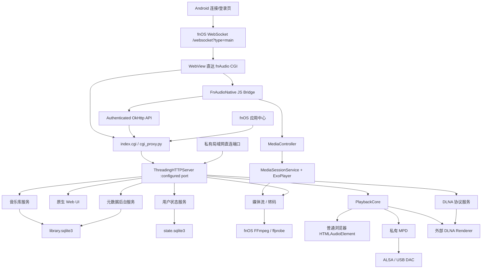

# fnAudio 架构

> 当前源码版本：`0.2.61`  
> fnOS 源码：`C:\path\to\fnAudio\src`  
> Android 源码：`C:\path\to\fnAudio\android-client`

## 1. 系统定位

fnAudio 是部署在 fnOS NAS 上的单进程 Python 音乐服务，并带有私有 MPD 子进程和原生 Web UI。它承担以下角色：

- 本地音乐库索引和查询服务。
- 浏览器播放器的媒体源和状态服务。
- NAS 声卡或 USB DAC 的本机播放器。
- 外部 DLNA Renderer 的 Control Point。
- 面向局域网控制器的 DLNA MediaServer。
- 面向局域网控制器的 DLNA MediaRenderer。
- Android 混合客户端的 Web UI 服务端和媒体 URL 来源。

## 2. 运行时拓扑



CGI/Android 原生桥是公网和 fnOS 会话的认证入口。Python 服务仍监听 `0.0.0.0`；明确的 RFC1918、IPv4 链路本地、IPv6 ULA 和 IPv6 链路本地地址可直接使用 Web UI，公网地址仍要求带 fnOS token 与明确 scope 的回环代理。DLNA 设备描述、SOAP、GENA 和媒体资源按协议保留局域网入口，并使用独立网络限制。

## 3. 分层与模块

| 层 | 主要路径 | 职责 |
| --- | --- | --- |
| fnOS 生命周期 | `manifest`、`cmd/`、`config/`、`wizard/` | 安装、升级、端口、权限、共享目录、启动停止和卸载 |
| 入口代理 | `app/ui/index.cgi`、`app/ui/cgi_proxy.py` | iframe/Android 入口、端口发现、Header/Cookie token 转发、HTTP 代理 |
| 前端 | `app/ui/index.html`、`app.css`、`app.js` | 浏览、搜索、播放、队列、歌词、收藏、歌单、设置和原生桥检测 |
| Android 登录与历史 | `android-client/.../data/`、`network/`、`ui/LoginActivity.java` | WebSocket 登录、Keystore 加密令牌、多连接恢复与切换 |
| Android Web 宿主 | `android-client/.../ui/MainActivity.java`、`web/NativePlaybackBridge.java` | 直达 fnAudio、会话 Cookie/Header、原生认证 API、JS/MediaController 桥、状态回传 |
| Android 播放 | `android-client/.../playback/` | MediaSessionService、ExoPlayer、通知、媒体键、音频焦点和后台生命周期 |
| HTTP 编排 | `app/server/server.py` | API、静态文件、媒体响应、DLNA 路由和服务装配 |
| 音乐库 | `app/server/library.py` | 扫描、Tag、封面、CUE、SQLite 索引和查询 |
| 播放核心 | `app/server/playback/` | 队列、目标、状态机、插件接口和输出适配 |
| DLNA | `app/server/dlna/` | 发现、推送、MediaServer、Renderer、SOAP、事件和诊断 |
| 本机服务 | `app/server/services/` | MPD 配置、启动、监督、状态监听和输出测试 |
| 状态 | `app/server/state_store.py` | 收藏、歌单、播放会话、UI 偏好和 revision |
| 元数据 | `app/server/metadata_service.py` | 在线元数据、歌词、封面、任务、缓存回收及受独立开关保护的 Tag 写回 |
| 媒体交付 | `app/server/transcode.py` | MP3、DSD WAV、CUE FLAC、流式转码和缓存清理 |

### 可测试边界（持续拆分）

- `server/playback_status_response.py`：播放状态成功/错误响应的纯组合与安全投影；不执行设备探测或播放副作用。
- `server/library_query_cache_presentation.py`：查询缓存指标和快照安全投影；无状态、无 I/O，可单独验证。
- `ui/library_item_request_loader.js`：收藏/歌单引用曲目批请求的 Promise 去重与 in-flight 上限；不负责渲染或缓存写入，可独立回归。
- `ui/library_track_filter_policy.js`：分页/分组/DSD/队列/收藏/歌单曲目来源、搜索和排序的纯决策；状态和补水仍由 `app.js` 负责。
- `ui/library_root_label_policy.js`：多根目录标签提取与同名消歧；无 DOM/网络副作用。
- `server/library_scan_file_policy.py`：扫描文件扩展名分类；无文件系统副作用，供扫描与签名编排复用。
- `library_signature()`：文件签名收集受片段数和总文本预算限制，避免超大目录检查无界累积。
- `library_signature()` 复用 `library_scan_results.digest_signature_parts()`，确保单根目录和多根目录签名遵循同一哈希策略。
- `server/api_route_policy.py`：API 路径规范化、媒体资源认证判定与读写 scope 映射；无网络副作用，可独立回归。
- `server/cover_item_cache.py`：封面提取的有界 LRU、同键 in-flight 协调及压力摘要；实际文件读取由 `server.py` 注入。
- `ui/creator_view_policy.js`：歌手/作曲者状态和专辑集合/详情视图判定；无 DOM/网络副作用。
- `ui/user_media_state_policy.js`：收藏/歌单归一化、增量变更计算与合并；本地存储和服务器同步仍由 `app.js` 负责。
- `ui/lyrics_parse_policy.js`：LRC 时间戳和歌词行排序解析；歌词请求、轮询和渲染仍由 `app.js` 负责。
- `ui/playback_target_policy.js`：本机、远程、DAC、MPD 播放目标的安全识别与归一化。
- `ui/repeat_mode_policy.js`：循环关闭、列表循环、单曲循环的归一化、轮换和中文文案；循环按钮与后端控制接线仍由 `app.js` 负责。
- `ui/track_sort_policy.js`：曲目标题、序号、加入时间及中文数值排序纯规则。
- `ui/library_sort_options_policy.js`：按视图选择排序选项和默认排序键；`app.js` 负责状态接线。
- `ui/folder_label_policy.js`：跨平台文件夹名称与当前路径标签生成。
- `ui/host_privacy_policy.js`：LAN/公网主机判定与保留地址规则。

以下模块承载纯策略或响应投影，主编排层只负责 I/O、状态和生命周期接线：

- 服务端：`health_snapshot.py`、`diagnostics.py`、`http_worker_presentation.py`、`playback_targets_response.py`、`upnp_device_selection.py`。
- 曲库查询：`library_query_spec.py`、`library_track_filter_policy.py`、`library_pagination.py`、`library_*_presentation.py`。
- 前端大曲库：`library_query_params.js`、`library_load_key.js`、`library_response_loader.js`、`library_page_plan.js`、`library_page_merge.js`、`library_render_policy.js`。

这些模块应保持无网络/无文件副作用（除明确的适配器边界），每次拆分必须配套独立回归；真实 Renderer、DAC、AirPlay 和 Android 验收不由离线测试替代。

## 4. 主要数据流

### 音乐库

```text
library_path / library_paths
  -> Linux inotify 变化通知（不可用/溢出时回退完整签名）
  -> 音频信息、Tag、封面和 CUE 解析
  -> library.sqlite3
  -> 分页/分组/文件夹 API
  -> Web UI 或 DLNA ContentDirectory
```

音乐库表包括 tracks、albums、artists、composers、genres、folders、covers、cue_tracks 和 metadata 相关表。SQLite 使用 WAL、busy timeout 和 NORMAL synchronous。

### 统一播放

```text
队列同步 -> PlaybackCore -> 选择 target_id
    browser   -> 媒体 URL -> HTML audio
    android   -> JS Bridge -> MediaController -> ExoPlayer 前台服务
    mpd       -> 私有 MPD -> ALSA/USB DAC
    alsa      -> FFmpeg/aplay/libasound 直接输出
    dlna_push -> SOAP -> 外部 Renderer
```

外部控制器把 fnAudio 当作 Renderer 时，DLNA 会话仍会同步回 PlaybackCore，避免维护第二套互不相干的播放状态。

Android 模式下，WebView 仍使用服务端队列 API 保存用户状态，但真正的当前项、进度、自动下一首和播放生命周期由 Media3 服务持有。原生状态通过 `window.fnAudioNativeOnState()` 回传；页面恢复时优先采用原生当前曲目，避免被 NAS 中稍旧的播放快照倒退。

fnOS nginx 会在 token 无效时以 HTTP 200 和纯文本 `invalid token` 拦截 CGI 请求。WebView 的 `shouldInterceptRequest()` 无法可靠取得 POST body，因此 Android 的队列、状态、播放控制和设置等非 GET API 通过 `FnAudioNative.requestJson()` 交给 `MainActivity` 的 OkHttp 客户端。原生层只允许访问当前 NAS 的 `/cgi/ThirdParty/fnaudio/index.cgi/api/`，附加认证 Header/Cookie，并通过 `window.fnAudioNativeOnHttpResponse()` 把状态、响应头和正文交还网页。

fnOS CGI 对路径信息的暴露在不同环境中可能不一致：代理优先从显式 `X-FnAudio-Path`、`REQUEST_URI`、`PATH_INFO` 三个来源恢复 `/index.cgi/` 后的真实 API 路径。播放队列 POST 使用显式路由 Header 作为兜底，避免请求被错误转发到 HTML 首页并以 HTTP 200 返回。

Android 系统返回键不使用 WebView 的原始历史栈，因为其中可能包含 fnOS 登录或系统入口。`MainActivity` 先调用网页的 `fnAudioHandleAndroidBack()` 关闭当前对话框、菜单、歌词或嵌套分类；网页确认没有内部层级可退时，第一次返回显示退出提示，2.2 秒内第二次打开 `LoginActivity` 并结束主页面。主动返回登录页会携带禁止自动恢复标记，避免登录页立即重连。

### Android 登录与会话

```text
地址/端口/HTTPS/账号/密码
  -> ws(s)://host:port/websocket?type=main
  -> user.login（兼容 user / username）
  -> token + longToken
  -> Android Keystore 加密历史（地址、账号、密码和令牌）
  -> WebView GET: Authorization + 同源 token Cookie
  -> 非 GET API: FnAudioNative -> authenticated OkHttp
  -> /cgi/ThirdParty/fnaudio/index.cgi/
```

历史连接先尝试 `user.authToken`，再尝试 `user.tokenLogin`；令牌失效时可自动使用本机加密保存的密码重新登录。连接记录以规范化 host、端口、协议和账号作为身份：普通表单改变身份会新增 UUID，历史页明确“编辑”才保留所选 UUID；“新增连接”返回空白表单。需要 HMAC/`si`、2FA 或验证码的固件仍需用真机协议 trace 补齐。

Media3 通知小图标由 `PlaybackService` 显式设置为白色播放圆环。歌曲没有真实封面时，`NativePlaybackBridge` 在应用私有目录生成一次透明底白色播放圆环 PNG，并让无封面队列项通过同一个 `file://` URI 引用；真实封面 URL 仍优先。占位 PNG 不嵌入每一个 `MediaItem`，避免长队列重复携带位图数据或触发 Binder 事务过大。

### 转码策略

- 外网或手动请求：非 MP3 可转 MP3。
- DSF/DFF：MPD/USB DAC 与 DLNA Renderer 保持原始数据；只有明确的浏览器兼容模式可请求 96 kHz、24 bit WAV。
- CUE 虚拟分轨：可转独立 FLAC 片段。
- 转码文件默认位于配置目录下的 `transcode/`，缓存 TTL 为两天；当前浏览器曲目的 MP3 缓存会在设置媒体 URL 前经 `/api/transcode/warm` 进入高优先级单工作线程队列，普通媒体请求只做低优先级兜底。

### 用户状态

```text
localStorage 兼容数据
  <-> /api/state/user
  <-> revision 冲突检测
  <-> state.sqlite3
```

持久化内容包括收藏、歌单、队列、当前曲目、循环、随机、播放目标和表格偏好。

### 歌曲行操作菜单

`app/ui/app.js` 为歌曲行提供统一的上下文菜单入口：桌面端使用浏览器 `contextmenu`，移动端使用 Pointer Events 识别 550ms 长按。移动超过 10px、触点取消或列表滚动会取消手势；菜单打开后拦截随后的合成点击，避免长按被解释为普通播放。

上下文菜单只暴露“从当前开始播放所有歌曲、加入当前队列、收藏歌曲、加入播放列表”四项。播放全部仍经 `allTracksForCurrentContext()` 获取当前视图完整上下文；收藏动作是只添加语义，不与旧的收藏切换动作混用。桌面多选与旧的歌曲操作对话框仍保留各自实现，避免把菜单精简误扩散到其他入口。

## 5. 外部依赖

| 依赖 | 来源 | 用途 |
| --- | --- | --- |
| Python 3.12 | fnOS `python312` 应用 | 主服务和 CGI |
| MPD 0.23.12 | `app/target/bin/mpd` | 本机播放和 Renderer 后端 |
| MPD 动态库 | `app/target/lib/` | 私有 MPD 运行时 |
| FFmpeg / ffprobe | fnOS 系统路径 | 探测、转码和部分直接播放 |
| ALSA / aplay / libasound | fnOS/Linux | NAS 声卡和 USB DAC |
| fnOS Trim API | Unix socket | 共享目录授权与文件能力 |
| Android Media3 1.10.1 | Google Maven | ExoPlayer、MediaSessionService 和 MediaController |
| OkHttp 4.12.0 | Maven Central | fnOS WebSocket 登录和原生媒体 HTTP 数据源 |
| Android Keystore | Android 系统 | 加密保存连接地址、账号、密码和 token；`allowBackup=false` |
| MusicBrainz、网易、QQ、酷狗、咪咕、JOOX、千千 | 公网服务 | 元数据、歌词和封面 |
| shairport-sync / nqptp | fnOS 可选组件 | AirPlay Receiver 与时钟同步 |

## 6. 必须保持的架构边界

- 前端只通过统一播放 API 选择目标和发送控制，不直接实现 SOAP、ALSA 或 FFmpeg 细节。
- `PlaybackCore` 管状态和队列，输出插件负责实际传输。
- DLNA 的 Control Point、MediaServer 和 Renderer 是独立角色，不在前端混写协议逻辑。
- 音乐库查询应通过 SQLite 分页接口，不把整个大库序列化到浏览器。
- 前端可短期缓存已访问的分类和分页响应；扫描结束或显式刷新必须使缓存失效，状态轮询不得重建完整歌曲列表。
- DMS 只宣告已实现的 UPnP 能力；公开媒体和缩略图路由不依赖 fnOS Web token，但仍必须按有效曲目 ID 和音乐库边界取数。
- 外部元数据只能后台获取，列表和歌词请求不能因第三方服务阻塞主请求。
- fnOS 特权操作必须通过明确的授权边界，不能把 token 当作普通前端状态公开。
- Android 原生服务是 Android 模式下唯一音频输出所有者；网页 `<audio>` 必须保持空闲，避免双重播放。
- Android 非 GET API 必须通过限定同源和 fnAudio `/api/` 路径的原生认证桥；不得把 token 暴露给任意 URL 或网页脚本回调。
- token 只能进入 Keystore 加密存储、同源 Cookie 和内存请求头；不得写日志、文档、截图或构建产物。
- 切换 NAS 连接时必须停止旧 MediaSessionService，防止旧 token 和旧媒体队列跨服务器复用。
- 自签名 HTTPS 只能按连接固定完整证书 SHA-256；首次固定前不得发送凭据，证书变化必须拒绝。
- 私有目录/文件采用 `0700/0600`，公开 UI 采用 `0755/0644`；媒体替换必须保留原 uid/gid 和 mode。

## 7. 输出与权限策略

- `upmpdcli_renderer.py` 只探测外部 upmpdcli，不负责启停、不可选择且不占用 ALSA。
- MPD Mixer 默认 `none` 以保持 bit-perfect；`hardware` 只接受真实 Playback Volume 控件，不可用时回退 `none`；`software` 明确标记非 bit-perfect。
- 每个输出目标由独立后端状态适配器确认播放、停止和自然结束，浏览器与 Android 不替远程后端自行切歌。
- Linux 扫描、CUE、媒体读取、共享目录删除均以真实路径做包含关系判断，阻止符号链接逃逸。
- 主进程暂不降权；待 fnOS 提供共享目录 ACL、ALSA 组、SSDP 与 Tag 写回的稳定契约后再拆分权限。

## 8. 当前扩展点

- `playback/plugins.py` 可注册新的输出插件。
- `dlna/profiles.py` 可基于真实互操作问题增加设备 profile。
- `MetadataProviders` 可增加新的元数据提供商，但必须保留缓存、超时和匹配评分。
- 音乐库 schema 变更需同时处理迁移、`METADATA_VERSION` 和索引重建。
- UI 的纯展示规则按模块拆分：`ui/view_presentation.js` 管理视图标题，`ui/track_presentation.js` 管理曲目字段、占位符与行标识；`app.js` 保留状态、DOM 和 API 编排。所有 UI 模块都必须在 `build_release.ps1` 的内容哈希中登记。

详细风险和技术债见 `PROJECT_CONTEXT.md`，未完成工作见 `TODO.md`。
# 2026-08-30 前端边界补充：全量播放分页策略

- `src/app/ui/library_full_list_policy.js`：全量播放列表的安全总数归一化与合并停止策略。
- `src/app/ui/app.js`：保留分页请求、批量并发、缓存写入、结果合并和取消生命周期。

# 2026-08-30 前端边界补充：访问模式加载器

- `src/app/ui/access_profile_loader.js`：访问模式 API 的短 TTL 缓存、并发请求去重与显式清理。
- `src/app/ui/app.js`：仅消费 profile 并刷新模式按钮，不再在每次曲库分页请求中直接发起重复访问模式请求。

# 2026-08-30 可观测性补充：播放命令缓存压力

- `playback_command_cache.py` 生成仅含 entries、limit、saturated 的缓存压力摘要。
- `server.py` 在锁内读取快照并注入 `/api/health`、`/api/diagnostics`；健康与支持数据不携带命令 ID、响应、曲目或队列。

# 2026-08-30 可观测性补充：曲库查询缓存压力

- `library_query_cache.py` 以 `saturated` 表达条目容量或结果权重预算是否耗尽。
- `library_snapshot.py` 仅投影该布尔压力状态，不公开查询键、路径或缓存内容。

# 2026-08-30 边界补充：播放命令幂等缓存

- `src/app/server/playback_command_cache.py`：有界命令结果缓存的过期回收、损坏条目隔离、防御性读取和 FIFO 淘汰。
- `src/app/server/server.py`：保留命令 ID 提取、锁保护、TTL/容量配置以及实际播放命令执行；缓存模块不直接触碰输出设备。

# 2026-08-30 边界补充：曲库刷新队列

- `src/app/server/library_refresh_policy.py`：无状态的刷新队列状态转移策略，统一处理重复请求、force 升级、worker 启动判定、请求取出和取消信号判定。
- `src/app/server/library.py`：保留 `SCAN_REQUEST_LOCK`、后台线程生命周期、取消事件和实际扫描执行；策略模块不接触线程或文件系统。
