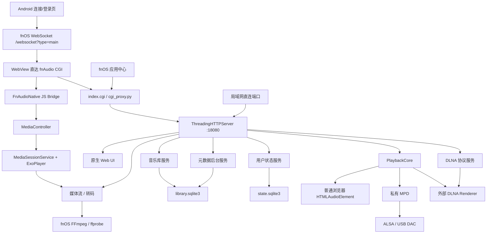

# fnAudio 架构

> 当前源码版本：`0.1.166`  
> fnOS 源码：`C:\path\to\fnAudio\src`  
> Android 源码：`C:\path\to\fnAudio\android-client`

## 1. 系统定位

fnAudio 是部署在 fnOS NAS 上的单进程 Python 音乐服务，并带有私有 MPD 子进程和原生 Web UI。它承担以下角色：

- 本地音乐库索引和查询服务。
- 浏览器播放器的媒体源和状态服务。
- NAS 声卡或 USB DAC 的本机播放器。
- 外部 DLNA Renderer 的 Control Point。
- 面向局域网控制器的 DLNA MediaServer。
- 面向局域网控制器的 DLNA MediaRenderer。
- Android 混合客户端的 Web UI 服务端和媒体 URL 来源。

## 2. 运行时拓扑



安全上必须注意：CGI 是 fnOS 正常入口，但 Python 服务默认监听 `0.0.0.0`，直接端口访问可能绕过 CGI 层。

## 3. 分层与模块

| 层 | 主要路径 | 职责 |
| --- | --- | --- |
| fnOS 生命周期 | `manifest`、`cmd/`、`config/`、`wizard/` | 安装、升级、端口、权限、共享目录、启动停止和卸载 |
| 入口代理 | `app/ui/index.cgi`、`app/ui/cgi_proxy.py` | iframe/Android 入口、端口发现、Header/Cookie token 转发、HTTP 代理 |
| 前端 | `app/ui/index.html`、`app.css`、`app.js` | 浏览、搜索、播放、队列、歌词、收藏、歌单、设置和原生桥检测 |
| Android 登录与历史 | `android-client/.../data/`、`network/`、`ui/LoginActivity.java` | WebSocket 登录、Keystore 加密令牌、多连接恢复与切换 |
| Android Web 宿主 | `android-client/.../ui/MainActivity.java`、`web/NativePlaybackBridge.java` | 直达 fnAudio、会话 Cookie/Header、JS/MediaController 桥、状态回传 |
| Android 播放 | `android-client/.../playback/` | MediaSessionService、ExoPlayer、通知、媒体键、音频焦点和后台生命周期 |
| HTTP 编排 | `app/server/server.py` | API、静态文件、媒体响应、DLNA 路由和服务装配 |
| 音乐库 | `app/server/library.py` | 扫描、Tag、封面、CUE、SQLite 索引和查询 |
| 播放核心 | `app/server/playback/` | 队列、目标、状态机、插件接口和输出适配 |
| DLNA | `app/server/dlna/` | 发现、推送、MediaServer、Renderer、SOAP、事件和诊断 |
| 本机服务 | `app/server/services/` | MPD 配置、启动、监督、状态监听和输出测试 |
| 状态 | `app/server/state_store.py` | 收藏、歌单、播放会话、UI 偏好和 revision |
| 元数据 | `app/server/metadata_service.py` | 在线元数据、歌词、封面、任务和缓存回收 |
| 媒体交付 | `app/server/transcode.py` | MP3、DSD WAV、CUE FLAC、流式转码和缓存清理 |

## 4. 主要数据流

### 音乐库

```text
library_path / library_paths
  -> 全目录变化签名
  -> 音频信息、Tag、封面和 CUE 解析
  -> library.sqlite3
  -> 分页/分组/文件夹 API
  -> Web UI 或 DLNA ContentDirectory
```

音乐库表包括 tracks、albums、artists、composers、genres、folders、covers、cue_tracks 和 metadata 相关表。SQLite 使用 WAL、busy timeout 和 NORMAL synchronous。

### 统一播放

```text
队列同步 -> PlaybackCore -> 选择 target_id
    browser   -> 媒体 URL -> HTML audio
    android   -> JS Bridge -> MediaController -> ExoPlayer 前台服务
    mpd       -> 私有 MPD -> ALSA/USB DAC
    alsa      -> FFmpeg/aplay/libasound 直接输出
    dlna_push -> SOAP -> 外部 Renderer
```

外部控制器把 fnAudio 当作 Renderer 时，DLNA 会话仍会同步回 PlaybackCore，避免维护第二套互不相干的播放状态。

Android 模式下，WebView 仍使用服务端队列 API保存用户状态，但真正的当前项、进度、自动下一首和播放生命周期由 Media3 服务持有。原生状态通过 `window.fnAudioNativeOnState()` 回传；页面恢复时优先采用原生当前曲目，避免被 NAS 中稍旧的播放快照倒退。

fnOS CGI 对路径信息的暴露在不同环境中可能不一致：代理优先从显式 `X-FnAudio-Path`、`REQUEST_URI`、`PATH_INFO` 三个来源恢复 `/index.cgi/` 后的真实 API 路径。播放队列 POST 使用显式路由 Header 作为兜底，避免请求被错误转发到 HTML 首页并以 HTTP 200 返回。

Android 系统返回键不使用 WebView 的原始历史栈，因为其中可能包含 fnOS 登录或系统入口。`MainActivity` 先调用网页的 `fnAudioHandleAndroidBack()` 关闭当前对话框、菜单、歌词或嵌套分类；网页确认没有内部层级可退时，Activity 才把任务移到后台。

### Android 登录与会话

```text
地址/端口/HTTPS/账号/密码
  -> ws(s)://host:port/websocket?type=main
  -> user.login（兼容 user / username）
  -> token + longToken
  -> Android Keystore 加密历史（地址、账号、密码和令牌）
  -> WebView Authorization + 同源 token Cookie
  -> /cgi/ThirdParty/fnaudio/index.cgi/
```

历史连接先尝试 `user.authToken`，再尝试 `user.tokenLogin`；令牌失效时可自动使用本机加密保存的密码重新登录。需要 HMAC/`si`、2FA 或验证码的固件仍需用真机协议 trace 补齐。

### 转码策略

- 外网或手动请求：非 MP3 可转 MP3。
- DSF/DFF：可转 96 kHz、24 bit WAV。
- CUE 虚拟分轨：可转独立 FLAC 片段。
- 转码文件默认位于配置目录下的 `transcode/`，缓存 TTL 为两天；当前浏览器曲目的 MP3 缓存会在设置媒体 URL 前经 `/api/transcode/warm` 进入高优先级单工作线程队列，普通媒体请求只做低优先级兜底。

### 用户状态

```text
localStorage 兼容数据
  <-> /api/state/user
  <-> revision 冲突检测
  <-> state.sqlite3
```

持久化内容包括收藏、歌单、队列、当前曲目、循环、随机、播放目标和表格偏好。

## 5. 外部依赖

| 依赖 | 来源 | 用途 |
| --- | --- | --- |
| Python 3.12 | fnOS `python312` 应用 | 主服务和 CGI |
| MPD 0.23.12 | `app/target/bin/mpd` | 本机播放和 Renderer 后端 |
| MPD 动态库 | `app/target/lib/` | 私有 MPD 运行时 |
| FFmpeg / ffprobe | fnOS 系统路径 | 探测、转码和部分直接播放 |
| ALSA / aplay / libasound | fnOS/Linux | NAS 声卡和 USB DAC |
| fnOS Trim API | Unix socket | 共享目录授权与文件能力 |
| Android Media3 1.10.1 | Google Maven | ExoPlayer、MediaSessionService 和 MediaController |
| OkHttp 4.12.0 | Maven Central | fnOS WebSocket 登录和原生媒体 HTTP 数据源 |
| Android Keystore | Android 系统 | 加密保存连接地址、账号、密码和 token；`allowBackup=false` |
| Spotify、网易、QQ、MusicBrainz | 公网服务 | 元数据、歌词和封面 |

## 6. 必须保持的架构边界

- 前端只通过统一播放 API 选择目标和发送控制，不直接实现 SOAP、ALSA 或 FFmpeg 细节。
- `PlaybackCore` 管状态和队列，输出插件负责实际传输。
- DLNA 的 Control Point、MediaServer 和 Renderer 是独立角色，不在前端混写协议逻辑。
- 音乐库查询应通过 SQLite 分页接口，不把整个大库序列化到浏览器。
- 外部元数据只能后台获取，列表和歌词请求不能因第三方服务阻塞主请求。
- fnOS 特权操作必须通过明确的授权边界，不能把 token 当作普通前端状态公开。
- Android 原生服务是 Android 模式下唯一音频输出所有者；网页 `<audio>` 必须保持空闲，避免双重播放。
- token 只能进入 Keystore 加密存储、同源 Cookie 和内存请求头；不得写日志、文档、截图或构建产物。
- 切换 NAS 连接时必须停止旧 MediaSessionService，防止旧 token 和旧媒体队列跨服务器复用。

## 7. 当前扩展点

- `playback/plugins.py` 可注册新的输出插件。
- `dlna/profiles.py` 可基于真实互操作问题增加设备 profile。
- `MetadataProviders` 可增加新的元数据提供商，但必须保留缓存、超时和匹配评分。
- 音乐库 schema 变更需同时处理迁移、`METADATA_VERSION` 和索引重建。

详细风险和技术债见 `PROJECT_CONTEXT.md`，未完成工作见 `TODO.md`。
