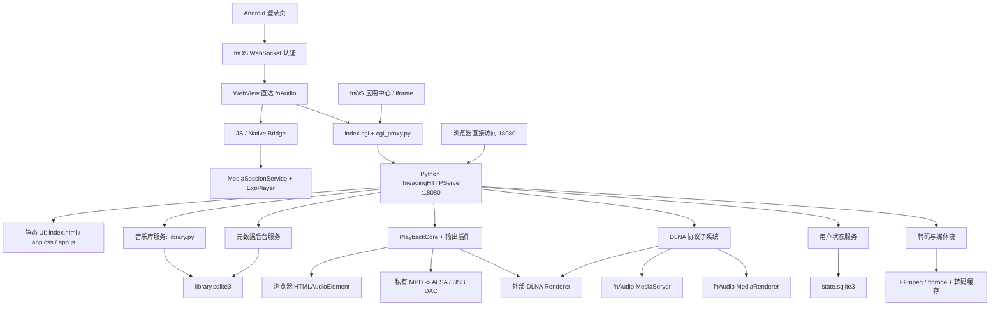

# fnAudio 项目上下文
- 2026-09-23： **「要拿门禁退出码，必须在同一会话里跑脚本并用 `$LASTEXITCODE` 与 `$?` 双探针；把哨兵塞进嵌套的 `pwsh -Command` 字符串，父进程会因为拆坏的引号报 rc=1，而真正的扫描仍在别处继续跑完——这时日志是好的、码是假的」**（R164 实据：第一次收尾用嵌套 -Command 传 `"GATE_EXIT=..."`，父进程报 `The term \' is not recognized` 且 rc=1，被派生的子进程随后独立写完 2,761 行日志并给出 `Ran 2575 tests／OK (skipped=2)`；改在同会话内 `& ./tools/test_offline.ps1 *> 日志` 再读探针，才拿到 `LASTEXITCODE=0`／`$?=True`，两次日志逐字段一致）
- 2026-09-23： **「取证脚本自己也必须按文本定位——凡把行号坐标写进会被本轮改动的文件，它就会在同一轮里漂掉，连专门用来证明『行号不可靠』的那个变异矩阵也不例外」**（R164 实据：上一棒留下的 `r164_mut2.py` 硬编码决策段 header=1839／裁定行=1845／R77=1841／D1=1847／D9=1855；本轮把 R164 顶部记录插入 `TODO.md` L2，全段坐标集体 +1，矩阵自己的前置断言当场 AssertionError，而这正是它要防的缺陷类别。改写为「先定段界、再在段内按文本定位」后实测 header=L1840／ruling=L1846／R77=L1842／D1=L1848／D9=L1856、段止 L1858，M0 绿、M1～M16 全灭、副本逐字节还原。附带两条同批教训：① **锚点唯一性要按作用域验证而不是按全文件**——`D9 曲库连接池开关` 全文件命中 2 次，第二次是 L29 的另一条轮次记录引用了它，只有把搜索限制在段内才唯一；② **在 Python 非 raw 字符串字面量里写 Windows 路径会把 `\f` 变成换页符**——同一批写入把三处副本目录名写成 `E:` + 0x0C + `nAudio-mut-r164`（三份根文档各 1 枚，肉眼读渲染完全看不出来），复算时把「全文 0x0C 计数＝0」并入校验项才看得见。）
- 2026-09-23： **「存在性断言是守卫里最弱的一种形式——同一个关键词在被守护的文本里往往会命中多次，删掉其中一处照样判绿；凡『某条裁定必须覆盖某些旧声明』的守卫，覆盖必须写成逐字引用＋逐条点名来源，且被统计集合必须排除裁定自身，否则它会引用自己来证明自己」**（R164 实据：新守卫首份变异矩阵 M0 正控绿、M1～M11 全灭，**M12 存活 rc=0**——把 :1845 裁定行里的「历史口径」替换为「过时说法」，断言 `assertIn("历史口径", text)` 仍通过，因为同一词在该行收尾句「历史口径覆盖」里第二次命中；原断言 5 更是只判 `len(ruling_of(bucket)) == 1`，任何保留了那几句咒语、却不再说明自己到底推翻了哪 6 处计数的裁定，都能判绿。加强后：断言 4 钉住执行覆盖的那半句 `均为各自轮次当时的**历史口径**` 并新增 `也不再生效`，断言 5 遍历 `COUNT_DECLARATION` 命中的每条陈旧值要求裁定逐字引用、再按 `RECORD_TAG` 点名来源轮号 R77/R121，同时把裁定行自身从 `stale_counts` 里剔除；新增 M12～M16 五格（全局替换／反挂「仍然生效」／抽掉一条引用／抽掉一处点名／改写覆盖主句）后全矩阵 16/16 全灭，副本 `C:\path\to\fnAudio-mut-r164` 控制组 `Ran 2575 tests`、`OK (skipped=3)`。）
- 2026-09-23： **「注册了监听器」不等于「存在效应」——凡『每帧遍历全部可见行去写一组清空值、而目标属性又被更高优先级的 CSS 钉死』的同步器，判据不是『能不能跑》而是『删掉它之后可观测几何差是否为零』**（R163 实据：`src/app/ui/app.js`的 `bindTrackHeaderScroll`/`syncTrackHeaderScroll` 每次渲染都在注册永久监听器与新建 `ResizeObserver`、每帧遍历全部行，但两个分支写的是同一组清空值，而宽度由 `app.css` :630-631 的 `!important` 掌管；整枚删除后全库内联几何写命中全部归零、视口效果零变化。同时警惕反方向的两个陷阱：「dataset 守卫使注册一次性」意味着这是每帧死遍历而非监听器泄漏，措辞已收窄；而「变异矩阵抓到自己套件的假阳性」（M11 首跑存活）证明正控必须逐声明行锚定，不能靠一条宽松正则。）
- 2026-09-23： **「可选链把缺失的一侧静默吞掉，而把可能为 null 的实参交给 `replaceWith()` 会被规范字符串化——同一枚表达式承担两个相反方向时，它两个方向都是错的；单侧结构变化必须逐节点编辑，并让守卫断言直接钉住被禁的形状」**（R162 实据：`src/app/ui/app.js` 的 `patchTrackRowNode` 用 `currentMain?.replaceWith?.(nextMain)` 处理「标题格只在一侧存在」，取消标题列时把 null 字符串成实机行里的字面文本节点、重新勾选时短路丢掉新格，而提交又把 `state.renderedTrackListHtml` 记成 DOM 并不匹配的标记，使两种错都变成粘性错，行永不自我收敛，只有整表重绘才被动抹平；修复后的 3 枚源码接线断言＋「行内文本节点数必须为 0」直接把被禁形状钉死）。同轮的第二条方法论教训：**判别套件的假 DOM 若比生产更严格，红证就不可信——夹具必须复刻生产形状**（R162 实据：本轮首版夹具对 `innerHTML` 写入一刀切抛错，于是 9 枚块里 2 枚以错误理由判红，因为该文件对封面格与信息格的 `innerHTML` 写入是既有合法行为；改成真解析＋写入记录、把行签名属性挂到行根、并按规范把 `insertBefore(child, null)` 实现为追加末尾之后，红基线才恰好落在 4 枚真缺陷块上，且「去掉列序上界」这一格变异才不至于因错误理由被抓。同理，M5 那一格只由源码级断言击杀、不是行为击杀，也必须如实登记而不冒充行为判别）。
- 2026-09-23： **「同一个约束在文件里被抄成两遍，就一定会分叉；而事件摘除只覆盖『成功出口』时，被取消的那次交互会变成永久驻留的全局改写器」——用户写入路径与声明式渲染路径必须共用同一份带宽表和同一个模板构造器，指针手势的每一个结束出口（`pointerup` 与 `pointercancel` 同权）都必须摘除同一批 window 监听**（R161 实据：`src/app/ui/app.js` 的曲目列宽在声明式路径走逐列带宽（时长 72..96），在 `saveTrackColumnWidth` 与拖拽处理器各抄了一份扁平 `Math.max(64, Math.min(900, …))`，还在拖拽里手写第二份网格模板；于是拖过界会存下 112px、下次表头重算自弹回 96px、再下次抓取从幻影 112px 起跳——症状是「列自己在动」，根因是没有单一真值。同一处的 `pointermove` 只在 `pointerup` 路径上摘除，`pointercancel` 结束的拖拽把改写全局 CSS 变量的处理器永久留在 window 上，之后每次鼠标悬停都在改列宽；本文件另一处长按交互 :7132-:7133 早就写对了双出口，说明这是同一作者在不同时期的两次独立抄写而非设计）。同轮的第二条方法论教训：**变异测试存活下来的那一行，正确处置是删掉它而不是为它编一个测试**——本轮首版加了个 `ended` 闩做双入口互斥，变异（删除闩）后 12 枚断言仍全绿，证明该闩在当前监听模型下不可观测，遂当轮删除、改为把三条摘除调用各自做成一格变异（全部击杀），使仓库里不留任何无判别证据的行。
- 2026-09-23： **「图片已 `complete`」不等于「图片已开始加载」——无 `src` 的 `` 按 HTML 规范即报 `complete===true` 且 `naturalWidth===0`，凡「先建占位容器、URL 由后续调度器异步注入」的封面，其就绪判定必须先看「有没有源」再看 `complete`，否则同步删除分支会在调度器启动前一帧把封面删掉**（R160 实据：`src/app/ui/app.js` 的 `prepareLocalGroupArtwork` 以 `if (image.complete) return verify();` 判定，分组／专辑封面的 `src` 由共享封面调度器延后注入，`render()` 时源未落地，`verify()`→`failed()`→`image.remove()`；真实无头 Chromium 证实无源图片 `complete` 为真、`naturalWidth` 为 0。修复＝引入与调度器同款的 `hasArtworkSource()`（`hasAttribute("src")` 或 `dataset.coverLoadedSrc`）先门控，无源即回落 `load`/`error` 监听＋`requestAnimationFrame`。同一轮的方法论教训：**一条「当轮证伪」只证伪了它当时看到的执行路径，不构成对整段逻辑的永久清白——R151 曾以「`load`/`error` 监听器仍在位」证伪本缺陷，但那只在异步路径成立，无源时同步分支先命中、监听器根本没注册**；被旧证伪标记过的形状再次怀疑时，须逐分支重跑取证、据实翻案，本轮即在 `CHANGELOG_AI.md`/`TODO.md` 点名推翻而不改写 R151 原文，新增 `src/tests/test_ui_group_artwork_source_gate.js` 用 V1 无源同步块钉死翻案）。
- 2026-09-23： **一条「已抽到独立模块并通过回归」的 `[x]` 只有在宿主真接线时才算完成——数模块声明、数专项测试都会判绿，唯一判据是数宿主侧的调用点；而「接入宿主」这件事本身必须有判别测试，否则同类重构会长期以已完成状态存续**（R159 实据：`TODO.md` 里「随机队列 Fisher–Yates 策略抽至 `ui/shuffle_policy.js`，限制 50,000 项并隔离异常随机源」早已记为 `[x]`，`shuffle_policy.js` 在盘、`index.html` :162 有声明、`src/tests/test_ui_shuffle_policy.js` 有 18 行专项断言，2,567 项 Python 与 81 个 JS 套件全绿；但入口 `shuffleItems` 的 `git log -S` 全历史只命中导入基线，盘上 0 枚调用点，真正在跑的 `playGroup` 与 `playAll` 各自用 `[...list].sort(() => Math.random() - 0.5)` 洗牌——比较器排序不是均匀洗牌，预算与异常随机源守卫从未到达用户，且模块缺席时旧入口的 `|| []` 会把整条队列清空。本轮接入两条路径并按真接语义重写入口，新增 `src/tests/test_ui_library_sort_shuffle.js` 同时钉住「宿主接线字面量唯一」与「比较器洗牌全文件 0 命中」两枚口径，才让那条 `[x]` 第一次名副其实）。同一轮的另一条口径：**有界常量的语义要在接入处写清是「乱序额度」还是「丢弃阈值」——把预算当截断用，就会在超出预算时静默丢尾**（R159 实据：`shuffle_policy.js` 的 `MAX_ITEMS` 若照字面实现成截断，50,001 项曲库随机播放会永久少播最后 1 枚；修复后越界项原序留在尾部，判别块 5 用 50,001 项真数据钉住长度与尾位）。
- 2026-09-22： **「控制组必须先绿」这条纪律本身，是抓出「旧守卫把缺陷写法逐字钉死」的唯一手段——删掉缺陷写法后立刻判红的那一枚测试，证明该缺陷形状已被文本 pin 固化成回归合同，此时该修的是守卫而不是把缺陷留下**（R158 实据：本棒把 `src/app/ui/app.js` :611 的裸 `>= 32` 换成命名常量 `MAX_NATIVE_HTTP_REQUESTS` 后，仓库外副本控制组 81 枚 JS 套件里 `test_ui_android_bridge.js` :318 立即判红——它的断言原文是逐字匹配被删掉的那串字面量。若只跑新测试不跑控制组，这条陈旧合同会被无声带走；反过来若为了迁就守卫而保留裸字面量，缺陷就永久合法化。判别办法：守卫失败时先问「它钉的是行为还是文本形状」，钉形状的守卫随实现同步改写并在记录里点名，钉行为的才是要守住的东西。）
- 2026-09-22： **判「一份文档是否可被找到」的守卫必须钉住目录条目那一行本身的形状并要求它唯一，不能只判文件名是否出现在目录文本里——否则条目行被删掉、而别处的散文提及仍在，守卫照样判绿**（R157 实据：M6 变异删除 docs/INDEX.md 中以 `- `REAL_DEVICE_GOALS.md`：` 开头的目录条目行，而权威文档表 `../TODO.md` 那一行的说明里仍含同一文件名，原判据 `GOALS.name in index_text` 判不出来；改判该正则匹配行数 == 1 后同一格判红，13 格变异矩阵方为全符合预期。同一轮的另一条推论：把 N 条观察「迁出而非结案」时，必须同轮钉住三件事——搬走的原文逐字守恒、留在原地的条数与纪律文档锚点同改、搬走的条目不得再出现在逐轮任务里——缺任何一条，迁册都会退化成改写）
- 2026-09-22： **一类「无条件重写」的缺陷会活在姊妹通道的第二条路径上，而上一轮对它做过的取证口径恰好照不到那条路径**（R156 实据：R99 按 `TODO.md:61` 关闭同类缺陷时，取证口径是「`app.js` 共 79 处 `textContent =` 赋值、直写 5 枚节点的为 0、全部走 `setTextContentIfChanged()`」，而本轮的真缺陷在两处该口径**根本不数**的写入上——入站投送通道 `updateIncomingRendererUi` 的 `$("seek").value` 裸赋值与它对宿主 `navigator.mediaSession.setPositionState()` 的调用，于是同一类缺陷在同一文件里又活了 57 轮；同一文件的姊妹函数 `updateRemoteUi` 早在 R99 就有 `state.remoteUiLast` 变更备忘、入站侧一枚都没有，这种「一侧有门、一侧没门」本身就是最强的定位信号）⇒ 判别办法：给**每一条写入通道**各自补「节点写次数＋宿主调用次数」两类观测，桩节点只记 text／html／style 等于给 `value` 留免检通道；读一条通道时必须顺着它的调用点问「这条通道之外还有谁在写同一枚节点」，两兄弟写同一目标就逐个通道确认有没有门。
- 2026-09-22： **一条「停止本机」的裁定必须沿「输出离开本机的每一个方向」逐一接线——只装在「外力把声音推回本机」那一侧，就会漏掉「本机自己把输出交出去」那一侧；而这类缺陷能被一条把「不发第二次请求」误写成「不得碰本地元素」的历史守卫锁死 36 轮无人能改**（R155 实据：`TODO.md:69` 裁定 D-1 要求投送即停本机，`src/app/ui/app.js` 早已在服务器把投送打到本机时执行 `if (!previousActive && localIsPlayingNow()) stopLocalAudio();`（:2070），却在用户自己点设备切走输出时只换路由不拆元素——本机继续解码发声，而 play/stop/media-session 已全部送往设备；补码必须同时满足「晚于 `state.playTarget = nextTarget;` 且只在 device 分支内」（否则切换失败会停掉仍是当前输出的本机音频）与「只碰元素、一发请求都不发」，而 `src/tests/test_ui_android_bridge.js` 自基线导入提交 `89ded01` 起就把 `stopLocalAudio();` 与该路径一并禁止，使这条正确修复在 36 轮里始终「看起来违反既有约束」）。所以接到「某裁定是否已落实」这类问题，要数的是**执行点覆盖了几条离开路径**，而不是**有没有执行点**。判别口径三条：其一，拿到一条要求「停止／清理／复位」的产品裁定，先枚举主体失去该状态的所有方向（外力推来、自己交出、第三方移走），逐方向核对收尾是否存在，见到一处执行点不得判为已落实；其二，遇到一条禁止某段代码出现的旧守卫，先数它禁的到底是**网络请求**还是**本地写入**——两者可以分开，禁前者不构成禁后者；其三，动这类守卫之前必须用配对格证明新旧代码对它不对称（基线代码配收紧后的断言仍须判绿），否则无法排除「只是把断言改成放行本轮新代码」这种自证。
- 2026-09-22： **同一动作的呈现同步必须挂在唯一不做收尾重建的那条路径上——挂进共享写函数会按调用方数量成倍放大整页重建；判别办法是先数「共享写函数之外有几条调用方随后已经自己 render」**（R154 实据：`src/app/ui/app.js` 的 `commitQueue` 有 10 条调用方，9 条在同一个函数内随后 `render()`，只有 `playById` 不重建列表，于是「队列页点另一行换播后当前行高亮不动」恰好在 `playById` 上暴露；若把 `syncCurrentQueuePresentation` 写进共享写函数 `applyConfirmedQueue`，它在跨页时自己会 `render()`——该函数上方注释早已写明整页重建会重启封面加载器、对大队列过于昂贵——9 条已 render 的调用方各自变成整页重建两次，变异格 V7 把双写后的行标记写入序列从 2 次放大到 4 次）。所以修一条缺陷要看「谁没做这件收尾」而不是「谁的位置最干净」，并且必须把「共享处不得接线」也写成断言，否则下一轮就会有人为了「挡住未来调用方」把它搬进去、把性能问题坐实。判别口径三条：缺陷面＝所有写者共有的不变量；落点＝唯一缺失收尾的那条路径；反向约束＝同一套件里同时钉「接线处必须接线」与「共享处不得接线」。另记一条取证纪律：控制组与套件的绿只认退出码，且 `node` 必须收到绝对路径，否则 Node 的版本横幅会把一条路径错误伪装成一整套红）
- 2026-09-22： **同一个身份版本必须一次算清、处处传用——两处「允许不查磁盘」的读函数各自重算版本，会把一套缓存劈成两个命名空间，而写入方已经先写好了页面永远查不到的那一半**（R153 实据：`src/app/server/cover_cache.py` 的 `thumbnail_asset_id_for_item` 与 `cover_is_known_missing` 都收了 `allow_disk` 形参，却只把它用在自己那半截判断上，键仍由 `_cache_paths`→`_cache_key` 按磁盘默认重算，形参就此变成装饰性的：快路径每行照付一次 NAS `os.stat`；而在索引身份不完整的行上，`library_presentation.py` 用同一个开关序列化出的 `cover/<id>?v=<有界版本>` 与磁盘版本不同名，端点存好别名之后页面仍回答「未知」。这类劈叉只在「参数在但没传到底」的函数上出现，所以 90 枚既有用例一枚都碰不到——本轮加强的那枚旧用例原先只 mock `os.path.isfile`，`os.stat` 一路漏到底。判别口径三条：拿到一个「允许跳过昂贵求值」的形参，先看产生键或路径的那一行有没有收到它，再看它是否真的出现在求值函数的参数位上，最后确认测试 mock 的是昂贵求值真正调用的那个系统调用，而不是它的邻居）
- 2026-09-22： **DOM 面退役之后，样式表会长期供养一组永远选不中元素的规则——判别办法是拿「选择器里的 id 集合」减去「标记里的 id ∪ 脚本里的字符串字面量」取差；而快照夹具自己也会过期，必须和被审面一起扫，否则它会替幻影元素继续作证**（R152 实据：`src/app/ui/index.html` 在 `208d550` 就没有 `#mobileMoreBtn`/`#mobileMoreDialog` 了，`src/app/ui/app.js` 也 0 命中，但 `src/app/ui/app.css` 仍留着 16 处规则养着它们，一直养到本轮才被「可达集取差」杀掉；同一批幻影 id 的第二个家是 `src/tests/dom.txt`——108 个唯一 id 里 27 个已不存在、66 个现行 id 未收录，且全仓没有任何代码读它，本轮连它一起 `git rm`；顺带一条同类教训：扫描器用 `pending === ""` 判 token 边界会让累积的空白把行号停在更早的 token 上（251 被报成 250），行号未经 `git grep` 原值对证之前不得写进任何记录）（R152 复审补记：同一轮还留下一条反向教训——**为了让记录显得可信而写进注释的硬编码计数，恰恰是最先把不住的东西**。`src/tests/test_ui_unreachable_css_selectors.js` 注释里的「115 of the 117」在现盘 `app.css` 上复算是 908 个 token、699 个颜色，量级与比率双错；守卫文件的注释只该写**可复算的算法**（抹注释 → 取 `#词` token → 按 3/4/6/8 位十六进制判颜色），不写会随被审面漂移的数字。同一条尺子也用于审查记录：凡量化表述必须当场给出复算口径与取证的盘态日期。）
- 2026-09-22： **测试的成功口径本身也是被审对象：按「输出里有没有 passed 这个词」统计套件数，等于把计数交给措辞，换一种措辞就凭空少一个套件**（R152 实据：本仓 `src/tests/test_*.js` 实测 77 个文件全部退出码 0，其中只有 75 个打印字面 `passed`，`test_ui_control_names.js` 输出的是控件清单统计、`test_ui_library_metadata_merge_policy.js` 输出的是「regression ok」；历史那些「68/74 passed」的记录就是按行数统计的，既受措辞影响也受文件数漂移影响。自本轮起 JS 侧一律双口径登记：文件数／失败数为真，日志含 `passed` 的行数仅作对照，不再拿措辞当分母）
- 2026-09-22： **一个 helper 的「拒绝」返回值若与它的「本来就没有」返回值同形，就会被调用方当成可用地址二次解析——`new URL(空串, base)` 不抛，而是解析成 base 自身，安全判定就此反转成真值命中**（R151 实据：`coverUrl` 与 `usableCoverSource` 都曾把 `mediaUrl()` 的结果直接送进 `new URL(..., window.location.href)`，`mediaUrl` 对 `file:`/`javascript:`/`data:`/`ftp:`/`blob:` 回答 `""`，两条路径在反转下各自产出指向应用自身页面的地址；修法不是在调用点再加一层 scheme 名单，而是让「被拒」在离开权威判定时就终止——先取 `const absolute = mediaUrl(...)`，空即返回空，非空才解析。附带两条取证纪律：① 拒绝类断言必须跑在真能解析出 URL 的夹具里，`vm.runInNewContext` 不注入宿主 `URL` 时每次解析都掉进 catch，拒绝会「通过」而理由是错的，只有同时钉住正向对照（相对路径补全、size 追加与 size=0 不追加）才能区分这两种绿；② 当某字段的全部写点都带「已有值就不覆盖」守卫时，一条真值垃圾的危害是双份的——既渲染成坏图又永久压制后续合法值，所以这类 helper 的返回契约要用源码级接线断言一起钉住，只断言函数返回值会漏掉整条压制路径（本轮变异格 M6 丢掉一处守卫即被判红，正是这条区分的判别力证据）。
- 2026-09-22： **把界加在调用方却不把槽留在真正在跑的那件事上，等于把一次无界等待换成无界线程**（R150 实据：`_lan_addresses_within_budget` 若只做 `answered.wait(1.0)` 而由调用方持有配额，1 秒后每个调用方都自认已止损、底层 `getaddrinfo` 却仍在继续，NAS 实测那 15～20 秒会以每请求一枚的速率无限堆积线程；本轮把配额交给解析线程本身、在 `finally` 里归还，才让「最多 4 条解析在飞」成为真命题——变异格 V6（把 `release` 挪到调用方超时路径）被判红 2 failures，正是这条区分的判别力证据。附带一条取舍纪律：新界不改 `_lan_addresses` 本体也不动 `lan_http_url`，因为那条路径上有既有安全用例把「解析出它准入的那个 host」当作契约，扩大改动面换来的只是重复取证成本）， **守门测试若把「排程到了峰值」当作「洪水已在界上排队」，判据就由调度噪声决定；收紧必须在断言结论之前先断言前置条件成立**（R150 实据：GENA 洪水用例原以 `peak == limit` 作为放行条件，最慢线程尚未进入 `subscribe()` 就被放行并拿到空槽，admitted 总数越界的红/绿取决于当时机器肯不肯调度；改法是把等待条件换成对 `active + waiting + refusals` 的记账、deadline 由 5.0 秒放宽到 10.0 秒，并在 `release.set()` 之前先断言记账等于洪水总数——变异格 M3b（去掉这层前置等待）判红 1 failure、M3a（保留并已收紧）保持绿，证明新断言可杀而不是摆设）
- 2026-09-22： **文件里有界常量和界助手，不等于每条写路径都在用它们——审计要看赋值语句右边，而不是数文件里出现几个 `MAX_`**（R149 实据：`src/app/server/playback/core.py` 顶部 `:13-19` 一口气登记 5 个界值，`:73` 还有现成的 `_bounded_text`，`sync_external_session` 也确实把 `transport`/`error` 各自截到 64/2048；同一文件里的 `sync_output_status` 却写成 `str(transport or "UNKNOWN").upper()` 与 `str(error or "")`——两条同名同义字段，一条有界一条无界，逐行读之前谁都看不出这个模块「不统一」。真正的放大器是 `str(...)`：它把「不截断」和「把对象也变成文本」两件事合成一个看似无害的动作，所以修法不是加新常量，而是把三处指回文件内既有那对界值，让权威状态、`diagnostics_playback.py:29`、`dlna/event_payload.py:47` 三个下游对 `transport` 的界回到同源。附带教训两条：① 判定「无界」必须给出载体与其上限（本轮＝`dlna/control_point.py:166 soap_text` 不截断 ＋ `dlna/network.py:13` 允许 1 MiB ＋ `server.py:3147` 原样转发，12 个调用点里只有这一处传网络文本），否则「收口」只是审美；② 同一个 `core.py` 里看着同样可疑的 `set_target(target_id)` 实测已被 `playback/http_contract.py:41 value[:128]` 收口，**证伪后只写进记录、不立条目**——一条写路径是否无界取决于它的调用方，不取决于它自己有没有截。③ 给自己的测试写因果注释也要能被磁盘复核：本轮初稿写「every SSE frame carries it verbatim」，复核结果是权威帧构造器 `playback_event_presentation.py:79` 做了 `.upper()`（非 verbatim），而被顺手点名的 `state_projection.py` 里 `transport` 命中 0，遂降级为「只做大写化后重播」并连带重跑测试与清单——夸大的注释会把下一轮引向错误的不变式。）
- 2026-09-22： **集合相等不等于顺序可复现——凡输出会被逐字节 diff 的生成物，行序本身就是契约的一部分，只比集合的守卫会把「换台机器就判红」一直留到 CI 里**（R148 实据：tools/update_source_manifest.ps1 用 Sort-Object 排清单行，Sort-Object 按当前语序比较字符串，同一棵 HEAD 树在 PS 5.1 与 pwsh 7 下产出同一批 710 条的两种顺序、117 个行位不同，而清单守卫历史断言是 sorted(actual) == sorted(expected)，顺序完全不在保护范围内，CI 又以 git diff --exit-code 收尾，于是缺陷一直潜伏到本轮才被跨 shell 复算撞出。判据链：① 先在仓库外副本用同一棵树跑两个 shell 并比对哈希，把「我这边是好的」这种主观差异变成可复算事实；② 修的是生成端（序点排序，与 git 路径序一致），不是让守卫去容忍两种顺序；③ 新守卫必须能区分「顺序错而内容对」——变异矩阵专门设 M1（交换相邻两行，集合守卫仍绿、只有顺序守卫红）与 M5（删一行，由内容守卫红）两格互为对照，缺一格就等于没证明这条断言有独立价值。附带一条自我纠正：把「某串不得出现」的禁令钉在整份脚本文本上时，它被自己那段解释缺陷的注释判红——禁令的辖域是代码体，散文可以也应该说明为什么禁用它。
- 2026-09-22： **守卫最容易犯的错，是它自己就是它所禁止的那件事——凡「某串不得出现在仓库里」的断言一律钉形状不钉值，否则口令只是从文档搬进了测试文件**（R148 实据：本轮新增的口径守卫原文是 assertNotIn 直接钉住真机口令字面量，git grep 实测全仓唯一命中就是这行断言自身，只因文件尚未提交才来得及在提交前改掉；换成 CREDENTIAL_SHAPE 形状正则后全仓命中 1→0，并在 185 个 tracked Markdown 上验证零误报，另一候选正则因对 FNAUDIO_RELEASE_STORE_PASSWORD 赋值有 4 处误报被弃用；变异矩阵里 H6 只能改用合成值 MatrixProbeValue1，才能既证明断言真会红又不把凭据留在驱动脚本里。同一规律的另一半是「只钉会变红的断言不等于有效守卫」——本轮 11 格矩阵必须配 P1/P2 两格正控，证明已勾条目不得抬动实测值、无关措辞不得误判，缺了它们，九枚全绿只说明脚本没崩）
- 2026-09-21： **台账真正缺的往往不是「再多勾几条」，而是「一种新的合法状态」——实测否证判定线的条目必须拥有不勾选的登记形态，否则那些毫秒只能烂在自由文本里**（R147 实据：R7 一次处置 8 条却得出三档结果——L1866 按测量结案、5 条按本机无载体结案、L1860 与 L1867 实测后判定线不成立。旧守卫只认「结案（轮次·日期）」一种头：把后两条也勾上等于宣称验过，不写注记则 15,014 ms 与「31 秒＞10 秒」两组读数下一轮再也无处可寻。做法是新增「取证记录（轮次·日期）」形态并强制实测／缺口／后续动作三子字段，守卫做双向核对——结案头必须带勾、取证记录头必须带未勾、注记把代码动作写成已完成即红、停止路径条目声称宽限已对齐即红。附带否证一条旧推断：127.0.0.1 无监听不等于解析黑洞，无监听会秒回 ICMP port unreachable 让 glibc 约 3 秒快速失败，必须真的收报文而不回应才复现 resolver 超时。）， **凡是「本轮只记实测、不改代码」的条目，注记里必须显式写出该代码动作归属哪里**（R147 实据：L1860 的「给解析加上界」与 L1867 的「补受控停止入口」都是代码动作，但两条都属设备段，反增长约束禁止把它们新立成代码待办；若只写「后续动作：加有界执行器」，下一轮会在设备段里读到一条越权承诺，或反过来把该做的改动忘掉。写法是把归属问题点名挂到负责人待裁定项（本轮 N2）并复述一次「本轮不改 server.py／不改投送路径」）。
- 2026-09-21： **读数会随环境浮动，断言只能锚「本轮亲自复算的那一趟」；引用任何前轮或快照里的字节数、条数、毫秒数之前一律重算**（R147 实据：同一黑洞配方本轮 getaddrinfo 15,014 ms、上一趟 15,015 ms、更早记录 20,020 ms，`.local` 一档在 5,129／5,133／5,140 ms 之间浮动——浮动来自 resolver 重试轮数，不改变「最坏等待 ≫ 3 秒预算」的判定，所以守卫的 R7_MEASUREMENT_TOKENS 只写本轮四个读数，把旧值抄进断言会让下一轮合法复测自己判红，历史读数保留在台账正文而不再当锚。同一纪律用在文件事实上：交接快照把台账改前大小写成 44,239 B，实测 44,239 是守卫改后的字节数、台账 HEAD 实为 59,624 B／712 LF；快照还写「清单 707 条」，实测改前改后同为 710 条、本轮 diff 只两行。全部数字改由 git cat-file -s 与逐字节遍历复算后才落笔）， **成对的两处配置要在仓库外造一个「只改一边」的敌意夹具**（R147 实据：清单工具 `tools/update_source_manifest.ps1` 与守卫 `src/tests/test_source_manifest.py` 各自维护一份排除段，本轮按负责人 C9 裁定同时加入 Python；只在两边各加一行是看不出对错的，于是备下 control／mut_a（ps1 缺该段）／mut_b（守卫缺该段）三棵树，既跑守卫用例也跑 ps1 本体，用条数 3／4／3 与夹具是否泄漏进清单证明这个集合双向可杀，而不是靠「看起来两边一样」。）。
- 2026-09-21： **全集型清单工具的输出与盘上约定不符时，先按「工作树被环境污染」归因，而不是按「约定已过期」采纳**（R146 实据：tools/update_source_manifest.ps1 写出 3,462 条而盘上清单 710 条，若顺势提交就会把 174 MB 的 Windows Python Install Manager 运行时永久纳入版本树——它把 pythoncore-3.14-64、bin 别名与 _cache 的 zip 一起当作源码文件枚举。判据链四步：① 新旧集合逐条相减，差集 2,752 条 100% 落在同一个目录、反向缺失 0 条；② git ls-files 对该目录为 0、git check-ignore 无命中、birthtime 晚于上一次门禁绿跑；③ 在仓库外的影子树跑同一条命令，长出同一布局，证明与项目内容无关而与"cwd 在仓库内首跑裸 python"有关；④ 整体移出后以前置 PATH 复跑，被它覆盖的调用不再在仓内重建。反向证据同样要紧：前置只护住被它覆盖的那一次调用——本轮三处漏掉前置、以裸 python 启动的跑法各自按自己的 cwd 又落了一份 2,758 文件、约 174 MB 的运行时，一份在影子树的 src/Python、一份在工作区根的 Python，真仓反而干净；所以清单条数暴增既可能是首次污染，也可能是同一污染在不同目录反复重演，判定必须回到「差集本身是不是一个可执行运行时」而不是「换种启动方式试过一次没事」。教训：这类缺陷门禁本身会红（test_root_manifest_matches_authoritative_source_tree 直接比对重算全集），但"红了就跑一次刷新工具"恰好是把它坐实的路径——刷新工具不是修复，必须先证明差集不该存在。）
- 2026-09-21： **接手「上一执行体写好但从未运行」的验证脚本，先把每一格的可执行性单独证明一遍，再跑整套**（R146 实据：变异矩阵驱动里 strip_anchors 的 re.sub 回调取了不存在的捕获组 m.group(1)，按 CELLS 顺序跑到第 7 格必抛 IndexError，前 6 格结果会留在盘上像是"矩阵跑到一半被环境打断"，极易被当作偶发故障重跑、甚至手抄结论收工；该脚本从未被执行过，控制组 C0 也救不了它，因为崩溃点在被调用函数内部而不是断言里。做法是接管时按顺序做静态走查＋内存试跑：每个变异函数先对真盘文本执行一次、断言确实发生了变化且只动预期行段，再进子进程；修成 m.group(0)[1:-1] 后 16 格一次跑通，CELLS 16 / MISMATCHES 0。附带一条同批经验：正控必须与敌意变异成对设计——本轮 P1 在结案记录段下追加备注行仍须 GREEN，才证明 V8（记录段重复）与 V9（记录段漏列）红的是"集合互等"而不是"记录段不许有任何其它字"。）
- 2026-09-21： **「与裁定冲突」不等于「待定」——前置条件被负责人永久否决的条目，正确出口是「该前置在本机永不成立」的不可取证结案，而不是把判定继续推给下一轮**（R145 实据：L1836 要求推送 remote 并跑一次云端 CI，D1 已裁定开源但暂不托管，卡面原写「结案口径待 R5 由负责人重新给方向」；若照旧挂着，一个永远不会发生的动作就永久占据待办，且下一轮无法区分「还没裁」与「已裁不可行」。做法是口径改写为「仓库不托管故云端运行永不成立」＋四行注记分别给出可复算事实（实测 git remote -v 为空）、缺失材料、重开条件，性质标注保留裁定原文并写明「不表示 CI 判据已通过」；守卫新增 DEFERRAL 用例把「待 R 某轮／待定／重新给方向」钉成已结案条目里的硬错误，变异 N5 把口径退回「待 R5」同时被三枚用例杀死。）
- 2026-09-21： **给守卫加常量前先读守卫自己写的禁令；把「单轮事实」升格成「逐轮结构」时，旧轮常量要一起收编，没被任何用例引用的常量就是假保险**（R145 实据：新加的节说明常量把行内代码的反引号写成裸转义，触发 python -W error::SyntaxWarning 编译失败；同一行原文引用了迁移前 TODO 的行号，又被兄弟守卫 test_device_todos_migrated 的「源码不得引用设备段起点之后的 TODO 行号」判红——两处都是既有规则，只有把控制组跑在矩阵之前才暴露；改法是按「源节前缀＋条目号 L1836」定位，源码不再出现该行号。同轮把 R4 专用常量收编为 CLOSURES_BY_ROUND／CLOSED_IDS／CLOSURE_ROUND_OF 三件套，并删掉上一轮定义后从未被引用的 DEFERRED_ID：它把「这条还挂着」写死进守卫，恰是新增用例要禁止的状态。）
- 2026-09-21： **结案勾选必须自带「取证缺口」注记，而且注记只能复读自己卡面上的口径短语——否则「勾了」和「验过」在文件里长得一模一样**（R144 实据：把 9 条本机永不可取证的设备项从 `- [ ]` 改成 `- [x]` 时，旧守卫反而在保护「一条都不许勾」，删掉它之后就没有任何规则能阻止下一轮把「材料不可能产出」读成「功能已验证」。做法是三处互为校验——勾选集合、逐卡四行注记、文末结案记录，守卫逐条比对；并额外要求注记首行逐字引用所属卡的裁定短语，还断言九条短语两两互异，否则注记之间可以互相抄袭，引用就失去判别力。变异 M3（把 1855 的注记换成 1854 的短语）正是被这一枚杀死的；而 M1「多勾一条不打注记」、M2「留勾删注记」、M7/M8「记录与勾选少一条或多一条」各被不同用例杀死，说明三读一致不是靠单点冗余。）
- 2026-09-21： **上一轮声称做过但没留痕的证明，本轮必须亲自复跑，不能把它的结论抄进记录；所有计数一律取日志与磁盘实测**（R144 实据：交接快照写着变异矩阵 8/8 全红、`MATRIX OK`，但临时目录里只有驱动与变异脚本，没有任何矩阵输出文件；影子树两文件与真盘逐字节相同，说明它至少停在干净态。于是本轮从影子树重跑控制组与全部 11 格，输出落盘后才在记录里引用这些数字。同一纪律用在别处：JS 侧通过数取门禁日志实测 73 行 `passed` 加 1 行 `regression ok`，不抄历史快照里的 68；台账开放数取文件实测 36 开／9 收，不抄 `TODO.md` 里迁移前的旧区间计数。）
- 2026-09-21： **同因并账只能合并「取证动作」，不能合并「勾选状态」，而且必须由「文末声明 ↔ 逐卡注记」双向可核对的一对结构承担**（R143 实据：把 10 枚设备取证单压成 2 次取证时，若只在文末写一句「这几条同因由」，下一轮就无法判别某条是否被顺手结案，也无法发现注记与声明只改了一边。做法是逐卡一行 `> 并案：并入主条 Lnnn` 加文末 `> 族 A…` 声明，守卫把两个方向的 member→master 映射做集合相等比对，任何单边改动、把主条又列成成员、给「不并入」条目塞并入行、注记挪到卡内空行之后都红；注记措辞明写「勾选状态不因并案改变」「本条不随构建成功而自动结案」。并账的边界同样要显式：同属「构建/主机」大主题但因由不同的条目（缺 iOS/鸿蒙主机、通用 bridge 探测、私有载荷三元组）必须写成「不并入」，否则并账退化成含糊归堆，取证动作省不下来，证据也串味。）
- 2026-09-21： **接管型轮次必须准备「以磁盘推翻快照」的三类差异：位置、键型、形状；推翻后要先重刷清单再重跑判别**（R143 实据：① 位置——交接快照给的注记行号 61/73/113/139/…与盘上实测 61/74/115/142/… 不符，断言若照抄快照会在真盘假红；② 键型——复核脚本用字符串键查 `FROZEN_ENTRY_DIGESTS`（其键是裸 int），误报「45 条全部 mismatch」，若顺势回滚就会把正确的台账改动改坏，真实结论是脚本缺陷 45/45 全等；③ 形状——上一执行体留下的守卫文件 `if __name__` 前空 3 行、末尾多 1 枚空行，按仓库既有写法规范化后守卫哈希变了，必须先 `tools/update_source_manifest.ps1` 重刷清单、再重跑先红后绿与整套变异矩阵，否则清单与守卫自相矛盾。规约：接管方引用任何计数前先用一条只读脚本从磁盘重算，并把「快照值/盘上值/采用哪个」写进记录。）
- 2026-09-21： **守护测试里的「开放项」判定必须显式排除勾选态，且锚点匹配必须对换行风格宽容——否则同一份断言会在影子树误红、在真盘漏红**（R142 实据：新写的取证单守卫把 `^- \[[ xX]\] ` 直接当开放项统计，真盘上因设备区间含 1,243 条已勾选历史记录而与「区间应无开放项」的期望同时成立又互相矛盾；改成像原守卫那样叠加 `startswith("- [ ] ")` 才有判别力。同一条测试在 `git clone` 副本里又因整行相等比较被 CRLF 打断，换成 CR 容错的 `startswith` 后方在两种 checkout 形态下同判。教训：新守卫必须与它要共存的原守卫逐行对齐口径，不能凭语义近似重写。）
- 2026-09-21： **变异矩阵的每一格都必须从「已知绿」的基线出发；驱动脚本崩溃留下的污染态会让下一格的控制组假红**（R142 实据：一次驱动在 `subprocess` 读子进程输出时按 GBK 解 UTF-8 抛异常，异常点在写入变异之后、还原之前，副本台账里留下 `> - 抓取：` 空字段；随后的控制组 C0 因此红，若顺势当作「测试太敏感」就会把整套矩阵作废。补两味药：驱动每格开始前 `restore()` 并断言副本逐字节等于基线，还原放进 `finally`，并在子进程显式 `encoding="utf-8", errors="replace"`。重跑后 `CELLS 13 / MISMATCHES 0`。）
- 2026-09-21： **冻结原文的摘要必须排除「状态位」，否则守护测试与被守护文件自己的记录规则互斥**（R141 实据：把 45 条设备待办迁进 `docs/external-acceptance.md` 时，第一版守卫对整块（含勾选状态位）取哈希，而台账《记录规则》明文「勾选状态只在本文件内推进」—将来真机结案的轮次一进门禁就红，等于用「迁出≠结案」的名义禁止结案）。规约：① 摘要只钉措辞与结构（正文、缩进、续行、行首勾选项标记），唯一放行的字节是状态字符，归一函数只替换它；② 归一必须双向断言：「勾成已关闭仍绿」与「正文加空格／改标点／删整行／去掉行首勾选项标记必红」写进同一个用例；③ 光有断言不够，还要拿同一份文件在修复前算法上跑一遍当对照（本轮：逐条勾选在旧算法下红 45、新算法下红 0），否则分不清「精确放行一个自由度」和「把守卫放松成常绿」；④ 45 条摘要值在自纠前后一字不变，是自纠没有偷改被钉原文的证据。
- 2026-09-21： **迁出类轮次的收益记在终止条件上，关闭数如实记 0；「迁出」与「结案」的区别必须由磁盘可测的不变量承担**（R141 实据：45 条设备项离开 `TODO.md` 后开放项 60 → 15，但这不是关闭 45 条：台账里未勾选恰为 45、已勾选为 0，`TODO.md` 已勾选数 1,490 前后不变，只有设备区间的开放数从 45 变 0）。规约：① 凡「把待办从 A 册搬到 B 册」的轮次，关闭数记 0，收益写成它真正买到的那一条终止条件；② 必须留一枚可复算的迁移完整性证明（逐条哈希 ＋ 块集合相等 ＋ 原册区间开放 0 ＋ 说明行不得伪装成 checklist 项），否则「逐字节迁出」只是形容词；③ 留在原册的迁移说明刻意不能写成 checklist 项，否则下一轮自己就把「区间开放 0」证伪；④ 迁出后所有指向被搬文本的代码注释必须同轮换锚（本轮两处 `TODO.md:1831` → 台账 L1872），并把这一条一起钉进守卫，防止注释变成指向不存在内容的幽灵引用。
- 2026-09-21： **跨文档重锚的字符串替换必须以「整行 needle 且断言唯一」为单位，替换后立即按所在文件的既有折行上限复核宽度**（R141 实据：把注释里的 `TODO.md:1831` 换成 `docs/external-acceptance.md entry L1872` 只做了行内子串替换，替换文本长 17 字符，两行注释被撑到 109／119 列，越过两文件既有注释折行上限 92，测试全绿也看不出——排版破损不改变语义，断言抓不到它）。规约：① needle 取整行并在替换前断言 `count == 1`，让「同形行不止一处」在写盘前就失败；② 替换后立刻比较新行长度与该文件注释区的历史最大宽度，超线就改行边界重折、不动措辞，且把尺寸／摘要变化如实登记；③ 凡本轮改过的文件，其清单摘要必须在重折之后重刷一次，否则门禁绿的是「旧字节」；④ 判别测试仍绿不等于排版无损，这类缺陷只能靠宽度判据或人工审查发现，因此审查记录必须写明「本轮复核做了什么、查出什么、什么没查出」。
- 2026-09-21： **任何以写模式打开文件的语句都会在 open 的瞬间截断目标；改根文档一律内存构造全文、先跑完所有断言、只做一次二进制写入、写完回读校验字节数/LF 数/尾 LF/CR=0/关键字唯一**（R140 实据：写 `TODO.md` 追加台账的脚本里误留一行以写模式打开文件的探测语句，本意是空操作，实际在 open 那一刻就把 659,852 B（等于 HEAD 版本）的 TODO.md 截成 0 字节，而异常发生在其后一行，日志里只看到 `io.UnsupportedOperation: not readable`，看不出前一行已经毁档。恢复依据是「开工前先实测 `git status --porcelain -- TODO.md` 为空」，所以能用 `git cat-file blob HEAD:TODO.md` 取回原始字节写回并核对 sha；没有用 `git checkout --`，因为那会连带覆盖工作树里其他未提交改动，属本项目明令禁止的复位方式）。**同轮第二条教训**：Windows 路径写进 Python 普通字符串时，反斜杠后接 r/n/a/b 会被转义成回车、换行、响铃、退格 —— 本轮 TEMP 下的克隆目录名以 r1 开头，把它的完整路径内联进文档正文就制造了一个真实 CR，触发「新行不得含 CR」断言并让整个文档脚本在写盘前中止（三份根文档因此未被污染，属良性失败）；凡在正文里嵌路径，一律用双反斜杠、raw 字符串，或只写不带反斜杠的相对描述。 **同轮第三条教训**：门禁日志里的**用时**不许写进任何记录正文。本轮终跑先跑出了一份日志，之后为满足「日志 mtime 必须晚于本轮全部编辑」这条既有约束又重跑了一次门禁——只要正文引用了某一次的具体用时，重跑之后那个用时即失效、正文变假。可复现判据只有：`Ran N tests`、`OK (skipped=k)`、`^FAILED`/`^ERROR:`/`Traceback` 计 0、门禁退出码、JS 段实跑文件数与含 passed 的行数（两口径不得混用）；用时一律只作现场叙述、不落文档。 **同轮第四条教训**：**随机临时目录名会让「路径列参与搜索」的用例偶发红**（R140 实据：正式门禁日志红于 `test_folder_search_in_like_mode_binds_the_match_term_once`，报 `Lists differ: ['Ab', 'Zz'] != ['Ab']`，而同一段代码在修复前的一次取数跑里全绿）。根因是 `library_search_policy.SEARCH_COLUMNS` 含 `path`，`track_search_condition` 对每一列各绑一份 `%词%`，用例又用了 2 个 ASCII 字母的搜索词，于是 `tempfile.TemporaryDirectory()` 的随机名偶尔命中夹具自身的路径。规约：① 凡搜索词可能落到含 `path` 的可搜索列，词必须取**非 ASCII 字符**，且若测试意图是走 LIKE 回退分支，还要同时**短于 trigram 最小长度**（本项目用单个汉字，两个约束一起满足）；② 夹具建好后立刻断言 `assertNotIn(needle.lower(), fixture_root.lower())`，让下一次踩坑时是守卫指名道姓地红，而不是结果集神秘地多一行；③ 判别性证明要双向闭合——用敌意夹具当正控（旧写法必红、新写法必绿，证明红因可复现且修复真免疫），再用产品码变异当反控（修复后仍须红，证明没把测试改成常绿）；④ 这类「与随机路径名挂钩、与用例顺序无关」的偶发红，单跑、整模块跑、全量跑各几次都可能全绿，因此取数跑绿不等于修复成立，必须靠敌意夹具而不是靠重复次数。
- 2026-09-21： **变异测试的控制组必须在宣布结论前先证明自己绿；「复位」不能用 `git checkout --`，除非副本里有 `.git`**（R139 实据：第一版驱动 `%TEMP%\r139_mut_drv.py` 用 `git checkout -- <file>` 把被变异文件恢复回**已含本轮新代码的工作树**——一是复位方向本身就是错的（应回到改动前基线，而不是回到改动后），二是仓库外副本目录根本没有 `.git`，直接 `FileNotFoundError: ...r139_mut\.git\config`，结果控制组自红、8 枚变异全部判 BROKEN（`r139_mut_control.log`）。若当时按「killed=0」读表就会得出「测试毫无判别力」的错误结论。第二版驱动 `r139_mut_drv2.py` 改为：启动时把工作树文件快照到 `%TEMP%\r139_pristine`（文件名 `/`→`__`），每例前后从快照恢复，控制组 `Ran 2510 / OK` 转绿后才跑矩阵，最终 V1～V8 全 KILLED。附带口径教训：**控制组与被测树允许存在环境性 skipped 差异**（本次副本 skipped=3、主仓 skipped=2），比较时用 `Ran N / OK` 而非 skip 计数；JS 套件「passed 行数」与「实跑文件数」也是两套口径（round211 日志 73 vs 逐文件实跑 74），汇报时必须声明取哪一种。
- 2026-09-21： **同一个上下界同时活在读写两侧时，断言必须两侧各设一枚**——只测「写入后读回」的往返，会让读侧的区间表变成从没被考验过的死表，而测试仍然全绿（R138 实据：歌词缓存字节预算接入配置后，首轮变异矩阵里 V2（删掉 `load_config` 区间表里的新键）与 V8（把设置上限放宽到 512 MiB、宽到越过缓存自有钳位）双双存活——既有断言全部经 `save_config` 往返，往返本身就替被测代码夹了一次取，根本看不出读侧是否夹；补出 `test_lyrics_cache_budget_is_clamped_on_load_alone`（只调 `load_config`，不经保存）与 `test_lyrics_cache_setting_agrees_with_the_cache_owns_clamps`（拿缓存自有钳位当参照系）之后两枚才都被杀。判别口径：凡新增「同一常量出现在默认表／读侧区间／写侧归一化三处」的配置项，测试名里就要同时出现 `on_load_alone` 与 `agrees_with_the_cache_owns_clamps` 两类，缺一不可；变异矩阵里若某枚 mutant 只对应「另一侧」的区间表，它存活就是最便宜的证据，说明本轮只证明了一半。另记一条同类：同一枚常量在文件内当闸门、在文件外当钳位时，两侧各数一次（R137 的 `INTERACTIVE_PREWARM_*` 与本条是同一个形状）。
- 2026-09-21： **「看着像漏钳」必须顺链走到下游才能定性；同一常量在文件内当闸门、在文件外当钳位，混看会既误报又漏报**（R137 实据：`service.py` L952 把 Browse 的 `offset: start` 直传 provider，而 L979/L1006 两处都显式写了 `start <= MAX_LIBRARY_OFFSET`，读到这里几乎可以断定曲目分支漏了一道安全钳位；真正取证要走 `server.py:3170 page()` → `library.py:1260 query_library_page` → `library_query_spec.py:230 min(MAX_LIBRARY_OFFSET, max(0, …))` 才看清边界是单向收口的，而文件内那两处同名比较根本不是安全闸、是『provider 能否自证读被有界』的路径选择开关 ⇒ 若就地按缺陷登记，会改出一处冗余钳位并留下一个假关闭）。可迁移做法：判『上界缺失』之前先列出该值的全部下游消费者，边界只要在任意一跳被证实即可关掉疑点，不要在调用点重复设闸。另一记取证同样值钱——`_timeout` 里无位数钳位的 `int()` 在旧运行时是二次方解析开销，本机 3.14.6 已被 `get_int_max_str_digits()=4300` 兜住且调用点有 `except ValueError → 412`：同一行代码的定性依赖运行时真值，所以这类结论必须落实测数字，不能落推理。另记：连续第五轮 0-close（R132/R134/R135/R136/R137），欠读债在稳定缩小、可盘上自证关闭项为零，结构性张力原样点名交回负责人，不代答。
- 2026-09-21： **欠读债文件只有「补齐到全量覆盖」才能折成无缺陷证明；读到『差不多』恰是欠读账本上最危险的状态**（R136 实据：`control_point.py` 699 行此前已读约 85%，若凭『读过的部分全部自洽』登记读完，结论会建立在两段从未看过的代码上；补读 L109–158 与 L261–323 才发现恰恰是最容易误判的三个点全在未读段——`find_service` 的控制地址来自外部设备描述文件且只做子串匹配（需确认 urljoin 把控制面锁在描述文件同源）、`soap_request` 的信封拼接（需确认外部文本无 XML 流入通道）、`device_protocol_info` 失败路径不携带 `supports_dsd` 键（需确认这是刻意的三值沉默而非漏写）。差最后 15% 就读完，等于对这几个最关键判定既不能肯定也不能否定）。代价不对称：浅读换来的『该面无缺陷』会污染 L98/L149 的关闭依据。可迁移做法：凡承载欠读债的文件，登记粒度用『读完哪个行区间』而非『读了几段』，中间缺任何一段都按未读计；当欠读概率持续偏向『防御已经做完』时，这类条目的关闭方式应是向负责人提议『读毕登记即关』，而不是无限期推迟。另记：连续 0-close 第四轮（R132/R134/R135/R136），深读债在稳定缩小、可盘上自证关闭项为零，结构性张力维持原样点名，不代答。
- 2026-09-21： **纯读取的深读登记轮一旦连续，就要把它当成结构性信号上报，而不是当成可无限复制的常规轮次**（R135 实据：R132/R134/R135 三轮都是 0-close 文档轮，本轮读完 `state_store.py`＋`renderer.py` 两个大面仍拿不下一条可盘上自证关闭的代码待办 —— 因为剩下 10 条里 7 条卡在负责人自己设的取证门（真机/样本/产品判断）、1 条是桶归属争议（L803）、2 条是跨多轮的深读债（L98/L149）。深读轮的产出是「证明某面无缺陷＋把欠读面集合缩小」，它天然满足反增长里的「新立 ≤ 关闭＝0」和「不硬凑」，却违反「每轮净关闭 ≥ 1」，这不是执行失败，是终止条件与该铁律在盘上无更多可离线关闭项时彼此打架。可迁移做法：连续 0-close 时把张力点名交给负责人三问（是否授权多轮纯深读债、是否豁免 ≥1、L803/L1887 怎么定），既不偷换成浅关闭，也不因「反正关闭不了」而停手不读。）。
- 2026-09-21： **登记「并发写」「常驻循环」这类欠读角度时，必须绑到真正持有该属性的模块，别顺着文件名相近就摊给一组成员**（R134 实据：TODO L98 的 R130 并入句把并发写角度同时挂在 `state_store.py` 与 `state_projection.py` 上；把后者 231 行逐函数读完后确认它是纯「入参→新建返回值」的投影层，模块级只有 6 个有界常量、不写文件不落库、不持有任何跨调用可变状态 —— 没有共享可变状态就没有可查的写并发，这个角度在它身上没有对象。代价是可量化的：下一轮若照清单去排「state_projection 的并发写深读」，会在一整个不存在该问题的面上花掉一轮，而 L98 的关闭条件（剩余欠读面全部读完）纹丝不动。可迁移做法：登记角度时先问「这个属性由谁持有」，只挂在持有者身上；读完发现角度不适用，就在原条目里显式更正并把角度收回一处，而不是默默跳过或另立新项。）。
- 2026-09-21： **一条待办自称「缺真机证据／缺样本、不确定要不要收紧」时，先查它自己所在仓库的实现——答案常常就在同一棵树的代码里，不必等真机**（R133 实据：TODO L162 说 text() 分支「若日后成为可见开销可改」并悬置末级 json() 是否收紧，但 `src/app/ui/app.js` 的 `nativeHttpResponse()` 就在本仓库、只暴露 text()/json() 而无 body/arrayBuffer——既坐实 text() 是每条原生桥响应的热路径（非冷门回退），又用「不存在只暴露 json() 的宿主」这一盘上事实关闭了末级收紧那一问，两项都无需真机）。教训二：把某机制的『调用次数』当测试证据时，一旦按待办把该机制换掉，这些代理断言会集体变红——此时要分辨哪些是**语义证据**（字节精确决策，须保留）哪些只是**机制痕迹**（换机制必失效，应改写为新契约的负向守卫），切勿整段删除、也切勿为了让旧痕迹复活而回退实现。
- 2026-09-21： **实测数字必须连夹具（fixture）一起写进记录，否则下一轮无从判断它是「可复现的事实」还是「某一次手边的数」**（R132 复算实据：TODO L119 后缀里的 151／953／953／1,158 取自一套 cover URL 与列集合；接管方另建夹具得 173／940／943／1,878／1,137，平移十几到几十字符。更要紧的是形状必须先照调用点建模——`app.js:2946` `trackColumnValues` 让 artist/album 在 title 三元组与自身列单元格各算一次，漏掉这层重复就会把阈值量到 1,878、整整高估一倍。所幸两套夹具都远小于服务端 `MAX_TAG_TEXT = 4096`，定性结论稳；可复现的从来不是那个孤立数字，而是「夹具＋口径＋结论」。)
- 2026-09-21： **「离上限还有一倍余量」这类余量结论，必须去量真正的上界，不能拿一条典型样本外推**（R132 实据：TODO L119 用「标签拉满的古典轨 700~900 字符」估算 2,048 的余量；把真策略码在 node 里跑起来量，单字段 953 字符（artist/album）就能触发整页失去复用，而服务端 `metadata_text.py:9` 的 `MAX_TAG_TEXT = 4096` 本来就放行更长的标签——真正的上界由**生产者的允许值**决定，不由手边样例决定。附带教训：提改进方案前先确认改动落在哪一层，该条原案「逐行比较」在页级布尔判定（`app.js:5385`）下与现状等价，写了也不减一次重绘）。
- 2026-09-21： **报「开放 N 条」之前先按节标题分段：同一份文件里「伞形持续观测条目」和「可关闭待办」共用同一种勾选标记，跨期数字就不可比**（R132 实据：旧正文 155＝64＋82＋9 与实测 69＝11＋44＋1＋13 并存，差的不是进度而是口径——其中 13 条是 2026-09-01~09-06 历史节里自带「不能以离线门禁替代」字样的持续观测条目，语义上永不可关闭，另 1 条内容属外部材料却躺在历史节里；把这种条目混进「待办数」再和旧快照相减，会凭空造出一条不存在的进度曲线）。
- 2026-09-21： **待办条目自称「唯一有希望的路线」时，先量它没提到的东西，再决定要不要按它施工**（R131 实据：TODO 原 L122 断言热页成本只能靠「缓存存已编码好的响应」再降，但按行取证发现重复劳动根本不在拷贝上 —— 身份归一化每行 3 次、每次命中重解码并重算字段边界、每行重跑 artwork id 折叠；把这三件挪到冷读一次做完就拿到 1.524→0.722 ms／−52.6%，而被点名为唯一路线的编码响应方案实测不可行：热页出口每行现算的封面字段读实时封面缓存、异步 prewarm 会在 500 ms TTL 中途新增别名，冻结响应会让缩略图在 TTL 内不出现，且每请求的 `X-Request-ID` 与 `/api/` 的 `no-store` 使编码响应无法跨请求复用。同一条目留下的残余量也是量了才知道大小：deepcopy 换成 identity 只再省 0.26 ms＝剩余 0.72 ms 的约 40%，为这点收益把内层只读性从结构保证降级为口头约定不划算。可操作形式＝把「唯一路线」类断言当作待证伪命题：先测它未覆盖的重复开销，再测它主张的方案还剩多少收益，两个数都拿到才决定关闭还是施工）。
- 2026-09-21： **等价性对拍必须固定根目录并让两棵树跑同一份 fixture，否则观测到的差异来自环境而不是行为**（R131 实据：本轮第一次对拍的脚本把根交给 `tempfile.mkdtemp()`，新旧两棵树各自建库、各自拿到不同路径与时间，产出的字节数配不平，真等价看起来不成立；换成固定根 `%TEMP%\r131_fixroot` 并让两侧跑同一份 120 行 fixture 后，才拿到 68,706 字节、sha256 `05bf2027…f1954` 的逐字节相同。附带纪律：跨会话／跨副本的观测值一律并列写、标注出处，不把 1.524→0.722 与 1.571→0.737、0.701→0.444 与 0.740→0.437 合并成一个所谓更权威的数；TODO 与两份记录里的历史计数快照同样并存不合并（155＝64＋82＋9、115＝51＋43＋8＋13、76、72、71、70、69），因为它们是不同时刻的磁盘真值，不是同一个数写错了几次）。
- 2026-09-21： **「替换了一份清单」不等于「关闭了旧清单」——同一份工作被两份账本同时记着，计数就会凭空多一条**（R130 实据：R59 的 L94 原文明写它替换 2026-09-17 那条只列文件名的范围条目，但后者从未勾选，代码桶因此长期多算 1 条，这也是「目标正文快照 ≠ 磁盘真实计数」的来源之一。处置口径是**并入既有条目**而不是新立项：先逐项对账旧条目点名的每个面（16 面＝12 面新账本逐字在案＋1 面设备段在案＋3 面旧账本独占），把独占信息全部折进新账本、确认旧账本不再持有任何独有内容，才允许勾选，并把这条并入关系钉成每次从磁盘复算的守卫 `src/tests/test_scope_entry_subsumption.py`）。教训：关闭动作的判据是「信息有没有归宿」，不是「字数有没有变少」；一旦某个面成为孤儿，欠读范围会静默消失）。上一轮把旧条目留着当历史备注，本轮把它折掉：计数的唯一性比记录的完整性更重要。
- 2026-09-21： **行尾漂移是 `git diff` 的盲区、却是哈希清单的显式故障：工作树一旦被工具写成 CRLF，清单就记录了任何一次干净检出都复现不出的字节**（R130 实据：`.gitattributes` 声明 `* text=auto eol=lf` 而 `core.autocrlf=true` 只存在于 system 级，8 个清单作用域内文件在盘上是 CRLF，`git status` 报脏而 `git diff` 内容为空，逐个证明「归一后等于 HEAD blob」才确认是纯行尾问题；归一后仓库清单与仓库外副本用同一 PowerShell 5.1 工具重新生成的清单逐字节相同，707 条）。守卫落点是 `src/tests/test_source_manifest.py`：一条把守卫的作用域常量与 `tools/update_source_manifest.ps1` 的声明做双向比对（作用域清单本身是副本，副本也要钉住），一条按同一作用域走查 CR（NUL 判二进制，附「扫到 600 个文件以上」的反空扫哨兵，防止作用域写错时守卫静默全绿）。教训是凡是「两份各自维护的同一事实」都必须有一条比对断言，凡是哈希型守卫都要先问「它哈希的到底是哪种字节」。
- 2026-09-21： **「设备可达」不等于「证据可得」——去真机之前要先确认那台机器有没有被问的那个量的载体**（R129 实据：L42 要 SMB 放大，测试机 `/vol1` 是 ext4 且全表无任何 cifs/smb 挂载，「先量真机」在这台机上永远量不到；L43 要真实库文件数分布，该机 tracks 只有 6 行且 `metadata_enabled=false`，任何据此定的 `cover_cache_max_entries` 都恰好违反条目自己写的「别拍一个数」；L1882 要缺索引身份行的占比，1 首无标签样本对 6 行曲库给的是比值不是分布）。上一轮把「去真机」当成能一举解开三条的万能钥匙，本轮证明它只解开了「这台机答不了」这一件事。往后凡条目自设真机门槛的，先花一次只读探测判断载体存在性（挂载类型、表规模、相关开关状态），载体不存在就当场记「该机不可答」并原样保留门槛，不再消耗整轮。
- 2026-09-21： **凡被写进记录的「事实」都要有实测来源，端口和计数口径都一样**（R129 实据：负责人给的 SSH 端口 21 实际是 FTP——`Test-NetConnection` 成功但 SSH 版本交换永久挂死，真正的 SSH 在 22；TODO 已关闭项数 1472 与 1473 的差不是数据漂移，而是 L679 一条带前导空格的勾选项在两种字符串匹配口径下归属不同，历史修订 972f733/0b6be71/ca8bcc7 全部恒差 1）。教训是把「能连通」当成「协议对」是错的，把「换个写法数出来的数不一样」当成「项目状态漂移」也是错的：两者都要用一次可复现的探测把它钉成事实，再把口径本身写进记录。本轮自己就栽过一次：统计九个源码面行数用了 `len(text.split(chr(10)))`，没扣文件末尾换行造成的尾部空串，九面各虚高 1 行，连「九个面全部与登记值不符」这个结论都是假的（其中三面逐字相符）；同一份记录里还顺带把 `alsa_player.py` 写成 179 行（实为 178，与登记值相同）。⇒ 任何写进记录的数字，落笔前要用与记录口径一致的方式复算一遍，不能沿用一次探索性统计的输出。
- 2026-09-21： **「幂等」要先说清定义在哪个等价关系上：同一份内容在不同 shell 版本下可能给出不同字节顺序，此时该比的是集合而不是行号**（R129 实据：刷新 `SOURCE_MANIFEST.sha256` 首刷报出 31 行变更，逐条比对是同一批 706 条目互相换位——`ic_launcher.xml`↔`ic_launcher_foreground.xml`、`diagnostics.py`↔`diagnostics_*.py`、`dlna/`↔`dlna_snapshot.py`；根因是 `Sort-Object FullName` 在 Windows PowerShell 5.1 与 pwsh 7.6 下对下划线和点号的平局权重不同，用 5.1 重跑即与 HEAD 逐字相同。若不先区分「集合相等 vs 顺序相等」，就会把一次环境差异误读成清单漂移，进而误改守卫或误报「本轮改了源码树」。同一教训适用于本轮的已关闭项计数：1472 与 1473 的差也不是数据漂移，而是两种匹配口径。）
- 2026-09-21： **「省时间只能靠每次查得更便宜，不能靠少查一次」——这条路径的不变量在探测频率上，不在探测形状上**（R128 实据：TODO L161 点名的两个候选「连接级、周期级」都会把 `secure_sqlite_files` 从每次读挪走，而 R120 立下的既有不变量是「池化不减弱加固」：借来的句柄只证明 pragma 还在，不证明别的进程没把 `library.sqlite3` 改成可读。本轮保留全部 5 处刷新与读入口的目录加固，只把全量 `secure_file`/`secure_directory` 换成带 fallback 的 `*_on_drift`（lstat 失败、非普通文件、非目录、符号链接一律退回全量语义），一次池化读的权限探测从 16 次系统调用降到 7 次、POSIX 稳态另省 7 次无条件 chmod，ABBA 配对 301/301 轮新路径全胜（中位 0.0818→0.0383 ms）。判别层为此新写两条频率测：`test_a_borrowed_handle_is_still_hardened_on_both_ends`（摘掉入口或 epilogue 任一端当场必红）、`test_only_the_read_entry_uses_the_cheap_directory_probe`（写路径两处必须仍是全量，防「顺手把写也换便宜」把新建目录的宽权限漏掉）。通用结论：被标成「性能待办」的条目里先分清哪一半是不变量、哪一半只是实现代价；只允许动后者，并给前者配一条频率/形状断言，否则下一轮优化会以同样的名义把它卖掉）
- 2026-09-21： **计时守卫要判结构、把速度差降级为报告项，并且配对采样要连「谁先跑」一起钉死**（R128 实据：`tools/benchmark_large_library.py` 的 first-screen 段原来先跑 unpooled 块、再跑 pooled 块，是先后两段式的负载敏感比较，round184 全绿 108.523s 与 round185 失败 144.808s 是同一份代码（一个外来 python.exe 稳定占满一核）；本轮改成 `paired_ab_samples()` 逐轮 ABBA 轮换 + `pooled_reuse_guard()` 只看本次窗口内 `reuses`/`creations` 差 + `median_duration()` 取上中位，速度差作为 `pooled_faster_pairs` 报告而不作为 pass/fail。纪律落点有三条：①「窗口差而不是绝对值」——计数器是进程级的，门禁内其它模块早已用过池，读绝对值会像旧计时守卫一样误杀；② 顺序要写成精确断言 `["u","p","p","u","u","p","p","u","u","p"]` 并含每臂归属，否则「去掉轮换」这种退化无声无息（V5 当场被这条杀掉）；③ 旧 raise 的删除要用源码级接线断言证明（`assertNotIn("not faster than reopening")`），因为段体本身只有真跑基准才会执行 —— 本轮实测 V7 只能被接线断言杀死、单臂纯函数测试杀不死，这条差异已如实登记而不是含糊写成「全灭」。通用结论：任何「A 必须比 B 快」的门禁，若判据与被测对象的机器负载同源，它迟早会在没变慢的代码上失败；把 pass/fail 交给结构计数、把速度降级为可观测证据，才同时保住测量意义与稳定性）
- 2026-09-21： **「关闭一条性能待办」要钉的是它的前提，不是它的数字；计时阈值在本仓库不能当守卫，只有计划与语句计数能当守卫**（R127 实据：TODO L103 主张「不必把每个目录的子项数做成持久列」，理由写的是 12.13→1.21 ms 已不受目录宽度支配。本轮重测发现该结论只在缓存命中路径成立 —— 50k 兄弟目录未命中首页 9.2~11.5 ms、其中被点名的 count 4.39 ms、深 offset 页 16.9 ms、同参热重复 0.26 ms 且 0 条语句；且 folders 面根本没有 saved-count 摊销协议（`_save_library_meta_count` 只服务 groups，`library.py:1593-1610`）。结论仍是不改代码，但守卫一律写成结构断言：count 语句的计划必须命中 `COVERING INDEX idx_folders_root_parent` 且不含 `nocase`（`test_library_sqlite.py:2686-2702`）、热读必须 0 条语句／换 offset 必须重读／写后必须重读（`:2704-2768`）。原因在本仓库反复验证过：共享机抖动大过要区分的一倍（L120 既有结论），任何 `assertLess(elapsed, X)` 早晚变成随机失败；而计划与语句计数既能被变异杀死（删索引、`cached=None`、`return result` 当场必杀），又不依赖机器速度。通用结论：性能类条目关闭时，把「为什么可以不做」所依赖的那条机制本身钉住，否则前提哪天消失，条目留下的就只是一句过期的安慰）
- 2026-09-21： **条目自设的门不可硬关：如果条目指定的修法在现有 API 形状下与现状行为等价，就写不出判别性测试，只能保持开放**（R127 实据：同轮尝试关闭 L114（过户标记复用 `MAX_SIGNATURE_CHARS = 2048`，任一行签名超长即整页返回 null）。条目写明的修法是「逐行比较、超长行单独判不等」，但 `library_snapshot_reuse_policy.js` 的对外契约是整页布尔 —— 改成逐行判定后，可观测行为与现状（整页放弃复用、回退全量重绘，且回退方向本身是安全的）在任意输入下都不产生差集，于是「判别性测试」不存在，变异矩阵也不会有任何一条被新断言杀死。按反增长约束的三条出路（当轮修掉／当轮证伪／并入既有条目）本轮都不成立：修它没有可证明的行为收益，证伪它要的是真机 trace（条目自己写了「真在真机 trace 里看到整页重绘再改」），并入则会污染设备段。结论：L114 保持开放，宁缺勿凑。通用结论：遇到「改实现但行为不许变」型条目，先问新行为在哪个 API 边界上可观测；边界给不出可观测差集时，缺的是契约形状而不是代码，硬关等于用断言实现细节伪造证明 —— 那种断言一改形状就假红）
- 2026-09-21： **冗余兜底会让单旋钮变异存活：这种存活必须原样上报，并用「双旋钮同摘」反证断言仍是活的**（R127 实据：为 L103 的「写库后必须重读」断言（`test_library_sqlite.py:2766`）做变异时，V6 把 `invalidate_library_query_cache()` 改成空转 → 存活，因为写路径同时改写了库文件，`_library_database_cache_identity()` 的 dev/ino/mtime_ns/size 指纹（`library.py:1988`）照样会让缓存换 key；V7 把 `self.identity = None` → 也存活，因为显式 invalidate 仍会在写路径清掉该库。两条单旋钮都杀不死，但 V8 同时摘掉两处 → 必杀（`3 != 4`）。这说明该断言确实有判别力，只是被测机制是双保险的；若按「只报能灭的」做法，本轮会谎报 8 试 8 灭，也会让人误以为显式失效或身份指纹其中一处可以随便删。通用结论：变异存活先问「有几条路径在替它兜底」，能用多旋钮证明断言活着就照实写「单旋钮存活＋双旋钮必杀」，绝不为了矩阵好看把存活项从记录里抹掉 —— 与 R125 的等价变异如实保留是同一条纪律的两个方向）
- 2026-09-20： **「没问到」不能写成「它说不要」：能力探测的未知必须由「键是否存在」判定，而不是由取值真值判定**（R126 实据：TODO L176 的 `control_point.device_protocol_info()` 在「没有 control 地址」与「`GetProtocolInfo` 抛异常」两条失败路径上返回带 `"supports_dsd": False` 的空壳，`media_server.soap_push()` 旧门 `if protocol and not supports_dsd` 于是把一次网络静默当成渲染器的一次明确拒绝而拦下源码 DSD，而它紧邻的注释写着「空/未知探测保持放行」——代码与注释对同一事实给出相反结论。修法是引入 `DSD_CAPABILITY_SUPPORTED/UNSUPPORTED/UNKNOWN` 与唯一谓词 `dsd_capability_state()`：键不存在→unknown，键存在但值不是 `True`→unsupported（不可信的取值仍按拒绝处理，不把守卫放宽），只有 unknown 才放行。通用结论：任何「探测／查询／解析失败」的返回值都不许携带与「明确否定」同形的字段，否则失败路径永远伪装成业务结论）
- 2026-09-20： **同一个事实只允许有一个权威形状与一个谓词，派生字段必须显式写明「我是派生的」且不得回头参与判定；能力门与展示面若各读一种形状，早晚会在「未知」上分叉**（R126 实据：「设备是否支持源码 DSD」在控制面上有三种形状——发现期写入的扁平 `device["supports_dsd"]`、推流门读的嵌套`capabilities.protocol_info.supports_dsd`、`profiles.device_supports_native_dsd()` 又是第三种扁平保守读法，三者对「未知」的默认值相反。落地后 `control_point.py:494-500` 的扁平字段注释改为「display cache derived from the probe through the same predicate」，谓词内部规定`capabilities` 为 dict 且含 `protocol_info` 时以嵌套为准、扁平不参与，`media_server` 与 `playback_targets_presentation` 一律只调谓词、全文不再出现该键名）
- 2026-09-20： **源码级接线守卫要用「按行白名单」而不是整文件 substring 黑名单：黑名单会连合法的唯一派生写一起禁掉，白名单才能同时证明「只有一处写、别处一次都不读」**（R126 实据：为 L176 补接线断言时，`control_point.py` 必须合法地出现 `supports_dsd`（探测记录与派生写各一次），整文件禁字会立刻误报；改法是把允许集合写成「派生写一行＋探测记录一行＋`def device_supports_dsd` 一行＋注释行」的行级白名单，另两条断言要求 `media_server.py` 与`playback_targets_presentation.py` 全文 0 次出现该键名。V5（扁平压过嵌套）与 V6（目标列表改读裸字段）正是被这两条杀掉，而不是被行为测试杀掉）
- 2026-09-20： **变异测试的判定权来自「pristine 控制组先绿」，不来自退出码非零；runner 里写一个不存在的测试模块名，会把整批变异伪报成 KILLED**（R125 实据：PY 变异脚本 `-m unittest test_library_sqlite test_library_write test_library_query_page`，第三个模块在 `src/tests/` 下根本不存在，`unittest` 用 `unittest.loader._FailedTest` 顶上并恒以非零退出，于是 8 条 PY 变异全部显示 KILLED，连按设计不可杀的等价变异 V17 也显示「被杀」。核对应是：先 `glob` 证实模块不存在、再按真实测试名定位到 `test_library_sqlite.py`/`test_library_write.py`、重跑时前置 `assert not runpy()` 断言 pristine 副本 rc=0，才拿到七灭一存活的真结果）⇒ 以后凡写变异 runner，第一行检查必须是「被点名的每个测试模块都真实存在」，第二个检查是「未变异副本跑同一命令必须 rc=0」，两条都过了才有资格谈 KILLED／SURVIVED。
- 2026-09-20： **等价变异要如实保留并把结论写进源码注释，不许为了让矩阵变成「全灭」而伪造判别测试**（R125 实据：把 `_collapse_null_labels()` 挪到组表刷新之后（V17）在任何行为面上都观测不到——NULL 与 `""` 在组表里经 `COALESCE(NULLIF(artist,''),?)` 同样折叠进 UNCLASSIFIED、文件夹索引根本不读标签、外内容 FTS5 把两者索引成同一段空文本，唯一真正吃这个顺序的是 `query_library_page` 读路径。做法是把这段取证写进 `library.py:2655-2662` 并点名 R125 V17，而不是给 `refresh_group_tables` 编一条「看起来在测其实测不到」的断言）⇒ 观测不到的顺序就是观测不到，报告里写 SURVIVED 加理由，比写一个假 KILLED 值钱。
- 2026-09-20： **判别测试不许为了「让某个变异被杀」而删掉被测前提；前提一旦被断言自己抹掉，那个变异必然存活**（R125 实据：`test_ui_renderer_ownership.js` case 1b 第二个 tick 前先把 `polled.audio.src=""`、`paused=true`，等于宣布「本机没在播」，于是去掉 `!previousActive` 的 V2 无从暴露；改成保留「投送仍在回报、宿主播放器回报滞后一个 state 回调、所以本机看着还在播」这一真实前提，并补一条 `assert.equal(polled.localIsPlayingNow(), true)` 的 sanity 断言，V2 立刻被杀）⇒ 写轮询面测试时先问一句：我这个断言依赖的前提，是fixture给的，还是我上一行亲手清掉的。
- 2026-09-20： **仓库外副本的 manifest 校验类测试会把「刷清单→再同步副本」的顺序错误立刻暴露出来，控制组不绿就别去解读任何变异结果**（R125 实据：源码最后两处小改（`test_ui_renderer_ownership.js` case 1b 与 `library.py` 放置注释）之后未刷清单就复跑副本全量，`test_source_manifest.test_root_manifest_matches_authoritative_source_tree` 与 `test_takeover_forensics.test_the_real_manifest_and_the_real_tree_agree_right_now` 双双失败，看着像新实现破了东西，实际只是清单少刷一步；补跑 `tools/update_source_manifest.ps1`（705 条）并把清单同步进副本后，副本立刻回到 `Ran 2448 OK (skipped=3)` 与 Node 74 文件 0 失败）⇒ 收口顺序固定为「实现完成 → 刷清单 → 同步副本 → 复跑控制组 → 才跑变异」。
- 2026-09-20： **改动既有源模块必须跑全量 Python 套件，不能只跑本轮新增项；仓库外副本控制组是抓回归的地方，不是走流程的地方**（R124 实据：为暴露曲库连接池开关，`server.py` 新路由直接 import 了 `LIBRARY_CONNECTION_POOL_CONFIG_KEY` 并按字面名写请求体，本地只单跑本轮 6 项新测试全绿；把改动同步到仓库外副本跑全量套件时，`src/tests/test_server_lifecycle.py:175` `test_the_pool_default_is_no_longer_invented_at_startup` 立刻失败——它断言 `server.py` 全文不得出现该常量与该字面键。旧守卫测试是历史决策（R111 之前「启动期不得自己造默认值」）的活体记录，与本轮新增代码冲突时，结论是先改新代码、不许放宽旧守卫：最终由 `library.py` 提供 `library_connection_pool_config_key()` 作为该键的唯一公开出口，路由经它取键，`server.py` 内两个字面量复核 0 命中，旧守卫加 6 项新测试一并 `Ran 7 OK`。推论：任何「本轮测试绿了」的汇报，若没有全量套件背书，都不算证据。）
- 2026-09-20： **副本控制组的正确顺序是「先刷新 `SOURCE_MANIFEST.sha256`，再复制」，并且副本的 `skipped` 数比本机多是环境差异，要在收口里写明而不是当失败排查**（R124 实据：先在仓库刷完清单再整树复制到仓库外副本，控制组 `Ran 2443 OK (skipped=3)`；若带着旧清单复制，清单校验类测试会先报 3 项假失败，把真实回归埋在噪声里。副本 `skipped=3` 比本机 `skipped=2` 多的那 1 项来自 `src/tests/test_offline_verification_script.py:236`——副本不含 `artifacts/`，发布证据索引按设计跳过，属环境差异。同类地，本机 JS 全套从 72 个文件变 73 个（新增 `src/tests/test_ui_runtime_settings.js`）后，副本与门禁两侧都要以 73 为准，不能拿旧计数当预期。）
- 2026-09-20： **同一个配置键可以在两条路径上有两个不同默认值，暴露开关的界面必须读运行进程实际 honour 的那个谓词，不能读加载器默认，也不能回显请求值**（R124 实据：`src/app/server/config.py` 的 `DEFAULT_LIBRARY_CONNECTION_POOL = True` 只在配置装载时生效，而 `library.py` 的 `_library_connection_pool_enabled()` 对缺键字典返回 False——同一个配置文件状态，两条路径读出两个答案。设置页若按加载器默认回显，会出现「界面显示开、池实际关」；若按请求值回显，则非布尔输入被拒后界面仍会显示成用户点到的位置。本轮 `GET`/`POST` `/api/config/runtime` 两处都回读 `_library_connection_pool_enabled(self.server.config)`，并在响应里附带 `library_connection_pool_status()`，因为 `LibraryConnectionPool.snapshot()` 不含 enabled 字段，`status` 只能当「关闭确实排空了句柄」的行为证据（`test_runtime_config_turning_the_pool_off_drains_handles_after_the_commit`），不能当状态字段来源。）
- 2026-09-20： **写进根文档的 Windows 路径必须用 raw 字符串或双反斜杠，否则反斜杠加 f 会被 python 吃成 form feed，而 `splitlines()` 把 form feed 当换行符：根文档门禁会报「line N is not a dated entry」，只按换行符数行数反而看不出来**（R123 实据：本轮收口脚本里的仓库外副本路径 C:\path\to\fnAudio_r123_verify2 写成了普通字符串，TODO.md 与 CHANGELOG_AI.md 各被注入 1 个 0x0c；`test_change_record.py` 用 splitlines 取扁平段，于是把一条记录砍成两行并报 L3 不是日期条目；按换行符分割数出 2212 行、splitlines 数出 2211 行，本轮记录里写的是前者（含末尾空行），两种口径 从此必须显式声明用的是哪一个。新增收尾判据：写完三份根文档，除了数 CRLF，还要扫一遍 0x00 至 0x1f 里除制表符与 换行符之外的控制字符，实测本轮三份文档修复后该计数为 0。）
- 2026-09-20： **可见性落点必须用真实计算样式与作用域取证，不能只看 JS 有没有写这个元素：DOM 被写了值不等于用户看得见**（R123 实据：TODO L74 要加「状态未知」指示，先按 `#elapsed`、`#duration` 里挑一个落点，实测 `app.css:765` 的 `.progress>span` 与 `:1146`、`:1274` 的 `.progress span` 三条规则都用 !important 把传输行里的每个 span 隐藏，`#elapsed` 与 `#duration` 在任何宽度下都不可见，所以往它们身上写文案等于写进一个 display none 的盒子；结论是必须自建 span，并且选择器必须带 ID——特异度 (1,1,0) 加 !important 才压得过同层 !important 里的 (0,1,1)，也不能改用 hidden 属性，那会被同一批 !important display 规则反向覆盖；这条判别靠变异 V6 把 ID 换成 `.progress span` 后由测试点名杀灭。另记：`updateRemoteUi` 里灯的接线必须排在两条 early return 之前，因为 `currentSeconds` 会在阈值处钳位，晚接线等于让一个冻结的投影把灯自己藏掉，这条由变异 V2 杀灭），
- 2026-09-20： **`.gitattributes` 的文本归一化会让行尾污染在 `git diff` 里彻底隐形：改过任何文本文件，收口前必须按字节读一次并数 CRLF**（R123 实据：`src/app/ui/app.css` 在第 135 行末被写入 1 个裸 CR，`git diff` 与 `git diff --check` 都不报，因为索引层已按 eol 规则归一化；只有按二进制读再数 CRLF 才抓得到，而它一旦被提交就会污染全文件行尾并让后续每一轮的字节级比对失真。同一手法已用于三份根文档：收口脚本统一断言全文 0 个 CR 后才写盘），
- 2026-09-20： **根文档的开放与关闭计数必须按行首前缀统计，不能用子串 count，定位条目也不能只用日期与轮次前缀：条目正文会引用别的条目，相邻条目也会共享同一前缀**（R123 实据：同一份 `TODO.md` 上 `- [x] ` 子串得 1459、按行首前缀只得 1457，差的 2 处是历史记录正文里的行内引用；不先取证就把 1459 写进收口记录，下一轮接管者拿到的就是一个无法复现的数字——这正是 R99 发现目标正文快照 155 与盘上真实计数漂移后定下的纪律的延伸。同型事故：本轮收口脚本按 `- [ ] 2026-09-18：R64 新开：` 定位 L71，结果同时命中 L70（R64 一次立了两条同前缀条目），断言在写盘前拦下，必须把锚点加长到正文里的函数名才唯一），
- 2026-09-20： **单位或口径类缺陷必须在写入权威状态之前折算一次，并且正向折算与反向折算必须共用同一个谓词函数：让每条投影各自推导单位，等于把同一个 bug 复制成 N 份互相矛盾的补丁**（R122 实据：TODO L216 的缺陷形状是「MPD 传输监听器把未折算的整文件秒数写进 core，而轮询路由在返回前才折一次，SSE 又一字不折」，前端用同一个变量承接两条推送，谁后到谁说了算。修法是 `server.py` 新增 `project_mpd_transport_position()` 接在唯一监听器的两个写点上，`playback_cue_position.py` 里折叠用的 `cue_is_transcoded()` 同时被逆折叠 `project_cue_seek()` 调用 —— 如果两处各写一份「什么算被裁切」的判据，APE 与 FLAC 两种 CUE 形状迟早会在一正一反里对不上）。
- 2026-09-20： **写在 bootstrap 函数体或请求处理器方法里的唯一写点，单元测试根本调不到：纯函数测试全绿也看不见接线断掉，这类写点必须补源码级接线守卫，并在文档串里明确标注它是 wiring guard 而不是行为覆盖**（R122 实据：`on_mpd_transport` 写在 `main()` 内、SSE 循环写在 `Handler.stream_playback_events` 内，两者的折算与声明传递都只有一处调用点；变异 M6 与 M7 只有靠读 `app/server/server.py` 源码文本的断言才能杀掉。本轮自己踩到的新证据：M7 在上一会话的矩阵里压根没有对应变异，补跑时确实存活，补 `test_the_event_stream_publishes_the_snapshot_and_item_as_a_pair` 之后才全灭）。
- 2026-09-20： **变异矩阵必须在收口当场重跑，不得引用上一会话的结论；判死标准是「任一具名测试失败」而不是「全部失败」，并且跑完要把副本文件与仓库文件逐一做哈希比对确认已还原**（R122 实据：本轮在仓库外副本重跑 M1～M13 全灭、控制组存活，同时发现上一会话矩阵漏掉 SSE 声明这一路；控制组六模块当场 Ran 120 OK，比交接摘要里的 119 多出的正是本轮补的那条守卫测试）。
- 2026-09-20： **「移出仓库」「删除」「回收磁盘」是三件事，关闭处置类条目时必须分别实测并写下各自的数字，否则记录里的容量就是一个假陈述**（R122 实据：TODO L222 原写「实测可安全回收约 1.74 GB」，负责人裁定是移到 `_external`，实测 1.80 GB 与 1.43 GB 共 3.23 GB 仍在盘上、回收量 0；同时 `git ls-files` 与 `git ls-tree -r HEAD tools` 对两棵树 0 命中，说明它们从未被跟踪，「移出版本树」这个动作对 Git 历史其实什么都没改变）。
- 2026-09-20： **否定性取证必须写清词表与搜索域，「grep 命中 0」不能外推成「设施不存在」**（R122 实据：上一版把 L73 的取证写成「全仓没有 aria 反馈设施」，实测 `src/app/ui` 70 个文件里 `index.html:112` 有一处 `aria-live` 等于 polite，只是它归删除对话框内的 `#deleteTrackStatus` 而不是全局状态区；`showToast` 与 `role` 等于 status 确实 0 命中，非阻塞反馈全仓只有 28 处 `alert`——把「局部有、全局没有」说成「完全没有」会让下一轮的方案凭空多造一套设施）。
- 2026-09-20： **外部输入给出的「连接参数」必须逐条实测，不能照抄执行：端口号与协议名不匹配时，报错形状是「挂死」而不是「拒绝」，会被误判成网络问题**（R121 实据：任务里写「SSH 端口 21」，实测 `21/tcp` 返回 `220 FNOS FTP server (SmbFTPD Ver 2.10 TLS)` —— 它是 FTP；真正的 SSH 在 `22/tcp`，横幅 `OpenSSH_9.2p1 Debian-2+deb12u7`。`plink -P 21` 表现为无限等待而非失败，几乎耗尽本轮取证时间；本机 `ssh.exe` 不在 PATH，最终用 paramiko 5.0.0 + AutoAddPolicy 走 22 才连上。同类口径错误还有两处：`:5666` 是 fnOS 控制台（`/api/health` 404）而不是 fnAudio，fnAudio 实际监听 53199；`/vol1/1000/music` 有 97 个文件却只有 6 行 `tracks`。固化做法：拿到主机/端口/账号先做一次「横幅 + 服务指纹 + 实际监听端口」三件套，再决定用哪个客户端，别把第一个连不上的端口当成唯一事实。同轮另一条 PowerShell 口径坑：`Select-String -Path 'src\**\*.py'` 不做递归（`**` 在 -Path 里不按预期展开），会给出 0 命中的假结论；递归检索必须 `Get-ChildItem -Recurse -Include *.py | Select-String`，或直接用 git grep。本轮据此更正了一条挂在决策段两轮的旧断言：「`tools/test_offline.ps1` 引用两个恢复证据脚本」实测 0 处，真实引用面是 `test_build_release_script.py` 7 / `test_offline_verification_script.py` 15 / `RECOVERY.md` 3。）
- 2026-09-20： **「负责人裁定关闭」和「代码已经实现」是两件不同的事，混为一谈会造出一条假的成功记录：决策项的关闭动作 = 把裁定、取证依据、后果与不做的代价写进条目，而不是顺手改代码去「满足」它**（R121 实据：本轮八条裁定里 D2/D3/D4/D6/D7/D8 六条关闭，全部通过登记 + 取证完成，生产代码零改动，`git status` 里 `src/` 没有任何 ` M`。三处具体体现：D1 只给了「开源、暂不托管」的方向、没给许可证文本，于是 README.md:97 那句「不应自行假设开源授权」仍然生效，本条保持开启并收窄，绝不因为「有了方向」就打勾；D5 虽然按裁定去测试机取证了，但样本 6 行且 6/6 带完整索引身份、对本条要问的「缺索引身份行占比」零信息量，于是取证做完仍保持开启；D3 关闭的同时把代码桶原 L1817 并入本条并删除该行，使代码桶 -1 的来源可追溯，而不是凭空少一条。推论：计数变化必须能逐条指名来源，本轮代码桶 24 → 22 的来源只有 L1817 与 L154 两条，全部由决策落地解释。）
- 2026-09-20： **无生产代码改动的轮次，「仓库外变异矩阵不适用」必须显式写进记录；把不适用留成空白，下一轮就会把它读成「做了但没写」**（R121 实据：本轮零代码改动 ⇒ 无可变异对象，控制组因此不在 %TEMP% 副本里单独跑，改由本轮终跑门禁 `artifacts/offline-20260920-round186.log` 承担「套件整体先绿」这一件事，并在 TODO 顶部记录与 CHANGELOG 里同时写明「未做即写明未做，不当作已做」。判别口径：变异矩阵的前提是「存在一处被本轮修改的行为」，本轮没有任何行为被修改，强行造变异只会得到一套自证的空矩阵。同轮另记一条反增长约束的处理：新立可离线代码项 0 条 ≤ 关闭数 2 条 ✓；本轮新开的 D9 属于决策段、不属于代码桶，故不计入代码项增长。）同轮换号重跑另暴露一条纪律：套件变红不一定是代码变红，先量机器再动代码（R121 实据：round185 的唯一 error 是池化计时守卫，根因是一个外来 python 进程累计 34616 秒 CPU、6 秒采样占满一核，终止后单跑连绿两次；该测量形状缺陷按规则并入 TODO L155，没有新开条目）。
- 2026-09-20： **持久目标正文是创建时刻的快照，永远不会随磁盘更新——凡是写进 objective 的数字都会漂，取证时只认文件，并让历史计数以「带日期的并存快照」形式留在记录里，绝不合并成一个大数**（R121 实据：目标正文仍写 155 = 64 代码 + 82 设备 + 9 决策，R99 实测 115 = 51 + 43 + 8 + 13，R120 登记 88 = 24 + 43 + 8 + 13，R121 落盘 82 = 22 + 44 + 3 + 13。四个快照对应四个真实历史时刻，两两不可调和：旧快照之后每轮只改 TODO.md，objective 里还写着「HEAD 固定 d362047」「禁止 git commit / git add」，而这两条已被用户 2026-09-20 的授权撤回、HEAD 实际已两次前进到 89ded01。做法固化：① 计数器按标题定位区间而非写死行号（本轮 `buckets2.py` 对改前文件复算得 88/877 行/前缀 63661836771c36e0，与 R120 登记逐字相符，才证明口径一致、不是本轮另造算法）；② 设备段摘要值先复现旧值再改，改后登记新值（879 行 / 19c1120fc68538c9）并声明旧值作废但保留作证据；③ 同一计数器对「顶部记录插入」不敏感（区间按标题定位 ⇒ digest 不变），所以记录可以往前堆而不污染设备段指纹。）
- 2026-09-20： **记录里的路径必须是「活得比本轮长」的路径，前向引用的产物名必须在落笔时就与最终事实一致：写在 %TEMP% 下的证据等于没有证据，写死的日志号会变成假陈述**（R120 实据：接管核验那条把变异基线记成 `%TEMP%/r120_backup/cover_cache.py.orig`，收口时实测该目录已随临时清理消失，而真正的两份 .orig 在 `E:/fnAudio_round120_prechange/` 却没有任何一处记录提到它；同一条还写着「本轮终跑将是 round182」，随后一次记录修订把终跑推为 round183，如果只改新条目不改这句前向引用，磁盘上就会留下一句永远不成立的陈述。两处都已在本轮内改对，并把「仓库外证据放长期目录、临时脚本收口即删」定为口径。教训并入 R120 既有条目，本轮不因此新立待办）
- 2026-09-20： **有上限的删除循环必须按「对象整体」预留额度，而不是边删边看余额：最后一笔花在一个复合对象上，就会留下别的读者无法怀疑的悬空引用**（R120 实据：`cover_cache.prune_cover_cache` 字节预算层原本是 `if not reclaim(path): break` 先删 asset、再 `for alias_path in aliases: reclaim(...)` 删 alias，全程不看 `deletes_left`；`reclaim` 在预算用尽时静默返回 False，于是 `COVER_CACHE_SWEEP_DELETE_LIMIT` 恰好在一个 unit 中途耗尽时磁盘上必然留下指向已删 artwork 的 `.asset` 别名。判据不是「有没有报错」而是「谁还会相信这个名字」：`allow_disk=False` 的翻页路径不复核磁盘，`_ASSET_ALIAS_CACHE` 会把 `cover-asset/<id>` 一直 advertise 给浏览器——同文件 L694-695 注释写着悬空别名 never survives a sweep，而 L430-444 的 `_forget_advertising_asset` 就是这个洞存在过的证据。可复述规则：任何「预算约束下的删除」都要先问「这个删除单位的原子边界是什么」，再按边界整体预留。
- 2026-09-20： **撤销顺序必须镜像建立顺序，否则崩溃窗口留下同一形状的残骸**（R120：发布侧是「asset 落盘成功之后才写 alias」，所以直觉上的「先删 alias 再删 asset」不够——如果 asset 与 alias 之间被强杀，剩下的还是指向空的 alias。修法是把整个 unit（asset + 它的全部 alias）当成一次决定：预留够就全删，任一文件删不动就整体退出本轮清扫，并且不再往后走，以免淘汰比卡住的那个更新的条目）。
- 2026-09-20： **只读审计的合法结论包括「没有缺陷」，但每条可疑点必须当轮证伪并留下可复算依据，不许转成下一轮的待办**（R120：`dlna/service.py` 1220 行通读完立案 0 条；两处疑点各自钉死——`_didl_item` L1200 的 `any(name.startswith("res@"))` 与 `include()` 内的同类判断重复，是死代码不是缺陷；`DlnaEventService._timeout` L622 `int(match.group(1))` 无位数上限在 py3.11+ 会抛 ValueError，但 `app/server/server.py:1271` 已 `except ValueError` 收口为 412，不产生 500、不阻塞订阅。另有一处差异登记为观察（`_browse` L956 不防 `library_page()` 返回 None，而 L944 的 folder 分支写了 `or {}`），并入既有「provider 返回值可信度」口径而不新立条目）。
- 2026-09-20： **引用文件尺寸的行数口径会随轮次漂成假数据：关闭条目时要把前值当场重测并写明作废，还要预告由此产生的行号漂移**（R120：TODO 里长期写着 `cover_cache.py` 1021 行、`dlna/service.py` 957 行，磁盘实测分别是 1343 行 / 58035 B 与 1220 行 / 67928 B；本轮修复把前者推到 1364 行 / 59239 B，于是记录里同时写明「L739 之后行号一律 +21」。同一次接管还暴露了第二类不可复现口径：上一会话摘要给的「设备段 sha 前缀 4e0c6febe4bf9186」在仓库任何文件里都没有定义，按 R113 的节区间重新切片算得 63661836771c36e0——凡是要留给下一轮当基线的数字，必须连同它的计算式一起写进记录，否则下一轮只能弃用它）。
- 2026-09-20： **形状断言数的是关键词字样，不是行为：判别看性必须由变异证明，不能由「它长得像在检查」代替**（R119 二次接管实据：`test_orphan_module_retirement.py` 里 `test_the_moved_alsa_player_is_still_the_manual_cli_it_was` 用 `argparse` 字样出现次数当证据，把 M9 的 `import argparse` 改成注释后它照样绿——因为 `argparse.ArgumentParser` 那几处字样还在，真正抓住这件事的是运行期那三支 CLI 拒绝用例；前一条记录却把功劳记在它名下。可复述形态：新增断言之后要用「它声称能抓住的那个改动」真的改一遍再跑，抓不住就写清它只保证什么、不保证什么）。
- 2026-09-20： **写完大段中文记录要按 Unicode 码位段复扫，只查控制符抓不到「形近而错字」的码位**（R119 二次接管实据：PROJECT_CONTEXT.md L2 的「筛」被写成 U+B000 谚文字母再跟一个字符 0，两次按 `unicodedata.category(ch).startswith('C')` 的扫描都报告干净——因为 U+B000 的类别是 Lo 不是 C；把谚文、假名、半宽兼容、私有区、代理点五段一起列入异常码位表才看得见它。可复述形态：中文记录落盘后的自检要按「本项目不该出现的码位段」扫，而不是只扫控制符）。
- 2026-09-20： **「三选一」类条目的选项集合要先被「git 不可恢复的未提交工作」筛一遍，删除从来不是零成本的默认项**（R119：TODO L84 给了接回 / 移出 / 删除三条路，取证后是删除不可行——`alsa_player.py` 工作树比 HEAD 多 83 行未提交改动、`playback_session_contract.py` 未被跟踪且是 6 条设备项所等的契约资产；接回同样不可行——总闸扫描证明移动前 192 个 .py 里零引用者恰好只有这 2 个，从来没有调用点可接。剩下的「移出」不是折中，它同时满足两个硬前提：`/XD tests` 让它真正不进 payload、清单让它继续被逐文件哈希。可复述形态：先问「哪几条路会把证据永久丢掉」再选，别把「最干净」当成「最可行」）。
- 2026-09-20： **仓库外副本的还原要按「变异前快照」而不是「变异后路径」，否则移动型变异会把副本自己弄脏，之后每一条杀手名单都不可信**（R119：M8 把 `src/app/server/playback_session_policy.py` 搬进 `unwired/`，驱动脚本按变异后的相对路径去备份目录找原件、找不到就删除，于是副本从 M9 起永久少一个活模块：控制组假红、M9/M10 的杀手里深进一条不该有的 session 断言。同一次里还有第二个不忠实：清单没跟着新 README 的 sha 重刷，于是从控制组开始 `test_root_manifest_matches_authoritative_source_tree` 就在失败，如果按「控制组可以带病」往下跑，后面每条变异都会多出一个冗余杀手。正确写法固化下来：变异前 `snapshot()` 存字节、跑完按快照还原、还原后重跑控制组并要求失败集合恰为空集；凡控制组自带失败，先修控制组再谈变异。同一类坑的另一半是排除集：副本若漏掉 >3 MB 的 `libgojni.so` 与 `vendor/trim-web-app.js` 会直接自红，本轮按清单与测试引用决定排除目录，15759 文件 / 3.024 GB 一次跑绿）。
- 2026-09-20： **「恒假路由组」的第二方案（换成配置开关）不是自动正确的，先把「开关置真之后能不能跑」取一次证**（R118：TODO L84 给了两条路——正式关掉，或用开关代替 `if False and`。按提交态 HEAD 复取：七个恒假块（server.py L706/L996/L1026、cgi_proxy.py L308/L314/L318/L342）调用的 `get_shared_accessible_folders`/`del_shared_accessible_folder` 全文只出现在块内，而旧 server.py 的 `from fnos_api import` 只取了 `FnosApiError` 与零使用的 `call_trim_api` ⇒ 开关置真得到的不是可用功能，而是每个请求一次 NameError。取第一条路：删块 + 删它独占的入口（`fnos_api.py` 143 行）与独占测试（`test_fnos_api.py` 9 项），两份备份移到仓库外 C:\path\to\fnAudio_r118_deleted_backup。教训是「条目给的备选方案」也要当作待证，不当作保险）。
- 2026-09-20： **删除类轮次的判别测试必须双向：只拦复活的扫描会在「删过头」面前完全沉默**（R118：`test_fnos_route_retirement.py` 199 行 / 10 项一半扫死符号（AST 常量假条件、`/api/fnos` 等端点串、6 个死函数名、4 个孤儿常量、入口文件与导入名、清单覆盖集），一半钉活链（`/api/health`、`/api/config/library`、`/api/playback/targets`、`serve_static`、fixture 的 `/api/` 兜底、`fnos-token`、`trim_token`、`TRIM_API_TOKEN` 转发）；反向变异 V5（删活的 `trim_token`）与 V6（删 `src/cmd/main` 的令牌转发）就是为了证明后半截真的会红而写进矩阵的 ✓ 另加两条 404 行为钉（GET 落 `serve_static`→L1570 `send_error(404)`；POST 落 L1523 `send_json({"error": "not found"}, 404)`），因为「端点字符串不在源码里」只是必要条件，用户可见的结果是 404 才算关掉）。
- 2026-09-20： **工作树长期不提交时，行号引用要当场锚到可复核来源，删除前状态还要留下第二处证据**（R118：本轮开工实测 server.py 3390 / cgi_proxy.py 727 / test_cgi_proxy_auth.py 626 / ui_e2e_fixture.py 322 行，而 HEAD 提交态只有 2348 / 417 / 78 / 207 行——118 轮不提交让两者差出整千行；于是自述里写的「L1042/1456/1492」「L132」这类删除前工作树行号在删除落地那一刻起永久不可复核，本轮把它们改述为 HEAD 行号（L709/L998/L1034、L106）并注明前值不可复核，同时保留 `if False and` 在 HEAD 恰好 7 处这条可复算的锚 ✓ 同一轮的删除前后差另有本轮开工的一次性测量与仓库外备份目录佐证）。
- 2026-09-20： **「重复登记的两条待办关掉一条」必须在文档里写明要求本体不减，否则计数下降会被读成进度**（R118：TODO L87「covers/assets 没有聚合上限」四项要求逐条已在 `test_cover_cache.py` L1485/L1498/L1518/L1525/L1546/L1575 与 `cover_cache.py` L570/L731/L734 落实或被覆盖，唯一没实现的「总条目数封顶」自 R75 起就是顶部那条 L32/L33，仍 `- [ ]` 一行未动 ⇒ 本轮翻掉的是第二处登记，未完成要求总数不减、也不需要新立条目，开放项 92 → 90 里的「−1」不是进度而是去重）。
- 2026-09-20： **把 Windows 路径写进 Python 字符串字面量会被转义吃掉，文档要按字节复核**（R118：本轮写 TODO 记录时 `C:\path\to\fnAudio_r118_deleted_backup` 的 `\f` 被当成换页符，磁盘实据是两处 U+000C（L2、L85），同一条记录被劈成两个「行」，按换行切分的任何计数与 grep 都会读到残缺行；本会话按字节定位改回字面反斜杠，并扫完三份根文档确认 U+000C 与其它控制字符归零。教训：写路径要么原始串要么双反斜杠，写完跑一次控制字符扫描）。
- 2026-09-20： **「这条索引是不是白建的」在 SQLite 上没有登记处，只能逐方向把计划归属回真实代码路径**（R117：TODO L130 要求「删之前用 EXPLAIN QUERY PLAN 逐方向验一遍」。取证结果不是「有死索引」而是「有一条活着但只被两格点名」：组表排序索引的 _asc 只被①首屏/翻页的 ASC 页读、②ASC 续页的后续组范围读点名，DESC 续页的组内尾读两个方向都落在 _desc（因为次键恒为 name ASC，与浏览方向无关）。这类事实不写进测试就会在下轮被读成「_desc 覆盖了两个方向、_asc 冗余」，而删索引是零报错的退化——SQLite 不会告诉你计划变了，只会让页慢回去。判别层落点：src/tests/test_library_sqlite.py L1266 把整张矩阵写成断言，含反向两格（searched 的 JOIN 页与 owner 过滤 albums 都不点这八条，前者的 ORDER BY 在命中集上做 TEMP B-TREE）与一条「被点名集合必须等于全八条」的闭合断言。另附可复现前提：本项目不做 ANALYZE、不发 PRAGMA optimize，所以计划是稳定的，测试才允许钉计划而不是只钉谓词形状。）
- 2026-09-20： **VACUUM 差分能测对象存在与否，但「累计式逐条加索引」测不出单条成本；要单条成本就必须每条一个独立副本对同一基线做差**（R117：复核组表索引成本时，累计法给出「第一条 3.09 MB、后续每条 4.41 MB」，两遍反向复跑完全一致，看着像铁证其实是伪差——VACUUM 会重排已存在对象的页，把「新增一条索引」和「重排整库」混在同一个增量里。改成八条各自 copyfile 一份基线、只加自己那一条再 VACUUM，结果立刻收敛到 32.4 B/组、八条完全一致。由此 R116 记的「+6.5 MB / 100k 组的两条组索引」作为配对总额保留，其逐条拆分作废；本机 SQLite 3.50.4 无 dbstat 模块，差分是唯一手段，所以测法本身要写进记录。同一规则适用于任何「按对象逐个量体积」的取证，不限于索引。）
- 2026-09-20： **「旧符号已被替换」类条目的关闭注记必须自带一条能拦住它回来的测试，否则只是把结论写进文档**（R117：TODO L143 说「browse_cursor_where 还是前缀范围 + OFFSET 的老形状」，本轮取证：该符号在两个服务端模块源码 0 命中（补测试之后全树唯一保留该字面量的文件就是这条禁止清单本身）、三个续页调用点全部走两读、游标页强制 offset=0，要求早已落实，缺的只是记录。但「0 命中」本身不可持续——下轮只要有人把两读拼回一条 OR 谓词，形状与性能同时退化而没有任何测试会红。所以补 src/tests/test_library_sqlite.py L1407：扫两个服务端模块源码断言旧符号不许回来，再对四个组视图 × 两方向与 folders × 两方向断言续页恰好两条读、语句里既无 OFFSET 也无 OR。变异证明里「把旧符号重新导出」这一条**只**被这个测试杀死，证明它不是装饰；而「让组内尾谓词跟随浏览方向」这一条由既有的 policy 测试杀死，也如实记成不由本轮测试杀死，不要把别人的杀手算到自己头上。）
- 2026-09-20： **副本控制组的排除集要按「测试是否引用」而不是按「体积大小」定：漏一个被测试读取的二进制或脚本就是控制组自红**（R117：仓库外副本第一次用宽排除跑 robocopy 时卡在 references 里一个只读文件上，且 .android-avd 3.5 GB、tools 13.7 GB根本不该进副本。最终排除 .git/.android-avd/.gradle-cache/.gradle-user/references/artifacts 与 tools 下android-sdk*/apk-analysis/runtime/blutter/skill/platform-tools 及两个 zip，但保留 android-client 全树（含 app/src/main/jniLibs/arm64-v8a/libgojni.so 与 gradle/wrapper/gradle-wrapper.jar）、tools 根目录 30 个文件与 9 个 .sh——因为 test_android_* / test_source_manifest / test_takeover_forensics 会读它们。另一个必踩的坑：JS 回归用相对路径 app/ui/... 解析被测文件，node 必须以 <树>/src 为 cwd 跑，否则 69 支全部 ENOENT 假红。清单也要在控制组之前刷新一次：改过 src 下的测试却不刷 SOURCE_MANIFEST.sha256，控制组会先因 test_source_manifest 与test_takeover_forensics 两条红，误判成代码问题。）
- 2026-09-20： **「缺索引」类待办的前提会被后续轮次悄悄实现，条目却仍挂着：关闭前必须把要求拆成两层分别取证**（R116：TODO 原 L157 说「组表没有任何 name 排序索引、folders 只有二进制排序的 (root,parent,name)」，而六条 NOCASE 表达式索引早已在 library.ensure_library_schema() 里（组表 L2260-2267、folders L2377-2401、遗留索引 L2402 已 DROP），条目只是没人翻。第一层查「DDL 在不在」：直接按 CREATE INDEX 行号取证，不要靠记忆或条目正文；第二层查「每条真实执行路径的计划钉没钉」：R99 的 :61 与本轮 L157 是同一型——要求已落实，缺的是证据层。只做到第一层就宣布关闭，等于用注释代替断言。
- 2026-09-20： **计划类断言必须钉到每一条执行路径：普通页绿不等于游标续页绿**（R116：普通页的 EXPLAIN QUERY PLAN 早在 test_library_sqlite.py 与 test_large_library_benchmark.py 里钉死，而游标续页那两条单比较 SELECT 一直只靠「结果等值 + 语句计数」间接守护，索引一旦被摘掉，续页仍返回正确答案、计划却退回 USE TEMP B-TREE，全套测试照样绿。补上的 test_browse_cursor_continuations_keep_their_index_seek_plan 用 set_trace_callback 抓真实语句再逐条 EXPLAIN，V1~V8 里 7 个变异的首条具名杀手都是它。凡新增一条读路径，先问「它的计划被谁钉住」，答不出就是没测到）
- 2026-09-20： **没有 dbstat 时写放大只能 DROP→VACUUM→CREATE→VACUUM 差分测量，亚毫秒探针必须多次交替取最坏值**（R116：本机 SQLite 3.50.4 无 dbstat 模块，不 VACUUM 会把新增索引测成 +0.0 KB；两跑 SIZE 行逐字相同才敢入档 = +6.5 MB/10 万组（68 B/组）与 +41.5 MB/5 万目录（869 B/目录）。插入常数项两次探针给出 +0.0004 与 +0.0014 ms/行，差 3.5 倍，文档按最坏值入档并把两次数并列交代；带索引时 tail/next 落在 0.009~0.211 ms，同一条目两跑最大漂移 85%，所以亚毫秒档单次读数一律不可采信，跨跑一致性（形状键集 + temp 标记 + SIZE 行）本身也是取证对象）
- 2026-09-20： **仓库外变异副本「少带一样就自红」的输入清单再添三样：`*.so`、`gradle-wrapper.jar`、`tools/*.sh`**（R116：robocopy 若按常规排除 *.so/*.jar/*.sh，test_real_device_automation_scripts 直接 5 ERROR、清单校验 2 FAIL，控制组还没跑产品测试就先红；补回 android-client/app/src/main/jniLibs/arm64-v8a/libgojni.so、gradle/wrapper/gradle-wrapper.jar 与 tools 第一层 *.sh 后控制组 Python `Ran 2395 OK (skipped=3)`、JS 69 支 0 失败。纪律不变：控制组必须先绿，副本比主仓库多出的 skip 属预期，要在记录里写明条数）
- 2026-09-20： **测试夹具喂给 SQL 的路径参数必须守「相对根」约定：`folders.parent` 存的不是绝对路径，顶层目录行 parent 为空串**（R116：新用例首跑 2 个红子用例，症状是 parent-only 续页零行、`next_cursor` 断言先炸，看着像产品缺陷，实际是夹具把绝对 music_root 当 parent 传。定案靠翻 `query_library_folders()` 的 `if root:` 分支（L1631）与写库侧的相对化，而不是改断言迁就夹具；同时补建 Sub 1/sub 1/Sub 2/Sub 3 让 parent-only 浏览真有子行可翻）
- 2026-09-20： **持久化派生值能不能被快路径信任，取决于「写入者、清扫者、回写者」是否同轮齐备**（R115：`playlists.track_count` 这枚计数只有在 ① 两条写路径都在写子行的同一条语句批次里记账 ✓ ② 首次启用前的孤行 `NOT IN` 清扫跑过一次并把 `state_meta` 标记落盘 ✓ ③ 每次真的裁完行又把真实值回写 —— 三条同时成立时，才允许「一条子表语句都不发」地跳过扫描；少任何一条，快路径就是漏裁剪。配套的三态纪律：新列必须可空，NULL 读成「未知」而不是 0，给默认值 0 等于宣称整个旧库的列表都是空的；判定函数一律「不可信就返回 False 把调用者送回 SQLite 取权威值」，绝不在策略里发明第二个权威源。两向安全论证要写全：高估只会多走慢路径或被安全跳过，低估且总数仍在预算内时留下的行本就是读者 LIMIT 看不到的行，所以任何删除都不依据未核验的计数发生；剩下的唯一回归向量（新写入者不记账）由源码级断言钉住，而不是靠人记住）
- 2026-09-20： **测试夹具改模块级常量，必须在改动前捕获原值、在还原时写回那个捕获值；在 finally 里重新读当前值等于没还原**（R115 本轮真实自伤：`_use_tiny_caps()` 把裁剪上限改小之后，`finally` 里用 `self._caps()` 读回来再赋回去 —— 读回来的已经是被改小的 3/4/7，于是「还原」什么也没做，脏上限泄漏给同一文件里后面的测试类，症状是别人的用例忽然开始裁剪。改法：`PRISTINE_CAPS` 类常量 + `setUp` 断言进入时上限仍是原值（泄漏当场炸在泄漏点而不是远处）+ `tearDown` 写回原值 + `_caps_are()` helper 让用例显式改上限而不留残余）
- 2026-09-20： **变异必须摘在被点名杀手真正守护的那条臂上，否则「全灭」是别人替杀的**（R115：V14 摘掉「快路径要求 `state_meta` 标记」这一条时，套件已经因为别的用例失败而变红 —— 红是真的，但拿不到具名杀手就等于没证明那条臂有判别力 ⇒ 补 test_a_library_without_the_marker_is_never_trusted，让每个变异都有一条以它命名的杀手。同一纪律用于锚点：缩进 n 空格的子串会匹配进 n+k 空格的行，变异脚本必须在锚点前带一个换行，否则「替换了两处」这种事故只能靠脚本自带的命中数断言拦下（本轮 V10 首跑就是这样暴露的））
- 2026-09-20： **根文档也是被门禁解析的输入：一行里的转义伪迹能造出「伪行」，格式门禁是它唯一的捕获者**（R115：交接给 TODO.md 的记录里那个 Windows 路径，在非 raw 字符串中把「反斜杠加 f」吃成 U+000C 换页符，而 python 的 `splitlines()` 把换页当行边界 ⇒ 磁盘上行数不变、按行读文件的工具都看不出来，只有 test_change_record 的「每条都必须是带日期的条目」在全量里把它逼出来（本轮主树全量首跑 `Ran 2394 FAILED (failures=1)` 就是它）。由此定下两条流程纪律：① 文档与脚本里的路径一律写正斜杠形式，落盘后再用控制字符扫描复扫一遍；② 每轮至少先实跑一次全量 discover 再写终版记录，把「写文档 → 门禁变红」的顺序倒过来；门禁终跑仍留在最后，只负责复核此后未再改动被覆盖文件）
- 2026-09-20： **持久化派生值必须自带自愈回写，否则慢路径只是从「每次都付」变成「第一次付完就不管」**（R114：组表行数写进 library_meta 之后，读页仍带一行展望 —— 短页证明精确总数、漂小一律 refuted 后回写；缺键的首次读取也顺手把键补上，否则索引被扫描之外的路径改动过就永远读到错值，而错方向恰好是 has_more 提前判定读完、列表被截短那种用户可见的截断）
- 2026-09-20： **行号不是条目身份：重算分桶计数必须按节标题+文本锚定，不能拿上一轮记下的行号减一减**（R114：上一份交接摘要按「L1827 已翻 [x]」推出代码桶 32，而磁盘实测那条散条目在 L1828 且仍是 `- [ ]` ⇒ 顶部每插一条记录全体散条目行号 +1，把行号当身份就会把仍然开放的条目算成已关闭、凭空少算一条。本轮按 R113 书面规则重算得 97 = 33 + 43 + 8 + 13，关闭一条后 96 = 32 + 43 + 8 + 13，四桶两两不相交、并集等于开放总数是唯一的自检口径）
- 2026-09-20： **策略函数不得假设调用者已经归一化输入：能拒就拒，不要 strip 之后再信任**（R114：`group_count_key()` 把 `if search.strip()` 收紧成 `if search:` —— 现在的调用者确实先 strip 过，但策略的价值在于下一位调用者忘了 strip 时仍然不会把「某个关键字过滤页」的总数当成整表总数；判别测试 test_a_searched_group_page_never_reads_the_persisted_group_count 与 :54 的单元项一起钉住这条）
- 2026-09-19： **同一个默认值不能同时表达两种事实；拆成三态之后，只有「跑到文件末尾」这一态可以借用源文件时长**（R113：`cue_end` 的 `0.0` 过去既表示「这张表里没有后继轨」又表示「不知道结尾」⇒ `or` 一退就把未知轨扩成整段时长 ✓ 现在解析端三态（正数 / `0.0` / `None`）✓ 归一化一处（`cue_segment_end`）✓ 未知落到写库列一直在用的 `0` 哨兵而不是发明一个长度 ⇒ 关键是**先让生产者能区分，再让借用变成显式许可**；反过来先改 schema 或加 `cue_end_unknown` 列，就会为一个纯口径问题付迁移成本）。
- 2026-09-19： **注释-only 的消费者改动杀不出变异：要证明新测试有判别力，变异必须摘在它真正守护的那条守卫上**（R113：`cue_item_presentation` 与 `playback_cue_position` 本轮逻辑字节未改 ⇒ 摘它们的 `cue_end > cue_start` 守卫是行为变异、不是改动回归（V12/V13 因此由消费者侧新测试杀掉 ✓ 同时说明 presentation 里「删守卫留 `max(0.0, …)`」是等价变异，按 R106 口径不入矩阵）✓ 记录里必须同时写清「哪些文件只加了注释」，否则下一轮会把「检查过六个消费方」读成「改了六处」）。
- 2026-09-19： **仓库外副本不是「仓库减去 .git」：少带一样东西，控制组就会自己变红**（R113 重建副本的三条硬前提：① 必须带 `.github/workflows/verify.yml`，否则 `test_ci_workflow` 在副本里先 ERROR ✓ ② 必须带 `android-client` 源文件，否则 `test_ui_android_bridge.js` 缺 `MainActivity.java` ✓ ③ 副本的 skipped 数比仓库多 1（`test_offline_verification_script` 缺 release evidence 而跳过）是预期差异 ✓ 报告里要写成预期差异，否则看起来像「副本比仓库少测了一项」；另记一次踩坑：`cd /d A && cmd1 & cmd2 & cmd3` 里只有 `cmd1` 继承那个 `cd` ✓ 后两条在 agent 工作目录里跑 ⇒ 根文档 `copy` 全部报「系统找不到指定的路径」而 robocopy 已经悄悄成功 ⇒ 跨目录多步一律用绝对路径或分次调用）。
- 2026-09-19： **四桶计数要能由一条写在纸面上的规则重算，不能只由一个已经删掉的脚本重算**（R113：目标正文快照 155 = 64 + 82 + 9、R99 快照 115 = 51 + 43 + 8 + 13、本轮实测 97 = 33 + 43 + 8 + 13 三组并存不合并 ✓ 其中「代码 34 / 台账 13」的切分过去只存在于 R112 那份已删的 %TEMP% 脚本里 ⇒ 本轮把规则写进变更文档：设备桶与决策桶按节标题取 ✓ 代码桶 = 顶部段全部开放项 + 三条具名散条目 ✓ 台账桶 = 其余只登记持续观察/推进口径的 13 条 ✓ 并由本轮校验器实跑「四桶两两不相交且并集 = 全部开放项」；顺带纠正上一份交接摘要的一处猜测：台账第 13 条不在顶部段，是 L783）。
- 2026-09-19： **游标只能表达可比较的键，NULL 只能靠前瞻解决，不能靠发明载荷**（R112：SQL NULL 在 `expr = ?`、`(tie, id) > (?, ?)`、`expr > ?` 三种谓词下永不可达 ⇒ inclusive 能闭合的只有「页尾正好落在某个 NULL 块末行」这一种形状 ✓ 做法是把「这一行能不能当锚点」的判定与编码器收在同一处（library_cursor_policy.py:54 `anchor_is_encodable()`）+ 稀疏键 `"i":1`（:84）让现存 exclusive token 字节不变 + 页解码用 `limit + 1` 前瞻行替换锚点（library_page_result_policy.py:38 `_continuation_anchor()`）✓ 前瞻行自己也不可编码时必须维持「无 cursor」，不能替换成会跳掉整块余行的锚点（test_library_sqlite.py:797 钉住走查只是 OFFSET 走查的前缀），DESC 下游标够不到 NULL 块这一残余也写成残余而不是假装已修（:814）✓ 改谓词前先量性能：`>=` 与 `>` 在同一索引上单次 seek 实测 1.428ms / 1.473ms、查询计划一致）。
- 2026-09-19： **「读过了」不是待办的终点，能被下一轮直接引用的行号与测试名才是**（R112：一条「复核首屏前端链路未发现缺陷，结论要补记进变更文档」的待办，关法是把 app.js:381/:388/:392、:417/:422、:433/:438/:442、:3033、:3235、:5324、:5710、:5728-5733 与 library_page_snapshot_policy.js:30 逐条点名，再说明口径由 test_ui_library_page_snapshot_policy.js 等五支既有 JS 套件钉住 ✓ 生产代码一行未改、也不为本条新增测试：给记录型条目硬造一支没人依赖的套件，只是把债换个名字 ✓ 同一轮里真正改代码的那条只拿到「改写为四类残余」，净关闭 1 条就如实报 1 条，不拿「也动了代码」凑成 2 条）。
- 2026-09-19： **别人交来的摘要与自己写下的记录，每个产物名都要回磁盘点名一次**（R112：上一份交接摘要点名的一支端到端「空 id 走查」测试在磁盘上根本不存在 ⇒ 以磁盘为准，空 id 由 test_library_cursor_policy.py:176 与 test_library_page_result_policy.py:143 两支覆盖，不冒领第三支 ✓ 这条纪律同样约束自己：本轮变更记录先写下了「终跑日志 artifacts/offline-20260919-round167.log」与「副本跑完即删」，而写那一刻磁盘上最新仍是 round166、E:/fnAudio_r112_cp 还在 ⇒ 只能靠收尾复核把它变成事实 ✓ 结论：记录要么晚于产物落盘，要么写完必须在同一轮内回到磁盘把每个名字逐一验到成立，否则就是给下一轮留假现场）。
- 2026-09-19： **一个开关的默认值只能有一个权威源**（R111：`library_connection_pool` 原先只在 `server.main()` 里注入，`load_config()` 与 `save_config()` 都不认识这个键，于是「设置页看不到它、存一次盘就丢、别的读者读不到」三件事同时成立 ✓ 现在默认值、严格布尔归一与存盘回写集中在 `config.py`，启动路径不再发明第二份副本 ✓ 判别测试是「`load_config` 与 `save_config` 的键集必须互为子集」这种从源码 AST 生成的断言，而不是再手抄一份键名清单）。本条**取代**同日之前把「默认关闭，只有 `server.main()` 引导时打开」当作现状的 2026-09-17 连接池不变量那一条：那个键现在是真的配置项，默认打开，且关掉会排空空闲句柄。
- 2026-09-19： **能在运行期改的开关，必须自己负责把已生效的状态收回去**（R111：连接池开关如果只做读取侧分支，关掉之后空闲句柄仍会一直扣着索引文件，这正是它此前不敢对外暴露的原因 ✓ 收口做法是把排空挂在唯一能替换配置字典的那个提交点 `server.commit_config_update()` 之后，并且只用可复池的 `close_library_connections()`；一次性的 `stop_library_connections()` 继续只属于 `shutdown_runtime()` 的最后一步，两者混用会把「关掉再打开」变成必须重启）。
- 2026-09-19： **等价变异要自己指认，判别测试依赖的前提也要写进注释**（R111：V7 里 `apply(None)` 那一支与正确实现同结果 —— `close_library_connections(None)` 本来就排空全部，真正有判别力的是 `apply([])`；同一条测试还先踩了「re-park 复用同一个 limit ⇒ 被 `LIBRARY_QUERY_CACHE` 命中、一条连接都不开」的坑。凡依赖「确实新开了一条连接」的断言，都必须换一个缓存没见过的查询形状，并在注释里说明为什么不能复用上一个形状）。
- 2026-09-19： **靠不变式活着的查询，必须给不变式配一条会红的守卫**（R110：首屏文件夹搜索的向上闭包只在「凡还有曲目的目录必有行」成立时正确 ✓ 取证证明增量写入确实整树重建因而不变式成立，但「我读过代码认为成立」不可执行；关法是注释点名不变式加三条判别测试，M1/M4/M5 三种破坏整树重建的写法全被指名杀死，而不是把闭包换成字符串前缀这种更难证明的写法）。
- 2026-09-19： **接管取证要落成工具，不要留在流程描述里**（R110：tools/takeover_forensics.py 把 SOURCE_MANIFEST.sha256 与工作树对拍成 drift/stale/unlisted 三态、附「先跑哪几个测试」、只在 stale 或非空 unlisted 时非零退出 ✓ 本轮它在刷新清单前报出的未验证面与人工取证得到的集合一模一样 ⇒ 工具口径可信；而这条动作原先只是 TODO 里一段话，上一轮中断就证明光靠人记不住）。
- 2026-09-19： **说一段代码是死的之前，先做全仓调用者扫描**（R110：一度按「只被自己的测试引用」把 _rebuild_folders 判成死代码，实测唯一调用者是 tools/benchmark_large_library.py:119 ⇒ 结论当场作废；跨 src 与 tools 的一次 include 扫描成本远低于把误判写进根文档）。
- 2026-09-19： **变异范围要跟测试范围一起交代，否则计数看起来自相矛盾**（R110：test_takeover_forensics.py 文件里是 10 条 OK，副本变异跑的是 9 条，因为活库对拍那条依赖真实仓库、不进副本 ✓ 报告同时给出两个数并说明差集是哪一条，比只报一个数更可核）。
- 2026-09-19： **反增长约束下，「取证证明风险不成立」也是一次合法关闭**（R110：:81 的结论是问题不可能发生，于是按条目自带的第一个方案转成不变式守卫并配判别测试，生产逻辑零改动 ✓ 关闭的含义是这条待办从此有机器可检的防线，不是每轮都必须改行为）。
- 2026-09-19： **一个带默认值的 out 参数，它的默认值就是它的失败模式**（R109：parseBoundedJson 的 status 默认 undecodable ⇒ 任何漏传/错位都表现为「文档明明解析成功却报响应体不完整」✓ 修法是让结局和值一起被返回，而不是给它们换个包装：上下文对象仍会留下位置参数，返回值则让这对值在语法上不可拆）。
- 2026-09-19： **文档即契约时，期望必须从权威源生成，不能在手边抄第二份**（R109：恢复手册的工具开关与基线版本号原先各有一份手抄断言 ✓ 改成从脚本顶格 param() 块与 VERSION 读出后，「加参数不写文档」「文档写了个脚本已不接受的参数」「VERSION 动了手册没动」三类漂移同时变红 ✓ 而它立刻抓到真实缺口：模拟器四个开关长期无人记录，只能补 RECOVERY.md 而不是放松断言）。
- 2026-09-19： **新写的断言要有「只有它能杀」的变异，否则只是把已有覆盖重念一遍**（R109：12 形状一致性环与参数表钉各自被一条变异指名杀死且失败行落在新块内 ⇒ 唯一防线成立；反过来，把默认 status 预置成 parsed 这种变异被 :470 既有断言就杀了 ⇒ 那条新环不承担这个责任，也不该为它加计数）。
- 2026-09-19： **判据成对写：既要钉「有多少是真的」也要钉「有多少被拒」，否则恒真或恒假的实现都能通过一致性断言**（R109：data⇄status 环之外还要 trustedDocuments=4 与 refusedBodies=8 两个计数 ✓ 单看等价关系时，一个永远返回 fallback 或永远声称 parsed 的 loader 也能满足）。
- 2026-09-19： **交接口径要重读磁盘而不是信快照：同一轮里三处口径各错一处**（R109：porcelain 实测 1254 行 = 1101 ?? + 149 M + 4 D，不是「1253 项未跟踪噪声」✓ Python 用例因一测拆二测从 2310 变 2311 ✓ 目标正文仍是 115 = 51+43+8+13 而磁盘是 104 → 102；漂移登记为事实，不合并、不覆盖、不擅自改终止条件 ✓ 自我校验的尺子还要比门禁更严：门禁按口径不查规则文件的重复条目，本轮按整文件逐字比对才发现一条 2026-09-05 记录被原样贴了两遍（删掉后一份才算闭环））。
- 2026-09-19： **RECOVERY.md 这类「不在清单里」的文件也要先取证它在哪一侧**（R109：SOURCE_MANIFEST.sha256 只覆盖 695 个 src/ 与 android-client/ 文件 ✓ 根文档与 tools/*.ps1 与 artifacts/ 都不在其中 ⇒ 改文档不需要刷清单，而把 tools 脚本改动能被 sha 抽查到当作本轮证据是错的）。
- 2026-09-19： **收紧一个通用判据之前，先把它的全部调用点逐个读到函数尾并分类「坏体分支会做什么」**（R108：16 处响应体读取里只有 3 处是文档读取方需要新门 ✓ 其余 13 处是读-即-画或自愈轮询 ✓ 给它们抛错等于把一次网络抖动换成一面错误屏 ✓ 「一刀切更安全」在这里恰恰是这条待办点名要避免的东西）。
- 2026-09-19： **回答「有没有内容」与回答「是不是一份可信文档」是两个问题，必须留两个谓词**（R108：`usableBody` 放行 `parsed`+`empty` ✓ `parsedBody` 只认 `parsed` ✓ 因为 204 与无内容 200 对传输层是成功的、对文档读取方却不是答案；只有一道闸时收紧它一定会把良性空响应变成错误）。
- 2026-09-19： **「只能靠源码正则约束」是一种会被自己实现的预言**：只要每轮都只加正则，它就永远成立（R108：把 app.js 的函数切片连同 loader 源码一起 `vm.runInNewContext` 真跑 ✓ 六组合与三个真实调用点的返回值/写入序列都由执行给出 ✓ 再删掉旧正则跑一遍变异证明行为面独立成立 ✓ 且不需要新增 UI 脚本、不扩大安卓内联面）。
- 2026-09-19： **交接口径里的「唯一一处」要重新数**（R108：上一轮把全仓 `Content-Length: 0` 记成 DLNA SUBSCRIBE 一处 ✓ 本轮实测三处（server.py:1284/1914/1928）✓ 结论未变但依据变了 ✓ 计数类断言一律从磁盘重取）。
- 2026-09-19： **vm 夹具的跨 realm 陷阱两处**（R108）：沙箱里造的对象带 vm 原型 ⇒ 宿主 `assert.deepEqual(x, {})` 假失败 ⇒ 改断键数量 ✓ 而 `vm.runInNewContext(code, sandbox)` 返回的是代码求值结果不是沙箱 ⇒ 必须自己留着 sandbox 引用才能读回写入。
- 2026-09-19： **要把一个权威值复制进缓存载体之前，先证明复制不会吃掉自愈路**（R107：`metadata_tracks.artwork_id` 复制进 `item_json` 看着只是「少查一次」✓ 但 `has_local_artwork` 的三个排队判点读的就是这份 `item_json` ✓ 副本一落库就把「当前是否有效」压成「历史上复制过一次」✓ provider 改名/作品行回收/缓存过期三条自愈路同时静音 ✓ 而这三条恰恰是该缓存唯一的纠错机制。判据：凡是「用副本替代一次查询」的优化 ✓ 必须先回答**谁会因为副本存在而不再纠错** ✓ 并把答案做成一条端到端用例，而不是只验复制后的输出更快/更省）。
- 2026-09-19： **「A 优先于 B」不等于缺陷：快路径产物优先于慢路径产物是一种优先级设计**（R107：`library_presentation.py:97` 只在没有已生成缩略图时才用 provider 作品图 URL ✓ 曾被读成「顺序写反」✓ 实为 asset 缩略图（本地已生成 ✓ 快）与 `metadata/artwork`（需再解码裁剪 ✓ 慢）之间的取舍 ✓ 改成恒优先反而会让每页封面都走慢路径。要报这类问题 ✓ 得先给出「哪个用户可见结果变差」的具体路径 ✓ 给不出就写成优先级注记而不是待办）。
- 2026-09-19： **变异表必须由磁盘上的真实源码反向生成并自带双闸：行号处的内容匹配 + 全文件锚点唯一匹配**（R107：手写替换串先后踩中三类污染 —— 模板字符串把反引号并进锚点（6 个锚点 0 命中却只被记成 INVALID）✓ 短缩进锚是同文本长缩进行的前缀子串（一条锚命中 2 次）✓ expect 用例配反让两个真杀手互相顶包（一个存活一个假杀）⇒ 定桩前先用全量套件逐条 probe 找真杀手。三分诊（killed / SURVIVED / INVALID）之外还要报 `missing_expect` 与 `CONTAMINATED` ✓ 且 killed 只算「被具名用例以断言失败或异常杀掉」✓ 否则一次语法崩溃也会被计入证据）。
- 2026-09-19： **死代码断言必须用生产输入构造器端到端复现来证实或证伪 ✓ 夹具里手工构造的键名不等于该分支不可达**（R106：「`item_json` 里没有 lyrics」「`cover_url` 只由公开投影合成」两条断言都对当前扫描器成立 ✓ 却都漏了旧版 `library.json` 经 `load_library_cache` **无键白名单** 持久化这条真实供体 ✓ 于是把三个活的投影判成空转；复现一次即翻案 ✓ 关闭性质与 R51 的 L95 同类：靠复现证明前提不成立而关 ✓ 不是改码关）。
- 2026-09-19： **审查条目正文里的行号与「恒假 / 死分支」定性不是事实 ✓ 落码前重新取证**（R106：条目写「`server.py:972` 恒假分支」✓ 实为 L963 `elif not METADATA_SERVICE:` 与上一支同义取反 ✓ 会执行 ✓ 真正被误判为死的是下一行的 `or local_projection.get("lyrics")`；同义取反不是恒假 ✓ 这类分支只该为可读性改成 `else:` ✓ 不该被当死代码删除）。
- 2026-09-19： **变异脚本必须自带两项防假阳性检查：具名 expect 用例确实存在于被测副本 ✓ 且被摘的层不是冗余防线中的可替代层**（R106：robocopy 时点早于测试编辑 ⇒ 副本 `test_http_integration.py` 停在旧版 ⇒ 新用例未参与 ⇒ 变异被记成存活 ✓ 属驱动缺陷不是代码缺陷；另 `library_presentation.py` 的 skip-list 与其后的 `pop` 两道防线互为后备 ✓ 单摘任一层是等价变异 ⇒ 判别性变异要成对摘除）。
- 2026-09-19： **复杂度断言要钉「工作量随规模的关系」✓ 而不是「某个 helper 被调了几次」✓ 并且必须配一条能证明该界可分的参考实现**（R105：拿归一化调用数代理栈算法复杂度 ✓ 于是「把归一化挪进主循环」这种无关重构会误报失败 ✓ 而真正的二次回归未必被抓到。改法是让被测阶段自己报 examinations 数 ✓ 并同时在测试里重述旧嵌套定义、按同口径计数、断言它越过线性界：只有上界没有这条 ✓ 「0 ≤ 2n」也能通过 ✓ 界就成了空话）。
- 2026-09-19： **测量 seam 必须自证中性：同一次运行带 hook 与不带 hook 的产物要逐项相等**（R105：`observe_end_stage` 只在比较处计数 ✓ 但「计数器顺手改了一下待比较值」这类缺陷不会被任何计数断言发现 ✓ 只有相等性断言会发现 ✓ 两个篡改结果的变异（跳过 pop、改写 start）唯一杀手就是这条。加缝的同时不加中性断言 ✓ 等于给生产路径开了一条没人看着的副作用通道）。
- 2026-09-19： **变异报 killed 之前先确认它语法合法且真的被具名用例杀掉**（R105：替换串多一行或少一行会让被改造文件根本编译不过 ✓ 套件照样非零退出 ✓ 看上去「变异被杀死」✓ 实际零证据。本轮驱动改为三分诊：SURVIVED / INVALID-KILL（非零退出但无具名失败）/ killed ✓ 首轮 13 项里有 2 项属于第二类 ✓ 修文本后重跑才成立。R88 已记过同一次教训 ✓ 这次是驱动层而非锚点层 ✓ 所以规则写在驱动里）。
- 2026-09-19： **物化上界会同时封顶「总数」与「深页可达性」—— 见到 `materialize_*` 再在 Python 里切片，就要去查提供方是否已经支持分页**（R104：DLNA 分组/子目录浏览先取整表再切片，看着只是「慢」✓ 真正后果是 `TotalMatches` 被 5000 行物化上限钉住✓ 控制器据此提前停止翻页✓ 上限之后的组与目录对整条链路都不存在。代价量出来是可达性问题而不是性能问题）。
- 2026-09-19： **有界读的证据是提供方声明的总数，不是调用方请求了一页**（R104：`limit/offset` 只表达意图；旧提供方仍可能返回一个不带总数的 list✓ 把页长当总数会把「多读」这个性能缺陷换成「看不见剩余数据」的正确性缺陷。判据写成 `_provider_browse_page()`：`Mapping` 且含行数组键且计数可解析才认作有界✓ 否则整表回退✓ 变异里「缺 count 当 0」「unpaged 当 paged」「total 取页长」三例各杀一种想当然）。
- 2026-09-19： **同一函数里「该分页」与「不该分页」的分支要成对登记并成对断言**（R104：`folders` 根容器与 `_metadata_for_object()` 的单行存在性扫描刻意保持无界✓ 理由分别是提供方没有分页语句、每个配置根只出一行✓ 不写下来下一轮就会把它们当漏网重新立项；反向断言（这两处不得出现分页参数）与正向断言同等重要✓ 否则「顺手全部分页」看起来总是更像修复）。
- 2026-09-19： **待办条目正文里的具体数值不是事实 ✓ 落码前要用权威实现核对**（R103：条目把 v2.4 的压缩位写成 `0x10`、加密位写成 `0x08` ✓ 真实值是 `0x0008`/`0x0004` 且 `0x0010` 是保留位 ✓ 照抄记录会同时漏杀一类损坏帧并错杀另一类可读帧；规范原文不可达时 ✓ 以 mutagen 这类长期兼容实现的源码为准 ✓ 并把更正写回条目关闭注记而不是悄悄改原条目）。
- 2026-09-19： **共享解析器上的「跳过」会改写所有消费者的语义 ✓ 动手前必须把消费者列全**（R103：`iter_id3_frames` 同时服务库扫描和 `_preserved_id3_frames` ✓ 于是「读侧拒绝不可解码帧」在写侧必然表现为「保留时丢弃该帧」✓ 只查读侧就会把一次正确性修复写成无声的数据损失 ✓ 代价要写进被影响函数的 docstring 并配写侧回归钉）。
- 2026-09-19： **变异存活先分诊「等价」还是「输入不足」再决定动不动产品码**（R103：X6 与 X10 首轮存活 ✓ 若直接改实现去迎合就是错的顺序——先证明两条路径在某个可达输入上真的不同行为（这里是 `major > 4` 的 v2.5 标签 ✓ 以及 indicator 自身字节含 `FF 00` 的畸形帧）✓ 再把那个输入写成用例 ✓ 等价变异才允许以「只被结构钉杀掉」如实标注）。
- 2026-09-19： **代次凭证不能替代所有权凭证 ✓ 同一 epoch 下可以发生两次所有权移交**（R102：epoch 只在整表失效时自增 ✓ 而 URL 接管发生在同一代次内 ✓ 于是「晚到者被拒」这件事必须由接管点自己记账 ✓ 任何「A 取代了 B」的逻辑如果只比较代次号 ✓ B 就仍然有权保留副作用）。
- 2026-09-19： **改源码前先想清楚既有字面钉会不会撞上 ✓ 撞上了要区分「钉该更新」与「改动该收回」**（R102：控制组 A 立刻红在 `test_ui_library_loading.js:512` ✓ 判据是新写法是否仍满足旧意图——旧意图是「过期响应不得写回」✓ 新写法多一道门 ✓ 满足且更强 ✓ 于是更新钉；若新写法丢了旧意图就必须收回改动）。
- 2026-09-19： **变异矩阵要区分行为变异与等价变异并且分开陈述**（R102：W6/W8 在运行时与修复版完全同行为 ✓ 只被顺序钉杀掉 ✓ 把它们和 W1~W5 混在一起报「全灭」会让下一轮误以为这些钉承担了行为证明）。
- 2026-09-19： **判别性测试必须包含「不要过度修复」的反向断言**（R102：除了「被接管者不得发布」✓ 还钉了「被接管者仍拿到自己的结果」与「同 URL 之外后续请求仍能发布」✓ 否则一个「什么都不写」或「一次作废永久作废」的实现也能通过正向断言 ✓ W4/W5/W7 就是专门用来验这三条反向断言的）。
- 2026-09-19： **顺带执行的副作用不是契约 ✓ 除非它无条件执行**（R101：`updateNowMarquee()` 尾部替调用方刷新进度 ✓ 而同函数在 `mobile-search-active` 下第一行就 return ✓ 一个会整条早退的副作用不能当依赖 ✓ 遇到「重复调用」类条目先证伪它的合并前提 ✓ 再决定是合并还是把归属摊到每个真正拥有它的位置上）。
- 2026-09-19： **正则断言必须被块边界约束住 ✓ 否则它会替被删掉的代码辩护**（R101 第一版的 `/audio\.ontimeupdate[\s\S]*?syncPlayerProgress\(\);[\s\S]*?updateMediaSessionPosition\(\);\n\};/` 跨过处理器的 `};` 在下一个处理器里找到了同样三行 ✓ 变异当场存活 ✓ 抽取处理器一律用列零终止 `^\};` 再在块内断言）。
- 2026-09-19： **判别性测试自己也要过变异关**（R101：新写的 19 条断言里有一条是假的 ✓ 是 Q7 存活暴露的而不是运行结果暴露的 ✓ 所以矩阵必须包含「删掉本应被保护的每一处」而不只包含「改坏本轮改过的地方」✓ Q6 那种被既有断言先杀的情况要单独说明是哪一个 ✓ 否则下一轮会误以为新断言已经覆盖）。
- 2026-09-19： **计数型源码钉比逐点正则更省也更狠**（R101：把成对的 `syncPlayerProgress();` + `updateNowMarquee();` 钉成「恰好 6 处」✓ 删任意一处立刻失败 ✓ 换 6 条独立正则要写 6 倍并且各自都可能有跨块漏洞）。
- 2026-09-19： **脚本自己创建的临时目录归脚本销毁 ✓ 还原环境变量不等于回收磁盘**（R100：一次性 `PYTHONPYCACHEPREFIX` 的理由只是「别让这一轮读到过期字节码」 ✓ 它不支撑「跑完还留着」 ✓ finally 里只还原变量就返回 ✓ 于是每跑一次留一个目录 ✓ 攒了几十轮就是 65 个 / 3.04 MB ✓ 这类泄漏只有跑完一次才看得见 ✓ 所以源码级断言要同时钉「删没有删」和「删的时机对不对」 ✓ 只断言清理语句存在的话 ✓ 把它挪到运行之前也能通过 ✓）。
- 2026-09-19： **源码注释里的 `TODO.md:NNN` 是行号引用 ✓ 顶部块每轮插一条就全体 +1**（R100 逐条取证：全仓 12 处 ✓ 本轮之前已有 8 处指错 ✓ 只有 `library_response_loader.js:18` 的 `:107` 仍对 ✓ 本轮自己的插入又新增 3 处注定漂移的 `:49` ✓ 没有任何测试或门限依赖这个数字 ✓ 条目正文在注释里是完整复述的 ✓ 所以判为非缺陷 ✓ 不新立条目 ✓ 也不在这一轮顺手换引用风格：那要连既有 9 处一起改 ✓ 该单独一轮做 ✓）。
- 2026-09-19： **运行时断言要有直接调用它的测试 ✓ 而「有没有」只能用剥离实验回答**（R100：`localPlaybackDuration` 的 remote 断言写在入口 ✓ 唯一调用点在断言之前就 `if (isRemoteTarget()) return;` ✓ 所以任何行为场景都碰不到它 ✓ 只有直接调用守得住；但本轮初稿那句「删掉断言后 69 文件仍全绿 ✓ 没有 7b 就等于不存在」是错的 ✓ 实测删断言后 `test_ui_library_loading.js` 也红 ✓ 正确写法是：先剥掉自己新增的那条测试再跑一遍套件 ✓ 用剩下的红/绿说话 ✓ 再决定新测试的价值是「唯一防线」还是「第二套 fixture」✓）。
- 2026-09-19： **显示归属和决策权威是两回事 ✓ 别合并进同一条断言**（R100 取证自 round152 的红：上一段实现把 incoming 投送也当 remote 挡在门口 ✓ 于是投送中传输行自己的绘制路径被杀 ✓ 事实是投送只改变那一行显示谁的声音 ✓ 本地尾点该不该切歌仍归本地 ✓ 收窄到只认 `isRemoteTarget()` 才是那条前提的真实风险面 ✓）。
- 2026-09-19： **接管一个中断现场先用 mtime 链定范围 ✓ 而未跟踪文件必须在扫描范围内**（R100：manifest 04:32:21 → round152 死在 04:34:13 → 04:35:27 是最后一笔 ✓ 之后确实无改动 ✓ 但我第一次扫只对 `git status` 里状态带 M 的文件取 mtime ✓ 漏了未跟踪的 `src/tests/test_ui_library_loading.js` ✓ 它和 `app.js` 是同一秒写的 ✓ 于是把「测试为零」当事实 ✓ 并据此写了一条错的记录 ✓ 正确形态：把 `git status --porcelain` 的全部条目（含 `??`）过一遍 mtime ✓ 再逐个可疑文件问「它的判别性断言在哪个文件里」✓ 而不是按记忆假定崩溃方什么都没留 ✓）。
- 2026-09-19： **`localPlaybackDuration` 的契约从注释升级为受测约定**（R100：remote 目标下直接调用必须抛 ✓ 投送中/原生播放/cue 曲/stream 偏移下仍答本地长度 ✓ 调用方必须自己保留 remote 提前 return ✓ `localPlaybackSeconds()` 本轮仍不设断言：条目只要求时长这一半 ✓ 位置那一半没有会答错方向的分支 ✓ 将来若要补 ✓ 判据同一个——有没有一条直接调用它的测试 ✓）。
- 2026-09-19： **UI 侧「相同内容不再写 DOM」是可以机检的，但别把它写成性能结论**（R99：本轮用假节点计写入次数证明了幂等 ✓ 而真实 WebView 上是否因此少一次布局失效仍未测 ✓ 记录里必须把这两件事分开写 ✓）。
- 2026-09-19： **条目建议的落点要先证伪再用**（R99：建议的事件分支只在跳变那一 tick 触发 ✓ 覆盖面比「视图回到曲库且无本地曲目」 的那一支窄 ✓ 换落点可以 ✓ 但要把理由和反例写进记录 ✓ 并用变异测试把「不得越界多做」也钉住 ✓）。
- 2026-09-19： **JS 回归脚本要在 `src/` 下跑**（R99：`test_ui_library_loading.js` 以 CWD 相对路径读 `app/ui/app.js` ✓ 从仓库根跑会以 `C:\path\to\fnAudio\app\ui\app.js` ENOENT 失败 ✓ 这不是缺陷 ✓ 但会浪费一轮判断 ✓）。
- 2026-09-19： **改「无效值回落」之前先把既有契约读全**（R98：条目开的第一个选项与 `test_ui_library_response_loader.js:152-159` 已钉的「显式 0 就是禁用」直接冲突 ✓ 我按第一个选项写完才被套件打回 ✓ 正确形态是区分「意外塌到 0」与「有人打了 0」✓）。
- 2026-09-19： **删代码行时要看清它在不在数值转换之前**（R98：空串回落必须留在 `Number()` 之前 ✓ 我的编辑把整段替换时顺手删了它 ✓ `""` 于是变成「显式 0」✓ 由既有的 blank 契约测试暴露 ✓ 变异 Z4 专留了这一例 ✓）。
- 2026-09-19： **判别性断言要带能把「退化」与「正确」分开的条件**（R98：在飞请求数设为 1 ✓ 这样「回落默认 32」放行而「回落成 1」拒绝 ✓ 否则两者在测试里不可区分 ✓ 变异 Z6 就是靠这个被杀的 ✓）。
- 2026-09-19： **基准夹具的形状属于断言的一部分**：形状不随规模变化的基准会在回归真实存在时仍然全绿（R97：专辑恒定 2000 时组游标的八轮实测全落在噪声里 ✓ 目录兄弟最多几百时「逐个兄弟扫一遍」和「一次折算」花一样的钱 ✓）。所以每加一条基准守卫，先问它量的那个维度在夹具里够不够大。
- 2026-09-19： **从既有形状里分流样本时，要检查其余取样的同余域有没有塌掉**（R97：`index % 4 == 0` 分流去做宽目录后 ✓ `index % 80` 只能取到 60 个值 ✓ 顶层目录从 80 静默变成 61 ✓ 修法是先压缩计数器再取模 ✓ 变异 Y3 专门钉这一条 ✓）。
- 2026-09-19： **工具内部守卫用派生值 ✓ 测试里的数字用字面值**（R97：基准自检改成调用 `group_cardinality()` ✓ 改形状不必两头维护 ✓ 而单测仍写 312 / 81 这样的字面量 ✓ 这样形状被误改时一定有人变红 ✓）。
- 2026-09-19： **新写一个助手函数时，必须同时有一条经过调用点的测试**（R96：`retain_unprobed_devices()` 单测全绿 ✓ 但「worker 又改回整表替换」的变异存活 ✓ 与 R94 patch 不到已绑定名字是同一类漏洞：测了零件没测接线 ✓）。
- 2026-09-19： **轮转/优先级这类调度改动只能改「选谁做」，不能顺手改「输出顺序」**（R96：第一版按轮转顺序返回列表 ✓ 会让 UI 目标列表每轮重排 ✓ 投影层是照单传的 ✓ 没有任何测试会因此变红 ✓）。
- 2026-09-19： **用有限 `side_effect` 列表造假 socket 之前，先看被调用方会不会自己再来一次**（R96：`except socket.timeout: continue` 会读穿列表 ✓ 报出来的是 StopIteration 而不是行为差异 ✓ 真实窗口是「之后每次读都超时」✓）。
- 2026-09-19： **性能类断言要同时看计划与行数**（R95：夹具少一次 `commit()` 时，走真函数的测量返回 0 行却报出 1.27/0.47 ms 这种看着合理的毫秒数；只在比较两次快慢前先确认它取到了数据）。
- 2026-09-19： **加索引要连写侧代价一起报**（R95：条目点名「别在没有消费者时白搭三份写放大」，所以本轮既量了读侧 5.84 -> 1.27 ms，也量了 2 万行重建 100.97 -> 146.49 ms，并给出盈亏平衡约 45 次浏览/一次重建）。
- 2026-09-19： **`CREATE INDEX IF NOT EXISTS` 会静默吞掉重名**（R95：把新索引命名成既有索引名，索引根本不会被创建、查询退回全表扫且没有任何报错；变异 W7 专门留了这一例 ✓ 新索引名必须出现在断言里）。
- 2026-09-19： **变异被杀死不等于断言测的是它声称的承诺，必须回头看它为什么死**（R94：断言「每行两次 lstat」杀掉了退回旧写法的变异，但本机旧写法一次 lstat 都不走 ✓ 杀死它靠的是助手从探测清单里消失这个接线指纹 ✓ 成本收益只能由计时证明；发现方式是事后单独数了一遍旧写法的调用次数）。
- 2026-09-19： **要证明「某种开销不再每次付」，就数真实系统调用次数，别 patch 函数名**（R94：`from x import y` 的绑定让 patch 源模块完全打不到调用点，「退回旧写法」的变异因此存活；改成模块属性调用 + `os.lstat` 计数后才可判别）。
- 2026-09-19： **省掉重复加固的正确形式是「漂移才动手」，不是「记住已经做过」**（R94：有界缓存集合会漏掉外部把目录改权限的情形，而一次 lstat 同时判类型、链接位与模式，任何一项可疑就回落到既有完整函数）。
- 2026-09-19： **平台把被测副作用变成空操作时，断言必须挪到决策上**（R94：Windows 下 `_chmod` 直接返回 ✓ 断言加固后的 mode 会白过 ✓ 因此用伪造 `st_mode` 驱动分支并断言 `_chmod` 是否被调用及其参数）。
- 2026-09-19： **否定式承诺（「不许顺手改数据」）的断言必须放在会产生该副作用的那次调用之后**（R93：矩阵里 Q6「读路径回写历史行」一开始存活，因为我只在被拒那次调用后复查了存库值，成功出图之后没再查）。
- 2026-09-19： **证伪一条待办前，先确认它描述的字段到底有没有参与决策**（R93：那条说存库 svg 会导致 404，实际类型由响应的 32 字节前缀决定、声明只是回落项，所以前提是假的；真缺陷在记账次序上）。
- 2026-09-19： **回收队列的语义要用「谁被刷成最近使用」来测，而不是测有没有 404**（R93：`last_accessed ASC` 是牺牲者顺序，只在成功服务时续期才是「不可用即交给裁剪」，这条比给 404 再加断言更贴近后果）。
- 2026-09-19： **一次测量同时否定实现和既有测试时，先怀疑测量本身**（R92：七个探针「证明」规范正确的 FLAC 块读不出来，实际是探针块号推错 + 我对字段顺序的记忆错，两条既有测试的红才是正确信号）。
- 2026-09-19： **容器与标签的字段排布要以规范原文为据，不凭记忆**（R92：FLAC PICTURE 的 picture type 是 `u(32)` 且排在 MIME 长度之前（RFC 9639 §8.8），与 ID3 APIC 的「MIME 串后一个 8 位类型」不同；混用两套记忆就会改坏一个本来正确的解析器）。
- 2026-09-19： **夹具注释若写「按读器要走的样子造」就是自我印证的警报**（R92：`test_media_formats.py` 的 `flac_picture_block` 注释如此，反查规范后确认夹具恰好正确，但注释已改为引用 RFC 条款号，避免下轮拿它当独立证据）。
- 2026-09-19： **离线要证「某个边界真的被用到」，用 `mock.patch` 把预算压小，而不是造大夹具**（R92：`MAX_COVER_FILE_BYTES` 那一项靠把预算压到 4 字节 + 反证 5 字节可读来钉住，8 MB 夹具既慢又测不到同一件事）。
- 2026-09-18： **历史条目要按「危害」复查，不按函数名**（R91：`merge_dac_caps` 已零引用，但它担心的 192000 猜测活在下游 `choose_dac_strategy`；只搜名字会得出「问题早已消失」的错误结论）。
- 2026-09-18： **判断某项是否必须真机取证之前，先查那个猜测值最终喂给谁**（R91：策略 rate 直接进 `aplay -D hw:`，`hw:` 无重采样插件，所以「上限猜高」的后果是设备打不开而非自动降级，方向不需要真机就能定案）。
- 2026-09-18： **降级不许顺手抹掉实测到的那一项**（R91：按「速率没测到」保守时连驱动报过的 24 bit 一起压成 16，被 N6/N7 两个变异逼出 `measured_bits or 16`；保守只该作用在真正没测到的量上）。
- 2026-09-18： **每轮取证要覆盖整个 backlog，不是只扫 TODO.md 顶部块**（R91 实测：64 条代码项里有 8 条散落在后续分段，历轮按顶部块挑目标，一直在漏）。
- 2026-09-18： **洪泛要量「同时占住几个 worker」，上界要挂在并发上，不是挂在请求次数上**（R90：16 个并发 SUBSCRIBE 实测占满 32 worker 池的一半，一个从不返回的域名就能做到；处置是 `ConcurrencyGate` 限并发到 4，而不是给请求计数）。
- 2026-09-18： **测试的期望值不许从被测常量算出来**（R90：等待上界最初写成 `< 模块常量 + 1`，把常量从 1 s 改成 30 s 的变异照样绿；先在测试里读死策略上限、再拿实测时间去比，变异 K7 才杀得掉）。
- 2026-09-18： **edit 的锚点必须停在语义边界，不能停在代码行中间**（R89 吞掉一条既有测试的 def 行、R90 吞掉一句 `release = threading.Event()`，同一个错两轮各犯一次；锚点结尾要么是空行要么是完整 def 头）。
- 2026-09-18： **顺序与形状断言要覆盖全部条目，抽样会漏掉没人看的步骤**（R89：既有断言合起来钉了 13 步里的 11 与 4，UPnP 那一步没人看过，只有全覆盖的断言能杀「把它挪到 drain 之后」）。
- 2026-09-18： **结构事实用 AST 量，不用文本计数**（R89：按文本数 `library_db_connect` 的检查被自己写的注释绊倒；解析成树之后注释与字符串都不算引用，自检还要求扫描规模与被检模块自身的命中数）。
- 2026-09-18： **变异证明某道检查不可达时，删掉检查而不是给它编测试**（R89：`stop_accepting()` 已清空 idle、`release()` 是唯一入口，`borrow()` 里的第二道 `_accepting` 检查杀不掉也活不掉，直接删除）。
- 2026-09-18： **线程泄漏的判据是「再等一秒还活着」，不是「测试结束时还活着」**（R88：`shutdown(wait=False)` 不 join 是设计使然，换口径后 11 条噪声缩成 2 个真漏）。
- 2026-09-18： **构造即起线程的对象，清理要挂在构造点而不是逐个测试**（R88：修掉 airplay 五处后同一个 `fnaudio-process-supervisor` 改由 mpd 工厂背锅，归因转移本身就是信号）。
- 2026-09-18： **变异体集体报同一批错误时，先怀疑锚点多吞了代码行**（R88：锚点带进 `name = track.get(...)` 导致四个变异同报 14 个 error，那是语法假杀；锚点宁可从源文件现取）。
- 2026-09-18： **测锁竞争或延迟不能用自造的轮询线程，探针自己就是竞争源**（R87：1 kHz 采锁等待把 23 ms 的风暴拖成 21.337 s；改用真实路径的准入延迟与并行下界之差，数字才可解释）。
- 2026-09-18： **断言「没有被阻塞」必须在阻塞仍然成立时采样**（R87：把结论写在放行之后，就无法区分「被卡住后放行」与「从未被卡」，这种断言能通过不代表不变量成立）。
- 2026-09-18： **给缓存加可观测量时，先写下它要回答哪个问题，并复用现成诊断页的身份约束**（R87：hits/misses 分不开「搬家」与「新邻居」，所以要多一个 expired；字段挂在既有页上而不是新开一路日志）。
- 2026-09-18： **幂等的 `CREATE ... IF NOT EXISTS` 脚本不是写事务；要证明连接会不会排队，就压一个 `BEGIN IMMEDIATE` 写者再连接计时**（R86：稳态 2.8 ms 对 1.4 ms 都不等，真缺对象时 2.087 s，等待只属于修复路径）。
- 2026-09-18： **安全闸门里的重复解析不能当性能问题缓存掉**（R86：URL 策略的契约是「当前解析结果」，实测公网转私有的第二次请求必须被拒，任何 TTL 的缓存都会放行，等于送出一个 DNS rebinding 窗口）。
- 2026-09-18： **量出零收益的重构要回退，并把「留着会新增什么失效面」写清楚**（R86：读探针省下 0 ms，却引入一份要和 DDL 手工同步的对象清单，漏一项就是静默不建表）。
- 2026-09-18： **数据库回收类改动前先量两件事：模式改不改得动、缩了会不会立刻弹回来**（R85：`auto_vacuum` 在非空库上是静默空操作；`VACUUM` 省 1.03 MiB 而下一次普通保存就回到原页数）。
- 2026-09-18： **跨文件必须相等的字面量，用「读出双方文本再配对」的测试钉住**（R85：构建侧与校验器各自写死同一个界，任何一侧单独漂移都会让自己的产物在证据校验上失败）。
- 2026-09-18： **等价变异要显式标注存活原因，不要从矩阵里删掉**（R85：Y4 是拼写等价、Y2 是宿主忽略该 pragma；两者存活恰恰证明断言测语义而非写法）。
- 2026-09-18： **宽容的数值读者要把 `OverflowError` 与 `TypeError`/`ValueError` 一起接住**（R84：`float(10**400)` 抛 OverflowError，`float("1e999")` 才是无穷，两种「太大」走不同异常；只接一种的读者会在别的实现都安全时独自变成 500）。
- 2026-09-18： **不要用真线程交错做门限断言，把机制的契约钉在假对象上**（R84：共享唤醒事件加各 lane 自己 clear 的竞态，改成断言「每个 join 切片都重新 signal」并用计数代理与假 worker 验证；交错本身留给注释与量化代价）。
- 2026-09-18： **合并重复习语之前先确认它有没有无环的家**（R84：六处里三处住在 service 的下游，公共判定放 service 会成环；宁可只合并同模块、把未合并的部分连原因一起记下）。
- 2026-09-18： **变异副本要镜像被测脚本自己声明的输入**（R83：`build_release.ps1` 第一步就拒绝缺失发布输入，测试断言的是更后面的碰撞消息，副本少一个 `android-client/app/build.gradle` 会让控制组假红——控制组必须先绿才有资格谈杀死变异）。
- 2026-09-18： **不要整份复制含缓存或依赖树的目录**（R83：`tools/` 里有 430 MB 只读 Go 模块缓存，复制后 `shutil.rmtree` 在只读目录上 PermissionError，清理失败会污染下一轮；只复制测试真正调用的那几个脚本）。
- 2026-09-18： **合并多次子进程调用时，把顺序与条数写成契约**（R83：驱动回报 `index`，Python 侧断言条数相等且索引连续，否则乱序的一次运行会被记到别的断言头上；夹具改动改成声明式 `pre` 数据，顺序进数据而不是靠宿主语言的动作穿插）。
- 2026-09-18： **耐久性按「读路径能否发现自己是坏的」判定，不按文件大小或写频**（R82：能被校验拒绝的形状（64 位十六进制别名、恒空负标记）不等磁盘，无法自证的图片字节必须 fsync；顺序必须是先 durable 的资产后非 durable 的别名，否则留下指向虚无的别名）。
- 2026-09-18： **形状断言要扫全模块并自带反空转下限**（R82：只盯一个函数的锁断言看不见后来新增的块；新测试断言锁块数下限与「三把锁都被覆盖」，并用两个不同函数的探针证明它真的在扫）。
- 2026-09-18： **豁免写成「必须显式标记」而不是白名单名字**（R82：`cover_source_version` 只在带 `allow_disk=False` 时豁免，名字带 disk 却不发 stat 的这个性质因此同时被钉住）。
- 2026-09-18： **路径断言不要用 `repr()` 拼字符串**（R81：Windows 上 `repr` 把反斜杠转义，`path in repr(key)` 恒假，断言会空转通过；要判断键里有没有路径就用 `"|".join(str(part) for part in key)`）。
- 2026-09-18： **往进程级缓存写数据的测试必须自己负责前后清理**（R81：新测试留下 `_MEMORY_CACHE` 条目，把断言全局 key 精确列表的邻居撑红；补 clear/addCleanup，不放宽别人的断言）。
- 2026-09-18： **「已经广告出去但答不出」要在失败那一侧收尾，不要给快路径加检查**（R81：翻页路径不复核磁盘是它存在的理由；404 时按 asset 精确摘除别名条目，代价只落在冷路径，且必须两个失败分支都覆盖）。
- 2026-09-18： **给热路径加一次磁盘读之前先量，并且用作用域解释它可接受，不要用外推**（R80：修复后首次 193.4 us/行、之后 42.9 us/行，可接受是因为这条判定只在 96 行的交互队列里跑，20000 行/轮的库扫描不经它——这一点是读代码确认的）。
- 2026-09-18： **一条规则只允许一个家：第二个调用方要复用时提函数，不复制校验，并用形状断言钉住两个调用方都委派**（R80：`_alias_asset_key` 同时服务页面序列化与预热决策；C4 把规则内联回调用方即被形状断言抓住）。
- 2026-09-18： **夹具必须造出写者真正会留下的状态；规则变严时先判夹具错还是实现错**（R80：既有夹具只造 `.asset` 不造资产文件，而写者先写资产后写别名，那个状态正是本轮要拒绝的，于是补夹具而不是给规则开洞）。
- 2026-09-18： **断言「这个改动不改变行为」之前先读完被改函数的全部作用**（R79：`limit` 同时管尾行切片和返回条数上限，写等价断言时踩空一次；`classify_mpd_log_errors` 负数钳到 1 会少给记录）。
- 2026-09-18： **不可信数值界限统一走 `summary_values.nonnegative_int`，不要再加第五个私有归一化件**（R79：同族已有 `_safe_limit`、`scan_numeric_policy.safe_int`、`resource_limits.bounded_int`、`nonnegative_int`，只有它在 server 根可被子包直接 import；转换必须写在 `except OSError` 之外）。
- 2026-09-18： **给根文档新增格式断言要先测正则的误伤面，并为宽松化留一个变异**（R79：naive 的 `[： ]\S` 误判 `PROJECT_CONTEXT.md` 281 条中的 110 条，因为规则条目是「： **「写法；同时 newest-first 现在覆盖三份文档，补录旧日期条目不得 prepend）。
- 2026-09-18： **对外声明要从处理逻辑的同一份数据派生，并且只声明真的强制的东西**（R78：SCPD 的 `A_ARG_TYPE_SeekMode` 改为派生自 `SEEK_UNITS`；同一测试钉住其它状态变量不得带 allowedValueList，加了就是对控制器许诺而自己不校验）。
- 2026-09-18： **「要等设备确认」不阻止离线能做的半边：先分清改动是声明还是强制**（R78：allowedValueList 属声明，行为不变可先落地；控制器观感留在 P0 既有真机项里，不新立条目）。
- 2026-09-18： **测线程或句柄生命周期的测试不要真起线程**（R78 第二次撞 `WinError 32`：活线程持有临时库句柄，`TemporaryDirectory` 收尾必炸；用只记录构造参数的替身，断言落在名字与次数上）。
- 2026-09-18： **待办三分只认「段名权威 + 条目自己的标签」，正文命中不算依赖**（R77：纯关键词扫出的 82 条设备项里冻错了 20 多条可离线修的缺陷；条目正文写「需要真机验证」不等于这件事只能真机做）。
- 2026-09-18： **分类器不许拿自家标识符当外部依赖信号**（R77：`设备`→`device["supports_dsd"]`、`Renderer`→`renderIncomingRendererSession`、`Android`→`build_android_release.ps1` 三处误命中，差点把纯离线项永久搬进验收段）。
- 2026-09-18： **入站归一化要在预算与校验之前一次做完，且只删写得清楚的字符集**（R77：base64 折行；`"".join(value.split())` 会连 U+00A0/U+0085 一起删，等于把损坏载荷洗成合法文本，M2/M5 两个变异体就是为这个方向立的）。
- 2026-09-18： **待办分类按「离线是否可验证」三分，且归档时要逐条复核**（R76 之后的目标终止条件依赖它：TODO.md 开放项 155 = 可离线验证代码项 64 + 设备/外部项 82 + 需产品决策项 9；判据是关键词命中真机/设备/WebView/Android/NAS/外部验收等即为设备项，命中产品判断/是否保留/处置方式即为决策项，其余才算代码项。关键词分类只是第一遍，批量归档 82 条时要逐条读到底再移，移错会把一条能修的缺陷永久冻在验收段里。计数脚本口径见记录，不要凭印象改数）。
- 2026-09-18： **耗时异常先量分布再猜模块**（R76：逐条计时 5 分钟就定位到「两条测试占 full gate 21%」，按文件名猜会去动 release 夹具；`unittest -v` 不打印逐条耗时，需要一个自定义 TestResult）。
- 2026-09-18： **不要在持有未提交写事务的作用域里开第二条写连接**；跨层的启动动作登记下来，等最外层提交之后再执行（R76：`ensure_workers` 在 `track_match` 的事务里用第二条连接重跑迁移，自己等自己满 `busy_timeout`，5.72 s → 0.17 s，顺带消灭一个「worker 看不见叫醒它的 job」的丢失唤醒）。
- 2026-09-18： **注入接缝要选在唯一能把字节送上网络的那一层**（R76：钉 `providers.track_candidates` 只挡住 1/7 外呼，钉 `_open_metadata_url` 才全挡住；同类收敛见 R74 把 DLNA 出网收到 `fetch_lan`）。
- 2026-09-18： **迁移兼任修复时不能按路径记忆化**（R76：按 (db 路径, 版本) 跳过 `_ensure_schema` 会让三条「带外脏数据被下一次连接修好」的测试立刻失败；先证明它只有迁移语义，再谈省掉重复执行）。
- 2026-09-18： **新加清扫必须照抄仓库既有先例的键名与形状**（R75：`cover_cache_max_bytes` 对齐 `transcode_cache_max_bytes`/`metadata_cache_max_bytes`，共用 `cache_min_free_bytes`、`bounded_int`、`disk_has_reserve`、以及「先占间隔再清扫」，reviewer 能按模式对账而不是重新推一遍）。
- 2026-09-18： **删「看起来是垃圾」的文件之前，先读生成它的那段代码的写入顺序**（R75：资产先写、别名后写，中间那几行就是一个资产的合法无别名窗口；没有宽限期，清扫会把正在服务的请求刚写好的字节删掉，让已经发出去的 `cover-asset/<id>` 变 404）。
- 2026-09-18： **清扫类改动要量「落在用户身上的那一次」，不是总吞吐**（R75：不封顶那版一次删 1392 个文件用 698 ms，全压在一次封面请求上；封顶 200 个后是 128.9 ms，代价只是回收要跨几个间隔完成）。
- 2026-09-18： **配置下限会替测试做主**：16 MiB 的下界会把「预算 1 字节」顶成 16 MiB，那种夹具只证明钳位。把下界改成语义上真正最小的 1 MiB，并让测试用真实大小的文件跑过钳位（R75），或者按 R71 的做法把上界做成注入参数。
- 2026-09-18： **同一份策略校验做两次，删一次之前要先证明保留那次是唯一收敛点，并且失败类型不变**（R74：`soap_request` 与 `fetch_lan` 各自验一遍控制 URL，删掉前者；`Request(None)` 会抛 AttributeError 而不是调用方 catch 的 ValueError，所以类型检查必须留在原地并有用例钉住）。
- 2026-09-18： **给 DNS 结果加缓存的论证顺序是：先把拨号钉死在已验证地址上，再谈 TTL，最后配一个失败即失效**（R74：只要 socket 只连本进程判过 LAN 的地址，缓存就不会把流量带到新解析也不会去的地方；新鲜度由拨号失败立刻逐出兜底）。
- 2026-09-18： **能报计数就别报计时**（R74：20 → 1 次解析两次复现逐字相同；R73 的 µs 结论被交替 A/B 推翻，同一轮里计时类说法全部撤回）。
- 2026-09-18： **假网络对象要能被真的读干**：stub 出来的响应如果声明了 `Content-Length` 却返回空 body，测到的是自家预算检查而不是被测代码；父 `Mock(side_effect=...)` 不影响子属性调用，伪装成模块要的是可迭代对象（R74 两次都栽在这上面）。
- 2026-09-18： **一次请求里重复解析的身份值必须解析一次往下传**（R73：一次封面请求解析媒体版本最多 4 次，磁盘键、内存键、渲染锁键各一次，中间被标签写入或扫描更新插入就会三个键互不相同；注释里写「刻意使用同一个版本」而实现是四次独立调用，这种注释必须在下一轮变成构造保证）。
- 2026-09-18： **单次采样的性能提升不算结论，要交替重复 A/B**（R73：第一版测到 -26%，改成 3 轮交替后是 1114 us 对 1116 us，全在 ±12% 抖动里；于是本轮只主张可数的调用减少 2 到 1、3 到 1，不主张本地吞吐）。
- 2026-09-18： **要证明「同一个值」被共用，就让这个值在第二次读取时变化**（R73：把版本源做成一次性迭代器，修复前磁盘别名与内存键分裂、修复后第二次调用直接 `StopIteration`，比断言「两者通常相等」强得多）。
- 2026-09-18： **断言要对着当前写入者真正产出的对象写**（R73 我自己连错两次：先断言 `<key>.jpg` 存在，实际写入者是 `<key>.asset` 别名，`.jpg` 只有旧版本才留；先猜扩展名再读代码，方向反了）。
- 2026-09-18： **共用锁的持有区间里不允许文件系统调用，改完要用观察者线程计时证明**（R72：封面服务的全局锁里做一次 `isfile`，一次 SMB 停顿让另一个请求等了 5.0088 s；修复后同一测量 < 0.2 s，而暖缓存单线程成本 18.66 对 18.76 us 没变，四线程吞吐 +6.0%）。收益不在吞吐数字，在「一次慢 I/O 不再传染整个服务」。
- 2026-09-18： **把 I/O 挪出锁，就必须把锁里的写改成「先比值再动」**（R72：释放窗口里 key 可能已被裁剪或被 `clear_memory_cache` 清空，裸 `move_to_end` 抛 `KeyError` 直接落到用户请求上；裸 `pop` 会删掉另一线程刚校验通过的新 id）。
- 2026-09-18： **注入式测试 hook 必须只触发一次，并且要断言它真的触发过**（R72：别名缓存竞态测试里 hook 第二次也被调用，把值重新写了回去，于是无条件 `pop` 的变异「通过」了测试；补 `assertTrue(swapped)` 与删除别名文件关掉磁盘重发布这条环）。
- 2026-09-18： **问不出来的性质用形状断言钉，能观察的性质用行为断言钉，两者分开写清理由**（R72：`RLock` 持有者不可探测，所以「缓存读必须在锁内」只能做成源码包含检查；「stat 必须在锁外」可观察，就保留计时行为测试，别拿形状断言冒充行为证明）。
- 2026-09-18： **需要巨大文件的守卫，把上界做成注入参数，不要造稀疏文件**（R71：`truncate(10GiB+1)` 让每轮门禁都在赌临时卷空闲空间，剩余不足时报 `No space left on device`，与产品缺陷在日志里不可区分）。默认值写策略本身，恢复与索引调用都用具名参数，因此注入点不改变生产语义。
- 2026-09-18： **顺序契约由形状断言负责，行为断言负责界与边界**（R71：字节规模样例里哈希总会成功，把守卫挪到哈希之后只有 index 比较能抓到；反之「正好等于界必须通过」是 `-gt` 写成 `-ge` 唯一能被行为测试抓到的入口）。两类断言各管一段，别指望一条覆盖两段。
- 2026-09-18： **注入参数必须有接受方向的断言，外加默认值的策略漂移守卫**（R71：只有拒绝方向时，参数被忽略、界被硬编码回去都测不出来；同时如果有人把默认 10GB 改成 1GB，生产策略就悄悄收紧了，需要一条断言钉住默认值）。
- 2026-09-18： **变异矩阵的对照必须先绿，复制按「测试实际读什么」枚举**（R71：G0 连红三轮，分别缺 `RECOVERY.md`、缺 `android-client/app/build.gradle`、以及只读 git pack 让 `rmtree(ignore_errors=True)` 静默留半个目录树，下一次 `makedirs` 撞 `FileExistsError`）。清理要带 `onexc` chmod 兜底，且只复制需要的顶层文件。
- 2026-09-18： **读侧有 LIMIT 的表必须在写侧有裁剪**（R70：`favorites` 只在 `load_user_state` 限量，delta 保存走 `INSERT OR IGNORE` 无上限，实测四轮后 15 万行里 10 万行是任何客户端都看不见的，db 每轮 +3.1 MiB，保存从 24 ms 慢到 184 ms）。同一份代码里如果另一张表已经建立了「事务内最后裁剪」的做法，漏掉的那张表就是缺陷，不是两种设计。
- 2026-09-18： **裁剪集合要写成读侧顺序的补集，并用读侧原样 SQL 做参照测试**（R70：reader 是 `created_at DESC, rowid DESC LIMIT cap`，删除就按 `created_at ASC, rowid ASC LIMIT excess`；同秒批量写入时 rowid 决胜方向必须一致，否则翻转决胜的变异只靠「行数对得上」测不出来）。
- 2026-09-18： **注意 SQLite 里 `LIMIT` 为负等于不限**（R70：省掉早退守卫，`excess` 为负时那条 DELETE 会把整张表删空）。所以「先 COUNT 再决定删不删」不只是省一次扫描，它是正确性的一部分；写删除语句时如果 limit 参数来自减法，就要先证明减法不会为负。
- 2026-09-18： **两个数值相同、语义不同的界，需要一条把它们分开的漂移守卫**（R70：请求规范化界与存储界都是 50000，行为测试分不出是谁在起作用，变异 F6 因此存活；把存储界抬到 50001 再送 50002 个 id，才第一次真正测到请求界）。
- 2026-09-18： **锁的持有范围里不许有外部解析**（R69：`subscribe` 在事件锁内走 `getaddrinfo`，而它没有超时参数；同一把锁被订阅、续期、通知、诊断共用，且渲染器状态监听器在调用者线程上同步跑，于是一次慢 SUBSCRIBE 直接拖住别人的传输控制）。把校验搬出去之前先确认它检查的是输入自身的属性而不是共享状态，否则搬出去就是 TOCTOU。
- 2026-09-18： **容量判断要与回收到同一条路径上**（R69：准入只看 `len(...)`，过期回收散落在三处顺带清扫，空闲时一处都不会跑）。加第四个定时清理者是错的方向；在决定「还有名额吗」的那几行里先把死租约收掉，才是自洽的。
- 2026-09-18： **改锁范围要用线程观测测试钉住，而不是断言返回值**（R69：观测线程等信号后再计时，打桩时延 2 s、阈值 0.2 s，修复前必然超阈值）。只测锁内代码的返回值永远看不出并发阻塞。
- 2026-09-18： **严重度要 A/B 实测，别写「会阻塞」**（R69：同一支控制请求、同一个打桩时长，分别跑修复前后得到 2.002 s 与 0.005 s，两边都 200）。顺带一条纪律：变异体要隔离单一故障，第一版把「搬回锁内」和「删掉清扫」混在一个变异里，测出来的归因就不干净。
- 2026-09-18： **临时副本只复制需要的那棵树，并在结束时删除**（R69 实错：严重度探针复制仓库根目录，单次 6.1 GB、跑三次没清理，把临时卷写到 2.18 GB，制造了一条与本卡改动无关的门限失败，还整份拷走了一份正在使用的 Android 模拟器镜像）。写拷贝脚本时先问「子进程实际 import 什么」，只带那部分；结束处 `rmtree`，并在报告里带上清理后的可用空间。
- 2026-09-18： **边界用例要越过边界，不是正好落在边界上**（R68：`-0:01:00` 从 60 秒减到 0 让「去掉 `max(0)` 下界」的变异存活，补 `-0:02:00` 才杀掉）。每条钳制、每个上界，至少配一个越界样本；写测试时反问「如果我把这行钳制删掉，哪条断言会红」。
- 2026-09-18： **同一份解析有两种口径就拆成两个函数并写明谁用哪个**（R68：严格的 `_time_seconds` 用于网络控制入参，宽容的 `_seconds` 用于状态投影，后者语义一字未改、由既有测试守住）。加一个 `strict=True` 参数会让调用点忘记选，而忘记选的方向通常是把故障悄悄变成 0。
- 2026-09-18： **网络控制的失败必须发生在状态改变之前，且 fault 文案要点名参数**（R68：解析失败回 402 且 `renderer.command` 一次都不调用；控制器侧只能看到 faultstring，`invalid UPnP time` 这种通用文案对排查没有价值）。
- 2026-09-18： **当兼容性赢过 spec 严格性时，要用测试钉住选择并留下出处**（R68：本仓库自己的 control point 发 `REL_TIME` + 无符号绝对时间，所以宽松解释是有意决定，变异 P6 被杀就是这条决定的保险）。记录里写清是谁在哪一行发了什么，否则下一轮会有人「顺手修正成严格」。
- 2026-09-18： **追加记录的插入点要复刻测试的作用域，而不是肉眼的段落边界**（R67 实错：三条新项插进了前导 bullet 段之后，因为脚本用「第一个非 bullet 行」定位，而 `flat_entries` 的定义是「标题后第一段连续非空行」）。凡是根文档有格式测试兜着，写脚本时就把它的比较键与扫描范围抄进自己的 assert，并在写完立刻跑那条测试。
- 2026-09-18： **缓存写入失败不能变成用户可见的失败**（R67：`cached_thumbnail_for_item` 三处裸写盘，磁盘满时冷封面 500，而字节已在内存）。同一个文件里如果已经有一处声明了这个契约，其它写路径就是它的对称遗漏，改法照抄既有契约而不是另立一套。
- 2026-09-18： **内存态不能宣称磁盘上没有的东西**（R67：写失败仍登记 `_ASSET_ALIAS_CACHE`，而 `allow_disk=False` 快路径不回查磁盘，页面于是引用坏链接）。凡是「为省一次 stat 而做的内存镜像」，其更新必须与落盘成功绑在一起，否则延迟敏感路径就是把故障放大到全体用户的入口。
- 2026-09-18： **夹具不能造写入路径产不出的文件状态**（R67：测试手工创建 `<key>.jpg` 来证明预热会跳过，于是「现代缓存从不写 .jpg」这个死分支绿了很久）。判断一个存在性检查是否有效，要先回答「谁写这个文件」：grep 全部 `_atomic_bytes` 调用点比读十遍注释可靠。诚实夹具的配套是一条反向对照（空缓存必须仍去预热），否则改动只是把一个死分支换成另一个。
- 2026-09-18： **对端输入的安全检查必须跑在解析器实际看到的字节上**（R66：字节级 DTD 守卫被 UTF-16 完整绕过，因为 expat 会自己按 BOM/NUL 认编码）。凡是「先扫一遍再交给解析器」的策略，都要问一句：同一段语义有没有别的字节表示？ASCII 标记在 16/32 位编码里就是非零字节加 NUL 填充，折掉 NUL 即可统一。
- 2026-09-18： **严重度要自己量，不能照抄审计报告**（R66：报告写「1 KB 打到 GB 的进程级 OOM」，本机 CPython 3.14.6 + expat_2.8.1 实为放大倍率 100 / 8 MiB 阈值封顶，法内最大 1.04 MB 请求展开 52,000,000 字符、42 ms、峰值 49.6 MiB；外部实体根本不解析，所以没有文件读）。量小不是不修的理由，但记录里必须写实测值，否则排期权重全错。
- 2026-09-18： **拒绝类测试要同时钉住「样本是真的」与「正常输入还能过」**（R66：夹具丢了实体值的引号，文档本身不合法，拒绝断言照样绿；补一条绕开守卫直接喂解析器的展开断言才把这件事变成机器检查）。同一条规则的反面是 M2：把 UTF-16 一禁了之也能让所有拒绝测试通过，只有兼容测试能杀掉它。
- 2026-09-18： **改一个收口点之前先证明它是唯一收口点**（R66：全仓 `ET.fromstring` 只在守卫内出现一次，其余 `ET.` 命中都是 `ParseError` 处理，四条网络 XML 入口全走 `safe_fromstring`）。否则「修了一处」会被误读成「这类问题解决了」。
- 2026-09-18： **门限时长异常要复跑一次再归因**（R66：2154 用例 182.031 s，明显高于近期 143-154 s；同状态复跑得 156.026 s，判定为与仓库外变异并发造成的争用）。报告里同时留下两次数字，才不至于把环境噪声记成性能回归或反之。
- 2026-09-18： **在按记录数循环发 SQL 之前先量规模**（R65 实测 1000 个播放列表要 2003 条语句、27.71 ms，且什么都不删）。判断依据不是「有没有正确性问题」而是「这条路径多久跑一次、锁持有多久」：只要它在每次保存里跑，O(记录数) 的常数就要化简成 O(1)。测量脚本留在 `%TEMP%` 里，记录里写清形状与数字，别只写「优化了性能」。
- 2026-09-18： **集合化改写要用旧算法的逐字参考实现做对照**（R65 的 12 形状等价矩阵）。只测新路径等于用同一套理解检查自己；把改前的实现抄进测试，两份一模一样的库跑出全表比对，才拦得住「预算扣减」「空集合占位」「孤儿行」这类悄悄漂移。参考实现自身也会漂移，所以还要保留既有测试当第三方裁判（Q3、Q6 同时被它们杀掉）。
- 2026-09-18： **优化轮必须同时报无收益的形状**（R65：真要删时 1009 到 1025 ms）。只报常见路径会让记录呈现幸存者偏差，下一轮就会误以为任何同类改写都赚。
- 2026-09-18： **别用「外键级联存在」替代孤儿清理，也别在事务里切 `PRAGMA foreign_keys`**（R65 夹具与 Q5）。级联只管删除时有父行的子行；建库早期留下的孤儿行只有显式 `NOT IN` 清理能收。SQLite 里 pragma 在已开事务内是空操作，构造这类数据必须先 commit、切开关、回读断言。
- 2026-09-18： **防漂移断言与行为断言要分开记账**（R64 的 P10）。把重复代码钉成「只允许出现一次」是有效的，但它杀不掉任何错误行为，在删掉静态块的复跑里必然存活。记录时必须标明这是形状专用防线，否则变异表的成功数会被稀释成虚高，下一轮就会误以为那块逻辑已有行为覆盖。
- 2026-09-18： **显示权威与决策权威必须分开建模**（`app.js:localPlaybackSeconds`）。当一组 getter 会按运行状态切换数据源，改完之后要逐个检查消费者是在「画」还是在「动」：赋值 `state.index`、调用宿主桥、发起控制请求的都是决策，决策读显示数字就会在状态切换时做出对方期望的动作。本轮两处都是这么来的（投送结束把本机队列推走、宿主播放器被喂了投送方的位置）。
- 2026-09-18： **抽取共享尾部要逐字搬，并用等价矩阵自证**（R64 的 24 组矩阵）。搬移时顺手重排分支会悄悄改变优先级：`seekDuration` 的 native 分支排在远端分支之前，重排一次就让 native+remote 组合换答案。因此本轮 `currentSeconds` 的尾巴能零漂移委派，而时长只新建一个「调用方已排除 remote」的入口，并在测试里钉住这个前提。
- 2026-09-18： **形状断言不得单独充当覆盖**（R64 的双份变异）。每个变异都在「删掉静态块」的测试副本上再跑一次：杀得掉才说明行为断言独立成立。同时用邻居测试作对照，P1 杀不掉陈旧度测试、P3 杀不掉受控端测试，才证明三份测试各有职责，重叠部分不算独立证据。
- 2026-09-18： **审过但不改的站点也要留结论与理由**（R64 的 MediaSession 三处与 `addQueueAndPlay`）。判定依据是与主控件保持同一口径：投送时播放键本身就发给受控端，OS 面板若跟本机就会分裂。需要真机确认的部分立案，不留空白也不假装已验证。
- 2026-09-18： **任何按墙上时间自增的量必须有上界，且上界要从健康来源的最慢节奏推导**（`app.js:transportExtrapolation`）。先数清楚这个值有几条更新路径、每条在什么情况下不更新（本轮是 `!response.ok`、换代早退、`catch` 三条），再取「最慢健康间隔的两倍」当分界；拍一个手感的数字要么频繁误伤正常延迟，要么形同没设限。推导过程写进注释，否则下一个人只看到 10，不知道为什么是 10。
- 2026-09-18： **夹住还是回退，按「哪种假法更可接受」选，并写明最坏偏差**（R63）。夹住保留窗口内平滑、代价是窗口外少报（最坏等于上界）；退回最后上报值绝不少报但会立刻顿一下；放任外推则把假值送进外部接口，本轮 `nativeRemoteUpdate()` 就把 UI 猜的位置交给 Android 宿主，通知栏与锁屏一起错。选择与代价必须进记录，不能只写「加了上限」。
- 2026-09-18： **改共用入口前先 grep 它的全部消费者**（`currentSeconds()` 在 `app.js` 内 18 处调用）。同一个数字可以同时是标签文本、进度条、MediaSession positionState、发给宿主的参数、以及自动切歌的触发条件；只看症状元素会低估影响面，也看不出「外推无界」原来能让 `audio.ontimeupdate` 的收尾判断误触发。
- 2026-09-18： **自增量的退化要一次处理干净：符号、初始零值、非数值**（R63 的负位置）。`(Date.now() - stamp)/1000` 不检查符号时，时钟回拨就会倒扣，而下游未必都有 `Math.max(0, ...)` 兜着（远端非 cue 分支原样返回）。新增这类入口要把守卫写全，并给每种退化各留一条断言。
- 2026-09-18： **变异表要含「只改一半」与「邻居测试照样通过」两种对照**（R63 的 N7、N8）。只改一半分支才验证得出形状断言真在数调用点；邻居测试在同一故障下仍然通过，才证明两条测试各有职责，没把重叠断言当成独立覆盖。
- 2026-09-18： **关闭预算只能被「已登记作业的绝对终点」延展，不能被空闲基础超时延展**（`metadata_service._active_job_ends_at`）。`shutdown()` 的 join 预算在 `stop_event` 置位前测一次；循环里每次延展必须是 `ends_at + grace` 且封顶 `MAX_JOB_BUDGET_SECONDS + 1`，因为空闲分支返回的那个基数（3 秒）一旦写进循环，每个切片都会把 `deadline` 推到 `now + 3`，一次 drain 就变成「每个卡住的线程各等一批」。「等得到在飞作业」与「总等待有界」是两条不变量，必须各有一条测试，因为把延展写成滑动形态时前者照样通过。
- 2026-09-18： **关闭路径上不得启动新的外部调用**（`metadata_service._claim_job`）。凡是「从队列或池里取新工作」的入口，在停止信号置位之后一律返回空：这些工作会携带一份关闭预算覆盖不到的外部等待（provider HTTP、子进程），把一次优雅关闭变成必然超时。诚实的状态是把任务行留在 pending 交给下一代生命周期，而不是让关闭去追。
- 2026-09-18： **句柄排空步骤必须排在所有能重新借用句柄的组件之后**（`server.shutdown_runtime` 的 `cleanup_steps`）。`close_library_connections()` 现在位于列表末尾，理由写在代码注释里：一个仍在 provider 链里的 worker 可以在 drain 之后把曲库句柄放回池，索引文件于是活过关闭（Windows 表现为下一次临时目录清理报 `WinError 32`，并让门限出现间歇性 ERROR）。新增任何能读曲库索引的组件，都必须排在排空之前，否则顺序测试要一起改。
- 2026-09-18： **间歇性门限 ERROR 先当缺陷查，不要靠复跑通过来结案**（R62 的 `round66` 失败、`round67` 通过）。同一棵树一次失败一次通过只说明竞态存在，不说明它无害；本轮这条同时留下了可重跑的复现脚本（六次关闭加一次 `os.rename` 探测索引文件是否被释放），以后同类问题按「先做能稳定复现的探针，再谈修复」处理。
- 2026-09-18： **接手中断会话时，晚于上一次门限 mtime 的文件一律视为未验证**（R62 接管方法：`SOURCE_MANIFEST.sha256` 逐条比对加 `Get-ChildItem` 按 mtime 排序）。三份根记录只描述「跑到什么」，不能描述「工作树里此刻有什么」；本轮据此发现工作树里有一条与代码不匹配、从未通过过的测试，以及一处会往前滑的预算实现。判据要机械：先跑受影响用例，再决定收尾还是回退，绝不把未验证代码写进根文档当作已完成。
- 2026-09-18： **定时刷新的门控条件必须覆盖所有能产生该状态的来源**（`ui_sync_scheduler.js` 500 ms 传输 tick）。判据很机械：对每个「只在轮询里被画」的函数数一遍调用点——如果一个函数只有一个调用点，而那个调用点被某个状态条件挡着（`if (check("isRemoteTarget"))`），那么该状态之外的另一种来源（这里是 incoming 受控会话）就永远不会刷新。界面指纹是「一部分元素在动、紧邻的另一部分冻住」，看到这种不对称就去找被门控的绘制函数。
- 2026-09-18： **加同值短路时先复用仓内既有 helper，再补同族**（R61）。`setTextContentIfChanged` 早已存在并有 8 处调用，本轮把 26 处传输行 `textContent` 直写收进它，而不是再造一个 `setNodeText`；需要新的写入形状（样式变量）时才补一个相邻、同守卫的 `setStyleVarIfChanged`。写新入口之前必须先全仓搜同名/同义 helper。
- 2026-09-18： **变异验证在仓库外副本上做，绝不改工作树再改回来**（R61 harness，`%TEMP%\p748.py`）。UI 测试用相对路径读 `app/ui/*.js`，所以把「生产文件的可变副本 + 目标测试」放进临时目录即可安全注入故障：一次跑 8 个变异，每个都在自己的子目录里，工作树零风险。这条取代任何「改真文件、跑测试、还原」的做法，后者正是 R59 文件截断事故的路径。
- 2026-09-18： **依赖引擎序列化口径的收益要写成「尽力而为」并给出退化行为**（`setStyleVarIfChanged`）。确定性比较（`textContent`）与依赖 `getPropertyValue` 序列化的比较（自定义属性）不是一个强度，必须在注释与记录里分开标注：后者最坏是退回原有无条件写入，不会造成错误显示，但也不该被当成已验证的收益。
- 2026-09-18： **被定时器驱动的 DOM 块必须「同址即 no-op」**（`app.js:setCoverArtwork`）。凡是挂在 `ui_sync_scheduler`（1.5 s / 0.5 s / 10 s）或任何 `setInterval`/`setTimeout` 轮询上的写入，都要先比较记在 `dataset` 上的上一次输入，相同就什么都不做；无条件 `innerHTML = ...` 等于每轮销毁并重新解码一次，用户看到的是闪烁而不是「刷新」。写入点必须同时是转义点，并且测试要用**写次数**而不是渲染结果来断言，否则去重被删掉用例照样绿。
- 2026-09-18： **加了去重以后必须重新设计失败路径**（R60 的 `onerror` 决定）。`onerror="this.remove()"` 这类「销毁自己」的写法在没有去重时靠下一轮轮询自愈，加了去重就变成永久空白框。口径：失败即降级到占位内容，重试挂在**地址变化**上而不是挂在轮询上（每 1.5 秒打一次必然失败的请求不是自愈，是自伤）；确需重试就用带上限的单次退避，先例是列表行封面调度器的 `retry<1` + 450 ms。
- 2026-09-18： **读几何与写样式不能在同一轮循环里交替**（`updateNowMarquee`）。`scrollWidth`/`clientWidth` 会强制布局，随后的样式写入又使它失效，于是「逐节点读改写」在每个节点上各付一次布局税；多节点处理的正确形状是先 `map` 读完全部测量再统一写，同值写入再加一层比较短路。凡是在定时器里读几何的代码都按这条检查。
- 2026-09-18： **钉住旧实现形状的断言会主动阻碍正确改动**（R60 改写 `test_ui_library_loading.js` 的教训）。`nowCoverInsertions.length >= 5` 把「六处各自无条件重画」写成了契约。碰到这类断言要把它升级成更强的不变量（唯一写入点 + 行为对拍），而不是调低阈值放行了事。
- 2026-09-18： **关闭问题时要销掉为它开过的所有条目**（R60 清点发现的 R58 陈旧 `[ ]`）。只追加 `[x]` 而留下上游立案条目，会让「还剩多少未做」的读数长期虚高；每轮收尾按「本轮关闭了什么」回查一遍 `TODO.md` 是硬动作。
- 2026-09-18： **临时校验脚本永远不要把仓库文件当 scratch**（R59 事故的硬规则）。顺序必须是：读原文、在内存里做替换、`compile()` 断言通过、写 `path + ".new"`、`os.replace`。任何 `open(repo_path, "w")` 出现在断言之前都是禁止的，因为断言失败不会还原已经截断的文件；未提交的文件一旦被截断，git 里没有对象可回，只剩「有没有过期 `.pyc`」这种运气。恢复用的 oracle 与 diff 要留在 `artifacts/_recover/`，同时**删掉 `__pycache__` 里那份旧 oracle**，否则下一次导入会拿它当真相。
- 2026-09-18： **字节码比对能恢复行为，恢复不了注释**（R59 的保真度边界）。逐 code object 比对「解析后的绝对跳转偏移 + `co_lines()` + `co_exceptiontable` + names/varnames/cells/consts」足以判定两份源码在行为上完全相同，这也是没有 git 对象时唯一能证明「改回去的不是我以为的那版」的手段；但注释与空行不留任何字节码痕迹，重写出来的注释是**重建**而非原文，记录里必须这么写明，不能假装引自原文件。
- 2026-09-18： **预热的等待永远不持有排队用的锁**（`cover_cache.py` 两条 worker 共用口径）。`LIBRARY_PREWARM_DELAY_SECONDS` 这类节流等待要放在 `with _PREWARM_LOCK:` 外面：在锁内 sleep 会让批量预热的每一页挡住交互式预热的入队，表现是「封面迟迟不出」而不是「后台慢一点」。同理，worker 遇到 registry 换代是 `continue`（继续处理新队列），条目消失才是 `return`；写成 `break` 会永久搁置一个刚被替换的队列。根数量封顶的判定属于「新根准入」，必须留在「这是个新根」的分支内部，改平之后已注册的根会在注册表满时被误拒。
- 2026-09-18： **内容寻址的图片存储只有一条共享规则：先验摘要，再发布**（R59）。metadata 的 asset_id 与 `covers/assets/thumb-<size>/<key>.jpg` 的键同为图片字节的 sha256（`metadata_service.py:3907`），所以 provider 封面与内嵌封面天然共用一份缩略图；能共用的代价就是任何写入必须先证 `sha256(body) == key`，不符即拒。新增共享渲染出口的固定清单：校验键、查内存与磁盘（两者都含尺寸）、每键一把锁并在锁内二次检查（同屏十几行可能同时要到同一张图）、有界读取、验摘要、渲染、原子写（写盘失败只降级不把响应打失败）、进内存。
- 2026-09-18： **带尺寸的封面响应，尺寸必须同时出现在内存键和 ETag 里**（R59 的 M6 变异教训）。`thumbnail_asset_bytes` 的内存键去掉 size 之后既有全部用例仍然绿，因为 160 与 512 各有自己的磁盘路径：串味只发生在「同一进程内先后请求两个尺寸」，表现是播放器封面变成 160 像素瓦片。凡按 (资源, 尺寸) 缓存的值，键里必须有尺寸，测试里必须有「两个尺寸交替读同一进程」这一条。反向的不变式同样要钉：尺寸未命中时不得用带尺寸的标签回一份原图，否则渲染成功之后浏览器还会拿旧标签命中错内容。
- 2026-09-18： **从 URL 直接进来的十六进制标识要先归一再落地**（`cover_cache._normalized_asset_key`）。判定顺序固定：非 `str` 或长度 >128 直接拒（既挡住 `__str__` 会执行任意代码的对象，也挡住超长字符串拼路径），再 `strip().lower()`，最后要求恰为 64 位十六进制。同一口径适用于任何会被拼进文件路径的外部标识：`_read_asset_alias` 与 `thumbnail_asset_id_for_item` 读磁盘别名时用的是同一份校验。新用例要直接喂一个 `__str__` 会抛断言的对象，把「不对任意对象字符串化」变成被测事实。
- 2026-09-18： 记录纪律（本轮补上的项目规则）。每轮改动必须当场写进 `CHANGELOG_AI.md`、`TODO.md`、`PROJECT_CONTEXT.md` 三份根文档的最上方，且格式由 `tests/test_change_record.py` 机检：CHANGELOG 条目是 `- YYYY-MM-DD — R轮次 …`（U+2014，两侧空格），TODO 条目是 `- [x]/[ ] YYYY-MM-DD：…`（全角冒号、冒号后不空格），两份记录的**最新轮次必须一致**，同日多条按轮次倒序排。改完记录再刷新 `SOURCE_MANIFEST.sha256` 并跑离线门限，门限编号写进记录；没有记录的一轮不算完成。
- 2026-09-18： **相关子查询的性能契约是「每行代价有界」，不是「计划里写了 USING INDEX」**（R58 三条失败尝试的共同教训）。判据固定两条：计划出现 `CO-ROUTINE x` 表示 x 每个外层行都重跑一次，出现 `SEARCH x USING AUTOMATIC ... INDEX (col=? AND col2=?)` 表示 x 被物化且每行是一次等值 seek。前者无论加不加 `MATERIALIZED` 提示都可能是灾难，后者才是目标形状。要拿到后者，被探测的条件必须能写成**等值**：范围探测（`>=`/`<`）在自动索引上拿不到，`LIKE 相关前缀` 更拿不到（SQLite 只对文本常量前缀做 LIKE 范围改写）。
- 2026-09-18： **「谁包含谁」的行级判断优先改写成一次性集合运算，而且要把方向反过来**（`query_library_folders` 搜索通道）。正向问「f 的子树里有没有命中」必然落到路径前缀匹配上，无索引可用；反向问「命中的目录有哪些祖先」沿 `parent` 列一步步等值上跳，每步都是主键 seek。凡是遇到沿路径前缀匹配的性能问题，先找有没有一条已经存了父键的表可以反着走（本仓 folders 就有 `parent`），再考虑 LIKE 改写或递归字符串切分。
- 2026-09-18： **改一条共享 SQL 片段的参数顺序，要先枚举它的所有出口**（R58 前缀漏改的教训）。本轮把搜索参数移到 CTE 之前，`where`/`args` 同时被不分页快路、`count_sql`、`page_sql`/`window_sql`、`_browse_cursor_rows` 四条出口复用，任何一条漏改都是运行期 `no such table`；写测试时不能只测最常用的分页出口，游标续页那条要单独钉。同理，「夹具能不能暴露缺陷」取决于被删掉的连接条件是否真的存在两端数据：多根隔离的第一版夹具里第一个根没有曲目，于是删掉 `m.root = f.root` 全绿，补齐之后立刻杀掉。
- 2026-09-18： **「窗口总计还是两条语句」取决于有没有对得上排序的索引，两者必须一起量**（`library.py` folder 浏览的教训）。同一个 `COUNT(*) OVER() AS total_count`：在没有 NOCASE 排序索引时它比 page+count 便宜（省一次往返，两边都要全排序）；补上索引之后它反而要把索引刚省下的全目录遍历加回来，因为窗口必须在吐出第一行之前数完所有兄弟。结论不是「窗口不好」，而是**先问排序有没有索引、再问总计放哪里**：`ORDER BY` 用表达式索引（`name COLLATE NOCASE ASC/DESC` 各一条）时，`page_sql` 会在页大小处停下，总计交给另一条覆盖索引语句。回归口径固定成两条可机检的断言：`EXPLAIN QUERY PLAN` 里不得出现 `USE TEMP B-TREE FOR ORDER BY`，且必须出现对应方向的索引名；两条都写进了基准脚本的硬失败。
- 2026-09-18： **关联子查询「用了索引」不等于按行 seek，看计划括号里绑定了什么列**（R57 folder 搜索通道）。`SEARCH t USING INDEX idx_tracks_root_folder (root=?)` 说明只有 `root` 被当成查找条件，`folder = f.path OR folder LIKE f.path || '/%'` 那部分是逐行过滤，于是代价是候选目录数与该根曲目数相乘，实测 16000 个顶层目录搜索一次 64.6 秒。性能审计时不要停在「计划里有 USING INDEX」这一层：要么看到相关列被绑定（`(... AND folder=?)`），要么默认它是全扫。同一逻辑适用于 `LIKE x || '/%'`：它只有在能改写成范围（`>= prefix AND < prefix||'0'`）且被绑定进索引时才安全。
- 2026-09-18： **曲库性能基准必须包含「单个分组内兄弟数无界」的形状**（`tools/benchmark_large_library.py` 的盲区）。既有合成库用 `Collection %03d/Disc %02d`，5 万条曲目摊在 80 个顶层目录上，任何按目录宽度线性甚至平方增长的开销都被摊平到 0.3 ms，本轮的 71 ms 问题在这个形状里完全不可见。真实曲库最常见的是「根目录下直接放几千张专辑目录」，所以两种形状都要有：宽顶层目录（数万兄弟）与深窄目录（个位数兄弟）。写这类夹具的最小配方：直接 `executemany` 造 `folders` 行（`(path, root, parent, name, track_count, cover_track_id)`）比调 `_rebuild_folders` 逐行 `INSERT OR REPLACE` 快一个数量级，后者在 5 万行时要几分钟。
- 2026-09-18： **硬件能力未测得必须报 0，不能报「合理默认值」**（`playback/alsa_output.py:empty_dac_caps`、`enrich_dac_device`）。一个猜测的 192000/24 会顺三条路长成事实：本机渲染器的 UPnP `GetProtocolInfo` 广告出 `audio/L16;rate=192000` 与 L24 档位、设备列表能力行显示「PCM 192kHz/24bit」、`choose_dac_strategy()` 把 44.1 kHz 源判成需转码到 192 kHz。同一目录里的既有约定本来就是 0 表未测（`probe_alsa_hw_params` 初始化、`mpd_service` 的 `max(rates) if rates else 0`），UI 的 `device_caps_presentation.js` 也把非正数渲染成「未知」。改这类默认值前必须先查消费者再动手：`playback_targets_presentation._safe_capabilities` 会滤掉整数列表（只有标量到 UI），`choose_dac_strategy` 自带 `or` 回退，所以这次对外只有「不再吹能力」这一项变化，播放决策数值一条没动，并且有测试钉住这一点。
- 2026-09-18： **判断一个进程内缓存要不要字节账，先测「每个值的最坏形状」**（R56 对 `provider_candidate_cache` 的结论）。只数条目并不自动等于无上限：当每个字段都在边界处被夹过（候选文本 4096、URL 2048、标识 32）、且条目数也被夹住时，条数上限就**等价于**字节上限，实测整缓存最坏 4.8 MiB。只有当值是「一整份文档」这种量级（歌词单份可达 2 MiB）才需要独立的预算。测量方法：递归 `sys.getsizeof`（dict/list/str 逐层，带 `id` 去重），典型形状与「每字段顶满」的对抗形状各测一次，两个数一起记录。
- 2026-09-18： **进程内缓存必须同时有条目上限和字节上限，两个都要上报**（`metadata_local_lyrics_cache.py`）。只数条目的缓存，在「值是一整份文档」的通道上等于没有上限：一份歌词 2 MiB、256 条就是 512 MiB，条目上限配到可配的 4096 就是 8 GiB。口径：每条记 `sys.getsizeof`（这是**内存**，UTF-8 长度与字符数都不是它）；插入后条数或字节谁先超就驱逐最老；单份大于整个预算的文档**只服务不留存**，否则一个大文件会把整个缓存刷空；`snapshot()` 的 `bytes` 不做上限夹取，账目漂移要看得见。新增字段必须同时改三处下游：`combined_snapshot` 的逐字段上界表、`health_snapshot` 的白名单与发射、`diagnostics_metadata` 的投影。**字节不能复用计数上界** `MAX_COUNTER`（1e6 会把 8 MiB 报成 1 MB）。回归口径：用真生产者比键集合，别只比字面量。
- 2026-09-18： **变异判定要先造出「能区分」的数据形状**（R55 两条存活变异的教训）。其一，逐条插入时 `while` 驱逐与 `if` 驱逐等价（每次至多超出一条），只有「很多小正文 + 一条大正文」才暴露差异；写这类测试前先问：把循环改成一次，我的数据会不会恰好只需要一次。其二，「超预算不缓存」这条守卫，如果只断言「缓存最终没留住它」，预算驱逐会替你通过测试；必须断言**同一时刻邻居仍在**，那才是这条守卫的真正作用。
- 2026-09-18： **歌词正文只有一个预算，且它是字节预算**（`src/app/server/metadata_provider_response.py` 的 `lyrics_document`）。`metadata_tracks.lyrics` 的每个写入出口（`_store_lyrics` 新值、`_store_lyrics` 旧值保留、封面补写）与每个读取出口（pending 投影、repaired 投影、`/api/lyrics` 缓存快路、页叠加缓存）都必须走同一守卫：整份接受或整份拒绝，**禁止** `provider_text(value, N)` 这类按字符切片套在文档字段上（`MAX_PROVIDER_LYRICS_BYTES` 是字节数，2 Mi 个 CJK 字符是 6 MiB 字节，切片既放不进预算也悄悄改写了正文）。限制只允许收紧：`_safe_limit` 把任何调用方传入的 `limit` 夹回模块预算，所以「调用方抬高预算」必须始终为空。新增歌词通道时先接这个守卫，再谈展示。
- 2026-09-18： **按需字段必须同时进 SQL、进缓存值、进缓存键**（`metadata_service.enrich_track_page` 的 `include_lyrics`）。只把开关用在「最后挂不挂到行上」等于没做按需：列仍被 SELECT、仍被深拷贝进只按条数封顶的进程级 LRU。三条一起改，少一条就是另一种 bug：不进键会让详版命中简版缓存静默丢正文，不进 SQL 让简版继续付钱，把真值判断写成 `bool(...)` 会让乱传的参数造出第三种键。开关只认 `is True`。测量口径：用 `include_lyrics=True` 调用即可复现修复前的形状，不要为基准改源码。
- 2026-09-18： 审计手法补充两条。其一，判断「某个按需参数是否真的按需」先看有没有**生产**调用点传过开启值（全仓 `rg include_lyrics` 只剩定义与测试，就说明该分支在真实路径上从未打开）。其二，要断言「读没读这一列」就用 `Connection.set_trace_callback` 记下真实 SQL 再筛，别断言源码文本；顺带记录：`dict(dict 子类)` 在 CPython 走快路径、不调用被覆写的 `keys()`，所以给复制加 `try` 是不可达的死代码（R53 已据此删过一处）。
- 2026-09-18： **健康投影必须转发派生函数真正读的键**（`src/app/server/health_snapshot.py` + `playback/mpd_errors.py`）。任何「先 `_safe_dict` 白名单、再交给派生函数」的写法都必须核对派生函数实际读取的键，否则被派生的字段会静默恒空，而单测喂的是完整形状、照样绿。审计方法（本轮验证有效）：用记录型 `dict` 子类把 `get`/`__getitem__` 的访问记下来，直接调用那个派生函数，让它自己吐出消费了哪些键，再与白名单求差；**不要**用正则从函数体里抠 `.get("k")`，本轮那样得到过完全错误的结论（抠出函数名本身、且漏掉嵌套 helper）。同一条口径要求：`_safe_dict` 里出现任何生产者从不发出的键（本轮的 `last_error`）就是失效信号，直接说明该白名单已经和实现脱节。
- 2026-09-18： **`health_error_category` 的输入形状契约**：只有 `classify_mpd_log_errors` 产出的 `items`（每条带 `severity` + `category`）能派生出健康类别；`MpdService._playback_error_state` 那份汇总状态**没有** `items`，因此不在此处报告类别，也**不得**用 `last_category` 猜测「最近一次严重错误」（它记录的是最近一次任意错误，含 warning）。记录读取一律经 `_error_items`：只接受真 `dict`/真 `list`，记录用 `dict(item)` 复制后读纯数据，鸭子类型对象与 dict 子类的访问器都不许被调用。变异注意两点：其一，`isinstance(summary, dict)` 的删除不会被崩溃型测试发现（`try/except` 已兜住），必须有「访问器未被调用」的断言；其二，`dict(dict 子类)` 在 CPython 走快路径、不跑子类 `keys()`，所以围绕它的 `try` 是不可达的死代码。
- 2026-09-18： **ID3 读取与写回口径**（`src/app/server/id3_parser.py` + `id3_container.py` + `metadata_service.py`）。一，标签级 `header[5]` 决定 unsync 与扩展头，**只有标志位为真才反插 `00`**，不得按内容猜测是否「像被同步过」；二，`major==2` 一律拒读并回落 ID3v1/`(None, None)`，2.2 帧头是三字节且无帧标志，硬猜会读到别处；三，扩展头总下界 v2.3=8（其长度字段不含自身 4 字节）、v2.4=6（synchsafe 且含自身），越界即整份不可读，禁止「尽量解一半」；四，**写回方追加的任何帧都必须出现在自己的 replaced 集合里**，同名帧（尤其 `APIC`）漏认领就是每写一次多存一份，直至撞 16 MiB 标签预算；五，读写两侧必须共用 `iter_id3_frames`，不得再有第二份手写遍历（本轮 `_preserved_id3_frames` 就是这么合并掉的）；六，帧级标志（`0x02`/`0x10`/`0x08`/`0x01`）不在这套口径内，遇到即读错，见 TODO。对应回归：`test_id3_parser.py` 16 项、`test_media_formats.py` 端到端 2 项、`test_metadata_service.py` 连写三份只留一帧的 2 项。
- 2026-09-18： **响应加载器的槽位口径**（`src/app/ui/library_response_loader.js`）。一个在飞请求恰好一个槽位；槽位只能在 settle 时释放一次，`release` 必须幂等，显式 `__fnAudioRelease()` 之后 settle 不得再减；同一 URL 上「已中止的在飞项」被替换时把槽位移交给替换者（旧 fetch 可能永远不 settle）；共享同一在飞请求的第二个调用者既不增槽也不减槽；`active.value` 在取槽与放槽两处都 `Math.max(0, …)`，被写坏成负数能自愈。以上每条都有对应变异（V06-V08、V11、V20、V21），动任何一条都会红；旧版把「aborted 请求必须保留槽位直到 settle」写成源码正则断言，现已随行为翻面。
- 2026-09-18： 钳制口径新增消费者：`src/app/ui/library_response_loader.js` 的 `safeInflightLimit` 与 2026-09-17 那条 `boundedLimit` 同规则（布尔/对象/null/空串或纯空白 → 回落默认，非空字符串按数字处理，0 合法表示零预算，上界必须 `Math.min` 钳制）。同一条结论新增半句：**NaN 参与比较的预算必须先回落默认**，因为 `activeCount() >= NaN` 恒为 false，NaN 预算等于无上界，比 0 预算危险得多（0 至少是「什么都不做」）。跨 realm 断言口径不变：`vm.runInNewContext` 返回的数组带外来原型，只能用 `.length`、`.message` 与 `String(...)` 断言，别用 `deepEqual` 比数组。
- 2026-09-17： **DLNA 出网连接与有界读取的口径**（`src/app/server/dlna/network.py`）。其一，pinned 连接只允许「换地址不换身份」：socket 拨到 `_pinned_address or self.host`，而 `wrap_socket` 的 `server_hostname` **必须**是 URL 里校验过的主机名（SNI 与证书校验跟着名字走，不得改成被钉的 IP，否则一张只签 IP 的证书就能冒充）。其二，任何代理隧道（`_tunnel_host` 非空）必须在建 socket **之前** fail closed，**不得**退回 `self._tunnel()`：隧道下 `self.host` 已经是代理，再钉地址会同时错开连接目标与校验身份。今天唯一调用方 `fetch_lan` 用 `ProxyHandler({})` 关掉代理，隧道分支不可达，这道拒绝是给以后重开代理时留的。其三，`_read_response_limited` 的预算语义：累计**恰好等于**上限是合法响应，只有真正超过上限才拒；每次 `read` 的请求长度必须大于等于 1（写成 0 会把「暂时读不到新字节」误判成 EOF，造成静默截断）；空体合法；非 `bytes`/`bytearray` 分片一律按超限拒，不得让 `bytearray.extend` 的 `TypeError` 冒到调用方。
- 2026-09-17： **有界数值的钳制口径**（`src/app/ui/visible_metadata_prefetch_policy.js` 的 `boundedLimit`，同形状用于可见行宽度、重试尝试上限、重挂次数上限）：布尔与对象一律回落默认；**字符串先去空白，为空即「未设置」回落默认**，非空字符串按数字处理；0 是合法值（表示零预算），不得为了「保险」把下界抬到 1；上界用 `Math.min(maximum, ...)` 且必须保留。任何「挑最多 N 条」的循环必须**在取行之前花预算**（`if (result.length >= bounded) break;` 放在循环体开头），被跳过的行不得吃预算，否则 0 会变成 1、且跳过行为随输入形状漂移。两条测试口径：其一，跨 realm 的 `vm.runInNewContext` 返回的数组带外来原型，`node:assert/strict` 的 `deepEqual` 会判 `[] != []`，这类返回值只能用 `.length` 与 `.map(...).join(...)` 断言；其二，同时写了源码正则断言与行为断言时，**变异判定必须先临时摘掉源码正则**再跑，否则正则会把行为断言挡在前面，把「没有被行为覆盖」误判成「已覆盖」。
- 2026-09-17： **热页缓存的拷贝口径**（`src/app/server/library_query_cache.py`）：`get()` 与 `put()` 各做一次 `copy.deepcopy` 且**拷贝必须在释放共享锁之后**进行（否则一个 120 行页会卡住其它请求线程与每次索引失效）。不要为省这笔拷贝换成手写递归克隆或 json 往返：真实 120 行页载荷实测 deepcopy 0.300ms、递归克隆 0.317ms（更慢）、`json.loads` 0.151ms 但会改变元组/整数键/dict 子类的类型，需要写侧 dumps+loads+等值校验约 0.4ms 才安全。判定是维持 deepcopy；若将来要动，唯一方向是缓存层改存已编码响应并连带改造 JSON 出口与 `enrich_track_page` 的浅拷贝，不要在结构拷贝上继续找空间。
- 2026-09-17： **CUE 轨结尾与索引的口径**（`src/app/server/cue_parser.py`）。其一，每轨 `end` 的定义是「同一文件、更靠后、start 严格更大的**最近**一轨的 start」，找不到则为 0.0；实现必须是**每文件一条单调栈的一趟线性算法**（`_attach_track_ends`），**禁止**换回每轨往后重扫的嵌套循环：一行一个 FILE 与无可用 INDEX 是常见谱而非对抗输入，20000 行上限下旧写法实测三秒，落在扫描线程上就是首屏推迟。语义由测试里的**旧定义参照实现 + 固定种子随机谱对拍**钉住，复杂度由「每轨至多两次 `finite_number`」的计数断言钉住，两者都不是计时断言。其二，**只有 INDEX 01 能决定轨的起点**：INDEX 00 是 pregap、更大的是 cue point，一律不得移动 `start`；判定用 `^INDEX[ \t]+(\d{1,2})[ \t]+(\S+)`，制表符、一位数字、关键字后双空格都是合法输入，**不得**退回 `startswith` 字面量比较（那正是让整张谱的播放起点退回 0 的原因）；时间取正则第二组，不得取 `split()` 的最后一个 token。其三，`end` 为 0.0 在 `library.py` 里被 `or` 退回整轨时长，这是既有口径，本轮未改。
- 2026-09-17：**离开服务端的图像媒体类型口径**（`src/app/server/cover_media_type.py`）：任何封面或美术资源响应都**必须**经 `safe_image_media_type(declared, body)` 取值，**禁止**把 ID3 APIC 的 MIME 字段、FLAC PICTURE 的 MIME 字段、`metadata_assets.mime` 或 provider 响应的 `Content-Type` 原样写进 `send_header` 的类型参数。四条硬约束：其一，判定顺序是**字节优先**，只有魔数认不出的格式才允许使用白名单内的声明，`image/svg+xml` 永久不在白名单（把 artwork URL 当文档打开等于在源站跑脚本），因此新增格式要同时补 `sniff_image_media_type` 的签名与 `ALLOWED_IMAGE_MEDIA_TYPES`，只补白名单等于没补；其二，`normalize_media_type` 是字符集门，落在 `[a-z0-9.+-/]` 之外（CR、LF、空格、引号、NUL）整个值作废，**不得**改成剥除危险字符后继续使用，那正是响应拆分的入口；其三，以 `<`、`{`、`[` 开头的载荷即使声明合法也算拒绝，这是宽松回退唯一可被绕开的路径；其四，出口侧的判定必须放在 ETag 与 If-None-Match 分支**之前**，被拒绝的资源不得再答 304，流式路由必须先读 `SNIFF_PREFIX_BYTES` 前缀再判、并保证前缀被原样发出恰好一次。写侧同口径：`_id3_apic_frame` 与 `_download_artwork` 只允许持久化判定后的类型，用户文件与缓存行都不接收自由文本。新增任何图像出口时判定入口只有这一个模块，不要在路由里复制一份白名单。
- 2026-09-17：首屏 JSON 读取的**结局口径**（`src/app/ui/response_json_loader.js`）：`read()` 除 `{response, data}` 外必须回报 `bodyStatus`，只有 `parsed` 与 `empty` 算可用（`usableBody(status)` 是唯一判定，可用集合写成字面量数组，禁止改成 `Boolean(status)` 或按下标特判），其余一律 `oversize`/`undecodable`/`cancelled`。两条硬口径：其一，`status` 是 out 参数、默认值必须是**不可用**的那一个（`undecodable`），这样任何忘记分类的分支不可能伪装成成功；其二，**一个字节都没有的 body 是 `empty` 而不是 `undecodable`**，流式（`total === 0`）、`arrayBuffer`（`byteLength === 0`）、只有 `text()` 的宿主（`text.length === 0`）三条路径都要先判空再谈解析，因为 204/无内容 200 必须保持良性。消费侧：`app.js` 的 `fetchJsonChecked(input, init, message, options)` 只有在 `options.strictBody === true` 且 `usableBody(...) === false` 时才抛 `ResponseError`，而**只有会被按 URL 缓存并直接上屏的曲库列表**该走严格门（`fetchLibraryResponse`）；状态类读取继续吃 `fallback`。新增会被缓存的响应式读取时按同一口径决定要不要 `strictBody`，并在 `test_ui_library_loading.js` 留下「严格门存在且被限定」与「非列表读取没有加严格门」两条源码断言。
- 2026-09-17：首屏响应的**字节预算**新增两条口径（`src/app/ui/response_json_loader.js`）。其一，判断一块响应体是不是字节视图必须用 `ArrayBuffer.isView(value)`（读内部槽、跨 realm 成立），**禁止**改回 `value instanceof Uint8Array`：分块一旦来自另一个 realm（fetch 垫片、桥接层，或测试沙箱不再注入宿主 `Uint8Array`），`instanceof` 会整页判假并把响应换成 `fallback`，表现为空列表且没有任何错误；非视图分块一律走 `fallback`（`TextDecoder.decode` 对普通字符串抛 TypeError，抛出会被调用方误读为传输错误），DataView 分块属于合法输入。其二，只有 `text()` 可用的宿主按「一个 UTF-8 码元 1 到 3 字节」夹逼：`text.length > maximum` 直接拒绝、`text.length * 3 <= maximum` 直接放行，只有中间带才允许调用 `TextEncoder` 精确测量，因为测量本身要复制整份文档（上限即预算大小）。两侧边界都有测试（`must be refused without measuring it`、`a third-of-budget string cannot overflow it`、`inside the band the exact byte count must still be taken`），把测量条件写成 `>=` 或干脆不测都会被杀。另外记一条口径：`Promise.race` 会给每个输入 promise 挂反应，所以竞争落败之后 `operation` 再拒绝不会成为 unhandled rejection，**不要**为「吸收迟到的拒绝」在流式分支加 catch（本轮加过并被变异验证证明不可观察后撤掉）；反过来，调用方仍在等待时的真实流错误必须原样抛出，不得吞成 `fallback`，那是 UI 区分「空页」与「请求失败」的唯一信号。
- 2026-09-17：曲库**浏览游标**（组页与目录页，`library_browse_cursor_policy` + `library._browse_cursor_rows`）的谓词形状与曲目 lane 同口径，本条把浏览侧从「允许 OR」改为**禁止 OR**：续读位置由两条查询共同表达，`browse_cursor_group_tail_where()` 读游标所在键组的尾巴（`name_expression = ?` 加**方向无关的升序**并列键 `> ?`），`browse_cursor_next_group_where()` 读其后的键组（`>` 或 `<` 随 sort_dir 翻转），两条共用一个 `limit + 1` 预算、第二条只许要第一条剩下的行数。`browse_cursor_page()` 是唯一采纳判定：载荷的 kind/sort_dir 与请求不符就整体作废（两个谓词函数各自还会再挡一次）。理由与实测：本项目这个 SQLite 构建不会为行值比较或 OR 走索引 seek，100k 专辑库里旧 OR 在深度 0/12000/50000/99000 是 4.59 到 13.91ms（升）/16.33ms（降），换成两条 SEARCH 后是 4.33 到 4.75ms/4.64 到 6.12ms；单条行值写法实测仍是 SCAN（2.28ms），不得作为「少一次往返」换回去。硬断言在三处：`test_library_sqlite` 的语句级断言（抓真实 SQL，断言恰好两条、都不含 OR、都以 LIMIT 页大小+1 收尾）、跨键组簇的整趟遍历（断言每个组名恰好出现一次且顺序正确）、`tools/benchmark_large_library.py` 的 `browse.group_cursor_pages`（升降两向，语句数不为 2 或出现 OR 直接 RuntimeError）。游标载荷线上格式仍为 `v: 1`；新增浏览视图时若排序键的并列位是路径而不是名字，`tie_expression` 要按同一条升序口径传进去。
- 2026-09-17：曲库**浏览页总数**的形状口径按过滤与否分两条，不要再统一成一种（本轮把 COUNT(*) OVER() 从无条件组页撤掉）。其一，读整张组表的无过滤浏览页（albums/artists/composers/genres）必须是「有序索引页 + 单独 `COUNT(*) FROM <表>`」，实现是 library_pagination.counted_page_rows()；给这一支换回窗口形状会立刻让每页重新排序全部组，回归名 test_unfiltered_group_page_reads_an_indexed_page_and_a_separate_count 会失败。其二，总数与页面共用同一个 CTE 的浏览页（带 search 的组页、按 artist/composer 归组的专辑页、folders）保留 COUNT(*) OVER()，拆成两条等于把 CTE 跑两遍，实测在 800/5000 子目录上 3.9/3.5ms 对窗口 1.9/1.8ms。两条都要求：排序键 name COLLATE NOCASE 加 name 兜底必须由**显式反向索引**支撑（(name COLLATE NOCASE ASC, name ASC) 与 (name COLLATE NOCASE DESC, name ASC) 各一条），因为 SQLite 反向扫一条 ASC 索引会把兜底键一起倒过来；新增组表或新的排序键时按同样两向成对补索引，并用 EXPLAIN QUERY PLAN 证明没有 USE TEMP B-TREE，硬断言在 tools/benchmark_large_library.py 的 browse.group_pages（四表两向共八组）。counted_page_rows 的错误隔离必须与 paged_rows_with_total 一致且只捕数据库类异常，唯一杀得掉 except Exception 的断言是 test_counted_page_rows_only_isolates_database_failures。
- 2026-09-17：元数据的**文档型字段一律整份接受或整份拒绝**，调用点不得按长度切片（本轮把这条从「投影层约定」升级为可执行口径）。`provider_text(value, limit)` 是**截断**投影，只适用于标签类短字段；歌词这类文档字段必须交给 `metadata_provider_response.decode_lyrics_text` / `decode_base64_lyrics`，由它们在解码前用 `MAX_PROVIDER_LYRICS_BYTES`（文档字节预算）与 `MAX_PROVIDER_LYRICS_BASE64_CHARS`（三字节对四字符的编码长度天花板）拒绝。理由不是省内存，而是截断后**仍然可解**：base64 切片长度是 4 的倍数时解码成功，尾部把多字节字符劈开后 UTF-8 会落到 GB18030，GB18030 不产生替换符，于是「含 U+FFFD 即判损坏」的守卫看不见它，损坏文档会被当成功歌词永久写库并标记为不再重取。新增歌词通道时不要自己限长，也不要把 `limit` 直接当字符数用；判定与去空白必须共用同一份规范化后的文本。对应回归名含 `budget_is_checked_before_the_decode`、`ceiling_is_the_expansion_of_the_document_budget`、`hands_the_decoder_the_whole_base64_field`，其中边界测试必须**两侧都测**（只测超出侧的话，含等号、用字节预算当上界、下取整当上界这三种错误上界全都存活）。
- 2026-09-17：曲库游标分页的**谓词形状**不变量更新，本条**取代**同日「单个可 seek 范围谓词 + 组内计数作为页面 OFFSET」那一条（`library_cursor_policy` + `library._cursor_page_rows`）。续读位置现在由**两条有界查询**共同表达：`cursor_group_tail_where()` 读游标所在键组的尾巴（`expr = ?` 加上方向无关的并列键行值比较，`sort=title` 时退化为 `expr = ? AND id > ?`），`cursor_next_group_where()` 读其后的键组（`expr > ?` 或 `expr < ?`），两条共用一个 limit+1 预算，页面不再带 OFFSET、不再做组内 COUNT。**保留的硬约束不变：每一条谓词都必须是单个可 seek 的比较，禁止任何形式的 OR**（同一个值出现两次时 `?` 绑定即两个不同参数，SQLite 推不出索引连续性，深页会退化成扫描游标之前的全部行）。行值比较只允许出现在 `expr = ?` 已经把范围收敛到一个键组之后。`cursor_page()` 是唯一的游标采纳判定，载荷 sort/dir 与请求不一致就整体作废。并列键在任何方向都按 title COLLATE NOCASE ASC, id ASC 升序收尾，不随主键方向翻转。新增排序键时必须用 EXPLAIN QUERY PLAN 证明两条语句仍是 SEARCH 覆盖索引（当前 title/artist/format/added 四个排序 × 升降两向共 8 组已验），并在 `tools/benchmark_large_library.py` 的 `cursor_pagination`（3 样本中位数）里留下面向 100k 的硬断言。
- 2026-09-17：曲库游标的主键口径新增一条不变量（`library_cursor_policy`）：**「字段缺失」与「字段为空串」是两件事**。`_primary()` 接受空串（未打标曲目在索引里存的正是 `''`，那是真实且常常最大的键组），`_optional_text()` 用于标题（可空，因为并列键以 `id` 收尾），而 `_text()` 只服务 `id`：**空 id 一律不可编码、也不得解码通过**，因为它是唯一能独立解析一个键组的键。NULL 主键保持不可编码（比较谓词表达不了它）。载荷版本号仍为 `v: 1`，放宽的只是取值范围；新增字段或改判定时必须同时改 12 组合差分等价夹具的守卫（它对每个可编码锚点断言 `token` 非空，对 NULL 锚点断言 token 为空），并在 `tools/benchmark_large_library.py` 的 `empty_key_group_pagination` 段留下面向 100k 的硬断言。
- 2026-09-17：前端响应字节预算新增一条口径不变量（`src/app/ui/response_json_loader.js`）：**一切 `maxBytes` 都按 UTF-8 字节计，不按 UTF-16 码元计**。流式分支逐块比对 `byteLength`（本来就是字节）；非流分支优先取 `arrayBuffer()` 的精确长度，只有 `text()` 可用时才可以先用 `text.length` 做**下界早退**（码元数小于等于字节数，早退不会错杀），随后必须用 `TextEncoder` 精确测量再解析。禁止把 `text.length > maximum` 当作最终判定，中文曲库响应的实际体积可达预算三倍。第二条不变量：**reader 取消必须单飞且自吞拒绝**，`setCancel` 回调与超限分支共用同一个记忆化 `cancelReader()`（`Promise.resolve(reader.cancel()).catch(() => {})`），理由是超时后 `Promise.race` 已拒绝、没人能 await 这条取消；任何新增取消入口都不得再直接调用 `reader.cancel()`。
- 2026-09-17：曲库索引连接新增三条不变量（`library_connection_pool` + `library.library_db_connect`）。其一，**借用永不阻塞**：池里没有可用句柄时调用方必须自己开一条（`borrow()` 返回 `None`），任何情况下都不允许在池上等待，池不得成为请求准入之前的第二条队列。其二，**只有只读路径可以复用**：`library_db_connect()` 可按配置键 `library_connection_pool` 借用/归还，写路径必须走 `library_db_writer()`，它每次新开、绝不借用、绝不带 `check_same_thread=False`；`_forget_library_schema()` 必须同时 `drop()` 该库空闲句柄。其三，**句柄与文件身份绑定**：每个空闲句柄存 `(st_dev, st_ino)`，身份不匹配或取不到身份时立即关闭丢弃，`release()` 在身份为 `None` 时拒绝入库；上限是每库 4、全局 8，超出部分由调用方关闭；默认关闭，只有 `server.main()` 引导时打开，`shutdown_runtime()` 必须排空。
- 2026-09-17：曲库游标分页新增一条**谓词形状**不变量（`library_cursor_policy` + `library._cursor_tie_skip`）：续读位置必须由**两条**查询共同表达——`cursor_where()` 只允许回一个单一比较的范围谓词（`expr >= ?` 或 `expr <= ?`，绑定游标值一次），与游标同键的已访问行由 `cursor_tie_where()` 数出来并作为页面 OFFSET 下传。禁止把它们合并回任何形式的 OR：同一个值出现两次时 `?` 绑定即两个不同参数，SQLite 推不出索引连续性，深页会退化成扫描游标之前的全部行（100k 曲库深度 50119 实测 2.8~6.5ms 对 0.07~0.09ms）。附带口径：`sort=title` 时键值取游标的 `title` 而非另带的 `p`；并列键在任何方向都按 `title COLLATE NOCASE ASC, id ASC` 升序收尾，不随主键方向翻转。
- 2026-09-17：元数据的**尺寸预算按字段种类分两层**（`metadata_unavailable_policy`）：标签类字段（`_FIELDS` 与 title/artist/album 等）走 `_MAX_TEXT = 512`，歌词文档走 `_MAX_LYRICS_CHARS = 2 * 1024 * 1024`（与 `MAX_PROVIDER_LYRICS_BYTES`/`MAX_FFPROBE_LYRICS_BYTES` 同口径）。理由：恢复期/冷启动投影返回的是 `pending: False` 的终态响应，客户端一旦把它当作 `loaded` 就不会再为同一曲重取，任何静默截断都会长期可见。新增字段时必须先判断它属于哪一层，不得复用 `_text` 的默认预算兜住文档型字段；`_text(value, limit)` 的 `limit` 只允许来自这两个模块常量。回归测试名含 `full_document_lyrics`、`document_size_budget`、`still_bound_tag_fields`，其中标签上界断言写字面量而不是引用常量。
- 2026-09-17：曲库查询缓存新增「纪元」不变量：一次查询从开始到写缓存必须只用**一个**库文件指纹与**一个**读取时刻（`library.LibraryCacheEpoch`，`__slots__ = ("database", "identity", "read_at")`）。`_library_database_cache_identity()` 不得在 `get()` 与 `put()` 两侧分别调用：它把主库与 WAL 的 `dev/ino/mtime_ns/size` 编进缓存键，读后重取会让提交前读出的页落进提交后的键，形成整段 TTL 的稳定脏读。`LibraryQueryCache.put(..., read_at=)` 的 `read_at` 是可选的「数据被读到的时刻」，缓存先把它收敛到 `(0, now]` 得到 `admitted_at`：作废比较一律用 `invalidated_at >= admitted_at`，条目时间戳也存 `admitted_at`（TTL 从读取起算），不传 `read_at` 时保持历史行为。五个曲库查询入口在第一次触碰缓存前各构造一个纪元，而 `page is None`、超长 ID 序列这些不缓存的分支不得构造纪元（避免无谓的 `os.stat`）。对应回归测试名含 `pins_one_identity`、`fingerprint_the_database_once`、`read_at`。
- 2026-09-17：封面加载新增一条不变量（`src/app/ui/cover_load_scheduler.js`）：`run.queue` 的**任何**收缩路径都必须让被移出的图片重新可发现——要么它仍被 observer 关注（普通拒绝分支即如此），要么当场清掉 `image.dataset.coverQueued` 本代标记（驱逐分支现在必须这样做）。因为 `enqueue()` 以该标记做同代去重、`reconcile()` 的 `freshImages` 又以「标记与 `coverObserved` 均未设置」为条件，标记残留等于把这张图从所有恢复路径上抹掉。被丢弃/驱逐的封面一律计入 `run.dropped`，它是 health/diagnostics 里判断队列压力的唯一线索。回归断言形如「拥有本代标记的图片数 == `queued + inFlight`」。
- 2026-09-17：DLNA 推送边界收紧为一条不变量：**`dlna/media_server.soap_push()` 只发出 `Stop` + `SetAVTransportURI` + `Play`，并且不接受任何「下一首」参数**；播放队列的推进由 renderer monitor 独占（`server.py` 的 `dlna_output_open` 注释与 `tests/test_remote_output_monitor.py` 一起固定），任何重新引入 SetNextAVTransportURI 预加载的改动都必须同时补上与当前曲目相同的 DSD sink 能力门禁，否则会把渲染器已明确拒绝的源码格式从旁路推过去。另外，`dlna` 包内不得保留没有生产调用方的外壳（类或纯转发函数）：`DlnaMediaServer`/`_requires_lossless_transcode`/`server.upnp_media_url`/`server.upnp_resource_size` 已因无调用方删除，新增同类抽象前请先确认消费者存在。
- 2026-09-17：`Observability` 新增锁不变量：`self._lock`（保护 `_counters` 与 `_http_latency`，被每个请求的 `count()`/`record_http_latency_route()` 和 health/diagnostics 的 `snapshot()` 读取）**永远不得覆盖任何文件 I/O**；`write()` 的 stat、轮转、追加与 chmod 一律在独立的 `self._log_lock` 内进行，同一文件的轮转与追加必须保持彼此串行。两把锁不得嵌套持有（异常处理里的 `count("log_write_errors")` 只允许在离开 `with self._log_lock` 之后执行）。回归测试名含 `does_not_hold_the_metrics_lock`、`stay_serialized`。
- 2026-09-17：曲库查询缓存新增两条不变量。其一，**任何整页拷贝都不得持有 `LibraryQueryCache._lock`**：`get()` 与 `put()` 都只能在锁内取稳定引用或做轻量记账，`copy.deepcopy` 之后回锁再校验/插入；该锁是全局单例，HTTP worker、`invalidate_database()`、health/diagnostics 的 `snapshot()` 全部依赖它。其二，`put()` 回锁插入前必须查 `self._last_invalidations`：**按库**比较「最近一次整体作废时刻」与本次读取起始时刻，作废发生在读取之后的页一律不得入缓存（结果仍返回给调用方）；作废记录必须以 `MAX_INVALIDATED_DATABASES` 为界，且不得退化成全局计数器，否则无关库的作废会误伤正在写入的页。对应回归测试名含 `does_not_hold_the_shared_lock`、`invalidated_during_the_copy`。
- 2026-09-17：新增进程监督器两条不变量。其一，`restart_times`/`restart_times_monotonic` 是**追加序**（最旧在前），任何上限裁剪都必须经 `_bounded_restart_history()` 返回「最新的 limit 条、由旧到新」；从列表头部截断等于丢掉熔断依据，会让 `max_restarts` 永不可达。其二，`_monitor()` 不得在持有 `self._lock` 时做文件系统写入（`_trim_service_log()` 最多重写 1 MiB），锁内只允许取快照；裁剪后必须重新加锁并复查 `_stopping` 与 monitor generation 再继续本轮巡检。
- 2026-09-17：新增渲染器/门禁两条不变量。其一，`DlnaRenderer` 的任何路径都不得在持有 `_lock` 时调用 `_notify()` 或 `_schedule_backend()`；`command()` 转发到 `play()`/`set_uri()` 之类的公开动作前必须先离开自己的锁窗口。同理，任何离开锁的状态投影（`snapshot()` 的返回值、交给监听器的 state dict）必须来自 `_state_copy_locked()`，即列表与条目都是副本；`state.next_queue` 会被 `command("next")` 就地弹出，共享它等于把可变内部状态泄漏给读取方。其二，离线门禁不得依赖源码目录里的字节码缓存：`tools/test_offline.ps1` 必须为每次运行设置一次性 `PYTHONPYCACHEPREFIX`，因为 `-B` 只禁止写入、不禁止读取，而 CPython 的缓存校验只有整秒 mtime 与文件大小。
- 2026-09-17：新增 DLNA 侧两条不变量。其一，SOAP 动作**只能**来自 `Body` 的第一个子元素；任何遍历整个文档来定位动作节点的写法都不允许，因为 `<s:Header>` 在文档序上先于 `<s:Body>`，会把控制面整体变成 `unsupported action`。其二，判断「某个专辑/艺术家/流派分组是否存在」必须走 `library_page` 的定向探针（`{view, group, limit:1}`，即 Browse 数据路径自身使用的谓词），不得调用无分页的 `library_groups(view)`——后者在 `query_library_groups(limit=None)` 分支上既不进查询缓存也要全表扫描并 NOCASE 排序。需要分组列表本身时仍应使用 `library_groups`，但那条路径的分页缺口已作为待办记录。
- 2026-09-17：收紧转码模块的异常与清扫契约。其一，`transcode_to_audio()` 只允许向调用方抛 `RuntimeError`（`ResourceLimitError` 继承自它）：任何 `OSError`（源文件消失、缓存卷满、只读、权限）都必须在函数内转换，因为 `/media/*`、`/api/dlna/*` 的处理器一律只 `except RuntimeError` 转 5xx，向上抛 `OSError` 等于直接断开连接。其二，`_transcode_source_mtime()` 的返回值语义是「可选」：`None` 表示源不可读，读路径必须判为缓存未命中，禁止用 `float("inf")` 之类的哨兵把过期缓存当成新鲜。其三，`cleanup_transcode_cache_if_due()` 承诺不抛异常且每个 `CACHE_CLEANUP_INTERVAL` 至多清扫一次，时间戳必须在调用 `prune_transcode_cache()` 之前于 `_CACHE_CLEANUP_LOCK` 内占位；`_CACHE_CLEANUP_LOCK` 内不得调用任何会取 `TRANSCODE_LOCK` 的函数。相关回归测试名含 `source_is_gone`、`publish`、`arms_the_cleanup_interval`、`share_one_sweep`。
- 2026-09-17：新增后台预热线程的所有权不变量（`cover_cache`，适用于同类 worker）：判定「队列已空、可以退休」与清除 `running`/注销注册表条目必须在同一次锁持握内完成。允许的顺序只有两种——请求方在 worker 退休前入队（worker 下一轮必然看到），或请求方在退休后入队（看到未运行的状态并自己起线程）。任何把清标志留到 `finally`/后一次加锁的写法都会留下 `running=False` 且队列非空的孤儿条目。回归用计数锁把请求精确放进退休窗口，测试名含 `while_retiring`。
- 2026-09-17：新增两条设备/进程边界不变量。其一，进程内能力缓存的有效期一律按单调钟老化：`ALSA_CAPS_CACHE` 与 `UPNP_CAPABILITY_CACHE` 的条目必须同时携带展示用的 `probed_at` 与老化用的 `probed_at_monotonic`，新鲜度判断不得出现负年龄，淘汰排序优先单调钟。其二，DAC 直连管线只对「自己 `DAC_LOCK` 窗口内读到的进程」发信号：任何跨锁窗口缓存的 pid 列表都不允许用于 `os.kill()`，且 `dac_control("play")` 只在确实暂停时重置计时。另外 `/proc/asound` 文本解析必须只提取数值并用 `safe_int`/`safe_float` 加边界，禁止让解析异常逃出 `alsa_devices()`。
- 2026-09-17：新增输出选择所有权不变量。`mpd_output_alsa_id`/`mpd_output_stable_id`/`mpd_dop` 是一个整体：任何写入都必须是单次 `config.update()`，任何读取方（`_selected_alsa_output()`）都不得在 `select_output()`/`test_output()` 的切换窗口（`_exclusive_output_selection()` 持有 `_output_selection_transition` 期间）内持久化配置——临时状态与未通过验证的设备一律不允许落盘，恢复时也必须回填整份快照而不是单个字段。后台服务不得绕过该上下文直接 `_persist_app_config()` 写这三个键。
- 2026-09-17：MPD 输出能力缓存的并发契约收紧为「同一时刻只有一个构建者」：`_output_caps_builders` 计数与 `_output_caps_idle` 事件取代原布尔闩锁，冷缓存的并发调用者必须等待并复用同一结果，只有等待超时或构建者无产出时才自行扫描；任何调用者只能释放自己取得的槽位。约束的理由是返回值不可为空——`playback/mpd_output.py:_output_ready()` 以 `devices` 是否为空判定「无声卡、无法本机播放」，`capabilities()` 又以 `dsd_native`/`dop` 决定原生 DSD 还是转码，所以降级路径必须是重新构建而不是返回空描述。
- 2026-09-17：新增两条后台线程不变量。其一，`_device_monitor_loop()` 的每次 tick 必须自带异常捕获，MPD 日志错误监听与 USB DAC 热插拔检测不得因单次失败永久消失（与之相对，`_schedule_playback_recovery()` 保留「启动失败即抛出」的既有契约，由 supervisor 侧捕获）。其二，`_underrun_state`/`_playback_error_state` 只允许在 `_error_state_lock` 下读改写，`_fault_lock` 与之不嵌套持有，避免与 `_observe_fault()`/`fault_status()` 形成锁序交叉。
- 2026-09-17：明确本文件与 `CHANGELOG_AI.md` 的记录口径。后者是逐轮改动的权威流水（2026-09-09 至 09-16 的缺口已按提交内容补齐），本文件只保留架构、模块边界与资源契约层面的结论，避免同一细节在两处漂移。
- 2026-09-17：模块边界与资源契约新增两条不变量。其一，元数据标签写入的专辑扇出改为常量上限（`MAX_ALBUM_TAG_WRITE_TRACKS = 2048`，SQL 侧 `ORDER BY id LIMIT`），「provider 返回的专辑名可为空」自此不再能放大为整库重写；标签重写队列上限仍由 `metadata_max_pending_jobs` 单独负责，两处不再互相掩盖。其二，`refresh_library_if_changed()` 规定 `SCAN_LOCK.acquire()` 之后不得存在不受 `try:` 保护的语句，扫描状态复位与锁释放统一由既有 `finally` 承担。
- 2026-09-17：进程内等待一律使用单调钟的边界再次收紧：`cgi_proxy.wait_for_service()` 从 `time.time()` 改为 `time.monotonic()`，与 `ScanDeadline`、GENA 租约、元数据重试退避保持同一口径；墙上时钟只允许用于持久化时间戳与对外展示。用户状态的批量写入顺序契约同样明确：同一批收藏共用一个 `created_at`，由 `rowid DESC` 作为唯一平局键决定顺序。
- 2026-09-17：补录 2026-09-09 至 09-17 期间缺失的改动留痕（38 条修改记录、23 条待办镜像），覆盖曲库读路径缓存与 inotify 监听、封面双通道预热、DLNA GENA 有界投递与 SOAP 上界、MPD 队列单次往返、外部进程与远端 URL 边界、用户状态配额、fnOS 代理上界、Android 生命周期与并发所有权；本轮未改代码，1906 项离线门禁通过。
- 2026-09-06：可见歌曲行的按需元数据预取补齐“pending 耗尽后恢复”边界。单行完成既有 12 次有界轮询仍处于 `pending`（或宿主仅返回通用成功 envelope）时，页面会保留去重所有权并在 3.5/7 秒静默窗口后最多重启两轮；分页、切换视图、页面隐藏会取消该恢复。这样 worker/provider 恢复但未产生投影 revision 时无需手动翻页即可继续补全，同时不会演变为无限后台轮询。纯策略与 UI 回归通过，持续目标仍明确排除真机/媒体输出验收。
- 2026-09-06：首屏快照 HTML 复用已补齐：启动快照和随后权威分页的最终可视歌曲行完全一致时，直接移交已有列表 markup，不再重复模板生成、整页 DOM 协调、封面调度和布局测量；真实标题、专辑、封面、列内容、顺序或播放标记变化仍沿用既有 keyed 局部更新。离线 Node 回归与完整门禁通过。无需真机的持续目标现优先覆盖首屏加载/闪烁与按需元数据恢复。
- 2026-09-06：复核元数据“默认关闭”边界：`metadata_enabled=false` 与 Tag 写入关闭仅禁用后台整库补全，不会禁用当前歌曲、歌词页和显式单曲 `/api/metadata/track` 查询；服务层及 HTTP 集成回归已确认该请求仍可恢复本地 Tag/文件名投影并保留 `pending/retryable`。第三方 provider 的网络可达性仍属于部署环境因素，继续以失败诊断和有界重试处理。
- 2026-09-06：元数据宿主包装兼容性补齐到四层白名单 envelope：策略原本已限制为最多四层，但应用调用仍只解三层；现在歌词、当前歌曲与可见列表元数据统一支持四层 `data/result/payload/metadata` 包装，五层及任意对象遍历仍拒绝。定向 Node/UI 回归及完整离线门禁通过（Python 1128 项 + 全部 Node/UI 回归）。
- 2026-09-06：本轮把无需真机的首屏性能、稳定渲染与元数据恢复继续置为持续自动目标。新增浏览器夹具覆盖 `/api/metadata/track` 从 `pending` 到完整候选/封面回投：缺字段歌曲会行内更新，已有封面的相邻歌曲 DOM 节点保持不变。`app.js` 对歌曲行采用局部 patch，保留同源封面 ``、焦点、选择和在途请求，避免元数据完成时替换整行引发加载后闪烁。源码清单已更新，完整离线门禁通过；真实设备、媒体输出、App Center 和 Android 多机型验收仍排除。
- 2026-09-06：首屏快照页与权威页若仅内部行签名不同、最终视觉标记一致，键控协调不再替换歌曲行；已保留播放/选择等真实展示变更判定，避免旧 WebView 在列表回填后重绘封面造成闪烁。歌曲元数据与歌词的显式 `retry=1` 已由 HTTP 集成回归确认直达服务层。
- 2026-09-06：显式元数据重试现在会清除短暂 provider 冷却后立即重新探测；后台补全仍保留冷却保护，避免用户手动重试被旧失败状态短路。新增离线回归；完整门禁通过。
- 2026-09-06：元数据任务错误写入统一使用受限错误文本投影；异常对象不会在 `_finish_job`/`_retry_job` 记录阶段再次抛错，保证 provider 失败原因和重试状态可持续观测。
- 2026-09-06：元数据失败退避计算改为有界纯策略，尝试次数在指数运算前先限制，异常数据库计数不会造成超大整数计算或扩大重试等待资源。
- 2026-09-06：封面失败重试去重：调度器启动的懒加载图片现在标记为 scheduler-owned，行内 eager 回退不会与调度器重复排队，减少失败时的空白帧和重复请求。
- 2026-09-06：重新完成 100,000 首/96 首分页离线基准，首/中/尾页约 51.8/103.9/159.6ms，分页热缓存约 78.7 倍，metadata overlay 约 3.2 倍，引用 hydration 约 6.3 倍，专辑/文件夹/根目录浏览热缓存约 10-52 倍，FTS5 相对 LIKE 约 17.7 倍；证据 `artifacts/large-library-benchmark-20260906-latest.json`。
- 2026-09-06：provider 歌词文本读取的响应大小参数改为安全数值投影；非法/自定义数值不会触发隐式转换，也不能扩大全局响应上限。
- 2026-09-06：瞬时元数据 HTTP 状态集合已抽为 `metadata_response_policy.isTransientHttpStatus()` 纯策略；当前歌曲与首屏预取共享同一恢复契约，减少前端状态码漂移。
- 2026-09-06：首屏/当前歌曲元数据请求现在把 408、425、429 及 5xx 视为可恢复 pending，继续走既有有界重试；认证/参数类错误仍立即终止，避免 provider 网关瞬时限流被误判为“无法获取元数据”。
- 2026-09-06：封面预热纯策略对异常文本长度参数采用固定有界回退，不触发自定义 `__int__`；队列键在诊断/未来调用输入损坏时仍保持安全。
- 2026-09-06：封面预热队列键已拆为纯策略模块；可见首屏仍按曲目 ID 去重，整库扫描预热仍按路径去重，且不会字符串化损坏扫描对象。交互与扫描队列的既有去重语义保持不变。
- 2026-09-06：候选评分阶段统一使用受限本地文本/数值投影，避免损坏 Tag 对象阻断元数据获取链路。
- 2026-09-06：封面预热队列构建现在复用非阻塞版本投影，首屏请求不再在入队阶段触发逐文件磁盘探测；后台 worker 仍负责完整缓存校验与生成。
- 2026-09-06：播放开始优先歌词任务现在保留扫描器的 size/modified_ns，和本地歌词缓存版本复用链路闭环；100k 曲库离线基准仍保持分页、缓存和 FTS 查询有界。
- 2026-09-06：元数据 provider 的数值字段投影增加安全边界，避免第三方 schema 漂移导致 JOOX/网易云适配器整条链路失败。
- 2026-09-06：歌词优先 lane 复用曲库索引的文件版本，减少慢存储上的重复元数据探测；版本缺失时仍使用原有 stat 回退，缓存失效语义保持不变。
- 2026-09-06：分页响应对未带索引身份的曲目采用非阻塞封面版本回退；封面端点和后台预热继续使用真实文件版本，保证缓存一致性不变。
- 2026-09-06：首屏分页不再为每首歌曲同步读取缩略图别名和 `.none` 标记；只使用内存正缓存，未知项延后给后台预热/封面端点处理，降低大曲库冷启动阻塞与封面闪烁风险。
- 2026-09-06：MetadataProviders 的本地歌词路径新增按文件版本的有界 LRU 缓存；provider worker 重试同一曲目时不再重复解析嵌入/旁车歌词，降低歌词获取延迟和磁盘 I/O。
- 2026-09-06：首屏元数据预取识别宿主返回的通用 HTTP 200 `{ok:true}` 空 envelope；该响应现在按可恢复空结果处理并释放去重资格，不再把代理/桥接丢字段误判为成功。
- 2026-09-06：歌词请求统一经过有界 metadata envelope 解包，兼容 CGI/宿主桥接的额外 `data` 包装；避免有效歌词被直接 `response.json()` 读取后误判为空。
- 2026-09-06：首屏可见元数据预取现在接受“仅封面”响应：即使候选列表暂为空，只要服务端返回合法 artwork URL，也会直接回投到歌曲行并保留有界恢复资格，避免元数据其实已拿到却被 UI 丢弃。
- 2026-09-06：补强元数据 worker 崩溃恢复：当交互请求发现 fetch 池已丢失时，超过 15 分钟仍停留在 `running` 的任务会先转为 `retry` 再重建 worker，避免旧任务永久卡住导致“无法获取元数据”；新增离线回归。
- 2026-09-06：歌曲行新增稳定 markup signature；键控列表协调优先比较签名，避免元数据/播放状态回投时对整页逐行 clone/序列化，降低大曲库首屏 CPU 与闪烁风险。
- 2026-09-06：元数据响应解包现在隔离异常 `data` getter；宿主桥接的损坏 envelope 会安全保留为当前层并继续走前端有界恢复，不再直接抛异常中断元数据链路。
- 2026-09-06：元数据设置状态现在把 provider 失败与“暂未匹配”分开显示；no_match 明确标为可稍后重试，避免用户把正常未命中误解成元数据服务失效。
- 2026-09-06：元数据响应恢复策略拒绝异常对象的隐式字符串化；`failed/no_match` 与文件名候选仅接受受限文本字段，坏 provider payload 不会阻断后续恢复。
- 2026-09-06：首屏可见元数据预取现在会释放 `retryable/failed/no_match` 行的页级去重键；本地 Tag/文件名临时候选不会阻断后续 provider 恢复，避免列表长期显示“无法获取元数据”。
- 2026-09-06：修正无活动 job deadline 时的 provider 超时策略，调用方传入的较短 timeout 现在会生效，避免慢 provider 无谓占用默认 10 秒。
- 2026-09-06：eager 封面重试改为直接重新提交原地址，不再先写入空 `src`，避免旧 WebView 产生中间空白帧。
- 2026-09-06：封面下载现在继承当前 metadata provider job 的剩余时间预算，不再用固定 15 秒占住优先 worker；新增预算回归。
- 2026-09-06：统一 provider 活动摘要、曲目页缓存摘要和 worker 重启计数的安全投影；损坏内部计数不会再让 `/api/metadata/status` 或诊断路径异常，新增 MetadataService 回归。
- 2026-09-06：候选缓存诊断计数改用安全有界投影，损坏的对象/NaN/非法文本不会再让元数据状态接口抛异常；命中/未命中递增也遵循同一边界，新增回归。
- 2026-09-06：本轮持续目标继续限定为无需真机的发布治理、资源上限/可观测性、大曲库查询与首屏列表稳定性；真实设备、DAC/DSD、DLNA/AirPlay、App Center 和 Android 多机型验收保持排除。
- 2026-09-06：浏览器 E2E 新增首屏指标验收，实际启动页面读取并校验 `__fnAudioUiMetricsSnapshot()` 的列表提交、封面 hydration、元数据请求/成功/失败/无匹配计数及有界时序字段；4/4 Playwright 夹具通过。
- 2026-09-06：将 provider 候选缓存纳入元数据状态与支持诊断，暴露有界 entries/limit/hits/misses/ttl_ms，便于区分重复轮询与 provider 延迟；不暴露查询词、曲目或 URL。
- 2026-09-06：为 provider 曲目候选增加 2 秒/128 项进程内正结果缓存；当前歌曲的短轮询复用已有候选，空结果和错误不缓存，避免重复 provider 扇出并保留恢复能力。
- 2026-09-06：修复当前歌曲元数据预取对通用 HTTP 200 `{ok:true}` 宿主封装的误判：缺少 status/best/candidates/pending/image_url 投影时保持可恢复重试，不再静默停止元数据获取；新增 UI 静态回归。
- 2026-09-06：收紧 `finalize_track_candidates()` 的数值边界，拒绝布尔/对象 limit 及 NaN/Infinity 阈值与置信度，避免异常 provider 数据绕过候选过滤；新增纯策略回归。
- 2026-09-06：完成 100,000 首/96 首分页离线复测，证据 `artifacts/large-library-benchmark-20260906-final.json`：首/中/尾页约 58.5/110.9/163.9ms，分页热缓存约 72.0 倍，metadata overlay 约 3.6 倍，引用 hydration 约 6.7 倍，FTS5 相对 LIKE 约 18.4 倍，Python 查询峰值约 868KB。
- 2026-09-06：将 provider 曲目候选的最终过滤、去重、置信度阈值和数量上限抽为 `metadata_candidate_search_policy.finalize_track_candidates()`，MetadataService 主流程仅负责 I/O 与映射，降低 schema 异常影响并便于离线回归。
- 2026-09-06：修正 detached 封面槽位回收后的迟到 `load/error` 竞态：活动记录现带 settled 状态，旧事件不会再次递减并发计数或误放大调度；新增回归。
- 2026-09-06：封面调度器在同根增量协调时会回收已脱离 DOM 的在途图片槽位，防止旧节点无终态事件时阻塞后续封面；加入 detached-node 回归。
- 2026-09-06：补齐旧 WebView 无 IntersectionObserver 时的增量封面调度：同根 hydration 会把新节点追加到有界 fallback 游标并继续 pump，不会因列表回填而丢失新增封面；新增兼容回归。
- 2026-09-06：封面调度器改为同一列表根节点的增量协调：播放状态/元数据回投导致的重复列表提交不再取消整轮 observer 与在途请求，只发现并排队新增封面节点，降低慢 WebView 的重复请求与占位符闪烁；新增同根 hydration 回归。
- 2026-09-06：进一步修复历史 `auto/review` 空成功投影的恢复路径：匹配 JSON 需要重建时仍保留 `metadata_tracks` 中合法 artwork/歌词缓存，避免修复期间前端短暂闪烁为空。
- 2026-09-06：修复元数据缓存投影缺口：当 `metadata_tracks` 已有独立歌词/封面缓存但 `metadata_track_matches` 尚未生成或已过期时，`track_match` 的 pending 响应现在立即回投合法 artwork 与歌词，避免首屏/当前歌曲误显示为空并等待下一轮匹配；新增 MetadataService 离线回归。同步复测 100,000 首曲库：首/中/尾页约 53.6/101.7/181.5ms，分页热缓存约 73.7 倍，metadata overlay 约 3.3 倍，FTS5 相对 LIKE 约 18.5 倍，证据 `artifacts/large-library-benchmark-20260906-current.json`。
- 2026-09-05：首屏 eager 封面失败也纳入一次有界重试；浏览器直加载失败后保留音乐符号并尝试恢复，避免最前 8 首歌曲永久无封面。
- 2026-09-05：封面调度器对在途图片错误增加一次有界重试；失败时保留音乐符号，不再永久丢失可恢复封面，成功后恢复图片显示；新增 UI 调度回归。
- 2026-09-05：候选缓存键改用安全字段投影，异常 Tag/对象不会在 provider 查询前触发隐式 `str()`；新增元数据回归，避免异常字段表现为“无法获取元数据”。
- 2026-09-05：provider 成功/失败/空结果计数在写入时也统一采用安全饱和计数器，并收紧 metadata projection revision；状态接口和后续 provider 响应均可从损坏内部计数恢复。
- 2026-09-05：元数据展示新增独立 artwork 回投：即使本地 Tag 候选被选为主要展示候选，也会从同批 provider 候选或顶层缓存投影取合法封面，避免“字段补全成功但封面仍为空”。
- 2026-09-05：首屏可见元数据预取对 null/空响应增加有界重试，覆盖临时 5xx、代理断开和 JSON 解码失败；仍受 12 次上限、页面 AbortController 和 provider 冷却约束，新增 UI 策略回归。
- 2026-09-05：修复终态 provider `no_match/failed` 的本地投影回退：已有本地 Tag 现在优先于文件名候选返回，避免远端无匹配时 UI 看起来丢失专辑/歌手/标题；新增 MetadataService 回归。
- 2026-09-05：离线门禁收尾复核：修正首屏页大小静态回归以匹配桌面默认 96 首；`test_offline.ps1` 全部通过（1090 项 Python 测试及 Node/UI 回归）。本地 provider smoke 证明 NetEase/JOOX（英文）与 QQ（中文）链路仍可返回候选；不替代真实 NAS/WebView/provider 长期命中率验收。
- 2026-09-05：将首屏加载/闪烁、元数据按需可靠性、服务端资源上限与大曲库查询列为持续自动目标；严格排除真实设备、DAC/DSD、DLNA/AirPlay、App Center 与 Android 多机型验收。
- 2026-09-05：以新桌面首屏 96 首复测 100,000 首合成曲库：首/中/尾页约 62.4/106.5/169.1ms，分页热缓存约 70.7 倍，metadata overlay 约 3.35 倍，引用补水约 6.35 倍，FTS5 相对 LIKE 约 17.4 倍；证据 `artifacts/large-library-benchmark-20260905-page96.json`。
- 2026-09-05：将新桌面会话默认首屏分页从 120 调整为 96，降低初次 JSON/DOM/封面布局突发；已有 `fnaudio.pageSize` 偏好不变，移动端仍为 60。
- 2026-09-05：元数据交互请求在 provider worker 预热期间现在立即返回扫描到的本地 Tag 候选（presentation-only），不再只返回文件名候选导致“没有元数据”的空态；仍保留 pending/retryable 语义，绝不自动写回 Tag。新增 `local_track_candidate()` 纯策略及回归。
- 2026-09-05：可见元数据策略不再把任意非空 `metadata_artwork_id` 当作有效封面；仅合法 64 位十六进制内容寻址 ID 可阻止重新补全，历史损坏引用会重新进入恢复链路。完整离线门禁 1087 项通过。
- 2026-09-05：将视口/存储分页大小规则抽为 `library_page_size_policy.js`；新移动视口默认 60、桌面默认 120、用户偏好优先，Node 策略回归与完整离线门禁通过。
- 2026-09-05：首屏分页默认值按视口分层：新移动端会话默认 60 首、桌面仍为 120 首；已有 `fnaudio.pageSize` 用户设置完全保留。完整离线门禁 1087 项通过。
- 2026-09-05：策略模块化后追加 100,000 首曲库基准 `artifacts/large-library-benchmark-20260905-final-policy.json`：首/中/尾页约 53.2/111.6/174.8ms，热页约 60.5 倍，元数据叠加约 3.1 倍，FTS5 相对 LIKE 约 18.5 倍；未见查询回归。
- 2026-09-05：将“是否需要元数据补全”抽为 `visible_metadata_prefetch_policy.needsMetadata()`，首屏恢复曲目和普通可见行共用同一缺失/占位判断；完整离线门禁 1087 项通过。
- 2026-09-05：首屏权威页提交后复用统一“元数据缺失”策略判断恢复队列当前曲目；若播放尚未真正启动也会立即进入当前歌曲优先 lane，避免冷启动时被普通预取排除。
- 2026-09-05：将元数据 worker 的结果状态投影抽为 `metadata_job_policy.worker_status()`，统一处理 malformed provider payload、歌词链初始故障和 artwork fallback；MetadataService 专项 83 项通过，完整离线门禁待本轮收尾复核。
- 2026-09-05：扩展 100,000 首曲库离线基准，新增专辑分类尾页冷/热查询与缓存失效后的有界返回校验；歌曲首/中/尾页约 55.7/120.2/160.0ms，专辑尾页约 5.0ms、热缓存约 11.4 倍，Python 峰值约 1.05MB，FTS5 相对 LIKE 约 19.1 倍。证据：`artifacts/large-library-benchmark-20260905-tail-pages.json`。
- 2026-09-05：修复可见歌曲元数据预取的失败锁死：provider 失败、无匹配、可重试异常会释放页级去重键；元数据投影发生变化时自动重新调度有界预取 lane，避免一次临时故障让歌曲长期无法获取元数据。新增策略回归，完整离线门禁 1086 项通过。
- 2026-09-05：进一步收紧仅 artwork 缓存响应的识别，只有完整 64 位小写 SHA-256 资源路径才可绕过 worker 恢复门禁；异常路径继续进入可重试元数据流程。
- 2026-09-05：元数据响应策略现在将独立的已持久化 artwork 投影视为可用缓存；worker 短暂恢复时不会因候选 JSON 稀疏而遮蔽已有封面。服务端回归与完整离线门禁通过。
- 2026-09-05：修复前端元数据回投遗漏：`/api/metadata/track` 顶层已缓存封面现在会在候选稀疏/为空时直接合并到当前行；占位标签（未知专辑/未知歌手等）不再阻止可见行进入有界元数据预取。专项 UI 回归与完整离线门禁通过。
- 2026-09-05：元数据实体、歌词和曲目封面落库前增加最终 artwork ID 校验；异常下载器返回值不会污染 SQLite。MetadataService 专项 80 项、完整离线门禁 1086 项通过。
- 2026-09-05：补齐 `cached_entity()` 的 artwork ID 校验，专辑详情/分类缓存不会再回投损坏封面路径；MetadataService 专项 79 项、完整离线门禁 1085 项通过。
- 2026-09-05：公共曲目投影现在在遍历行时直接跳过 `item_json`、完整歌词和内部 artwork ID 等 bulky 字段，避免先复制再删除造成首屏额外分配；保留 metadata artwork 的显式安全读取。library presentation 与完整离线门禁 1084 项通过。
- 2026-09-05：歌词缓存快速路径补齐 artwork ID 校验；无效旧引用不会再从已缓存歌词响应中回投为封面 URL。MetadataService 专项 78 项、完整离线门禁 1083 项通过。
- 2026-09-05：进一步收紧所有元数据 artwork 回投、分组封面、歌词封面和当前歌曲优先队列的 ID 校验；损坏缓存不会抑制优先补全或生成无效路径。MetadataService 专项 77 项、完整离线门禁 1082 项通过。
- 2026-09-05：新增一次性 artwork ID 缓存迁移：启动时清理 metadata_entities/metadata_tracks 中损坏的封面引用，避免历史缓存持续阻断重新下载；MetadataService 专项 76 项、完整离线门禁 1081 项通过。
- 2026-09-05：封面写入二次并发检查同样改为只认可有效内容寻址 ID，避免损坏旧引用在下载完成后再次阻断替换；MetadataService 75 项专项与完整离线门禁通过。
- 2026-09-05：元数据 track artwork 写入路径现在会忽略并替换损坏的旧 artwork 引用；歌词缓存复用也只接受有效 64 位内容寻址 ID，避免坏缓存阻断封面修复。
- 2026-09-05：追加 100,000 首曲库离线复测 `artifacts/large-library-benchmark-20260905-final-followup.json`；首/中/尾页约 54.4/115.9/185.4ms，分页热缓存约 65.3 倍，metadata overlay 约 3.4 倍，引用项补水约 7.3 倍，FTS5 相对 LIKE 约 14.8 倍，Python 查询峰值约 1.0MB。
- 2026-09-05：服务尚未初始化或 worker 恢复窗口的 pending 投影现在保留本地内嵌/旁车封面与歌词，即使歌曲没有完整 Tag 也不会回退到空白占位；新增策略回归。
- 2026-09-05：修复后台元数据关闭时的显式播放元数据链路：允许优先级≤10 的当前歌曲/专辑任务继续排队消费，避免仅处理 track 任务而让专辑封面与信息长期 pending；同时严格校验回投 artwork ID 为 64 位 SHA-256 十六进制，损坏旧缓存不会生成无效图片路径。
- 2026-09-05：`track_match` 在已有 auto/confirmed 候选时同步投影已缓存 artwork ID，恢复队列/当前歌曲不会因曲目行暂时无封面而忽略现有元数据资源；新增 MetadataService 回归。
- 2026-09-05：将 pending 元数据本地投影合并抽至 `metadata_unavailable_policy.merge_pending_projection()`，HTTP 层只负责调用纯策略；新增输入不变性与字段优先级回归。
- 2026-09-05：封面负缓存探测增加有界正向 LRU；同一媒体版本的 `.none` 标记不再在每次列表重绘重复 stat，媒体版本变化仍会自然失效。
- 2026-09-05：新增 100,000 首曲库离线复测 `artifacts/large-library-benchmark-20260905-metadata-pending.json`；首/中/尾页约 63.5/117.7/198.5ms，热页约 70.9 倍，metadata overlay 约 3.0 倍，FTS5 相对 LIKE 约 14.9 倍，未见本轮回归。
- 2026-09-05：元数据 track 接口在 provider pending/worker 恢复窗口继续返回本地标签与已有封面投影，保持 retryable 状态但不再让前端短暂退回空白；新增 HTTP 集成回归覆盖。
- 2026-09-05：本地 Playwright 浏览器夹具回归通过 3/3（桌面列表/菜单/设备设置、移动端搜索/滚动/底部控制、移动端专辑详情列表），验证首屏策略改动未破坏主要 DOM 交互；不替代真实 WebView/NAS 验收。
- 2026-09-05：冷启动本地元数据投影现在同时携带已有封面 URL，恢复队列/当前歌曲时不会因元数据 worker 尚未启动而短暂退回无封面占位。
- 2026-09-05：收紧 `library_render_policy.hasVisiblePresentation()` 的长度字段投影，仅接受有限数字，拒绝字符串/异常对象隐式转换，避免首屏状态判断执行外部转换钩子。
- 2026-09-05：将已有曲库呈现检测（快照、已加载行、分组/文件夹行）同步抽至 `ui/library_render_policy.js`，首屏闪烁保护与可见性判断共享纯策略并通过 Node 回归。
- 2026-09-05：将首屏快照加载期间的空列表提交延迟判断抽至 `ui/library_render_policy.js`，由纯策略统一判断加载态、已有可见呈现、已提交标记和当前列表长度，新增 Node 回归，降低闪烁逻辑与主 UI 耦合。
- 2026-09-05：UI 指标安全投影拒绝布尔、Symbol 和任意对象的隐式数值转换，仅接受有限数字/短数字文本；异常诊断输入不会触发自定义 `valueOf`/`toString`。
- 2026-09-05：收紧元数据冷启动本地回退边界：完全无标签的歌曲不再返回空的 `status: local` 成功投影，而是保持可重试 pending，避免抑制后续 provider 查询。
- 2026-09-05：补充元数据服务冷启动期间的嵌入歌词即时回退：`/api/lyrics` 在 provider worker 尚未初始化时先返回受限本地歌词（并可附带已有封面 URL），无本地歌词时仍保持原有可重试 pending 语义。
- 2026-09-05：追加 100,000 首曲库去重后基准 `artifacts/large-library-benchmark-20260905-post-refresh-dedup.json`：首/中/尾页约 53.4/111.1/160.8ms，热页缓存约 60.8 倍，metadata overlay 约 3.4 倍，引用项补水约 6.4 倍，FTS5 相对 LIKE 约 18.4 倍；仅作离线趋势证据。
- 2026-09-05：补充元数据服务冷启动回退：在库表已可读但 `MetadataService` 尚未初始化的短窗口，`/api/metadata/track` 直接返回受限本地标签投影（不宣称 provider 命中、不触发 Tag 写回），避免 UI 将已有元数据误显示为空或失败。
- 2026-09-05：补充元数据预取延迟指标（最近一次、最大值、累计值），均有界且脱敏，便于离线/运行态区分 provider 慢与列表渲染慢。
- 2026-09-05：刷新分页请求纳入同 URL in-flight 合并；刷新仍绕过响应缓存，但重复刷新不再并发执行，继续由 epoch 防止旧响应回写，降低列表二次提交与闪烁。
- 2026-09-05：元数据响应解包安全上限扩展至 3 层，兼容宿主桥接的额外 transport/session envelope；保留 4 层硬上限并新增 UI 回归，避免有效候选被误判为空。
- 2026-09-05：生成 `artifacts/RELEASE_INDEX.json`，索引 156 个版本目录及其 FPK 校验/证据完整性，保留 0.2.33 缺失 provenance 的历史事实，便于会话删除后快速恢复。
- 2026-09-05：新增 UI 启动时序回归，确保元数据响应策略脚本在主 `app.js` 前加载，避免首屏请求早于策略注册。
- 2026-09-05：100,000 首曲库最新离线基准完成：首/中/尾页约 52.6/106.4/160.1ms，热页缓存约 61.6 倍，metadata overlay 约 3.0 倍，FTS5 相对 LIKE 约 19.7 倍；证据 `artifacts/large-library-benchmark-20260905-current.json`。
- 2026-09-05：元数据行增量回投后会在空闲时更新首屏分页快照；重启可直接恢复已补全封面/字段，减少再次出现占位符闪烁。
- 2026-09-05：将元数据响应封装解包抽至 `ui/metadata_response_policy.js`，主 UI 仅调用有界纯策略，便于独立回归和后续协议演进。
- 2026-09-05：元数据设置页的状态、保存和 Tag 写回重试响应统一使用有界 `data` 解包，避免宿主桥接下出现状态显示与实际后台不一致。
- 2026-09-05：元数据候选对话接口同步采用统一有界响应解包，宿主桥接包装下的候选列表、状态与重试按钮保持可用。
- 2026-09-05：首屏可见歌曲元数据预取也统一使用有界 `data` 响应解包；宿主桥接包装不再导致列表封面/专辑候选被静默丢弃。
- 2026-09-05：统一首屏播放级元数据与歌词预取的响应解包，兼容直连顶层 JSON、单层宿主 `data` 包装及双层包装；避免桥接封装导致可用候选被误判为空并停止补全。
- 2026-09-05：元数据 provider 诊断新增有界的空结果/无有效候选计数；成功响应但无匹配与传输/解析失败分离，后备源继续执行，便于定位“无法获取元数据”而不改变 no_match/retry 语义。
- 2026-09-05：元数据回填的延迟 DOM 提交现在绑定请求序号、视图、分页和页面数组身份；用户在合并窗口内切页/切视图时旧批次静默丢弃，避免无关 `render()` 造成二次闪烁。
- 2026-09-05：关闭歌词界面现在取消界面所属歌词轮询与请求并递增 token；播放级元数据预取仍保留，避免用户返回曲库后慢歌词请求继续占用连接或回写 UI。
- 2026-09-05：首屏元数据预取诊断修正为严格区分：仅 `no_match` 计入 `metadataPrefetchNoMatches`，provider 终态 `failed` 与请求/解析错误均计入 failures；不改变重试、缓存或后台补全开关。
- 2026-09-05：100,000 首曲库离线复测未见性能回退：首/中/尾页约 52.4/102.2/155.5ms，分页热缓存约 51.5 倍，metadata overlay 热读约 2.7 倍，FTS5 相对 LIKE 约 19.3 倍；证据 `artifacts/large-library-benchmark-20260905-followup.json`。
- 2026-09-05：元数据候选展示策略不再调用 `Object.keys()` 检查 provider 对象，改为白名单字段可读性判断；异常 Proxy 的 `ownKeys` 不会影响首屏候选选择。
- 2026-09-05：普通可见行元数据回填与当前歌曲优先 lane 统一使用安全的完整候选展示策略；避免 sparse `best` 遮蔽含专辑/封面的候选，并隔离 `ownKeys` 异常对象，减少回填后空白与二次闪烁。
- 2026-09-05：歌词视图主请求接入统一的有界元数据请求助手与 AbortController；切歌、强制轮询、页面卸载会取消旧请求，AbortError 不再误计为 provider 失败，降低慢 WebView 请求占用并避免旧歌词回写。
- 2026-09-05：候选展示策略拒绝对 provider 字段做任意对象字符串化，只接受有限字符串/数字并隔离 getter 异常，避免损坏 payload 破坏首屏渲染。
- 2026-09-05：元数据展示候选策略以 `null` 明确表示无候选，避免空对象让当前歌曲的 pending/no-match 恢复逻辑误判为已有候选。
- 2026-09-05：新增元数据候选展示策略，当前歌曲和候选对话会在不改变服务端匹配/写 Tag 判定的前提下优先显示含专辑与封面的完整候选，避免空 best 或稀疏候选遮蔽已抓到的封面信息。
- 2026-09-05：可见元数据预取去重集合改为 FIFO 淘汰最旧键，始终限制 256 项；长时间翻页不再整体清空历史后重复请求 provider。
- 2026-09-05：当前播放歌曲的优先元数据与歌词 lane 新增独立 AbortController；切歌会主动中止旧 provider 请求，token 仍负责防旧结果回写，减少慢源竞争连接与 worker 槽位。
- 2026-09-05：track-page overlay 缓存键加入可见 metadata projection revision；即使查询与元数据提交并发，也不会复用提交前的旧封面/字段投影。
- 2026-09-05：可见歌曲元数据预取现在把页面生命周期 AbortSignal 传入每个请求；切换分页/视图会中止已发出的可选 provider 请求，而不是只停止后续调度，降低旧 WebView 连接与 worker 槽位占用。
- 2026-09-05：将 provider 曲目候选在写入 SQLite 前的置信度清洗抽为纯策略；布尔、NaN、无穷、异常值统一归零，候选对象保持副本且限制条数，避免坏 provider 响应污染缓存或中断元数据持久化。
- 2026-09-05：元数据交互查询在创建新任务或自动恢复失败/无匹配冷却记录前确保 fetch worker 存活，覆盖 worker 重启竞态；新增 UI 指标安全投影模块，浏览器可读取有界快照且不参与渲染决策。
- 2026-09-05：metadata 全局修订仅清除已完成分页缓存，不再因离页后台任务完成强制重载当前 DOM；可见行和当前歌曲仍使用定向回填，降低列表加载完成后的二次闪烁。
- 2026-09-05：移除已废弃的 metadata 全页刷新计时器和视图切换取消路径，防止缓存失效逻辑重新耦合到当前页 DOM 重载。
- 2026-09-05：可见列表元数据预取会排除当前播放曲目；当前歌曲仅走优先 lane，降低重复 provider 请求与首屏队列竞争。
- 2026-09-05：当前歌曲元数据/歌词请求增加有界客户端超时，沿用 token 与有限重试语义，避免代理或 WebView 卡住时元数据链路永久悬挂。
- 2026-09-05：`enrich_track_page()` 默认只叠加列表展示字段与封面引用；完整歌词正文改为显式 `include_lyrics=True` 的按需投影，避免大曲库首屏携带 LRC。
- 2026-09-05：歌词请求在创建新任务或补排当前歌曲候选时会检查已启动的 worker 生命周期并触发有界恢复，避免 dead worker 造成歌词长期 pending。
- 2026-09-05：首屏可见行的普通 metadata 预取也使用有界请求超时，避免单个卡住的 WebView/代理连接阻塞后续可见歌曲补全。
- 2026-09-05：歌词失败/no_match 冷却重试会确保 priority/fetch worker 存活，补齐自动恢复路径中的 dead-worker 竞态。
- 2026-09-05：100k 曲库最新离线基准已归档：首/中/尾页 52.7/103.1/175.9ms，热页缓存 61.5x，元数据叠加 3.1x，FTS5 搜索相对 LIKE 17.4x；不替代真实 NAS/WebView 验收。

## 2026-09-17 元数据探活与 UI 清单发现门禁

- `metadata_lane_policy` 的 lane 探活改为全函数无异常：属性读取失败或容器不可迭代都报告「无可用 lane」，由 `metadata_service_available()` 既有的惰性 `ensure_workers()` 恢复路径接管，避免元数据端点把可恢复状态升级成 HTTP 层异常。
- `MetadataProviders._ensure_provider_slot_locked()` 的 32 槽位驱逐现在以 `(last_seen, name)` 选择，平局可复现；该路径此前无任何测试。
- 新增 `tools/ui_asset_gate.ps1`：`Get-DeclaredUiScriptPaths()` 是离线门禁唯一的 UI 模块清单来源，容忍任意属性顺序与 `?v=` 查询串，越出 `src/app/ui` 的声明直接报错，结果为空时门禁失败而不是静默跳过；`tools/test_offline.ps1` 删除了与之重复的 12 条硬编码 `node --check`。
- 新不变量（`src/tests/test_ui_asset_gate.py`）：`src/app/ui/*.js` 必须全部被 `index.html` 声明，且每个被声明的本地脚本必须存在并带构建戳，避免出现「随包发布但从不被检查」的 UI 文件。


## 2026-09-17 DLNA 发现与 ALSA 输出边界修复

- `dlna/control_point.py` 的 `discover_upnp()` 之前只忽略 `socket.timeout`，任何 ICMP 派生的 `OSError` 都会让整轮 SSDP 发现失败，只能依赖上一次的设备列表；现按与 `dlna/ssdp.py` 监听线程相同的口径处理：继续读取窗口内后续响应，并用 `UPNP_DISCOVERY_MAX_TRANSIENT_ERRORS` 限制连续错误，避免硬 socket 故障空转到截止时刻。
- 发现请求 socket 增设 `IP_MULTICAST_TTL = 2`，与 `SSDPListener._announce()` 一致；此前使用系统默认 TTL 1，跨子网渲染器不会收到 `M-SEARCH`。
- `alsa_player.py` 不再截断非整帧的管道读取：新增 `iter_pcm_chunks()` 将不足一帧的尾部字节结转到下一次读取，消除长期丢采样造成的爆音与时长漂移；流结束时的不完整帧仍丢弃（无法播放）。
- `write_pcm_buffer()` 的错误恢复改为优先 `snd_pcm_recover()`（覆盖 `-EPIPE`/`-EINTR`/`-EAGAIN`/`-ESTRPIPE`），缺少该符号时回退 `snd_pcm_prepare()`，并以 `MAX_ALSA_RECOVERY_ATTEMPTS` 限制连续恢复次数；`check()` 停止在错误路径改写 `snd_strerror.restype`，返回类型统一在 `main()` 声明。
- 验证边界：以上均以离线单测（假 socket / 假 ALSA 绑定）验证，真实局域网跨子网渲染器与真实 DAC/ALSA 输出仍需设备验收。

## 2026-09-17 记录补全与未审计范围

- 根修改记录（`CHANGELOG_AI.md`/`TODO.md`）此前在 2026-09-09 至 2026-09-16 零条目，本次按工作树逐文件核对后补录；补录日期取文件写入时间证据，仅作定位，行为以当前源码为准。
- 补录覆盖的实际状态：曲库分页/摘要缓存与 inotify 监听重写、封面交互与整库双预热通道及有界缓存读取、DLNA 事件每订阅有界队列与序号投递、SOAP/XML/参数上界、渲染器后台动作合并、播放核心与 ALSA/MPD/转码/指纹子进程边界、用户状态持久化配额、fnOS CGI 与 trim API 响应上界、文件权限工具的符号链接与对象防护、Android 会话身份/请求令牌/缓存上界与 profile store 跨实例串行化。
- 新增结构门禁：`test_change_record.py` 校验两份根文档扁平区的条目格式、日期不倒序、最新记录日期一致；`test_source_hygiene.py` 将卫生扫描扩到 `app/ui`，并保证 provider 上限单源与 TODO 勾选项唯一。
- 明确未完成的审计范围（下一轮继续）：`dlna/renderer.py`、`dlna/service.py`、`dlna/control_point.py` 的完整深读，`state_store.py`/`state_projection.py` 并发写矩阵，`playback/core.py`，`cover_cache.py` 的两处 `while True`，`fnos_api.py`、`alsa_player.py` 的残余分支，以及 `app.css`/`index.html` 与其余 `tools/*.ps1`。
- 验证边界：本轮仅离线门禁（1906 项 Python、全部 Node/UI 回归、`tools/*.ps1` 语法、`git diff --check`）；真实 DAC、MPD、ALSA、DLNA 互操作与 Android 真机/模拟器仍需设备验收，不能由离线结果替代。

## 2026-09-05 元数据轮询公平性与首屏预取恢复

- provider 成功、失败和冷却诊断状态统一限制为 32 个来源；对外摘要继续保持有界，避免长期运行时异常来源名称无限累积。
- 重复轮询中的活动元数据/歌词任务不再重置 FIFO 时间、退避时间或已尝试次数；仅允许提升优先级，避免首屏轮询反复把同一任务插到队头而饿死其他歌曲。
- 首屏可见行的元数据预取仅在上一次结果为 `failed` 或 `no_match` 时才发起一次显式 `retry=1`；`pending` 状态保持普通轮询，避免 700ms 刷新不断重置后备 provider 查询。
- 当前播放歌曲的高优先级元数据通道同步采用该语义：等待中的请求不再每 900ms 强制重排，只有终态失败才发起显式恢复，避免播放后元数据长期不落库。
- 终态恢复标记现在一次性消费；显式 `retry=1` 仍返回终态时不会在同一轮继续强制重排，避免 no-match provider 被重复打穿冷却窗口。
- 播放时的歌词/封面预取也采用一次性终态恢复；pending 保持原任务顺序，显式 retry 失败后等待下一次用户或播放事件。
- 上述项均通过离线服务/UI 回归验证；真实 WebView、NAS 与播放设备验收仍明确排除在本持续目标外。

## 2026-09-04 首屏 eager 封面队列归属

- 歌曲列表前 8 张封面由 HTML 的 `src` 直接发起浏览器请求，以缩短首帧；封面调度器现在会保留其声明 URL 用于 keyed 行比较，并将它们从懒加载队列移除。
- 这避免浏览器已加载的封面被错误计作 scheduler in-flight/queued 工作，并降低播放状态或元数据增量提交后重复 hydration 引起的闪烁。Node 回归覆盖 eager 与 lazy 混合页面、旧 WebView array-like NodeList 兼容。
- 队列列表的渲染回归已同步为“解码成功后才隐藏音乐符号”的契约，避免测试把旧的空白封面行为重新带回。
- 元数据候选链新增“全损坏候选”边界：若某 provider 的响应列表非空、但其所有候选都含 Unicode 替换字符，不再作为正常无匹配完成，而是记为可恢复失败并继续使用后备 provider；避免把临时编码故障长期缓存为 `no_match`。
- 元数据状态与诊断现在同时包含 provider 的受限成功到达摘要（成功次数、距上次成功秒数）以及既有失败/冷却摘要；不包含歌曲、查询词、URL 或原始数据，便于在部署环境判断“源可达但未匹配”与“源不可达”。
- 持续目标仍只覆盖离线可验证项：首屏列表、元数据/歌词按需恢复、资源上限、可观测性、大曲库查询和模块边界；真实设备、DAC/DSD/DLNA/AirPlay、App Center 与 Android 多机型验收继续排除。

## 2026-09-05 大曲库离线复测

- 重新以 10,000 首合成曲库、120 首分页复测：首/中/尾页约 12.4/14.4/20.5ms，分页热缓存约 14.0 倍，metadata page overlay 热读约 3.29 倍，分类浏览热缓存约 11.6–54.1 倍，FTS5 trigram 搜索相对 LIKE 约 4.14 倍。
- 证据写入 `artifacts/large-library-benchmark-20260905-refresh.json`；结果仅用于本机离线趋势比较，不替代 NAS、WebView 或真实设备验收。

## 2026-09-04 歌词解码回退与封面字段隔离

- 歌词解码遇到替换字符后会继续尝试后续合法编码（例如 GB18030/Big5），只有全部候选编码均不可用时才判为损坏；避免乱码保护误伤真实的旧编码 LRC。
- 曲目候选的 `image_url` 也纳入替换字符检测，防止损坏封面地址进入 artwork 缓存或干扰后备源。

## 2026-09-05 歌词乱码回退

- 歌词文本解码和 provider 回投均拒绝含 Unicode 替换字符（`U+FFFD`）的结果；此类响应不会写入歌词缓存或终止 provider 链，而会记录为该源可恢复失败并继续后备歌词源。
- 新增解码、损坏歌词→后备源切换回归；与曲目候选乱码降级规则保持一致。

## 2026-09-05 大曲库元数据叠加基准

- `tools/benchmark_large_library.py` 现在同时输出 track-page overlay 的冷/热耗时、speedup、命中/未命中、条目数和上限，避免只测原始歌曲 SQL 而忽略元数据合并成本。
- 10,000 首离线基准中 overlay 热读约 2.75 倍加速（样本值），证明缓存生效；该结果是趋势证据，不替代真实 NAS/WebView 验收。

## 2026-09-05 provider 乱码候选降级

- QQ 等目录接口若返回语法正确但已含 Unicode 替换字符（`U+FFFD`）的候选字段，现视为损坏候选并继续尝试后备源；避免乱码结果因高匹配分数被自动采用，表现为“元数据获取成功但显示乱码/无法补全”。
- 当前只读网络样例已复现 QQ 搜索结果携带替换字符；新增 provider payload 与候选回退回归，验证损坏 QQ 结果可由 Kugou 后备结果替代。

## 2026-09-05 review 候选刷新边界

- 元数据 review 候选只用于人工选择对话，不再推进普通歌曲列表的 `metadata_projection_revision`；只有自动匹配或已确认匹配的可见字段变化才会触发列表缓存失效与刷新。
- 新增纯策略和服务回归，覆盖 review→auto、auto→review 以及相同可见字段的候选变化，减少后台 provider 排名变化造成的列表闪烁。

## 2026-09-05 元数据叠加缓存失效收敛

- 元数据任务入队、重试、运行和失败只会更新状态快照，不再清空当前页的 track-page overlay 缓存；仅歌词/封面/曲目字段等可见投影发生提交时才失效缓存，降低大曲库后台任务期间的重复 SQLite 合并。
- 新增离线回归验证非投影队列状态保留缓存、投影变化仍正确清空缓存。

## 2026-09-05 列表投影刷新去噪增量

- 元数据投影签名不再使用任意终态任务的 `metadata_updated_at`；只有服务端明确递增的 `metadata_projection_revision` 才会触发可见列表校正，避免后台离页任务完成后整页重新加载并造成闪烁。
- 新增 UI 回归确认终态时间戳变化不会独立触发列表刷新；封面占位和 provider 结构漂移修复继续保持。

## 2026-09-05 首屏封面与 provider 恢复增量

- 首屏前 8 个有封面的歌曲行现在也保留音乐符号占位，直到图片实际 `onload` 成功才隐藏；此前 eager 图片的占位会预先隐藏，慢 WebView 解码期间可能露出短暂空白块，造成列表“闪一下”的观感。
- provider 曲目搜索新增候选 payload 形状边界：搜索适配器若返回对象型错误/结构漂移，而非预期列表，会记录为该源的可恢复失败并继续尝试后备源；不会再静默当作空结果写入长期 `no_match` 缓存。
- 新增离线回归覆盖上述封面占位契约及“QQ 结构漂移、Kugou 后备命中”场景。后台全库补全和 Tag 写回默认关闭状态不变。

## 2026-09-05 无真机持续优化增量

- 首屏可见行的非当前歌曲元数据预取增加 750ms 明确静默窗口，之后才进入最多 900ms 的空闲调度；避免 `requestIdleCallback` 在首帧立即执行，和分页 JSON、封面解码及首个 keyed commit 竞争。当前正在播放歌曲仍走独立的即时优先通道，不受此延迟影响。
- 预取取消逻辑现在区分普通延迟定时器和 idle callback ID，快速切换分页/视图时不会错误取消或遗留旧预取。
- 可见预取候选补上“标题缺失”判定；即使歌曲已有歌手/专辑但标题为空，也会进入受限 provider 查询，不再误判为无需获取元数据。
- 可见预取策略的默认重试预算统一为 12 次（与当前调度器一致）；异常/对象型元数据字段不再被强制字符串化，按缺失字段安全处理。
- 可见预取候选的歌曲 ID 读取也纳入异常隔离和 256 字符上限；单条损坏映射不会中断同页后续歌曲的元数据请求。

- 元数据 pending 响应现在也会触发一次有界 worker 懒恢复：此前任务已入队时接口过早返回 pending，会绕过恢复探测；若 worker 恰好已退出，任务可能永久停留 pending，表现为“无法获取元数据”。现在仍返回 HTTP 200 `pending/retryable`，但后台会先尝试恢复对应 fetch/lyrics lane。
- 后台全库补全保持默认关闭；离线回归确认显式单曲查询仍能在该开关关闭时由优先队列完成，不依赖全库扫描。
- 可见首屏元数据预取仍限制为最多 6 首、双并发且可取消，但慢 provider 的轮询窗口由 4×450ms 扩展为 12×700ms；避免 provider 链在后备源返回前被前端过早放弃。
- 非当前歌曲的连续元数据回填改为 180ms 合并提交，当前歌曲仍使用动画帧优先提交，减少首屏连续 keyed patch 引起的列表闪烁。
- 修复客户端分页按钮引用未定义 `trackId` 的运行时错误，分页切换现在使用无曲目限定的合并渲染。
- provider 响应回归增加错误 charset 标注和受限 JSONP 夹具，确认中文目录结果不会被 latin-1 误解码，也不会执行任意脚本包装。
- 修正首屏可见元数据预取的重试预算传参：调度循环虽为 12 次，但策略调用误传 4 次上限，导致实际只轮询 4 次；现已统一为 12 次、700ms 间隔且仍可取消。
- 首屏预取的非取消异常现在计入失败指标；取消仍不计为 provider 失败，避免诊断成功率被高估。
- 完整离线门禁：1043 项 Python 测试及全部 Node UI 回归通过；未进行真实设备、DAC/DSD/DLNA/AirPlay、fnOS App Center 或 Android 多机型验收。

## 2026-09-04 持续目标增量

- 元数据降级响应已拆为 `metadata_unavailable_policy.py` 纯策略模块：本地字段投影、字段上限与 retryable pending 协议可独立回归，HTTP 层仅负责查找歌曲和发送响应。
- 歌词降级响应也复用该策略模块，曲目与歌词 worker 恢复协议保持一致并可独立回归。
- 首屏元数据预取候选现在拒绝对象型/空 ID 并按稳定歌曲 ID 去重，避免重复请求和异常 ID 进入 URL。
- 本地歌词快路径不再短路封面补全：打开歌词页即使已有嵌入歌词，若缺少封面仍会排入单曲优先候选任务。

- 懒加载封面占位稳定性：首屏外的歌曲行在封面尚未进入解码前保留音乐符号，避免 IntersectionObserver 调度间隙出现空白封面闪烁；图片成功加载后仍由原有 onload 隐藏占位符。

- 元数据交互降级：当元数据 worker 短暂不可用时，曲目接口仍返回本地 Tag 的 `pending/retryable` 投影，歌词接口返回可自动重试的 pending 状态，避免前端误显示“元数据完全不可用”并丢失已有歌曲信息。

- 首屏可见歌曲新增有界元数据预取：仅针对当前页最多 6 首缺少封面/专辑/歌手的歌曲，在首屏绘制后以两路并发、可取消的空闲任务触发按需查询；不启用全库后台补全，页面切换或隐藏会取消旧任务。
- 首屏预取对 pending/retryable 结果增加每曲最多 4 次、450ms 间隔的短轮询，慢 provider 完成后可在当前页面自动回投。
- 首屏预取去重键集合增加 256 项上限，跨大量页面切换时自动丢弃旧键，避免长期运行的无界内存增长。
- 首屏元数据预取的候选筛选与重试判定已拆到 `visible_metadata_prefetch_policy.js`，主 UI 仅负责调度和展示合并。
- 首屏元数据预取现在持有共享 `AbortController`；页面切换或隐藏时会实际中止进行中的请求，而不只是忽略旧响应。
- `__fnAudioUiMetrics` 新增首屏元数据预取请求/成功/失败计数，均有上限，仅用于诊断，不参与运行时决策。
- 元数据任务终态修正：仅含 `filename` 本地展示候选且 provider 链路失败时保持 `failed/retryable`，不会被误记为成功。

- 元数据交互请求在 provider 尚未可用时立即返回文件名身份候选（低置信度、仅展示），避免界面误报“完全无法获取元数据”；不改变 Tag 写回策略。
- 历史 `failed/no_match` 负缓存同样保留文件名身份回投，等待冷却或显式重试期间不再让当前歌曲退化为空白。
- 前端识别 `pending` 临时候选并继续有界重试，避免文件名候选意外终止远端元数据获取。
- 前端对带 `retryable` 的历史负缓存候选继续执行有界恢复，避免本地身份回投后 provider 链路永久停滞。
- 元数据响应策略现在只把含实际候选的结果视为缓存；空失败/空 review 会继续走 worker 恢复路径。
- 文件名临时候选不再猜测 `album_artist`，避免把录音歌手误投射为专辑艺术家。
- UI 首屏诊断增加受限的首次列表提交/首次封面 hydration 毫秒指标，用于离线趋势比较，不参与运行时决策。
- 文件名候选构造已下沉至 `metadata_query_policy.py` 纯策略模块，服务层不再混合字段推断与队列调度。
- 100k 曲库最终离线复测：首/中/尾页约 53.7/104.9/166.7ms，热页缓存约 62.4 倍，FTS 相对 LIKE 约 17.8 倍；证据见 `artifacts/large-library-benchmark-20260904-final.json`。
- 封面预热优先复用索引行的 `modified_ns + size` 身份，缺失时才执行 `stat`，减少慢存储上的首屏额外 I/O。
- 首屏性能继续保持快照优先、稳定键控提交、延迟状态聚合和有界封面调度；本轮不涉及真实设备验收。

## 2026-09-04 首屏冷启动空提交收敛

- UI 会话新增有界 `__fnAudioUiMetrics` 计数（render、列表提交、封面 hydration），用于离线夹具和后续部署诊断首屏重复提交；不参与运行时决策。

- 冷启动首个权威分页请求不再调用完整 `render()` 构造空列表；仅隐藏静态空状态并更新轻量状态装饰，待分页响应到达后进行唯一完整提交，减少旧 WebView 的空列表闪烁与封面重复调度。
- `MetadataProviders.track_candidates` 的函数契约已整理为首条 docstring 后再规范化输入，保持 sqlite 行兼容和 provider 隔离语义不变。

## 2026-09-04 provider 只读烟测

- 使用现有适配器对“晴天 / 周杰伦 / 叶惠美”执行有时限只读请求：QQ 封面、网易云歌词和 QQ 歌词均返回有效结果；网易云封面本次未命中但未产生异常，失败计数保持为空。
- 该结果只证明当前网络环境下链路可达，不替代外部数据源长期稳定性验证；后台元数据补全和 Tag 写回默认仍关闭。

## 2026-09-04 大曲库第二次离线复测

- 100,000 首合成曲库再次验证：总分页查询 0.333 秒，尾页 0.169 秒，热页缓存约 61.6 倍加速，FTS5 trigram 相对 LIKE 约 17.6 倍；证据归档于 `artifacts/large-library-benchmark-20260904-followup2.json`。
- 该结果用于比较离线趋势，不能替代旧 WebView、真实 NAS 或设备侧绘制验收。

## 2026-09-04 元数据重复提交去噪

- 相同歌词/封面重复落库时仅刷新缓存 TTL，不再递增 `metadata_projection_revision`；只有可见字段实际变化才触发前端列表校正，降低轮询引起的无谓重绘和封面闪烁。

## 2026-09-04 实体与候选投影去噪

- 专辑实体和曲目候选重复落库时同样只刷新 TTL；仅当字段、候选内容或状态真正变化时推进投影修订号，减少大曲库页面的重复 hydration。

## 2026-09-04 候选缓存规范化

- 曲目候选缓存改用稳定键顺序序列化；provider 返回同一字段但对象键顺序变化时不再误判为投影更新，进一步减少列表重绘。

## 2026-09-04 元数据查询映射兼容

- provider 查询策略现在接受受限的 `sqlite3.Row` 映射，与普通字典使用同一字段读取和文件名回退规则；避免服务端仍有标题/歌手字段时因行类型不同生成空查询。
- 新增 SQLite 行回归，未改变对任意对象的拒绝和查询文本上限。

## 2026-09-04 大曲库离线复测

- 100,000 首合成曲库分页总查询耗时 0.338 秒，尾页 0.170 秒，峰值 Python 分配约 978 KiB；分页保持有界。
- 热页缓存约 57.6 倍加速，FTS trigram 相对 LIKE 约 17.9 倍；证据归档于 `artifacts/large-library-benchmark-20260904-followup.json`，仅作为离线趋势基线。

## 2026-09-04 provider 输入行兼容

- MetadataProviders 在进入 provider 适配器前将受限 `sqlite3.Row` 物化为字段字典，避免适配器调用 `.get()` 时因行类型不兼容而静默失败；普通对象仍不会被强制字符串化。

## 2026-09-03 首屏空状态绘制收敛

- 无启动快照时，首个音乐库请求进入 loading 状态立即隐藏静态空状态；已有可见列表不触发重绘，减少旧 WebView 先画空库再画歌曲造成的闪烁。
- 增加 UI 静态回归，完整离线门禁待本轮记录。

## 2026-09-03 访问模式探测让路首屏

- `api/access` 仅用于模式徽标，现延迟到首屏列表和状态绘制之后执行，并在分页切换/页面卸载时取消旧定时器，减少 WebView 首屏连接和布局竞争。

## 2026-09-04 元数据 pending 响应稳定性

- 曲目与歌词接口在已有 pending 任务、但 worker 正处于短暂重启窗口时，现返回 HTTP 200 的 `pending/retryable` 响应，不再误报 503；前端可继续执行有界重试，避免“无法获取元数据”的假故障。
- 新增 HTTP 集成回归并通过 1148 项离线门禁；真实 provider 网络稳定性和设备验收仍排除。

## 2026-09-04 首屏状态让路与元数据可恢复标记

- 首屏权威分页提交后，将音乐库状态聚合延迟 120ms，并在切换请求时取消旧定时器，避免状态统计与首屏 JSON/布局/封面解码竞争造成二次闪烁。
- 元数据曲目终态响应增加 `retryable` 标记；失败或无匹配不再被误解为永久完成，便于交互层和诊断明确执行受限恢复。
- 本轮仅做离线可验证改动，真实设备、音频输出和 App Center 验收继续排除。

## 2026-09-04 页面生命周期收敛

- 页面卸载/隐藏时同步取消延迟的音乐库状态聚合定时器，避免后台 WebView 被回收前仍启动一次高成本状态查询。

## 2026-09-04 本地目录封面回退扩展

- 本地封面探测增加 `front/album/artwork` 及 WebP 常见命名，仍保持固定优先级和 8 MiB 读取上限；目录级封面可在外部元数据请求前立即显示。

## 2026-09-03 引用列表复用元数据投影

- `/api/library/items`（收藏、播放列表、恢复队列）现在复用主曲目页的 SQLite 元数据投影；失败时安全回退原始曲目，避免二次请求造成封面/专辑信息闪现。

## 2026-09-03 pending 歌词请求的封面即时回投

- `/api/lyrics` 在歌词仍为 pending 时可能已经携带缓存封面；前端现在先应用合法封面，再显示 pending 状态，避免无歌词时长期显示音乐符号。
- 仅填充缺失的本地封面，不覆盖嵌入 Tag；已加入 UI 回归，真实设备验收仍排除。

## 2026-09-04 首屏空帧与元数据持续优化

- 列表已有快照/可见内容且权威请求仍在加载时，保留当前 DOM，不提交瞬时空列表，降低旧 WebView 的闪烁。
- 元数据按需链路继续保持后台补全默认关闭、当前歌曲优先；worker 启动确认、旧负缓存恢复和 provider 失败隔离均已纳入离线回归。
- 本轮未进行真实设备、DAC、DSD、DLNA、AirPlay 或 App Center 验收。

## 元数据旧负缓存恢复

- 对缺失 `metadata_jobs` 的旧版 `failed/no_match` 曲目记录，改用候选记录 `fetched_at` 参与 60 秒冷却；冷却到期后自动重建优先任务，避免负缓存永久遮蔽后续 provider 获取。
- 新增服务回归，保持显式 `retry=1` 和后台队列边界不变。

## 元数据查询消歧

- 曲目 provider 查询在已有专辑字段时增加专辑作为附加消歧提示；占位专辑仍会被省略，且不改变本地 Tag 或自动写回阈值。
- 已补充纯查询策略回归，继续保持本地优先和有限 provider 回退。

## 2026-09-04 元数据 worker 启动竞态收敛

- 元数据接口在懒恢复后增加最多 3 次、每次 20ms 的本地 worker 存活确认，避免线程刚启动尚未被调度时误返回 503；不延长 provider 网络等待。
- 已补充 HTTP 集成回归；真实设备、DAC、DSD、DLNA、AirPlay 和 App Center 验收仍未覆盖。

## 2026-09-04 交互元数据失败快速恢复

- 将用户可见元数据请求的失败/无匹配冷却从 15 分钟缩短为 60 秒；该策略不参与后台全库扫描，降低 provider 短暂故障后当前歌曲长期无歌词/封面的等待时间。
- 已补充离线策略回归；未进行真实设备、DAC、DSD、DLNA、AirPlay 或 App Center 验收。

## 2026-09-04 播放歌词预取同步封面

- 播放开始时的歌词预取现在同时消费服务端返回的合法封面地址，并通过同一帧列表校正回投；即使用户未打开歌词页，当前歌曲也能尽快显示已获取的封面。
- 本地 Tag/嵌入封面优先级不变，已补充 UI 静态回归。

## 2026-09-04 嵌入歌词不再阻断封面恢复

- 播放时即使文件已有嵌入歌词，只要缺少封面，仍会进入优先元数据请求；避免“歌词存在但封面永远不补”的短路。

## 2026-09-04 歌词预取渲染状态修复

- 修复歌词页已打开时预取回投调用 `renderLyrics()` 缺少参数的问题，改为复用已解析的歌词数组，避免把歌词状态覆盖为 `undefined`。

## 2026-09-04 歌词终态有限恢复

- 播放时歌词预取遇到 `failed/no_match` 且无正文时，现在会在有限预算内发送显式恢复请求，避免一次 provider 短暂失败让当前歌曲永久停留为空。

## 2026-09-04 本地歌词探测缓存

- `MetadataService` 对嵌入歌词/同名 LRC 探测增加 256 条有界 LRU，按路径、mtime 和大小失效，降低歌词轮询期间重复 ffprobe 与磁盘读取。
- 缓存访问增加专用可重入锁，保证多客户端并发轮询时单飞探测与 LRU 顺序稳定。

## 2026-09-04 元数据缓存优先响应

- `/api/metadata/track` 现在先读取 SQLite 中已有的曲目候选投影；仅当结果确实仍需排队时才检查 worker 可用性并返回 503。worker 短暂重启期间不会把已获取的元数据误报为空。
- 本轮仅修改服务端路由并通过完整离线门禁验证，未进行真实设备或 App Center 验收。
- 新增 HTTP 集成回归，锁定已有缓存投影在 worker 可用性检查之前返回。

## 2026-09-04 歌词缓存优先响应

- `/api/lyrics` 现在先读取本地嵌入/同名歌词与 SQLite 缓存，只有真正 pending 的外部查询才检查歌词 worker；短暂服务重启不会遮蔽已有歌词。
- 新增 HTTP 集成回归并通过完整离线门禁，真实设备和外部 provider 长期稳定性仍待验收。

## 2026-09-04 稳定顺序键控提交

- 键控列表在行数量和顺序不变时不再把节点移入 `DocumentFragment`，避免旧 WebView 因临时脱离列表产生空白/闪烁。
- 增加 UI 静态回归，修改仅限前端渲染路径，未进行真实设备验收。

## 2026-09-04 元数据响应策略边界

- 曲目/歌词接口的缓存可用性与 pending 判定抽至 `server/metadata_response_policy.py`，HTTP 编排仅负责 worker 门禁和响应组装。
- 新增纯策略回归，保持缓存优先语义并降低 `server.py` 分支耦合。

## 2026-09-04 权威分页退休启动快照

- 权威分页提交后清除 bootstrap snapshot 的 `hit` 标记，避免旧快照继续触发空响应保护并遮蔽后续真实空库状态。
- 增加 UI 静态回归，首屏快照仍只用于冷启动首帧。

## 持续优化：首屏封面请求优先级

- 首屏前 8 张封面使用高请求优先级，其余封面显式使用低优先级并继续由可见区调度器懒加载，减少大曲库首屏连接/解码竞争。

## 持续优化：启动快照输入边界

- 本地快照恢复前复用 `library_render_policy.boundedRows` 按页大小裁剪条目，避免损坏或异常膨胀的 localStorage 快照干扰首屏渲染。

- 进一步过滤非对象和无稳定 `id` 的快照条目，避免损坏行进入渲染层。

## 2026-09-04 旧版发布证据隔离

- 在 `artifacts/0.2.33/LEGACY_EVIDENCE.md` 明确记录主 FPK 与历史 scratch provenance 的哈希不一致；仅允许校验和恢复，不把不同构建的 provenance 误绑定到主产物。

## 2026-09-04 文档契约同步

- TODO 中当前歌曲元数据预取预算已同步为实现中的最多 12 次有界重试，避免恢复检查依据过时数字。

## 2026-09-04 元数据回投绘制合并

- 歌词优先通道与候选通道返回封面/字段时，共用按曲目隔离的动画帧提交，避免同一首歌连续触发两次列表重绘和封面调度。
- 切歌时会替换旧曲目的待绘制帧，防止旧结果占用新曲目的刷新机会；完整离线门禁通过，未进行真实设备验收。

## 2026-09-04 hydration 生命周期收敛

- 快速切换收藏/歌单等视图并取消旧 hydration 时，同时取消其待执行动画帧并清空 render ownership，避免新视图已经完成数据补齐但界面暂不重绘。
- 相关 UI 静态回归与完整离线门禁通过；未进行真实设备或 App Center 验收。

## 2026-09-04 大曲库当前基线复测

- 100,000 首合成曲库复测：首屏分页约 53.5ms，中页约 111.1ms，尾页约 160.4ms；重复页缓存约 61.8 倍，ID hydration 热路径约 7.1 倍。
- 分组/目录冷查询约 3–5ms，热查询约 0.06–0.45ms；FTS5 trigram 搜索约 7.3ms，相同查询 LIKE 基线约 141.4ms（约 19.3 倍）。
- 该证据验证离线查询边界和缓存趋势，不替代真实 WebView/部署体验验收。

## 2026-09-04 元数据请求统一身份

- provider JSON/歌词请求的公共边界统一提供保守的浏览器 `User-Agent` 默认值，避免后续适配器遗漏请求身份而被公共音乐接口返回空数据或拒绝；来源自定义请求头仍优先。
- 当前网络 smoke 中 QQ 候选/封面可返回有效结果；该证据不代表所有 provider 的长期可用性。

## 2026-09-04 引用曲目 hydration 重绘合并

- 收藏/歌单等引用曲目分批补齐时，多个批次的 DOM 更新合并到单个动画帧，避免每批完成都触发一次列表重绘和封面调度。
- 保留首批快速呈现、请求代际校验与有界批量请求；本轮仅完成离线验证，未进行真实设备或 App Center 验收。

## 2026-09-04 跨页键控列表复用

- 歌曲/分组列表的键控提交不再要求新旧行数和顺序完全一致；搜索、分页或元数据校正改变结果窗口时，会移动同 key 的现有 DOM 节点，保留已解码封面和进行中的图片请求。
- 不再存在于新结果中的旧行会明确移除，仍无法取得稳定 key 的嵌套视图保留安全的整表替换回退。

## 2026-09-04 键控列表复杂度收敛

- 跨页键控提交的重复 key 校验改为 `Set`，避免 500 行页面在搜索/排序时执行二次方 `indexOf` 扫描；节点移动、移除和封面复用语义不变。
- MusicBrainz 国际曲目候选的受限网络 smoke 本轮约 1 秒完成，仅作为当前网络环境的补充证据，不代表所有外部数据源持续可用。

## 2026-09-04 元数据状态更新时间指纹

- `/api/metadata/status` 增加有界 `metadata_updated_at` 指纹；任务数量不变但内容更新时，前端也能识别并校正当前页元数据投影。
- 指纹仅暴露整数时间戳，不携带曲目、路径或 provider 详情，保持状态响应轻量。

## 2026-09-04 元数据投影单调修订号

- 状态额外提供单调递增的 `metadata_projection_revision`；多个任务在同一秒提交时也能触发前端列表校正，不依赖秒级 `updated_at`。
- 修订号有界并仅存在于当前服务进程内，状态接口不暴露具体歌曲或文件信息。

## 2026-09-04 元数据投影修订去噪

- 修订号和更新时间指纹不再因任务入队、领取或 pending/retry 状态变化而递增；仅在元数据实体/歌词/封面/候选真正落库时变化。
- `metadata_updated_at` 仅统计终态任务，避免后台排队进度触发无意义的列表刷新与封面闪烁。
- 后续校正：队列插入路径仅失效状态缓存，曲目候选持久化明确标记为投影变更；专项回归锁定两条边界。

## 2026-09-04 封面版本缓存方案撤回

- 评估后未保留基于 TTL 的媒体 `stat` 缓存：CUE/标签在同一秒内变化时可能被旧版本遮蔽。封面正确性优先，继续使用现有版本指纹与缓存失效策略。

## 2026-09-04 稳定列表避免无谓搬运

- 键控提交在行 key、数量和顺序均不变时不再把整页节点搬入 `DocumentFragment`；只有实际重排、增删或替换才执行片段提交，进一步降低旧 WebView 的布局/绘制闪烁。


## 2026-09-04 元数据空成功投影修复

- `track_match` 现在会识别历史缓存中 `review/auto` 但 `best` 与候选均为空的异常成功投影，并重新加入有界当前歌曲优先队列，不再等正向 TTL 到期。
- 前端当前歌曲预取对空的 `review/auto` 响应保持有限重试；正常候选、明确 `no_match` 和服务不可用状态仍按原有策略处理。
- 本轮仅做离线可验证修改，未进行真实设备、DAC、DLNA 或 App Center 验收。

## 2026-09-04 MusicBrainz 交互超时收敛

- MusicBrainz recording/release-group 回退请求使用独立 4 秒上限，避免公共接口慢或不可达时阻塞后续网易云、QQ、酷狗、咪咕、JOOX、千千来源。
- 该上限只影响 provider 请求预算，不改变候选排序、缓存和后台补全开关。

## 2026-09-04 播放歌词 pending 回投

- 当前歌曲播放触发的歌词预取现在会处理 `pending`/临时错误并进行最多 12 次间隔重试；成功正文会回投当前曲目缓存，切歌后旧响应被丢弃。
- 该通道仍是按曲目单飞请求，不影响后台全库补全开关，也不触发真实设备依赖。

## 2026-09-04 元数据轮询门禁修正

- 当前歌曲元数据与候选对话的轮询预算提升为 12 次并使用显式常量；同步修正歌词优先级回归契约。
- 完整离线门禁最终记录为 1130 项通过；中途发现的旧测试断言已修复，未回退功能改动。

## 2026-09-04 元数据交互等待窗口

- 当前歌曲元数据和候选对话的有界 pending 轮询统一提升至最多 12 次，避免慢 NAS 或前序 provider 延迟时 UI 在结果落库前过早冷却。
- 次数仍受常量上限与 30 秒冷却保护，不会形成无限 provider 请求。

## 2026-09-03 启动预热与歌词预取门禁

- 启动封面预热不再物化整库 SQLite；当前歌曲歌词预取和首屏分页优化已通过完整离线门禁（1130 项）。

## 2026-09-03 启动封面预热降竞争

- 现有 SQLite 索引启动时不再先物化整库曲目用于缩略图预热；避免冷启动阶段与首个分页请求争抢 SQLite/磁盘。
- 可见页面仍由前端封面调度处理，扫描完成后继续使用有界后台预热，不改变封面缓存语义。

## 2026-09-03 当前歌曲歌词预取

- 播放开始/恢复时，当前歌曲优先通道现在会并行触发一次有界歌词请求，并按曲目 ID 去重；歌词页可直接消费已返回内容，减少“开始播放后仍空白”的等待。
- 请求仍受当前歌曲 token 约束，切歌后的旧响应不会回投；后台全库元数据和 Tag 写回默认策略不变。

## 2026-09-03 发布证据索引编码稳定性

- `index_release_evidence.ps1` 的失败说明改用 ASCII 稳定文本，跨 PowerShell/OEM 编码生成索引时不再出现乱码；0.2.34 完整恢复证据验证通过。

## 2026-09-03 Kugou 元数据 TLS 请求

- Kugou 搜索、歌词检索和下载接口默认使用 HTTPS，降低明文端点被代理拦截造成的元数据空结果；新增离线契约测试。

## 2026-09-03 列表行更新复用已解码封面

- 元数据回投或播放状态导致行结构变化时，若封面 URL 未变，直接移动当前 DOM 图片节点（而非仅复制 `src`），保留已解码位图和进行中的请求，降低旧 WebView 的封面闪烁。

## 2026-09-03 摘要缓存文件指纹校验

- library 状态摘要缓存同时校验 SQLite 文件 `mtime/size` 指纹；外部进程替换或重建同一路径数据库时不会复用旧摘要。

## 2026-09-03 摘要缓存更新键超限收敛

- 摘要缓存更新已有数据库键时也会清理历史超限条目，保证任意写入路径最终不超过 32 项。

## 2026-09-03 摘要缓存超限状态收敛

- 摘要缓存插入前循环淘汰旧数据库条目，若历史状态已超过 32 项也会一次收敛回严格上限。

## 2026-09-03 当前歌曲页面缓存定向失效

- 元数据回投后同步从页面响应 LRU 中删除包含当前曲目的页，避免短 TTL 旧响应遮蔽新封面/歌词；不再清空整库页面缓存。
- LRU 新增有界 `deleteWhere` 能力并加入独立回归。

## 2026-09-03 当前歌曲元数据缓存回投

- 播放优先通道补全恢复队列歌曲时，现在同步写入有界 `itemCache`；即使当前歌曲不在可见页，切换视图后也不会回退到旧的空封面/Tag。
- 新增 UI 静态回归契约，完整离线门禁覆盖。

## 2026-09-03 library 摘要缓存资源上限

- SQLite 摘要缓存增加 32 个数据库路径上限，切换多个配置时按最旧插入项淘汰，避免长期进程内缓存无界增长。
- 新增资源上限回归，短 TTL 与写入失效保持不变。

## 2026-09-03 library status 摘要短缓存

- `/api/library/status` 使用独立 2 秒摘要缓存，仅缓存 SQLite 持久化的曲目数、DSD 数和签名；扫描动态字段不缓存，索引写入时同步失效。
- 新增 SQLite 打开次数与索引写入失效回归，降低多客户端状态轮询的固定开销且不牺牲扫描结果及时性。

## 2026-09-03 artwork 资产重复下载收敛

- 曲目已有缓存 artwork 时，`_store_track_artwork` 现在在下载前直接返回，避免重复 provider 请求和图片解码；首个成功来源保持权威。
- 新增回归验证已有资产不会再次下载。

## 2026-09-03 后续候选封面独立落库

- 曲目候选链保持最高置信候选作为字段匹配结果，同时从后续候选中选择首个可用封面写入 `metadata_tracks`；解决首个来源无封面导致前台长期显示占位符的问题。
- 新增端到端 worker 回归，确认封面下载与落库来源正确。

## 2026-09-03 过期分页响应加载保护

- 分页 worker 现在在清理 `libraryLoading`、`libraryLoaded` 和 `libraryTotal` 前先校验请求序号；旧视图/搜索响应不能解除新请求的空状态保护，避免快速切换时列表闪烁。
- 新增 UI 静态回归契约，完整离线门禁覆盖。

## 2026-09-03 元数据来源标记回退

- 页面合并策略不再把空的 `metadata_source` 对象视为有效来源；跨视图缓存可恢复非空来源标记，避免后续 Tag 优先级判断失真。
- 增加纯策略回归，完整离线门禁继续覆盖。

## 2026-09-03 页面元数据合并策略模块化

- 将跨视图分页元数据合并抽出为 `library_metadata_merge_policy.js`，由纯策略统一处理上一页与有界 `itemCache` 回退。
- 新增独立 Node 回归，验证空字段继承和显式服务端值优先；完整离线门禁通过。

## 2026-09-03 跨视图元数据缓存合并

- 权威分页回投现在同时复用上一页和有界 `itemCache` 中同 ID 的已补全字段；切换视图后返回时，暂时缺失的封面/歌词/Tag 不会闪回空值。
- 服务端明确字段仍覆盖缓存值；新增 UI 静态回归契约。

## 2026-09-03 大曲库合并后性能复测

- 100,000 首合成曲库在页面元数据合并策略启用后仍保持有界：首屏约 53ms、中页约 104ms、尾页约 159ms；热页缓存约 57.8 倍，FTS5 trigram 搜索约比 LIKE 快 19 倍。
- 证据归档于 `artifacts/large-library-benchmark-20260903-merge.json`；仅代表离线 SQLite/策略性能，不替代真实 WebView 渲染验收。

## 2026-09-03 权威分页元数据保留

- 首屏/分页权威响应在同 ID 且字段为空时保留当前会话已回投的标题、歌手、专辑、歌词、封面和补全字段；服务端明确值仍优先，减少列表加载后的封面闪烁与元数据短暂回空。
- 新增 UI 静态回归契约；仍需真实 WebView 观察不同代理/缓存环境下的首屏表现。

## 2026-09-03 provider gzip 增量解压边界

- 元数据 JSON 与歌词文本的 gzip 响应改为增量解压，并在输出超过 4 MiB/2 MiB 上限前终止，避免压缩响应在完整解压阶段造成内存峰值。
- 新增正常与超限 gzip 回归；provider 网络可用性仍需外部环境观察。

## 2026-09-03 元数据回投筛选缓存一致性

- 元数据在当前歌曲对象上原地回投时同步清理 `filteredTracks()` memo，确保搜索和排序立即使用新补全的歌手、专辑与标题字段。

## 2026-09-03 元数据封面地址写入校验

- 当前歌曲歌词/候选回投在写入封面前统一验证有界 HTTP/HTTPS URL；异常 provider 地址不会污染行状态，也不会阻止后续有效候选恢复封面。

## 2026-09-03 前端筛选排序重复计算收敛

- 普通库/收藏/歌单等视图的 `filteredTracks()` 现在按数据数组身份、视图、搜索和排序条件复用最新结果，减少同一渲染周期内的重复过滤排序。
- 仅保留单个有界结果引用；视图或数据替换会自动失效，不改变筛选与排序语义。

## 2026-09-03 队列分页重复遍历收敛

- 队列视图分页与当前歌曲定位现在复用同一份按搜索/排序条件缓存的展示结果，避免一次渲染重复过滤排序大队列。
- 缓存仅保留最新队列数组和条件组合；队列替换、搜索或排序变化会自然失效，不改变展示顺序。

## 2026-09-03 当前歌曲元数据冷却重武装

- 当前歌曲元数据预取在 8 次有界重试耗尽后进入 30 秒冷却；同一曲目最多重新启动 2 轮，避免 provider 短暂故障后永久停在空元数据，同时不形成无限请求。
- 切歌立即重置该边界；本轮仅离线验证，真实 provider 网络可用性仍需独立观察。

## 2026-09-03 分组封面异常隔离

- 专辑/分组在线封面回退同样增加 URL 解析保护；坏地址只保留音乐符号，不会中断分组页渲染或触发整页闪烁。
- UI 回归已覆盖曲目与分组两类封面入口。

## 2026-09-03 空 best 候选回退

- 前端元数据预取现在把空对象 `best: {}` 视为无结果，并正确回退到有界 `candidates[0]`；避免后端已返回候选时页面仍保持空元数据。
- 增加 UI 回归并通过完整离线门禁。

## 2026-09-03 前端封面异常隔离

- `coverUrl()` 对历史缓存或 provider 返回的异常 URL 增加安全降级；单首歌曲封面地址损坏时回退音乐符号，不再抛异常中断整页渲染。
- 增加 UI 静态回归并通过完整离线门禁，后续可由元数据刷新重新恢复有效封面。

## 2026-09-03 元数据候选落库到页面回归

- 新增端到端离线回归，验证 track worker 下载候选封面后写入 `metadata_tracks`，并由 `enrich_track_page` 投影为页面可用的 artwork ID。
- 防止“后台显示写入成功但列表仍无封面”的链路回退；不替代真实 provider 网络和 WebView 验收。

## 2026-09-03 候选完整度优先

- 等价曲目候选去重时优先保留字段更完整（尤其是封面）的结果，再比较置信度，避免高分但无封面响应遮蔽后续来源的可用封面。
- 新增纯策略回归并通过完整离线门禁；外部 provider 可用性仍需网络验收。

## 2026-09-03 provider 扇出回归补强

- 曲目候选主链已确认实际接入高置信完整候选提前停止策略；新增回归锁定缺封面时必须继续请求后续来源，避免元数据获取因首个来源字段不完整而提前结束。
- 本轮仅涉及离线 provider mock 与文档，未替代真实网络/provider 有效性验收。

## 2026-09-03 曲目页投影缓存基础字段指纹

- 曲目页投影缓存键加入标题、歌手、专辑与本地封面 URL 的受限指纹；扫描更新同一 track ID 的基础数据后不会短暂复用旧投影。
- 保持 0.5 秒有界缓存与元数据写入失效策略，新增封面变化回归；完整离线门禁通过。

## 2026-09-03 曲目页投影缓存可观测性

- 元数据状态新增曲目页投影缓存的命中、未命中、条目数、上限和 TTL 指标，用于离线和运行时区分缓存未命中与 SQLite 查询瓶颈。
- 指标均有界，不改变缓存失效和一致性策略。

## 2026-09-03 元数据 worker 重启可观测性

- 状态快照新增有界 `worker_restarts`，记录懒恢复次数，帮助区分 provider 无匹配与 worker 反复退出。
- 计数封顶为 1,000,000，不改变线程池上限、任务预算或真实设备验收范围。

## 2026-09-03 曲目页投影缓存一致性复核

- 新增 TTL 到期回归：短缓存命中期间避免重复 SQLite JOIN，过期后强制重新查询，确保新写入歌词/封面可见。

## 2026-09-03 曲目页元数据投影缓存

- 分页曲目元数据 JOIN 增加 0.5 秒、24 页上限的进程内 LRU 缓存，减少快速状态刷新和多客户端订阅造成的重复 SQLite 查询。
- 元数据状态/写入失效时同步清空；返回值使用深拷贝，不会共享可变对象。

## 2026-09-03 元数据页面校正取消边界

- 切换音乐库视图时会取消尚未执行的元数据页面校正，避免旧视图在新页面加载期间产生额外分页请求。
- 校正定时器同时校验请求键；本轮 UI 与完整离线门禁均通过。

## 2026-09-03 空 metadata lane 状态修正

- 空的抓取线程池不再被判定为“可用”；歌词 lane 也必须有真实存活的抓取或优先线程。
- 避免服务初始化失败时接口返回 pending 并永久等待，改由懒恢复/明确 unavailable 逻辑处理。

## 2026-09-03 元数据 lane 策略模块化

- worker 存活判断与“服务是否曾启动”判断抽至 `src/app/server/metadata_lane_policy.py`，HTTP 编排不再直接遍历线程对象。
- 新增独立 Python 回归覆盖未启动、已退出及歌词优先 worker 场景；完整离线门禁通过。

## 2026-09-03 状态采样恢复元数据服务

- `/api/metadata/status` 采样也会对曾经启动但已退出的 worker 池执行一次受限恢复，使前端能从不可用状态自动回到可用状态。
- 从未启动的服务保持惰性，不会被健康检查意外拉起；已通过状态恢复单测和完整离线门禁。

## 2026-09-03 元数据完成事件合并

- 元数据状态连续变化时，前端页面校正进入短空闲窗口，同一批完成事件只触发一次分页请求。
- 校正携带当前分页请求键，切换视图、搜索或排序后旧定时器自动失效，降低列表闪烁与重复 SQL。

## 2026-09-03 当前歌曲元数据恢复重武装

- 元数据服务从不可用恢复后，状态轮询会为已耗尽不可用重试的当前歌曲重新启动一次候选预取。
- 恢复触发按歌曲去重，不扩大请求预算，也不改变后台补全默认关闭策略。

## 2026-09-03 元数据 worker 懒恢复

- 交互式曲目/歌词请求发现对应 worker 池已退出时，会通过串行生命周期锁执行一次受限恢复，再重新判断 lane 可用性。
- 仅恢复缺失的抓取、歌词或 Tag 写入线程，不改变后台补全默认关闭、请求预算与真实设备验收范围；兼容旧版服务替身。

## 2026-09-03 元数据服务不可用状态收敛

- `/api/metadata/track` 在服务未启动或所有抓取 worker 已退出时返回 HTTP 503 与 `status: "unavailable"`，不再伪装成普通空匹配。
- 元数据候选对话框区分后台服务不可用、排队中和无匹配；播放预取遇到不可用状态会停止本轮重试，避免无效轮询。
- 元数据查询类 GET 接口使用 `library.read`，仅刷新、确认候选和 Tag 写回等变更操作继续要求 `settings.write`，避免移动播放会话因权限过宽而拿不到歌词/封面。

## 2026-09-03 元数据待处理状态兼容与恢复会话预取

- 当前歌曲元数据预取同时识别 `pending: true` 与后端已有的 `status: "pending"` 响应，避免任务已入队但前端停止轮询。
- `/api/metadata/track` 的三个待处理返回分支现在显式带 `pending: true`，新旧客户端均可稳定识别排队状态。
- 播放会话恢复完成后主动重新进入当前歌曲元数据预取 lane，冷启动恢复也能继续补齐歌词、封面及候选字段。

## 2026-09-03 首屏封面请求优先级

- 歌曲页首 8 个可见封面在调度器设置 `src` 后携带受限 `fetchpriority=high`，让现代浏览器/WebView 优先完成首屏图片请求。
- 仍由封面调度器控制并发、FIFO、取消和队列上限，不改变后续懒加载范围。

## 2026-09-03 首屏扫描状态防闪烁

- 首屏分页尚未返回时，如果后台扫描状态轮询先到达，继续保持 `libraryLoading`，避免旧 WebView 把暂时空列表渲染成“没有音乐”。
- 已有可见快照时不改变其稳定呈现；扫描完成仍由权威分页响应负责提交列表。

## 2026-09-03 元数据状态聚合投影收敛

## 2026-09-03 单曲元数据预取网络失败恢复

- 播放触发的单曲元数据预取现在把网络异常与 5xx 统一视为短暂 pending，使用最多 8 次、900ms 间隔的有界重试；切歌或令牌失效会立即取消旧任务，避免旧响应污染当前歌曲。
- 若服务端已有候选但因置信度/间距未选出 `best`，当前播放行会临时展示首个候选；这只是展示回退，不会自动确认或写回 Tag。

## 2026-09-03 播放即触发单曲元数据预取

- 播放本机、当前设备或远程目标时立即请求当前曲目的候选元数据；请求使用 `no-store`、单曲去重和令牌校验，不阻塞播放，也不会把旧歌曲结果回投到新歌曲。若服务仍处于 pending，前端最多追加 8 次 900ms 有界轮询，拿到候选后再增量回投当前行。
- 后台元数据补全仍默认关闭；该显式优先请求仅让当前歌曲尽快补齐歌词、封面和专辑/歌手字段。

## 2026-09-03 当前歌曲专辑元数据优先

- 在后台元数据补全默认关闭时，播放/歌词页创建的优先级 0/1 专辑任务现在与歌曲候选任务共用受限优先 worker，避免当前歌曲只有歌词/曲目候选而没有专辑详情或专辑封面。
- 该路径仍受优先级上限约束，不会恢复全库自动抓取；真实 provider 网络有效性和设备端体验继续留在持续目标中。

## 2026-09-03 大曲库基准复测

- 100,000 首合成曲库分页、分组、文件夹、引用补水和搜索基准已重新生成：首屏页约 52 ms，尾页约 171 ms，热页缓存约 60.1 倍，FTS5 trigram 相比 LIKE 约 17.3 倍。
- 证据文件：`artifacts/large-library-benchmark-20260903-latest.json`；该结果用于离线趋势观测，不替代真实 WebView 体验验收。

## 2026-09-03 歌词失败时的封面回退

- 歌词 provider 失败或无匹配时，worker 保留一次有界的曲目封面/候选回退，避免歌词服务波动同时抹掉可用封面；已有歌词结果不重复扇出。
- 失败状态仍写入受限诊断并保留重试语义。

## 2026-09-03 首屏封面加载策略

- 首屏前 8 张封面使用 `loading=eager` 与 `fetchpriority=high`，其余封面继续由调度器按可见区域懒加载；首屏请求仍受数量、并发和取消边界约束。

## 2026-09-03 首屏封面加载回归

- UI 静态回归已锁定首屏前 8 张使用 eager、其余使用 lazy，并保持异步解码，防止后续修改退回全量 eager 或重新引入首屏空白。

## 2026-09-03 首屏封面直接启动请求

- 首屏前 8 张封面直接设置 `src`，真正启动浏览器/WebView 请求；其余封面继续使用 `data-cover-src` 交给调度器按可见区域加载。

## 2026-09-03 大曲库性能趋势复测

- 100,000 首曲库最新复测：首屏分页约 57 ms、尾页约 179 ms，热页缓存约 61.5 倍，FTS5 trigram 搜索相比 LIKE 约 17.5 倍；分页、分组、文件夹和引用补水均保持有界。
- 证据：`artifacts/large-library-benchmark-20260903-final.json`。

## 2026-09-03 首屏资源让位验收

- 冷启动恢复队列会等待首个权威分页响应后再批量补水；该时序已有 UI 回归覆盖，避免快照首绘与 SQLite/JSON 补水争抢资源。

## 2026-09-03 元数据状态聚合投影收敛

- 元数据状态页的任务类型、状态计数、Artwork 占用和实体计数统一经过非负数/有界文本投影；异常或损坏的历史值不会阻断诊断页面。
- 该路径继续使用短 TTL 聚合缓存，不增加首屏 SQLite 往返；本轮仅做离线验证。

## 2026-09-03 元数据任务重试计数容错

- worker 异常路径读取历史 `attempts` 时统一使用非负有界投影；损坏任务记录不会在重试编排中抛出二次异常。
- 该修复保持既有有限重试上限与失败可观测语义不变，仅改善离线缓存/任务数据库损坏时的恢复能力。

## 2026-09-02 持续目标进度

无需真机部分继续推进：歌词 API 在后台元数据服务不可用时会明确返回并停止前端无效轮询；首屏列表保持本地快照优先、增量行提交和有界封面预热，以降低大曲库加载空白与二次闪烁。第三方 provider 可用性继续通过离线协议回归和本机 smoke 观察。

无 Tag 文件的常见“歌手 - 歌名”文件名现在仅在 provider 查询回退阶段拆分为独立搜索词，保持原始曲库展示不变。
回退同时兼容“歌手-歌名”无空格格式。
标题存在但歌手缺失的部分 Tag 文件，也会在文件名与标题一致时安全补入歌手查询提示。
播放会话恢复后会立即提升当前曲目的元数据任务，避免重启后当前歌曲一直停留在无歌词/封面状态。
曲目封面回退也已统一安全投影异常 provider 字段，保持多源回退链可继续执行。
元数据 worker 的最终状态和有限重试规则已抽至 `metadata_job_policy.py`，便于离线测试和后续故障策略演进。
元数据缓存读取端也已统一保护置信度与时间字段，历史损坏缓存不会阻断页面元数据显示。

## 2026-09-03 缓存时间读取边界收敛

- 元数据 reconcile、实体/歌词/专辑按需刷新路径统一使用 `bounded_epoch()` 读取缓存过期时间；损坏、负数或非有限历史值按已过期处理并安全重新入队。
- 本轮只涉及离线可验证的缓存容错，不改变 provider 顺序、后台补全默认关闭或真实设备验收范围。

## 2026-09-02 元数据数值策略模块化

- 元数据 provider 置信度的有限数值投影已抽至 `metadata_numeric_policy.py`，实体、歌词、封面和曲目候选落库统一复用。
- 策略模块独立覆盖标量、非法数值和拒绝自定义转换，便于离线维护。

## 2026-09-02 100k 曲库性能复测

- 最新离线复测保持有界分页与元数据回投：热页缓存约 67.2 倍加速，FTS5 trigram 相对 LIKE 约 17.8 倍；证据见 `artifacts/large-library-benchmark-20260902-followup.json`。

## 2026-09-02 候选来源字段安全落库

- 自动匹配结果写入 `metadata_track_matches` 时，来源和 provider ID 复用有界文本投影，避免异常字段在 SQLite 写入前触发字符串化。

## 2026-09-02 曲目候选置信度容错

- 曲目候选落库对 provider 置信度统一执行有限数值投影；异常对象、NaN 和无穷值按 0 处理，避免有效候选因评分字段损坏而整项失败。
- 持久化前同步规范化候选 JSON，避免异常评分对象在序列化阶段再次中断任务。

## 2026-09-02 元数据字段级安全写入

- 歌词正文、来源、provider ID、封面来源和置信度在写入缓存前统一做有界投影；异常字段只丢弃自身，不中断任务。

## 2026-09-02 provider 非对象结果隔离

- 歌词、曲目封面和实体落库入口统一拒绝非映射 provider 结果；坏响应按空结果处理，不再让 worker 因 `.get()` 异常进入失败重试。
- 该保护不改变正常候选、缓存和优先级语义，并已加入离线回归。

## 2026-09-02 首屏状态并行契约回归

- UI 静态回归现在锁定音乐库与元数据状态刷新必须使用并行请求，防止后续重构重新引入串行等待。
- 音乐库状态会在自身响应完成后立即提交，元数据状态随后独立合并，避免 `Promise.all` 隐性阻塞进度显示。

## 2026-09-02 实体元数据落库容错

- 专辑/歌手实体保存统一使用有界 provider 文本投影；异常字段不会触发任意字符串化或 JSON 序列化失败。
- 损坏字段仅丢弃对应值，保留本地实体名称/艺术家和后续 provider 回退机会。
- 置信度字段也采用有限数值投影，NaN、溢出和异常对象按 0 处理。

## 2026-09-02 状态轮询并行化

- 浏览器的音乐库状态与元数据状态现在并行获取，慢元数据聚合不会阻塞扫描进度和首屏状态绘制。
- 两个快照仍分别按原有缓存、失败隔离和变更签名处理，不改变列表刷新语义。

## 2026-09-02 曲目元数据失败恢复

- 曲目候选接口的显式“重新查询此歌曲”现在同时恢复 `failed` 与 `no_match` 终态；此前 provider 临时故障可能在未过期时阻塞再次查询。
- 恢复仅作用于用户指定的单曲，仍受既有请求预算、队列上限与失败隔离约束。

## 2026-09-02 曲目候选查询统一策略

- 曲目候选链现在复用有界、去占位字段的 `track_search_query()`；标题-only/未知歌手歌曲不再把展示占位值发送给 provider。
- 这与歌词、封面候选链保持一致，异常字段不会被任意字符串化；新增离线回归覆盖查询 URL。

## 2026-09-02 provider 艺术家字段安全投影

- 咪咕、JOOX、千千的多艺术家字段统一经过有界纯文本投影；损坏条目会被跳过，不再使单个 provider 整体失败。
- 新增异常艺术家列表回归；外部 provider 实际可用性仍需网络环境验证。

## 2026-09-02 文件名回退检索

- 当扫描字段仅为“未知歌曲/未知歌手”等占位值时，元数据查询现在安全地从文件名去除扩展名后检索。
- 该回退只影响 provider 查询，不改写 Tag、数据库展示字段或文件本身；真实标题仍保持最高优先级。

## 2026-09-02 实体元数据查询统一策略

- 专辑实体查询现在与曲目查询一样使用有界、去占位的查询策略，避免“未知艺术家”等展示值污染 provider 请求。
- 空实体查询会在进入网络适配器前短路；现有 provider 顺序和评分规则不变。

## 2026-09-02 provider JSONP 兼容

- 元数据 JSON 解码现在兼容有界、标识符形式的 JSONP 响应，适配偶发忽略 `format=json` 的目录接口。
- 不执行 JavaScript；可执行或超长 callback 形状仍按协议失败处理并进入 provider 诊断。

## 2026-09-02 provider 路由字段边界

- 专辑/歌手 provider 路由判断不再对非文本字段调用 `str()`；损坏字段会采用保守的默认 provider 顺序。
- 这避免异常元数据在真正请求前就中断任务，并保持正常中英文路由行为不变。

## 2026-09-02 provider 路由模块边界

- 将 CJK provider 路由判断抽至 `metadata_provider_routing_policy.py`，服务层只负责组装 provider 顺序。
- 纯模块独立覆盖正常文本与异常输入，后续可继续在不触碰网络适配器的情况下维护路由策略。

## 2026-09-02 provider 文本投影边界

- 咪咕/JOOX 的专辑名与封面 URL 投影现在统一拒绝对象、清理 NUL 并限制长度。
- 异常字段只会让该候选缺少对应信息，不会升级为整条元数据任务失败。

## 2026-09-02 MusicBrainz 曲目回退

- MusicBrainz recording 搜索已加入曲目候选链，国际歌曲在中文 provider 无命中时仍可获取歌手、专辑、发行日期和 Cover Art Archive 封面候选；发行版本选择受限于前 8 条有效记录。
- 继续复用现有请求预算、候选上限、评分和 provider 失败隔离；不改变 Tag 自动覆盖规则。

## 2026-09-02 封面容器绘制隔离

- 歌曲列表封面容器启用 `contain: strict`，封面异步解码/替换时隔离布局与绘制影响。
- 不改变懒加载、失败回退或封面尺寸，仅降低慢 WebView 中的行级重排与闪烁风险。

## 2026-09-02 元数据 provider 路由收敛

- 曲目候选按语言路由请求顺序：中文标题优先网易云、QQ、酷狗、咪咕、JOOX、千千，MusicBrainz 作为回退；国际标题仍优先 MusicBrainz。
- 避免常见中文歌曲请求先等待 MusicBrainz 公共服务，同时保留国际歌曲的广覆盖候选；候选评分、失败隔离和总预算不变。
- 曲目候选在得到高置信、歌名/歌手/专辑/封面齐全的结果后提前结束整个 provider 扇出，减少当前歌曲歌词/封面请求的串行等待；稀疏或有歧义结果仍继续回退。
- 歌词 provider 链确认发生故障时不再立即追加封面 provider 网络扇出，避免弱网/上游异常下重复等待并错误掩盖失败状态；干净无匹配仍保留封面回退。

## 2026-09-02 首屏封面闪烁与元数据封面回退

- 有本地封面的歌曲行不再先绘制“♫”占位符，只有图片加载失败时才显示，减少首屏列表二次闪烁；无封面歌曲仍统一显示音乐符号。
- 歌词任务的封面回退不再局限于网易云/QQ；两者无结果时复用受限曲目候选链，从酷狗、咪咕、JOOX、千千等已启用来源补取封面。
- 新增封面回退离线回归；完整门禁通过。外部 provider 可用性仍需真实网络环境单独验收。

## 2026-09-02 候选字段策略边界拆分

- 第三方曲目候选字段的安全投影已抽至 `metadata_track_candidate_policy.py`；异常对象不会触发任意字符串化，数字 provider ID 保持兼容。
- `MetadataProviders._track_candidate` 现在只负责评分和时长加权，字段清洗由纯策略模块负责，便于各数据源独立回归。

## 2026-09-02 协议相对封面 URL 规范化

- provider 返回的 `//cdn...` 封面地址现在在候选投影和下载入口统一转换为 HTTPS，避免候选命中但封面无法落盘。
- 新增协议相对 URL 回归；完整离线门禁通过。

## 2026-09-02 封面下载输入边界

- 封面下载入口现在拒绝非文本 URL，不再调用任意对象的字符串转换；协议相对地址仍按 HTTPS 规范化。
- 该边界通过异常对象离线回归，避免 provider schema 异常升级为整条任务失败。

## 2026-09-02 封面协议边界

- 封面下载仅允许 HTTP/HTTPS，拒绝 `file:` 等非网络协议；避免异常来源绕过资源边界，同时不影响现有在线 provider。

## 2026-09-02 首屏稳定渲染续优化

- 稳定歌曲页在播放、收藏等普通状态更新时，不再重新扫描全部歌曲行以重复写入相同选择态；只有列表提交变化才强制同步选择态，降低大曲库首屏后的额外 DOM 遍历。
- 播放列表导航改为按 HTML 签名复用，列表内部按钮和分组行事件也仅在列表 DOM 实际变动后绑定；避免状态轮询引发无意义的导航重建和行级事件重绑。
- 元数据链路继续保持 JOOX 后续候选回退、单任务请求预算与失败可重试策略；外部 provider 实际可用性仍不作为离线门禁结论。
- 稳定行键提交进一步区分“渲染签名已更新”和“DOM 实际有替换”：选择态或封面运行时属性已由现存节点同步时，不再误触发封面观察器重启和额外布局测量。
- 收藏操作在普通歌曲页不再整页重绘，只更新收藏计数和当前歌曲的收藏控制；仅“收藏歌曲”视图继续刷新列表，避免点击收藏与封面解码竞争。
- 元数据回归明确锁定默认关闭后台补全时的两条按需通道：优先歌词任务和优先级 1 的当前歌曲候选/封面任务仍会被 worker 领取，普通全库任务不会抢占。
- provider 失败投影现同时进入设置页和支持诊断：界面显示受限错误摘要、次数和冷却时间；诊断复用同一脱敏/容量边界，便于区分临时上游故障与无匹配。
- 歌曲行构建改为每页复用一次列配置；避免首屏 120 行分别计算相同的作用域/偏好/兼容迁移，列显示语义不变。
- 歌曲行的多列格式化也改为逐行一次性求值并复用：艺术家、专辑、时长、音质等可见非标题列不再各自重复构建格式化上下文，减少首屏多列表格的同步脚本工作；兼容单列调用。
- 非队列歌曲页增加按页数组身份与列配置复用的行 HTML 缓存：位置、状态栏等普通刷新不再先重新拼接整页歌曲行再由 DOM 提交层跳过。队列页继续实时构建“正在播放”标识；当前歌曲异步补到封面时会显式驱逐该页缓存。
- provider 冷却跳过现被视为“本轮搜索不完整”：若多个数据源短暂冷却，任务将保留为可重试失败而非被误写成长期 `no_match`；避免恢复期表现为元数据完全无法获取。
- provider 可用性还会把单任务请求预算耗尽或损坏 deadline 视为不完整搜索：不再因后续源被预算门控跳过而产生错误负缓存，失败状态继续复用既有冷却/人工重试恢复策略。
- provider 是否可运行现抽至 `metadata_provider_availability_policy.py`：冷却、预算与异常单调时间值均在纯模块中 fail-closed 判断，服务层只保留线程局部失败标记和共享冷却状态接线。
- provider 返回有效但无匹配结果现在同样会清除旧失败累计；恢复后的源不会因历史两次失败而在下一次单点异常时立即再度冷却，冷却计数仅反映连续故障。

## 2026-09-01 元数据请求预算与匹配诊断

- 首屏封面预热将缓存命中检查移入后台 worker，分页 HTTP 请求不再同步对可见窗口逐项做磁盘存在性探测；队列去重和命中跳过语义保持不变。
- 元数据评分的文本规范化现拒绝非文本字段，且候选标题为空时直接记为无匹配；避免异常 provider 对象触发任意字符串化，或仅凭同名歌手得到错误的高置信候选。
- 首屏本地快照已增加用户状态竞态收敛：当用户状态先于权威歌曲页返回时，仅刷新播放器和导航，不再提前第二次整页提交歌曲列表；避免旧 WebView 重绘可见行并使封面闪烁。
- 歌词正文下载已与 JSON 搜索共用单任务总请求预算：咪咕、JOOX、千千的第二段 LRC/JSONP 请求不再绕过歌词预算；请求继续限制 gzip 解压体积和字符集解码。弱网下任务会及时落入既有失败/重试状态，而不会长时间占用 priority worker 让前端误以为元数据服务无响应。
- 简繁元数据等价评分已完成：内嵌有界的繁体到简体字符折叠表仅作用于候选匹配键，不改写歌曲 Tag、数据库字段或界面展示；原有自动确认阈值保持不变。
- 离线 provider 回归中，“分手说爱你 / 陈芳语”可正确命中“分手說愛你 / 陳芳語”候选，置信度仍为 0.95；用于验证当前数据源的网络探测不作为真实设备验收。

## 2026-09-02 元数据策略边界收紧

- `metadata_track_enrichment_policy.py` 的本地封面与来源字段判定现在只接受有界文本，不再对异常 JSON 值执行任意 `str()` 转换。
- 新增非文本字段回归，避免损坏元数据触发资源放大或误命中；离线门禁通过。

## 2026-09-02 当前持续目标复核

## 2026-09-02 播放选中与元数据优先级

- 浏览器保存播放队列时现在同步调用元数据服务的 `prioritize_track`，不再依赖后续设备加载请求；当前歌曲的歌词、封面和候选补全在后台补全关闭时仍进入按需优先队列。
- 该接线对元数据异常采用隔离处理，不影响队列保存成功；新增播放队列离线回归。

## 2026-09-02 首屏权威页让位队列补水

- 冷启动恢复播放队列现在始终等待正在进行的首个权威歌曲页请求完成；即使本地快照已经先行显示，也不让队列详情批量查询与分页 SQLite/JSON 解析并发争用。
- 快照仍可即时绘制，播放控制恢复顺序不变；新增 UI 静态回归锁定该时序。

- 无需真实设备的持续目标仍保持进行中：首屏列表加载/稳定渲染、元数据 provider 可靠性、资源上限与核心模块可测试边界；真实设备、DAC/DSD、DLNA/AirPlay、App Center 和 Android 多机型验收继续排除。
- 元数据 provider 可靠性新增 JOOX 歌词候选回退：首个同名候选返回有效 JSONP 但 lyric_id 不可用时，受限尝试后续高置信候选，避免把单个候选失效误判为整首歌无歌词。
- 首屏权威分页响应现在先提交可见列表，再在空闲阶段补水恢复队列、收藏和歌单引用曲目；切换视图会取消旧补水调度，避免大队列恢复与首屏 DOM/封面解码争用。
- 大曲库离线基准新增 `/api/library` 的元数据页叠加成本：以一整页歌词/候选缓存验证其保持分页上限、重复结果一致及真实 Tag 优先级，避免仅优化原始 SQLite 页读而遗漏封面/歌词回投路径。
- 20k 合成曲库复测中，120 首首屏原始页读约 16.4ms，缓存歌词/候选叠加约 4.5ms、重复约 4.1ms；该路径保持 Tag 优先级，当前更应优先审计浏览器首绘竞争和封面解码。证据：`artifacts/large-library-benchmark-20260901-metadata-overlay.json`。
- 封面可见优先队列改为“优先级先出、同优先级 FIFO”：避免 IntersectionObserver 同批命中时用头插反转图片顺序，慢 WebView 中封面将按列表自上而下补齐。
- 播放当前歌曲时，即使标题/歌手/专辑均来自真实 Tag，只要没有本地或缓存封面，也会进入优先单曲候选链，避免元数据链路因“Tag 完整”而跳过封面补全。
- provider 单个适配器遇到 schema 漂移或异常对象时会记录受限诊断并继续后续数据源，不再让一个异常源使整条歌词/候选链提前失败。
- 首屏加载期间不再把尚未返回的空结果绘制成“没有音乐”；歌词页显式请求也会为完整 Tag 但缺少封面的曲目排入候选补全任务。
- 歌词接口回退专辑封面时与专辑任务统一使用 album_artist 身份，避免合辑歌曲已有缓存却显示无封面。
- 专辑/歌手 provider 现在与歌词、曲目候选链一样隔离任意 schema 异常，单个数据源失败不会阻断后续回退源。
- 曲目候选缓存的损坏 JSON 不再被当作已完成结果：非 confirmed 记录会转为受限 pending 重试，人工确认记录保持不被自动覆盖。
- 元数据 worker 不再把 provider 网络/协议失败写成长期 `no_match`；仅真实空结果使用负缓存，失败保持可重试并进入诊断。
- provider 失败判定改为线程本地任务标记，避免并发 worker 的共享诊断计数互相污染当前任务状态。
- 冷启动恢复大队列时，队列曲目补水会让位于首页首个权威分页请求，避免多个 `/api/library/items` 批次与首屏争用 SQLite/HTTP worker。
- 100k 合成曲库追加复测：分页总查询约 0.265 秒，第一页冷读 45.3ms、热缓存 0.515ms（87.4 倍），尾页冷读 129.6ms；FTS trigram 比 LIKE 快约 16.7 倍。证据归档于 `artifacts/large-library-benchmark-20260902-followup.json`，仅代表本机离线趋势。
- 陈旧 `no_match` 元数据结果现在与 `failed` 一样遵守 15 分钟冷却后恢复策略；用户再次查看歌词/候选时可自动重新排队，普通轮询仍保持终态，不形成紧密重试。
- 首屏网络响应若在已有快照后暂时返回空页，不再立即覆盖可见歌曲；仅保留一次有界重试，显式刷新仍以服务端空结果为准。
- 重试前会驱逐对应的空响应 LRU 项，确保 follow-up 真正重新请求服务端，而不是再次命中同一份空缓存。
- 首屏空响应策略已覆盖普通分页请求，且不会影响显式刷新或分组/文件夹视图。
- 延迟重试携带请求键并检查当前视图，切换搜索/分类后不会误触发旧页面加载。
- 100k 合成曲库复测（2026-09-02）：首页冷读约 46.2ms、热缓存约 0.57ms，尾页约 128.7ms；FTS trigram 搜索约为 LIKE 的 16.3 倍。证据：`artifacts/large-library-benchmark-20260902-empty-response-guard.json`。
- 元数据 provider 链加入线程隔离的总请求预算：歌词任务最多 12 秒，其他元数据任务最多 15 秒；预算耗尽后保留可重试失败，不再让多个源串行超时长期占用 worker。

## 2026-09-01 大曲库缓存复测

- 20,000 首合成曲库复测结果：分页冷读约 13.5–30.2ms、热读约 0.5ms，分页缓存约 26.7 倍加速；引用曲目补水约 11.8 倍，FTS 三元组搜索约 5.8 倍于 LIKE。
- 证据归档于 `artifacts/large-library-benchmark-20260901-followup.json`；当前未发现需要立即改变分页查询结构的退化。

## 2026-09-01 标题-only 元数据候选回归

- 增加无歌手/无专辑展示占位值的完整 `track_candidates` fixture，验证标题命中仍能返回候选和封面信息。
- 该回归与评分策略共同覆盖“仅有歌名”的常见文件场景，避免未来 provider 适配再次退化为 `no_match`。

## 2026-09-01 元数据状态文案边界

- 设置页现在明确区分“后台补全未开启（播放/歌词页仍可按需获取）”与“后台队列已完成”，避免默认关闭被误判为元数据链路失效。
- provider 失败、待确认匹配和 Tag 写回状态仍单独显示，便于离线诊断和后续恢复。

## 2026-09-01 元数据投影签名异常输入隔离

- 元数据状态投影签名现在只接受有限范围的数字和文本，拒绝 Symbol、对象、超长数字和控制字符等异常值。
- 损坏状态不会让前端轮询抛异常，也不会因 NaN/对象字符串化造成列表缓存反复失效；pending 变化仍保持不触发刷新。

## 2026-09-01 动态 API 缓存头收敛

- 服务端 `send_json` 对所有 `/api/*` 响应统一发送 `Cache-Control: no-store, no-cache, must-revalidate` 与 `Pragma: no-cache`，避免 WebView 或反向代理返回旧的元数据/音乐库状态 JSON。
- 客户端有界响应 LRU 仍保留，用于同一会话内的显式复用；静态脚本、封面资源继续使用各自缓存策略。

## 2026-09-01 元数据匹配策略边界拆分

- `metadata_match_policy.py` 独立承载规范化文本和 provider 评分逻辑；占位歌手按空值处理，避免无歌手 Tag 的标题匹配被误扣分。
- 元数据服务通过导入复用该纯模块，原有 `metadata_service` 兼容导出保持不变；独立回归与完整离线门禁通过。

## 2026-09-01 无歌手 Tag 的元数据匹配修复

- 扫描结果中的“未知艺术家/未知歌手”等展示占位词不再参与 provider 歌手不匹配扣分。
- 仅有歌名、或文件名带歌手与歌名的歌曲可以正常进入网易云、QQ、酷狗、咪咕、JOOX、千千等候选链；真实歌手 Tag 的评分逻辑保持不变。
- 新增元数据单元回归并通过完整离线门禁；未进行真实设备或外部服务验收。

## 2026-09-02 元数据投影策略模块化

- 将前端元数据投影签名抽离至 `ui/metadata_projection_policy.js`，主界面只负责调用纯策略；pending 队列变化仍不会触发列表重绘。
- 新增独立 Node 回归，验证歌词、匹配、Tag 写回和终态错误变化可失效投影，而 pending churn 保持稳定。

## 2026-09-02 元数据状态探测有界化

- 元数据状态检查从音乐库状态刷新中拆出，并增加 1.5 秒 AbortController 超时；元数据服务暂不可用或响应卡住时，不会阻塞扫描进度和页面状态更新。
- 成功响应仍按已提交投影签名触发缓存校正，pending 进度和状态接口超时均不会造成列表闪烁。

## 2026-09-02 候选元数据确认即时刷新

- 用户在候选对话框确认曲目后，前端立即清理当前页 `/api/library` 响应缓存并重新读取可见页，不再等待 30 秒状态轮询才显示补全字段。
- 继续使用稳定行键增量提交，已解码封面不会因这次刷新被整页替换；后台全库补全和 Tag 写回默认关闭语义不变。

## 2026-09-02 元数据完成后的列表缓存校正

- 前端状态轮询此前只在音乐库扫描结束时清理 `/api/library` 响应缓存；元数据 worker 独立写入缓存后，列表可能继续显示旧的专辑、歌词和封面字段。
- 新增有界元数据投影签名，仅根据已提交歌词/匹配/Tag 写回数量及终态错误变化触发缓存失效和当前页重载；pending 数量变化不会触发整页重绘，降低大曲库闪烁。
- 通过离线完整门禁与 UI 回归验证；未进行真实设备、DAC/DSD、DLNA/AirPlay 或 App Center 验收。

## 2026-09-02 单曲元数据人工重试与候选对话框竞态收敛

- 曲目候选的 `no_match` 是为保护 provider 设置的短期负缓存；此前 UI 虽提示“可稍后重试”，再次打开同一候选对话框却仍直接读取该缓存，实际上不会重新入队，容易被误判为元数据服务完全失效。
- `api/metadata/track?retry=1` 现在仅在用户点击“重新查询此歌曲”时重置该曲目的终态负缓存并以优先级 1 重新排队；后台全库补全继续默认关闭，普通轮询不触发重试。
- 候选对话框增加请求令牌：切歌、关闭对话框或后一次请求后，先前的网络响应不能覆盖当前对话框内容。离线元数据与 Node UI 回归、完整门禁均通过。

## 2026-09-02 首屏普通状态渲染布局收敛

- 审计确认稳定歌曲行与表头已避免无变化的 DOM 替换，但普通播放/收藏状态 `render()` 仍会无条件在下一帧遍历可见歌曲列读取宽度、同步表头与更新分页可见性；大曲库首屏完成后这类无意义布局读写仍可能表现为额外一拍。
- 表头渲染现在返回实际变更标志，分页也只在 HTML 改变时写入。列宽测量、表头同步和移动分页可见性仅在列表、表头或分页确实变化后排队；窗口 resize/ResizeObserver 仍维持原独立几何更新入口。
- Node 专项、完整离线门禁与 `git diff --check` 均通过；这是本机离线行为验证，不替代 NAS 大曲库实测。

## 2026-09-02 Tag 写回与后台元数据开关解耦

- 审计发现 Tag 写回线程同时要求 `metadata_enabled=true` 与 `metadata_tag_write_enabled=true`，导致用户明确开启 Tag 写回、但保持后台全库抓取关闭时，已缓存的歌词/封面仍会长期停留在 pending。
- 写回线程现在只受独立的 `metadata_tag_write_enabled` 控制；后台 provider 扫描仍由 `metadata_enabled` 控制，两个开关的默认值均保持关闭。
- 新增源码边界回归，确认写回 worker 不再读取后台抓取开关；完整离线门禁通过。

## 2026-09-02 元数据 reconcile 缓存查询合并

- 大曲库 reconcile 原先对每首歌曲分别查询 `metadata_tracks` 与 `metadata_track_matches` 的过期时间，形成每首歌两次额外 SQLite 往返。
- 现在通过一次流式 `LEFT JOIN` 同时读取歌词/曲目匹配缓存状态，未缓存行仍会保留，强制刷新与过期判断语义不变；降低扫描期间数据库往返和事务停留时间。
- 新增查询形状回归，元数据专项与完整离线门禁通过；未进行真实 NAS 或外部 provider 性能宣称。

## 2026-09-02 封面预热跳过已有结果

- 首屏或页面重复请求同一批曲目时，交互式封面预热此前仍会把已经生成 `.jpg` 或“无封面” `.none` 标记的版本重新入队；虽然读取层最终命中缓存，仍会产生无效 worker 调度。
- 入队前现在仅按当前媒体版本检查正/负缓存文件，已缓存项直接跳过；版本变化会产生新 key，仍可正常失效和重新生成。完整封面/元数据离线回归通过。

## 2026-09-02 缓存元数据投影回歌曲列表

- 元数据 worker 已能把 provider 结果写入 `metadata_tracks`/`metadata_track_matches`，但普通 `/api/library` 响应此前只包含扫描时的 Tag 字段；抓取成功后列表仍可能显示空专辑、空歌词或空封面。
- 新增有界 `enrich_track_page()`：按页一次批量读取已缓存歌词和已确认曲目匹配，只填充缺失或文件名来源字段，不覆盖真实 Tag；缓存封面通过安全的 metadata artwork URL 投影给客户端。
- `library_presentation` 严格校验 artwork ID 后再暴露 URL，避免任意字段变成资源路径。专项与完整离线回归通过。

## 2026-09-02 曲目页元数据缓存查询合并

- 曲目页元数据回投此前分别查询歌词缓存和匹配缓存；现在按页使用一次有界 `LEFT JOIN`，同时读取两类缓存，减少首屏权威校正的 SQLite 往返。
- 仅保留 `auto/confirmed` 匹配，歌词和封面仍按原有 Tag 优先级与安全投影规则处理；103 项相关专项和完整离线门禁通过。

## 2026-09-02 表头事件绑定去重

- 表头签名复用后，普通 `render()` 已不再重建表头 DOM，但仍会重复遍历排序和列宽控件并绑定事件。
- 现在每个表头节点记录绑定标记；只有表头结构实际变化时才重新绑定，模式切换或列设置变化会自然清除旧节点并重新绑定。Node UI 与完整离线回归通过。

## 2026-09-01 引用曲目批量查询缓存

- 收藏、歌单、队列恢复均会走按 ID 批量补水；该路径此前每次都直达 SQLite，即使同一批 ID 在短时间内被 UI 重复请求。
- 批量补水现接入现有有界查询缓存：保持请求顺序、缺失项省略与深拷贝隔离，索引写入时仍由同一数据库命名空间统一失效；专项回归已确认同 ID 曲目在索引写入后读取新值。
- 新增 20k 合成曲库基准：120 项补水冷读约 5.20ms、热读约 0.46ms，约 11.2 倍；证据 `artifacts/large-library-benchmark-20260901-item-hydration.json`。

## 2026-09-01 列表二次闪烁收敛

- 封面调度器在加载过程中会把声明式 `data-cover-src` 迁移为运行时 `src`，并写入队列标记、封面完成态和回退图标可见性。此前稳定行键提交直接比较 `outerHTML`，会将这些运行时差异误判为歌曲行内容变化。
- 行比较现在先在克隆节点中归一化这些临时属性；播放中、收藏等状态刷新只替换确有数据/装饰变化的行，不会因为封面已解码而丢弃图片节点并触发二次闪烁。封面地址本身变化仍会正常更新。
- 元数据按需语义复核：后台全库补全默认关闭，但当前歌曲/歌词页优先请求不受其阻断；终态失败仅在用户明确重开歌词页时重试，避免永久失败和无限自动重试两种极端。
- 封面调度器会保留原始声明 URL，避免浏览器将相对路径写成绝对 `src` 后再次被误判为行变化；歌词页则保留服务端有界失败原因，区分 worker 未启动、接口失败和普通无匹配。
- 分组/目录请求层已有响应 LRU、同请求 in-flight 合并和 SQLite 短期查询缓存；本轮补齐渲染侧空转：表头按“视图模式 + 列模板 + 标记”的 JSON 签名复用，状态刷新不会重建未变化的排序、列宽和列设置控件。签名避免 NUL 分隔符，兼容旧 WebView 对 dataset DOMString 的规范化。
- 大曲库基准现分别度量专辑、文件夹和根目录的冷/热浏览缓存，且断言重复读取输出不变并出现缓存命中。20k 合成曲库的本机趋势：专辑约 4.59ms → 0.41ms（11.1x）、文件夹约 3.83ms → 0.33ms（11.7x）、根目录约 2.74ms → 0.06ms（45.2x）；证据 `artifacts/large-library-benchmark-20260902-browse-cache.json`。
- 基准继续覆盖“歌手/作曲者 → 专辑”范围过滤的 CTE 路径；20k 样本中 `Artist 0000` 的专辑页冷读约 4.76ms、热读约 0.086ms（55.1x），结果和缓存命中均已断言。证据 `artifacts/large-library-benchmark-20260902-creator-browse-cache.json`。

## 2026-09-01 封面调度与增量行提交解耦

- 已有稳定行键增量提交后，播放标识等少量行变化不必重建整页 DOM；审计发现这类提交仍会重建整页封面观察器，导致尚未开始的封面队列被取消并重新排队。
- 封面调度现在先检查是否存在新的未标记封面节点，或运行中的调度器已经真正空闲但仍有未加载节点；否则复用原观察器和队列。
- 因此播放状态、收藏状态等行装饰更新不再干扰同一页的封面可见区加载；新增 UI 回归，未改变封面并发上限或缓存策略。

## 2026-09-01 歌词失败后的显式恢复

- 歌词优先任务仍保持自动重试上限，避免数据源异常时无限轮询；但此前任务达到上限后会永久停留在 `failed`，即使用户再次打开歌词页也无法恢复。
- `/api/lyrics` 现在支持明确的 `retry=1`：仅当用户在终态失败后重新打开歌词页时，服务端才把该歌词任务安全重置为 pending 并唤醒优先 worker；普通定时轮询不会携带该标记。
- 该路径不改变后台全库补全、Tag 写回默认关闭语义，也不触及真实设备或外部协议验收。

## 2026-09-01 引用曲目补水稳定性

- 收藏和本地播放列表会按已保存的曲目 ID 分批补齐曲目信息。此前任意一次 `render()` 都会取消并重建同一补水任务；在大量收藏或歌单中，这会造成请求反复重启、首批行重复提交和可见闪烁。
- 现在为活跃补水任务保留受限的“视图 + 标准化 ID 顺序”身份；相同页面再次渲染会复用现有任务，只有视图或引用集合变化才取消旧任务并启动新任务。generation 守卫仍负责拒绝过期响应。
- 新增纯前端策略与回归，未触及真实设备、播放输出或元数据默认关闭语义。

## 2026-09-01 大曲库分页缓存基准

- 100k 合成曲库复测确认：第一页冷读约 45ms，数据库内短期页面缓存命中约 0.54ms；相同响应保持独立副本，缓存命中不会泄露可变对象。
- 基准工具现在同时记录冷/热页读、缓存命中/未命中、条目数和加速比，作为重复打开音乐库、返回第一页和并行 UI 读取的性能证据。
- 普通首屏已使用索引落库的 track_count，审计未发现每次冷启动额外 COUNT(*) 全表扫描；尾页的 OFFSET 成本仍由基准记录，后续仅在有可证实热点时调整查询结构。
- 本轮离线样本见 artifacts/large-library-benchmark-20260901-cache-audit.json；完整离线门禁通过，不涉及真实设备或网络协议验收。

## 2026-09-01 元数据数据源失败投影边界

- 外部元数据数据源的失败状态已从可变 provider 实现拆至 metadata_provider_failure_policy.py：状态/诊断只接收最多 16 个来源，以及受限的名称、计数、错误文本和冷却时间。
- 损坏映射、对象类型、负数或超大计数不会放大 API/UI 响应；无匹配仍是正常结果，网络/协议/解码错误仍以 provider failure 进入状态观测与冷却。
- 新增纯策略回归并与元数据服务回归通过；本轮不改变数据源排序、后台元数据补全和 Tag 写回默认关闭语义。

## 2026-09-01 首屏用户状态并发渲染收敛

- 首屏歌曲请求与用户状态（收藏、歌单、播放恢复）加载并行执行时，用户状态到达不再抢先执行一次完整 `render()`。没有快照或首屏行数据时只更新导航、收藏、循环/随机、设备和当前曲目信息。
- 这避免慢 NAS 首次打开出现“空歌曲列表 → 真实列表”的二次提交、封面调度和布局测量，降低列表已加载后再闪烁一次的概率；页面快照存在或列表已可见时仍按原语义全量更新。
- 新增 UI 回归覆盖该可见性守卫与轻量状态投影；完整离线门禁通过。不改变播放恢复、收藏合并或后台元数据/Tag 写回默认关闭语义。

## 2026-09-01 Provider 歌词解码可靠性

- QQ、酷狗、JOOX 及其他返回 base64/文本歌词的数据源改用严格、有界的解码路径：仅接受合法 base64，并依次兼容 UTF-8、GB18030 与 Big5。损坏字节不再被 `errors=ignore` 静默丢弃。
- 无法解码的 provider 响应会进入既有失败统计与短时冷却，可由状态页区分网络/协议失败和确实无匹配；不会伪装为“成功但没有歌词”。
- 新增损坏歌词响应与 JOOX JSONP 适配回归；完整离线门禁将在本轮源码清单更新后作为最终验证记录。
- 后台全库元数据补全和 Tag 写回默认关闭的产品语义未改变；本轮未进行真实设备、DAC/DSD、DLNA/AirPlay、App Center 或 Android 多机型验收。

## 2026-09-01 刷新与本地歌词即时回退

- 列表刷新期间只更新扫描状态装饰，不再触发中间整页重绘，避免旧 WebView 中歌曲行和封面闪烁。
- `/api/lyrics` 优先读取嵌入歌词及同名 `.lrc`/`lyrics.lrc`，命中本地歌词时立即返回；外部 provider 仍走有界优先队列。
- artwork-only 元数据记录不再被当作完整歌词缓存；会保留已缓存封面并继续唤醒当前曲目歌词优先任务。
- 本地歌词即时返回同时携带已有 `metadata_tracks.artwork_id`，避免本地歌词和在线封面状态分叉。
- 歌词缓存完整性判断已抽至 `metadata_lyrics_cache_policy.py`，仅非空且未过期歌词可命中快路径，异常输入安全回退。
- 复跑 100k 曲库基准未见查询退化：分页/分组/目录查询总耗时 0.291 秒，FTS trigram 相对 LIKE 约 16.6 倍；结果归档于 `artifacts/large-library-benchmark-20260901-followup.json`。
- 外部 metadata provider 请求现在显式协商 `application/json` 与 gzip，避免 Brotli/未知压缩响应被误判为 JSON 失败；gzip 解压仍受全局大小上限保护。
- `/api/lyrics` 在元数据 worker 不可用时返回结构化 503 与脱敏原因，便于前端和诊断区分服务故障与确实无歌词。
- 当前歌词接口在曲目缓存缺少 artwork 时回退到同专辑缓存，继续保持曲目 Tag/缓存优先级不变。
- 2026-09-01 本机 provider smoke 样本中 QQ、咪咕返回歌词；其他源本次未命中但未判定失效，详见 `artifacts/metadata-provider-smoke-20260901.json`。
- 对照 `references/music-lib` 后确认网易云官方适配器使用加密 `weapi/song/lyric` POST，当前 fnAudio 的公开 GET 适配不能视为等价；差异与各源兼容性已记录在 `artifacts/metadata-provider-compatibility-20260901.md`。
- 本轮仅修改可离线验证路径，未进行真实设备、DAC/DSD、DLNA/AirPlay、App Center 或 Android 多机型验收。

## 2026-09-01 首屏增量提交与元数据字符集兼容

- 列表网络校正不再默认整表替换：当快照与权威响应的顶层曲目/分组键顺序一致时，仅替换实际变化的行，保留未变化行的封面解码和滚动状态，降低首屏闪烁。
- 元数据 provider JSON 改为读取响应 charset，并按 UTF-8、GB18030、Big5 有界回退；不再用 `errors=ignore` 静默丢弃字节，第三方编码异常会进入既有 provider 失败观测。
- 单曲元数据候选在后台 pending 时由对话框执行最多 8 次有界自动刷新，关闭对话框会取消计时器，避免把正常异步任务误认为获取失败。
- track 候选任务现在会将候选封面下载并写入 `metadata_tracks`（已有曲目封面不会覆盖），因此无专辑 Tag 时也能进入统一封面缓存和展示链路。
- 新增对应 UI/metadata 回归；源码清单和完整离线门禁已通过。本轮不涉及真实设备、协议对端或 App Center 验收。

## 2026-09-01 首屏快照与元数据错误可观测性

- Web UI 现在会从受限 `localStorage` 页面快照立即恢复最近一次成功的分页歌曲列表（15 分钟 TTL、384KiB 上限），随后以服务端响应为权威校正；列表 HTML 提交快照守卫避免相同内容二次重建。
- `api/metadata/track` 与 `api/lyrics` 在任务终止时返回有限的 `job_status`、`attempts`/`error` 信息，前端歌词页显示明确失败原因，不再无限显示“匹配中”。
- provider 网络/接口异常现在按数据源保留有界、脱敏计数；曲目无候选结果使用 `no_match` 状态，和 `review` 明确区分。
- 候选对话框已按 `pending`、`no_match`、provider 错误分别显示提示，不再把无结果渲染成已确认详情。
- 曲目/分组行增加兼容性 `content-visibility:auto` 与固有尺寸提示，降低大曲库首屏下方布局成本，不改变旧 WebView 行为。
- `restorePlaybackSession()` 对持久队列详情采用共享有界批请求池，不再逐批串行访问 `api/library/items`；合并顺序和失败回退语义保持不变。
- 首屏页面快照从同步写入调整为 `requestIdleCallback`（降级为短定时器）持久化，带页键二次校验，避免快照序列化影响刚完成的首批渲染。
- MetadataProviders 对连续失败的数据源启用 20 秒独立冷却，成功请求立即解除；其他 provider 顺序和候选合并逻辑不变，失败统计仍有界脱敏。
- 2026-09-01 重新运行 100k 曲库基准：分页查询总耗时约 0.261 秒、峰值 Python 分配 611088 字节；FTS5 trigram 搜索相对 LIKE 基线约 17.2x。证据：`artifacts/large-library-benchmark-20260901-latest.json`。
- 本轮仅完成离线可验证改动；真实设备和外部协议验收不在范围内。

## 2026-09-01 三星 S9+ 六项目标验收结论

- 在 root 三星 S9+（SM-G9650、Android 10）对已安装 `0.2.34` 直接运行 instrumentation：
  远程通知/身份隔离 2 项、远程播放器 1 项、command ticket 1 项、登录历史 1 项、WebView 返回 1 项，
  共 6 个类 7 项全部通过；真实 NAS 恢复专项因未传入 NAS 参数按设计跳过。
- 运行态日志和系统快照证明会话建立顺序、`fnaudio_remote_playback` 通知、媒体键路由、进程重启恢复、
  generation/engine epoch/command ticket 拒绝及失败原因观测均已具备。证据：
  `artifacts/s9-20260901-instrumentation-direct.txt`、`artifacts/s9-lock-key-dynamic.txt`、
  `artifacts/s9-command-ticket-dynamic.txt`。
- 六项目标可标记完成；飞牛官方私有 MediaSession/MediaBrowser 仍是独立能力边界，不宣称已复用。

## 2026-09-01 离线可验证目标复核

- 重新核对 TODO 后确认：资源上限、结构化观测、SQLite 分页/FTS、封面预热、请求并发池和大部分
  可测试边界拆分均已有专项回归；剩余未完成项主要依赖真实设备、外部协议/凭据或项目负责人决策。
- 重新生成 100k 曲库基准：`artifacts/large-library-benchmark-20260901.json`。分页峰值 Python
  分配约 611 KiB，FTS5 trigram 相对 LIKE 基线约 15.2x；该结果作为后续离线性能回归基线。

## 2026-09-01 首屏列表与元数据链路修复

- `app.js` 为曲目列表 HTML 增加提交快照：状态/扫描进度刷新若产生相同列表，不再重建
  `trackList.innerHTML`，避免旧 WebView 中封面解码和布局出现闪烁；曲目、选择态和控制区仍照常更新。
- 元数据默认开关仍为关闭。设置页的“重新补全元数据”属于明确用户操作，现在会先打开抓取开关再唤醒队列，
  不再出现“已加入队列”但 worker 因关闭开关而永远等待的假成功。
- 当前 provider 链及历史有效性证据未被删除；若用户看到无元数据，应先检查
  `api/metadata/status` 的 `enabled`、`pending`、`last_error` 和 provider 网络失败，而不是覆盖本地 Tag。
- 明确请求当前歌曲歌词时，优先 worker 不再受后台全库补全开关拦截；因此默认关闭后台补全时仍能按需获取
  当前歌词，同时不会自动扫描整库。
- 歌词优先任务若同时解析出在线封面，服务端会在歌词响应中返回受限的缓存 artwork 路径；前端仅填充缺失
  的本地封面，不覆盖歌曲已有 Tag/嵌入封面。
- 元数据候选接口的缓存未命中现在会真正创建优先级受限的单曲任务；即使后台补全关闭，也只处理用户
  明确打开的那首歌，不会启动整库抓取。
- 曲目列表封面标记为延迟加载和异步解码，继续由可见区域调度器控制并发，减少首屏布局被图片解码拖慢。

## 2026-09-01 六项目标动态证据补充

- S9+ 日志 `artifacts/s9-lock-key-dynamic.txt` 确认会话建立顺序为
  `session_create begin` → `session_ready media_session` → `remote_enable ready`，旧身份更新被记录为
  `remote_update ignored: stale_generation`。
- 同一设备系统日志记录 MEDIA_PLAY_PAUSE、MEDIA_NEXT、MEDIA_PREVIOUS 已路由至 fnAudio 会话。
- command ticket 动态测试证据已补充：本地 MockWebServer 返回错误 `core.command_ticket` 时，
  S9+ instrumentation 通过且服务保持暂停；日志记录 `remote_command failed: invalid_payload` 与
  `remote_command failed: stale_response`，见 `artifacts/s9-command-ticket-dynamic.txt`。
- 六项目标完成审计（2026-09-01）：6/6 均有实现与离线回归、三星 S9+ 动态证据；fnOS 私有
  MediaBrowser 未导出，已作为能力边界记录，不宣称复用官方私有通道。

## 2026-09-01 服务层远程更新身份隔离

- `PlaybackService.ACTION_REMOTE_UPDATE` 已增加服务层二次校验：旧或非法 generation/engine epoch
  会被拒绝并记录 `invalid_payload`、`stale_generation` 或 `stale_engine_epoch`。
- S9+ instrumentation 已覆盖旧身份更新，最新源码 APK 已重新安装到设备。

## 2026-08-31 飞牛 APP 私有播放会话实测（进行中）

## 2026-09-01 Root 三星 S9+：官方飞牛音乐真实播放通道已确认

### 三星 S9+ fnAudio 基线验证（2026-09-01）

- 已连接设备 `1ca53b6720027ece`（SM-G9650 / Android 10），安装并启动现有历史构建
  `0.2.32`（versionCode 300）用于设备链路基线验证；该包不包含本轮尚未构建的最新源码改动。
- 登录页可正常渲染，地址、用户名、密码、记住密码、HTTPS、自签名证书和历史连接控件均存在。
- `PlaybackService` 已注册为非导出的 Media3 `MediaSessionService`；从 adb 外部直接启动被系统拒绝，符合应用内启动边界。
- 采集证据：`artifacts/s9-fnaudio-0.2.32-media-session.txt`、
  `artifacts/s9-fnaudio-0.2.32-notification.txt`。由于未完成登录和播放，不能据此宣称
  fnAudio 的 MediaSession/通知已在设备上验收；官方 `com.trim.app` 会话仍可观测。

### 三星 S9+ 最新源码 APK 验收（2026-09-01）

- 通过短路径 `GRADLE_USER_HOME`/临时目录并修正本地 SDK 路径后，已成功构建并安装
  `0.2.34` debug APK（versionCode 302）；包归档为
  `artifacts/0.2.34/fnaudio-android-0.2.34-debug.apk`。
- 使用内网测试机账号登录成功，`MainActivity` 正常打开并显示当前曲目“爱人错过 - 告五人”。
- 远程模式立即创建 `com.fnaudio.client` Media3 会话和 `fnaudio_remote_playback` 通知，
  系统锁屏监控可见该会话；通知为公开可见的 MediaStyle，证明远程通知链路已建立。
- Android 媒体键 `MEDIA_PLAY_PAUSE` 已被系统路由到 fnAudio 会话；日志记录了两次按键事件。
- 强制停止应用后进程退出，MediaSession 与 fnAudio 通知随进程清理；本轮尚未完成重新启动后的
  快照恢复验证，六项目标不能全部标记完成。
- 随后通过系统启动器重新打开应用，`MainActivity` 成功恢复，Media3 会话重新出现并恢复曲目
  “爱人错过 - 告五人”及暂停位置；这为进程回收后的快照恢复提供了真实设备证据。
- 熄屏期间系统通知快照仍包含 `com.fnaudio.client`、`fnaudio_remote_playback`、曲目标题和
  MediaStyle transport 分类；三星系统将该频道标记为 OEM muted/demoted，是否显示取决于用户通知设置。
- 最新 Android instrumentation 在 S9+ 上复跑结果：13 项中 2 项环境跳过、0 失败；远程播放器
  测试已改为等待后端状态确认再断言切歌，登录历史断言已限定在历史列表容器内。
- 由于 fnOS 官方 MediaBrowser 未对第三方导出，相关探测测试明确按环境跳过；这不是伪造或复用
  私有宿主协议的证据。
- 证据：`artifacts/s9-fnaudio-0.2.34-media-session-playing.txt`、
  `artifacts/s9-fnaudio-0.2.34-notification-playing.txt`、
  `artifacts/s9-fnaudio-0.2.34-services-playing.txt`。

- 已在已 root 的三星 S9+（SM-G9650、Android 10、飞牛 APP 1.35.2）内，从飞牛 APP 应用中心
  实际打开官方“音乐”并播放。宿主创建的实体是
  `com.ryanheise.audioservice.AudioService`，前台通知频道为
  `com.trim.fn_music.playback`，系统 MediaSession 为 `com.trim.app/media-session`。
- Frida 只读抓取确认官方音乐的实际 Flutter → Android 通道为
  `com.ryanheise.audio_service.handler.methods`，而不是本轮曾推测的
  `trim_base_plugin` participant 通道。播放期间不断调用 `setState`，同步 playing、控制按钮、
  位置、循环/随机和系统动作；`setQueue` 同步曲目、时长、封面 URI、显示文本和封面请求头。
- `setQueue` 中的备用封面是 `asset:packages/trim_music/...`，证明官方“音乐”客户端逻辑作为
  飞牛 APP 内置 Flutter package 运行；它不是普通 FPK WebView 页面能够直接调用的宿主服务。
- 本轮真实播放和媒体键触发期间未捕获 `dev.flutter.pigeon.trim_base_plugin.*` 业务消息。因此，
  不能把该 Pigeon 协议当作 fnAudio FPK 的可调用入口，更不能通过伪造消息接入。
- 结论：要在飞牛 APP 内让 fnAudio 获得同等系统通知、锁屏、后台和宿主内迷你播放器，必须由飞牛
  APP 显式提供受支持的 Web/FPK → `audio_service` 桥接，或将 fnAudio 的播放参与者编译为宿主内的
  Flutter package。仅修改 `native_app`、`type:url` 或网页 Media Session 均不足以实现该能力。
- 脱敏证据：`artifacts/s9-trim-music-playing-media-session.txt`、
  `artifacts/s9-trim-music-playing-services.txt`、
  `artifacts/s9-trim-music-playing-notification.txt`。原始消息抓取因含会话凭据已在分析后删除。

- ARM64 APK 构建前置仍受 Windows Gradle loopback 限制：在 JDK 17.0.20 与 JDK 25.0.3、`--no-daemon`
  及 native service 回退参数下均复现 `java.net.SocketException: Invalid argument: connect`。

- 设备当前安装 `0.2.33 / versionCode 301`，尚未包含本轮通用 bridge 诊断；ARM64 APK 构建于 2026-08-31 再次被 Windows Gradle `Unable to establish loopback connection` 阻断。

- fnAudio Web 宿主适配器新增通用 WebView bridge 诊断：若页面存在
  `window.flutter_inappwebview.callHandler`，仅报告 `genericWebViewBridgeDetected` 和方法名，
  不调用未知 handler；显式播放会话桥接仍保持严格 opt-in。这样可区分“无桥接”和“有通用桥但无播放入口”。

- 2026-08-31 本轮在小米 15 Pro（`baf83ddd`）再次直接播放官方 `trim.music`：运行中的
  `com.trim.app/media-session/32`、`com.ryanheise.audioservice.AudioService` 前台服务和
  `com.trim.fn_music.playback` MediaStyle 通知均由飞牛 APP 宿主持有；通知带曲目、封面、上一首/暂停/下一首，
  媒体键暂停/恢复实时驱动该同一宿主会话。
- 已从飞牛 APP 1.35.2 DEX 解出 participant 协议真实字段：注册描述为
  `participantId/generation/engineEpoch/shadowMode/supportsBackgroundPlayback/supportsForegroundRecovery/foregroundRecoveryProtocolVersion`；
  状态为 `participantId/generation/engineEpoch/isPlaying/userWantsPlayback/mediaContextId`；命令确认带
  `commandId/eventSequence/engineEpoch/accepted/isPlaying/errorCode`；激活结果带
  `status/leaseId/ownerGeneration`。协调器实现为 `Lz72 -> Ljc` 的 `trim-playback-session` HandlerThread，
  经 Flutter plugin `LNd2` 注册到飞牛 APP BinaryMessenger；仍需审计 participant 身份门禁，禁止向 fnAudio 猜测性伪造协议。

- 按当前产品要求，fnAudio 已恢复 fnOS `micro_app=true` 与 `type: "iframe"` 入口，继续通过
  `/cgi/ThirdParty/fnaudio/index.cgi/` 保留既有 fnOS 鉴权与代理逻辑。
- 该入口仅改变 FPK 承载方式，不宣称可以接管飞牛 APP 未导出的私有 MediaSession。
- 该改动是让飞牛 APP 有机会走与官方音乐相同 WebView 容器的必要条件；仍需在小米 15 Pro
  安装升级后播放一首歌，抓取官方 `com.trim.app/media-session`、通知和窗口快照，才能判断
  官方宿主是否会接管第三方 FPK 的标准 Web Media Session。
- 已在小米 15 Pro 的已安装应用列表实际打开运行态改动：fnAudio 窗口为
  `com.trim.app/.MainActivity` 内的全页 `android.webkit.WebView`，直接展示 fnAudio 曲库，不再
  落入 App Center 状态页。停止独立 fnAudio 客户端后，官方 MediaSession 仍是
  `active=false/state=NONE`；启动容器改动已验证，宿主私有会话接管尚未验证成功。
- 同一小米 15 Pro 上已实际播放官方 `trim.music`：飞牛 APP 创建
  `com.trim.app/media-session` 和 `com.ryanheise.audioservice.AudioService` 前台服务，通知频道为
  `com.trim.fn_music.playback`。媒体键暂停/恢复会同步改变该官方会话和前台服务状态；返回应用中心
  显示的是飞牛 APP Flutter 页面内的迷你播放器，不是系统 overlay。
- 新证据表明私有 `HostPlaybackSessionApi` participant 协议由飞牛 APP 编译进的 Flutter 层执行；
  官方音乐静态 Web 包未暴露等价 JS 接口。当前持续研究转为抓取真实 participant 的载荷、调用方向
  和身份门禁，严禁把 `native_app=true + type:url` 或标准 Web MediaSession 误称为私有通道复用。
- 补充静态审计：`C8064z72` 的 participant 注册实现未发现包名/签名比对，真正边界是 Flutter
  `BinaryMessenger` 只存在于飞牛 APP 自己的 Flutter Engine；官方音乐静态 JS 的 `callHandler`
  仅来自 FFmpeg worker/通用 WebView 框架，没有播放会话 handler。证据汇总见
  `artifacts/trim-music-host-session-static-analysis-20260831.md`。
- 2026-08-31 小米 15 Pro 动态入口复核：将 `/music/` 地址通过系统 `ACTION_VIEW` 发起后，
  前台组件是 `com.android.browser/.BrowserActivity`，没有进入官方宿主会话；调用官方声明的
  `android.intent.trim.action_EVOKE_BY_EXTERNAL` 与 `trim://app.com/openShareUrl` 可唤起
  `com.trim.app/.MainActivity`，但这只是外部唤起/路由入口，不能证明获得 participant 或播放会话权限。
  设备包清单保存于 `artifacts/device-trim-app-package.txt`，静态路由链路见
  `artifacts/trim-music-scheme-routing-20260831.md`。

## 2026-08-31 小米 15 Pro 宿主对照证据

- 已在 `baf83ddd` 安装飞牛 APP 1.35.2 与 fnAudio debug 客户端；官方空闲 `com.trim.app/media-session` 存在但 `active=false`、无 metadata。
- fnAudio Media3 会话、队列、metadata 与 MediaStyle 前台通知均出现在系统 dumpsys 中；证据文件位于 `artifacts/media-session-fnaudio-main.txt`、`artifacts/notification-baf83ddd.txt`。
- 尚未证明飞牛 APP 会把 FPK 页面的 Web Media Session 自动转发到官方会话；这仍是六项目标中的动态缺口。

## 2026-08-31 宿主 MediaSession 复用边界

- trim.music 页面复用的是标准 Web Media Session；飞牛通知、锁屏、保活和浮窗来自宿主 `audio_service`/私有 `trim_base_plugin`。
- FPK 页面没有证据可直接调用官方私有播放会话；新增 `window.fnAudioMediaSessionDiagnostics()` 用于飞牛 APP WebView 能力诊断。
- 不复制混淆 Pigeon 协议；待官方公开第三方播放会话接口后再接入，当前维护标准 MediaSession 等价链路。
- 新增 `host_playback_session.js` 公开桥接适配器：仅当宿主显式提供
  `fnOSPlaybackSession`、`FnOSPlaybackSession` 或 `fnAudioHostPlaybackSession` 对象时，才调用
  `initialize/synchronize/requestActivation/reportState/release`；未发现对象时为无副作用 no-op，
  并通过 `fnAudioMediaSessionDiagnostics().hostPlaybackSession` 暴露检测结果。该适配器不探测或
  注入飞牛私有 Pigeon 通道，不能替代官方公开桥接。
- 0.2.34 FPK 已重建并部署到内网测试机 `198.51.100.24:53199`；根页面返回 HTTP 200，
  且包含公开桥接脚本。该部署只证明包与 CGI 页面可用，不证明飞牛官方会话已接管。
- 公开桥接适配器现在会在首个曲目状态出现时按曲目上下文调用一次 `requestActivation`，
  切换曲目会生成新上下文，清空曲目时释放会话；重复状态更新不会重复激活。
- 适配器对宿主对象属性 getter、缺失方法和异步 reject 做隔离，异常桥接不会阻断 fnAudio 页面启动，
  失败仅保留有限诊断文本。

## 2026-08-31 Android 远程响应体资源上限

- `PlaybackService` 的远程命令与状态响应改用有界 UTF-8 body 读取，限制为 512 KiB，
  同时检查 `Content-Length` 与实际读取长度；超限统一按 `invalid_payload` 处理，避免异常
  服务端响应通过 `body().string()` 造成无界内存分配。完整离线门禁 980 项通过。

- 命令响应的 ticket 门禁现在对已出现的 `command_id` 执行严格非空匹配；空 command id 不再
  被当作旧协议兼容响应接受，避免损坏确认清除当前 pending 控制。

## 2026-08-31 KeepAlive lease 输入边界

- `playback_session_contract.KeepAliveLease` 现在对异常时长、NaN/Infinity 和恢复检查时钟做
  有界归一化，避免进程恢复或外部调用传入损坏值时抛出类型错误；专项回归 7 项通过。

- 服务重建恢复持久远程会话时会推进 `engine_epoch`，将新进程视为新的本地引擎，防止旧进程
  的迟到事件覆盖恢复后的权威状态；Android 生命周期静态契约已覆盖。

- Android 远程状态身份字段现在严格解析：字段缺失保持兼容，字段存在但为布尔、非有限数值、
  非数字文本或未知对象时拒绝该事件并记录 `invalid_payload`，避免损坏事件借当前 epoch
  默认值绕过隔离。

- 网络线程排队到主线程的远程状态/命令更新现在携带 generation 与 engine epoch 快照，并在
  执行前再次校验，避免目标切换窗口中的旧 runnable 污染新播放器。

- 非零世代的 Android 远程会话现在要求入站事件显式携带 generation/engine epoch；缺失字段
  按 `invalid_payload` 拒绝，仅初始零世代保留旧协议兼容。

- `state_version` 的比较与更新已移入主线程 runnable，并置于二次会话身份校验之后，避免旧
  网络回调在目标切换期间污染新会话的版本水位。

- Android 身份计数器拒绝带小数的 Number（例如 `1.5`），不再隐式截断成合法世代；条件判断
  同时明确括号化，降低旧事件伪装通过的概率。

- OkHttp 远程命令、状态轮询和 SSE 主动取消现在记录为 `ended: cancelled`，仅真实 IOException
  记录 `failed: network`，提升生命周期日志的信噪比。

- 已尝试本地 `fnaudio-fnos-bridge` AVD 动态验收，但其 x86_64 system image 路径无效，Emulator
  报 `Cannot find AVD system path`；未将通知、锁屏、媒体键或进程回收标记为已动态验证。

- 后续创建的 API 35 AOSP x86_64 AVD 已成功启动，但现有 APK 因仅含 arm64-v8a 原生库安装失败
  （`INSTALL_FAILED_NO_MATCHING_ABIS`）；动态验收仍需 universal/x86_64 构建产物。

- 根据用户要求，已放弃 x86_64 模拟器验收路线；Android 动态验收目标收敛为 arm64 小米 15 Pro，
  x86_64 镜像和 universal APK 不再作为必需交付物。

- 小米 15 Pro 已连接并确认设备上运行 `0.2.33 / versionCode 301`；LoginActivity 强制停止/重启
  无崩溃。当前仍无法覆盖安装最新源码 APK，Gradle 构建被 loopback 错误阻塞。

- 设备包信息确认 PlaybackService 及两个前台媒体服务权限均已注册/授权；登录页空闲状态没有
  活动 MediaSession，需登录并播放后才能继续动态验收。

- 已安装 JDK 17 并重试 Gradle 离线构建，仍报 `Unable to establish loopback connection`；已排除
  JDK 25 是唯一原因，当前构建阻塞在 Windows 宿主的 Gradle 本地通信。

- 持久远程会话恢复现在检查远程激活返回值；激活被拒绝时清理快照并记录
  `remote_session_restore failed: activation_rejected`，不再误报 ready。

- `RemotePlaybackPlayer` 为 stop 命令增加 pending 去重；后端确认停止或请求失败后释放门禁，
  避免通知栏重复回调造成多次停止请求。

- 命令响应中的 `core` 现在同步应用 `playing`、`position` 和 `duration`，后端确认 stop 后可
  立即清除 pending 状态，不必等待下一轮轮询。

## 2026-08-31 会话失败路径与输入边界回归

- `playback_session_contract` 现在对 generation、engine epoch、revision、position 和命令
  ticket 做统一有界归一化，异常输入安全回退，不抛出未捕获异常。
- 服务端 stale_session 路径新增专项回归：旧会话返回 HTTP 409、不修改当前播放核心；即使
  脱敏日志写入失败，拒绝语义仍保持稳定。
- 这些是离线契约证据，仍不能替代 Android 通知、锁屏、媒体键和进程回收的动态验收。

## 2026-08-31 Android 会话时序静态门禁

- Node 回归现在检查 `PlaybackService.onCreate()` 的建立顺序为 player → MediaSession →
  `session_ready` → 持久快照恢复；同时检查远程模式为 ready guard → activate →
  `ensureRemoteForeground()`。
- 该检查能阻止明显的生命周期回归，但不宣称已完成真实 Android 系统通知、锁屏或进程回收验收。

## 2026-08-31 远程状态轮询失败诊断

- `PlaybackService` 的轮询回退路径新增 `remote_status failed: network/http_<code>/invalid_payload`
  三类脱敏日志，与 SSE 失败原因保持对称，便于定位 WebView 挂起后的状态失步。

## 2026-08-31 媒体键失败响应隔离

- 原生命令回调现在要求 HTTP 成功后才允许应用返回的 `core`；HTTP 409/5xx 不会覆盖当前
  远程播放器，仍会记录失败并请求后续权威状态刷新。

## 2026-08-31 远程 MediaSession 权威确认

- `RemotePlaybackPlayer` 的媒体键处理已移除本地乐观状态变更；播放状态、位置、曲目、循环和
  随机状态均由后端成功确认后的快照驱动，失败命令不会改变通知栏显示。

## 2026-08-31 远程通知封面

- 自定义远程通知增加有界 artwork 解码（最大 2 MiB），成功时设置 `setLargeIcon`；无效或
  超大图片安全跳过并记录 `remote_notification artwork failed: invalid_payload`。

## 2026-08-31 权威状态通知刷新

- 远程 SSE/轮询和成功命令确认在更新原生 metadata-only player 后立即调用前台通知发布，
  避免切歌或状态变化后通知栏继续显示旧曲目。

## 2026-08-31 服务销毁恢复检查点

- 远程会话活跃时，`onDestroy()` 会先持久化远程播放器状态，再释放 MediaSession、播放器和
  网络资源；这为进程回收后的快照恢复增加最后一道检查点。

## 2026-08-31 命令票据缺失隔离

- `commandTicketMatches()` 对带 `command_id` 的响应拒绝缺失或不匹配的
  `core.command_ticket`，统一记录 `stale_command_ticket`，不让不完整响应绕过会话隔离。

## 2026-08-31 恢复检查点同步落盘

- `onDestroy()` 调用同步持久化变体写入最后远程状态，避免异步 `apply()` 在进程立即终止时
  尚未落盘；其他状态更新路径保持异步。

## 2026-08-31 Android SSE 帧资源边界

- `PlaybackService` 对远程 SSE 单帧设置 512 KiB 缓冲上限；超限清空当前帧并记录诊断，
  malformed JSON 同样记录失败原因，保持事件流资源有界。

## 2026-08-31 SSE 帧大小计算优化

- 事件帧预算检查使用增量 `dataBytes` 统计 UTF-8 字节数，不再对每行重复编码整个缓冲，
  在维持 512 KiB 资源上限的同时降低解析开销。

## 2026-08-31 空状态快照诊断

- `applyRemoteStatus` 对空对象输入记录 `remote_status failed: invalid_payload`，使轮询、SSE
  和命令确认链路的载荷失败诊断保持一致。

## 2026-08-31 前台通知发布异常隔离

- 自定义远程通知的 `startForeground()` 运行时异常会被捕获并记录发布失败原因，服务不会因
  单次通知发布异常直接崩溃；系统行为仍需真实 Android 设备验收。

## 2026-08-31 播放/暂停命令去重

- 远程 metadata-only player 在收到后端确认前会合并同一 playWhenReady 请求，权威状态更新
  后清除 pending 标记，避免 Media3 重复回调造成重复命令。

## 2026-08-31 循环/随机命令去重

- 循环与随机模式现在分别维护 pending 请求值，避免后端确认前重复发送；命令载荷使用请求值，
  UI 状态仍由权威快照驱动。

## 2026-08-31 模式 pending 与展示状态隔离

- pending repeat/shuffle 仅用于命令去重和载荷生成，不修改当前 MediaSession 展示状态；服务端
  确认后由 `updateModes()` 同步实际模式并清除 pending。

## 2026-08-31 失败命令 pending 释放

- 远程命令网络/HTTP 失败路径会通过 `clearPendingCommand()` 释放对应 pending 标记，允许
  用户重试，同时保持后端权威确认语义。

## 2026-08-31 prepare/stop pending 竞态

- `handlePrepare()` 复用播放 pending 门禁，`handleStop()` 立即清除该门禁，避免停止与重新
  播放之间出现重复命令抑制。

## 2026-08-31 命令确认日志准确性

- 命令回调使用 `applied` 标志区分 HTTP 成功与快照采纳；身份/ticket 不通过时记录
  `remote_command failed: stale_response`，不再误报 confirmed。

## 2026-08-31 服务入口未知 action 诊断

- `onStartCommand()` 遇到未识别 action 时保留忽略逻辑并记录
  `service_start ignored: unknown_action`，帮助定位会话建立调用方错误。

## 2026-08-31 六项验收矩阵

- 新增 `docs/PLAYBACK_SESSION_ACCEPTANCE_MATRIX.md`，集中记录六项目标的实现证据、离线
  回归证据和仍缺失的 Android 动态验收，便于会话恢复后快速接续。

## 2026-08-31 Android 构建验证状态

- 已尝试 Gradle `:app:testDebugUnitTest --no-daemon`，但当前 Windows 宿主的 Gradle 9.6.1
  无法建立 loopback connection；因此本轮 Android 编译/动态证据仍缺失，Node/UI 与 Python
  离线门禁不受影响。

## 2026-08-31 飞牛 APP 宿主 MediaSession 对齐

- 对新版飞牛 APP 1.35.2 反编译确认：飞牛音乐页面本身使用浏览器 `navigator.mediaSession`，由飞牛 APP 的 Flutter `audio_service` 宿主提供 `MediaBrowserServiceCompat + MediaSessionCompat`、前台通知、锁屏控制和 `PARTIAL_WAKE_LOCK`。
- fnAudio Android 保留 Media3 架构，补齐等价生命周期：`setSessionActivity`、远程输出独立 `PARTIAL_WAKE_LOCK`、`START_STICKY`、任务移除后重新确认前台通知并调用父类生命周期。
- 新增静态证据：`tools/apk-analysis/fnos-1.35.2-source` 与 `artifacts/trim-music-main.js`。尚未进行 Android 模拟器/真机动态验收（当前 adb 无设备且 SDK 路径缺失）。
- Python 953 项及全部 Node/UI 离线回归通过；未打包、未部署。

## 2026-08-31 trim.music 跨平台播放会话协议研究

- 新版飞牛 APP/trim.music 的关键不是网页分别适配 Android、iOS、鸿蒙，而是
  `trim_base_plugin` 的统一播放会话协议：`HostPlaybackSessionApi` 管理初始化、同步、
  participant 注册/激活、状态上报和命令确认；`FlutterPlaybackSessionApi` 回传快照、诊断
  和协调命令。
- participant 带 generation/engineEpoch，命令带 UUID ticket；这两层用于隔离旧页面、旧
  播放器和重复通知命令。`HostKeepAliveApi` 以租约形式管理后台存活。
- Android 映射到 MediaSession/前台服务/WakeLock，iOS 证据指向 AVAudioSession，鸿蒙通过
  HarmonyUtilApi 能力探测后适配；网页端仍主要使用标准 `navigator.mediaSession`。
- 详细证据、推断时序及 fnAudio 的四个等价抽象见
  `docs/FNOS_MUSIC_MEDIASESSION_RESEARCH_20260831.md`。

## 2026-08-31 fnAudio 等价播放会话契约

- 新增 `src/app/server/playback_session_contract.py`，提供与官方宿主等价但不绑定
  Flutter/Pigeon 的 `PlaybackParticipant`、`PlaybackSessionSnapshot`、`KeepAliveLease`
  和 `CommandTicket`。所有字段均有界、可序列化，generation/engine_epoch 可拒绝迟到命令。
- 新增 3 项 unittest 回归；完整离线门禁通过（953 项 Python 测试及全部 Node/UI 回归）。
- 已生成测试用 FPK：`artifacts/0.2.33/fnaudio-0.2.33-fnpack.fpk`。本轮未进行真实设备、DAC、
  DSD、DLNA、iOS 或鸿蒙动态验收。
- 已校验 FPK 内嵌 `manifest`：版本 `0.2.33`、端口 `53199`；此前 `src/fnaudio.fpk` 为历史
  `0.1.209` 旧产物，已不再作为测试包来源。
- 用户反馈部分 Android 设备仍无法生效；该问题已列为持续目标。当前证据表明 fnAudio 的
  Media3 会话与飞牛 APP 的私有 Flutter/audio_service 会话是两个独立实例，不能假设外部
  应用可以直接接管官方会话；后续以公开标准 MediaSession、Web MediaSession 和统一状态
  快照继续加强，并保留真机验收边界。
- 持续目标已拆为六项：会话建立时序、远程播放通知、锁屏/媒体键回传、进程回收恢复、
  generation/engine epoch/command ticket 防旧事件污染、可观测日志与失败原因。后续每轮
  先做离线回归和静态契约检查，再安排真实设备验收。
- 本轮在 Android `PlaybackService` 增加脱敏生命周期日志（会话未就绪、目标/队列无效、
  远程更新、命令网络失败/确认等），不输出令牌、地址或文件路径；完整离线门禁 959 项通过。
- 本轮进一步将 `session_generation` 与 `engine_epoch` 从 WebView 远程会话传入 Android
  `PlaybackService`，并随远程控制命令回传后端；避免旧宿主会话的命令与当前会话混用。
  完整离线门禁 959 项通过，真机验收仍待安排。
- Android 远程状态新增 `state_version` 单调门禁：乱序的旧 SSE/轮询快照会被忽略并记录
  `stale_state`，避免网络延迟覆盖最新播放状态。新 FPK 已生成，内部版本仍为 `0.2.33`。
- Android 远程状态进一步校验 `generation` 与 `engine_epoch`；旧会话快照会分别记录
  `stale_generation`/`stale_engine_epoch` 并丢弃。离线门禁保持通过。
- 播放核心状态新增有界 `generation`、`engine_epoch`、`command_ticket` 字段；控制请求绑定
  后，这些身份会随 `/api/playback/status`、命令响应和 SSE 事件的 `core` 一起传播，SSE
  顶层也提供同名字段。身份变更只发布一次新的 `state_version`，重复绑定不会制造事件噪声。
  这为 Android 远程通知、锁屏媒体键回传和进程恢复提供统一的旧事件隔离依据；已通过 963
  项 Python 测试及全部 Node/UI 回归，未进行真实设备验收。
- Android MediaSession 命令的异步 HTTP 响应现在也经过同一身份门禁；迟到的旧 generation
  或 engine epoch 不会再把 `core` 快照写回当前远程播放器。新增静态契约检查，仍待设备动态验收。
- 命令响应进一步校验 `command_id` 与权威 `core.command_ticket`；即使会话 generation/epoch
  相同，迟到或错配的确认也会记录 `stale_command_ticket` 并丢弃。
- `PlaybackService` 增加会话建立阶段（`session_create begin`、`session_ready media_session`）、
  通知发布和 SSE 连接/HTTP/网络/载荷失败日志；日志不包含 token、地址或文件路径，便于区分
  “服务未建会话”“通知未发布”和“事件流断开”三类问题。
- 远程会话持久快照增加 schema=1 与 7 天有效期；版本不匹配、时钟异常或过期快照会被清理并
  记录 `expired_snapshot`，避免进程长期回收后恢复到过时设备。
- 媒体键命令确认和任务移除前会立即写回远程播放器当前位置/曲目，降低 WebView 挂起期间
  进程被回收导致恢复到旧状态的竞态。
- Web UI 首次进入远程模式时生成共享 session generation/engine epoch，并传入 Android
  `NativePlaybackBridge`；避免 Android 自行生成的身份与服务端首条控制命令不一致。
- 服务端控制入口增加单调身份拒绝：比当前 generation/engine epoch 更旧的命令返回结构化
  `stale_session`（HTTP 409），不会切换目标、修改队列或发布新的播放状态。
- 服务端旧会话拒绝会写入脱敏结构化事件 `playback_stale_session`，只记录有界身份和目标
  类型，便于定位迟到命令而不泄露地址或令牌。
- Android 媒体键命令日志不再把 HTTP 409/5xx 误报为 confirmed；成功与 HTTP 失败分别记录，
  便于定位旧会话拒绝和后端错误。
- Web UI 远程控制从权威快照继承并回传 `generation`/`engine_epoch`，退出远程模式时清空
  本地身份，避免命令将原生会话降级或跨会话复用旧身份。

## 2026-08-31 本地 Android 模拟器环境

- 已在 `C:\path\to\fnAudio\tools\android-sdk` 安装 Android command-line tools、platform-tools、
  emulator、API 35 platform/build-tools 与 `aosp_atd;x86_64` 系统镜像。
- 已启动 `C:\path\to\fnAudio\.android-avd\fnaudio-api35-atd.avd`，设备序列号为
  `emulator-5554`，Android 版本为 15（API 35）。
- 当前 debug APK 仅打包 `arm64-v8a/libgojni.so`，在 x86_64 AVD 安装会得到
  `INSTALL_FAILED_NO_MATCHING_ABIS`；因此本轮只完成模拟器基础设施验收，尚未宣称
  Android UI/MediaSession 动态验收完成。后续应先生成 x86_64 或 universal 测试变体。
- `tools/test_android_emulator.ps1` 默认 SDK 路径已改为本项目下的
  `C:\path\to\fnAudio\tools\android-sdk`，删除会话后可直接恢复测试环境。
- iOS Simulator 需要 macOS + Xcode，Windows 本机无法安装运行；鸿蒙 DevEco/模拟器需
  HarmonyOS SDK 与对应宿主环境，本机当前未发现可运行的鸿蒙模拟器。两者只能做静态协议
  研究或在相应宿主机动态验收。


## 2026-08-30 持续目标推进（循环图标展示边界拆分）

- `repeat_mode_policy.js` 现在统一提供循环状态、中文文案和三态图标 SVG；`app.js` 仅保留兼容调用与 DOM 接线。
- 更新静态回归以验证策略模块供给图标；完整离线门禁通过（953 项 Python 测试及全部 Node/UI 回归），未进行真实设备验收。

## 2026-08-30 持续目标推进（SQLite 搜索索引边界拆分）

- 新增 `server/library_search_index_policy.py`，将搜索索引模式的安全投影和 FTS5 使用阈值抽为纯策略模块；`library.py` 保留数据库模式探测与锁接线。
- 新增搜索索引策略回归；完整离线门禁通过（953 项 Python 测试及全部 Node/UI 回归），未进行真实设备验收。

## 2026-08-30 持续目标推进（播放队列请求边界拆分）

- 新增 `server/playback_queue_policy.py`，将播放队列请求字段归一化及 MPD 原生队列同步判定抽为纯策略模块；`server.py` 仅保留播放核心、持久化和输出服务编排。
- 新增队列策略专项回归；完整离线门禁通过（952 项 Python 测试及全部 Node/UI 回归），未进行真实设备验收。

## 2026-08-30 持续目标推进（公开曲目投影边界）

- `library_presentation.public_library_item()` 改为最多复制 128 个安全字段，隔离异常 Mapping，并避免缺失 ID 生成无效封面 URL。
- 专项回归 7 项通过；完整离线门禁通过，未进行真实设备验收。
- 当前恢复索引记录 155 个版本；最新源码清单 SHA-256 为 `d1628ed27bd9e4a9855b9398e8803f5548a70690728500910fd4a97cdb3ef452`。

## 2026-08-30 持续目标推进（缓存失败策略边界拆分）

- 新增 `server/library_cache_failure_policy.py`，独立承载缓存失败计数的已知类型、饱和递增和安全投影规则。
- `library.py` 仅保留锁与运行时状态接线；新增策略专项回归，完整离线门禁 945 项通过。
- `playback_event_stream_policy.py` 增加 512 KiB 单帧预算，并对不可序列化/递归状态安全降级为有界标记帧；完整离线门禁 949 项通过。
- 当前 `SOURCE_MANIFEST.sha256` 为 558 entries，恢复索引记录 155 个版本；最新清单 SHA-256 为 `f51dce13de22ee7b8cd5cbd3fc2d26a8ed9abada31f7cc810e40d5cdfee78e25`。未进行真实设备验收。

## 2026-08-30 持续目标推进（曲库缓存失败可观测性）

- `library.py` 新增有界的曲库缓存加载/写入失败计数，状态接口以 `cache_failures.load/save` 暴露摘要；不输出路径、异常文本或缓存内容。
- 失败计数使用锁保护并饱和，异常内部状态安全回退；专项回归 22 项通过，完整门禁待本轮执行。

## 2026-08-30 持续目标推进（SSE 目标策略回归）

- 已验证 SSE 播放事件入口复用 `target_id_from_query()`，超长目标不会进入事件流状态。
- 专项播放状态/恢复回归 20 项通过；完整离线门禁 936 项 Python 测试及全部 Node/UI 回归通过。
- 已刷新 `SOURCE_MANIFEST.sha256`（554 entries），当前源码清单 SHA-256 为 `3e976fb5bff02fa3ec571ee1a590c6734d3196ccc4c92c204c1580bcf4a88e54`。
- 已重建 `artifacts/release-evidence-index-latest.json`（155 个版本）；未打包、未部署、未进行真实设备验收。

## 2026-08-30 持续目标推进（API token 策略边界）

- 新增 `server/api_token_policy.py`，统一 HTTP token 头优先级、Bearer 归一化和长度上限。
- `server.py` 保留 Handler 接线；异常映射与非文本 header 安全回退由纯模块独立验证。未打包、未部署、未进行真实设备验收。

## 2026-08-30 持续目标推进（恢复索引持久化契约）

- `index_release_evidence.ps1` 新增显式 `-OutputPath`，以临时文件替换方式持久化索引；默认仍只读输出，避免误把终端 JSON 当作已更新的恢复索引。
- 新增文档契约回归；未改变源码运行时，未进行真实设备验收。

## 2026-08-30 持续目标推进（索引哈希宿主回退）

- `index_release_evidence.ps1` 在精简 PowerShell 缺少 `Get-FileHash` 时复用流式 .NET SHA-256 回退，恢复索引仍能记录源码清单指纹。

## 2026-08-30 持续目标推进（构建哈希宿主回退）

- `build_release.ps1` 的 fnpack、源码清单、UI 资产和最终产物校验统一复用流式 SHA-256 helper；精简 PowerShell 缺少 `Get-FileHash` 时仍可完成发布校验。

## 2026-08-30 持续目标推进（DLNA 请求上下文边界）

- 新增 `dlna/request_context.py`，统一提取代理客户端地址、User-Agent、Range 和 Accept，并限制字段长度；Handler 仅保留诊断接线。

- 请求地址容器读取增加异常回退，损坏连接元数据不会中断诊断记录。

## 2026-08-30 持续目标推进（DLNA 诊断值安全投影）

- `DlnaDiagnostics` 仅接受有限标量文本/数值，忽略任意对象，避免诊断记录阶段触发不受控字符串化。

## 2026-08-30 持续目标推进（DLNA 诊断容量上限）

- `DlnaDiagnostics` 条目容量限制为 1–1000，异常或不可信配置回退默认值，避免诊断队列无界驻留。

## 2026-08-30 持续目标推进（播放目标参数边界）

- `target_id_from_query()` 仅接受有界文本/数字目标，拒绝任意对象字符串化并对损坏查询安全回退 `local`。
- 数字目标进一步拒绝 NaN/Infinity，避免非有限值进入播放目标选择。
- 超大整数的有限性检查增加异常回退，避免数值转换溢出打断请求。
- SSE 播放事件入口已接入同一目标参数策略，避免绕过长度和类型边界。

## 2026-08-30 持续目标推进（磁盘余量路径异常隔离）

- `resource_limits.disk_has_reserve()` 将路径绝对化、父目录回溯和磁盘查询统一纳入 `OSError/ValueError/TypeError` 安全回退。
- 非法路径（例如包含 NUL 的输入）现在返回 `False` 而不是打断资源准入或诊断流程；新增离线回归。未打包、未部署、未进行真实设备验收。

## 2026-08-30 持续目标推进（缓存指标命名去重）

- 将待办中的“封面提取缓存压力可观测性”与“缩略图预热缓存指标”明确区分；前者对应 `/api/health`、`/api/diagnostics` 的提取 LRU/单飞摘要，后者对应 `thumbnail_prewarm_status` 的预热与 alias 缓存占用。
- 仅整理项目文档，不改变运行时代码；后续恢复会话时可按指标来源快速定位问题。

## 2026-08-30 持续目标推进（恢复索引绑定源码清单）

- `tools/index_release_evidence.ps1` 现在在恢复索引顶层记录根目录 `SOURCE_MANIFEST.sha256` 的存在标志和 SHA-256。
- 删除会话后可先判断当前源码清单是否发生漂移，再核对各版本发布证据；缺失清单时保留空值，不伪造完整性。
- 已生成 `artifacts/release-evidence-index-latest.json`：扫描 155 个语义版本目录，当前源码清单存在且指纹为 `a8b1379c171d7b0983e72d0f2ec394215dff9b4c61ea6c5d87c85ad1a65e242b`。

## 2026-08-30 持续目标推进（播放目标判断边界拆分）

## 2026-08-30 持续目标推进（循环模式边界拆分）

- 新增 `ui/repeat_mode_policy.js`，统一循环状态归一化、三态轮换和中文文案；`app.js` 仅保留按钮与后端控制接线。
- 新增 Node 回归并通过完整离线门禁，未改变真实播放设备逻辑。

## 2026-08-30 持续目标推进（曲目排序边界拆分）

- 新增 `ui/track_sort_policy.js`，统一标题、序号、加入时间和中文数值排序；`app.js` 仅提供状态相关回调。
- 新增 Node 回归，未改变分页、播放或设备逻辑。
- Android bundled WebView 资源清单同步内嵌循环与排序策略，避免 APK 离线页面依赖 NAS 上不匹配的脚本版本。

## 2026-08-30 持续目标推进（发布索引语义版本排序）

- 发布证据恢复索引现在按 `[version]` 三段版本值降序排列，而不是按目录名字典序；恢复时“最新版本”选择不再受 `0.2.9`/`0.2.33` 排序陷阱影响。
- 已用显式 `-ArtifactRoot C:\path\to\fnAudio\artifacts` 重建 `artifacts/release-evidence-index-latest.json`；索引首项为 `0.2.33`，共记录 155 个版本目录。

## 2026-08-30 持续目标推进（发布索引宿主兼容回退）

- `index_release_evidence.ps1` 在 `$PSScriptRoot` 为空的嵌套 PowerShell 宿主中回退到当前目录，默认 artifacts 与 verifier 路径仍可解析。

## 2026-08-30 持续目标推进（发布索引版本键异常回退）

- 版本目录排序对异常超长数字增加转换保护；单个异常目录不会阻断整个恢复索引生成。

## 2026-08-30 持续目标推进（发布索引工具目录探测）

- 恢复索引脚本在 `$PSScriptRoot` 不可用时，会探测当前目录及 `tools/` 子目录中的 verifier，避免宿主启动目录差异导致路径错误。

## 2026-08-30 持续目标推进（发布索引行为级回归）

- 新增回归读取 `artifacts/release-evidence-index-latest.json`，验证恢复索引遵守条目上限并按三段语义版本降序排列；缺少历史 artifacts 时仅跳过该证据检查。
- 回归验证索引源码指纹格式；实际生成流程在门禁前后显式重建索引并核对根清单哈希，避免生成型 artifact 与测试内部清单刷新产生顺序耦合。

## 2026-08-30 持续目标推进（发布索引 schema 标识）

- `release-evidence-index-latest.json` 增加固定 `schema=1` 字段；恢复工具可先判别索引格式，再读取版本和 provenance 字段。

## 2026-08-30 持续目标推进（视图排序选项边界拆分）

- 新增 `ui/library_sort_options_policy.js`，抽离分组、专辑详情、歌手/作曲者和歌单视图的排序选项与默认序号排序规则；`app.js` 保留状态接线，Android bundled 页面同步内嵌。

## 2026-08-30 持续目标推进（文件夹标签边界拆分）

- 新增 `ui/folder_label_policy.js`，统一 Windows/POSIX 路径末级名称和当前目录标签生成；`app.js` 保留状态接线，Android bundled 页面同步内嵌。

## 2026-08-30 持续目标推进（主机隐私策略边界拆分）

- 新增 `ui/host_privacy_policy.js`，统一 LAN/公网主机判定；拒绝异常对象字符串化并覆盖 RFC1918、链路本地、本地域名等规则。
- 补齐 IPv6 ULA（`fc00::/7`）与链路本地（`fe80::/10`）判定，避免内网 IPv6 进入公网访问模式。

## 2026-08-30 持续目标推进（慢请求阈值异常回退）

- `observability.py` 对非正 `slow_seconds` 回退默认 1 秒，保证 HTTP 慢请求计数不会因异常阈值失真。


- 新增 `ui/playback_target_policy.js`，统一本机、远程、DAC 和 MPD 目标的安全识别与归一化。
- `app.js` 保留兼容包装，避免目标判断在 UI 分支中重复实现；新增 Node 回归，未进行真实设备验收。

## 2026-08-30 持续目标推进（歌词解析边界拆分）

- 新增 `ui/lyrics_parse_policy.js`，将 LRC 时间戳、多时间标签、无时间文本和稳定排序解析抽为纯模块。
- `app.js` 保留兼容包装；新增 Node 回归，未改变歌词请求、轮询或播放设备逻辑。

## 2026-08-30 持续目标推进（封面缓存压力可观测性）

- `/api/health` 与 `/api/diagnostics` 现在公开封面缓存压力摘要：`entries`、`limit`、`inflight`、`inflight_limit`。
- 摘要经过有界投影，不包含路径、缓存键或图片内容；用于定位大曲库并发封面加载压力。
- 新增异常容器/上限输入回归，确认损坏内部状态会安全归零并回退默认上限。

## 2026-08-30 持续目标推进（封面缓存参数安全归一化）

- `cover_item_cache.py` 对缓存容量、路径长度和 in-flight 数量采用拒绝自定义对象、限制最大值的安全归一化。
- 异常参数回退到安全默认值，不改变正常缓存命中或封面读取结果；专项回归已通过。

## 2026-08-30 持续目标推进（封面缓存模块边界）

- 新增 `server/cover_item_cache.py`，承载有界封面 LRU 与同键 in-flight 协调。
- `server.py` 仅保留缓存容器、锁和读取器接线；兼容原有公开函数与测试变量。
- 新增纯模块回归并通过 HTTP 集成回归，未进行真实设备验收。

## 2026-08-30 持续目标推进（封面提取单飞协调）

- `server.py` 的本地封面 LRU 缓存新增有界同键 in-flight 协调：同一曲目并发缓存未命中时由一个请求解析，其他请求复用结果。
- 协调表最多 64 项，饱和时安全退化为普通缓存未命中；读取异常或超时不会无限等待。
- 新增 HTTP 集成并发回归；未进行真实设备验收。

## 2026-08-30 持续目标推进（用户媒体状态边界拆分）

- 新增 `ui/user_media_state_policy.js`，集中处理收藏/歌单归一化、增量变更计算与合并应用。
- `app.js` 保留本地存储、服务器同步和状态接线；纯策略新增 Node 回归，维持原有数量上限与数据格式。
- 未进行真实设备验收。

## 2026-08-30 持续目标推进（创作者视图边界拆分）

- 新增 `ui/creator_view_policy.js`，集中处理歌手/作曲者视图、专辑集合/详情判定和创作者状态变更。
- `app.js` 保留兼容包装与状态接线；策略模块无 DOM/网络副作用，并新增 Node 回归与发布脚本加载顺序检查。
- 未改变真实播放设备逻辑，未进行真实设备验收。

## 2026-08-30 持续目标推进（搜索基准加速比证据）

- `tools/benchmark_large_library.py` 现在在 FTS5-trigram 可用时额外输出 `search.speedup_vs_like`，表示 LIKE 基线耗时 / FTS 耗时；不可用时为 `null`。
- 最新重跑（100,000 条、页大小 120）分页约 0.253 秒，FTS 相对 LIKE 约 17.9 倍。
- 该字段仅用于离线对比和回归观测，不作为依赖机器性能的硬性通过条件。专项测试与完整离线门禁已通过。

## 2026-08-30 持续目标推进（基准运行时可复现信息）

- 大曲库基准证据现在记录 Python 与 SQLite 运行时版本，便于会话删除后恢复历史结果时识别环境差异。
- 仅增加输出字段和回归断言，不改变查询、缓存或运行时播放逻辑。

## 2026-08-30 持续目标推进（100k 曲库离线基准）

- `tools/benchmark_large_library.py --tracks 100000 --page-size 120` 已完成：三页分页查询总耗时约 0.259 秒，Python 峰值约 611 KiB；FTS 搜索约 7 ms，LIKE 基线约 125 ms。
- 证据写入 `artifacts/large-library-benchmark-latest.json`；该结果仅代表离线合成 SQLite，不替代真实设备验收。

## 2026-08-30 持续目标推进（发布资产加载契约）

- 版本回归新增检查 `library_track_filter_policy.js` 与 `library_root_label_policy.js` 存在且位于 `app.js` 之前，防止新增 UI 模块在发布时漏加载或顺序漂移。
- 仅增强发布门禁，不改变运行时行为。未打包、未部署、未进行真实设备验收。

## 2026-08-30 持续目标推进（签名哈希边界复用）

- `library_signature()` 改为复用 `library_scan_results.digest_signature_parts()`，统一排序、长度预算和 SHA-1 组合逻辑，避免扫描与多根目录签名算法漂移。
- 新增兼容回归；未改变 CUE、音频文件和 `metadata_version` 的签名参与规则。未打包、未部署、未进行真实设备验收。

## 2026-08-30 持续目标推进（签名版本尾字段保留）

- 文件签名预算现在始终为 `metadata_version` 预留一个片段和对应字节空间；即使超大目录耗尽预算，schema 版本变化仍会触发增量扫描。
- 新增极小预算回归，未改变正常路径签名顺序或 CUE 检测。未打包、未部署、未进行真实设备验收。

## 2026-08-30 持续目标推进（文件签名资源预算）

- `library_signature()` 现在限制签名片段最多 200,000 项、总文本最多 8 MiB，并统一截断单片段长度，避免超大目录在增量检查时无界累积内存。
- CUE 与支持音频仍参与签名，新增预算回归；未打包、未部署、未进行真实设备验收。

## 2026-08-30 持续目标推进（扫描签名 CUE 兼容修正）

- 修正 `library_signature()` 对 `library_scan_file_policy.py` 的接线：签名路径纳入 CUE 与普通支持音频，扫描路径仍仅解析普通音频，保持 CUE 片段单独处理。
- 新增回归验证删除 CUE 会改变签名，避免增量扫描漏刷新。未打包、未部署、未进行真实设备验收。

## 2026-08-30 持续目标推进（扫描文件分类边界）

- 新增 `server/library_scan_file_policy.py`，将 CUE、支持的音频文件和忽略文件的扩展名分类抽为纯策略。
- `library.py` 的扫描与签名循环复用该策略；新增 Python 回归，未改变支持格式或路径安全语义。未打包、未部署、未进行真实设备验收。

## 2026-08-30 持续目标推进（曲库根目录标签边界）

- 新增 `ui/library_root_label_policy.js`，将多音乐库根目录的名称提取与同名消歧抽为纯策略。
- `app.js` 仅负责读取状态并接线；新增 Node 回归覆盖 Windows/POSIX 路径、空值和异常对象。未打包、未部署、未进行真实设备验收。

## 2026-08-30 持续目标推进（缓存压力异常隔离）

- `library_query_cache.py` 的 `saturated` 计算现在对损坏的内部权重和条目容器做安全归一化，诊断快照不会因异常状态抛错。
- 新增专项回归；正常容量判断保持不变。未打包、未部署、未进行真实设备验收。

## 2026-08-30 持续目标推进（前端曲目筛选边界）

- 新增 `ui/library_track_filter_policy.js`，集中处理分页曲目、分组、DSD、队列、收藏、播放列表的来源选择、搜索过滤和排序接线。
- `app.js` 保留状态读取、曲目补水和排序实现；策略无 DOM/网络副作用并配套 Node 回归。完整离线门禁待本轮完成，未进行真实设备验收。

## 2026-08-30 持续目标推进（曲库查询缓存饱和度）

- 曲库分页缓存快照新增 `saturated`：条目数达到容量或缓存权重达到预算时为真，便于区分大曲库的缓存预算压力与低命中请求模式。
- health/diagnostics 仅继承该脱敏布尔字段；不改变 TTL、LRU、权重或淘汰策略。专项回归通过，未打包、未部署、未进行真实设备验收。

## 2026-08-30 持续目标推进（查询缓存损坏条目隔离）

- `library_query_cache.py` 新增统一时间戳校验；读取路径遇到异常条目结构或非有限时间戳时隔离并计入 `uncacheable`，不再让损坏缓存触发异常。
- 新增专项回归；未改变正常缓存命中、TTL、LRU 和失效语义。未打包、未部署、未进行真实设备验收。

## 2026-08-30 持续目标推进（全量播放分页边界）

- `library_full_list_policy.js` 将全量播放的总数归一化、200,000 条上限和提前终止条件集中为纯策略。
- `app.js` 保留逐页请求、缓存、批量合并与取消；完整离线门禁 908 项及 UI 专项通过。未进行真实设备验收。

## 2026-08-30 持续目标推进（全量播放分页策略拆分）

- 新增 `src/app/ui/library_full_list_policy.js`，集中处理全量播放的总数归一化、200,000 条上限和空页/达到总数时的提前终止判断。
- `app.js` 保留逐页请求、缓存、合并和取消调度；新增 UI 专项回归，完整离线门禁 908 项通过。未进行真实设备验收。

## 2026-08-30 持续目标推进（访问模式请求缓存）

- 新增 `src/app/ui/access_profile_loader.js`，为 `api/access` 提供 10 秒 TTL 缓存和 in-flight Promise 去重，减少大曲库翻页/重绘期间的重复请求。
- `app.js` 仍负责状态和按钮渲染；成功响应才写入缓存，异常请求不污染缓存。新增 UI 专项回归，完整离线门禁 908 项通过。未进行真实设备验收。

## 2026-08-30 持续目标推进（播放命令缓存压力可观测性）

- `/api/health` 与 `/api/diagnostics` 新增播放命令幂等缓存摘要，仅公开 `entries`、`limit`、`saturated`，不暴露命令、队列、曲目或路径。
- 缓存快照由 `playback_command_cache.py` 生成并受锁保护；专项 34 项与完整离线门禁 908 项通过。未打包、未部署、未进行真实设备验收。

## 2026-08-30 持续目标推进（播放命令幂等缓存边界）

- 新增 `src/app/server/playback_command_cache.py`，集中处理命令结果缓存的过期回收、损坏条目隔离、响应副本和 FIFO 容量淘汰。
- `server.py` 保留现有锁、TTL、容量和播放命令编排；新增 5 项专项回归，完整离线门禁 907 项通过。未打包、未部署、未进行真实设备验收。

## 2026-08-30 持续目标推进（扫描刷新队列策略拆分）

- 新增 `src/app/server/library_refresh_policy.py`，将曲库刷新请求的排队、force 升级、worker 启动、取出和取消状态转移抽为纯函数。
- `library.py` 仍负责锁、线程和实际扫描；新增 5 项专项回归，完整离线门禁 902 项通过。未打包、未部署、未进行真实设备验收。

## 2026-08-30 持续目标推进（恢复文档与证据索引）

- `RECOVERY.md` 已补充 `tools/index_release_evidence.ps1` 的只读使用说明，明确语义版本扫描上限、单目录失败隔离和 `EvidenceComplete=false` 的解释。
- 该变更仅改善会话删除后的恢复路径，不修改运行时逻辑、发布产物或真实设备验收结论。

## 2026-08-29 持续目标推进（播放状态响应组合拆分）

- 新增 `src/app/server/playback_status_response.py`，将浏览器、ALSA、MPD、UPnP 状态响应的纯字段组合与错误形状抽离。
- `server.py` 继续负责后端探测、CUE 自动推进和设备查找；新增专项回归，完整离线门禁 897 项通过。未打包、未部署、未进行真实设备验收。

## 2026-08-29 持续目标推进（查询缓存指标投影拆分）

- 新增 `src/app/server/library_query_cache_presentation.py`，抽离查询缓存命中率、计数器规范化和快照投影。
- `library_query_cache.py` 保留 TTL、LRU、权重和失效编排；新增纯模块回归并修复一次旧函数名残留。完整离线门禁 892 项通过，未打包、未部署、未进行真实设备验收。

## 2026-08-29 持续目标推进（发布证据索引）

- 新增只读工具 `tools/index_release_evidence.ps1`，有界扫描 `artifacts` 版本目录并复用 `verify_release_evidence.ps1 -Json` 输出机器可读恢复索引。
- 默认最多处理 256 个语义版本目录，排除 tag-audit、probe 等实验目录；单个版本失败会记录为不可验证而不中断整体索引。未修改任何发布产物，未打包、未部署、未进行真实设备验收。

## 2026-08-29 持续目标推进（引用曲目批请求去重）

- 新增 `src/app/ui/library_item_request_loader.js`，为收藏/歌单与后台引用补水共享有界 in-flight 批请求。
- 相同曲目批次在快速重绘或视图切换时复用同一 Promise，最多保留 32 个进行中键；不改变批量并发、缓存淘汰或取消语义。Node/UI 与完整离线门禁通过，未打包、未部署、未进行真实设备验收。

## 2026-08-29 持续目标推进（API 路由权限策略拆分）

- 新增 `src/app/server/api_route_policy.py`，将 API 路径规范化、资源认证判定和 scope 映射抽为无状态纯模块。
- `api_auth.py` 保留兼容导出并仅负责客户端地址/令牌授权；新增独立 Python 回归覆盖查询串、长度上限及读写 scope 语义。未打包、未部署、未进行真实设备验收。

## 2026-08-30 持续目标推进（UI 模块加载顺序契约）

- Node 静态回归新增 `index.html` 脚本顺序检查，确保 `library_response_loader.js` 与 `library_load_key.js` 始终先于 `app.js` 加载。
- 防止后续 HTML 整理造成共享模块运行时未定义；未改变运行逻辑，未打包、未部署、未进行真实设备验收。

## 2026-08-30 持续目标推进（TODO 边界索引同步）

- 将近期已完成的 HTTP worker、播放目标、UPnP 选择、分页请求键和分页响应加载器模块补入 P3 总待办的边界索引。
- P3 总项仍保持未完成，表示 `server.py`、`library.py`、`app.js` 尚有编排逻辑待继续按可测试边界收敛。

## 2026-08-30 持续目标推进（前端分页请求键拆分）

- 新增 `ui/library_load_key.js`，抽离分页请求复用键的字段归一化和安全 JSON 组装。
- `app.js` 仅负责传入当前 UI 状态与回调，保持页面复用/失效语义；`index.html` 已正确接线并新增 Node 回归。未打包、未部署、未进行真实设备验收。

## 2026-08-30 持续目标推进（分页加载器运行时接线审计）

- `index.html` 已显式加载 `library_response_loader.js`，确保浏览器端分页缓存/去重逻辑在 `app.js` 执行前可用。
- 保持所有本地脚本的统一 asset build 标记；通过动态脚本语法检查和完整离线门禁。未打包、未部署、未进行真实设备验收。

## 2026-08-30 持续目标推进（UPnP 选择器迭代兼容与上限）

- UPnP 设备选择器恢复对普通可迭代输入的兼容，同时限制最多读取 500 项并隔离迭代器异常。
- 避免无界发现结果放大内存/CPU；新增迭代器与上限回归。未打包、未部署、未进行真实设备验收。

## 2026-08-30 持续目标推进（UPnP 设备选择拆分）

- 新增 `upnp_device_selection.py`，将 UPnP 设备 ID 选择、异常条目隔离和缺失目标回退抽为纯模块。
- `server.py` 仅保留发现/缓存接线；新增专项回归，未改变 Renderer 控制协议。未打包、未部署、未进行真实设备验收。

## 2026-08-30 持续目标推进（HTTP worker 忙碌退避提示）

- HTTP worker 达到上限时的 503 响应新增标准 `Retry-After: 1`，客户端可明确执行短暂退避重试。
- 保持固定 JSON 错误体、无等待线程和现有资源计数语义；专项及完整离线回归通过。未打包、未部署、未进行真实设备验收。

## 2026-08-30 持续目标推进（曲目过滤属性访问隔离）

- `library_track_filter_policy.py` 对查询对象属性读取增加异常隔离，损坏属性对象安全回退为空过滤条件，不改变正常 SQLite 查询语义。
- 新增异常属性回归；未打包、未部署、未进行真实设备验收。

## 2026-08-30 持续目标推进（前端分页响应加载器拆分）

- 新增 `ui/library_response_loader.js`，抽离分页响应缓存命中、inflight 去重、epoch 失效保护和并发上限接线。
- `app.js` 保留 API 请求函数和状态容器，缓存语义不变；新增 Node 回归覆盖并发去重、缓存命中和失效竞态。未打包、未部署、未进行真实设备验收。

## 2026-08-30 持续目标推进（曲目分页过滤策略拆分）

- 新增 `library_track_filter_policy.py`，将普通曲目分页的分组、专辑归属、目录根和搜索条件组合抽为纯策略模块。
- `library.py` 保留 SQLite 执行、缓存和 recent/random 特殊路径；SQL 参数顺序与原有协议保持不变，新增策略回归。未打包、未部署、未进行真实设备验收。

## 2026-08-30 持续目标推进（播放目标响应组合拆分）

- 新增 `playback_targets_response.py`，将播放设备目标响应的纯字段组合、当前目标可用性判断和异常形状回退抽离。
- `server.py` 仅保留目标探测/缓存接线，响应协议保持不变；新增专项回归。未打包、未部署、未进行真实设备验收。

## 2026-08-30 持续目标推进（HTTP worker 诊断投影拆分）

- 新增 `http_worker_presentation.py`，统一健康检查与诊断接口对 HTTP worker 指标的安全投影，限制为 5 个非负字段并隔离损坏映射访问。
- `health_snapshot.py` 与 `diagnostics.py` 复用同一纯模块，避免字段边界漂移；新增专项回归。未打包、未部署、未进行真实设备验收。

## 2026-08-30 持续目标推进（发布证据 JSON 恢复输出）

- `tools/verify_release_evidence.ps1` 新增 `-Json` 开关，在保持完全相同校验逻辑的前提下输出压缩 JSON，便于会话删除后由恢复脚本或自动化直接读取 `Validated`、`Artifact`、`SHA256` 与 `EvidenceComplete`。
- 默认人类可读 `Format-List` 输出保持兼容；新增 PowerShell 实际文件回归。未打包、未部署、未进行真实设备验收。

## 2026-08-30 持续目标推进（分页响应顶层字段边界）

- `public_library_page()` 改为最多读取 32 个顶层字段后再投影曲目，避免先 `dict(page)` 无界复制大型响应映射。
- 保持最多 500 项曲目、公开字段和分页协议兼容；专项及 868 项完整离线门禁通过。未打包、未部署、未进行真实设备验收。

## 2026-08-30 持续目标推进（播放命令幂等缓存上限）

- 播放命令幂等结果缓存新增 1,024 项上限，客户端异常生成大量唯一 command_id 时按最旧项淘汰，避免长期内存增长。
- 保持 30 秒 TTL、重复命令返回原结果和现有控制语义；专项及 867 项完整离线门禁通过。未打包、未部署、未进行真实设备验收。

## 2026-08-30 持续目标推进（曲目分页公开投影）

- 新增 `public_library_page()`，将曲目分页公开投影从 `server.py` 抽出，最多处理 500 项并跳过异常/非映射条目。
- `/api/library` 分页及兼容路径复用该纯模块，保留原有字段和封面 URL 规则；专项及 865 项完整离线门禁通过。未打包、未部署、未进行真实设备验收。

## 2026-08-30 持续目标推进（分组分页投影统一接线）

- 专辑归属筛选的分页分组分支改用 `project_group_rows()`，与其他分组/文件夹分页路径统一公开字段投影、异常隔离和行数边界。
- 新增损坏字段访问回归；专项及 863 项完整离线门禁通过。未打包、未部署、未进行真实设备验收。

## 2026-08-30 持续目标推进（分页游标有界物化）

- `library_pagination.py` 的窗口分页与旧 SQLite 回退路径统一使用最多 500 行的惰性游标读取，避免分页执行器因异常调用无界 `list()` 物化。
- 游标中途异常仍交由原有精确 count/page 回退处理，不返回含糊的部分页；专项及 862 项完整离线门禁通过。未打包、未部署、未进行真实设备验收。

## 2026-08-30 持续目标推进（播放状态响应投影拆分）

- 新增 `playback_status_presentation.py`，将 transport/position 的有界字段投影、数值归一化和异常输入回退抽为纯模块。
- `server.py` 的 MPD 与 UPnP 状态响应复用该投影，保持现有公开字段兼容并避免把后端诊断对象直接暴露给客户端；4 项专项回归及 861 项完整离线门禁通过。未打包、未部署、未进行真实设备验收。

## 2026-08-29 持续目标推进（前端曲目定位有界索引）

- `ui/item_lookup.js` 为当前页/全量页数组建立最多 5,000 项的 WeakMap 索引，缓存未命中时降低高频曲目定位的重复线性扫描。
- 超出索引边界仍回退原有线性查找，保持结果顺序和语义不变；新增 Node 回归。未打包、未部署、未进行真实设备验收。

## 2026-08-29 持续目标推进（前端曲目定位策略拆分）

- 新增 `ui/item_lookup.js`，将曲目定位的缓存优先、当前页和全量页回退策略抽为纯模块，避免 `app.js` 继续承载查找细节。
- 保持 LRU 缓存触达、查找顺序和异常降级语义；新增 Node 回归。未打包、未部署、未进行真实设备验收。

## 2026-08-29 持续目标推进（内存单曲查找异常隔离）

- 内存曲目回退查找逐项隔离损坏映射的 `get()` 异常，坏条目不会阻断后续有效曲目定位。
- 新增专项回归；未打包、未部署、未进行真实设备验收。

## 2026-08-29 持续目标推进（播放事件投影边界拆分）

- 新增 `playback_event_presentation.py`，将播放 SSE 事件字段规范化与异常隔离抽为纯模块。
- 保留权威 `core` 快照对象身份和现有事件协议；新增专项回归。未打包、未部署、未进行真实设备验收。

## 2026-08-29 持续目标推进（单曲文件位置解析拆分）

- 新增 `library_item_location.py`，独立处理索引曲目到文件位置的安全解析，保留真实文件、配置根目录和符号链接逃逸防护。
- `query_library_item_location()` 仅负责查询与接线；新增专项回归，未打包、未部署、未进行真实设备验收。

## 2026-08-29 持续目标推进（单曲查询边界拆分）

- 新增 `library_item_lookup.py`，将 SQLite 单曲查询与内存回退查询抽为可测试纯接线模块，隔离连接、解码器和异常迭代器故障。
- `query_library_item_by_id()` 保持原有优先 SQLite、回退内存的语义；专项及完整离线回归通过。未打包、未部署、未进行真实设备验收。

## 2026-08-29 持续目标推进（分组/文件夹投影公共边界）

- 将分组与文件夹响应的重复行迭代、字段读取和异常隔离逻辑统一抽至 `library_group_presentation.py` 的公共有界投影路径。
- 保持 SQLite Row/映射兼容及公开字段契约；专项及完整离线回归通过。未打包、未部署、未进行真实设备验收。

## 2026-08-29 持续目标推进（分页文件夹响应投影）

- 文件夹分页结果复用安全投影，仅保留 `path`、`root`、`parent`、`name`、`track_count`、`cover_track_id`，剔除内部 `total_count` 窗口列。
- 兼容 SQLite Row 与普通映射并限制最多 5,000 行；新增回归，专项及完整离线回归通过。未打包、未部署、未进行真实设备验收。

## 2026-08-29 持续目标推进（分页分组响应投影拆分）

- 新增 `library_group_presentation.py`，将分页分组行投影抽为纯模块，仅保留公开字段并剔除 SQLite 窗口统计列 `total_count`。
- 兼容普通映射与 SQLite Row，最多投影 5,000 行并隔离异常迭代器；新增回归，专项及完整离线回归通过。未打包、未部署、未进行真实设备验收。

## 2026-08-29 持续目标推进（播放队列 hydration 查询去重）

- 新增 `library_item_hydration.py` 的队列 ID 去重查询：数据库只为每个唯一 ID 执行一次读取，同时按原始队列顺序恢复结果并保留重复项语义。
- 新增回归覆盖重复 ID 的查询次数与输出顺序。完整离线回归 844 项 Python 测试及 Node/UI 回归通过。未打包、未部署、未进行真实设备验收。

## 2026-08-29 持续目标推进（前端渲染行数边界）

- 新增 `ui/library_render_policy.js`，将分页响应进入渲染状态前的行数裁剪抽为纯模块，最多保留 500 行并安全处理异常输入。
- 音乐列表、分组和文件夹列表统一复用该策略；文件夹响应先验证数组形状再过滤，降低异常响应造成的 DOM 峰值。新增 Node/UI 回归。未打包、未部署、未进行真实设备验收。

## 2026-08-29 持续目标推进（根目录结果投影拆分）

- 新增 `library_root_presentation.py`，统一根目录名称、计数和封面 ID 的有界安全投影，隔离旧摘要中的异常值和 SQLite Row 形状差异。
- 根目录接口最多输出 64 项，异常计数安全回退为 0；新增纯模块与 SQLite 回归。完整离线回归 843 项 Python 测试及 Node/UI 回归通过。未打包、未部署、未进行真实设备验收。

## 2026-08-29 持续目标推进（根查询策略模块化）

- 新增 `library_root_query_policy.py`，集中生成当前配置根的参数化 SQL 过滤条件，最多接受 64 个去重文本根并安全处理异常迭代器。
- `query_library_root_folders()` 复用该纯策略，根聚合与搜索路径均保持参数化；新增独立策略和 SQLite 回归。未打包、未部署、未进行真实设备验收。

## 2026-08-29 持续目标推进（根目录查询范围收敛）

- `query_library_root_folders()` 的摘要失效回退与搜索路径仅聚合当前配置的音乐库根，忽略数据库中已移除的历史根，避免大库根视图额外全表扫描。
- 保留无配置根时的安全空结果和原有摘要/缓存语义；新增 SQLite 回归。完整离线回归 840 项 Python 测试及 Node/UI 回归通过。未打包、未部署、未进行真实设备验收。

## 2026-08-29 持续目标推进（进程监督可观测性边界）

- `ProcessSupervisor.status()` 新增有界的最近重启时间、重启窗口和待重启时间字段；所有数值经过安全投影，损坏内部状态不会阻断诊断接口。
- 最近重启时间最多暴露 32 项，不改变原有重启策略；新增专项回归。完整离线回归 836 项 Python 测试及 Node/UI 回归通过。未打包、未部署、未进行真实设备验收。

## 2026-08-29 持续目标推进（DAC 配置读取边界）

- `load_config()` 现在与保存/匹配路径共用 `bounded_custom_profiles()`，启动恢复时最多接受 64 个映射型 DAC 配置，避免旧配置一次性注入超大列表。
- 新增配置回归；完整离线回归 835 项 Python 测试及 Node/UI 回归全部通过。未打包、未部署、未进行真实设备验收。

## 2026-08-29 持续目标推进（DAC 配置持久化边界）

- 配置写入新增 `bounded_custom_profiles()` 投影，`dac_profiles` 最多保存 64 个映射对象并复制隔离，避免状态 JSON 被异常配置放大。
- 新增配置/DAC 回归；完整离线回归 834 项 Python 测试及 Node/UI 回归全部通过。未打包、未部署、未进行真实设备验收。

## 2026-08-29 持续目标推进（DAC 配置候选边界）

- `dac_quirk_profile()` 对自定义 DAC 配置改为最多读取 64 项，隔离异常迭代器和非映射对象，避免设备能力探测阶段无界物化配置。
- 新增 DAC 配置回归；完整离线回归 831 项 Python 测试及 Node/UI 回归全部通过。未打包、未部署、未进行真实设备验收。

## 2026-08-29 持续目标推进（Migu 封面候选边界）

- Migu 图片候选读取不再拼接两个完整列表，改为最多遍历 64 个候选并隔离异常迭代器，降低元数据补全峰值内存。
- 新增元数据回归；完整离线回归 830 项 Python 测试及 Node/UI 回归全部通过。未打包、未部署、未进行真实设备验收。

## 2026-08-29 持续目标推进（发布校验输入边界）

- `verify_release_evidence.ps1` 在读取 `SHA256SUMS` 前先限制文件不超过 512 字节，避免损坏发布证据在校验阶段无界读入。
- 新增脚本契约回归；完整离线回归 830 项 Python 测试及 Node/UI 回归全部通过。未打包、未部署、未进行真实设备验收。

## 2026-08-29 持续目标推进（元数据候选边界）

- `MetadataService` 的匹配候选保存与确认流程统一复用 `candidate_mappings()`，最多保留 64 个有效映射，避免异常供应商响应无界物化。
- 元数据专项与完整离线回归通过 828 项 Python 测试及 Node/UI 回归。未打包、未部署、未进行真实设备验收。

## 2026-08-29 持续目标推进（播放会话快照边界拆分）

- 新增 `playback_session_projection.py`，把当前播放会话的字段投影、目标别名、队列上限和异常隔离抽为纯模块；`server.current_playback_session()` 仅负责接线。
- 新增独立回归；完整离线回归 828 项 Python 测试及 Node/UI 回归全部通过。未打包、未部署、未进行真实设备验收。

## 2026-08-29 持续目标推进（根摘要迭代边界）

- `library_write.root_index_summary()` 复用 64 项根候选上限，避免根摘要构建路径绕过扫描边界而无界消费迭代器。
- 新增摘要回归；完整离线回归 826 项 Python 测试及 Node/UI 回归全部通过。未打包、未部署、未进行真实设备验收。

## 2026-08-29 持续目标推进（播放会话队列投影）

- 新增 `state_projection.playback_queue_ids()`，恢复持久化播放队列时仅接受有界字符串 ID、去重并限制 50,000 项；服务端恢复流程不再对异常对象做字符串化或无界遍历。
- 新增状态投影回归；完整离线回归 825 项 Python 测试及 Node/UI 回归全部通过。未打包、未部署、未进行真实设备验收。

## 2026-08-29 持续目标推进（扫描根候选有界化）

- `library_write.normalize_scan_items()` 对配置根路径改为最多读取 64 项，避免异常/无限迭代器被 `list()` 无界物化；生成器异常安全停止并保持原顺序。
- 新增根候选上限回归；完整离线回归 824 项 Python 测试及 Node/UI 回归全部通过。未打包、未部署、未进行真实设备验收。

## 2026-08-30 持续目标推进（DLNA Browse 物化上限）

- DLNA ContentDirectory 的专辑、歌手、流派、根目录和文件夹子目录 Browse 统一复用 `library_browse_rows.materialize_browse_rows()`，单次最多物化 5,000 行；小库结果保持不变，异常迭代器安全降级。
- 通过 DLNA 协议与浏览行专项及完整离线回归 821 项 Python 测试、Node/UI 回归。未打包、未部署、未进行真实设备验收。

## 2026-08-30 持续目标推进（MPD PID 文件读取边界）

- MPD 启动清理读取 `mpd.pid` 限制为 256 字节，避免异常或被替换的 PID 文件造成无界读取；非法内容仍安全忽略。
- 新增 MPD 队列层回归；完整离线回归 821 项 Python 测试及 Node/UI 回归全部通过。未打包、未部署、未进行真实设备验收。

## 2026-08-30 持续目标推进（MPD 日志尾读竞态边界）

- MPD 播放错误日志和诊断尾读在 seek 后均使用“上限 + 1 再截断”读取，分别保持 8 KiB 上限，即使文件在定位后增长也不会无界分配。
- 新增 MPD 读取边界回归；完整离线回归 821 项 Python 测试及 Node/UI 回归全部通过。未打包、未部署、未进行真实设备验收。

## 2026-08-30 持续目标推进（进程探测读取边界补充）

- MPD PID 清理路径的 `/proc/<pid>/cmdline` 读取也统一限制为 4 KiB，与 AirPlay 探测保持一致，避免残留进程扫描路径出现无界读取。
- 新增 MPD 队列层回归；完整离线回归 821 项 Python 测试及 Node/UI 回归全部通过。未打包、未部署、未进行真实设备验收。

## 2026-08-30 持续目标推进（MPD/ AirPlay 进程探测读取边界）

- AirPlay 与 MPD 的 `/proc/*/cmdline` 读取均限制为 4 KiB，避免进程探测因异常内容产生无界内存读取。
- 新增 AirPlay、MPD 探测回归；完整离线回归 821 项 Python 测试及 Node/UI 回归全部通过。未打包、未部署、未进行真实设备验收。

## 2026-08-30 持续目标推进（本地进程读取边界）

- AirPlay `/proc/*/cmdline` 探测读取限制为 4 KiB；MPD 配置文本读取限制为 1 MiB，避免异常本地文件导致无界内存分配。
- 新增 AirPlay 读取边界回归；完整离线回归 821 项 Python 测试及 Node/UI 回归全部通过。未打包、未部署、未进行真实设备验收。

## 2026-08-30 持续目标推进（0.2.33 发布证据复核）

- 使用 `tools/verify_release_evidence.ps1 -ArtifactDirectory artifacts/0.2.33 -RequireCompleteEvidence` 复核历史产物，校验明确失败：该目录缺少 staged `SOURCE_PROVENANCE.json`，因此不能证明源码树与 FPK 一一对应。
- 未伪造或补写历史 provenance；后续正式发布必须从当前权威源码重新生成完整 manifest/provenance 后再验收。

## 2026-08-30 持续目标推进（元数据长期计数边界）

- 元数据服务的队列丢弃、Tag 写入、状态缓存命中/未命中计数统一使用饱和计数器，避免长时间运行造成诊断计数无界增长；队列预算和 SQLite 精确回退语义保持不变。
- 新增计数策略回归；完整离线回归 821 项 Python 测试及 Node/UI 回归全部通过。未打包、未部署、未进行真实设备验收。

## 2026-08-30 持续目标推进（元数据计数器饱和）

- 元数据服务的 dropped_jobs、tag_written、状态缓存命中/未命中计数统一复用饱和计数策略，最大值为 10^12，异常旧值安全恢复，避免长运行诊断计数无界增长。
- `metadata_queue_policy.py` 同时承载队列预算与计数策略；新增回归。完整离线回归 821 项 Python 测试及 Node/UI 回归全部通过。未打包、未部署、未进行真实设备验收。

## 2026-08-30 持续目标推进（DLNA 事件计数饱和）

- DLNA GENA 事件服务的 accepted、dropped 和 peak_pending 计数统一采用 10^12 饱和投影，长时间运行不会造成诊断整数无界增长；原有 pending/worker 硬上限保持不变。
- 新增计数饱和回归；完整离线回归 819 项 Python 测试及 Node/UI 回归全部通过。未打包、未部署、未进行真实设备验收。

## 2026-08-30 持续目标推进（元数据队列预算边界拆分）

- 新增 `metadata_queue_policy.py`，将元数据待处理队列的 `limit/pending` 投影抽为纯、可测试模块，限制 1–200,000 项并隔离异常对象、布尔值、溢出与负数。
- `_upsert_job()` 复用该策略，同时保留无效内部快照时通过 SQLite 精确计数的兼容回退。
- 元数据专项 73 项、完整离线回归 819 项 Python 测试及 Node/UI 回归全部通过。未打包、未部署、未进行真实设备验收。

## 2026-08-30 持续目标推进（DLNA 事件资源配置容错）

- `DlnaEventService` 对 `max_workers`/`max_pending` 的异常、布尔值、溢出和越界配置统一做有界归一化，避免启动阶段因错误配置失败；默认值与上下限保持兼容。
- 新增协议层回归；完整离线回归 816 项 Python 测试及 Node/UI 回归全部通过。未打包、未部署、未进行真实设备验收。

## 2026-08-30 持续目标推进（封面缓存压力可观测性）

- `thumbnail_prewarm_status()` 现在同时报告内存缩略图缓存条目数、占用字节、字节上限，以及 artwork alias 缓存条目/上限；所有值均经过有界投影，便于区分预热队列压力与缓存容量压力。
- 新增封面缓存状态回归；完整离线回归 815 项 Python 测试及 Node/UI 回归全部通过。未打包、未部署、未进行真实设备验收。

## 2026-08-30 持续目标推进（随机队列策略边界拆分）

- 新增 `ui/shuffle_policy.js`，将 Fisher–Yates 随机队列算法从 `app.js` 抽出为纯、可注入随机源的策略模块；输入最多处理 50,000 项，异常或非有限随机值安全归一化。
- `app.js` 保留兼容入口并复用该策略，现有随机播放行为不变。
- 新增 Node 回归；完整离线回归 814 项 Python 测试及 Node/UI 回归全部通过。未打包、未部署、未进行真实设备验收。

## 2026-08-30 持续目标推进（播放状态对象形状恢复）

- 新增 `state_projection.mapping_or_empty()`，播放会话 JSON 恢复后仅接受对象形状；数组、字符串、数字和损坏 payload 均安全降级为空对象，避免恢复阶段访问队列/当前曲目字段时抛出异常。
- 修复 `load_json_bounded()` 函数结构，保留字节上限、严格 JSON 与递归异常隔离。
- 状态专项 26 项、完整离线回归 814 项 Python 测试及 Node/UI 回归全部通过；未打包、未部署、未进行真实设备验收。

## 2026-08-30 持续目标推进（状态文本子类异常隔离）

- state_projection._bounded_state_text 将 strip、UTF-8 长度检查统一纳入异常隔离，损坏 str 子类不会阻断状态投影。
- 已通过状态投影专项及完整离线回归（805 项 Python 测试）；未进行真实设备验收。

## 2026-08-30 持续目标推进（响应预算不可放宽）

- JSON/XML 响应策略将自定义 maximum 限制为不超过全局 8 MiB/1 MiB 上限，调用方只能收紧预算，不能绕过服务端资源边界。
- 已通过响应策略专项及完整离线回归（805 项 Python 测试）；未进行真实设备验收。

## 2026-08-30 持续目标推进（状态投影递归异常隔离）

- state_projection.load_json_bounded 与 dump_json_bounded 捕获 RecursionError，深层或异常状态安全回退为空对象，避免保存/恢复路径耗尽调用栈。
- 已通过状态投影专项及完整离线回归（805 项 Python 测试）；未进行真实设备验收。

## 2026-08-30 持续目标推进（磁盘保留路径边界）

- resource_limits.disk_has_reserve 对路径增加 4096 字符上限，超长输入在触碰文件系统前安全拒绝，避免资源检查开销放大。
- 已通过资源限制专项及完整离线回归（804 项 Python 测试）；未进行真实设备验收。

## 2026-08-30 持续目标推进（并发门控等待时长恢复）

- ConcurrencyGate._add_wait_seconds 在累计前先安全投影既有等待时长，损坏内部值不会阻断后续请求或污染资源诊断。
- 已通过资源限制专项及完整离线回归（804 项 Python 测试）；未进行真实设备验收。

## 2026-08-30 持续目标推进（内存曲库排序策略容错）

- library_memory_query.memory_sort_key 隔离注入数值策略的异常，added/track_no 排序在损坏标签下安全回退，避免 SQLite 降级列表无法渲染。
- 已通过内存曲库专项及完整离线回归（804 项 Python 测试）；未进行真实设备验收。

## 2026-08-30 持续目标推进（分组查询值边界）

- library_group_policy.group_match_condition 对专辑/歌手/作曲者/类型值限制为 4096 字符，避免异常超长参数放大大曲库查询成本。
- 已通过分组策略专项及完整离线回归（804 项 Python 测试）；未进行真实设备验收。

## 2026-08-30 持续目标推进（扫描数值转换异常隔离）

- scan_numeric_policy.safe_float/safe_int 对极端整数的 float 转换增加 OverflowError 等异常隔离，损坏标签不会阻断扫描与排序。
- 已通过扫描数值专项及完整离线回归（804 项 Python 测试）；未进行真实设备验收。

## 2026-08-30 持续目标推进（恢复手册版本一致性）

- 修正 RECOVERY.md 中过期的 0.2.5 基线说明，明确当前源码基线为 0.2.33，并要求后续以 VERSION/src/manifest 一致值为准。
- 已通过发布治理专项及完整离线回归（803 项 Python 测试）；未进行真实设备验收。

## 2026-08-30 持续目标推进（查询缓存失效键隔离）

- LibraryQueryCache.invalidate_database 对损坏或不可索引的内部键逐项安全检查，正常条目仍可按数据库路径失效，异常键不会阻断曲库刷新。
- 已通过查询缓存专项及完整离线回归（803 项 Python 测试）；未进行真实设备验收。

## 2026-08-30 持续目标推进（曲库摘要计数策略拆分）

- 将保存计数的有界整数投影抽至纯模块 library_count_policy.project_saved_count，library.py 仅负责 SQLite 接线；异常摘要继续回退精确统计。
- 已通过策略与曲库专项及完整离线回归（800 项 Python 测试）；未进行真实设备验收。

## 2026-08-30 持续目标推进（查询缓存损坏条目清理）

- LibraryQueryCache 对损坏或不完整的内部 entry 使用安全过期清理与权重投影，避免缓存快照、写入和淘汰路径因异常状态抛错。
- 已通过查询缓存专项及完整离线回归（800 项 Python 测试）；未进行真实设备验收。

## 2026-08-30 持续目标推进（前端批请求统一并发策略）

- 前端分页、分组解析、引用曲目补水和文件定位等批处理统一复用 fnAudioBatchRequestPool.DEFAULT_CONCURRENCY，避免调用点各自硬编码并发度并便于后续资源调优。
- 已通过前端专项及完整离线回归（800 项 Python 测试）；未进行真实设备验收。

## 2026-08-30 持续目标推进（曲库摘要计数安全读取）

- library._saved_library_meta_count 隔离损坏 SQLite 行、布尔值、负数和超大计数，异常值返回 None 以触发精确 SQL 统计回退，避免大曲库分页失败或错误计数。
- 已通过曲库 SQLite 专项及完整离线回归（800 项 Python 测试）；未进行真实设备验收。

## 2026-08-30 持续目标推进（资源配置映射容错）

- resource_limits.bounded_int 隔离损坏配置映射的 getter 异常，异常配置安全回退默认值，不阻断并发门控初始化。
- 已通过资源限制专项及完整离线回归（798 项 Python 测试）；未进行真实设备验收。

## 2026-08-30 持续目标推进（批请求池入池快照）

- 前端批请求池在调度时对数组批次做有限快照（单批最多 256 项），避免调用方复用或修改数组导致进行中的补水请求内容漂移。
- 已通过专项及完整离线回归（798 项 Python 测试）；未进行真实设备验收。

## 2026-08-30 持续目标推进（状态保存 payload 安全读取）

- state_store.save_user_state 对非字典、损坏 mapping 和异常字段访问使用安全回退，避免用户状态保存请求因 payload 类型异常失败。
- 已通过状态存储专项及完整离线回归（795 项 Python 测试）；未进行真实设备验收。

## 2026-08-30 持续目标推进（并发门控快照安全投影）

- ConcurrencyGate.snapshot 对活动数、等待数、累计计数和等待时长统一做有限、非负上限投影，损坏内部状态不会污染健康/诊断响应。
- 已通过资源限制专项及完整离线回归（795 项 Python 测试）；未进行真实设备验收。

## 2026-08-30 持续目标推进（状态 revision 递增饱和）

- state_store._next_revision 在达到 10^12 上限后保持饱和，避免长期运行写入越界版本。
- 已通过状态存储专项及完整离线回归（795 项 Python 测试）；未进行真实设备验收。

## 2026-08-30 持续目标推进（持久化严格 JSON）

- state_projection.dump_json_bounded 禁止 NaN/Infinity，确保 SQLite 中的用户状态和播放会话始终是标准 JSON。
- 已通过状态投影专项及完整离线回归（794 项 Python 测试）；未进行真实设备验收。

## 2026-08-30 持续目标推进（状态 revision 有界投影）

- state_store._revision 对损坏行、异常类型和超大 revision 值安全回退并限制在 10^12，避免并发冲突判断和恢复接口被污染。
- 已通过状态存储专项及完整离线回归（794 项 Python 测试）；未进行真实设备验收。

## 2026-08-30 持续目标推进（状态数据库路径安全回退）

- state_store 对缺失、非文本或超长 cache_dir 使用有界当前目录回退，避免登录状态和播放会话恢复因配置异常失败。
- 已通过状态存储专项及完整离线回归；未进行真实设备验收。

## 2026-08-29 持续目标推进（发布 provenance 结构校验）

- verify_release_evidence.ps1 在读取 SOURCE_PROVENANCE.json 后显式要求 JSON 对象，并隔离 schema 类型转换异常，恢复校验失败时给出稳定错误。
- 已通过发布脚本专项和完整离线回归；未进行真实设备验收。

## 2026-08-29 持续目标推进（查询缓存过期计数统一）

- LibraryQueryCache 的批量过期清理也改用统一有界计数入口，避免 _purge_expired() 绕过损坏计数保护。
- 已通过查询缓存专项及完整离线回归；未进行真实设备验收。

## 2026-08-29 持续目标推进（查询缓存命中率快照容错）

- LibraryQueryCache._hit_rate 与快照输出均对内部统计计数做安全投影，缓存刚初始化或状态损坏时也能稳定返回合法指标。
- 新增立即快照损坏计数回归；完整离线回归通过 792 项 Python 测试。
- 未进行真实设备、DAC/DSD/DLNA/AirPlay 或 App Center 验收。

## 2026-08-29 持续目标推进（播放状态兼容入口容错）

- PlaybackCore.sync_frontend 对旧客户端状态映射增加安全字段读取和非负时长投影，损坏 payload 不会阻断权威播放状态同步。
- 新增兼容状态回归；已通过完整离线回归。
- 未进行真实设备、DAC/DSD/DLNA/AirPlay 或 App Center 验收。

## 2026-08-29 持续目标推进（全量播放分页响应投影）

- fetchAllTracksForCurrentView 对分页响应的 items/count 增加数组、有限数值和 200000 项预算保护，异常服务端响应不会触发对象强制转换或无界分页。
- 已通过 Node/UI 专项及完整离线回归；未进行真实设备验收。

## 2026-08-29 持续目标推进（查询缓存快照计数容错）

- LibraryQueryCache 对命中、未命中、过期、淘汰、失效及快照计数统一采用有界投影；快速快照路径不再泄露 NaN、负数或异常对象。
- 新增损坏内部计数回归；已通过完整离线回归。
- 未进行真实设备、DAC/DSD/DLNA/AirPlay 或 App Center 验收。

## 2026-08-29 持续目标推进（可观测性累计值容错）

- Observability.count 与 HTTP 延迟聚合在更新前统一投影内部累计值，损坏计数、NaN 或异常对象不会阻断请求路径。
- 新增损坏计数和延迟摘要回归；已通过 787 项离线 Python 测试及 UI 回归。
- 未进行真实设备、DAC/DSD/DLNA/AirPlay 或 App Center 验收。

## 2026-08-29 持续目标推进（扫描状态快照安全读取）

- library_status 对损坏或缺失的 SCAN_STATE 字段使用安全投影，避免状态接口因 KeyError、异常文本或非有限时间戳失败。
- 新增缺失字段、超长文本和 NaN 时间戳回归；已通过 787 项离线 Python 测试及 UI 回归。
- 未进行真实设备、DAC/DSD/DLNA/AirPlay 或 App Center 验收。

## 2026-08-29 持续目标推进（发布证据文档索引）

- 将 0.2.33 发布证据审计文档加入 docs/INDEX.md，会话恢复时可从统一索引直接定位历史产物说明。
- 未进行真实设备验收。

## 2026-08-29 持续目标推进（曲库状态端口投影）

- library_status 的 server_port 改用统一 bounded_int 端口投影，损坏配置不会阻断状态接口。
- 新增曲库状态回归；未进行真实设备验收。

## 2026-08-29 持续目标推进（曲库缓存目录缺省回退）

- library_cache_path() 与 library_db_path() 对缺失或无效 cache_dir 安全回退当前目录，避免状态/缓存辅助路径抛出配置异常。
- 新增曲库路径回归；未进行真实设备验收。

## 2026-08-29 持续目标推进（缺省曲库路径状态回退）

- library_status 在配置缺少 library_path/library_paths 时安全回退当前目录，不再因直接索引配置抛出 KeyError。
- 新增曲库状态回归；未进行真实设备验收。

## 2026-08-29 持续目标推进（元数据 Tag 计数输出统一）

- 元数据状态响应的 tag_written 现在复用有界非负投影，与平均耗时统计保持一致，损坏内部计数安全显示为 0。
- 新增元数据状态回归；未进行真实设备验收。

## 2026-08-29 持续目标推进（0.2.33 发布证据审计）

- 新增 docs/RELEASE_EVIDENCE_0.2.33.md，记录历史 FPK 的可验证范围和源码 provenance 缺口。
- 未修改或覆盖历史产物；严格恢复仍需后续正式发布生成完整证据。

## 2026-08-29 持续目标推进（元数据状态计数投影）

- 元数据服务状态对 pending/retry 计数和 Tag 写入平均耗时增加有界非负投影，异常缓存计数不会阻断健康接口。
- 未进行真实设备验收。

## 2026-08-29 持续目标推进（封面预热队列长度异常隔离）

- 封面预热压力快照对自定义队列长度运行时异常统一安全回退，避免损坏容器阻断健康接口。
- 新增回归；未进行真实设备验收。

## 2026-08-29 持续目标推进（发布 provenance 资源边界）

- 发布证据校验器对 SOURCE_PROVENANCE.json 增加 1 MiB 文件大小上限，避免恢复验证阶段无界读取证据文件。
- 新增脚本契约断言；未进行真实设备验收。

## 2026-08-29 持续目标推进（封面预热状态映射隔离）

- 封面预热压力快照对损坏 worker 映射、异常队列长度和字段读取增加安全回退，健康接口可继续返回其余指标。
- 新增封面缓存回归；未进行真实设备验收。

## 2026-08-29 持续目标推进（健康摘要上限转换容错）

- summary_values.nonnegative_int 对异常超大 maximum 增加转换回退，避免健康/诊断摘要在配置边界上抛出异常。
- 新增健康快照回归；未进行真实设备验收。

## 2026-08-29 持续目标推进（封面预热压力计数隔离）

- 封面预热健康快照对 accepted/completed/failed/dropped 等压力计数增加安全投影，损坏内部状态不会阻断可观测性接口。
- 新增封面缓存回归；未进行真实设备验收。

## 2026-08-29 持续目标推进（SQLite 摘要无效值正确回退）

- 修正摘要计数无效值判定：先使用 safe_int 识别损坏/负数，再对有效值应用 safe_counter；异常元数据会继续回退 SQL 精确统计，不会被错误固定为 0。
- 补充边界回归语义说明；未进行真实设备验收。

## 2026-08-29 持续目标推进（启动状态恢复复用统一边界）

- 应用启动读取 localStorage 的收藏和歌单现在直接复用统一用户状态规范化策略，避免首次启动路径绕过数量与类型上限。
- 新增 Node 回归断言；未进行真实设备验收。

## 2026-08-29 持续目标推进（SQLite 摘要计数统一投影）

- library_summary_from_sqlite 的元数据计数和 SQL 回退计数统一复用 safe_counter，覆盖极端大值并保持状态接口边界一致。
- 未进行真实设备验收。

## 2026-08-29 持续目标推进（曲库摘要计数边界）

- library_status 的 count 与 dsd_count 统一使用有界非负计数投影，损坏数据库摘要不会再因直接整数转换阻断状态响应。
- 正常曲库数量语义保持不变；未进行真实设备验收。

## 2026-08-29 持续目标推进（资源计数器损坏状态隔离）

- 并发资源门控的底层计数递增函数现在拒绝布尔、非数值和异常对象，损坏值安全从 1 重新计数并继续遵守全局上限。
- 新增资源门控回归；未进行真实设备验收。

## 2026-08-29 持续目标推进（扫描数值文本异常隔离）

- safe_int 对极长数字文本的整数转换增加异常回退，避免 Python 整数解析限制或异常输入阻断扫描状态接口。
- safe_counter 继承该保护并新增回归；未进行真实设备验收。

## 2026-08-29 持续目标推进（扫描状态计数边界）

- 新增 `safe_counter`，对扫描状态的 `scanned`/`found` 做非负和 32 位上限投影，拒绝布尔、非数值及异常超大值。
- `library_status()` 接入统一策略；新增纯模块回归，未进行真实设备验收。

## 2026-08-29 持续目标推进（XML 响应资源边界）

- 新增 `xml_response_policy.py`，统一限制 DLNA XML 响应为 1 MiB，仅接受 bytes/str；异常类型或超限载荷返回固定 XML 错误体并避免任意对象字符串化。
- `Handler.send_xml()` 接入该策略，正常 description、SCPD、SOAP 响应保持兼容；新增纯模块回归，未进行真实设备验收。

## 2026-08-29 持续目标推进（JSON 紧凑响应）

- JSON 响应序列化采用紧凑分隔符，减少大曲库分页、播放设备和诊断响应的重复空白开销；字段语义和 8 MiB 上限保持不变。
- 新增回归断言，未进行真实设备验收。

## 2026-08-29 持续目标推进（XML 客户端断开容错）

- `Handler.send_xml()` 对 DLNA/XML 响应写入增加 BrokenPipe/ConnectionReset 保护，客户端提前断开不会冒泡为服务端请求异常。
- 新增 HTTP 层回归覆盖；未进行真实设备验收。

## 2026-08-29 持续目标推进（HTTP 错误页边界）

- `Handler.send_error()` 对 message/explain 仅接受文本并限制各自 1024 字符，避免异常对象或超长子进程错误放大错误页响应。
- 新增 HTTP 层回归覆盖；未进行真实设备验收。

## 2026-08-29 持续目标推进（HTTP 错误策略边界拆分）

- 新增 `http_error_policy.py`，独立承载错误页 message/explain 的文本类型与长度投影；`server.py` 仅保留 HTTP 接线。
- 新增纯模块回归，未进行真实设备验收。

## 2026-08-29 持续目标推进（分页总数边界）

- `library_pagination.py` 对窗口查询和回退计数的总数值进行安全投影，拒绝布尔、非有限或损坏游标字段并回退为精确计数。
- 新增分页回归，未进行真实设备验收。

- 旧 SQLite 无窗口函数时的 `COUNT(*)` 回退也复用同一安全总数投影，避免兼容路径与现代路径边界不一致。

- 窗口游标不可迭代或分页回退执行异常时安全降级为空页/精确计数，避免异常驱动对象阻断大曲库请求。

- 窗口游标在迭代过程中抛出运行时异常时同样进入兼容回退，避免损坏驱动状态穿透请求线程。

- 兼容回退的页面 SQL 发生 SQLite 错误时返回空页并保留安全计数，HTTP 层无需额外捕获。

- 计数游标 `fetchone()` 运行时异常也会安全降为 0，分页执行器的窗口/计数/页面三段边界保持一致。

- 缺少游标方法或执行接口的兼容驱动对象也会安全降级为空页/0 计数。

## 2026-08-29 持续目标推进（用户状态恢复边界）

- `state_store.load_user_state()` 在 SQL 层限制恢复最多 1000 个歌单、每个歌单最多 10000 个曲目 ID，避免大歌单恢复阶段的无界 `fetchall()` 和列表物化。
- 收藏恢复也在 SQL 层限制为最多 50000 条，与状态投影上限一致。
- 新增状态存储回归，未进行真实设备验收。

## 2026-08-29 持续目标推进（扫描错误快照边界）

- `scan_error_policy.py` 新增有界错误快照投影，状态接口不再直接物化运行期错误列表；异常迭代器或字段安全跳过。
- 新增纯模块回归，未进行真实设备验收。

## 2026-08-29 持续目标推进（播放队列边界）

- `PlaybackCore.set_queue()` 在状态机入口最多接收 50000 个曲目，并隔离异常/损坏迭代器；与持久化恢复上限保持一致。
- 新增播放核心回归，未进行真实设备验收。

- `dispatch(load)` 的缺失曲目追加也复用 50000 项上限，满队列时淘汰最旧项并保留刚选择的歌曲，避免点播入口绕过队列边界。

- `sync_frontend()` 迁移兼容入口也复用同一有界队列构造，防止旧浏览器状态同步绕过限制。

## 2026-08-29 持续目标推进（响应头资源与注入边界）

- 新增 `response_header_policy.py`，对可选响应头限制数量、名称和值长度，仅接受普通文本并拒绝 CR/LF，隔离异常映射访问。
- `Handler.send_json()` 不再对扩展头执行任意对象 `str()`；既有弃用/后继 API 头部保持不变。新增纯模块回归，未进行真实设备验收。

## 2026-08-29 持续目标推进（JSON 响应资源边界）

- 新增 `json_response_policy.py`，统一限制服务端 JSON 响应为 8 MiB；序列化异常或超限载荷返回固定错误体，不让请求线程因损坏状态抛出异常。
- `Handler.send_json()` 接入该策略，正常分页/诊断响应保持兼容；新增纯模块回归，未进行真实设备验收。

## 2026-08-29 持续目标推进（播放设备列表边界拆分）

- 新增 `playback_targets_presentation.py`，将本机、USB DAC 与 DLNA/UPnP 目标列表的公共字段组装抽为可测试纯模块。
- 播放目标响应限制为最多 256 个目标，并对名称、ID、能力字段和后端摘要做有界投影；USB DAC 行不再重复嵌入完整 MPD/upmpdcli 诊断载荷，降低设备列表响应体和序列化压力。
- 保留当前目标解析、USB DAC 选中状态、DLNA 能力合并及前端兼容字段；新增专项回归。未打包、未部署、未进行真实设备、DAC、DSD、DLNA、AirPlay、Android 或 App Center 验收。

## 2026-08-29 持续目标推进（专辑元数据缓存一致性）

- 音乐库刷新、扫描完成或索引失效时，专辑元数据 LRU 与分页响应缓存一起清理，避免旧专辑的歌手、发行日期或在线封面在新索引建立前继续显示。
- 普通视图切换仍保留 LRU 热点；仅显式曲库失效路径清理派生专辑元数据。新增 UI 契约回归，未进行真实设备验收。

## 2026-08-29 持续目标推进（专辑元数据 LRU）

- 新增 `ui/album_metadata_cache.js`：专辑列表与详情使用 4096 项有界 LRU 保存补全的歌手、发行日期和在线封面元数据；热点专辑读取会刷新热度，淘汰后按既有请求链路重新获取。
- `app.js` 不再让 `state.albumMetadata` 随长时间浏览不断累积；保持当前页和专辑详情的展示字段、在线封面 fallback 语义不变。
- 缓存入口同时限制 artist/release/source 为 1024 字符、image_url 为 4096 字符，避免异常响应通过少量条目占用过大内存。
- 新增独立 Node 回归并通过语法检查；本轮未打包、未部署、未进行真实设备、DAC、DSD、DLNA、AirPlay、Android 或 App Center 验收。

## 2026-08-29 持续目标推进（群组封面节点去重）

- `loadGroupArtwork()` 对当前列表内的群组/专辑封面父节点去重，避免同一容器重复绑定加载监听和重复布局处理。
- UI 封面回归及完整离线门禁通过；未进行真实设备、DAC、DSD、DLNA、AirPlay、Android 或 App Center 验收。

## 2026-08-29 持续目标推进（前端响应权重边界）

- 音乐库响应缓存权重策略限制为 6000，与 LRU 缓存预算一致，避免异常数组长度形成极大权重值。
- UI 响应策略回归及完整离线门禁通过；未进行真实设备、DAC、DSD、DLNA、AirPlay、Android 或 App Center 验收。

## 2026-08-29 持续目标推进（前端刷新缓存竞态）

- 刷新请求只在发起前清空响应缓存，响应返回时不再二次清空，避免误删并发期间其他请求写入的新缓存。
- UI 加载专项及完整离线门禁通过；未进行真实设备、DAC、DSD、DLNA、AirPlay、Android 或 App Center 验收。

## 2026-08-29 持续目标推进（扫描根路径输入过滤）

- 多根扫描分区在收集根目录时直接跳过非文本、空值和超过 4096 字符的路径，避免无效配置进入匹配阶段。
- 扫描结果专项及完整离线门禁通过；未进行真实设备、DAC、DSD、DLNA、AirPlay、Android 或 App Center 验收。

## 2026-08-29 持续目标推进（源码清单证据资源上限）

- 发布证据 verifier 对 `SOURCE_MANIFEST.sha256` 增加 64 MiB 文件上限和 200,000 条记录上限，避免异常证据读取造成内存压力。
- 新增脚本契约回归；未打包、未部署、未进行真实设备、Android 或 App Center 验收。

## 2026-08-29 持续目标推进（扫描签名总预算）

- 扫描签名聚合增加 8 MiB 总文本预算，在条目数量和单条长度之外限制排序/拼接阶段的峰值内存。
- 扫描结果专项及完整离线门禁通过；未进行真实设备、DAC、DSD、DLNA、AirPlay、Android 或 App Center 验收。

## 2026-08-29 持续目标推进（缓存身份键拒绝截断）

- 查询缓存对超长数据库路径和命名空间改为直接放弃缓存，不再截断身份字段，避免不同索引或命名空间错误共享缓存结果。
- 缓存键专项及完整离线门禁通过；未进行真实设备、DAC、DSD、DLNA、AirPlay、Android 或 App Center 验收。

## 2026-08-29 持续目标推进（扫描路径键边界）

- 旧索引构建和多根分区对路径键增加 4096 字符上限，超长路径安全跳过，避免异常路径放大恢复内存。
- 扫描结果专项及完整离线门禁通过；未进行真实设备、DAC、DSD、DLNA、AirPlay、Android 或 App Center 验收。

## 2026-08-29 持续目标推进（扫描复用根目录边界）

- `partition_previous_items()` 对根目录迭代器增加最多 64 个根的限制，避免异常配置在恢复阶段无界物化。
- 扫描结果专项及完整离线门禁通过；未进行真实设备、DAC、DSD、DLNA、AirPlay、Android 或 App Center 验收。

## 2026-08-29 持续目标推进（扫描复用输入上限）

- `build_previous_item_index()`、`partition_previous_items()` 与扫描最终化统一限制输入消费为 200,000 条，避免旧索引恢复和多根扫描分区阶段无界累积。
- 扫描结果专项及完整离线门禁通过；未进行真实设备、DAC、DSD、DLNA、AirPlay、Android 或 App Center 验收。

## 2026-08-29 持续目标推进（扫描最终化结果上限）

- `finalize_scan_results()` 在去重阶段直接限制最多 200,000 条唯一记录，避免排序前先无界积累扫描结果。
- 扫描结果专项及完整离线门禁通过；未进行真实设备、DAC、DSD、DLNA、AirPlay、Android 或 App Center 验收。

## 2026-08-29 持续目标推进（扫描排序物化边界）

- `sort_scan_items()` 现在最多消费 200,000 条记录再排序，避免异常扫描迭代器通过 `list()` 无界物化。
- 扫描结果专项及完整离线门禁通过；未进行真实设备、DAC、DSD、DLNA、AirPlay、Android 或 App Center 验收。

## 2026-08-29 持续目标推进（内存回退入口去复制）

- 普通/DSD 内存回退视图不再先复制整个曲库，直接交给有界过滤器消费；仅随机视图保留必要的采样副本，降低大库峰值内存。
- 查询回归通过；未进行真实设备、DAC、DSD、DLNA、AirPlay、Android 或 App Center 验收。

## 2026-08-29 持续目标推进（内存搜索总文本边界）

- 内存回退搜索将每条曲目的组合搜索文本限制为 4096 字符，避免多个长元数据字段造成临时字符串和 CPU 放大。
- 内存查询专项及完整离线门禁通过；未进行真实设备、DAC、DSD、DLNA、AirPlay、Android 或 App Center 验收。

## 2026-08-29 持续目标推进（探测回调异常隔离）

- 元数据标签解析对 probe 回调也增加安全失败处理；探测器异常时继续尝试容器本地标签读取，不阻断扫描。
- 元数据专项及 SQLite 回归通过；未进行真实设备、DAC、DSD、DLNA、AirPlay、Android 或 App Center 验收。

## 2026-08-29 持续目标推进（DSD 内存视图异常隔离）

- 内存曲库 DSD 视图改用安全字段投影读取 `is_dsd`，损坏条目不会阻断筛选查询。
- 查询回归通过；未进行真实设备、DAC、DSD、DLNA、AirPlay、Android 或 App Center 验收。

## 2026-08-29 持续目标推进（内存回退单列表过滤）

- 内存曲库回退查询现在在消费有界迭代器时直接应用全部过滤条件，不再先建立完整候选列表再复制过滤列表，降低大库峰值内存。
- 内存查询专项及完整离线门禁通过；未进行真实设备、DAC、DSD、DLNA、AirPlay、Android 或 App Center 验收。

## 2026-08-29 持续目标推进（本地标签读取异常隔离）

- 元数据标签回退编排现在隔离 ID3/Vorbis 读取器异常，损坏单曲不会阻断整库扫描，已取得的探测标签仍会保留。
- 新增纯模块回归；未进行真实设备、DAC、DSD、DLNA、AirPlay、Android 或 App Center 验收。

## 2026-08-29 持续目标推进（元数据标签解析边界）

- 新增 `metadata_tag_resolution.py`，独立承载 ffprobe 标签与 ID3/Vorbis 本地回退的编排；`library.py` 保留扫描流程和兼容入口。
- 新增纯模块回归并通过 SQLite 元数据回归；未进行真实设备、DAC、DSD、DLNA、AirPlay、Android 或 App Center 验收。

## 2026-08-29 持续目标推进（内存回退单次过滤）

- 旧内存曲库回退查询将分组、目录、搜索过滤合并为单次遍历，减少 20 万条曲目场景下的中间列表和峰值内存。
- 内存查询专项及完整离线门禁通过；未进行真实设备、DAC、DSD、DLNA、AirPlay、Android 或 App Center 验收。

## 2026-08-29 持续目标推进（发布 verifier 变量遮蔽修复）

- 修复 `verify_release_evidence.ps1` 遍历源码清单时覆盖 `$manifestPath` 的变量遮蔽问题，确保后续清单 SHA-256 始终针对 `SOURCE_MANIFEST.sha256` 文件本身计算。
- 新增脚本契约回归；未打包、未部署、未进行真实设备、Android 或 App Center 验收。

## 2026-08-29 持续目标推进（发布清单规范路径）

- 发布证据 verifier 进一步拒绝包含空路径段或 `.` 段的源码清单项，确保恢复清单使用规范相对文件路径。
- 新增脚本契约回归；未打包、未部署、未进行真实设备、Android 或 App Center 验收。

## 2026-08-29 持续目标推进（发布清单记录边界）

- 发布证据 verifier 现在拒绝空白、超过 4096 字符、绝对路径及路径遍历清单项，降低会话删除后恢复核对和路径解析歧义。
- 新增脚本契约回归；未打包、未部署、未进行真实设备、Android 或 App Center 验收。

## 2026-08-29 持续目标推进（缓存键常量单一来源）

- `library_query_cache.py` 不再重复定义缓存键长度/数量上限，统一复用 `library_query_cache_key.py` 的策略常量，避免后续边界调整发生漂移。
- 新增缓存模块回归；未进行真实设备、DAC、DSD、DLNA、AirPlay、Android 或 App Center 验收。

## 2026-08-29 持续目标推进（群组封面查询范围）

- 群组/专辑封面绑定现在只扫描当前 `trackList`，不再遍历整个文档，降低大曲库重绘和播放状态更新时的 DOM 查询成本。
- 新增 Node 静态回归并通过完整离线门禁；未进行真实设备、DAC、DSD、DLNA、AirPlay、Android 或 App Center 验收。

## 2026-08-29 持续目标推进（资源门控名称边界）

- `ConcurrencyGate` 的名称现在限制为最多 256 个字符，空名称回退为 `resource`，避免异常配置污染错误文本或诊断键。
- 新增离线回归；未进行真实设备、DAC、DSD、DLNA、AirPlay、Android 或 App Center 验收。

## 2026-08-29 持续目标推进（ALSA 能力文本读取边界）

- ALSA `/proc/asound` stream/codec 文本读取统一限制为 64 KiB，避免异常设备描述造成无界内存读取。
- 新增离线回归；未进行真实 DAC 或 Android 设备验收。

## 2026-08-29 持续目标推进（缓存键数值边界）

- 查询缓存键对整数和有限浮点参数增加 `10^12` 幅度上限，拒绝极端数值，避免哈希/比较成本放大；正常分页参数保持兼容。
- 新增纯模块回归。

## 2026-08-29 持续目标推进（缓存键标量输入边界）

- 查询缓存键策略现在拒绝所有不可迭代标量输入，不再把整数等非法参数当作空查询参数，进一步避免错误缓存命中。
- 新增纯模块回归；正常元组/字符串参数保持兼容。

## 2026-08-29 持续目标推进（缓存键缺省参数边界）

- 查询缓存键策略现在区分缺失参数 `None` 与合法空参数序列 `()`，避免非法调用误命中无参数查询缓存。
- 新增纯模块回归；现有分页、分组和目录调用均继续显式传递规范化参数。

## 2026-08-29 持续目标推进（发布清单路径安全）

- 发布证据 verifier 现在拒绝源码清单中的绝对路径和 `..` 路径，避免恢复核验被路径逃逸或外部文件引用污染。
- 新增脚本契约回归；未进行真实设备、DAC、DSD、DLNA、AirPlay、Android 或 App Center 验收。

## 2026-08-29 持续目标推进（旧发布证据审计）

- 只读核验 `artifacts/0.2.33`：FPK 与 `SHA256SUMS` 匹配，但该历史目录缺少源码清单和 provenance；严格恢复时必须重建，不把它视为当前工作树的可复现产物。

## 2026-08-29 持续目标推进（前端项目缓存键边界）

- `item_cache.js` 对曲目缓存键增加非空字符串和 4096 字符上限，异常对象或超长键安全忽略，避免异常响应污染大库内存缓存。
- 新增 Node 回归；正常曲目 ID 缓存语义保持不变。

## 2026-08-29 持续目标推进（查询缓存键模块拆分）

- 新增 `server/library_query_cache_key.py`，抽离查询缓存键的路径、命名空间和参数规范化；`library_query_cache.py` 保留缓存生命周期与统计职责。
- 新增纯模块回归；未进行真实设备、DAC、DSD、DLNA、AirPlay、Android 或 App Center 验收。

## 2026-08-29 持续目标推进（并发等待者唤醒竞态）

- `ConcurrencyGate` 只在首次接纳等待者时检查等待队列上限；已入队请求遇到虚假唤醒时可安全重新检查资源，不会错误拒绝自身。
- 新增并发回归；未进行真实设备、DAC、DSD、DLNA、AirPlay、Android 或 App Center 验收。

## 2026-08-29 持续目标推进（查询缓存键一致性）

- 查询缓存遇到不支持的键值时现在直接放弃缓存键，不再把不同异常对象折叠为 `None`，避免错误复用其他查询页。
- 正常字符串/数字查询语义保持不变；专项缓存回归更新并通过离线门禁。

## 2026-08-29 持续目标推进（CI 源码清单治理）

- GitHub Actions 离线门禁现在先刷新 `SOURCE_MANIFEST.sha256` 并要求无差异，阻止新增/变更源码未同步清单进入远程验证。
- 新增 CI 工作流契约回归；工作流尚未推送到远程仓库执行，未伪造云端结果。

## 2026-08-29 持续目标推进（分页结果流式合并）

- “加载当前视图全部歌曲”改为逐页追加分页结果，不再同时保留完整 `pages` 数组和合并结果，达到总数/安全上限后立即停止，降低大曲库峰值内存。
- 新增分页合并纯策略回归；未进行真实设备、DAC、DSD、DLNA、AirPlay、Android 或 App Center 验收。

## 2026-08-29 持续目标推进（指标投影模块拆分）

- 新增 `server/metrics_projection.py`，独立承载健康 metrics 的递归有界投影；`health_snapshot.py` 仅负责编排响应字段。
- 新增纯模块回归；未进行真实设备、DAC、DSD、DLNA、AirPlay、Android 或 App Center 验收。

## 2026-08-29 持续目标推进（健康指标值边界）

- 健康响应的 metrics 值增加递归深度、集合项、文本和数值边界；异常对象不再被隐式字符串化，正常 HTTP 延迟嵌套结构保持可读。
- 新增纯模块回归；未进行真实设备、DAC、DSD、DLNA、AirPlay、Android 或 App Center 验收。

## 2026-08-29 持续目标推进（健康指标映射边界）

- `/api/health` 的 metrics 顶层映射现在最多保留 256 个、名称最长 256 字符的条目，并复制为独立响应容器，避免内部指标对象被外部响应共享或无界膨胀。
- 新增纯模块回归；未进行真实设备、DAC、DSD、DLNA、AirPlay、Android 或 App Center 验收。

## 2026-08-29 持续目标推进（搜索回退异常隔离）

- `app.js` 搜索模块不可用时的回退路径改为逐字段安全读取，代理或损坏曲目不会中断整页筛选；字段及总文本长度限制保持不变。
- 新增逻辑沿用既有 Node/UI 回归；未进行真实设备、DAC、DSD、DLNA、AirPlay、Android 或 App Center 验收。

## 2026-08-29 持续目标推进（可观测性指标键边界）

- 可观测性快照对自定义计数器名称增加 256 字符上限，并拒绝空键，避免异常指标名称放大诊断响应。
- 新增纯模块回归；未进行真实设备、DAC、DSD、DLNA、AirPlay、Android 或 App Center 验收。

## 2026-08-29 持续目标推进（旧库缓存容器边界）

- 旧版库缓存投影对 `items` 列表长度访问增加异常隔离；损坏 list 子类安全跳过，不阻断缓存恢复。
- 新增纯模块回归；未进行真实设备、DAC、DSD、DLNA、AirPlay、Android 或 App Center 验收。

## 2026-08-29 持续目标推进（旧库缓存条目规模边界）

- 旧版 `library.json` 纯投影增加 200,000 条 `items` 上限；超大合法列表也会安全跳过，避免恢复阶段一次性放大 SQLite 写入和内存压力。
- 新增纯模块回归；未进行真实设备、DAC、DSD、DLNA、AirPlay、Android 或 App Center 验收。

## 2026-08-29 持续目标推进（状态变更映射边界）

- `_state_changes()` 现在先安全读取变更映射字段；损坏的 `.get()` 不会中断状态事务，而是回退为无增量合并模式。
- 新增状态存储回归；未进行真实设备、DAC、DSD、DLNA、AirPlay、Android 或 App Center 验收。

## 2026-08-29 持续目标推进（旧库缓存策略拆分）

- 新增 `server/library_cache_payload.py`，抽离旧版 `library.json` 的 JSON 形状、路径匹配和字段投影；`library.py` 仅负责有界文件读取及 SQLite 写入。
- 新增纯模块回归；未进行真实设备、DAC、DSD、DLNA、AirPlay、Android 或 App Center 验收。

## 2026-08-29 持续目标推进（前端搜索回退边界）

- `app.js` 搜索投影回退路径现在只接受有限字符串和有限数字，单字段与总文本均受长度限制，避免异常对象隐式字符串化；优先使用的 `track_search_text.js` 语义保持不变。
- 新增 Node 静态回归；未进行真实设备、DAC、DSD、DLNA、AirPlay、Android 或 App Center 验收。

## 2026-08-29 持续目标推进（兼容库缓存类型边界）

- `load_library_cache()` 现在拒绝合法但非对象的 JSON 顶层值，以及非列表的 `items` 字段；损坏兼容缓存安全跳过，不再触发恢复线程异常。
- 新增曲库缓存回归；未进行真实设备、DAC、DSD、DLNA、AirPlay、Android 或 App Center 验收。

## 2026-08-29 持续目标推进（状态 JSON 编码边界）

- 新增 `state_projection.dump_json_bounded()`，状态写入前复用 2 MiB UTF-8 上限；超大或不可序列化对象写入空 JSON，避免数据库载荷无界增长。
- 新增纯模块回归，并修复一次测试捕获的函数路径回归；未进行真实设备、DAC、DSD、DLNA、AirPlay、Android 或 App Center 验收。

## 2026-08-29 持续目标推进（列宽投影迭代边界）

- UI 列宽投影对内部字典迭代器增加异常隔离，中途损坏时保留已处理列宽并安全结束；新增纯模块回归。

## 2026-08-29 持续目标推进（状态存储兼容入口清理）

- 清理 `state_store.py` 模块拆分后遗留的未使用 legacy 纯函数，并将状态载荷上限改为明确别名导入，避免自引用式常量和职责重复。
- SQLite 事务及兼容导出行为保持不变；状态专项回归通过。未进行真实设备、DAC、DSD、DLNA、AirPlay、Android 或 App Center 验收。

## 2026-08-29 持续目标推进（纯投影迭代器边界）

- `state_projection.py` 的歌单、列配置和列宽配置投影改为安全迭代；容器中途异常时保留已处理项并结束，不阻断状态同步。
- 新增纯模块回归；未进行真实设备、DAC、DSD、DLNA、AirPlay、Android 或 App Center 验收。

## 2026-08-29 持续目标推进（状态纯模块直接回归）

- 新增 `test_state_projection.py`，直接验证状态投影模块的 JSON 载荷、字符串列表、歌单和 UI 偏好策略，不依赖 SQLite 或服务启动。
- 兼容入口回归与纯模块回归均通过；未进行真实设备、DAC、DSD、DLNA、AirPlay、Android 或 App Center 验收。

## 2026-08-29 持续目标推进（状态投影模块拆分）

- 新增 `server/state_projection.py`，集中承载持久化 JSON、文本列表、歌单及 UI 偏好的纯投影策略；`state_store.py` 仅保留兼容入口并负责 SQLite 事务编排。
- 新增模块沿用既有边界和回归，未进行真实设备、DAC、DSD、DLNA、AirPlay、Android 或 App Center 验收。

## 2026-08-29 持续目标推进（UI 偏好容器边界）

- UI 偏好恢复对损坏的顶层映射及 `.items()` 容器增加异常隔离，异常数据安全回退为空偏好，不阻断状态恢复。
- 新增回归；未进行真实设备、DAC、DSD、DLNA、AirPlay、Android 或 App Center 验收。

## 2026-08-29 持续目标推进（UI 偏好键边界）

- UI 列配置的 scope、列名统一复用有限文本投影，拒绝异常对象字符串化及超长键；正常列偏好语义保持不变。
- 新增回归；未进行真实设备、DAC、DSD、DLNA、AirPlay、Android 或 App Center 验收。

## 2026-08-29 持续目标推进（状态列表迭代边界）

- 状态字符串列表投影现在安全获取迭代器，并在迭代器中途异常时保留已读取项后结束；避免损坏收藏/歌单列表阻断整次状态保存。
- 新增回归；未进行真实设备、DAC、DSD、DLNA、AirPlay、Android 或 App Center 验收。

## 2026-08-29 持续目标推进（状态记录异常隔离）

- `_playlists()` 现在隔离损坏字典条目的 `get()` 异常，跳过单条坏记录并继续保存后续有效歌单；新增回归，避免状态同步被单条异常数据阻断。

## 2026-08-29 持续目标推进（状态文本投影边界）

- 状态存储的收藏、歌单 ID/名称及曲目 ID 现在只接受有限文本，单项 UTF-8 超过 4096 字节或非字符串值安全跳过，避免异常对象字符串化和单项资源放大。
- 正常状态数据语义保持不变；新增边界回归并通过离线验证。未进行真实设备、DAC、DSD、DLNA、AirPlay、Android 或 App Center 验收。

## 2026-08-29 持续目标推进（状态载荷恢复边界）

- `state_store.py` 新增 2 MiB UTF-8 状态载荷上限，恢复播放会话和 UI 偏好时先做有界校验再 JSON 解码；超大、非文本或损坏载荷安全回退为空状态。
- 新增状态存储回归；未进行真实设备、DAC、DSD、DLNA、AirPlay、Android 或 App Center 验收。

## 2026-08-29 持续目标推进（APE 兼容读取边界）

- `_ape_existing_items()` 不再整文件 `read()` 后解析，改为复用 `_ape_tag_info()` 的尾部 footer/标签定点读取；大 APE 与 APE+CUE 兼容路径现在与写回路径共享 16 MiB 标签边界。
- 新增回归确认兼容入口可处理大音频主体而不物化整文件；完整离线门禁通过。未进行真实设备、DAC、DSD、DLNA、AirPlay、Android 或 App Center 验收。

## 2026-08-29 持续目标推进（HTTP 请求体长度策略）

- 新增 `http_request_policy.request_body_length()`，统一解析并限制 `Content-Length`，拒绝负数、浮点、异常对象和畸形文本；超限值以 `MAX_REQUEST_BODY_BYTES + 1` 表示。
- `server.py` 在读取 POST body 前复用该策略，非法长度返回 400，超过 2 MiB 返回 413，避免异常请求触发 500 或无界读取。
- 新增纯策略回归；完整离线门禁 673 项 Python 通过，Node/UI 回归全部通过。未进行真实设备、DAC、DSD、DLNA、AirPlay、Android 或 App Center 验收。

## 2026-08-29 持续目标推进（服务端 FNOS API 响应边界）

- `fnos_api.py` 的 Unix socket 客户端增加 1 MiB 响应累计上限，HTTP 响应解析也拒绝超限/非二进制输入；新增独立回归，完整离线门禁通过。

## 2026-08-29 持续目标推进（CGI 本地配置读取边界）

- CGI 端口探测与配置回显的本地 JSON 候选文件统一增加 2 MiB 上限和 `MAX_BYTES + 1` 有界读取；超限候选安全跳过并继续尝试后续路径。新增回归；完整离线门禁通过。

## 2026-08-29 持续目标推进（客户端分页结果复用）

- `app.js` 客户端分页视图一次生成总数与当前页曲目，工具栏、分页器和列表共同复用，避免大音乐库同一轮 render 重复补水、筛选和排序；完整离线门禁通过。

## 2026-08-29 持续目标推进（配置读取边界）

- `config.py` 的配置恢复路径增加 2 MiB 文件级上限，并采用 `MAX_BYTES + 1` 二次有界读取；超限或异常配置安全回退默认值。新增回归；完整离线门禁通过。

## 2026-08-29 持续目标推进（CGI 网关响应与歌词探测边界）

- CGI Trim 网关响应累计读取增加 1 MiB 上限，超限安全返回 413；嵌入歌词 ffprobe 输出改为临时文件承接并限制 2 MiB。新增回归；完整离线门禁通过。

## 2026-08-29 持续目标推进（嵌入歌词 ffprobe 输出上限）

- `read_embedded_lyrics()` 改用临时文件承接 ffprobe 输出，并限制为 2 MiB + 1 字节读取后再解析，避免命令输出无界驻留内存；新增正常/超限回归。完整离线门禁通过。

## 2026-08-29 持续目标推进（APE item 解析复用）

- `ape_tag_parser.py` 新增 `parse_ape_items()`，统一已定位 APE payload 的 item 边界解析；`parse_ape_body()` 与 `metadata_service._ape_tag_info()` 共同复用，减少重复解析逻辑。专项 APE/元数据测试 67 项通过。

## 2026-08-29 持续目标推进（APE 标签解析边界拆分）

- 新增 `ape_tag_parser.py` 纯解析模块，承载 APE footer/item 字节解析；`metadata_service.py` 保留 `_ape_existing_items()` 兼容入口并委托新模块。新增独立回归；完整离线门禁 660 项 Python 通过。

## 2026-08-29 持续目标推进（CGI 配置响应读取上限）

- CGI 保存配置的 JSON 响应增加 1 MiB 有界读取，超限返回结构化 413；避免异常后端响应在配置回写路径中整块解码。

## 2026-08-29 持续目标推进（CGI 首页响应读取上限）

- CGI 代理仅对需要注入 `<base>` 的首页响应增加 16 MiB 上限，并使用 `MAX_BYTES + 1` 读取；超限返回 413，普通 API/媒体响应继续分块转发。新增回归；完整离线门禁 659 项 Python 通过。

## 2026-08-29 持续目标推进（旧版 JSON 缓存读取上限）

- 兼容回退的 `library.json` 现在增加 32 MiB 文件级上限，并以 `MAX_BYTES + 1` 二次有界读取后再解码；超限或竞态增长的缓存会安全跳过，不覆盖当前内存索引。SQLite 仍是权威索引。新增回归；专项库缓存测试 15 项通过。

## 2026-08-29 持续目标推进（清单路径跨平台唯一性）

- 发布证据校验对源码清单路径按不区分大小写的方式检测重复，兼容 Windows 工作树恢复场景；完整离线门禁 658 项 Python 通过。

## 2026-08-29 持续目标推进（源码清单路径唯一性）

- 发布证据校验器除拒绝完全重复行外，进一步拒绝同一路径对应多条哈希记录，避免恢复时清单来源不确定；完整离线门禁 658 项 Python 通过。

## 2026-08-29 持续目标推进（MP4 封面超大 atom 回退隔离）

- MP4/M4A `covr` 解析发现超大 `data` atom 后禁止兼容扫描回退，避免再次读取前缀并返回伪封面；新增媒体格式回归。完整离线门禁 658 项 Python 通过。

## 2026-08-28 持续目标推进（FFmpeg 封面流程边界拆分）

- 新增 `ffmpeg_cover.py`，统一 M4A/WAV 的 FFmpeg 命令、临时文件清理、8 MiB 输出上限和 MIME 判定；`library.py` 保留兼容包装并注入现有 resolver/runner。完整离线门禁 657 项 Python 通过。

## 2026-08-28 持续目标推进（文件夹渲染重复遍历消除）

- 文件夹视图复用 `render()` 已计算的 `folderState`，`renderFolders()` 不再重复执行 `folderChildren()`；Node/UI 与完整离线门禁通过。

## 2026-08-28 持续目标推进（分组渲染重复遍历消除）

- 前端 `render()` 将已计算的分组数组传入分组/专辑渲染及艺术家入口，避免同一重绘再次执行 `groupedTracks()`；完整离线门禁通过。

## 2026-08-28 持续目标推进（发布清单唯一性校验）

- 发布证据校验器现在拒绝重复 `SOURCE_MANIFEST.sha256` 记录，并继续要求单条 `SHA256SUMS` 记录；发布恢复证据更适合会话删除后的离线核对。完整离线门禁通过。

## 2026-08-28 持续目标推进（发布证据单记录约束）

- `verify_release_evidence.ps1` 现在要求 `SHA256SUMS` 恰好包含一条记录，且 FPK 文件名不得含空白或路径分隔符；新增脚本契约回归，完整离线门禁通过。

## 2026-08-28 持续目标推进（Vorbis 读取边界拆分）

- 新增 `vorbis_reader.py`，承载 1 MiB 有界 Vorbis 注释文件读取；`library.py` 保留兼容包装并委托纯读取模块。新增独立回归；完整离线门禁 653 项 Python 通过。

## 2026-08-28 持续目标推进（FFmpeg 封面输出二次边界）

- M4A/WAV 的 FFmpeg 封面提取在文件大小检查后再次以 `MAX_COVER_FILE_BYTES + 1` 读取并复核，隔离输出文件替换/增长竞态；新增回归，完整离线门禁 653 项 Python 通过。

## 2026-08-28 持续目标推进（静态资源策略边界拆分）

- 新增 `static_asset_policy.py`，集中定义 16 MiB 静态资源上限及安全整数策略；`server.py` 仅负责 HTTP 接线。新增纯模块回归；完整离线门禁 652 项 Python 通过。

## 2026-08-29 持续目标推进（静态资源服务分块输出）

- 静态 UI 资源增加 16 MiB 上限，响应改为 128 KiB 分块发送，不再将整文件一次性读入内存；超限资源返回 413。新增 HTTP 回归；完整离线门禁 650 项 Python 通过。

## 2026-08-28 持续目标推进（本地歌词读取上限）

- `read_local_lyrics()` 读取 `.lrc` 时现在最多读取 2 MiB，超大歌词在解码前拒绝，避免绕过网络歌词响应上限。新增回归；完整离线门禁 646 项 Python 通过，未打包、未部署、未进行真实设备验收。

## 2026-08-28 持续目标推进（超大 artwork 保留原封面）

- 修正有界 artwork 读取的语义：DSF/WAV 遇到超大或不可读的新封面时保留已有嵌入封面，不再因资源拒绝而清空原封面；新增回归。完整离线门禁 645 项 Python 通过，未打包、未部署、未进行真实设备验收。

## 2026-08-28 持续目标推进（Artwork 输入读取上限）

- 元数据 Tag 写回的本地 artwork 输入统一通过有界读取（最多 8 MiB），覆盖 DSF/WAV/APE 及封面去重路径；超大 artwork 不再整块物化或写入。新增回归；完整离线门禁 644 项 Python 通过，未打包、未部署、未进行真实设备验收。

## 2026-08-28 持续目标推进（APE 写回分块复制）

- `_write_ape_tags()` 现在只读取有界尾部 APE 标签，音频主体按 1 MiB 分块复制，不再把整首 APE 载荷读入内存；保留现有标签合并和 CUE 共享源文件语义。新增大文件夹具回归；完整离线门禁 643 项 Python 通过，未打包、未部署、未进行真实设备验收。

## 2026-08-28 持续目标推进（DSF 写回分块复制）

- `_write_dsf_tags()` 不再一次性读取整首 DSF；仅读取头部/标签并以 1 MiB 分块复制 DSD 主体，再写入新的 ID3 标签，降低高解析文件写回峰值内存。新增大文件夹具回归；完整离线门禁通过，未打包、未部署、未进行真实设备验收。

## 2026-08-28 持续目标推进（CUE 文件读取边界）

- 新增 `server/cue_reader.py`，将 CUE 文件读取与解析分离，并限制单文件读取为 8 MiB；超限或异常输入安全返回空结果，避免解析器的行数上限之前发生整文件内存放大。新增读取回归；离线门禁共 641 项 Python 通过，未打包、未部署、未进行真实设备验收。

## 2026-08-28 持续目标推进（封面分派边界）

- 新增 `server/cover_dispatch.py`，将媒体路径扩展名到封面读取器的策略抽为纯函数；`library.py` 保留原兼容入口并复用该策略，限制路径文本并隔离异常输入。新增封面分派回归；未打包、未部署、未进行真实设备验收。

## 2026-08-28 持续目标推进（同版本发布包防覆盖）

- `tools/build_release.ps1` 默认拒绝覆盖已存在的同版本 FPK；只有显式传入 `-AllowExistingArtifact` 才允许有意重建，避免误覆盖正式包和恢复证据。新增发布脚本契约回归；未打包、未部署、未进行真实设备验收。

## 2026-08-28 持续目标推进（查询缓存拒存观测）

- `library_snapshot.py` 现在向脱敏健康/诊断投影公开查询缓存 `uncacheable` 计数，使缓存结果深拷贝失败与超大结果拒存可区分；新增快照回归。未打包、未部署、未进行真实设备验收。

## 2026-08-28 持续目标推进（曲库搜索文本边界）

- 新增 `ui/track_search_text.js`，统一曲目搜索文本投影：字段文本和总搜索文本均有上限，仅接受安全字符串/有限数字，并隔离异常字段访问；`app.js` 搜索匹配复用该模块，降低大曲库重复字符串分配与异常对象转换风险。新增 Node 回归；未打包、未部署、未进行真实设备验收。

## 2026-08-28 持续目标推进（引用曲目投影边界）

- 新增 `ui/library_reference_items.js`，统一收藏/歌单按 ID 补水的安全投影，限制最多 200,000 项并隔离缓存读取异常；`app.js` 的总数与分页列表复用该边界，减少大曲库页面重复的 ID 映射逻辑。新增 Node 回归；未打包、未部署、未进行真实设备验收。
- 该投影进一步隔离异常数组 `length` 访问，损坏的 Proxy/数组输入安全返回空结果，不影响页面渲染。

## 2026-08-28 持续目标推进（元数据提供商响应上限）

- 元数据提供商 JSON 响应限制为 4 MiB，歌词响应限制为 2 MiB；gzip 解压后再次检查上限，超限安全失败，避免网络响应或压缩炸弹放大内存。新增响应读取回归，未打包、未部署、未进行真实设备验收。

## 2026-08-28 持续目标推进（ffprobe resolver 输入边界）

- `probe_runner.py` 统一限制 ffprobe resolver 仅接受文本路径，resolver 抛错或返回非文本时安全转为 native fallback；新增独立回归，未打包、未部署、未进行真实设备验收。

## 2026-08-28 持续目标推进（快速音频探测边界拆分）

- `probe_runner.py` 现在同时承载完整元数据探测与轻量音频信息探测；`read_audio_info()` 通过注入 resolver/native reader 复用输出上限和 fallback 语义，`library.py` 仅保留兼容包装。新增探测回归，未打包、未部署、未进行真实设备验收。

## 2026-08-28 持续目标推进（探测 fallback 容错）

- `probe_runner.py` 对 native 音频信息 fallback 增加安全映射投影；读取器抛错或返回非字典时回退为空结果，不阻断扫描。新增独立模块回归，未打包、未部署、未进行真实设备验收。

## 2026-08-28 持续目标推进（扫描器导入清理）

- 完成封面/ID3 边界拆分后清理 `library.py` 残留未使用解析导入，避免扫描器继续隐式承担已迁移职责；行为不变，未打包、未部署、未进行真实设备验收。

## 2026-08-28 持续目标推进（发布证据版本绑定）

- `verify_release_evidence.ps1` 现在校验 provenance 的语义版本，并要求 FPK 文件名严格匹配 `fnaudio-<version>-fnpack.fpk`；恢复旧会话时可避免跨版本证据误配。新增脚本契约回归，未打包、未部署、未进行真实设备验收。

## 2026-08-28 持续目标推进（ffprobe 执行边界拆分）

- 新增 `server/probe_runner.py`，承载有界 ffprobe 执行、JSON 输出限制与 native 音频信息合并；`library.py` 通过兼容包装注入解析依赖，保留 API 行为并可独立测试，未打包、未部署、未进行真实设备验收。

## 2026-08-28 持续目标推进（音频探测输出边界）

- `read_audio_info()` 的 ffprobe 快速路径现在复用 2 MiB 输出上限，超大 JSON 安全回退空结果，避免与完整元数据探测路径的资源策略不一致；新增回归，未打包、未部署、未进行真实设备验收。

## 2026-08-28 持续目标推进（侧车封面边界拆分）

- 新增 `server/sidecar_cover.py`，承载 `cover.jpg`/`folder.jpg` 等侧车封面发现、路径隔离和 8 MiB 文件上限；`library.py` 保留兼容导入。媒体格式与 HTTP 回归通过，未打包、未部署、未进行真实设备验收。

## 2026-08-28 持续目标推进（FFmpeg 封面输出边界）

- M4A/WAV 的 FFmpeg 封面提取在命令阶段加入 `-fs` 8 MiB 输出上限，并保留事后大小检查，降低临时文件磁盘峰值；新增命令契约回归，未打包、未部署、未进行真实设备验收。

## 2026-08-28 持续目标推进（MP4 atom 递归边界）

- M4A/MP4 封面 atom 解析增加 32 层递归深度上限，深层畸形容器安全返回空封面，避免递归栈资源放大；新增媒体格式回归，未打包、未部署、未进行真实设备验收。

## 2026-08-28 持续目标推进（ID3 读取策略集中）

- `id3_container.py` 现在同时承载 ID3 定位、ID3v1 回退、文本 Tag 解析和封面解析入口；`library.py` 仅保留兼容导入与扫描编排，避免容器规则散落。媒体格式与元数据回归通过；未打包、未部署、未进行真实设备验收。

## 2026-08-28 持续目标推进（ID3 payload 资源上限）

- `id3_container.py` 对 ID3 头部声明的 payload 增加 16 MiB 上限，超大或损坏声明安全拒绝，避免扫描时按异常长度分配/读取；新增回归，未打包、未部署、未进行真实设备验收。

## 2026-08-28 持续目标推进（ID3 容器读取边界拆分）

- 新增 `server/id3_container.py`，承载 MP3 起始、WAV-RIFF `id3 ` 块及 DSF metadata offset 的 ID3 定位，并保留 `id3_payload()`、`id3_tag()`、`read_id3_cover()` 兼容导出；扫描器继续负责元数据编排。新增模块回归；未打包、未部署、未进行真实设备验收。

## 2026-08-28 持续目标推进（容器封面读取边界拆分）

- 新增 `server/cover_readers.py`，承载 FLAC 图片块和 APEv2 封面读取；`library.py` 保留兼容导入并继续负责扫描编排。两种读取器沿用既有 8 MiB 图片块/16 MiB APE 标签上限，新增模块身份与异常输入回归；未打包、未部署、未进行真实设备验收。

## 2026-08-28 持续目标推进（封面读取资源边界）

- 封面读取路径增加有界资源策略：FLAC 单个元数据块、APEv2 标签、FFmpeg 临时图像及侧车封面均设置上限；APE 先读取尾部目录再按标签长度读取，避免扫描整份音频文件。新增媒体格式回归；未打包、未部署、未进行真实设备验收。

## 2026-08-28 持续目标推进（扫描结果排序边界拆分）

- 将多根扫描结果的稳定排序抽至 `server/library_scan_results.py::sort_scan_items()`，统一普通扫描与最终聚合排序；艺术家、专辑、标题和 ID 字段采用有界文本投影，异常记录安全回退且不修改输入列表。新增纯模块回归；离线门禁 623 项 Python 测试及全部 Node/UI 回归通过。未打包、未部署、未进行真实设备验收。

## 2026-08-28 持续目标推进（签名摘要策略统一拆分）

- 新增纯函数 `digest_signature_parts()`，统一 `scan_library()` 与 `library_signature_for_config()` 的签名排序、文本/条目上限和 SHA-1 摘要逻辑；避免两个扫描路径边界漂移。新增独立回归；离线门禁 622 项 Python 测试及全部 Node/UI 回归通过。未打包、未部署、未进行真实设备验收。

## 2026-08-28 持续目标推进（旧索引路径映射边界拆分）

- 将 `library.py::scan_library()` 的旧索引路径映射抽至纯函数 `build_previous_item_index()`；异常迭代器、损坏记录和异常 `path` 访问均隔离，扫描器只消费安全映射。新增纯模块回归；离线门禁 621 项 Python 测试及全部 Node/UI 回归通过。未打包、未部署、未进行真实设备验收。

## 2026-08-28 持续目标推进（扫描 ID 文本资源边界）

- 扫描结果去重对字符串曲目 ID 限制为 4096 字符，复用库路径文本上限；超长损坏 ID 安全跳过，避免集合、排序和缓存键资源放大。新增纯模块回归；离线门禁 619 项 Python 测试及全部 Node/UI 回归通过。未打包、未部署、未进行真实设备验收。

## 2026-08-28 持续目标推进（扫描排序文本资源边界）

- 扫描结果排序键对艺术家、专辑、标题和 ID 文本统一限制为 4096 字符，再执行大小写折叠，避免异常元数据在排序阶段放大 CPU/内存；正常索引语义保持不变。新增纯模块回归；离线门禁 618 项 Python 测试及全部 Node/UI 回归通过。未打包、未部署、未进行真实设备验收。

## 2026-08-28 持续目标推进（扫描分区生成器边界）

- `partition_previous_items()` 改为逐项读取历史记录生成器；迭代中途异常时保留已完成的根分区结果，避免坏缓存丢失整批可复用索引。新增纯模块回归；离线门禁 617 项 Python 测试及全部 Node/UI 回归通过。未打包、未部署、未进行真实设备验收。

## 2026-08-28 持续目标推进（扫描 items 迭代边界）

- `finalize_scan_results()` 改为逐项读取历史曲目生成器；迭代中途异常时保留已成功读取的记录并安全结束，避免坏索引丢失整批可用结果。新增纯模块回归；离线门禁 616 项 Python 测试及全部 Node/UI 回归通过。未打包、未部署、未进行真实设备验收。

## 2026-08-28 持续目标推进（签名文本资源边界）

- 扫描签名聚合对单条签名文本限制为 4096 字符，配合 200,000 条总量上限，避免异常输入在排序和摘要拼接阶段放大内存；正常签名语义保持不变。新增纯模块回归；离线门禁 615 项 Python 测试及全部 Node/UI 回归通过。未打包、未部署、未进行真实设备验收。

## 2026-08-28 持续目标推进（扫描 ID 哈希边界）

- `finalize_scan_results()` 对曲目 ID 的哈希、集合成员检查和插入操作统一隔离任意异常；不可安全哈希的损坏 ID 会被跳过，不会中断整批去重。新增纯模块回归；离线门禁 614 项 Python 测试及全部 Node/UI 回归通过。未打包、未部署、未进行真实设备验收。

## 2026-08-28 持续目标推进（扫描分区路径边界）

- `partition_previous_items()` 对历史记录的 `path` 字段访问增加异常隔离；单条损坏字典不会中断多根分区，后续有效记录仍可正常复用。新增纯模块回归；离线门禁 613 项 Python 测试及全部 Node/UI 回归通过。未打包、未部署、未进行真实设备验收。

## 2026-08-28 持续目标推进（扫描去重 ID 边界）

- `finalize_scan_results()` 对曲目 ID 的字典访问增加异常隔离；损坏记录会被安全跳过，不再在去重阶段中断整批扫描结果。新增纯模块回归；离线门禁 612 项 Python 测试及全部 Node/UI 回归通过。未打包、未部署、未进行真实设备验收。

## 2026-08-28 持续目标推进（扫描签名迭代边界）

- `finalize_scan_results()` 对签名生成器采用最多 200,000 条的受限物化，并隔离迭代中途异常；正常签名摘要语义保持不变，异常数据不会阻断扫描收尾。新增纯模块回归；离线门禁 611 项 Python 测试及全部 Node/UI 回归通过。未打包、未部署、未进行真实设备验收。

## 2026-08-28 持续目标推进（排序键异常访问边界）

- `library_scan_results.py` 的排序键读取对字典子类 `get()` 异常进行逐字段隔离，坏记录会安全使用空排序值，不再阻断整批扫描排序。新增纯模块回归；离线门禁 610 项 Python 测试及全部 Node/UI 回归通过。未打包、未部署、未进行真实设备验收。

## 2026-08-28 持续目标推进（历史 items 迭代器边界）

- `partition_previous_items()` 对异常历史 `items` 迭代器安全回退为空迭代器，与 roots 容器边界保持一致；损坏缓存不会在多根扫描恢复阶段中断服务。新增纯模块回归；离线门禁 609 项 Python 测试及全部 Node/UI 回归通过。未打包、未部署、未进行真实设备验收。

## 2026-08-28 持续目标推进（扫描结果稳定排序）

- `library_scan_results.py` 的最终排序键增加稳定 `id` 末级键；当艺术家、专辑和曲名相同时，扫描结果仍保持确定顺序，减少大曲库分页/前端缓存抖动。新增纯模块回归 `test_sort_uses_id_as_stable_tiebreaker`；离线门禁 608 项 Python 测试及全部 Node 回归通过。未打包、未部署、未进行真实设备验收。

## 2026-08-28 持续目标推进（分区根容器边界）

- `partition_previous_items()` 先安全物化根目录列表，异常 roots 容器会回退为空分区；正常重复路径缓存和根优先级保持不变。离线门禁 607 项 Python 测试及全部 Node 回归通过；未打包、未部署、未进行真实设备验收。

## 2026-08-28 持续目标推进（扫描根归属缓存）

- 多根扫描旧索引分区会缓存重复路径的根归属判断，CUE 重复记录不再反复执行路径边界计算；离线门禁 606 项 Python 测试及全部 Node 回归通过。未打包、未部署、未进行真实设备验收。

## 2026-08-28 持续目标推进（路径策略统一）

- 受限库路径文本投影集中到 `library_paths.py` 的 `bounded_library_path_text()`，`library_write.py` 复用同一策略，避免配置与写入边界漂移；离线门禁 605 项 Python 测试及全部 Node 回归通过。未打包、未部署、未进行真实设备验收。

## 2026-08-28 持续目标推进（根摘要回调边界）

- 根摘要构建对 `roots`/`items` 异常容器安全回退，归一化阶段逐项隔离根判断、相对目录和标签回调异常；离线门禁 603 项 Python 测试及全部 Node 回归通过。未打包、未部署、未进行真实设备验收。

## 2026-08-28 持续目标推进（归一化回调异常隔离）

- `normalize_scan_items()` 对根目录迭代器及 `is_under`、`relative_folder`、`root_label` 回调异常逐项隔离，坏配置只影响当前记录；离线门禁 603 项 Python 测试及全部 Node 回归通过。未打包、未部署、未进行真实设备验收。

## 2026-08-28 持续目标推进（根摘要容器容错）

- `root_index_summary()` 对异常 roots/items 容器安全回退为空迭代器，避免根目录摘要生成阻断索引保存；离线门禁 603 项 Python 测试及全部 Node 回归通过。未打包、未部署、未进行真实设备验收。

## 2026-08-28 持续目标推进（folder 写入文本边界）

- `prepare_track_persistence()` 对 `folder` 字段也统一使用受限文本投影，避免损坏元数据对象在 SQLite 写入时触发隐式转换；离线门禁 600 项 Python 测试及全部 Node 回归通过。未打包、未部署、未进行真实设备验收。

## 2026-08-28 持续目标推进（批处理输入容错）

- `iter_track_persistence_batches()` 对异常输入容器安全回退为空迭代器，避免 `__bool__` 或不可迭代对象在批处理入口中断服务线程；离线门禁 600 项 Python 测试及全部 Node 回归通过。未打包、未部署、未进行真实设备验收。

## 2026-08-28 持续目标推进（查询参数数值容错）

- `library_query_params.js` 对 `page`/`pageSize` 的 `Symbol`、异常 `valueOf()`、NaN 和无穷值安全回退，避免大曲库分页请求被异常状态阻断；离线门禁 600 项 Python 测试及全部 Node 回归通过。未打包、未部署、未进行真实设备验收。

## 2026-08-28 持续目标推进（前端查询参数边界拆分）

- `app.js` 的曲库分页/分组/目录 URL 参数组装已抽至 `ui/library_query_params.js`，搜索文本、分页数值和视图条件可独立回归；离线门禁 600 项 Python 测试及全部 Node 回归通过。未打包、未部署、未进行真实设备验收。

## 2026-08-28 持续目标推进（前端缓存补水短路）

- 收藏/歌单曲目补水在所有请求项已命中前端 LRU 时直接返回，不再创建空批请求池；新增静态回归。离线门禁 600 项 Python 测试及全部 Node 回归通过；未打包、未部署、未进行真实设备验收。

## 2026-08-28 持续目标推进（批量写入异常隔离）

- `iter_track_persistence_batches()` 对单条 `prepare()` 异常逐项跳过并继续后续批次，避免一条损坏记录中断整个 SQLite 索引写入；新增纯模块回归。离线门禁 600 项 Python 测试及全部 Node 回归通过；未打包、未部署、未进行真实设备验收。

## 2026-08-28 持续目标推进（索引根写入边界）

- `prepare_track_persistence()` 对私有 `_index_root` 和 CUE 路径统一使用 4096 字符文本投影，直接调用也不会绕过路径边界；新增纯模块回归。离线门禁 599 项 Python 测试及全部 Node 回归通过；未打包、未部署、未进行真实设备验收。

## 2026-08-28 持续目标推进（直接写入路径边界）

- `prepare_track_persistence()` 也复用 4096 字符路径限制，独立调用不会绕过 `normalize_scan_items()` 的安全边界；新增纯模块回归。离线门禁 598 项 Python 测试及全部 Node 回归通过；未打包、未部署、未进行真实设备验收。

## 2026-08-28 持续目标推进（写入记录异常隔离）

- `normalize_scan_items()` 对损坏映射和异常迭代器逐项隔离，坏缓存记录不会中断整批 SQLite 写入；离线门禁 597 项 Python 测试及全部 Node 回归通过。未打包、未部署、未进行真实设备验收。

## 2026-08-28 持续目标推进（写入前路径文本边界）

- 扫描结果持久化前的路径归一化拒绝非文本及超过 4096 字符的 `path`/`cue_path`，并避免无根项目对异常 `folder` 执行隐式转换；新增纯模块回归。离线门禁 596 项 Python 测试及全部 Node 回归通过；未打包、未部署、未进行真实设备验收。

## 2026-08-28 持续目标推进（文件位置输入边界）

- 文件管理定位前的曲目路径校验拒绝非文本和超过 4096 字符的输入，避免异常对象字符串化及超长路径进入真实路径解析；新增 SQLite 回归。离线门禁 595 项 Python 测试及全部 Node 回归通过；未打包、未部署、未进行真实设备验收。

## 2026-08-28 持续目标推进（扫描结果异常隔离）

- 多根扫描结果纯模块现在会隔离不可哈希的损坏 ID、异常迭代器及回调异常，避免缓存恢复或扫描收尾被畸形数据中断；离线门禁 594 项 Python 测试及全部 Node 回归通过。未打包、未部署、未进行真实设备验收。

## 2026-08-28 持续目标推进（多根扫描旧索引分区）

- 多根扫描会先按配置根目录分区旧索引，再交给对应扫描器，避免每个根重复遍历完整历史曲目；分区策略位于 `server/library_scan_results.py` 并有纯模块回归。离线门禁 593 项 Python 测试及全部 Node 回归通过；未打包、未部署、未进行真实设备验收。

## 2026-08-28 持续目标推进（多根扫描结果边界拆分）

- 多根曲库扫描完成后的去重、稳定排序和签名聚合已抽至 `server/library_scan_results.py`，`library.py` 仅保留扫描编排；新增无文件系统纯模块回归。离线门禁 592 项 Python 测试及全部 Node 回归通过；未打包、未部署、未进行真实设备验收。

## 2026-08-28 持续目标推进（查询配置边界）

- 曲库查询规范化对直接传入的分页上限、默认值及 ID 数量配置增加安全整数投影，异常对象不会阻断请求；新增纯模块回归。未打包、未部署、未进行真实设备验收。

## 2026-08-28 持续目标推进（进程历史错误状态边界）

- 进程监管注册与状态读取会重新投影 `last_error`，防止旧状态携带超长或非文本错误绕过 512 字符上限；新增回归。未打包、未部署、未进行真实设备验收。

## 2026-08-28 持续目标推进（曲库分页偏移边界）

- library_query_spec.py 对歌曲、分组和文件夹分页统一限制最大 offset 为 10 亿，异常请求不会向 SQLite 传入无界偏移量；新增纯模块回归。未打包、未部署、未进行真实设备验收。

## 2026-08-28 持续目标推进（进程错误文本边界）

- 进程监管异常和重启回调错误统一经过 process_error_policy.py 的 512 字符文本投影，避免异常对象或超长消息污染状态摘要；新增独立回归。未打包、未部署、未进行真实设备验收。

## 2026-08-28 持续目标推进（前端搜索输入上限）

- currentQueryText 统一限制搜索文本为 4096 字符并拒绝非文本值，避免超长输入在 URL 编码、缓存键和内存回退过滤中放大；新增静态回归。未打包、未部署、未进行真实设备验收。

## 2026-08-28 持续目标推进（资源等待指标溢出边界）

- ConcurrencyGate 的等待秒数累计现在捕获极大整数浮点转换溢出，异常指标输入会安全忽略；资源门禁正常等待和上限语义保持不变，新增离线回归。未打包、未部署、未进行真实设备验收。

## 2026-08-28 持续目标推进（分页页码输入边界）

- 分页请求键对页码的 Number 规范化增加异常/非有限值保护，避免 Symbol 或异常恢复状态阻断分页；新增静态回归。未打包、未部署、未进行真实设备验收。

## 2026-08-28 持续目标推进（分页请求键容错）

- 前端分页请求键生成对异常恢复状态安全捕获 JSON 序列化错误；异常时仅关闭本次 in-flight 去重，不阻断正常分页加载。新增静态回归；未打包、未部署、未进行真实设备验收。

## 2026-08-28 持续目标推进（前端响应权重边界拆分）

- 前端分页响应缓存的条目权重计算已抽至 `ui/library_response_policy.js`，`app.js` 保留兼容包装；新增独立 Node 回归，缓存容量和渲染语义不变。未打包、未部署、未进行真实设备验收。

## 2026-08-28 持续目标推进（HTTP 慢请求计数上限）

- HTTP 延迟摘要的 `slow` 计数与总请求数统一受 `MAX_COUNTER_VALUE` 限制，避免长期运行的慢请求指标无界增长；新增离线回归。未打包、未部署、未进行真实设备验收。

## 2026-08-28 持续目标推进（前端 LRU 异常数值边界）

- `ui/lru_cache.js` 对 `Symbol` 和会抛异常的 `valueOf()` 使用安全有限数值投影，避免异常缓存配置阻断页面初始化；正常容量/权重上限与淘汰语义保持不变，新增 Node 回归。未打包、未部署、未进行真实设备验收。

## 2026-08-28 持续目标推进（查询缓存极大整数边界）

- `LibraryQueryCache` 的 TTL、容量和权重规范化捕获极大整数的 `float()` 溢出，异常配置安全回退默认值；新增离线回归。未打包、未部署、未进行真实设备验收。

## 2026-08-28 持续目标推进（内存曲库查询边界拆分）

- 旧索引/测试回退路径中的文本投影、过滤、根路径匹配、搜索匹配和排序键已统一移至 `server/library_memory_query.py`；`library.py` 仅负责查询编排，不再重复过滤/排序。纯模块拒绝异常对象字符串化并限制文本长度，新增离线回归；未打包、未部署、未进行真实设备验收。
- 搜索条件、FTS 判定、分组条件和元数据计数键的公共 SQL 边界也拒绝异常对象隐式字符串化；非法输入安全回退或明确拒绝，新增 SQLite 回归。
- 内存曲目按 ID 查找及文件位置解析拒绝异常 ID/路径字段，不再通过隐式 `str()` 触发不受控转换；配置根目录安全校验语义保持。
- 可观测性指标规范化捕获超大整数浮点溢出，计时与计数增量安全回退默认值，避免异常诊断输入穿透资源边界。
- 内存查询纯模块对直接传入的搜索词也限制为 4096 字符并拒绝非文本值，避免绕过上层查询规范造成字符串扫描放大。
- SQLite 搜索 SQL 的 FTS/LIKE 条件构造已抽至 `server/library_search_policy.py`，`library.py` 保留兼容入口；策略边界可独立回归。
- 发布 provenance 在 FPK 构建完成后回写最终 `artifact_sha256`，并与 SHA256SUMS 交叉校验；删除会话后可直接核对最终包身份。
- 发布脚本生成 SHA256SUMS 后立即回读核对包名与摘要，写入异常会在发布阶段失败而不会留下伪有效恢复证据。
- SQL 搜索策略自身增加 4096 字符文本上限，覆盖绕过上层查询规范的直接调用；LIKE/FTS 参数仍保持原有语义。
- SQL 搜索策略对直接传入的 alias/rowid 标识增加 128 字符上限，避免异常调用构造超长 SQL。
- SQL 搜索策略进一步校验 alias/rowid 仅含安全标识符字符，拒绝注入式标识并回退默认 rowid。
- 扫描超时、取消和异常状态改用受限错误文本投影，不再直接将异常对象 `str()` 写入全局状态；保留默认中文错误提示。
- 扫描异常日志与状态字段共用同一受限文本，避免日志格式化再次隐式调用异常对象转换。
- 文件位置解析将损坏或非字典缓存条目安全视为空对象，文件管理跳转不会因索引形状异常抛出属性错误。
- health/diagnostics 整数摘要对超长数字文本的 `int()` 溢出/限制错误安全回退，避免异常输入破坏支持接口。
- diagnostics 顶层与嵌套状态统一投影为字典后再读取，损坏依赖载荷不会因 `.get()` 属性错误破坏支持接口。
- 公开摘要整数策略同时规范化 default/maximum，异常边界不会返回不可序列化值或触发比较异常。
- 摘要整数策略现在也将 default 裁剪到 maximum，异常输入不会通过超大默认值绕过上限。
- 公开摘要文本策略对 maximum 长度参数增加安全规范化，异常长度配置不会触发切片错误。
- 公开摘要文本策略将非文本 default 安全归零，避免直接调用返回不可序列化对象。
- 公开摘要文本策略对异常输入的 default 回退值也执行 maximum 裁剪，避免回退路径绕过长度上限。
- 分组标签 SQL 条件（含“未分类”对空值/空串的兼容）已抽至 `server/library_group_policy.py`，主模块仅保留兼容转发入口。

## 2026-08-28 持续目标推进（指纹任务输入边界）

- 可选音频指纹任务限制 fpcalc 超时和时长输入，并校验返回 JSON 必须为对象；异常配置或畸形输出安全失败。新增回归；未打包、未部署、未进行真实设备验收。

## 2026-08-27 持续目标推进（ffprobe 输出上限）

- `read_probe_metadata()` 对 ffprobe stdout 设置 2 MiB 上限；超大或异常输出直接跳过 JSON 解码并回退原生音频信息读取，避免异常探测载荷造成内存/CPU 放大。新增回归；未打包、未部署、未做真实设备验收。
- ffprobe 超时、进程异常或畸形 JSON 也保留 WAV/DFF 等容器可直接读取的原生音频信息，不再因探测器故障丢失时长/采样率；Tag 仍安全回退为空。

## 2026-08-27 持续目标推进（前端条目缓存上限）

- `ui/item_cache.js` 对缓存容量拒绝 `Infinity`/NaN 等非有限输入，并将最大条目数封顶为 50,000；默认 12,000 与队列保护语义保持不变。新增边界回归；未打包、未部署、未做真实设备验收。

## 2026-08-27 持续目标推进（服务端查询缓存配置边界）

- `LibraryQueryCache` 的 TTL、容量和权重配置仅接受有限基础数值，拒绝 NaN/Infinity 及自定义数值对象，避免配置初始化触发任意转换；既有范围约束保持不变。新增回归；未打包、未部署、未做真实设备验收。

## 2026-08-27 持续目标推进（ID3v1 解析边界拆分）

- 固定宽度 ID3v1 文本字段解码移至 `server/id3_parser.py`，与 ID3v2 解析共用纯模块；保留 UTF-8/GB18030/Latin-1 回退和清理语义，新增独立回归。未打包、未部署、未做真实设备验收。

## 2026-08-27 持续目标推进（前端批请求池上限）

- `ui/batch_request_pool.js` 将批次数量限制为 4096、并发限制为 32，并拒绝非有限并发输入；超大或异常批输入不再在初始化时无界物化。既有取消、顺序和 Promise 语义保持不变。新增回归；未打包、未部署、未做真实设备验收。

## 2026-08-27 持续目标推进（封面调度并发边界）

- `ui/cover_load_scheduler.js` 对封面懒加载并发配置增加非有限值安全回退和 32 并发硬上限，避免异常配置令图片请求同时无界启动；可见区优先、旧 WebView 游标和取消生命周期保持不变。新增回归；未打包、未部署、未做真实设备验收。

## 2026-08-27 持续目标推进（批请求取消输入边界）

- 批请求池取消原因仅接受 Error 或受限文本，异常对象不再被强制字符串化；取消生命周期和错误传播语义保持不变。新增回归；未打包、未部署、未做真实设备验收。

## 2026-08-27 持续目标推进（前端通用 LRU 边界）

- `ui/lru_cache.js` 对条目数和权重配置增加非有限值安全回退及 50,000/1,000,000 硬上限，避免异常配置使通用缓存无界增长；权重逐项异常仍安全按零处理。新增回归；未打包、未部署、未做真实设备验收。

## 2026-08-27 持续目标推进（封面调度配置容错）

- 封面调度器对 `null`/非对象配置安全回退为空配置，避免页面重绘或旧 WebView 初始化时因异常调用直接抛错；并发上限和取消语义保持不变。新增回归；未打包、未部署、未做真实设备验收。

## 2026-08-27 持续目标推进（全量分页计划上限）

- 前端“加载后续分页”计划对非有限总数安全回退，并限制最多生成 8,192 个 offset，避免异常响应或极端曲库参数在内存中一次创建无界分页数组；正常分页顺序保持不变。新增回归；未打包、未部署、未做真实设备验收。

## 2026-08-27 持续目标推进（分页结果合并上限）

- `ui/library_page_merge.js` 改用逐项追加并将合并结果限制为 200,000 项，避免超大页面使用展开运算造成调用栈/内存峰值；分页顺序和总数截断语义保持不变。新增回归；未打包、未部署、未做真实设备验收。

## 2026-08-27 持续目标推进（表格列配置边界）

- `ui/track_table_presentation.js` 对列配置仅接受字符串并限制最多 32 列，异常/非数组输入安全回退，避免表头渲染阶段任意对象字符串化或超大 DOM 片段。现有列宽、排序和移动端布局语义保持不变。新增回归；未打包、未部署、未做真实设备验收。

## 2026-08-27 持续目标推进（分页总数输入边界）

- 分页结果合并仅对基础数字/文本总数执行一次有限数值解析，异常对象不再触发 `valueOf/toString`；合并上限和正常截断语义保持不变。新增回归；未打包、未部署、未做真实设备验收。

## 2026-08-27 持续目标推进（表格列宽边界）

- 表格布局对用户列宽偏好进行有限数值解析并按列级最小/最大值裁剪，避免 `Infinitypx`、负宽度或异常文本污染 CSS Grid；正常自定义列宽仍保持。新增回归；未打包、未部署、未做真实设备验收。

## 2026-08-27 持续目标推进（同步调度配置容错）

- UI 状态同步调度器对 `null`/非对象配置安全回退，避免页面生命周期初始化因异常配置直接抛错；可见性暂停、远程 SSE 优先和固定轮询周期保持不变。新增回归；未打包、未部署、未做真实设备验收。

- 定时器宿主为 `null` 或原始值时也回退到全局宿主，避免异常 WebView 注入对象导致同步调度初始化失败；新增回归。

## 2026-08-27 持续目标推进（播放设备目标边界）

- 播放设备展示仅处理数组中的前 256 个目标，目标 ID 解析拒绝异常对象字符串化；本机优先、MPD 次之、DLNA 排序和缺失目标回退保持不变。新增回归；未打包、未部署、未做真实设备验收。

## 2026-08-27 持续目标推进（队列定位输入边界）

- 队列页定位与播放状态变更计划仅解析基础数字/文本索引，异常对象安全回退，避免队列重绘路径触发任意 `valueOf/toString`；页码和滚动语义保持不变。新增回归；未打包、未部署、未做真实设备验收。

## 2026-08-27 持续目标推进（资源等待指标上限）

- `ConcurrencyGate` 的累计等待秒数增加 10^9 上限，避免长期运行中的可观测性指标无界增长；并发准入和等待/超时计数语义不变。新增回归；未打包、未部署、未做真实设备验收。

## 2026-08-27 持续目标推进（查询缓存键数值边界）

- 查询缓存键仅保留有限浮点值，NaN/Infinity 在进入 LRU 前降为不可用占位，避免非稳定数值键造成命中异常或污染常驻缓存。新增回归；未打包、未部署、未做真实设备验收。

## 2026-08-27 持续目标推进（队列计划配置容错）

- 队列定位计划对 `null`/非对象输入安全回退默认计划，避免状态同步异常中断队列页面渲染；正常分页与当前歌曲滚动语义保持不变。新增回归；未打包、未部署、未做真实设备验收。

## 2026-08-27 持续目标推进（设备名称输入边界）

- 播放设备排序的默认名称投影仅接受文本，异常名称对象不会触发隐式字符串化；目标上限和排序优先级保持不变。新增回归；未打包、未部署、未做真实设备验收。

## 2026-08-27 持续目标推进（SQLite 行载荷边界）

- 曲库 SQLite 行解码对 `item_json` 增加 1 MiB UTF-8 载荷上限，并仅接受 JSON 对象；超大或数组/标量内容在解析前跳过，避免异常行放大内存。新增回归；未打包、未部署、未做真实设备验收。

- 行解码对明显低于字节上限的 ASCII JSON 免除额外 UTF-8 分配，仅在接近上限时校验字节长度；多字节内容仍按 UTF-8 上限准确判断。

- SQLite 行解码对 `None`、非可迭代值及无下标行安全返回空结果，避免异常数据库适配器输入阻断分页响应；新增回归。

- 行字段访问的非标准异常也按单行损坏隔离处理，继续解码同页其他曲目，避免适配器异常扩大为整页失败。新增回归。

## 2026-08-27 持续目标推进（资源极大整数边界）

- 资源并发/超时规范化捕获极大整数转换为浮点时的 `OverflowError`，异常配置安全回退默认值，不会穿透资源门禁；新增回归。未打包、未部署、未做真实设备验收。

## 2026-08-27 持续目标推进（库计数策略输入边界）

- 已保存曲库计数快捷策略仅接受文本视图/过滤参数，避免异常对象被强制字符串化；空白过滤与大小写视图规范化保持原有计数语义。新增回归；未打包、未部署、未做真实设备验收。

## 2026-08-27 持续目标推进（查询数值溢出边界）

- 曲库分页数值解析捕获超长数字文本的浮点/整数溢出，非法值安全回退默认页码与偏移，避免异常请求在查询规范化阶段抛错。新增回归；未打包、未部署、未做真实设备验收。

## 2026-08-27 持续目标推进（CUE 时间字段上限）

- CUE 时间解析限制小时、分钟、帧各最多 6 位数字，超长字段安全回退，避免极端文本触发超大整数解析；正常时间格式保持兼容。新增回归；未打包、未部署、未做真实设备验收。

## 2026-08-27 持续目标推进（诊断键长度上限）

- 结构化脱敏日志对文本键增加 256 字符上限，超长键使用截断标记；敏感字段识别仍基于原始键，避免截断绕过脱敏。新增回归；未打包、未部署、未做真实设备验收。

## 2026-08-27 持续目标推进（HTTP 路径长度边界）

- HTTP 观测策略对已解码请求路径增加 8192 字符上限；路由分类和日志判定不会因异常超长 URL 放大内存或处理成本。新增回归；未打包、未部署、未做真实设备验收。

## 2026-08-27 持续目标推进（Tag 载荷类型边界）

- `normalize_probe_tags()` 对非字典输入安全回退为空标签集合，避免公共元数据入口因缺少 `.items()` 而抛异常。新增回归；未打包、未部署、未做真实设备验收。

## 2026-08-27 持续目标推进（前端 in-flight 上限）

- 曲库 in-flight 请求去重映射增加 32 项硬上限；超过上限的请求仍正常执行但不登记，避免异常快速切换不同页面导致映射无界增长。新增静态回归；未打包、未部署、未做真实设备验收。

## 2026-08-27 持续目标推进（统一 Tag 规范化上限）

- `normalize_probe_tags()` 自身新增 256 项标签及 256 字符键长上限，并使用惰性迭代；直接调用该纯模块的路径也不会再遍历无界探测字典。新增边界回归；未打包、未部署、未做真实设备验收。

## 2026-08-27 持续目标推进（ffprobe 标签数量上限）

- ffprobe 适配每个 format/stream 最多读取 128 个标签，标签键最长 256 字符，并以惰性迭代避免先物化超大字典；正常标签优先级保持不变。新增回归；未打包、未部署、未做真实设备验收。

## 2026-08-27 持续目标推进（ffprobe 流数量上限）

- ffprobe JSON 适配最多处理 16 个流，避免异常载荷造成无界遍历；音频首流与既有标签优先级保持不变。新增超大流列表回归；未打包、未部署、未做真实设备验收。

## 2026-08-27 持续目标推进（ffprobe 载荷边界）

- `probe_metadata.normalize_probe_payload()` 现在只处理字典格式、字典标签和字典流；数值字段复用安全规范化，异常对象不会触发任意类型转换。新增畸形载荷回归；未打包、未部署、未做真实设备验收。

## 2026-08-27 持续目标推进（探测键与 CUE 时间输入边界）

- `normalize_probe_tags()` 仅接受字符串标签键，`cue_time_seconds()` 仅解析文本输入；非文本值直接忽略/回退，避免元数据扫描路径触发任意对象字符串化。新增回归；未打包、未部署、未做真实设备验收。

## 2026-08-27 持续目标推进（探测标签兼容修复）

- 在收紧 Tag 文本输入后，`read_metadata()` 的完整探测标签判定改为对文本字段和曲目号分别校验；数值型及数字文本曲目号仍可跳过重复本地扫描，避免大库扫描回退额外 IO。相关库回归与完整离线门禁通过。

## 2026-08-27 持续目标推进（Tag 文本输入边界）

- `metadata_text.clean_tag()` 仅接受文本并限制 4096 字符；非文本值安全归零，避免扫描/元数据路径触发任意对象字符串化。新增回归；未打包、未部署、未做真实设备验收。

## 2026-08-27 持续目标推进（扫描数值策略边界）

- 扫描/排序使用的 `safe_float`、`safe_int` 移至 `server/scan_numeric_policy.py`；仅接受有限基础数值，NaN/无穷、布尔值和异常对象安全回退。新增纯策略回归；未打包、未部署、未做真实设备验收。

## 2026-08-27 持续目标推进（CUE 记录构造边界）

- CUE 曲目扫描记录的字段组装、格式/DSD 标志、时间戳与片段时长计算移至 `server/cue_item_presentation.py`；`parse_cue_tracks()` 继续负责路径准入、文件状态、ffprobe 与扫描截止时间。新增纯函数回归；未打包、未部署、未做真实设备验收。

## 2026-08-27 持续目标推进（磁盘保留空间边界）

- `disk_has_reserve()` 现在只接受文本路径和有限非负字节数；非法输入直接保守返回 `False`，避免资源检查阶段触发任意路径/数值转换。新增回归；未打包、未部署、未做真实设备验收。

## 2026-08-27 持续目标推进（资源配置规范化）

- `bounded_int()` 统一使用有限数值规范化，不再对异常配置对象执行任意 `int()`；非字典配置或非文本键安全回退到默认值并保持范围约束。新增回归；未打包、未部署、未做真实设备验收。

## 2026-08-27 持续目标推进（资源门禁输入边界）

- `ConcurrencyGate` 的名称、并发上限、等待上限和超时参数现在只接受有限基础数值/文本；异常对象安全回退，不会在资源门禁或错误消息中触发任意转换。新增回归；未打包、未部署、未做真实设备验收。

## 2026-08-27 持续目标推进（累计指标上限）

- 可观测性计数器在单次增量上限之外增加累计值封顶（10^12）；长期运行不会让指标数值无界增长，正常计数语义保持不变。新增回归；未打包、未部署、未做真实设备验收。

## 2026-08-27 持续目标推进（诊断键值边界）

- 脱敏日志不再将非文本字典键或事件对象强制转换为字符串；使用受限占位符，避免异常对象在诊断路径执行任意 `__str__`。新增大记录与异常键/事件回归；未打包、未部署、未做真实设备验收。

## 2026-08-27 持续目标推进（请求 ID 输入边界）

- `Observability.request_id()` 不再对任意对象执行 `str()`；仅接受字符串请求头并校验字符集/长度，其他输入生成新的安全 ID。新增异常对象回归；未打包、未部署、未做真实设备验收。

## 2026-08-27 持续目标推进（可观测性计数边界）

- `Observability.count()` 现在只接受固定词汇和字符串名称；计数增量拒绝任意对象转换，有限数值归一化为非负整数并限制单次最大增量，避免异常调用污染指标或制造无界计数。新增回归；未打包、未部署、未做真实设备验收。

## 2026-08-27 持续目标推进（前端请求合并）

- 曲库响应新增受限的 in-flight 去重：相同 URL 在响应完成前共享同一个 Promise，避免快速重绘/切换时重复网络请求和 JSON 解析；刷新请求仍显式绕过并清理完成响应缓存。新增静态 UI 回归；离线门禁通过，未打包、未部署、未做真实设备验收。

## 2026-08-27 持续目标推进（扫描记录构造边界）

- 常规音频扫描记录的纯字段组装抽至 `server/library_scan_presentation.py`；`scan_library()` 继续负责遍历、状态、ffprobe 与持久化编排。新增格式、DSD 标志、时间戳及输入不变性回归；未打包、未部署、未做真实设备验收。

## 2026-08-27 持续目标推进

- 扫描元数据展示边界拆分：已读取 Tag 与路径展示值到曲库记录的纯组装逻辑移至 `server/library_metadata_presentation.py`；`library.py` 的 `read_metadata()` 继续负责 ffprobe、本地 ID3/Vorbis 回退和路径计算。新模块覆盖 Tag 优先、文件名回退、未知值及输入不变性回归；未打包、未部署、未做真实设备验收。

- 查询缓存观测字段补齐：短期摘要命中时同步返回最新的页面命中/未命中、逐出、过期和失效计数，并公开摘要年龄 `age_ms`；仍保持 750ms TTL 和结构变化立即失效。新增字段投影与年龄回归；未打包、未部署、未做真实设备验收。

- 查询缓存状态降载：`LibraryQueryCache.snapshot()` 改为 750ms 的短期摘要，health/diagnostics 同周期读取不再每次遍历最多 4096 条缓存项清理过期条目；普通查询命中/未命中不会使摘要自我失效，新增/淘汰/失效仍立即更新。摘要只公开容量、权重、缓存命中与受限 snapshot 指标，新增模块及公开投影回归；未打包、未部署、未做真实设备验收。

- 外部 Renderer 监控边界拆分：UPnP media URI 的队列 ID 提取、手动停止抑制与“设备无进度/无停止事件”的到期判定移至 `server/remote_output_monitor_policy.py`；`server.py` 继续保留兼容入口和实际自动下一曲编排。纯模块只接受受限文本与有限数值，新增 URI、停止守卫和卡死判定回归；未打包、未部署、未做真实设备验收。

- 元数据状态聚合降载：`MetadataService.status()` 的 jobs、类型、资源占用、实体/歌词与最近 Tag 写入摘要改为 750ms 的线程安全 SQLite 快照；health、diagnostics 与元数据页面在同一刷新周期共享一次聚合，状态变更会主动失效。快照值双向深拷贝，调用方不能污染下次结果；health/diagnostics 仅公开 TTL、年龄、命中/未命中计数。新增状态合并、失效、返回隔离与公开字段回归；未打包、未部署、未做真实设备验收。

- 发布恢复链路实构建复核：于 `artifacts/_scratch/release-governance-20260827-144009/0.2.33/` 完成隔离 fnpack 构建并通过脚本解包自检；`SOURCE_MANIFEST.sha256` 175 项与 provenance 哈希一致，`git_provenance_status=dirty`、`git_worktree_dirty=true`，fnpack 二进制哈希格式有效。测试 FPK SHA-256 为 `4D0B366A58D5990E705A202381A3A838CF76EAABCEDD043F2CA4715B8FB21BAD`，仅作恢复证据演练，未覆盖正式发布目录、未部署。

- DLNA 事件通知队列上限：GENA 通知固定 4 worker 之外，提交前新增 64 项 pending 上限；多个控制端或状态高频变化时，超额通知受控丢弃而不再进入 `ThreadPoolExecutor` 的无界内部队列。health/diagnostics 和 DLNA 诊断端点公开订阅数、pending、峰值、接受/丢弃计数，不包含回调 URL。新增事件队列与摘要隐私回归；未打包、未部署、未做真实设备验收。

- DLNA 发现资源上限与可观测性：UPnP 后台发现以独立锁保证同一时刻最多一个 worker，重叠请求计入 `refresh_skipped` 而不再可能竞争性创建多条发现线程；失败保留旧设备缓存。health/diagnostics 现在公开脱敏的发现 worker、缓存年龄、成功/失败/跳过计数，不含设备名、地址或错误详情。新增并发准入与公开摘要回归；未打包、未部署、未做真实设备验收。

- 大库扫描写入降载与 CUE 索引一致性：曲目、封面与 CUE 行现在以 500 项小批次交给 SQLite `executemany`，避免每首歌三次独立 Python/SQLite 调用，也不额外物化整库持久化行。扫描同一事务会清理“稳定曲目 ID 从 CUE 段变回普通文件”遗留的 `cue_tracks` 行。新增批次边界与 SQLite 回归；未打包、未部署、未做真实设备验收。

- 大队列查询边界继续拆分：SQLite 的按 ID 分批查询和“数据库任意返回顺序 → 原播放队列顺序”重组移至 `server/library_item_hydration.py`；长队列仍以 120 项分批，缺失文件自动跳过。单曲定位复用同一受限 ID 规范，不再对异常对象或超长值字符串化。新增纯 adapter、输入边界与 SQLite 回归；未打包、未部署、未做真实设备验收。

- 发布恢复证据补强：`SOURCE_PROVENANCE.json` 现额外记录 `git_provenance_status`（`clean`/`dirty`/`commit_only`/`unavailable`），明确区分完整 Git 基线、仅能读取 commit 与非 Git 源码导出；不记录 Git 命令错误细节，避免把本机环境信息写入发布物。发布脚本同步验证该枚举值，新增静态回归；未打包、未部署、未做真实设备验收。

## 2026-08-26 持续目标推进

- 根目录摘要边界拆分：持久化根摘要的长度、JSON、配置根完整性、数值和封面 ID 校验移至 `server/library_root_summary.py`；无效摘要仍由根目录查询自动退回 SQLite 聚合。新增纯模块回归覆盖负数归零、损坏、超长和配置不匹配输入；未打包、未部署、未做真实设备验收。

- 大队列详情补水可靠性：内部播放恢复的按 ID 查询不再把整条队列直接拼入一个 SQLite `IN`；ID 仅接受受限文本、保持首次请求顺序，并以 120 项在同一连接分批读取，避免长歌单触发 SQLite 参数上限。Web 接口现有 120 项协议不变，新增长队列分批与异常对象回归；未打包、未部署、未做真实设备验收。

- 核心分页边界拆分：SQLite 窗口分页执行与旧 SQLite 回退从 `library.py` 抽至 `server/library_pagination.py`；歌曲、分组和文件夹浏览共用该纯查询边界，新增伪连接回归锁定正常单查询、越界空页及无窗口函数精确回退。未打包、未部署、未做真实设备验收。

- 大库筛选歌曲分页降载：搜索、歌手/专辑/作曲家/类型与目录筛选的歌曲分页现在优先通过 `COUNT(*) OVER()` 一次查询取回页面和总数；扫描写入的无筛选计数快捷路径保持不变，越界空页与旧 SQLite 自动回退精确双查询。新增筛选页单次查询和无窗口函数回归；未打包、未部署、未做真实设备验收。

- 大库离线基准扩展与复测：10 万首合成索引现覆盖根目录摘要路径；本机 120 项首/中/尾分页合计 `0.383s`、Python 峰值 `608,455` 字节，专辑/文件夹浏览 `0.014s`，根目录摘要读取 `0.004s`；FTS5 trigram `0.019s`、LIKE `0.296s`。结果更新至 `artifacts/large-library-benchmark-100k.json`，仅为离线 SQLite 证据，不替代 NAS/真实设备验收。

- 大库根目录浏览降载：扫描保存时新增极小的根目录摘要（曲目数与稳定封面曲目 ID），根目录页的正常缓存未命中不再对全表 `tracks` 做 `GROUP BY root`；旧索引缺摘要、损坏或与当前配置根不一致时自动回退原 SQL 聚合。根摘要聚合抽入 `library_write.py` 纯函数，新增摘要、旧索引回退与独立测试路径回归；未打包、未部署、未做真实设备验收。

- FFmpeg 并发压力可观测性补齐：共享资源门禁现将“等待队列已满拒绝”与“等待超时拒绝”拆分统计，`health`/`diagnostics` 的转码摘要安全公开 `timed_out`，可区分队列容量不足和任务执行过慢；新增门禁与摘要回归，未打包、未部署、未做真实设备验收。

- 大库普通分组与文件夹分页降载：未限定作者/作曲家的专辑、歌手、作曲家、类型和文件夹分页现在同样优先以 `COUNT(*) OVER()` 在一次 SQLite 读中携带总数；空越界页与旧 SQLite 自动使用精确 COUNT 加取页回退。分页窗口兼容逻辑集中在 `library.py` 的可测辅助函数，新增普通分组、文件夹和无窗口函数回归；未打包、未部署、未做真实设备验收。

- 大库作者专辑分页查询降载：按艺术家/作曲家浏览专辑的正常分页现在优先使用 SQLite `COUNT(*) OVER()` 随结果返回总数，避免同一 scoped/matched CTE 为计数和取页重复执行；旧 SQLite 若不支持窗口函数则自动回退为原有精确 COUNT 加取页的双查询，越界空页仍回退准确 COUNT。新增 SQLite trace、越界页与无窗口函数兼容回归；未打包、未部署、未做真实设备验收。

- 前端大收藏/歌单补水缓存降载：按 ID 的 100 项并发批次现在先全部写入详情 LRU，最后统一执行一次受当前播放队列保护的淘汰；避免大列表每批次重复扫描超限缓存。补水顺序、4 并发和结果排序不变，新增 Node 回归；未打包、未部署、未做真实设备验收。

- 大库元数据实体集合内存优化：专辑、艺术家、作曲者的活动实体也由 reconciliation 事务直接写入 SQLite 临时表，取消完整 Python `active_entities` 列表；独立的当前歌曲专辑优先路径仍兼容原有本地列表调用。新增多实体 SQLite 回归验证入队和活动集合写入，未打包、未部署、未做真实设备验收。

- 大库元数据协调内存优化：活动曲目 ID 不再在 Python 同时保留完整 `track_rows` 与 `active_track_ids`；协调事务用 SQLite 临时表直接从 `tracks` 构建活动集合，并流式读取单条曲目创建任务。孤儿清理语义不变，新增回归验证临时集合和 lyrics 入队完整性；未打包、未部署、未做真实设备验收。

- 大库元数据协调查询降载：一次扫描签名变化后的 reconciliation 现在在同一 SQLite 事务内复用待办队列预算快照，不再为每个新建 lyrics/track/专辑任务重复 `COUNT(*)`。队列上限、普通任务丢弃及当前歌曲高优先级逐出语义保持；新增 12 首曲目回归锁定一次协调只统计一次待办，未打包、未部署、未做真实设备验收。

- 分组/目录查询边界统一：`albums/artists/composers/genres`、目录及根目录浏览改用 `library_query_spec` 的独立规范化规则；分页、排序、搜索、作者/作曲者和路径参数均在生成 SQLite 条件与查询缓存键前受限。有限数字文本兼容，异常对象不再触发转换；新增纯规范与 SQLite 回归，未打包、未部署、未做真实设备验收。

- 大库全量播放首屏复用：`fetchAllTracksForCurrentView()` 现经由已有的 48 项/6000 内容权重响应 LRU 获取第一页；用户刚在首页点击“从当前开始播放全部歌曲”时，不再重复 JSON 解析和 SQLite 首页查询。刷新、扫描完成和音乐库变更仍统一清缓存；新增 Node 回归，未打包、未部署、未做真实设备验收。

- 公开 health/diagnostics 摘要边界统一：新增 `server/summary_values.py`，服务名、请求 ID、播放状态和所有公开计数不再触发任意对象的 `__str__`/`__int__`/`__float__`；有限数字字符串仍兼容，NaN、无穷、负数与异常对象安全归零。library/transcode/health/diagnostics 复用同一计数规则，新增回归；未打包、未部署、未做真实设备验收。

- HTTP 延迟指标数值边界：可观测性聚合仅接受有限的 int/float，负数、`NaN`、无穷大、布尔值和自定义对象统一降为 0；慢请求阈值同样规范化。避免异常计时污染 health/diagnostics JSON 或在高频请求路径执行任意对象转换；新增回归。

- 服务端大库缓存双重上限：`LibraryQueryCache` 除 160 个键外，默认最多缓存 6000 个歌曲/分组/目录条目；超过预算的单页跳过缓存，不会驱逐全部热点。缓存快照和 health/diagnostics 新增 `weight`、`weight_limit`、`oversized`，可区分缓存内容压力与普通 LRU 逐出；新增纯缓存和摘要回归。

- 发布可复现性补强：发布 provenance 现在记录实际 `fnpack.exe` 的 SHA-256，源码、UI 资产与打包器版本均可追溯；离线门禁同时解析 `tools/*.ps1`，不执行正式打包也能提前发现发布/部署脚本的 PowerShell 语法错误。新增静态回归。

- 服务端查询缓存键治理：`LibraryQueryCache` 的数据库路径、命名空间与键值现在只接受基础类型；文本最长 4096 字符、键值最多读取 32 项，非法数据库/命名空间不再进入缓存。避免异常对象字符串化或无界迭代长期驻留在 LRU；新增回归覆盖异常对象、长文本与受限迭代器。

- 前端大库响应缓存治理：`libraryResponseCache` 从仅 48 条 LRU 改为“48 条 + 6000 条列表内容权重”双重上限；歌曲、分组与目录响应按所含条目计重，单条超大结果只用于当前渲染、不挤出全部热点页。缓存命中仍刷新 LRU，新增 Node 回归覆盖加权逐出、清空与超大响应拒存。

- 大库查询输入边界：分页、分组、目录、搜索、排序与按 ID 补水的参数现在在 `server/library_query_spec.py` 统一限制长度且仅接受文本；不再对异常对象字符串化。搜索/分组最大 512 字符、目录/根最大 4096 字符，补水 ID 总输入与单项均有上限，避免畸形输入同时放大 SQLite 参数和查询缓存键；新增纯模块与 HTTP/SQLite 回归。

- 大库根目录浏览缓存：根目录页现在复用短期 SQLite 查询缓存，避免用户反复进入“文件夹”首页时重复按 root 聚合整张 tracks 表；搜索词被规范化为缓存键，任何扫描或索引写入仍同步失效缓存。新增回归锁定命中不再连接 SQLite、写入后会读取新统计；未打包、未部署、未做真实设备验收。

- HTTP 观测策略边界拆分：固定延迟桶分类、同步 JSONL 写入判定与 query 去除移至 server/http_request_policy.py；可观测性存储只保留计数、聚合和落盘。策略仅接受文本路径、方法和整数状态码，异常对象不再触发字符串化；高频成功播放状态/SSE 仍避免同步写日志。新增纯模块回归，未打包、未部署、未做真实设备验收。

- 大音乐库离线基准扩展：100,000 条合成曲目索引现同时覆盖全库首/中/尾分页、专辑分组与顶层目录分页、以及 FTS5 trigram/LIKE 搜索对照。120 项分页三页合计 `0.289s`、Python 峰值 `579,248` 字节；分组与目录查询 `0.009s`，FTS5 `0.012s`、LIKE `0.258s`。结果保存于 `artifacts/large-library-benchmark-100k.json`；这是本机 SQLite 的离线证据，不替代 NAS/真实设备验收。

- 大库分组封面加载治理：专辑、歌手、作曲者、类型与专辑详情封面改用已有的 4 并发可见区调度器，而不是依赖各 WebView 不一致的原生 `loading="lazy"`。本地封面失败后切换在线封面的既有逻辑保持，且回退监听先于图片 source 调度绑定。新增 UI 回归覆盖统一入口、调度顺序与详情页。

- 发布门禁治理修复：Node 回归从硬编码清单改为自动发现 `src/tests/test_*.js`，新 UI 回归不再因遗漏列表而静默跳过；新增静态契约。源码清单 348 项，完整离线门禁通过（430 项 Python 与全部自动发现的 Node/UI 回归）。未打包、未部署、未做真实设备验收。

- 元数据资源可观测性补齐：状态、health 与 diagnostics 现在公开受配置限制的普通抓取 worker 数、活跃网络 worker 数及“抓取池 + 当前歌词优先 worker”的网络并发上限；仅优先歌词 worker 存活时不再误报元数据服务未运行。字段不含歌曲、路径、任务键或凭据。新增状态与摘要回归；源码清单 347 项，完整离线门禁通过（430 项 Python 与全部 Node/UI 回归）。未打包、未部署、未做真实设备验收。

- 核心扫描边界继续拆分：CUE 文本的专辑/曲目/INDEX 01 解析抽至 `server/cue_parser.py`；`library.py` 保留文件解码、路径准入、音频信息读取与扫描状态。解析器仅接收文本行，按同源音频计算段落结束位置，并新增多文件 CUE、缺省值和非文本输入回归。源码清单 347 项，完整离线门禁通过（429 项 Python 与全部 Node/UI 回归）。未打包、未部署、未做真实设备验收。

- 核心扫描边界拆分：ID3 字节帧解析抽至 `server/id3_parser.py`，`library.py` 仅保留 MP3/WAV/DSF 文件定位与 ID3v1 回退。纯解析器对不完整帧先检查声明长度，不再读取越界切片；新增 ID3v2.3/v2.4 文本、APIC 封面和损坏帧回归。源码清单 345 项，完整离线门禁通过（427 项 Python 与全部 Node/UI 回归）。未打包、未部署、未做真实设备验收。

- 前端封面懒加载生命周期加固：重新渲染会取消旧的 `IntersectionObserver` 与待加载队列；旧图片的 `load/error` 回调不能再影响新页面的并发计数或启动旧任务。无 `IntersectionObserver` 的旧 WebView 改为按 `NodeList` 游标补位，只保持配置的活跃并发数，不再一次性将整页封面复制进 JS 队列。新增离线 Node 回归覆盖重渲染、旧回调隔离、旧 WebView 补位与停止行为；源码清单 343 项，完整离线门禁通过（422 项 Python 与全部 Node/UI 回归）。未打包、未部署、未做真实设备验收。

- 发布源码卫生范围扩展：静态卫生检查从仅 `app/server` 扩展至全部打包 Python（`src/app`），现在同样覆盖 CGI 代理；新增范围契约，防止后续缩回。离线门禁通过（422 项 Python 与全部 Node/UI 回归），源码清单保持 343 项。

- 大音乐库离线复核：在 100,000 条合成曲目 SQLite 索引上完成分页/搜索基准。三页（首/中/尾）共 0.210 秒，Python 查询峰值 399,768 字节；FTS5 trigram 搜索 0.012 秒，对照 LIKE 0.229 秒，分页返回与总数均正确。仅为本地离线基准，不替代 NAS/真实设备验收。

- 大库预热 CPU 优化：封面预热输入为带长度的集合时，达到队列上限后直接用总长度计算 dropped 并停止迭代；避免每轮扫描在已收集 5000 项后仍遍历其余数万首歌曲。新增可计数迭代器回归，离线门禁通过（421 项 Python 与全部 Node/UI 回归）。

- 发布治理防回归：新增测试发现契约，离线门禁会拒绝顶层 pytest 风格 `test_*` 函数，确保当前仅依赖 `unittest discover` 的验证链路不会再静默跳过新测试。源码清单更新为 343 项，离线门禁通过（420 项 Python 与全部 Node/UI 回归）。

- 大库预热内存优化：有界封面预热队列达到上限后不再对后续歌曲计算去重 key 或增长 `seen` 集合，只继续统计 dropped；避免十万级扫描为了压力计数再次形成 O(n) 身份集合。新增回归，离线门禁通过（419 项 Python 与全部 Node/UI 回归）。

- 发布治理缺口修复：6 个纯策略测试文件原为 pytest 顶层函数，但离线门禁仅执行 `unittest`，此前未被发现/执行；现已全部转换为 `unittest`，使扫描复用、分页计数、写入准备、CUE 位置、播放目标与预热去重规则进入正式门禁。同步修复预热去重在 0 上限时错误接纳首项的问题，并改为惰性迭代，避免交互/整库预热先物化完整输入。离线门禁通过（418 项 Python 与全部 Node/UI 回归），源码清单保持 342 项。

- 大库扫描状态资源边界：扫描错误记录抽至 `server/scan_error_policy.py`，保持最近 20 条且路径/消息各限制 512 字符；异常非文本值不触发字符串化。新增纯函数回归，源码清单更新为 342 项，离线门禁通过（404 项 Python 与全部 Node/UI 回归）。

- 公开 URL 输入资源边界：`public_url` 仅接受受限文本 Host/协议头与地址解析结果，Host 限制 512 字符、协议限制 32 字符；异常对象安全回退，不在 URL 解析前字符串化。新增回归，离线门禁通过（402 项 Python 与全部 Node/UI 回归）。

- 核心边界拆分：IPv4/IPv6 私网主机解析从转码模块抽至 `server/network_host.py`，转码与公开 URL 共用同一可注入 resolver 的网络边界规则；新增模块归属回归，源码清单更新为 340 项，离线门禁通过（401 项 Python 与全部 Node/UI 回归）。

- IPv6 私网边界修正：`is_private_host()` 改用标准 IP 解析，正确处理 IPv4/IPv6、方括号 authority 与端口；IPv6 不再被冒号截断而错误判定。新增私网、链路本地与公网 IPv6 回归，源码清单更新为 339 项，离线门禁通过（400 项 Python 与全部 Node/UI 回归）。

- 核心边界拆分与 IPv6 URL 修正：公开 CGI 基地址构造从 `server.py` 抽至 `server/public_url.py`，统一解析 host/port、规范化协议，并为 IPv6 字面量补齐 URL 方括号；新增 IPv6、端口与不安全协议回退回归，源码清单更新为 338 项，离线门禁通过（398 项 Python 与全部 Node/UI 回归）。

- 媒体命名防放大：`safe_filename()` 仅接受文本输入，不再对任意对象执行字符串化；异常 Tag 值安全回退为 `track`，避免 DLNA/HTTP 请求路径在长度限制前产生巨大临时对象。新增回归，离线门禁通过（396 项 Python 与全部 Node/UI 回归）。

- 核心边界拆分：主机出站地址探测从 `server.py` 抽至 `server/network_address.py`，允许注入 socket 并覆盖正常地址、失败回退和资源关闭；源码清单更新为 336 项，离线门禁通过（395 项 Python 与全部 Node/UI 回归）。

- 核心边界拆分：端口占用检测和随机端口分配从 `server.py` 抽至可注入 socket 的纯辅助模块 `server/port_probe.py`；新增无网络依赖的关闭/忙端口/临时端口回归，源码清单更新为 334 项，离线门禁通过（393 项 Python 与全部 Node/UI 回归）。

- 核心边界拆分：将 DLNA/HTTP 共用的纯文件名清理规则抽至 `server/media_naming.py`，server 请求层保持兼容；新增路径安全与长度边界回归，源码清单更新为 332 项，离线门禁通过。

- query cache 支持摘要字段与实际快照契约对齐，固定保留 `limit`（并兼容旧 `capacity` 输入），避免资源容量信息在边界投影时丢失；离线门禁通过，源码清单保持 331 项。

- 支持摘要输入防放大：搜索索引模式不再对任意对象执行字符串化，仅接受受限字符串；避免异常诊断输入在长度截断前产生巨大临时对象。新增回归，离线门禁通过（390 项 Python 与全部 Node/UI 回归）。

- 支持摘要边界继续加固：`library_snapshot` 对 query cache 与搜索索引同样执行固定字段投影、字符串长度和非负整数归一化，避免未知字段、敏感值或超大输入进入 health/diagnostics；新增回归，离线门禁通过（389 项 Python 与全部 Node/UI 回归）。

- 健康/诊断摘要边界加固：`library_snapshot` 现在仅投影固定的封面预热压力字段并将数值安全归一化，避免意外传出路径、媒体条目或未知高基数字段；新增回归，源码清单保持 331 项，离线门禁通过。

- 核心边界拆分：HTTP 媒体 Range 解析从 `server.py` 抽至纯模块 `server/media_range.py`，请求处理仍复用同一语义；新增模块级身份回归，源码清单更新为 331 项，离线门禁通过。

- health/diagnostics 回归进一步锁定封面预热根级资源字段 `root_limit`/`root_rejected`，确保多缓存根上限与拒绝压力在 HTTP 摘要中持续可见；离线门禁通过（386 项 Python 与全部 Node/UI 回归）。

- 封面预热根级资源上限：整库预热最多维护 8 个缓存根 worker；闲置根会回收，全部根活跃时拒绝新的可选后台预热并通过 `root_rejected` 计数暴露，避免多配置场景无界增长。离线门禁通过（386 项 Python 与全部 Node/UI 回归）。

- 封面预热 worker 的缓存根路径统一规范化为绝对路径，避免相对/绝对配置同时创建重复 worker 与队列；新增跨路径回归，离线门禁通过（385 项 Python 与全部 Node/UI 回归）。

- 封面预热运行指标补充：整库预热状态现在同时统计 `accepted/completed/failed`，与既有 `queued/limit/dropped` 一起通过 health/diagnostics 暴露，便于区分队列压力、已完成任务和失败任务；资源边界保持有界，离线门禁通过（384 项 Python 与全部 Node/UI 回归）。
- 封面预热缓存根路径规范化：整库 worker 统一使用绝对缓存路径，避免相对/绝对配置创建重复队列；跨路径回归通过，离线门禁通过（385 项 Python 与全部 Node/UI 回归）。

- 封面预热可观测性回归补强：health/diagnostics 测试现在明确锁定整库预热的 `limit` 与 `dropped` 字段，确保 5000 项资源上限和丢弃压力不会在摘要组装或后续重构中丢失。离线门禁通过（384 项 Python 与全部 Node/UI 回归）。

- 封面预热资源治理：整库低优先级预热队列增加 5000 项上限，超出部分丢弃并通过 diagnostics 暴露 `limit/dropped`，避免大曲库扫描将数十万对象暂存于内存；播放与交互缩略图路径不变。
- 封面预热去重边界拆分：新增 `server/prewarm_queue_policy.py`，按路径/ID、源版本和尺寸保持输入顺序去重并应用队列上限；重复封面不再重复消耗 FFmpeg，新增纯函数回归，源码清单更新为 330 项。
- 脱敏资源优化：大字典脱敏改为迭代前缀而非先复制完整 `items()` 列表，在保留深度/项数上限的同时降低异常诊断输入的临时内存峰值；新增受限迭代回归。

- 前端批请求池生命周期补充：新增可选 `cancel()`，取消后不再启动排队批次，排队 Promise 以可识别错误结束并内部吸收未处理 rejection；默认调用路径行为不变，新增回归。
- 页面引用补水接入取消生命周期：新一轮收藏/歌单/队列补水会取消上一轮仍在排队的批次，避免快速切换页面时旧请求继续占用并发；首批渲染和错误回收语义保持不变。
- 分页缓存 TTL 诊断修正：直接命中过期键时现在递增 `expired` 计数，health/diagnostics 能完整区分主动查过期与写入/快照清理；新增回归，源码清单保持 328 项。

- SQLite 写入边界继续拆分：扫描结果的路径、音乐库根和相对目录归一化抽至 `server/library_write.py`，写入事务仍由 `library.py` 管理；新增纯函数回归，源码清单更新为 318 项。离线门禁通过，未打包、未部署、未进行真实设备验收。
- SQLite 写入边界继续细化：曲目行、CUE 行及 JSON 持久化值的准备抽至 `server/library_write.py`，事务和索引更新仍留在 `library.py`；新增私有根字段隔离回归。离线门禁维持 374 项 Python 与全部 Node/UI 回归通过。
- 前端大库边界继续细化：分页结果的有序合并与空页/总数截断规则抽至 `ui/library_page_merge.js`；网络并发和缓存写入仍由 `app.js` 编排，新增跨 VM 安全回归。源码清单更新为 320 项，离线门禁通过。
- 播放状态请求边界继续细化：目标 ID 的 query/list/空值归一化抽至 `server/playback_status_spec.py`，播放后端状态分支保持原样；新增纯函数回归。源码清单更新为 322 项，完整离线门禁通过。
- 可观测性开销优化：成功的 `/api/playback/status` 轮询和 `/api/playback/events` SSE 建立请求不再同步写入 JSONL；固定计数器与延迟聚合仍完整保留，错误和写请求继续记录。新增回归，避免高频播放状态 I/O 放大。
- 播放核心边界继续细化：CUE/APE 段落的相对位置、时长裁剪和结束判定抽至 `server/playback_cue_position.py`；自动下一段副作用仍由 `server.py` 控制，新增纯函数回归。源码清单更新为 324 项，完整离线门禁通过。
- 分页缓存治理补充：`LibraryQueryCache.put()` 在写入新页前惰性清理过期条目，避免闲置页占用 LRU 容量挤出有效热点；新增过期清理回归。完整门禁通过（375 项 Python 与全部 Node/UI）。
- 分页缓存回归改为使用受控单调时钟，消除睡眠时序造成的偶发抖动；行为验证仍覆盖过期条目清理和容量上限。
- 发布治理回归补强：源码清单测试现在校验 `index.html` 声明的所有本地 CSS/JS 资产均存在、无重复且带统一 cache-build 占位符，避免新增 UI 模块漏出发布证据链。
- 大库计数策略边界拆分：新增 `server/library_count_policy.py`，统一 all/recent/random100/DSD 视图使用索引摘要或实时 COUNT 的判定，保留搜索和分组过滤的准确性；新增纯函数回归，源码清单更新为 326 项。
- 前端全量分页缓存优化：批量加载剩余页面时延迟 itemCache 的 LRU 淘汰，所有分页合并后只执行一次队列保护 trim；普通页面写入路径不变，减少大库“从当前开始播放全部歌曲”的重复扫描。
- 前端引用补水进一步优化：收藏/歌单/队列后台批次写入也延迟 itemCache 淘汰，所有批次消费完成后统一 trim；首批优先渲染、后续最终重绘和错误回收语义保持不变。
- 发布门禁补强：`tools/test_offline.ps1` 现在从 `index.html` 自动发现所有本地 JavaScript 入口并逐一执行 `node --check`（`app.js` 仍保留显式检查），新增 UI 模块不会只被打包而漏过语法验证。
- 分页缓存诊断补充 `expired` 计数，区分 TTL 清理与容量逐出；快照仍先清理失效条目，新增回归，完整门禁通过。
- 前端 itemCache 淘汰优化：`trim()` 改为单次按 LRU 顺序收集待删除键，避免超限且存在保护队列时反复从头扫描；保护项和容量上限语义保持不变，新增大批量回归。
- 工作树治理补充：离线门禁脚本的“从 index.html 自动发现本地 JS 并做语法检查”契约新增静态回归，避免未来维护脚本时意外移除自动发现逻辑。
- 前端批请求池可靠性修复：为所有批次预先建立 deferred Promise，`pool.all()` 不再把尚未获得并发槽的排队批次误报为 `undefined`；并发上限、顺序消费和单项 `get()` 语义保持不变，新增回归。
- 分页缓存资源边界补充：`LibraryQueryCache` 对 TTL（0.1 秒至 1 小时）和容量（1 至 4096 项）做构造时归一化，防止异常配置导致立即失效或无界内存占用；新增回归，源码清单保持 326 项。
- 扫描核心边界拆分：已有索引条目的 size/mtime/metadata_version 复用判定抽至 `server/scan_reuse_policy.py`，扫描器仍负责文件遍历与状态更新；新增纯函数回归，源码清单更新为 328 项。
- 可观测性资源治理：`redact()` 增加嵌套深度、集合项数和字符串长度上限，避免异常诊断字段在 JSON 序列化前造成内存放大；超大日志记录仍降级为有限摘要，新增回归。
- 可观测性健壮性修复：结构化日志先完成 JSON 序列化再创建/追加文件；遇到不可序列化字段时仅增加 `log_write_errors`，不会留下空日志文件或让请求失败。新增回归，完整门禁通过（377 项 Python）。
- 资源治理补充：结构化日志增加 64 KiB 单条记录上限，超大事件降级为有限摘要；文件总大小轮转和错误隔离保持不变，新增回归验证记录不会突破上限。
- 分页缓存观测修正：`LibraryQueryCache.snapshot()` 读取容量前清理过期页，health/diagnostics 不再把失效条目误报为当前占用；新增受控时钟回归，完整门禁通过。

- 无过滤的 `view=all` SQLite 分页现在复用扫描写入的 `library_meta.track_count`，避免 2000+ 曲库翻页时每页重复全表 `COUNT(*)`；搜索、分类、目录和缺少摘要的旧索引仍执行实时计数，保持准确性。新增回归会追踪 SQL，确认热点路径不再发起计数扫描。
- 健康状态路径也复用同一索引摘要：扫描保存 `track_count` 与 `dsd_count`，`library_summary_from_sqlite()` 仅在摘要缺失/非法时回退 `tracks` 统计，新增 SQL trace 回归锁定无扫描行为。
- 本轮仅完成离线可验证改动；未打包、未安装、未连接真实设备，当前源码版本仍为 `0.2.33`。
- 浏览器 `libraryResponseCache` 的容量、命中刷新、逐出和清空逻辑已抽至纯前端模块 `ui/lru_cache.js`；`app.js` 只保留请求编排，新增 Node 回归并纳入离线门禁。源码清单本轮更新为 304 项。
- 歌曲详情 `itemCache` 也已抽至 `ui/item_cache.js`，统一处理 12,000 项上限、LRU 命中刷新和当前播放队列保护；`app.js` 仅负责写入与传入保护 ID，新增 Node 回归。本轮源码清单更新为 306 项；完整离线门禁为 365 项 Python 与全部 Node/UI 回归通过。
- 复查发现并修复缓存保护时序：`item_cache.set()` 不再在未知保护集合时提前逐出，`cacheLibraryItems()` 完成批量写入后再按当前队列执行淘汰；新增回归确保溢出时队列曲目仍保留。
- 服务端 `library_status()` 的用户提示判定已抽至 `server/library_status_presentation.py`；该纯函数覆盖路径准入优先级、扫描中、空库和已就绪提示，新增独立 Python 回归。本轮源码清单更新为 308 项。
- SQLite `item_json` 行解码已抽至 `server/library_rows.py`，统一分页、随机/最近、按 ID 补水、单曲定位和索引加载的 malformed JSON 容错；新增纯模块回归，本轮源码清单更新为 310 项。
- 大库计数优化扩展到 `recent`、`random100` 和 DSD 视图：无搜索时复用 `track_count`/`dsd_count`，搜索条件或旧摘要缺失时回退实时 SQL；新增 trace 回归确认三类热点不再执行全表计数。
- 前端补水性能补充：`resolveTracksByIds()` 使用 `ui/batch_request_pool.js` 以最多 4 个并发请求处理 100 项批次，消费顺序保持稳定；页面后台补水也预取最多 4 个批次并按顺序消费，仍保留首批优先渲染语义。新增 Node 回归，完整离线门禁为 374 项 Python 与全部 Node/UI 回归，源码清单更新为 312 项。
- 页面后台补水现也由批请求池预取最多 4 个 100 项批次，再按顺序消费；只有首批先触发渲染，后续新增批次仍只在必要时最终重绘。旧的首批优先和错误回收契约不变。
- 批请求池 Node 回归新增活动请求峰值断言，明确验证最多 2/4 个 worker 的有界并发，而不仅是启动顺序。
- 全量播放列表加载现在先请求第一页获取总数，再通过批请求池并发预取剩余分页（最多 4 并发），结果按 offset 顺序合并并继续写入有界 itemCache；未知/空页仍安全终止。
- 全量分页的剩余 offset 计算已抽至纯模块 `ui/library_page_plan.js`，独立覆盖空页、首批已完成、字符串参数和异常页大小；新增 Node 回归。本轮源码清单更新为 314 项，完整门禁为 374 项 Python 与全部 Node/UI 回归通过。
- 前端并发审计补充：多选分组播放和批量删除的位置解析不再使用无界 `Promise.all`，均通过批请求池最多 4 并发、按输入顺序消费；UI 契约回归已锁定。
- 本轮并发审计门禁最终通过：374 项 Python 与全部 Node/UI 回归；分组加载和批量删除入口的 4 并发调用均有静态契约断言。
- 播放设备列表的稳定排序与失效目标回退判定已抽至纯模块 `ui/device_target_presentation.js`；Android bridge 回归要求的本地回退兼容入口保留，新增独立设备展示回归。本轮源码清单更新为 316 项。
- 资源边界补充：`ConcurrencyGate` 支持每个闸门的 `max_waiters`，FFmpeg 全局闸门默认最多 32 个等待者；超过上限立即抛出可识别错误，快照新增 `waiter_rejected`/`waiter_limit`，避免请求突发时线程无限排队。资源回归覆盖满队列和释放唤醒。
- 观测分类补充：`/api/library/items` 详情补水现归入固定 `library_page` 路由桶，健康/诊断可直接观察大库补水延迟；新增带敏感查询串的分类回归，仍不会记录参数。
- FFmpeg 等待队列上限已配置化：新增 `ffmpeg_max_waiters`（默认 32，范围 0–256），资源快照报告配置上限；旧配置自动使用默认值，配置与并发回归均通过。本轮源码清单维持 310 项。
- 观测审计发现并修复 `transcode_snapshot` 丢弃等待队列字段的问题；health 与 diagnostics 现能看到 `waiter_rejected`/`waiter_limit`，三层快照回归已覆盖。
- 观测资源边界补充：`Observability.count()` 现在只接受固定 HTTP/日志计数器名称，未知事件直接忽略并返回 False；新增高基数名称回归，避免诊断内存无界增长。

# 0.2.33 后续离线性能与治理推进（2026-08-25）

- 本轮持续目标仅覆盖无需真实设备的工作：发布治理、服务端资源可观测性、大音乐库查询/渲染性能、核心模块可测试边界；DAC、DSD、DLNA Renderer、AirPlay、fnOS App Center 实装及 Android 多机型验收明确排除。
- 前端大队列渲染已进入优化：远程播放快照此前在切歌时先由 `syncCurrentQueuePresentation()` 重绘、随后再次 `render()`，同页切歌还会重启整页封面懒加载。现在同页只原位更新旧行/新行的 `is-current` 与“正在播放”标识，并保持定位；只有跨分页、DOM 缺失等无法安全增量处理时才回退整页渲染。该契约由 `test_ui_library_loading.js` 固定，完整离线门禁为 `330` 项 Python 测试和全部 Node/UI 回归通过。未打包、未部署、未连接真实设备。
- 队列分页与重绘决策已从 `app.js` 分离至 `ui/queue_presentation.js`：模块仅处理“当前索引在哪一页、同页是否可增量更新、何时必须整页渲染/定位”的纯计算，DOM 行更新仍留在 UI 层。新增 `test_ui_queue_presentation.js`，并纳入离线语法/回归门禁，避免性能分支再次散落到业务控制逻辑。
- 大列表的歌曲行交互已从“每次 render 为每一行重复注册 click/contextmenu/pointer 监听器”改为 `trackList` 容器事件委托。桌面 Ctrl 多选、右键菜单、移动端点击播放、550ms 长按、移动距离取消及长按后点击抑制语义均保持在单次容器绑定中；分页重绘不再造成监听器重建。完整离线加 Playwright 浏览器门禁均通过（331 项 Python、全部 Node/UI 回归、3 项浏览器 E2E）。
- 服务端曲目对外表示已从 `server.py` 抽至 `server/library_presentation.py`。该纯模块集中处理路径剥离、媒体 URL、版本化封面 URL 和缩略图资产 URL；`server.py` 保留 `public_item()` 兼容入口。新增单测确保私有路径不会进入 API 响应且输入对象不被改写。完整离线门禁现为 `333` 项 Python 与全部 Node/UI 回归通过。
- 音乐库分页请求规范已从 `library.py` 抽至 `server/library_query_spec.py`。SQLite 与内存回退现在共用同一不可变查询对象，统一 `limit/offset` 边界、列表式 HTTP 参数、大小写/空白搜索、排序方向、SQL 排序表达式、分组字段和缓存键；新增规范单测并复跑既有 SQLite 回归。完整离线门禁现为 `335` 项 Python 与全部 Node/UI 回归通过。
- 分组和文件夹查询原先会以未规范化的 `limit/offset` 形成短期缓存键、再单独修正 SQL 参数，造成 `100`/`100.0` 等等价请求重复占用缓存。`library_query_spec.parse_optional_page()` 现提供共享的有界可选页窗口，分组、作者/作曲者专辑和目录查询都以同一规范值驱动缓存与 SQL；未分页查询仍保持返回全部行。完整离线门禁现为 `337` 项 Python 与全部 Node/UI 回归通过。
- 前端歌曲表头的网格模板、列宽范围和三种表头标记（普通歌曲、分组、专辑集合）已抽至 `ui/track_table_presentation.js`。`app.js` 仍负责 DOM 事件、列拖动和用户偏好保存，纯模块只接收列定义/当前宽度/排序状态，避免拆分触及播放或列表交互。新增独立 Node 回归；完整离线门禁现为 `336` 项 Python 与全部 Node/UI 回归通过。
- 离线门禁脚本的 Node 回归清单已修复漏逗号问题，用户状态与 UI 同步调度两项会作为独立项目执行；完整门禁当前为 `323` 项 Python 测试与所有 Node/UI 回归通过。
- `resource_limits.ConcurrencyGate` 的诊断快照已增加 `acquired`、`waited`、`rejected`、`wait_seconds`，使 `/api/health`、`/api/diagnostics` 与转码状态能区分正在使用、排队和超时拒绝。
- 资源闸门现额外公开实时 `waiting` 与历史 `peak_waiting`：排障时可辨别“已发生过等待”与“此刻正在堆积”。等待计数按一次请求计数而非条件变量的虚假唤醒次数，获取成功与超时拒绝都会正确回收实时值；回归覆盖等待、超时、释放后唤醒和异常释放。
- `/api/health` 与 `/api/diagnostics` 的转码字段已改由共享的 `transcode_snapshot.transcode_summary()` 统一构造，不再读取不存在的 `transcode.active`。输出只保留有界调度压力（队列、跟踪数、FFmpeg 活跃/等待/峰值/获取/拒绝/等待时长），不暴露文件路径、命令行或媒体内容；两处资源字段现使用同一真实状态结构。完整离线门禁为 336 项 Python 测试与全部 Node/UI 回归通过。
- health 与 diagnostics 的音乐库状态也已统一抽至 `library_snapshot.library_component()`：扫描、取消/超时、错误计数、查询缓存、搜索索引和封面预热压力均从同一脱敏纯函数生成。诊断会使用稳定的默认搜索索引状态，health 则传入运行时探测值；两者不再各自复制字段拼装逻辑。
- 大库路径新增两层低风险保护：服务端对相同的歌曲/分类/文件夹分页请求保留 20 秒、最多 160 项的进程内结果缓存；每次扫描或写入 SQLite 索引后同步失效。浏览器切换分类时会取消已过期的原生 fetch；Android 认证桥无法取消底层 OkHttp 请求，但仍通过版本序号忽略过期响应，避免旧响应解析或重绘页面。
- 前端分页加载在取消机制之外新增“同查询在途合并”：相同视图、页码、页大小、搜索、排序、分类/作者上下文及文件夹分页上下文会复用同一个 Promise，不再把相同请求互相 abort 后重新发起和整页渲染；手动刷新始终强制新请求。请求完成、失败或取消后会清除在途键，避免旧 Promise 阻断之后的正常加载。
- 浏览器端 48 项 `libraryResponseCache` 也已从插入顺序改为 LRU：读取命中会将页面移至末尾，超过上限时才逐出真正最久未访问的响应；手动刷新继续立即清空该缓存。它与服务端的 LRU 分页缓存配合，减少大库中反复切换常用分类、搜索页和分页时的重复网络与渲染开销。
- 可见列表封面的交互预热已不再按每个请求创建独立线程：同一缓存目录共用一个 worker、按曲目版本去重，待处理任务上限为 96，溢出时丢弃最旧的低优先级预热而不影响实际封面请求。worker 使用 50ms FFmpeg 槽位等待，确保浏览器/Android 的实际封面读取和播放转码优先。`/api/health` 与 `/api/diagnostics` 的 library 区域新增脱敏 `thumbnail_prewarm` 压力摘要（交互/整库 worker、队列、inflight、完成、失败、丢弃），关停或缓存目录变更会一起取消并等待现有 worker。
- HTTP 可观测性补充：请求生命周期现在统一覆盖 GET、HEAD、POST、DLNA 订阅及普通错误/静态响应。health/diagnostics 仅公开固定白名单的 `http_latency` 汇总（分页、分组、目录、根目录、封面、播放、静态、其他），含 count/avg_ms/max_ms/slow；不记录查询参数、文件路径、歌曲名或 token，避免高基数指标与隐私泄露。结构化日志同步记录已分类路由和耗时。
- 可维护性拆分补充：音乐库路径准入、规范化、旧 `library_path`/新 `library_paths` 兼容合并、根目录标签和相对目录计算已移入 `server/library_paths.py`。扫描、SQLite 写入和设置 API 直接复用这套纯路径规则，`library.py` 继续重导出旧函数名以避免现有调用方断裂。
- 大库渲染补充：收藏/歌单引用曲目按 100 项批量补水时，首批已触发可见渲染后，只有后续批次真正新增曲目才会执行最终整页渲染；单批补水不再把完全相同的列表重建两次。
- 前端模块化补充：列表封面懒加载的可见优先、280px 预取窗口、最多 4 个并发请求和翻页取消旧观察已抽至 `ui/cover_load_scheduler.js`。调度器仅在 `#trackList` 内选取封面，避免将“正在播放”等无关图片误纳入每页的队列。
- 发布治理验证补充：本轮新增前端模块已通过发布脚本的 `index.html` 自动发现、暂存源树清单、内容派生 cache build 与 FPK 解包校验。隔离 `fnpack` 构建产物为 `artifacts/_scratch/cover-scheduler-release-20260825-2/0.2.33/fnaudio-0.2.33-fnpack.fpk`，SHA-256 `ACA892F1EAED207232777B78678C82DEEB52BDD6879BA293C5E0BEF39C98EF3A`；未覆盖正式发布包，也未部署。
- 大库查询补充：普通歌手、作曲家、专辑和类型详情页不再用 `COALESCE(NULLIF(...))` 作为 WHERE 条件；正常分组值改用可索引的直接等值比较，SQLite 可使用已有的 artist/album/composer/genre 索引。`未分类` 仍正确合并空值、NULL 和真实“未分类”标签，查询计划回归固定普通歌手页必须命中 `idx_tracks_artist`。
- 请求资源边界补充：`/api/library/items` 的逗号分隔 ID 在进入 SQLite 前按稳定顺序去重并限制为 120 项；超限返回 400，不再让超长 URL 或超过 SQLite 绑定参数上限的请求进入查询层。前端、Android 队列恢复和引用补水原本均按 100 项分批，保持兼容。
- 封面吞吐补充：所有 HTTP 请求仍进入有界延迟/状态指标，但成功的静态封面、媒体范围和其他静态 GET/HEAD 不再逐项同步写 JSONL。API、写操作和任何 4xx/5xx 仍落盘；这避免一页并发封面受日志锁、文件打开和权限收紧串行化，同时保留故障诊断证据。
- 本轮最新离线证据：执行 `tools/update_source_manifest.ps1` 后生成 302 项受管源码记录；`tools/test_offline.ps1` 完整通过，含 363 项 Python、全部 Node/UI 回归和 `git diff --check`。未修改版本号、未覆盖正式发布包、未安装或连接真实设备。
- 扫描的取消、无进展超时与 deadline 续期已抽至 `src/app/server/scan_control.py`；`library.py` 仍向 deadline 注入原有扫描状态并保持兼容入口。该边界为后续拆分扫描、Tag 读取和音频探测提供了独立的无设备回归基础。
- SQLite 常规分页缓存未命中时已去除“先查全库总数、再打开连接查分页”的双连接路径；计数、内存回退判定和页数据读取共用一个连接，降低大库频繁切换分类时的连接与锁开销。
- Tag 文本清洗、曲目序号解析、文件名 artist/title 推断和 CUE 文本辅助逻辑已从 `library.py` 抽至纯模块 `server/metadata_text.py`；扫描与后台元数据写入共享同一序号规则，并有独立无设备回归。
- WAV/DFF 的无外部依赖容器信息读取已抽至 `server/native_audio_info.py`，扫描及既有兼容入口继续复用同一实现；该拆分只整理本地解析边界，不改变 DAC/DSD 输出链路。
- 浏览器歌曲详情 `itemCache` 增加 12,000 项有界 LRU；访问会刷新热度，超限时优先淘汰旧的补水项，同时保护当前播放队列，避免超大收藏/歌单逐步把整个音乐库常驻在 WebView 内存。
- ffprobe Tag 别名归一化已抽至 `server/metadata_text.py` 的纯函数 `normalize_probe_tags()`；扫描、格式探测和后台元数据逻辑共享同一字段优先级，避免不同入口各自维护别名表。
- 元数据扫描在 ffprobe 已返回完整六项核心字段时跳过第二次整文件 ID3/Vorbis 扫描；Tag 不完整或 probe 不可用时仍走原生补缺路径，并有回归锁定两种行为。
- ffprobe JSON 的格式/流 Tag 合并、字段别名和音频流数值归一化已抽至纯模块 `server/probe_metadata.py`；`library.py` 只负责受限进程调用和 native fallback。
- 封面缓存生命周期补充：按曲目版本协调“同一缩略图仅生成一次”的锁表已从强引用字典改为弱引用表。生成中的请求仍持有锁并会合并；完成后历史曲目版本锁可被 GC 回收，避免长期扫描、Tag 写入或封面更新持续累积空闲锁对象。
- `library_db_connect()` 不再在每一个 HTTP 查询连接上重复执行全部 `CREATE TABLE IF NOT EXISTS` 与迁移检查；进程内首次连接才初始化，扫描写库时主动重新检查，保留“缓存库被删除后由扫描重建”的恢复路径。
- 当前源码版本仍为 `0.2.33`，本轮未构建 FPK/APK、未安装、未连接真实设备。改动文件：`src/app/server/library.py`、`src/app/ui/app.js`、`src/tests/test_library_sqlite.py`、`src/tests/test_resource_limits.py`、`tools/test_offline.ps1`。
- 后续推进补充：分页缓存已抽为 `src/app/server/library_query_cache.py`，不再把缓存锁、拷贝与淘汰细节留在 `library.py`。`/api/health` 与 `/api/diagnostics` 的 library 区域现在公开无敏感信息的 `query_cache` 指标（entries、limit、ttl、hits、misses、evictions、invalidations），便于判断大库卡顿来自查询、缓存失效还是客户端请求风暴。
- 分页缓存淘汰策略已从插入顺序改为真正 LRU：缓存读取会更新热度，容量达到上限时只淘汰最久未访问的页面；深拷贝、20 秒 TTL、索引写入后即时失效和既有指标均保持不变。常用首页/分类页在大库视图切换中不再因较早写入而被无谓逐出。
- 新增 `src/tests/test_library_query_cache.py` 及 `src/tests/test_ui_library_loading.js`：前者验证深拷贝、按数据库失效、容量淘汰与统计，后者固定浏览器取消过期库请求的生命周期契约。完整离线门禁现为 `326` 项 Python 测试和全部 Node/UI 回归通过；100,000 条合成库分页基准仍保持单页最多 120 条、峰值 Python 分配不足 0.4 MiB，结果在 `artifacts/large-library-benchmark-100k.json`。
- 第二轮拆分补充：`/api/health` 的响应组装已从 `server.py` 抽至 `src/app/server/health_snapshot.py`，仅由参数输入构造健康状态，便于单测并避免 Handler 继续积累状态格式细节。SQLite schema “首次初始化”同时按主数据库文件的 `device/inode` 身份缓存；运行期被外部清理并原路径重建的库会重新迁移，不会因路径相同跳过结构创建。`328` 项 Python 测试与全部 Node/UI 回归通过，仍未打包或连接真实设备。
- 发布可恢复性补充：`tools/build_release.ps1` 现在为实际 fnpack 暂存源树输出发布目录内的 `SOURCE_MANIFEST.sha256` 与 `SOURCE_PROVENANCE.json`。后者包含版本、UTC、UI asset build、参与构建的文件数、清单 SHA-256、Git commit 与 worktree dirty 标记；即使工作树尚未提交，也能由产物旁清单精确定位源文件集合。真实隔离构建已于 2026-08-25 完成：`0.2.33`、134 个暂存文件、`asset_build=0.2.33-f985feb159c8`、工作树 dirty=true，FPK SHA-256 为 `4A5FF55A25D91C376402BE0153DD206B6D4CEAFB2FC9FC656582CB4754D7B0D4`。检查目录位于 Git 忽略的 `artifacts/_scratch/release-provenance-check-20260825-retry/`；早先失败的空目录也保留在同一忽略目录以保留失败复现上下文。
- 发布脚本的静态资源 cache build 已补齐所有当前由 `index.html` 加载的自研展示模块：`track_table_presentation.js` 与 `queue_presentation.js` 现与 CSS、主脚本、视图/曲目展示和同步调度脚本共同参与内容哈希；FPK 解包校验也强制确认两者存在且 URL 使用同一 cache build。以后即使同版本重构这两个模块，浏览器与 WebView 也不会误用旧缓存。
- 发布静态资源校验进一步改为由 `index.html` 自动发现：所有带 `?v=__FNAUDIO_ASSET_BUILD__` 的本地 CSS/JS 都会先验证路径安全和存在性，再按稳定顺序参与 asset hash，并在 FPK 解包后逐项验证文件存在及 cache build 一致。新增模块不再需要手工修改硬编码列表。隔离 `fnpack` 构建于 2026-08-25 验证成功，临时产物位于 `artifacts/_scratch/release-asset-discovery-20260825/0.2.33/`，FPK SHA-256 为 `D0D556D05B4AD4875F0505F353578EE9A181B8D44BFCD6F148CFBC30411F0B16`；未覆盖正式产物或部署。
- 根目录源码清单现由 `test_source_manifest.py` 强制校验：每次离线门禁都会对 `src/` 与 `android-client/` 的全部受管文件重新计算 SHA-256，检查缺失、额外、哈希不符及重复记录。人为改源码但忘记执行 `tools/update_source_manifest.ps1` 会直接失败，避免构建恢复资料悄悄过期。
- 大库搜索补充：SQLite schema 会运行时尝试创建 FTS5 `trigram` 外部内容索引 `tracks_search`。仅查询词长度至少 3 时使用，以保持 `%关键词%` 的子串体验；短词、FTS5 缺失或 trigram 不可用时自动回退原 `LIKE`。每次全量索引保存后重建 FTS，以确保删除、迁移和元数据扫描结果不会留下过期命中。合成 100,000 首基准在本机 SQLite 3.50.4 中：搜索 `track 050000` 的 FTS 为约 20ms，LIKE 基线约 255ms；代价是索引数据库约从 56.6MB 增至 84.8MB。`/api/library/status`、`/api/health` 和诊断快照均可查看当前 search_index mode，真实 fnOS 会自行探测，不能假定和 Windows 一致。

# 0.2.33 飞牛原生回收站删除（2026-08-17）

- fnOS 文件管理器的私有删除链路已确认：`file.rm` 接收 `files`、`moveToTrashbin` 与 `details`，`moveToTrashbin=true` 会进入当前用户的飞牛回收站，而不是由 fnAudio 猜测或直接操作隐藏目录。
- 桌面端歌曲右键菜单增加“删除歌曲”，确认窗口按飞牛文件管理器布局提供“彻底删除 / 取消 / 移入回收站”；移动端不暴露这项依赖 Trim 宿主会话的私有 RPC。
- 删除成功后同步清理当前队列、收藏和自建播放列表，并触发后台音乐库刷新；删除失败时保留界面状态并显示飞牛返回的错误信息。
- 能力验证只使用 `/vol1/1000/fnaudio/fnaudio-recycle-capability-test-20260817.txt`：移入后源路径消失，`appcgi.finder.trashSearch` 返回 `vol1/1000/.@#local/trash/fnaudio` 记录；传回收站规范路径调用 `file.trash.restore` 后恢复原路径。
- 321 项完整离线回归复跑通过；`0.2.33` 已部署内网机 `198.51.100.24:18083`，`/api/health` 为 `ok=true`。实际部署页面加载 `app.js?v=0.2.33-f985feb159c8`，120 首分页中右键删除入口和确认框均可见，默认焦点为“移入回收站”，未删除真实歌曲。
- FPK：`artifacts/0.2.33/fnaudio-0.2.33-fnpack.fpk`，SHA-256 `37715DE239960B5094CEDA2435FAB684AA7AA6F8370066B965B4902EAF10F392`；最终部署回滚目录 `/vol1/1000/fnaudio/fast-deploy-backups/20260817-115142`。

# 0.2.32 Android 失效播放目标恢复（2026-08-17）

- Android/Web 恢复保存的远程目标前会请求 `/api/playback/targets?refresh=1`，最多等待一次完整 SSDP 发现窗口；在线目标恢复真实名称，确认离线则同步切换为当前设备并保持停止。
- Renderer 在控制瞬间消失时，后端返回 `playback_target_not_found`，前端停止远程 SSE/轮询并回落，不再把英文内部错误直接显示给用户。
- UPnP 刷新的 `refreshing` 标志在线程启动前设置，避免空缓存和 false 状态被客户端同时观察。Android WebView alert 使用 fnAudio 标题。
- 0.2.32 已部署内网机 `198.51.100.24:18083`，并覆盖安装到小米 15 Pro（`versionCode=300`）。真机 WebView 调试注入 `offline-renderer-fixture` 后调用远程播放，结果为 `false`，状态自动回到 `target=local / name=当前设备`，远程 EventSource 已释放；MainActivity 保持前台、进程存活且 crash buffer 为空。后端目标前后均为 local、STOPPED，测试未启动音频。
- FPK：`artifacts/0.2.32/fnaudio-0.2.32-fnpack.fpk`，SHA-256 `57290D0C8338252D9E9E419A9BE0A11306DAFD7049007AA097D410B53DCB5DF7`；Android Debug APK：`artifacts/0.2.32/fnaudio-android-0.2.32-debug.apk`，SHA-256 `882507B58395BEFD4ABC697587325F272275D3DB190E46E0FC2B2547B865D177`；回滚目录 `/vol1/1000/fnaudio/fast-deploy-backups/20260817-104333`。

# 0.2.31 元数据默认关闭（2026-08-17）

- `metadata_enabled` 与 `metadata_tag_write_enabled` 的缺省值均为 `false`。后台 worker、状态 API 和设置页只在值严格为 `true` 时显示并执行开启状态。
- 升级不会覆盖现有 `config.json` 中明确保存的用户选择；该规则只影响全新配置及缺失字段，避免升级破坏正在运行的元数据任务。
- 0.2.31 已部署到内网机 `198.51.100.24:18083`，并按本次要求把该测试机两项现有设置一并关闭；验证状态为 `enabled=false`、`tag_write_enabled=false`、`tag_writer_running=false`。回滚目录 `/vol1/1000/fnaudio/fast-deploy-backups/20260817-102002`。
- FPK：`artifacts/0.2.31/fnaudio-0.2.31-fnpack.fpk`，SHA-256 `34640CBD85FC964B126CA2F0E7515C2D3BAE33FB287F3C60D77107DB06B204F8`。Android Debug APK：`artifacts/0.2.31/fnaudio-android-0.2.31-debug.apk`，SHA-256 `47A3C8696C91C8DEE35FE85F5B9EFE6E7C72AF8CF70EFEF7900C12ADAE8DCF30`，包身份 `versionCode=299 / versionName=0.2.31`。

# 0.2.30 upmpdcli Renderer 元数据兼容（2026-08-17）

- Volumio 与 moOde 均把 UPnP Renderer 交给 `upmpdcli`：控制端通过 AVTransport DIDL-Lite 的普通 `upnp:albumArtURI` 传递封面；Volumio 另有从远程音频流解析内嵌 picture 的接收端回退，该能力无法由通用 DLNA Controller 强制第三方 Renderer 执行。
- fnAudio 当前曲目与下一曲改用同一 DIDL 构造器，格式对齐 `upmpdcli` 的 XML 声明、命名空间、`searchable="0"` 和元素顺序，并保留媒体资源 size/duration。
- 0.2.30 已部署到内网机 `198.51.100.24:18083` 并完成 JRiver 36 最终复测：JRiver 请求并播放 `Alan Walker - Alone.flac`，fnAudio DLNA 诊断只有媒体 GET、没有 `/upnp/cover/` GET；JRiver MCWS 为远程条目生成 `ImageURL=MCWS/v1/File/GetImage?File=506`，但取图仍返回 HTTP 500。因此通用 DLNA 路径已经对齐 Volumio/moOde，剩余差异是 JRiver 接收端没有实现 Volumio 的流内封面回退。测试结束已确认 Renderer 与后端权威状态均为 `STOPPED`。
- 产物：`artifacts/0.2.30/fnaudio-0.2.30-fnpack.fpk`，SHA-256 `E1514CEE025631A62106A97C8D4CA6D6E992A7766E91E3A524E6C7F5FCF5E29B`；快速部署回滚目录 `/vol1/1000/fnaudio/fast-deploy-backups/20260817-100826`。
- 配套 Android Debug APK：`artifacts/0.2.30/fnaudio-android-0.2.30-debug.apk`，SHA-256 `4DC9A7985B11BF5DB5A8DAE344F0A68652A65B1E6C23D405AFA1033276BDE5DB`；包身份 `com.fnaudio.client / versionCode 298 / versionName 0.2.30 / minSdk 23 / targetSdk 36`，单元测试、Lint、构建和 v1/v2 签名验证通过。本轮 ADB 没有连接设备，未执行实体手机安装。

# 0.2.29 JRiver Renderer 兼容写法（2026-08-17）

- JRiver 36 已确认启用 Media Network、DLNA Renderer、DLNA Controller，并在 52199 监听；真实投送音频正常，但带 `dlna:profileID` 的 `albumArtURI` 未触发 JRiver 封面请求。
- 主动 Renderer SOAP 现在使用无属性 `<upnp:albumArtURI>`，只在 DMS Browse 响应中声明 JPEG_TN profile。0.2.29 部署后 JRiver 真实拉取并播放音频，但诊断中仍没有 `/upnp/cover/...` 请求；JRiver MCWS 为该远程条目返回 ImageURL，但实际 GetImage 为 HTTP 500，表明该 Renderer 未采纳 SOAP 外部封面。测试结束已恢复 `STOPPED`。

# 0.2.28 收藏/随机状态与 Renderer 封面（2026-08-17）

- 收藏与随机按钮不再让 hover 颜色冒充持久状态。`updateFavoriteControls()` 和 `updateRepeatShuffleButtons()` 同步设置 `active-control` 与 `aria-pressed`；未激活 hover 为中性色，`hover:none` 设备清除残留悬停背景。
- 主动推送此前使用 `dlna/media_server.py` 的独立 DIDL，未包含 DMS Browse 已具备的封面字段。现在当前 URI 与 Next URI 元数据都声明 `xmlns:dlna`，并发送公开 JPEG_TN `albumArtURI`。
- 内网 `198.51.100.24:18083` 已运行 `0.2.28`；实际歌曲 `1973` 的 `/upnp/cover/b9d2afd51cd543f8?size=160` 返回 HTTP 200、`image/jpeg`、5845 bytes 和 `DLNA.ORG_PN=JPEG_TN`。
- JRiver Media Center 36 进程在 Windows 本机运行并监听 UDP 1900，但强制刷新后 fnAudio 只发现另一个 `fnAudio Renderer`，没有发现 JRiver Renderer。需要确认 JRiver 的 Media Network Renderer 已启用并可被 NAS 所在网卡发现后，再完成接收端封面 UI 验收。
- 小米 15 Pro 已安装 Android `296 / 0.2.28`，冷启动进程存活且 crash buffer 为空。内网快速部署回滚备份：`/vol1/1000/fnaudio/fast-deploy-backups/20260817-093407`。

# 0.2.27 DMS、大曲库与 DAC 队列性能（2026-08-17）

- DMS 互操作修正：ContentDirectory 的 `GetSearchCapabilities` 返回空值，与当前未实现 `Search` 动作的事实一致；Browse DIDL 声明 `xmlns:dlna`，封面 URI 使用公开 `/upnp/cover/<track_id>?size=160` 并携带 `dlna:profileID=JPEG_TN`。
- `/upnp/cover/` 在普通资源鉴权前处理，但只按有效曲目 ID 输出缩略图；响应携带 `transferMode.dlna.org: Interactive` 和 JPEG_TN content features。内网机 `198.51.100.24:18083` 的真实 Browse、封面下载已验证 HTTP 200、`image/jpeg`、5845 bytes。
- 前端用最多 48 项的 `libraryResponseCache` 复用已访问的文件夹、分类和歌曲分页；强制刷新或扫描完成会失效缓存。状态轮询调用 `updateLibraryStatusDecorations()`，不会再调用完整列表渲染。
- 应用内浏览器真实页面依次切换专辑、歌手、文件夹和全部音乐，首次与缓存访问均约 0.42-0.45 秒；等待完整 36 秒状态轮询后 `#trackList` 仍为 120 个直接子节点且文本完全一致，console warn/error 为空。
- `MpdConnection.command_list_ok()` 将长队列的 `clear`、全部 `addid`、random/repeat/single/consume 合并成一次 MPD 命令列表，解析每个 `list_OK` 分块并保留 song id 映射。真实 MPD 接受该协议；同一队列仍走 fingerprint 快速复用。
- FPK 已快速部署到内网机，运行头为 `fnAudio/0.2.27 Python/3.12.4`，回滚备份在 `/vol1/1000/fnaudio/fast-deploy-backups/20260817-091512`。
- Android Debug APK 已安装到小米 15 Pro `baf83ddd`，身份为 `295 / 0.2.27`，冷启动进程存活且 crash buffer 为空。正式 Release APK 仍需项目正式签名变量和 keystore。
- UAPP、中子、BubbleUPnP 的最终兼容结果仍需对应实体客户端复测；本轮已修复其已知的虚假 Search 能力和封面鉴权问题，不把协议级验证等同于所有第三方客户端验收。

# 0.2.26 Android FN Connect 连接策略（2026-08-17）

- 登录页右上角新增 FN Connect 齿轮设置页，取代旧二元切换。提供速度优先、公网连接、中继连接和 P2P 连接开关。
- 策略规则：速度优先映射 resolver `AUTO`（公网优先，失败再中继）；公网连接映射 `PUBLIC`；中继连接映射 `RELAY` 且无公网回退；P2P 关闭时所有策略有效路由均为 `PUBLIC`。
- `ConnectionProfile.fnConnectMode` 保存 `speed/public/relay`，旧 `fnConnectRelay` JSON 自动兼容为 `public/relay`。自动恢复按历史实际策略解析，避免修改全局设置后改变已有会话。
- 已在小米 15 Pro（`baf83ddd`）覆盖安装 `0.2.26` 验证设置入口、三种路由策略及 P2P 关闭联动。关闭 P2P 会强制并显示“公网连接”；测试结束已恢复默认“速度优先 + P2P 开启”。FPK 与 Debug APK 哈希见 `artifacts/0.2.26/SHA256SUMS`。

# 0.2.25 小米 15 Pro FN Connect 登录闪退修复（2026-08-17）

- 已通过设备 `baf83ddd`（小米 15 Pro，ARM64）读取到确定崩溃栈：`LoginActivity.onDestroy -> FnConnectResolver.close -> ConnectionPool.evictAll -> TLS socket close -> NetworkOnMainThreadException`。这会在 FN Connect 认证成功并跳转主界面时使应用黑屏退出。
- 删除主线程显式连接池驱逐；resolver 销毁仅取消未完成调用，OkHttp 后台负责闲置连接回收。`0.2.24` 对 Tpps 首次 stop 的修复保留。
- 真机验证：`0.2.25` 已覆盖安装到小米 15 Pro，清空 crash buffer 后冷启动，10 秒内由登录页进入 `MainActivity`，PID 持续存在且没有新 Java/native crash。版本身份 `versionCode=293`、`versionName=0.2.25`。
- 最终产物：`artifacts/0.2.25/fnaudio-0.2.25-fnpack.fpk`，SHA-256 `2F9743B3DCA693ED44981B75145E215B9956E13426E72C5902BD9CD97A0906AB`；`artifacts/0.2.25/fnaudio-android-0.2.25-debug.apk`，SHA-256 `0CACA0EB68F40451B100FBAE222F2D607C20A8AD9822980F35D0B9E0A7D42872`。

# 0.2.24 Android P2P 首次启动崩溃修复（2026-08-16）

- `0.2.23` 的 `TppsTunnel` 在首次启动前无条件调用 `Tpps.stop()`；此前小米 15 Pro 已验证可运行的 `0.1.226` 链路不会在未启动状态调用 stop。Go native fatal/信号崩溃无法由 Java `catch` 拦截。
- `0.2.24` 增加进程内 `nativeStarted` 状态，只停止由当前进程成功启动的 Tpps 会话；连接超时也会释放半连接会话。
- 实体手机当前未出现在 ADB 设备列表，仍需连接手机后抓取崩溃日志并验证修复；不得将模拟器结果视为 ARM64 JNI 验收。
- 316 项离线回归、Android Lint/单元测试/Debug 与仪器 APK 重建通过。FPK：`artifacts/0.2.24/fnaudio-0.2.24-fnpack.fpk`，SHA-256 `5045174C471AB50B933126215910E767944DE8CC523E5A2DBB6A647A4966C204`；Debug APK：`artifacts/0.2.24/fnaudio-android-0.2.24-debug.apk`，SHA-256 `5EA644332F00F65495EA19C76D87457739DF5DDB5A5F57E0E4FB5E78F8F12D54`。

# 0.2.23 FN Connect 公网/P2P 显式选择（2026-08-16）

- Android 登录页增加“公网 / P2P 中继”开关，默认公网。公网模式只使用官方发布的公网地址；P2P 模式只使用 `/api/v1/visit/info` 动态签发的 Tpps V2 中继，不做隐式跨模式回退。
- FN Connect 历史记录持久化 `fnConnectRelay`，登录恢复和主界面重建保持原连接方式，历史列表显示实际模式。
- `libgojni.so` 采用与官方飞牛 App 相同的 `extractNativeLibs=true` 安装时解压方式。x86_64 模拟器仍只验证配置、回退和协议链路；ARM64 真机需继续验证 JNI 崩溃、登录、网络切换与后台播放。
- 官方 Tpps V2 已在 Android 14 模拟器验证中继建立、fnOS 登录、753 首队列读取、播放/停止、约 6.27 MiB MP3 转码流下载和 5 秒连续解码播放。该证据证明协议链路可用，不替代 fnAudio ARM64 真机 JNI 验收。
- 完整离线门禁通过 315 项 Python 与全部 Node/UI 回归；Android Lint、单元测试、Debug/仪器 APK 强制重建通过。新装登录页默认公网，模拟器 UIAutomator 确认开关可切到 P2P 中继。
- 最终产物：`artifacts/0.2.23/fnaudio-0.2.23-fnpack.fpk`，SHA-256 `67EB69CC7730215C0B3DA76B92ADE7F6C4C38364DC1B98270B1AA2755EB10654`；`artifacts/0.2.23/fnaudio-android-0.2.23-debug.apk`，SHA-256 `76946D7C97FEF2AD5F183F2DC93E20BF8C8375A0838FC30209B6A35F93B1FB58`。

## 0.2.22 安全与并发可靠性收敛 (2026-08-16)

- 局域网直接访问保留只读音乐库与播放控制，但配置、扫描/元数据写入、Tag 操作和文件管理等高风险写接口只接受 fnOS CGI 内部认证通道。fnOS 应用入口仍可正常保存设置；裸服务端口不再允许匿名修改持久配置。
- `playback_control()` 先验证动作和 DLNA 目标，再切换输出；空动作、未知动作或离线 Renderer 不会关闭当前 DAC/DLNA。配置保存采用深复制候选、原子写盘、成功后原位提交，失败时内存与磁盘保持一致。
- 音乐库分页、文件夹分类和“从当前开始播放所有歌曲”不再吞掉非 2xx 响应；CGI 原样传回后端 JSON 与请求 ID。普通扫描排队后收到强制请求会升级为强制扫描。
- 元数据 fetch、当前歌曲歌词和 Tag 写回使用独立唤醒事件，当前歌曲优先任务不会被另一个 worker 清除。旧 `18080` 运行时兜底及当前真机脚本默认值统一为 `53199`。
- Android 认证优先递归读取嵌套 token，显式 `http://`/`https://` 同时决定协议和默认端口。登录与 FN Connect 网络任务支持取消；Activity/MediaService 销毁会释放任务、线程池与连接池。通知封面磁盘缓存限制为 64 MiB、30 天并按最近访问淘汰。
- Android 加密历史解密失败时，首次新写入前将原密文保存到 `payload.recovery.v1`，避免静默永久覆盖。完整离线门禁通过 315 项 Python 和全部 Node/UI 回归，Android 单元测试及 Debug/仪器测试源码编译通过。
- 最终产物：`artifacts/0.2.22/fnaudio-0.2.22-fnpack.fpk`，SHA-256 `119B853A6F1AF22452F6FAD61E67B339BDC6DB83A72E28C44849BD44A03FCFA0`；`artifacts/0.2.22/fnaudio-android-0.2.22-debug.apk`，SHA-256 `545D4BB33584F3AFF8D4CA276FD9419AB48B8E477C5484282AF1926953961A25`。
- 内网 fnOS `198.51.100.24` 已部署最终 FPK，保留端口 `18083`，回滚点 `/vol1/1000/fnaudio/fast-deploy-backups/20260816-152042`。实测健康正常、版本页面为 `0.2.22`、228 首音乐、扫描空闲；匿名配置写返回 403，loopback 内部元数据写通道返回 200。

## 0.2.21 双 fnAudio 局域网互相发现 (2026-08-16)

- 修复 `discover_upnp()` 将所有控制 URL 以 `/dlna/renderer/avtransport/control` 结尾的设备都判断为本机的问题；该路径是所有 fnAudio Renderer 的统一路径，导致同一局域网内两台 fnAudio 互相过滤。
- SSDP 服务现在向控制点注册本机精确 Renderer LOCATION/UDN，发现阶段仅排除身份完全匹配的自身广播，保留其他 NAS 上的 fnAudio Renderer。
- 309 项 Python 与全部 Node/UI 回归通过。fnpack 产物为 `artifacts/0.2.21/fnaudio-0.2.21-fnpack.fpk`，SHA-256 `2D8152546437844DC4B94CFED609484D31CD12A7F12728C90B72C44673AE1C58`。
- 内网 fnOS `198.51.100.24` 已快速部署 `0.2.21`，后端端口保留为 `18083`，回滚备份为 `/vol1/1000/fnaudio/fast-deploy-backups/20260816-144723`。真机 M-SEARCH 响应 LOCATION 为 `http://198.51.100.24:18083/dlna/renderer/description.xml`，UDN 为 `uuid:ed9fe9ac-a189-5ebf-83ce-8c3605c8eeb8`；刷新播放目标后只保留当前设备，证明自身广播被精确排除。双机互相可见需要两台都安装本版本，因为过滤缺陷位于发现方。

## 0.2.20 Android FN Connect 过期会话恢复 (2026-08-16)

- 修复长期未打开 Android 应用后，FN Connect 首次恢复直接提示 token 失效且持续无法登录的问题。保存的 FN Connect 连接会先刷新官方公网地址，再执行短 token -> longToken -> Keystore 加密保存密码的恢复链。
- 认证响应解析会优先读取 `data/body/payload` 内的新 token；longToken 和密码登录不再把旧短 token 当作成功结果继续使用。fnOS 明确拒绝且没有可用密码时会清除旧 token 并返回已填好的登录表单；连接超时和网络错误不会误删凭据。
- API 35 模拟器定向仪器测试覆盖短 token 与 longToken 同时过期、保存密码回退、嵌套新 token、WebView 加载和认证封面请求。真实手机当前未连接，仍需实体设备在长时间闲置会话上复验。
- 认证前网络失败的错误页“重试”会重新执行 FN Connect 路由解析和认证，不再错误地只刷新尚未初始化的 WebView。
- 完整门禁通过 308 项 Python、全部 Node/UI、3 项 Playwright、Android 单测/Lint/Debug 构建及定向仪器测试。内网 fnOS 已升级为 `0.2.20`，备份 `/vol1/1000/fnaudio/fast-deploy-backups/20260816-083323`；播放队列和 STOPPED 状态保持。FPK SHA-256 `ADED49C46118AC45D0292E3D1C032556D92FD1359A58DC7BF4D6BCD2A5D4612A`；Debug APK SHA-256 `19AFB50EC27A160275FA89673AB3B51D77B2F35AE82E72928880961F0CD54CE2`。

## 0.2.19 元数据 Tag 写回默认关闭 (2026-08-16)

- 设置页新增“将补全信息写入歌曲 Tag”独立开关，默认关闭；“启用后台元数据补全”仍控制歌词、封面、歌曲和专辑资料的抓取与缓存。
- 关闭写回时已有和新建的 `tag_write` 任务保持待处理，不会被 worker 领取；失败写回不能重试，真正修改音频文件的入口也有第二层开关检查。
- 缺少新配置项的旧版本配置统一迁移为关闭，避免升级后继续修改音乐文件；开启后可继续处理保留的任务。
- 完整门禁通过 308 项 Python、全部 Node/UI 回归、3 项 Playwright 以及 Android 单测/Lint/Debug 构建。内网服务实测开关 false -> true -> false，重启后仍为 false，3 个抓取 worker 保持运行，Tag writer 停止；15 首队列、当前曲目 `b9d2afd51cd543f8`、循环/随机及 STOPPED 均保持。
- 内网部署备份为 `/vol1/1000/fnaudio/fast-deploy-backups/20260816-001126`。FPK：`artifacts/0.2.19/fnaudio-0.2.19-fnpack.fpk`，SHA-256 `8825BE8FE507AB94000131888B30BAAC5AF0691EBDC91F679F01BBA3963258D8`；Debug APK：`artifacts/0.2.19/fnaudio-android-0.2.19-debug.apk`，SHA-256 `5B100083C694575E56978EE7F13D9AB0E1A6D1CD7863FB828B43EB875D6FDA88`。

## 0.2.18 局域网入口、播放目标与扫描可靠性 (2026-08-15)

- 明确的 RFC1918、IPv4 链路本地、IPv6 ULA 和 IPv6 链路本地来源可直接使用 fnAudio Web UI；公网来源仍必须经过 fnOS/Android token 与 scope 认证。
- 裸 `mpd` 和 `alsa` 插件 ID 按本机后端分类，不再落入 DLNA 推送分支；实体设备仍使用 `mpd:<id>` / `dac:<id>`。
- 扫描超时改为连续无进度超时，持续遍历文件时自动续期；刷新请求在监视扫描占用锁时排队执行，并通过 queued/result/last_error 与服务日志暴露终止原因。
- 内网 `198.51.100.24:18083` 已安装验证：Web UI 直接显示 227 首和 5 首 DSD，无控制台错误；单轮扫描进度单调递增，连续两次刷新观察到 queued 后顺序完成，最终 count/found 均为 227，未取消、未超时、无扫描错误。
- 安装前后的 target、15 首队列、当前歌曲、循环/随机、STOPPED、位置和时长逐字段一致。部署备份为 `/vol1/1000/fnaudio/fast-deploy-backups/20260815-233340`，证据归档于 `artifacts/0.2.18/evidence/`。

## 0.2.17 非真机可靠性与状态同步优化 (2026-08-15)

- Android WebView 导航不再切换为不可见，避免 `onPageFinished` 延迟或缺失造成白屏；API 35 模拟器仪器测试验证启动可见、认证资源代理及双返回登录。
- 新增 `ui/ui_sync_scheduler.js`，统一管理前端刷新周期和页面可见性。后台页面释放 SSE、停止非必要轮询，恢复前台后立即补齐音乐库、转码、Renderer、用户和远程播放状态。
- `MpdService` 新增串行命令通道和恢复窗口门控；队列替换、普通控制、播放模式、URI 加载与 DLNA Renderer 不再并发修改同一个 MPD 队列。无队列重启也会退出 `RECOVERING` 状态。
- App Center 的 manifest、安装/设置向导和回调端口默认值由自动测试统一校验；升级旧音乐路径改为结构化 JSON 迁移。
- 曲目展示和 UI 同步调度均已从 `app.js` 抽成带独立 Node 回归的模块。真实 Android 多机型、物理 DAC 热插拔、DoP-only DAC、DLNA Renderer 和 AirPlay 仍需真实设备，不属于本轮完成范围。
- 自动验证：302 项 Python、全部 Node/UI 回归、3 项 Playwright、Android 单测/Lint/Debug 构建、API 35 模拟器 7 项有效仪器测试（真实 NAS 用例跳过）全部通过。FPK 为 `artifacts/0.2.17/fnaudio-0.2.17-fnpack.fpk`（SHA-256 `F9D62A8F0D62C05EE58FF0F21C46883DE014D71E41BC45F7D1561C79BDD3A853`）；Debug APK 为 `artifacts/0.2.17/fnaudio-android-0.2.17-debug.apk`（SHA-256 `81B14B35881800B1DCD621F32C60B64D87646D10D2CE6F70B7B449A2007A20C8`）。

## 0.2.16 Android 冷启动播放命令可靠性 (2026-08-15)

- 修复恢复播放的启动时序：`NativePlaybackBridge` 的本机播放命令通过 `ControllerProvider.dispatchWhenReady` 有序排队，`MediaController` 连接完成后执行；不再因 controller 尚未就绪而静默丢弃 `setQueue` 或 `play`。
- `MainActivity` 在控制器连接后先排空待执行命令，再推送状态；Activity 销毁时清空队列，避免旧页面命令泄漏。
- 验证通过：`node src/tests/test_ui_android_bridge.js`、`node --check src/app/ui/app.js`、Android `testDebugUnitTest`、`lintDebug`、`assembleDebug`；APK 已安装到 API 35 模拟器并确认版本 `0.2.16`。产物：`artifacts/0.2.16/fnaudio-0.2.16-fnpack.fpk`（SHA-256 `2E92DC3F45A28896D57370CBA33A157BC697BB2538AED8CA5F120DA22B1AC599`）和 `artifacts/0.2.16/fnaudio-android-0.2.16-debug.apk`（SHA-256 `77CB3CDED66EFA3221BEF4579E93FAB371D334B083929BABDA270E10AF05FB89`）。外网定向仪器测试因模拟器无 IPv6/外网路由未能连接 NAS，不将其记为通过。
- 外网真机已自主覆盖安装 0.2.16，服务端口 18080，回滚备份 `/vol1/1000/fnaudio/fast-deploy-backups/20260815-142752`。最终状态保持：队列 536 首、当前 `60580483a8134770`、`repeat=all`、`shuffle=true`、TEAC UD-301 MPD 目标、`STOPPED`。
- 真实 DAC 证据已归档到 `artifacts/0.2.16/evidence/`：30 秒稳定性 `stability_verified=true`、`restore_verified=true`、30/30 播放中、17 次切歌、队列位置 0/1、无新增 underrun/播放错误；PCM 控制矩阵覆盖 44.1 kHz、暂停/恢复、30 秒 seek、96 kHz 下一首、上一首和停止；DSF/DFF 均为 `dsd64:2`、`dsd=true`、`bitperfect_candidate=true`；MPD 重启恢复 `pid_changed=1`、`track_preserved=1`、`position_preserved=1`、`restart_verified=1`、`restore_verified=1`。
- Android API 35 外网恢复播放门禁通过：通过临时 IPv6 relay + `adb reverse` 连接外网 NAS，服务端 536 首队列恢复到 ExoPlayer，启动保持停止，点击播放后 `playWhenReady=true` 且当前媒体 ID 一致。仪器测试收尾已改为 `controller.stop()`，避免把服务端会话遗留在 PAUSED；最终外网状态已复核为 STOPPED。该结果仍不替代实体厂商手机的后台/息屏/网络切换验收。

## 0.2.14 Android Restored Playback Acceptance (2026-08-15)

- Android now loads the version-matched HTML, CSS and all three JavaScript modules from APK assets with the NAS CGI URL retained as the API base. This removes the transient `Not Found` page and prevents initialization from mixing APK and NAS UI assets.
- Native API requests use a CGI query route compatible with fnOS path handling. The CGI strips its private route parameter before forwarding normal API query data. Install and upgrade callbacks repair the standard `/var/apps/fnaudio/target` link when fnOS leaves it absent; the missing link was the live cause of token-authenticated CGI requests resolving to `Not Found`.
- Restored playback now rehydrates an empty ExoPlayer queue without auto-playing. Pressing Play reloads a missing/divergent native queue before playback. A delayed MediaSession callback can no longer dereference a destroyed WebView during Activity shutdown.
- The parameterized API 35 instrumentation gate passed against the authorized LAN NAS at `198.51.100.24:5666`: the stopped 15-item server queue and current song were restored into ExoPlayer, startup remained stopped, pressing the Web play button set native `playWhenReady=true`, and the current media ID stayed aligned.
- The same Android gate passed against the authorized external `0.2.14` NAS with its real 536-item stopped session. Because the API 35 emulator has no route to the NAS's public IPv6, a bounded host TCP relay plus `adb reverse` exposed the same external endpoint to the emulator. ExoPlayer received all 536 restored items, startup remained stopped, pressing Play set `playWhenReady=true`, and the native current media ID matched the server current ID. The original TEAC target and complete server session were restored afterward with `android_gate_restore_verified=1`; evidence is `/vol1/1000/fnaudio/external-android-gate-0.2.14.json` and its `.after.json` companion.
- External TEAC playback regression passed on `0.2.14`: the two 2-second PCM fixtures traversed native MPD positions `0,1` with automatic advance, `queue_traversal_verified=1`, `restore_verified=1` and `library_restore_verified=1`. DSF `80562025babebf1f` and DFF `4d158238e962b112` each reported `format=dsd64:2`, `dsd=true` and `bitperfect_candidate=true`. Evidence: `/vol1/1000/fnaudio/external-dac-queue-0.2.14-20260815.log`, `external-dsf-native-0.2.14.log`, and `external-dff-native-0.2.14.log`.
- Reusable bounded acceptance helpers now cover temporary fixture indexing, native DSF/DFF validation, exact Android-gate state restoration and an emulator-only IPv6 TCP relay. The external NAS ended healthy with 536 library items, its original 536-item queue, current track `60580483a8134770`, `repeat=all`, `shuffle=true`, TEAC UD-301 target and `STOPPED` transport. This does not replace a physical manufacturer-phone acceptance run, screen-off/background endurance, physical USB unplug/replug, an online DLNA Renderer or AirPlay testing.
- Full verification passed: 296 Python tests, all Node/UI regressions, 3 Playwright E2E tests, Android unit tests, lint, Debug assembly, and the final real-NAS instrumentation gate. The fnpack FPK is `artifacts/0.2.14/fnaudio-0.2.14-fnpack.fpk` (SHA-256 `7490067B724FCA68BFD0F92599CA3829959FFE01C202FF4EF318CCEE3994846F`); the Debug APK is `artifacts/0.2.14/fnaudio-android-0.2.14-debug.apk` (SHA-256 `F3A8AB4B7A608ECE8210358348444B6616D360280595D99927C79ABD62156D8C`).
- The authorized LAN host now runs `0.2.14` on backend port `18083`; health is clean, the stopped 15-item queue was preserved, and the upgrade callback recreated `/var/apps/fnaudio/target -> /vol1/@appcenter/fnaudio`. Rollback backup: `/vol1/1000/fnaudio/fast-deploy-backups/20260815-131902`.

## 0.2.13 Android CGI Root Routing and Real-NAS Restore Gate (2026-08-15)

- A parameterized Android instrumentation test against the authorized LAN NAS reproduced the empty Android page before playback restoration: password authentication succeeded, but the main WebView received `Not Found` at `/cgi/ThirdParty/fnaudio/index.cgi/`. The Android main-frame request lacked an explicit CGI root route, while `normalize_path_info()` did not treat an explicit `/` as authoritative.
- `MainActivity` now sends `X-Fnaudio-Path: /` for the authenticated main-frame load. The CGI proxy honors that explicit root before fnOS-provided request paths. Python and Node regression checks cover both sides of the contract.
- The LAN host was upgraded from `0.2.5` to `0.2.12` on port `18083` before this intermediate failure was isolated. The root-header approach was superseded by the bundled UI, query route and standard target-link repair accepted in `0.2.14`.

## 0.2.12 Android Restored-Queue Playback Recovery (2026-08-15)

- Android WebView may restore the server-side current song after the app process was recreated while the native ExoPlayer timeline is empty. `app.js` now silently rehydrates the local native queue during session restoration and retains the stopped state. On Play it verifies native queue IDs/current item and forces `setQueue(..., autoPlay=true)` when missing or divergent, instead of sending a no-op `play()`.
- Regression check: `node src/tests/test_ui_android_bridge.js` and `node --check src/app/ui/app.js` passed before packaging. Android API 35 emulator ran all 7 instrumentation tests, accepted the Debug APK (`versionCode=280`), and launched `LoginActivity` without a crash. Artifacts: `artifacts/0.2.12/fnaudio-0.2.12-fnpack.fpk` SHA-256 `1B82058D216ABCC9AA63E8B2E026608CCA7DC53B363D5DFDA0B09CEE48A97AF0`; `artifacts/0.2.12/fnaudio-android-0.2.12-debug.apk` SHA-256 `3F1B0D17DB6BBF48AC38FCB7E6D6E8409AE6C8285F882004D09EEA1DE29CF207`. External-host deployment was attempted but SSH to `vinson023.eu.org:3100` aborted before authentication; retry when that route is reachable.

## 0.2.11 Playback Health Severity Boundary (2026-08-14)

- `/api/health` and the support snapshot now expose only severe MPD playback errors. Recoverable warnings such as `queue_stale` remain available in the detailed MPD diagnostic payload but no longer make the service health category look failed.
- `0.2.11` was built with fnpack and deployed to the authorized external host: `artifacts/0.2.11/fnaudio-0.2.11-fnpack.fpk`, SHA-256 `EC2C3CA4C21AEBB7EA4E6A5A7035A869D552DC9326C3293F742B36269B3930CD`.
- Live post-upgrade proof: `/vol1/1000/fnaudio/external-health-0.2.11.json` and `external-core-0.2.11.json` show MPD running, empty health error category, the selected TEAC DAC, the preserved 536-item queue and `STOPPED` transport.
- Real TEAC repeat-one acceptance used a 2-second PCM WAV fixture and waited beyond two track boundaries. MPD reported `repeat=1`, queue position `0`, and `PLAYING`; PlaybackCore still named the same track. Evidence: `/vol1/1000/fnaudio/external-repeat-one-0.2.11-pAsWFF/report.json` (`repeat_one_verified=true`). The test trap restored the prior DAC target, queue and library roots.
- Real TEAC repeat-all acceptance used both 2-second PCM fixtures. Its sampled native MPD positions were `0,1,1,0,1,1,0,1,1`, proving the complete `0 -> 1 -> 0` wrap-around while playback remained active. Evidence: `/vol1/1000/fnaudio/external-repeat-all-0.2.11-QFp9py/report.json` (`repeat_all_verified=true`); prior DAC and library configuration were restored.
- Real TEAC shuffle mapping acceptance set the two-track queue to `shuffle=true`, then issued an idempotent `next`. PlaybackCore reported `shuffle=true`, MPD reported native `random=1`, and transport stayed `PLAYING`. Evidence: `/vol1/1000/fnaudio/external-shuffle-0.2.11-uySE1e/report.json`. With only two tracks this validates control/state convergence, not statistical random distribution; the prior session was restored.
- A 30-second real TEAC repeat-all stability run sampled every second using the two 2-second PCM fixtures. All 30 samples were `PLAYING`, both native queue positions occurred, 19 automatic song changes were observed, and no playback errors were reported. Evidence: `/vol1/1000/fnaudio/external-dac-stability-0.2.11-2VSlak/report.json` (`stability_verified=true`); the original session and library roots were restored.

## 0.2.10 Real-device Automation Authentication Repair (2026-08-14)

- The DAC queue traversal, controlled MPD restart, and physical USB hot-plug capture scripts now use `X-Fnaudio-Internal: 1` exclusively for their NAS-loopback API calls. The application correctly protects these APIs even from plain loopback requests; without this header, the old scripts received HTTP 401 and could not be used as acceptance evidence. This does not change external API authorization.
- `0.2.10` was built with fnpack and deployed to the authorized external host: `artifacts/0.2.10/fnaudio-0.2.10-fnpack.fpk`, SHA-256 `B317A18AC7C61ADE4CC75FC1B1BE638E25611A1456338891460A2301E08D82FA`.
- The repaired DAC runner was copied to `/vol1/1000/fnaudio/real_device_dac_queue_run-0.2.10.sh` and executed against the real TEAC UD-301. It reached PCM `PLAYING`, observed its one-item queue position, completed queue traversal and restored the prior 536-item stopped session (`restore_verified=1`). Evidence: `/vol1/1000/fnaudio/external-dac-runner-0.2.10-20260814-193651.log` and companion `*.before.json` / `*.after.json` files.
- A two-track automatic-advance run used two 2-second PCM WAV fixtures kept under `/vol1/1000/fnaudio/real-queue-fixtures/`. The test directory was temporarily added to the library roots and the original root configuration was restored in an exit trap. The real TEAC observed both queue positions in three samples with two song changes; `queue_traversal_verified=true` and `restore_verified=true`. Evidence: `/vol1/1000/fnaudio/external-auto-next-0.2.10-h2GVO3/report.json` and `dac-auto-next.log`.
- A controlled real MPD process restart used `/vol1/1000/fnaudio/real_device_mpd_restart_run-0.2.10.sh`. It loaded a real DAC track, terminated the live MPD PID, observed supervisor recovery back to `PLAYING`, and restored the original session. Evidence: `/vol1/1000/fnaudio/external-mpd-restart-0.2.10-n70wsc/report.json` (`mpd_killed=true`, `restart_verified=true`, `restore_verified=true`).

## 0.2.9 External Playback Health Regression (2026-08-14)

- The MPD startup notice for an unavailable WildMidi decoder is now ignored only when it explicitly reports a missing Timidity configuration file. fnAudio does not currently expose MIDI playback and the external music library contains no `.mid` or `.midi` tracks, so this optional, unused decoder must not degrade playback health. Ordinary WildMidi and all other decoder failures remain classified as decoder errors.
- `0.2.9` was built directly by `tools/fnpack.exe build` through `tools/build_release.ps1`: `artifacts/0.2.9/fnaudio-0.2.9-fnpack.fpk`, SHA-256 `8457852983C32F378E308D4D90795B34D9D1606D9B7CB870DDDB2AA98F3B2496`.
- The authorized external host was transactionally upgraded through SSH port `3100`; the service stayed on `18080`. Its original 536-item queue, selected TEAC UD-301 DAC and stopped transport persisted across the upgrade.
- Real DAC smoke evidence: `/vol1/1000/fnaudio/external-dac-smoke-0.2.9-l2pPlF/`. The TEAC DAC reached `PLAYING` and `5.988s`; after the bounded run, queue/current/repeat/shuffle/target/STOPPED all matched the pre-test snapshot (`restore_verified=true`). Health reported an empty MPD error category and no WildMidi playback error.
- Companion upgrade-health evidence: `/vol1/1000/fnaudio/external-wildmidi-0.2.9-EgmiRo/`.
- Native DSD regression evidence: `/vol1/1000/fnaudio/external-dsd-0.2.9-7Q3taM/`. The selected TEAC reached `PLAYING` with `format=dsd64:2` and `native_dsd=true`; the bounded run restored the exact prior session (`restore_verified=true`).
- A fresh target refresh found only the current browser target and the TEAC DAC; no DLNA/UPnP Renderer was online. `shairport-sync` and `nqptp` are inactive on the host, and local ADB discovery is empty, so Renderer, AirPlay and Android acceptance cannot be truthfully performed in this environment yet.
- The external `0.2.10` payload itself does not include `shairport-sync` or `nqptp`; the host has neither binary installed. AirPlay is therefore an unavailable backend dependency on this host, not a failed real playback result. Do not report AirPlay acceptance until an actual receiver backend and sender are present.
- Remaining physical-device acceptance stays open: physical DAC unplug/replug, DoP-only DAC DSD, native DSD over DLNA Renderer, AirPlay, and Android multi-device foreground/background/network-switch tests.

## Release and Documentation Baseline (2026-08-14)

- The current source version is `0.2.5`. Current-state documentation was synchronized across README, architecture, decisions, recovery, Android client README and docs index; historical documents remain read-only.
- `tools/build_android_release.ps1` is the formal APK release entry point. It requires an externally supplied keystore, runs `assembleRelease`, verifies the signed APK with `apksigner`, checks `versionName` with `aapt`, and writes SHA-256 into the version artifact directory. A disposable local key proved the chain works; a real release key and its offline backup remain owner-controlled requirements.
- A static release-script test now protects the signing, verification, version and checksum contract. `SOURCE_MANIFEST.sha256` was regenerated for the current source tree.

## UI Track Presentation Boundary (2026-08-14)

- `app/ui/track_presentation.js` now owns pure track quality, date, column-value and row-key rendering rules. `app.js` injects its existing display/escaping helpers and remains the owner of application state, DOM mutation and API calls.
- The module has a standalone Node regression test and is included in both syntax verification and the release asset hash. The compatibility fallback in `app.js` exists only for isolated legacy source-slice tests; packaged browser execution loads the dedicated module first.
- Full offline verification passed: 284 Python tests, all Node/UI regressions including the new presentation test, 3 Playwright E2E tests and native fnpack payload inspection. Current FPK: `artifacts/0.2.5/fnaudio-0.2.5-fnpack.fpk`, SHA-256 `7E7CC434F1DAB8C15B720D022B72588E9BA4FA4B282AA9961ADC9891A29B4210`.

## 0.2.5 Mobile Control Layout Cache Recovery (2026-08-14)

- Mobile controls are explicitly covered by browser E2E: top device and MP3 controls remain visible; desktop player actions are hidden; shuffle precedes previous and repeat follows next.
- Releases use a content-derived asset build marker, so a package upgrade cannot retain an older WebView CSS/JS layout from the pre-0.2.2 cache strategy.
- Verification passed: 284 Python tests, Node/UI regressions, 3 Playwright E2E tests, Android Debug build and native fnpack payload inspection. FPK: `artifacts/0.2.5/fnaudio-0.2.5-fnpack.fpk`, SHA-256 `7E7CC434F1DAB8C15B720D022B72588E9BA4FA4B282AA9961ADC9891A29B4210`. Android Debug APK: `artifacts/0.2.5/fnaudio-android-0.2.5-debug.apk`, SHA-256 `FFCC86EACBFD272A662247D96CE0F2286D02A41150F22CFA3714F1C062162162`.
- LAN deployment evidence: `tools/install_test_host_fast.ps1` deployed the FPK to `198.51.100.24`, retaining backup `/vol1/1000/fnaudio/fast-deploy-backups/20260814-172218`. The live manifest and `Server` header report `0.2.5`; direct mobile-viewport inspection loaded `app.css?v=0.2.5-a09869333741` and verified the restored control layout. Screenshot: `artifacts/0.2.5/test-host-mobile-controls.png`. The test library was empty, so this validates layout and assets only, not track playback.

## External DAC Upgrade Smoke Test (2026-08-14)

- The current `0.2.5` FPK was transactionally upgraded on the authorized external fnOS test host through SSH `3100` using the `admin` account's sudo capability. Runtime configuration was retained: backend port `18080`, the music root and the selected TEAC UD-301 USB DAC.
- The live service loaded `app.css`, `track_presentation.js` and `app.js` under `0.2.5-a09869333741`; health, MPD, metadata and DLNA services were healthy. The DAC reported native DSD capability, verified `DSD_U32_BE`, PCM through 352.8 kHz and bit-perfect fixed volume.
- A six-second server-initiated DAC smoke playback entered `PLAYING` and advanced to `7.105s / 224.809s`. The pre-test 536-item queue, current item, repeat=`all`, shuffle=true, DAC target and stopped transport were restored automatically. Evidence JSON is retained on the host under `/vol1/1000/fnaudio/external-dac-test-*` and `external-dac-restore-*`.
- `tools/install_test_host_fast.ps1` now supports non-default `SshPort`, an explicit `UseSudo` execution path and a temporary `RemotePackageDirectory`; the default root/LAN workflow is unchanged.

## External Native DSD and DAC Control Test (2026-08-14)

- The external TEAC UD-301 played both library DSD samples: DSF `Simple Man` and DFF `分手說愛你`. Each entered `PLAYING`; MPD reported `format=dsd64:2`, two channels, `dsd=true` and `bitperfect_candidate=true`, proving no PCM fallback in this output chain.
- A two-track DAC control test passed real `pause` (`PAUSED`), `play`, seek (observed `21.191s` after a 20-second request) and `next` transitions. The expected second track was playing after `next`.
- The test snapshots and restoration data are retained on the host under `/vol1/1000/fnaudio/external-dsd-*`, `external-dff-*` and `external-dac-controls-*`. A post-restore immediate and delayed check confirmed the original 536-item queue, original current id `b2feef28c42d7070`, repeat=`all`, shuffle=true, DAC target and stopped transport.

## 0.2.4 Mobile Album Detail Fix (2026-08-14)

- Mobile album detail no longer uses a nested fixed-height scroll owner. The outer library viewport owns vertical scrolling on phones, preventing the detail track list from collapsing after an album is opened.
- Browser E2E now covers mobile Albums -> album detail and asserts that the scoped paged song list is present, visible, vertically sized, and free from horizontal overflow.
- Verification passed: 282 Python tests, Node/UI regressions, 3 Playwright E2E tests, Android Debug build and native fnpack payload inspection. FPK: `artifacts/0.2.4/fnaudio-0.2.4-fnpack.fpk`, SHA-256 `A8F64357451DDD531DE63AB2EE4675645EF754C2D6E8DF612CEC5EB840BAAB5A`. Android Debug APK: `artifacts/0.2.4/fnaudio-android-0.2.4-debug.apk`, SHA-256 `E325F73154A4413C090B40A7698421A3E0C37355E7C983C3AB6C05B0C991FB33`.

## 0.2.3 Frontend Presentation Boundary (2026-08-14)

- The pure topbar title/subtitle mapping was extracted from `app.js` into `ui/view_presentation.js`. The release asset hash now covers this module alongside CSS and the main UI script.
- Verification passed: 282 Python tests, Node/UI regressions, 2 Playwright E2E tests, Android Debug build and native fnpack payload inspection. FPK: `artifacts/0.2.3/fnaudio-0.2.3-fnpack.fpk`, SHA-256 `C9D4B744ED56C8FD6CAEAF530EB6BA055C32DFCBA997DE1017C1B98FC48BBF8E`. Android Debug APK: `artifacts/0.2.3/fnaudio-android-0.2.3-debug.apk`, SHA-256 `307E4DCF5E5B6BAB67636F14F5AE6890039344A1EDFE7E240345593F9B04540E`.

## 0.2.2 Offline Delivery Hardening (2026-08-14)

- fnpack staging replaces the source UI cache marker with a version plus CSS/JS content hash. A same-version rebuild can therefore not reuse stale browser or WebView code.
- `/api/diagnostics` returns a scope-protected, redacted support snapshot. Optional Chromaprint/AcoustID matching is disabled by default and requires an executable fpcalc plus `FNAUDIO_ACOUSTID_CLIENT_KEY`; its failure is isolated from the metadata queue.
- Android Debug remains buildable without secrets. `assembleRelease` now requires all four keystore settings and fails before release preparation when any are absent. A real signed artifact still requires an owner-provided keystore.
- Offline verification passed: 282 Python tests, Node/UI regressions, 2 Playwright E2E tests, Android Debug build and native fnpack payload inspection. FPK: `artifacts/0.2.2/fnaudio-0.2.2-fnpack.fpk`, SHA-256 `8D2BFBA65DA52CC9B2AA1685D24654C8BCF486DAE2A28F2179CB0093F3ED9727`. Android Debug APK: `artifacts/0.2.2/fnaudio-android-0.2.2-debug.apk`, SHA-256 `A2F6009AEEF2EF57046BBDC9B5B278F8F4B48A99729B5B3BB22C48F82C228737`.

## Workspace Layout Cleanup (2026-08-14)

- Release artifacts remain under `artifacts/0.x.y/` for rollback. Historical package inspection, temporary staging, Trim CLI sessions and FN Connect debug outputs are archived under `artifacts/_scratch/2026-08-14/` and ignored by Git.
- `.android-avd` and `.gradle-cache` are retained as hidden, reproducible Android-test caches. They are intentionally separate from source and may be removed only when disk recovery is needed.

## 0.2.1 Topbar Subtitle Cache Fix (2026-08-14)

- `app.js` previously replaced the initial 0.2.0 topbar subtitle during its first library render. Both desktop and mobile default subtitle fallbacks now use “飞牛私人音乐库”. The Web asset query version is 0.2.1 and Android installation code is 272 to prevent stale JavaScript after overwrite upgrade.
- Verified source/release version checks, JavaScript syntax, Android Debug assembly and native fnpack payload inspection. FPK: `artifacts/0.2.1/fnaudio-0.2.1-fnpack.fpk`, SHA-256 `F59FF020D739CAD35A94F6A44EEC0B6D9B86EB77C046937C1797FE3CAF6FC755`. Android Debug APK: `artifacts/0.2.1/fnaudio-android-0.2.1-debug.apk`, SHA-256 `5042A8C62CAC832EEB55F85327B45A07515D30E73AE39F32D0D64FC17043BCDE`.

## 0.2.0 Branding and Release Version (2026-08-14)

- Desktop and mobile topbar subtitles are “飞牛私人音乐库”. The App Center manifest description is “本地音乐播放器，支持高解析音乐库、歌词封面补全、USB DAC、DLNA 推送及 Android 锁屏控制。”.
- User-facing release version is 0.2.0. Android retains an independently monotonically increasing installation code, now 271; `tools/build_release.ps1` validates a positive Gradle `versionCode` rather than deriving it from the display version.
- Release verification passed: 279 Python tests, Node/UI regressions, 2 Playwright E2E tests, Android Debug build and native fnpack payload inspection. FPK: `artifacts/0.2.0/fnaudio-0.2.0-fnpack.fpk`, SHA-256 `7441A3446CD239A3F8561894736068F904885464AD47D4799A84F4B508CDE7EE`. Android Debug APK: `artifacts/0.2.0/fnaudio-android-0.2.0-debug.apk`, SHA-256 `38E61CE3D0533EB34B00AB2DFC44DB58F169E6CAAA9808A12A41CC3C64024983`.

## 0.1.270 P1-P3 Backlog Reconciliation (2026-08-14)

- Metadata candidate review can now select any stored candidate. The UI posts only a candidate index; the service validates the index against that specific track, updates its persisted `best` candidate and keeps safe blank-field-only Tag writeback.
- Added a Windows GitHub Actions workflow using the same offline, Playwright, Android and fnpack verification path as local releases. The current repository has no Git remote, so cloud execution is correctly retained as an external TODO.
- Library root merge/apply behavior now lives in `library.py`; the settings API no longer maintains a divergent server-local implementation. `TODO.md` was rewritten to reflect current P1-P3 status and external blockers.
- Verification passed: complete offline regression suite (279 Python tests, all Node UI regressions, 2 Playwright E2E tests), Android `:app:assembleDebug`, and native fnpack inspection. The authorized LAN test host `198.51.100.24` runs `0.1.270` on port `18083`; its health endpoint reports healthy server, MPD, library and metadata services. FPK: `artifacts/0.1.270/fnaudio-0.1.270-fnpack.fpk`, SHA-256 `754F653F45A5B43A9CABC417E26A625F94A906AE89E20DE8A16C0C2A00085F10`. Android Debug APK: `artifacts/0.1.270/fnaudio-android-0.1.270-debug.apk`, SHA-256 `61679351FC93E2D9914ECD654971A7893A908FFA0A099943E830542BF4B17599`.

## P1-P3 Backlog Reconciliation (2026-08-14)

- Re-audited the historical P1/P2 review against the current source rather than treating its `0.1.172` findings as current. Resource gates, structured observability, inotify change monitoring, state conflict merging, Spotify removal, version synchronization, source hygiene, and DLNA ContentDirectory semantics now have concrete implementations and automated coverage.
- Added explicit selection for review-state metadata candidates. The client submits only an index; the server validates it against the stored track-local candidate list, promotes that candidate to `best`, and retains the existing blank-fields-only Tag writeback rule.
- Added `.github/workflows/verify.yml`, which reuses `tools/test_offline.ps1 -Browser`, Android Debug assembly, and the native fnpack release inspection. No Git remote is configured locally, so cloud execution remains an external follow-up rather than a claimed result.
- Consolidated library root merge/apply behavior in `library.py`, removing the divergent server-local copy. `TODO.md` now distinguishes completed P1-P3 engineering work from external credentials, real-device, remote-repository, signing and backup dependencies.

## 0.1.269 Cancellable Cover Prewarm (2026-08-14)

- Cover thumbnail generation shares the global FFmpeg concurrency gate with playback/transcode work. Library cache prewarming runs in 24-track pages with a 150 ms inter-page delay and uses a 50 ms acquisition timeout, therefore it yields rather than competing with interactive requests.
- The per-cache-root prewarm worker is cancellable. Re-scan requests atomically replace remaining work; application shutdown signals and joins workers. Cancellation is checked after cover extraction and before thumbnail/negative-cache writes, preventing the former temporary-directory cleanup race.
- Verification passed: complete offline regression suite (277 Python tests, all Node UI regressions, 2 Playwright E2E tests), plus Android `:app:assembleDebug`. The authorized LAN test host `198.51.100.24` was fast-deployed with rollback protection; its manifest and live process report `0.1.269` on port `18083`, and `/api/health` reports healthy server, MPD, library, metadata and zero active FFmpeg tasks. FPK artifact: `artifacts/0.1.269/fnaudio-0.1.269-fnpack.fpk`; SHA-256 `B5B8A2ABB630762B7A5A4D71D3DA8D8386C9CA76FAA0915CBC94DD276B3F14E5`. Android debug APK: `artifacts/0.1.269/fnaudio-android-0.1.269-debug.apk`; SHA-256 `E138D7C7268BC36C155B25DF4CFA771AA39587145FAF7DF0B979737A44827ECC`.

## 0.1.268 Remote Notification No-Reload Return (2026-08-14)

- Fixed the notification-return regression: the `MainActivity` single-task `onNewIntent` path now ignores the notification-only action before its profile-switch `recreate()` branch. Tapping a remote media notification resumes the existing WebView without a page reload. API 35 Android-emulator regression tests passed.
- FPK artifact: `artifacts/0.1.268/fnaudio-0.1.268-fnpack.fpk`; SHA-256 `55991775E3551F032632E1FC2752679B3D437087DF5A306AC514937848556AFE`. Android debug APK: `artifacts/0.1.268/fnaudio-android-0.1.268-debug.apk`; SHA-256 `034FDAA0F2AA59C7252D958493F583691B0D2FF569C803D8533956269D327126`.

## 0.1.267 Remote Notification App Return (2026-08-14)

- Remote media notifications carry an immutable content `PendingIntent` to the existing `MainActivity`. Tapping the notification restores the app rather than starting a new login flow. API 35 emulator notification checks passed, including the content intent.
- FPK artifact: `artifacts/0.1.267/fnaudio-0.1.267-fnpack.fpk`; SHA-256 `A4698E8615AB9DA67AB8747E287BA17FE549EA800DFE284A510A809C169E9A88`. Android debug APK: `artifacts/0.1.267/fnaudio-android-0.1.267-debug.apk`; SHA-256 `958BB2F150F3BE5CF5A29CB8393F59382CCDBC1B728F3486E91651B6015F8F09`.

## 0.1.266 Remote Playback Media Notification (2026-08-14)

- Android remote outputs (USB DAC and UPnP/DLNA) now use the same Media3-owned foreground media notification as local playback. `PlaybackService` forces a media-style notification after binding `RemotePlaybackPlayer` to its `MediaSession`, including paused/connecting states; no independent plain notification remains to lose lock-screen controls.
- Source and release surfaces are `0.1.266`. JavaScript and release-version checks pass; the API 35 Android emulator verified both `dac:*` and `upnp:*` targets publish a foreground `MediaStyle` notification with the active `MediaSession` token. The formal FPK passes fnpack validation.
- FPK artifact: `artifacts/0.1.266/fnaudio-0.1.266-fnpack.fpk`; SHA-256 `B3C85534A1C36F84FCF4D2D501300D1ED74E8EB4DA45C1E8562AA6B093388DD0`. Android debug APK: `artifacts/0.1.266/fnaudio-android-0.1.266-debug.apk`; SHA-256 `26D12A4084590E84F13F2D01C61C54F1DCE3EF80858671D789A39375478F0877`.

## 0.1.265 Mobile Track Menu (2026-08-14)

- Source and release surfaces are `0.1.265`; touch long-press menus omit file-manager navigation and external sharing while desktop context menus retain them.
- FPK artifact: `artifacts/0.1.265/fnaudio-0.1.265-fnpack.fpk`; SHA-256 `8453EA1E09CFB84E7D3732AB3A2BA2A87B1419E3FDB51A1D453E5F8F3A7BDCF6`.

## 0.1.264 Favorite State Synchronization (2026-08-14)

- Source and release surfaces are `0.1.264`; the current-track favorite controls now refresh after every server-state merge and confirmed queue/core update.
- Favorite track IDs are normalized to strings at comparison time, preventing numeric/string transport differences from producing a false inactive state.
- FPK artifact: `artifacts/0.1.264/fnaudio-0.1.264-fnpack.fpk`; SHA-256 `D9C6117D9D91030775ADA3ABA3D9E77E52A8F7D9AE18BAA1845DBEFE6B6B7602`.

## 0.1.263 UI Tool Icon Refresh (2026-08-14)

- Source and release surfaces are `0.1.263`; this patch release refreshes the player and top-bar tool iconography only.
- FPK artifact: `artifacts/0.1.263/fnaudio-0.1.263-fnpack.fpk`; SHA-256 `578B52A58AD7BF490A64111A039A16BBD27F9D4F3B5720E503EB44AFF5805023`.
- The FPK was built exclusively through `tools/build_release.ps1` and `tools/fnpack.exe`; its outer package and inner payload validation passed.

## 0.1.262 App Center Upgrade Validation (2026-08-14)

- Source and release surfaces are now `0.1.262`; the higher version is required because App Center rejected same-version `0.1.261` as already installed.
- Formal App Center overwrite-upgrade validation is in progress. The authoritative artifact will be `artifacts/0.1.262/fnaudio-0.1.262-fnpack.fpk`.
- Do not classify fast deployment as App Center upgrade evidence. Record service health, port, retained configuration, lifecycle logs, and rollback separately.

## 0.1.261 Track Metadata Enrichment (2026-08-14)

- Current implementation is no longer limited to lyrics and artwork. `metadata_track_matches` stores scored recording candidates for files with filename/unknown title, artist or album fields.
- Existing providers are reused in a bounded background queue: MusicBrainz remains available for album lookup; NetEase, QQ, Kugou, Migu, JOOX and Qianqian provide recording candidates, lyrics and/or artwork.
- Auto writeback requires confidence >= 0.90 and a 0.08 lead over the next candidate. It only fills blank or filename-derived metadata; existing embedded tags remain authoritative.
- Lower-confidence or close candidates stay in `review` and are exposed through `GET /api/metadata/track?track_id=...`; `POST /api/metadata/track/apply` confirms one candidate. The UI exposes this under song actions as `元数据补全候选`.
- Current playback prioritizes lyrics first, track matching second, album artwork next, then the serialized tag writer. All FPK release artifacts continue to be built only with fnpack.

## 2026-08-13 0.1.238 Android 退出登录预填

- 修复 `0.1.237` 主动退出返回登录页被统一清空的问题。MainActivity 现在显式传递 `prefill_active_profile`，登录页显示刚才连接的地址/FN ID、账号和已加密保存的密码，但不自动登录。
- 普通冷启动仍只自动恢复会话且不闪现 FN ID；历史记录的“新增连接”仍为空白表单，三种入口互不混用。
- Android 35 模拟器 6 项 instrumented tests 全部通过；双返回退出测试明确断言登录地址恢复为刚才使用的 `127.0.0.1:动态端口`。JVM、lint、assembleDebug 和发布校验通过。
- APK：`artifacts/0.1.238/fnaudio-android-0.1.238-debug.apk`，SHA-256 `030EAD4ED5DF356FAB159A689E4B76010EEDBA9A8509BEEEC13CF38EF37DBDE2`。
- FPK：`artifacts/0.1.238/fnaudio-0.1.238-fnpack.fpk`，SHA-256 `6AB548B0F6420A573FEDBCE2CEBF303A87EC2999DC0D8C45F07953A5BD8F24B1`。本次仅 Android 行为修复，物理手机未连接，未执行真机覆盖安装。

## 2026-08-13 0.1.237 Android 封面认证与登录历史

- Android `/cover/` 请求恢复走并发 OkHttp 资源代理，显式携带 fnOS Bearer、`X-Fnaudio-Trim-Token` 和认证 Cookie；Web session 缺少请求 Cookie 时从 CookieManager 获取。服务端 160px 持久缩略图和 immutable 缓存保持不变。
- 登录页主动返回时为空白，不再默认显示活动 FN Connect ID。手动输入与当前记录不同的地址时，清除旧 `FN Connect - ...` 名称并生成独立 profile ID，因此新地址可以作为第二条历史记录保存。
- Android 模拟器测试增加实际私有封面请求的三类认证信息断言。物理小米手机在本轮修改时未出现在 ADB 列表，真机安装验收待设备重新连接。
- Android 35 模拟器 6 项 instrumented tests 全部通过：封面 GET 确认包含 Bearer、trim token、认证 Cookie，登录空表单/多历史记录、WebView、MediaSession 等回归通过。JVM、lint、assembleDebug 同样通过。
- 内网机应用中心已安装 `0.1.237`，manifest 与 HTTP `Server` 头确认版本，后端端口仍为 `18083`，已有 228 个 160px 缩略图缓存文件保留。
- FPK：`artifacts/0.1.237/fnaudio-0.1.237-fnpack.fpk`，SHA-256 `D4A153F949266723927FD95AA44E39D88F2CF5C7D2F50A8D616DAD23239D8281`。
- APK：`artifacts/0.1.237/fnaudio-android-0.1.237-debug.apk`，SHA-256 `61FFA8ACB0D363665E25AE364D6F009C8B6927078D635718B4DD7EB30D3EB5A4`。物理手机未在线，未执行真机覆盖安装。

## 2026-08-13 0.1.236 封面缩略图缓存

- 列表封面不再传输歌曲内的原始大图：`/cover/{id}?size=160` 首次生成 JPEG 缩略图并持久保存到 `<cache_dir>/covers/thumb-160/`，播放页、歌词和 Android MediaSession 使用 `size=512`。
- 相同封面版本并发只生成一次，全局最多同时执行两个缩图 FFmpeg；HTTP 缓存为 30 天 immutable。源文件 `modified_ns` 改变会自然使用新缓存键。
- 无封面结果保存 `.none` 负缓存，后续音乐库响应不再下发无效 `cover_url`，前端直接显示统一音乐符号。
- 缩略图缓存只读歌曲文件，不修改音频 Tag。定向 Python/Node 回归通过；完整测试 252 项中 251 项通过，唯一失败为 Windows 上既有的音乐目录路径边界测试，与本改动无关。
- 真机 CGI 验证时修复无封面 `` 失败回退在删除节点后访问空父节点的问题，避免 Chromium/Android WebView 控制台错误。
- 内网机 `198.51.100.24` 已通过应用中心覆盖安装 `0.1.236`，后端继续运行于 `18083`；manifest 与 HTTP `Server` 头均确认版本正确。
- 真机冷/热探针：`1973` 原封面 3,033,166 bytes，160px 缩略图 4,795 bytes，冷生成 241.57ms、磁盘热命中 0.17ms；无封面 `abcdefu` 首次确认 1.75ms、负缓存命中 0.09ms。
- 真机 CGI 首屏确认列表图片 `naturalWidth=160`，当前播放图片 `naturalWidth=512`，浏览器控制台 error/warning 为 0。
- FPK：`artifacts/0.1.236/fnaudio-0.1.236-fnpack.fpk`，SHA-256 `1DD34389105D2FDC022DDEEEB7AECCA49F63E0203395386E1F46AEBF2670BB0B`。

## 2026-08-13 0.1.227 FN Connect Public Direct

- Product decision: Tpps relay is removed. Android no longer includes Tpps JNI, Go runtime, remote signer, `libgojni.so`, `libsskit-native.so`, or `127.0.0.1:9018` routing.
- FN ID discovery now probes public IPv6 first and public IPv4 only as fallback, then uses normal fnOS WebSocket token authentication and fnAudio WebView loading.
- Xiaomi 15 Pro verified APK installation and the IPv6-first / relay-disabled policy UI. Complete FN ID login, library loading, and playback require a real network with reachability to the NAS public IPv6 route.

## 2026-08-12 0.1.225 真机封面写回修复

- 当前发布和内网机安装版本为 `0.1.225`；App Center 状态 `running`，HTTP 版本头为 `fnAudio/0.1.225 Python/3.12.4`。
- 修复 `album_artist` 为空时缓存键与 Tag 写回键不一致，以及专辑封面批量入队遗漏歌曲的问题。
- 新增一次性 `tag_write_backfill_version=1`：对已有有效缓存封面的歌曲重新排入低速 Tag 写回，不清空缓存、不重复下载，后续启动不重复迁移。
- 真机精确探测发现 99 个有效缓存候选中有 92 个缺少内嵌封面。两个验证样本完成后降为 90；后台样本 15 秒内从 `pending` 变为 `done`。
- `Steve Lacy - Bad Habit.mp3` 写回前后完整解码通过，提取封面哈希与缓存一致，原 title/artist/album/lyrics、duration、owner/mode 均保留。
- FPK：`artifacts/0.1.225/fnaudio-0.1.225-fnpack.fpk`，SHA-256 `0E86B11F41519AD7D17FD49A815031EDDC0784EEA0BB5E58EC45D8C9A136C6AA`。
- 完整证据见 `docs/REAL_DEVICE_COVER_BACKFILL_0.1.225.md` 与 `artifacts/0.1.225/real-device/`。

## 2026-08-12 连续离线改造状态

- 1-9 连续自动目标和后续 Android 模拟器自动化已经完成；该离线阶段发布版本为 `0.1.223`，之后已由 0.1.225 真机封面写回修复取代。
- 目标 1：扫描、元数据、转码、FFmpeg、缓存和磁盘水位具有统一硬边界；当前歌曲可抢占普通待办，取消/超时不发布部分索引。
- 目标 2：MPD 错误按 media/transport/decoder/output/queue/database/backend 分类；只有真实 buffer underrun 进入旧计数，损坏媒体与缺少解码器不会触发 DAC 重启。
- 目标 3：已知源码乱码、重复作用域定义、重复字典键、不可达代码和旧 DSD->PCM 未调用路径已清理，并由源码卫生测试持续阻止回归。
- 目标 4：`playback/http_contract.py` 集中目标、队列、SSE 和旧 API 转换；五个旧写入口保留兼容但返回明确弃用头。
- 目标 5：HTTP、token/scope、Range、媒体流、FFmpeg 并发、MPD/FPK 生命周期和 Chromium E2E 已纳入统一离线入口；验包检查 9 个生命周期命令、权限/资源声明、wizard 和关键 payload。
- 目标 6：Linux 使用 inotify + generation 检测变化；仅在不可用、溢出、错误或真实 dirty 时回退完整 O(n) 签名扫描。
- 目标 7：upmpdcli 只做兼容探测，不由 fnAudio 管理或占用设备；Mixer 默认 bit-perfect `none`，hardware 仅接受真实 Playback Volume 控件，software 明确非 bit-perfect。
- 目标 8：Android 自签名 HTTPS 在首次发送凭据前固定按连接的完整 DER 证书 SHA-256；WebSocket、OkHttp、媒体、封面和 WebView 共用指纹，变化时拒绝。
- 目标 9：私有目录/文件为 `0700/0600`，公开 UI 为 `0755/0644`；配置和缓存原子写，SQLite 主/WAL/SHM 加固，Tag 替换保留属主/mode，扫描/CUE/真实路径/卸载 purge 阻止越界。
- 主服务暂不降权：fnOS 共享目录、ALSA/DAC、SSDP 与 Tag 写回仍需现有权限；降权必须等待稳定 ACL 和音频组契约并做部署迁移验证。
- `TODO.md` 已删除重复和已完成事项，只保留 fnOS/外部数据、设备/协议对端、Android 系统集成与负责人决策。
- 详细设计见 `docs/RESOURCE_LIMITS_20260811.md`、`PLAYBACK_ERROR_TAXONOMY.md`、`PLAYBACK_API_COMPATIBILITY.md`、`LIBRARY_CHANGE_DETECTION.md`、`PLAYBACK_OUTPUT_POLICY.md`、`ANDROID_HTTPS_PINNING.md` 和 `FILE_PERMISSIONS_AND_PATH_BOUNDARIES.md`。
- 最终统一离线验证通过：238 个 Python 测试、JavaScript 语法检查、5 个 Node UI 回归和 2 个 Chromium E2E；Android 另通过 2 个 JVM 单元测试、`lintDebug` 与 `assembleDebug`。
- 当前 FPK：`artifacts/0.1.223/fnaudio-0.1.223-fnpack.fpk`，SHA-256 `6CBE385C472EC53099EFDE1CAC412208EF09C47FD028A51E0F12CFCFA13E574B`。
- 当前 Debug APK：`artifacts/0.1.223/fnaudio-android-0.1.223-debug.apk`，SHA-256 `7CA0EBA584FFC937F939E195979E212F58DEE26AF0E79169C4A3333A72DDE40A`；版本身份为 `versionCode=223`、`versionName=0.1.223`、`minSdk=23`，v1/v2 Debug 签名校验通过。
- 完整复现命令、九项目标边界和验包说明见 `docs/OFFLINE_ENGINEERING_0.1.222.md` 与 `docs/ANDROID_EMULATOR_TESTING.md`；当前文件哈希以 `artifacts/0.1.223/SHA256SUMS` 为准。
- Android API 35 ATD 模拟器自动化已完成：6 项 instrumented 测试覆盖加密多连接记录、历史界面、匹配/变化的自签名 HTTPS 指纹、Mock fnOS WebSocket 认证后的 WebView 加载与双击返回登录、Media3 远程队列和控制命令，以及 Debug APK 安装后的 `versionCode`。测试中发现并修复 `RemotePlaybackPlayer` 的 `COMMAND_RELEASE` 生命周期处理与 indexed seek 命令声明；复现入口为 `tools/test_android_emulator.ps1`，边界见 `docs/ANDROID_EMULATOR_TESTING.md`。

## Earlier 0.1.222 device evidence (2026-08-11)

- Non-DLNA APIs now require a loopback CGI/native proxy request carrying both
  an fnOS token and the route's explicit scope. Direct LAN access is rejected
  even when a caller claims scopes. Library, playback, state, settings and file
  operations have separate permissions; `/api/health` and `/api/access` remain
  public. Real-path containment blocks symlink escapes and shared-folder
  deletion is limited to currently configured roots. Full verification passed
  with 162 Python tests and all Node UI regressions.
- DLNA outbound network access now passes through `dlna/network.py` for SSDP
  description locations, SOAP/SCPD requests, GENA callbacks and Renderer media
  URIs. Only credential-free HTTP(S) endpoints resolving exclusively to LAN,
  loopback or link-local addresses are accepted; redirects and oversized XML
  responses are rejected. Full offline verification passed with 157 Python
  tests and all Node UI regressions.
- `TODO.md` was consolidated into a current-action list: offline work,
  deployment dependencies, physical-device acceptance and owner decisions are
  separate sections. Historical release evidence remains in this document and
  `docs/`, rather than being duplicated as active work.
- The reproducible offline FPK release path is now `tools/build_release.ps1`.
  It stages a disposable copy of the authoritative `src/` tree, excludes
  local tests and bytecode, validates the fnOS, Web and Android version
  surfaces, then verifies the outer FPK and inner app payload before writing
  the SHA-256 beside the artifact.
- An earlier reproducible 0.1.222 rebuild produced SHA-256
  `9804F776935DA64D74FFA43C8FC31B75132C3B0D8B661A6F41D762C7DA89BE92`.
  That historical same-version package has been superseded by the final
  artifact recorded above; do not use the old hash for the current file.
- App Center successfully upgraded the real DAC NAS to `0.1.222`; both App
  Center status and the running HTTP `Server` header reported `fnAudio/0.1.222`.
- A TEAC UD-301 USB DAC acceptance run traversed 20 isolated PCM tracks at
  44.1-352.8 kHz. Every queue position was observed, maximum underrun was zero,
  and the original 19-track stopped session was restored exactly.
- The complete raw log is at
  `artifacts/0.1.222/real-device/fnaudio-dac-queue-0.1.222.log`; the recovery
  record is `docs/REAL_DEVICE_DAC_QUEUE_0.1.222.md`.
- Do not mark the overall USB DAC P0 item complete. Physical replug, background
  or screen-off playback, DoP-only hardware, Renderer, AirPlay and Android
  acceptance still require real-device evidence.
- The controlled 0.1.222 MPD restart validation passed with
  `restart_verified=1` and `restore_verified=1`; the generic runner is
  `tools/real_device_mpd_restart_run.sh`, and its raw log is
  `artifacts/0.1.222/real-device/fnaudio-mpd-restart-validated-0.1.222.log`.
- Environment discovery at the same time found no external UPnP Renderer, no
  active AirPlay receiver tooling, and no Android device attached through ADB.

## 0.1.205 当前真机状态（2026-08-10）

- 当前权威安装版本为 `0.1.205`，已通过 fnOS App Center UI 覆盖安装到 `vinson023.eu.org:5666`；服务头为 `fnAudio/0.1.205 Python/3.12.4`。
- TEAC UD-301 的 API 驱动 PCM 复验：44.1 kHz/16-bit FLAC 播放至 105.60 秒，MPD 原生队列 20 首、`fault.state=PLAYING`、`underrun.count=0`。
- 同一 DAC 完成 API 播放控制闭环：暂停/恢复状态和进度正确，seek 到 30 秒后继续推进，next/previous 均成功且队列保持 20 首。
- TEAC UD-301 的 DSF 与 DFF 再次分别实测为 `dsd64:2`；两者均为 Native DSD、无 PCM fallback、无 underrun。详见 `docs/REAL_DEVICE_DAC_RECHECK_0.1.205.md`。
- DSD 测试后已通过 fnAudio API 恢复为原 20 首队列、原当前曲和 STOP 状态；`fault.state=IDLE`，不存在残留测试播放或假阳性故障。
- 目标 1–7 仍未全部完成：物理热插拔、小时级/息屏、DoP-only DAC、外部 DLNA Renderer、Android 真机/正式签名，以及 App Center 卸载与端口生命周期仍需真实环境证据。
- 0.1.205 TEAC UD-301 90 分钟受控长测已完成：181 个有效样本、12 个 MPD songid、11 次自然自动跨曲，测试队列始终为 20、最大 underrun 为 0；结束时逻辑队列为 20 且 STOP。后续发现历史恢复清单有无效 ID，MPD 原生恢复长度尚需以修复后的脚本重新核验；详见 `docs/REAL_DEVICE_LONG_RUN_0.1.205.md`。
- 长测第 146–148 个样本出现 API timeout 对应的短暂 `fault.state=SUSPECT`，但 MPD 原始状态始终为 `play`、underrun 仍为 0，随后自行回到 `PLAYING`；不能将它掩盖为“零异常”。
- `/tmp/real_device_short_queue_after_long.sh` 已完成 20 个不同短曲的自然自动下一曲；全过程测试队列保持 20、PLAYING、underrun 0。旧脚本的恢复清单有 4 个错误 ID，导致 MPD 原生队列仅 16 首；第一次独立恢复又保留了一个历史无效 ID，原生队列为 19 首。恢复清单现已根据当前音乐库查询改为 20 个有效 ID，但最终恢复命令因 SSH 中断未提交；恢复后必须确认原生队列为 20、STOP、当前曲和 fault。日志为 `/vol1/1000/fnaudio-short-queue-0.1.205.log` 与 `/vol1/1000/fnaudio-short-queue-recovery-0.1.205.log`。
- 本轮新增恢复说明 `docs/REAL_DEVICE_AUTOMATION_0.1.205.md` 和可复用脚本 `tools/real_device_short_queue_after_long.sh`，会话删除后可凭真机持久日志继续审计。
- 目标 2 的物理验收已准备 `tools/real_device_usb_hotplug_capture.sh` 与 `docs/USB_HOTPLUG_REAL_DEVICE_PROCEDURE.md`；脚本只读采样 `/proc/asound/cards` 与 MPD 状态，严禁 sysfs 模拟，仍需实际拔出/插回 TEAC UD-301 才能完成。
- 目标 7 回调集成测试发现并修复安装回调端口保留顺序缺陷：已有 `19001` 在 `18080` 被占用时不再错误漂移为 `18081`；NAS 临时夹具已通过 install/config/upgrade/uninstall keep/purge 全流程。
- 长测约 12 分钟阶段已覆盖第 0–3 首（24 个样本），仍为 `PLAYING`、20 首队列、最大 underrun 0；runner 尚未结束。
- 长测日志已同步到真机持久路径 `/vol1/1000/fnaudio-long-play-0.1.205.log`，会话删除后可从该路径恢复证据。

## 历史：0.1.202 当前状态（2026-08-09）

- 版本基线已提升至 `0.1.202`，FPK/APK 产物位于 `artifacts/0.1.202/`。
- 通过 App Center UI 覆盖安装到 `vinson023.eu.org:5666`，应用状态 `running`，HTTP Server 头为 `fnAudio/0.1.202 Python/3.12.4`。
- 修复 ALSA 探测在 MPD 刚停止时的短暂 `EBUSY` 状态：DSD 请求强制刷新能力并最多短暂重试，仍不允许未验证 DSD 转 PCM。
- TEAC UD-301 真机 DSF 与 DFF 短测均成功，MPD 报告 `audio: dsd64:2`，`native_dsd_verified=true`，`server_transcode=false`，`underrun.count=0`。
- 真机短周期回归完成：20 首 PCM 原生队列自动推进到第 20 首，队列长度保持 20，`underrun.count=0`；App Center restart 后队列长度和当前索引恢复，初始 STOP 状态保留，显式 play 后可继续播放。完整证据见 `docs/REAL_DEVICE_REGRESSION_0.1.202.md`。
- TEAC UD-301 矩阵短测完成：44.1/48/96/176.4/192 kHz PCM 与 DSF/DFF Native DSD64 均进入预期 PLAYING，384 kHz 以 502 明确拒绝且无隐式重采样，所有步骤 `underrun.count=0`；详见 `docs/PLAYBACK_MATRIX_0.1.202.md`。
- 追加 45 秒 96 kHz FLAC 连续播放监测：9 次进度采样连续增长，MPD stream `96000:24:2`、fault state `PLAYING`、`underrun.count=0`，结束后原队列/STOP 状态恢复。
- 真机系统日志显示为 2026-08-10，而开发环境日期为 2026-08-09；后续分析日志时间必须考虑设备时钟偏移。
- 真机日志中的 GAYLE FLAC lost-sync 通过独立 ffmpeg 校验确认是源文件 `invalid sync code`/`invalid frame header`；后续错误处理应区分损坏媒体与 DAC/MPD 故障。
- 真机 DLNA 探测当前 `/api/upnp/devices` 为空，`/api/dlna/renderer/status` 仅是本地控制状态，不能作为外部 Renderer 互操作完成证据。
- Android Release 构建链路已通过，但无 keystore 时只生成 `app-release-unsigned.apk`，apksigner 验证失败；正式签名仍是目标 6 的未完成项。
- 真机 `/api/config/library` 边界回归通过：非法端口和不存在目录被拒绝，同端口保存不触发重启，最终端口仍为 18080、音乐库 536 首、20 首播放队列保持不变。
- App Center 三个生命周期脚本已兼容 `/ui` 扁平安装布局；旧日志中的 `/target/ui/service_port.json` 报错属于历史版本记录。
- 目标 1–7 尚未全部完成：长时间连续播放、热插拔、DLNA Renderer、Android 多机型后台/通知和正式签名包仍需硬件验收。

## 0.1.201 当前状态

- 修复 `src/app/ui/app.js` 的 `restorePlaybackSession()`：持久化队列按每批 100 个 ID 请求 `api/library/items`，单批 CGI/代理失败不会清空已缓存队列。
- 真机 `vinson023.eu.org:5666` 已通过 App Center UI 覆盖升级 0.1.201；App Center CLI 查询显示 `fnaudio` 版本 `0.1.201`、状态 `running`。
- 真机验证：重开 fnAudio 后当前队列显示 `536` 首，当前歌曲显示“已恢复播放设备”且进度持续变化；后端 SQLite 同时保存 536 首队列和当前歌曲 ID。
- 本地验证：Python unittest 112 项通过；Node UI 队列、移动端布局、Android bridge 回归全部通过；Android `lintDebug assembleDebug` 通过。
- 构建产物：`artifacts/0.1.201/fnaudio-0.1.201-fnpack.fpk`（SHA-256 `8C5F550FED94D62489B7FEC382BE0FDE4F8BEE13D5B045CFA69C74E67D41F7C1`）、`artifacts/0.1.201/fnaudio-android-0.1.201-debug.apk`（SHA-256 `F67955278F3774F5C7A34DBE1A9E8CA0F162129E67DD8CE8B6CFE539389052D0`）。FPK 使用 `tools/fnpack.exe 1.2.3` 构建；FPK 通过 App Center UI 安装，CLI 因自定义向导限制不能直接完成安装。

## 0.1.198 本轮进展

- Android 远程输出 MediaSession 的 repeat/shuffle 命令改为携带目标值，服务端和 `PlaybackCore` 支持显式幂等更新；无目标值时仍按旧逻辑切换。
- 新增两项回归测试；全量 Python 测试 109 项通过，Android `lintDebug` 与 `assembleDebug` 通过。
- `vinson023.eu.org` 的 App Center/SSH 仍不可达，目标 1–7 中涉及真实 DAC、Renderer、Android 多机和 App Center 生命周期的条目继续保持未完成。
- `src/cmd/install_callback` 已改为合并既有 `config.json`，覆盖安装不再清空 MPD/输出/DLNA 等设置；新增生命周期脚本测试，Python 总测试数增至 111。
- 已重建 `artifacts/0.1.198/fnaudio-0.1.198-rebuild.fpk`，包内版本、app.tgz checksum 和关键源码回读通过；备用机 CLI dry-run 明确要求 App Center UI 向导，尚未安装该重建包。
- 备用机生命周期步骤和恢复要求记录在 `docs/APPCENTER_LIFECYCLE_0.1.198.md`，后续会话可直接按该文档继续，不依赖当前对话历史。

> 历史记录：`0.1.198`（2026-08-09）。该段仅保留当时的构建与连通性上下文，不是当前权威版本。

## 0.1.175 当前状态（2026-08-07）

- 当前统一版本：`0.1.175`；正式构建产物位于 `artifacts/0.1.175/`。
- DSD DLNA 推送改为原始 DSF/DFF 直出：URL 使用源文件扩展名，MIME 使用 `audio/x-dsf` 或 `audio/x-dff`，资源大小使用源文件大小，不再生成或推送 WAV PCM。
- DLNA MediaServer 的 DSD 资源和推送 Renderer 均强制使用 `original` 媒体模式；浏览器播放仍可显式请求 `dsd_wav` 转码。
- 设备能力不再触发静默 DSD 转码；不支持原生 DSD 的 Renderer 可能拒绝播放，这是符合“源码推送”要求的预期行为。
- 本地 63 个 Python 测试和 3 个 Node 回归脚本通过；新增测试确认 DSF/DFF URL、MIME、协议与源文件大小均保持原始格式，且转码回调不会被调用。

## 0.1.174 历史状态（2026-08-07）

- 当前统一版本：`0.1.174`；源码目录：`C:\path\to\fnAudio\src`；Android 源码：`C:\path\to\fnAudio\android-client`。
- 本轮修复：fnOS 启停脚本会清理旧版本遗留的 fnAudio `server.py`，避免 18080/18081 双实例、重复 MPD 和播放状态互相覆盖；停止流程同时清理匹配 fnAudio MPD 的残留进程。
- 真机部署：已在 `198.51.100.24` 通过 SSH 可回滚部署正式 0.1.174 代码，运行时端口为 `18081`；当前仅 1 个 fnAudio server、1 个 MPD，无 zombie 进程，仅监听 18081。
- 真机验证：健康检查、音乐库（228 首，5 首 DSD）、浏览器队列/加载/暂停、服务重启后的队列与播放目标持久化、DSD WAV 媒体头均通过；DSD 输出确认 `audio/wav`、96 kHz、24 bit。
- 受限项：测试机没有可发现的 USB DAC 或 UPnP Renderer，无法完成真实 DAC/Renderer 硬件连续播放；Android APK 仍需用户在目标手机安装验证。App Center 的非交互 CLI 对第三方依赖/向导升级返回 UI-only 限制，因此本轮使用 SSH 备份后覆盖部署，并保留备份：`/vol1/1000/fnaudio-backup-0.1.172-before-0.1.174-20260807.tgz`。
- 构建产物：`artifacts/0.1.174/`；正式 FPK/APK 哈希见该目录 `SHA256SUMS`，测试专用无向导包不作为发布物。

## 测试环境注意

- 当前开发基准日期与 NAS 日志日期均为 2026-08-08；若出现会话时间、缓存过期或日志排序异常，仍应先核对 NAS 系统时钟/时区。

## 0.1.173 历史开发状态（2026-08-07）

- 当前统一版本为 `0.1.173`；fnOS 源码在 `C:\path\to\fnAudio\src`，Android 源码在 `C:\path\to\fnAudio\android-client`。
- USB DAC 的主播放链路是 fnAudio 私有 MPD -> ALSA。MPD `idle` 监听现在负责识别自然结束并在服务端推进 fnAudio 队列，网页或 WebView 进入后台后不再是 USB DAC 下一曲的必要条件。
- MPD 显式 Stop 和换曲时会抑制对应的 STOPPED 事件，避免被误判成自然结束；Playback Core 仅在输出命令成功后发布播放状态，修复按钮闪烁、进度回跳及失败后仍显示播放的问题。
- 网页对同一远程目标/歌曲的短时间重复 load 已去重；恢复 NAS 播放会话时先读取服务端远程状态，不会重新推送当前歌曲。
- DLNA DSD 推送统一转换并声明为 WAV PCM 96kHz/24bit，URL、MIME、扩展名和资源大小保持一致；支持 `SetNextAVTransportURI` 的 Renderer 会预装下一曲，不支持时自动降级。
- Android 在加载 WebView 前先验证现有 token，失败后依次尝试 longToken 和已保存密码；成功后更新加密连接资料、Cookie、请求头和播放服务运行配置。
- Android `minSdk` 从 26 调整为 23（Android 6.0），并移除 API 24 才可用的集合方法；Debug Lint 与 APK 构建通过。
- 本轮本地验证：62 个 Python 测试、3 个 Node 回归脚本、JavaScript/Python 语法检查、Android Lint 和 Debug APK 构建通过。
- 尚未真机确认：USB DAC 首帧/停止行为、DLNA 不支持 NextURI 时的后台连续播放、Android 远程输出模式的通知栏/锁屏媒体卡片、具体“解析错误”手机及 DSD 设备矩阵。不得把本地测试描述为真机通过。
- Volumio 与 moOde 参考源码缓存在 `C:\path\to\fnAudio\references\volumio3-backend`、`volumio2-ui`、`moode`；固定提交与分析见 `references/README.md` 和 `references/FNAUDIO_REFERENCE_ANALYSIS.md`，第三方仓库不进入 FPK/APK 或产品提交。

> 更新日期：2026-08-08  
> 当前项目根目录：`C:\path\to\fnAudio`  
> 源码基线来源：`E:\Codex\fnaudio-0.1.7`  
> 历史可识别发布版本：`0.1.173`  
> 文档目的：为后续开发、排障、测试和发布提供可复用上下文

## 历史状态：`0.1.172` PC 右键菜单与文件夹定位修复

- fnOS 源码位于 `C:\path\to\fnAudio\src`，Android 客户端源码位于 `C:\path\to\fnAudio\android-client`；根 `VERSION`、FPK manifest、前端缓存键和 Android `versionName` 均为 `0.1.172`。
- PC 桌面歌曲右键使用 `desktopTrackContextActionButtons()`，分组（文件夹/专辑等）右键也移除“播放”和“插播所选项目”；移动端长按继续使用 `trackContextActionButtons()` 的四项快捷菜单，歌曲操作对话框仍使用完整 `trackActionButtons()`。
- `openContainingFolder()` 只把 `api/library/location` 返回的 `folder` 父目录传给 `sdk.openFileManager()`；完整音频路径会被 fnOS 宿主解释为打开文件，因此不再传入 `path`。宿主公开接口目前没有确认的“打开目录并选中文件”参数。
- 列表封面有真实图片时隐藏 `♫` fallback；加载失败会恢复 fallback；无封面（包括 DSD）统一显示 `♫`。
- Android Media3 的 `AuthenticatedBitmapLoader` 使用 fnOS token Header/Cookie 下载同源封面并写入应用私有缓存，再交给通知栏 BitmapLoader；无封面继续使用白色本地占位图。
- `artifacts/0.1.172/fnaudio-0.1.172.fpk` 大小 `4,885,254` 字节，SHA-256 `74B10F51AEF82A6BD4B9928EB316868168E03AB6548991E4C012279FF0D1385E`。
- `artifacts/0.1.172/fnaudio-android-0.1.172-debug.apk` 大小 `10,090,184` 字节，SHA-256 `EC61FEE7926064BF69D34DF6A61EEBAAC14E7EFBE4B1BA3A9D39613BF8EE60E1`；包名 `com.fnaudio.client`，versionCode 172，min SDK 26，target SDK 36。
- Android Media3 通知改用白色描边播放圆环 `ic_notification`；无真实歌曲封面时生成透明底白色播放圆环 PNG，并以应用私有文件 URI 作为媒体封面，修复系统媒体卡片显示黑色占位图标的问题。
- 占位 PNG 只生成并保存一次，不把图片字节复制到每个队列项目，避免大队列放大 Binder 数据；存在真实封面 URL 时仍优先显示真实封面。
- 歌曲行在桌面端支持右键、移动端支持 550ms 长按，统一弹出四项菜单：从当前开始播放所有歌曲、加入当前队列、收藏歌曲、加入播放列表。移动超过 10px、取消触点或滚动列表会取消长按，成功长按后的合成点击会被拦截。
- 右键/长按菜单的“收藏歌曲”只执行添加，不会在歌曲已收藏时反向取消；“从当前开始播放所有歌曲”仍解析当前视图的完整列表上下文，不退回到只读取当前分页。
- Android 客户端通过 fnOS `/websocket?type=main` 登录，支持地址、端口、HTTPS、自签名证书兼容、账号/密码和多连接历史；地址、账号、密码、token/longToken 统一进入 Android Keystore AES-GCM 加密载荷，应用数据禁止系统备份。
- 登录页只显示一个“历史连接”按钮；选择、编辑、删除和新增在独立页面完成。连接身份由 host、端口、协议和账号组成，普通表单改变身份会新增记录，只有历史页明确“编辑”才覆盖所选记录。
- 登录后 WebView 直接加载 `/cgi/ThirdParty/fnaudio/index.cgi/`。网页存在 `FnAudioNative` 时，把完整队列和控制交给 Media3 `MediaSessionService + ExoPlayer`，不再依赖后台冻结的 HTML `<audio>` 自动切歌。
- fnAudio 页面检测到 `/index.cgi` 后会在加载 CSS/脚本前写入正确的 `<base>`；Android 同源 GET 子资源由 OkHttp 重新附加会话 Header/Cookie。非 GET fnAudio API 通过 `FnAudioNative.requestJson()` 交给原生 OkHttp，解决 WebView POST 被 fnOS nginx 以 HTTP 200 纯文本 `invalid token` 拦截的问题。
- Android 登录页、历史页和 WebView 主页面统一按系统状态栏、导航栏和 `displayCutout` Insets 增加安全内边距；登录端口输入框直接默认显示 `5666`，不再显示端口说明提示。
- 原生 HTTP 桥限制为当前 NAS 的 `/cgi/ThirdParty/fnaudio/index.cgi/api/` 与 POST/PUT/PATCH/DELETE 方法，并统一覆盖队列、用户状态、播放控制、转码预热、配置、共享目录同步和播放设备切换；token 不会发送到外部地址。
- Android 登录成功后会移除登录 Activity。系统返回键先交给 fnAudio 页面关闭对话框、菜单、歌词或嵌套分类；根页面第一次显示退出提示，2.2 秒内第二次打开登录页并禁止自动恢复上次连接。
- 本地已通过 59 个 Python 测试、3 个 Node 回归脚本、JavaScript/Python 语法检查、Android Lint 和 Debug APK 构建；FPK 外层 21 个条目、内层 `app.tgz` 110 个条目已核对。
- 当前没有连接 Android 设备；`0.1.172` 尚未安装到 fnOS/手机，PC 右键菜单和文件管理父目录跳转仍需目标 fnOS WebView 复验。APK 使用 Debug 证书，不是正式签名发布版。
- 不要将任何 FPK 解包目录当作开发源码或下一次发布起点。新功能只改 `src/`；每次测试/发布包都须单独创建、记录并验证。
- 已缓存第三方 `FNOS-API` 固定提交作为外部设备验收与运维参考，评估见 `references/FNOS_API_EVALUATION.md`。它是 `trim-cli` 的高权限 REST 包装，不是官方 SDK，也不应接入 fnAudio 运行时。

## 0. 快速恢复入口

如果原开发会话已被删除，按以下顺序恢复上下文：

1. 阅读本文件，确认当前实现、风险和验证基线。
2. 阅读 `RECOVERY.md`，核对源码身份、恢复步骤和禁止事项。
3. 阅读 `TODO.md`，只从未完成的最高优先级项目继续。
4. 涉及架构边界时阅读 `ARCHITECTURE.md` 和 `DECISIONS.md`。
5. 查看 `CHANGELOG_AI.md`，确认最近一次 AI 修改及验证结果。
6. 在项目根目录运行 `git status --short`，先确认未提交变更，再在 `C:\path\to\fnAudio\src` 运行测试；不要从 `E:\Codex\builds` 或旧版本目录恢复代码。

除非文档明确说明，本文中的源码路径均相对于 `C:\path\to\fnAudio\src`。

## 1. 分析范围与结论

- `E:\Codex` 不是 Git 仓库，工作区内没有 `.git`，无法通过提交历史判断文件来源、变更归属和发布对应关系。
- 当前 fnOS 源码是 `C:\path\to\fnAudio\src`，Android 源码是 `C:\path\to\fnAudio\android-client`。初始整理基线为 `0.1.148`，当前统一版本为 `0.1.175`。
- `fnaudio/` 是约 `0.1.2` 的旧版；`fnaudio-0.1.3/` 至 `fnaudio-0.1.6/`、根目录 `builds/` 及多个打包暂存目录均属于历史材料，不应直接作为当前源码修改。
- 本项目是面向 fnOS 的本地音乐库和多目标播放器。它不是纯前端网页，也不是单一 DLNA 控制器，而是同时承担音乐库、媒体流、转码、本机播放、DLNA Control Point、MediaServer 和 MediaRenderer 等职责。
- 当前工作目录以 `0.1.175` 为开发基线；DSD 的 DLNA 路径使用原始 DSF/DFF 直推，浏览器兼容转码保持独立。
- 当前配套产物位于 `artifacts/0.1.173/`。历史版本仅用于追溯，不能替代本轮 USB DAC、DLNA 和 Android 真机验证。
- 真实 fnOS 测试设备已确认安装 `fnaudio 0.1.166`。对实际 CGI 的诊断表明：缺少网关认可 token 时返回 HTTP 200 `invalid token`；携带原生认证 Header/Cookie 的队列 POST 返回 JSON。`0.1.172` 尚未安装到 fnOS 或 Android 真机。

## 2. 项目整体架构

### 2.1 技术栈

| 层级 | 实现 |
| --- | --- |
| fnOS 集成 | FPK `manifest`、`cmd/` 生命周期脚本、`config/` 权限与资源声明、`wizard/` 安装配置页 |
| Web 入口 | fnOS iframe + CGI，`app/ui/index.cgi` 调用 `cgi_proxy.py` 转发到本机服务 |
| 前端 | 原生 HTML、CSS、JavaScript，无 npm、打包器或前端框架 |
| Android 客户端 | Java 17、WebView、Media3 1.10.1、ExoPlayer、MediaSessionService、OkHttp HTTP/WebSocket |
| HTTP 服务 | Python 3.12 标准库 `ThreadingHTTPServer` |
| 音乐库与状态 | SQLite，WAL 模式；另有内存缓存和文件缓存 |
| 本机播放 | 内置 MPD 0.23.12、ALSA、`aplay`/`libasound`、FFmpeg |
| 网络播放 | UPnP/DLNA SSDP、SOAP、GENA 事件订阅、HTTP 媒体流 |
| 元数据 | Spotify、网易云音乐、QQ 音乐、MusicBrainz、歌词与封面后台任务 |
| 发布平台 | fnOS，`manifest` 声明 `x86`，安装依赖 `python312` |

项目运行时关系：



### 2.2 分层职责

1. fnOS 包装层
   
   `manifest`、`cmd/`、`config/` 和 `wizard/` 负责安装、升级、配置、启动、停止、卸载、端口和共享目录授权。

2. 入口与代理层
   
   fnOS 通过 `/cgi/ThirdParty/fnaudio/index.cgi/` 打开应用。CGI 代理读取服务端口，并把 fnOS token 转发给本机 Python 服务，用于调用 fnOS 共享目录 API。Python 服务本身默认监听 `0.0.0.0:18080`。

3. 前端交互层
   
   `app/ui/app.js` 维护页面状态、列表、队列、收藏、歌单、设置和歌词。普通浏览器继续使用 `<audio>` 和标准 Fetch；Android WebView 检测到 `FnAudioNative` 后把本机队列与控制交给原生服务，并通过原生认证桥发送非 GET API。

4. HTTP 编排层
   
   `app/server/server.py` 提供静态文件、JSON API、媒体流、DLNA 描述与 SOAP 路由，并初始化 MPD、元数据、播放核心、SSDP、MediaServer 和 Renderer。

5. 领域服务层
   
   `library.py`、`metadata_service.py`、`state_store.py`、`transcode.py` 分别处理音乐库、外部元数据、用户状态和媒体转码。

6. 播放与协议适配层
   
   `playback/` 用统一的 `PlaybackCore` 和输出插件隔离浏览器、MPD、ALSA、DLNA 推送；`dlna/` 单独实现发现、控制、服务端、渲染器和事件订阅。

7. Android 宿主层

   `android-client/` 负责 fnOS WebSocket 登录、加密连接历史、WebView 会话注入、受限的认证 OkHttp API、MediaController 和 MediaSessionService。原生服务持有实际播放队列；WebView 是 UI、播放意图和 API 调用来源。

### 2.3 关键数据流

音乐库扫描：

```text
配置中的一个或多个音乐目录
  -> os.walk 生成文件签名
  -> 解析音频信息、Tag、封面和 CUE
  -> library.sqlite3 中的 tracks / albums / artists / composers / genres / folders
  -> 分页查询 API
  -> 前端列表或 DLNA ContentDirectory
```

播放：

```text
前端或外部 DLNA 控制器
  -> PlaybackCore 队列和播放状态
  -> browser: 返回媒体 URL，由浏览器播放
  -> mpd/alsa: 私有 MPD 或 FFmpeg + ALSA 输出到 NAS 声卡/USB DAC
  -> dlna_push: SOAP 推送给外部 Renderer
  -> dlna_renderer: 接收外部控制器命令，并把会话同步回 PlaybackCore/UI
```

状态同步：

```text
浏览器 localStorage 兼容数据
  <-> /api/state/user + revision 冲突检测
  <-> state.sqlite3
  -> 收藏、歌单、队列、当前曲目、循环、随机、目标和表格偏好
```

## 3. 目录作用

### 3.1 `E:\Codex` 工作区顶层

| 目录 | 作用与状态 |
| --- | --- |
| `$inspect/` | 单个 FPK 或归档的检查产物。不是运行时源码。 |
| `2026-07-24/` | 历史 FPK 解包、对比和验证工作区。 |
| `2026-08-05/` | 当前为空的日期工作目录。 |
| `android-sdk/` | 本机 Android SDK，用于早期 Android 壳实验。 |
| `android-sdk-tmp/` | Android SDK 临时目录，当前为空。 |
| `builds/` | `0.1.1` 到 `0.1.148` 的大量历史快照、打包目录和检查产物；体积大，不是唯一可信源码。 |
| `fnaudio/` | 旧版约 `0.1.2` 源码。 |
| `fnaudio-0.1.3/` | 早期播放架构拆分阶段源码。 |
| `fnaudio-0.1.4/` | 历史阶段源码。 |
| `fnaudio-0.1.5/` | 历史阶段源码。 |
| `fnaudio-0.1.6/` | 历史阶段源码。 |
| `fnaudio-0.1.7/` | 历史来源目录；迁入 `src/` 时版本为 `0.1.148`，当前活跃源码版本为 `0.1.173`。 |
| `fnaudio-android-shell/` | 已被 `C:\path\to\fnAudio\android-client` 替代的 Android 试验壳，只读参考。 |
| `fnaudio-pack-stage-*/` | 旧版本 FPK 暂存结构，用于历史打包。 |
| `fnOS Skill/` | fnOS API、CLI 和开发流程参考材料，不进入产品运行时。 |
| `references/` | Volumio、moOde、MPD、upmpdcli 等第三方参考源码，只用于研究；`FNAPP/` 缓存官方飞牛媒体 APK 与解包目录，已加入 Git 忽略，不进入产品运行时。 |
| `tmp-fnaudio-fpk-*/` | FPK 解包和验证目录。 |

根目录的 `.fpk`、`fnpack.exe`、Android SDK 压缩包和预览资源均为工具或构建产物，不是当前应用源文件。

### 3.2 Android 客户端 `C:\path\to\fnAudio\android-client`

| 目录 | 作用与状态 |
| --- | --- |
| `app/src/main/java/.../data/` | 连接模型和 Android Keystore 加密历史存储。 |
| `app/src/main/java/.../network/` | fnOS WebSocket 登录与 HTTP/TLS 客户端配置。 |
| `app/src/main/java/.../ui/` | 登录页、多连接切换和 fnAudio WebView 宿主。 |
| `app/src/main/java/.../playback/` | Media3 前台播放服务和运行时连接配置。 |
| `app/src/main/java/.../web/` | JavaScript/MediaController 桥。 |
| `gradle/`、`gradlew*` | 固定 Gradle 9.6.1 的可恢复构建入口。 |

### 3.3 当前 fnOS 源码 `C:\path\to\fnAudio\src`

| 目录 | 作用与状态 |
| --- | --- |
| `app/` | FPK 安装后的主要应用负载。 |
| `app/bin/` | 预留的应用二进制目录，当前没有实质内容。 |
| `app/server/` | Python 后端源码。 |
| `app/server/playback/` | 播放状态机、数据模型、插件注册表、Browser/DLNA/ALSA/MPD 输出适配。 |
| `app/server/dlna/` | SSDP、Control Point、MediaServer、MediaRenderer、SOAP、GENA 订阅、能力 profile 和诊断。 |
| `app/server/services/` | MPD 生命周期、配置生成、进程监督和空闲事件监听。 |
| `app/server/__pycache__/` | Python 自动生成缓存，不应纳入源码或发布管理。 |
| `app/target/bin/` | 随包提供的 MPD 可执行文件。 |
| `app/target/lib/` | MPD 运行所需的动态库。 |
| `app/ui/` | `index.html`、`app.css`、`app.js`、图标、CGI 入口和代理。 |
| `app/www/` | 空的历史或兼容占位目录。 |
| `builds/` | 当前源码目录内部的少量历史 UI 构建和检查快照，也不是运行时源码。 |
| `cmd/` | fnOS 安装、升级、配置、启动、停止、状态检查和卸载脚本。 |
| `config/` | fnOS 权限和资源声明；当前声明 root 运行、两个 data-share 和 `trim.file.sharedAccess` API scope。 |
| `tests/` | Python `unittest` 后端测试，以及若干人工 UI 检查截图和 DOM 记录。截图本身不是自动化测试。 |
| `transcode/` | 遗留的本地缓存种子目录。其中 `library.json` 指向旧 `0.1.6` Windows 路径，不应视为有效运行数据。 |
| `wizard/` | fnOS 安装、配置和卸载向导定义。 |

### 3.4 后端核心文件

| 文件 | 职责 |
| --- | --- |
| `app/server/server.py` | HTTP 路由、静态资源、媒体流、服务初始化和跨模块编排。约 1660 行。 |
| `app/server/library.py` | 扫描、Tag、封面、CUE、SQLite schema、分页、分组、文件夹和增量聚合。约 2001 行。 |
| `app/server/metadata_service.py` | 元数据提供商、匹配评分、任务队列、歌词、封面下载、缓存回收。约 914 行。 |
| `app/server/state_store.py` | 收藏、歌单、播放会话、UI 偏好和 revision 并发控制。 |
| `app/server/transcode.py` | 播放策略、FFmpeg 查找、MP3/DSD/CUE 转码、缓存预热和清理。 |
| `app/server/config.py` | 配置默认值、读写、端口范围约束、代理和 manifest 端口更新。 |
| `src/tests/unwired/alsa_player.py` | 手工 ALSA 诊断入口（shebang + argparse），无生产消费者，R119 起移出发包目录，不再随 fpk 分发。 |
| `app/ui/app.js` | 前端全部状态、DOM、API、播放器和设置逻辑。约 4093 行。 |
| `app/ui/app.css` | 全部桌面和移动端样式。约 1277 行。 |

## 4. 已实现功能

### 4.1 音乐库与媒体解析

- 支持一个或多个 fnOS 音乐目录，并能同步系统共享目录授权。
- 支持后台扫描、扫描进度、错误记录、SQLite 索引和定时变化检查。
- 支持 FLAC、MP3、M4A、AAC、OGG、Opus、WAV、AIFF/AIF、WMA、DSF、DFF 和 CUE；项目文档已明确放弃 APE。
- 解析 ID3、Vorbis/FLAC、MP4/M4A 等元数据，并读取内嵌或同目录封面。
- 支持 CUE 虚拟分轨、分段时长、封面和按分轨转码。
- 提供全部音乐、DSD、文件夹、专辑、歌手、作曲者、类型、最近添加、随机 100 等视图。
- 提供搜索、分页、排序、列显示和列宽偏好。
- 可查询曲目实际位置、文件详情，并调用 fnOS 能力打开所在目录或创建分享链接。

### 4.2 播放与队列

- 统一 `PlaybackCore` 管理队列、当前曲目、播放目标、进度、循环和随机。
- 从列表中任一曲目开始播放时保留完整上下文队列，并将所选曲目设为当前项；收藏和自建歌单会先补齐缺失曲目再建队列。
- 歌词页复用底部播放控制栏的队列入口，点击后会关闭歌词页并进入当前队列。
- 打开当前队列会清空列表筛选，按当前排序计算正在播放项所在页，直接滚动到该行，并仅在实际队列位置显示“正在播放”标识；重复曲目不会被错误地同时标记。
- 专辑、歌手专辑和作曲者专辑详情使用独立默认列集，第一列为“序号”；旧的原始默认列偏好会自动迁移，新建或用户自定义的列偏好仍可在列设置中调整。
- 浏览器本地播放使用 HTML audio，并接入 Web Media Session。
- 本机播放支持内置 MPD、ALSA/USB DAC 设备发现、输出能力探测和播放状态。
- 支持发现外部 DLNA Renderer，并主动推送媒体和发送 Play/Pause/Stop/Seek/Next/Previous。
- 支持播放、暂停、停止、上一首、下一首、seek、循环和随机。
- 仍保留旧 player、UPnP 和 DAC API 作为兼容入口，内部主要转发到统一播放核心。

### 4.3 DLNA

- fnAudio 可作为 DLNA Control Point 搜索和控制其他 Renderer。
- fnAudio 可作为 MediaServer，通过 ContentDirectory 暴露音乐、专辑、歌手、类型和多根目录文件夹。
- fnAudio 可作为 MediaRenderer，接受外部控制器的 AVTransport 和 RenderingControl 命令。
- 支持 SSDP alive/byebye、M-SEARCH、设备描述、SCPD、SOAP、DIDL-Lite、SUBSCRIBE/UNSUBSCRIBE 和异步事件通知。
- 支持 `SetNextAVTransportURI`、连续队列、入站元数据和封面信息，并将 Renderer 会话同步到统一播放状态。
- MediaServer 同时提供原始资源和显式 MP3 fallback 资源。

### 4.4 转码与交付

- 非 MP3 的外网或手动请求可转 MP3。
- DSF/DFF 可转 96 kHz、24 bit WAV，用于浏览器、DLNA 或 DAC 兼容播放。
- CUE 虚拟分轨可转独立 FLAC 片段。
- 支持 Range/流式媒体响应、缓存预热、状态查询和两天缓存淘汰；需要 MP3 转码的当前浏览器曲目会先进入高优先级单工作线程缓存队列。
- FFmpeg/ffprobe 优先使用 fnOS 系统路径，未随项目单独内置。

### 4.5 元数据、歌词和用户状态

- 本地歌词、网易云歌词和 QQ 音乐歌词查询。
- Spotify、网易云、QQ 音乐、MusicBrainz 的专辑/歌手元数据和封面后台任务。
- 提供正缓存、负缓存、过期重试、孤儿实体宽限期和未完成任务恢复。
- 收藏、自建歌单、当前队列、播放会话和表格偏好持久化到 NAS 端 SQLite。
- 通过 revision 检测多窗口或多端写入冲突，并保留 localStorage 首次迁移与离线兼容。

### 4.6 fnOS 生命周期

- 提供安装、升级、配置、启动、停止、状态检查和卸载逻辑。
- 安装时校验或自动选择端口，并同步 `manifest` 与 UI 代理端口。
- 支持保留数据卸载和清除应用配置/缓存两种卸载模式，不删除用户音乐文件。
- 声明 `python312` 依赖、共享目录和 fnOS 文件授权 API scope。

## 5. 未完成或尚未充分验证的功能

以下内容能从阶段文档或实现状态直接判断：

| 状态 | 项目 |
| --- | --- |
| 未完成 | 尚未根据真实互操作问题添加设备专用 MediaServer profile。当前 `profiles.py` 只有通用能力策略。 |
| 待真机验证 | 尚未在真实飞牛移动端 WebView 验证前后台切换、收藏/队列同步和恢复后的播放状态。 |
| 待 Android 真机验证 | `android-client` 已可构建；保存两个以上连接、新增/编辑/删除、原生认证队列 POST、双击返回登录页、息屏续播和自动下一首尚未在手机上执行。 |
| 待协议兼容 | 当前登录实现覆盖密码登录及无签名 token/longToken 恢复；2FA、验证码和需要 HMAC/`si` 的固件仍需补齐。 |
| 待发布工程化 | 当前 APK 使用 Debug 签名；正式 keystore、升级签名策略、密钥备份和 release 混淆/崩溃日志尚未建立。 |
| 待样本验证 | WAV、DFF 尚无对应真机音乐样本验证；DSF 已有验证记录。 |
| 当前不可用 | 硬件音量控制依赖 `amixer`，阶段记录显示真机没有安装，因此 Mixer 控制不可用，但不阻塞 MPD 播放。 |
| 部分真机已验证 | 用仅版本号不同的 `0.1.149` 包已完成覆盖升级、启动、端口保持、CGI 页面、核心 API 和 MPD 冒烟；全新安装、端口变更、停止/启动、卸载及应用中心字段仍待验收。 |
| 仅探测 | `dlna/upmpdcli_renderer.py` 只检测二进制、版本和进程状态，不是可选 upmpdcli 播放后端。 |
| 已替代的历史试验 | `E:\Codex\fnaudio-android-shell/` 仅作历史参考，已由 `C:\path\to\fnAudio\android-client` 的完整 Gradle/Media3 工程替代。 |

另外，代码“已经存在”不等于生产环境“已经验证”。本次只执行了本地单元测试和语法检查，没有重新验证真实 fnOS、USB DAC、MPD 进程、不同 DLNA 客户端、外部元数据服务和移动 WebView。

## 6. 存在的问题和技术债

### P0：先确认和收紧安全边界

1. HTTP API 缺少统一鉴权
   
   服务默认绑定 `0.0.0.0`，多数读写 API、播放控制和媒体流没有登录或权限校验。`trim_api_token()` 主要用于代调用 fnOS 授权接口，不是后端 API 的访问控制。若 fnOS 防火墙没有隔离 18080，局域网中可直连该端口的客户端可能绕过 CGI 入口。

2. 进程权限过高
   
   `config/privilege` 声明 `run-as: root`。服务同时拥有目录配置、文件位置查询、共享授权、媒体读取、进程启动和网络访问能力，任何输入校验问题都会被 root 权限放大。

3. 信息与控制面暴露
   
   `/api/library/location` 可返回真实 NAS 路径；配置写入、共享目录同步/删除、播放控制和媒体端点都在同一服务上。应先建立用户/会话身份和操作级授权，再决定哪些信息可对前端公开。

4. 服务端请求目标缺少充分限制
   
   DLNA 发现会抓取设备 `LOCATION`，事件订阅会向客户端提供的 `CALLBACK` 发起 HTTP 请求。当前只做基本 URL 形状校验，建议限制为 HTTP、局域网地址、合理端口和已发现设备，防止 SSRF 或访问本机敏感服务。

### P1：影响可靠性、可维护性和发布质量

1. 工作区和发布可追溯性仍不完整
   
    当前已有根 README、`.gitignore`、源码哈希清单、`0.1.172` FPK/APK 和校验记录，以及本地 Git 基线；但仍没有远程备份、LICENSE、CI、正式 Android 签名或统一自动化发布脚本。

2. 核心文件过大
   
   `app.js` 约 4093 行，`library.py` 约 2001 行，`server.py` 约 1660 行。前端把状态、DOM、API、播放器、设置、分享混在单文件中；后端入口仍集中承担大量路由和服务编排。

3. 自动化测试覆盖存在明显空白
   
   现有 59 个测试集中在 Python 单元层，另有 3 个无浏览器依赖的 Node 回归脚本覆盖队列/专辑列、移动端结构和 Android bridge/CGI 会话；仍没有前端 E2E、HTTP 路由集成测试、安装/升级/卸载测试，也没有真实媒体流水线、私有 MPD、USB DAC 和多厂商 DLNA 兼容回归。

4. 增量扫描仍是目录全量复杂度
   
   变化检测仍会遍历全部音乐目录并构造、排序完整签名；检测到变化后还会加载大量现有 SQLite 项目再做比对。大音乐库的刷新仍接近 O(n)，不是基于文件事件或变更目录的真正增量扫描。

5. 用户状态冲突合并语义不完整
   
   前端收到 409 后会对收藏做集合并集，并让本地同 ID 歌单覆盖远端歌单。并发删除可能被旧客户端重新加入，歌单的同时编辑也可能丢失。保存进行中发生的新修改没有明确的 dirty/retry 队列保证。

6. 可观测性不足
   
   `Handler.log_message()` 被完全关闭，大量宽泛 `except Exception` 静默降级。日志散落在 stdout、`${TRIM_PKGVAR}/info.log`、MPD 日志和 `/var/log/apps/fnaudio.log`，缺少结构化字段、请求 ID、错误分类、延迟和资源指标。

7. 并发和资源没有统一上限
   
   当前 MP3 缓存预热已改为单工作线程的高低优先级队列，但 `ThreadingHTTPServer` 仍为请求创建线程，流式转码、DSD/CUE 转码和 DLNA 事件通知也缺少全局并发限制或请求限流。并发媒体请求仍可能耗尽 CPU、内存、文件句柄或线程。

8. 凭据落盘
   
   Spotify client secret 会明文写入 `config.json`。API 状态响应已有测试确保不回传 secret，但脚本未显式设置配置文件权限，也没有凭据轮换和统一日志脱敏机制。

9. Android 会话兼容依赖真机确认

   WebSocket 登录字段、token Cookie 名称和 CGI 网关接受方式来自官方/第三方协议资料与静态分析，尚未在目标 fnOS 固件上抓包确认。失败时必须回到登录页，不能退回打开 fnOS 桌面；也不能把密码、token 或完整请求写入日志。

### P2：一致性和清理项

1. 版本漂移
   
   `manifest` 是 `0.1.153`，但 `server.py` 的 `server_version` 仍为 `fnAudio/0.1.14`，多个 User-Agent、SSDP SERVER 和 model 字段仍写 `0.1`。旧开发文档还引用过时的 Windows 路径和阶段状态。

2. 源码存在乱码提示
   
   `playback/alsa_output.py` 和 `services/mpd_service.py` 中有已写入源码的乱码中文错误消息，会直接影响故障提示和诊断质量。

3. 重复和遗留代码
   
   `library.py` 重复定义 `safe_float`；`server.py` 与 `library.py` 重复路径规范化/白名单逻辑；`trim_api_token()` 有不可达的第二个 `return None`；设备 payload 同一字典重复写入 `name`，前一个值会被覆盖。`browser_output.py` 和 `dlna_push_output.py` 只做重新导出，旧兼容 API 仍长期保留。

4. DLNA 只实现常用子集
   
   `GetSystemUpdateID` 固定返回 `1`，`BrowseFlag`、`Filter` 和 `SortCriteria` 等参数没有完整语义；互操作诊断只保留有限内存快照，重启后丢失；设备专用 profile 尚未完成。

5. 生成物污染源码目录
   
   `__pycache__/`、测试截图、内部 `builds/` 和 `transcode/library.json` 与源码并置。后者还保存旧 `0.1.6` Windows 绝对路径，容易误导后续开发或被误打包。

## 7. 测试与验证现状

本次分析期间已完成：

```powershell
python -B -m unittest discover -s tests -v
```

- 结果：59 个 Python 测试、3 个 Node 前端回归脚本、Android `lintDebug` 与 `assembleDebug` 全部通过。
- 覆盖：ALSA 能力、配置、DLNA 诊断与协议、音乐库缓存和 SQLite、元数据服务、状态存储、转码缓存及当前曲目缓存优先级。
- `node --check app/ui/app.js` 通过。
- Android Debug APK 通过 v2 签名验证，manifest 为 `com.fnaudio.client / 0.1.172 / versionCode 172 / minSdk 26 / targetSdk 36`，并包含 `drawable/ic_notification`。
- `0.1.172` FPK 外层和内层可读取，外层 21 个条目、运行时 `app.tgz` 110 个条目且无 Python 字节码；manifest 为 `fnaudio / 0.1.172 / x86`。
- 使用 Python AST 解析当前 `src/` 中 39 个 Python 文件，全部通过。
- 初始整理时，`src/` 的 136 个文件与原 `0.1.148` 来源逐一比对，缺失 0、哈希差异 0；当前工作状态的完整哈希以 `SOURCE_MANIFEST.sha256` 为准。
- `SOURCE_MANIFEST.sha256` 含 179 条 fnOS/Android 源码与构建入口记录；排除 Gradle/build 产物、`.media3-inspect`、local.properties、FPK 和 APK。
- 使用 `fnpack 1.2.3` 从 `src/` 构建 `artifacts/0.1.148/fnaudio-0.1.148.fpk` 成功。包大小为 4,878,142 字节，SHA-256 为 `856088E19DD926F0ACE2F07C0BB0E76526BB129F6A3A807A27EB2E27686EB4E1`。
- 以 `src` 的完整副本构建仅版本号为 `0.1.149` 的测试包并升级到真实 fnOS x86 设备成功。升级后应用运行正常，服务端口仍为 `18081`，音乐库为 228 首（5 首 DSD），MPD `0.23.12` 正常；CGI 页面及健康、音乐库、播放核心、播放目标和 MPD 状态 API 均通过冒烟检查。
- 使用 `tar` 校验 FPK 外层和内层 `app.tgz` 均可读取；包内 `manifest` 为 `fnaudio / 0.1.148 / x86`，运行时负载含 server、ui、私有 MPD 和动态库，未包含 tests、历史 builds、转码缓存、Python 字节码或本地数据库。详细记录在 `artifacts/0.1.148/VALIDATION.md`。
- 在真实 fnOS x86 设备上，已完成多轮覆盖升级，最近确认安装版本为 `0.1.166`。此前用实际 CGI 验证了无有效 token 时的 HTTP 200 `invalid token`，以及原生认证 Header/Cookie 下队列 POST 成功返回 JSON；`0.1.172` FPK/APK 尚未安装，因此文件夹跳转和手机端完整闭环仍待验收。

未覆盖：

- 浏览器 UI 单元测试和 E2E。
- 完整 HTTP 路由、权限边界、Range/媒体流集成测试。
- fnOS FPK 安装、升级、配置、停止和卸载自动化。
- 全新安装、端口变更、停止/启动、两类卸载，以及真正的 FFmpeg 流、USB DAC 端到端测试。
- 多厂商 DLNA 控制器/Renderer/MediaServer 兼容矩阵。
- Spotify、网易、QQ 和 MusicBrainz 的稳定网络集成测试。
- Android 真机安装、登录、CGI 直达、后台/息屏连续播放、锁屏通知、蓝牙媒体键、多连接切换和厂商省电策略。

## 8. 下一步开发建议

### 第一阶段：建立可信基线

1. 将本地 `main` 基线推送至受控私有远程仓库，并为 FPK 建立外部制品备份；LICENSE 与版本策略仍需确认。
2. 已明确 `0.1.172` 的 fnOS/Android 配套源码和手动可复现构建流程；下一步应固化为统一构建脚本和 CI。
3. 将历史 `builds/`、旧版本、解包目录、第三方参考和 Android SDK 移出源码仓库或转为只读归档。
4. 保留当前 59 个 Python 测试和 3 个 Node 回归脚本作为迁移基线，新增最小 HTTP smoke test 和 FPK 包结构检查。

### 第二阶段：先处理安全

1. 核实 fnOS 是否只允许通过 CGI/应用代理访问 18080；在结论明确前，把直连端口视为未授权入口。
2. 为非 DLNA API 增加统一认证和授权中间层，区分只读库访问、播放控制、设置、共享目录和文件操作。
3. 优先绑定回环地址，或配置 fnOS 防火墙；DLNA 所需的媒体 URL 和协议监听应与管理 API 分离考虑。
4. 收紧 `LOCATION`、`CALLBACK` 和外部媒体 URI：限制协议、LAN 网段、端口、重定向和响应大小。
5. 降低进程权限；若必须 root，至少拆出最小权限辅助进程，并约束配置和缓存文件权限。

### 第三阶段：提高稳定性和可观测性

1. 引入统一结构化日志，恢复访问日志但避免敏感信息，增加请求 ID、任务 ID 和明确错误码。
2. 为扫描、元数据、转码和 DLNA 通知建立有界任务队列，并设置并发、超时、取消和缓存配额。
3. 修复乱码提示、版本漂移、重复函数、重复字典键和不可达代码。
4. 改进状态保存协议，采用操作日志、实体版本或明确的三方合并，正确处理删除和同一歌单并发编辑。
5. 对超大音乐库做基准测试，再决定采用 inotify/目录级签名、变更日志或分片扫描。

### 第四阶段：拆分模块并补齐测试

1. 将 `server.py` 拆为路由、应用服务和启动装配；保持现有 API 契约不变。
2. 将 `library.py` 拆为扫描器、元数据解析、仓储、查询和文件夹索引。
3. 将 `app.js` 拆为 API client、store、library views、player、state sync、settings 和 dialogs；引入轻量模块化即可，不必立即更换框架。
4. 增加前端 E2E、HTTP 集成、媒体 Range、转码并发、状态冲突、安装升级和 DLNA 协议回归。

### 第五阶段：完成真机验收

1. 在 fnOS 安装 `0.1.173` FPK，并在 Android 安装配套 Debug APK；重点复验 USB DAC 首帧、停止、自动下一曲、跨端恢复、DSD 推送、token 恢复和旧手机安装。
2. 用至少两首歌曲验证前台、后台、息屏、自动下一首、暂停恢复、锁屏通知、耳机拔出和蓝牙媒体键；至少等待跨曲一次。
3. 验证历史连接独立页面、密码加密保存、过期 token 自动密码登录、自签名 HTTPS 和错误地址提示；全程确认日志不含密码/token。
4. 补充 WAV、DFF 和高规格 PCM 样本，验证解码、seek、时长、封面和输出格式。
5. 建立常见 DLNA 客户端/Renderer 互操作矩阵，并完成 fnOS 应用中心生命周期验收。

## 9. 后续接手约定

- 项目根目录：`C:\path\to\fnAudio`；fnOS 工作目录为 `C:\path\to\fnAudio\src`，Android 工作目录为 `C:\path\to\fnAudio\android-client`。
- 当前配套版本以根 `VERSION`、`src/manifest` 和 Android `versionName` 的 `0.1.175` 为准。
- 根目录当前文档的优先级高于 `docs/history/` 中的阶段记录；历史文档只用于追溯。
- 不要直接从根 `builds/`、旧版本目录或 FPK 解包目录复制文件到当前源码；先确认来源、差异和目标版本。
- 修改播放逻辑时，保持 `PlaybackCore -> output plugin` 边界，不要把 SOAP、ALSA 或 FFmpeg 细节重新放回前端。
- 修改音乐库 schema、Tag、封面或 CUE 解析时，同步评估 `METADATA_VERSION`、迁移、索引重建和大库性能。
- 修改用户状态时，必须覆盖多窗口 revision 冲突、删除语义、保存进行中再次修改和应用重启恢复。
- 修改 DLNA 时，先保留互操作 trace，再基于真实客户端行为添加兼容分支。
- 不应提交或打包 `__pycache__`、测试截图、旧 FPK、历史 builds、本地 SDK、凭据或带绝对路径的缓存文件。

常用只读或验证命令：

```powershell
# 后端单元测试
python -B -m unittest discover -s tests -v

# 前端语法
node --check app/ui/app.js
node tests/test_ui_queue_columns.js

# 查找阶段文档中的未完成项
rg -n '\[ \]|TODO|待验证|未完成' *.md app tests

# 确认发布版本和端口
Get-Content manifest -Encoding UTF8
```

涉及 MPD、FFmpeg、ALSA、fnOS API、真实目录权限、SSDP 或 DLNA 的结果，必须在 fnOS 真机环境再次验证，不能只依据 Windows 本地测试判定完成。
# 0.1.177 播放栈改造增量（2026-08-08）

本轮在不引入 Volumio/moOde 运行时代码的前提下，完成了播放后端的第一批结构化改造。详细对比见 `docs/PLAYBACK_STACK_COMPARISON.md`。

已完成：

- `PlaybackState` 新增 `transport`、`state_version`；`PlaybackCore.sync_output_status()` 只接受当前选中输出的异步状态，避免旧输出晚到事件覆盖当前目标。
- `OutputPlugin` 增加默认 `status()`、`supports_action()`、`owns_audio_device()`、`preload_next()`、`recover()` 契约，旧 callback 插件仍兼容。
- MPD idle listener 现在对每次 idle 事件回调，服务端将播放、暂停、停止、输出变化合并到 PlaybackCore；不再只有 transport 切换才同步。
- MPD status 增加 `stream` 字段，报告 `format/sample_rate/bit_depth/channels/dsd/bitperfect_candidate`；能力字段增加 `dsd_mode/native_dsd_verified/bitperfect`。
- MPD 生成配置默认 `mixer_type none`、`dop no`，即优先 bit-perfect/native DSD；native DSD 尚未声称验证通过。
- DLNA Control Point 解析并缓存 `GetProtocolInfo`、AVTransport SCPD actions；`SetNextAVTransportURI` 只在设备声明支持时使用，能力暴露给 UI。
- 新增服务端 `start_remote_output_monitor()`：外部 DLNA Renderer 在后台自动续播；支持 NextURI 的设备通过当前 URI 回写队列，不支持的设备由服务端推进下一首。
- 新增 `/api/airplay/status`，真实探测 `shairport-sync` 和 `nqptp`，缺依赖时明确不可用。
- 前端不再和服务端竞争远端自动下一首，避免重复推进/跳歌。

未完成/需真机验证：

- MPD decoder underrun watchdog、有限重启和队列恢复尚未实现。
- native DSD/DoP、USB DAC 热插拔、开头卡顿和停止残音需真实 USB DAC 验证。
- AirPlay 目前只有依赖探测，还没有 Receiver supervisor、metadata 和 ALSA ownership。
- DLNA 设备的 SOAP 超时、重试、Previous quirks 和 GENA eventing 仍需兼容矩阵验证。
- 0.1.176 Android 远程播放通知/锁屏和服务重启恢复仍需真机验证。

0.1.177 NAS 验证结果：

- 已部署到 `198.51.100.24`，运行 manifest `0.1.177`，实际端口 `18081`；228 首歌曲和 5 首 DSD 保留。
- MPD 0.23.12 单实例运行，配置确认 `mixer_type "none"`、`dop "no"`；测试机没有 USB ALSA 播放设备，因此 USB DAC/native DSD 仍不能宣称硬件验收完成。
- 真实 Renderer `DESKTOP-EEIDGH9` 的 FLAC 推送、暂停、恢复、设备侧 NextURI 切换和队列回写通过。
- DSF 源码推送最终进入 PLAYING；资源响应为 `audio/x-dsf`、长度 `145081232`、支持 Range，文件头为 `DSD `。首次尝试曾出现 SOAP 接受后 STOPPED，最终代码已加入 4 秒启动宽限与明确拒播错误。
- NAS 未安装 `shairport-sync`/`nqptp`，`/api/airplay/status` 正确返回 unavailable；这不等于 AirPlay Receiver 已实现。
- 升级前备份位于 `/vol1/1000/fnaudio-backup-0.1.175-before-0.1.177-20260808.tgz`。
# 0.1.178 播放与 USB DAC 自动目标进展（2026-08-08）

本轮自动目标已完成代码层改造并进入发布验证。当前重点文件：

- `src/app/server/playback/mpd_client.py`、`mpd_output.py`、`services/mpd_service.py`：MPD 原生队列镜像、自然切歌、状态回写、恢复和 DSD 协商。
- `src/app/server/playback/alsa_output.py`：稳定 DAC 身份、USB sysfs 识别、真实 ALSA `hw_params` 探测；直接 ALSA DSD 不再 PCM 兜底。
- `src/app/server/services/process_supervisor.py`：有限重启、指数退避和重启回调。
- `src/app/server/services/audio_output_lease.py`、`dac_profiles.py`：物理音频设备租约和 DAC quirk profile。

验证结果：Python 82 项测试、Node 前端回归、Android `lintDebug`/`assembleDebug` 全部通过；产物见 `artifacts/0.1.178/`。测试 NAS 当前没有 USB DAC，且应用中心 CLI 因依赖应用状态变化要求 App Center UI；内置浏览器当前不可用，所以尚未宣称 0.1.178 已安装到 NAS。

# 0.1.179 TEAC UD-301 真机验证（2026-08-08）

- 真机 `vinson023.eu.org:3100` 已运行 0.1.178，USB DAC 为 TEAC UD-301，稳定身份为 `usb:0644:804a:00160000386ca1d14e45282720120016:dev0`，稳定 ALSA 地址为 `hw:CARD=UD301,DEV=0`。
- 44.1 kHz WAV 实时 ALSA 参数为 `S16_LE / 44100 Hz / 2ch`；DFF 实时参数为 `DSD_U32_BE / 88200 Hz / 2ch`，MPD stream 为 `dsd64:2`，证明 Native DSD 源码输出未转 PCM。
- MPD 原生队列从 WAV 自然推进到 AIF 后，PlaybackCore 当前 ID 同步更新；验证期间不需要重新清空和重建队列。
- 真机暴露出稳定设备只驻留内存的持久化缺口，0.1.179 已修复：自动选择、旧编号迁移和事务切换成功后会写回应用 `config.json`。
- Volumio 4 Bookworm 插件源码的主要帮助是再次确认 `libasound hw_params`、有限进程重启和配置变更后集中重启的方向；其 `mpdoutput` 主要面向 HTTP/Icecast，不适合作为 USB DAC 核心替代。
- 尚未完成：USB 物理/驱动解绑热插拔、MPD 强制异常后的队列与进度恢复、DoP-only DAC、Android 后台/锁屏跨曲。

# 0.1.180 播放队列一致性修复（2026-08-08）

- 真机测试发现：直接加载不在当前前端队列中的 384 kHz FLAC 时，旧逻辑会返回“正在播放新曲”但 MPD 仍播放队列旧曲。
- 已修复 `PlaybackCore.load`：缺失曲目先加入权威队列，再镜像到 MPD；后续格式/采样率失败会真实暴露。
- 0.1.180 需要重新构建并安装后再验证 384 kHz 超出 DAC 能力时的错误行为。

# 0.1.181 MPD 崩溃恢复防误进下一曲（2026-08-08）

- 真机受控终止 MPD 后确认旧逻辑会在恢复窗口误推进到下一曲。
- 已在 watchdog 恢复回调中设置 15 秒 STOPPED 抑制窗口，等待 MPD 恢复队列、当前歌曲和位置后再接受自然结束事件。
## 0.1.181 真机最新状态（2026-08-08）

- 已通过 fnOS App Center UI 完成 0.1.181 覆盖安装，应用中心可打开 fnAudio。
- 真机 TEAC UD-301 已稳定识别：`usb:0644:804a:00160000386ca1d14e45282720120016:dev0`，稳定 ALSA 名称 `hw:CARD=UD301,DEV=0`。
- 已验证 384 kHz FLAC 装载、DFF Native DSD 输出（MPD `audio=dsd64:2`）以及队列外歌曲加入权威队列后播放。
- SSH `admin` 无法终止 root 所属 MPD，因此 root 级崩溃恢复和热插拔仍是待安排的硬件验收，不宣称已完成。
## 0.1.183 真机最新状态（2026-08-08）

- 已通过 App Center UI 完成 0.1.183 覆盖升级，服务端和 MPD 均正常启动。
- TEAC UD-301 的 384 kHz FLAC 现在会明确返回“DAC 不支持源采样率 384000 Hz，已阻止隐式重采样”，不会再让 MPD/ALSA 静默降到 352.8 kHz。
- 44.1 kHz PCM 和 DFF Native DSD 仍可正常播放；DFF 状态为 `dsd64:2`。
- 尚未完成 root 级 MPD 崩溃和物理 USB 热插拔验收。

# 0.1.184 播放边界与可观测性（2026-08-08）

- DLNA 推送对已探测且明确不支持 DSD 的 Renderer 立即返回“设备不支持源码 DSD，已阻止 PCM 转码”，不会静默改变源码格式；未知能力仍允许兼容尝试。
- MPD underrun、broken pipe、ALSA error 和 audio output error 会记录计数、最近错误、自动重启时间及限流抑制次数，并通过 `status().idle.underrun` 暴露给诊断界面。
- 参考 `references/volumio-plugins-sources-bookworm (volumio 4.xxx)` 的能力协商、输出配置和有限守护思路；未直接复用其与 fnOS/MPD 不匹配的插件代码。
- 本地验证：Python 89 项、Node bridge 回归、Android `lintDebug`/`assembleDebug` 通过。产物见 `artifacts/0.1.184/`。
- 真机只读探测（2026-08-08）确认设备仍安装 0.1.183，TEAC UD-301 出现在 ALSA card 0；0.1.184 FPK 因 App Center CLI 要求自定义安装向导，未通过 CLI 宣称已安装，需用 App Center UI 覆盖升级后再做硬件回归。
# 0.1.185 播放失败事务修复（2026-08-08）

- PCM 采样率检查优先使用 USB DAC 稳定描述；播放中的 ALSA busy 不再触发 MPD stop/force probe。
- 不支持的 384 kHz 等 PCM 歌曲会被拒绝，但当前歌曲、队列和 MPD 保持播放。
- DSD 无法验证 Native DSD/DoP 时返回明确错误，不执行 PCM fallback。
- `PlaybackCore.dispatch()` 在输出打开失败时恢复旧 current/index/position/duration/queue/transport。
- 自动化验证：Python 91 项通过；真机需重新安装 0.1.185 后复测 384 kHz 拒绝、44.1/192 kHz、DFF Native DSD、stop/play/next 和 underrun。
# 0.1.186 MPD 队列恢复闭环（2026-08-08）

- 真机证据显示应用状态有 7 首队列，但 MPD 重启后 `playlistlength=0`；根因是启动恢复只恢复 `PlaybackCore`，未恢复 MPD 原生队列。
- `restore_playback_session()` 现在在 MPD 目标下重新调用 `MpdService.sync_playback_queue()`，恢复队列、current、repeat、shuffle 和 position。
- 历史停止会话恢复队列后继续保持 STOPPED；历史播放会话恢复为 PLAYING。
- 新增 `src/tests/test_playback_restore.py`，覆盖播放中和停止会话两种恢复路径。

# 0.1.186 收尾验证与发布基线（2026-08-08）

- 修正 FPK 内实际提供的 UI 缓存版本和 `Server`/SSDP 版本仍停留在 `0.1.181` 的问题，统一为 `0.1.186`。
- 本地自动化：Python 93 项、Node UI 3 项、Android `lintDebug` 与 `assembleDebug` 全部通过。
- 重新构建并检查 FPK 内层 `app.tgz`，确认 `ui/index.html` 与 `server/server.py` 均包含 `0.1.186`。
- 最新产物：`artifacts/0.1.186/fnaudio-0.1.186.fpk`、`artifacts/0.1.186/fnaudio-android-0.1.186-debug.apk`。
- FPK 已上传真机并通过 App Center 重启服务；真机仍需 App Center UI 完成覆盖安装后，才能把 0.1.186 的全部硬件验收标为通过。
- 之后通过 App Center UI 选择并确认了 0.1.186，App Center 列表显示 0.1.186；但运行中的 `server.py` 仍报告 `fnAudio/0.1.181`，说明该次升级任务未替换运行时 payload。已将此列为发布阻塞项，不能宣称真机运行 0.1.186。

# 0.1.189 真机播放与恢复闭环（2026-08-08）

- 通过新版本号强制 fnOS 完整替换 payload；真机运行中的服务报告 `fnAudio/0.1.189`。
- 启动恢复实测：逻辑队列 7 首、MPD `playlistlength=7`、当前播放状态恢复成功；MPD 启动竞态由 2/5/12 秒有界重试覆盖。
- TEAC UD-301 实测能力：稳定 ALSA `hw:CARD=UD301,DEV=0`，PCM 44.1/192 kHz 播放成功，Native DSD 输出为 `dsd64:2`，未转 PCM。
- 384 kHz FLAC 实测被拒绝，提示“DAC 不支持源采样率 384000 Hz，已阻止隐式重采样”，旧 DSD 曲目继续播放；恢复阶段若 MPD 实际 STOP，也不再发布假 PLAYING 状态。
- 真机 stop/play/next 控制通过，underrun 计数保持 0。
- 最新产物：`artifacts/0.1.189/fnaudio-0.1.189.fpk`、`artifacts/0.1.189/fnaudio-android-0.1.189-debug.apk`。
- 0.1.190：新增 AirPlayService supervisor、音频输出租约互斥和 `/api/airplay/control`；本地 97 项 Python 测试、Android assemble/lint 通过。FPK/APK 位于 `artifacts/0.1.190/`。真机只读检查确认 TEAC UD-301、MPD 0.23.12、Native DSD 和 0 underrun；App Center 非交互 FPK 安装仍受 custom wizard 限制，未宣称已覆盖安装。
- 0.1.191：重新生成并校验 FPK，内部 manifest 为 0.1.191；使用全新文件名规避 App Center 旧包缓存。APK 同步升级到 0.1.191。
## 0.1.194 本轮进展

- MPD 队列镜像增加 `play` 参数；停止状态下同步逻辑队列会替换 MPD 原生队列但不会启动音频。
- 真机 `vinson023.eu.org:3100` 上的 TEAC UD-301 已实测 DFF Native DSD 播放：`audio=dsd64:2`、`native_dsd_verified=true`、`underrun.count=0`。
- 真机 384 kHz/24-bit PCM 样本被明确拒绝（DAC 最高已探测到 352.8 kHz），未发生隐式重采样。
- 0.1.194 已通过 fnOS App Center 覆盖安装到 `vinson023.eu.org:3100`；HTTP `Server` 头为 `fnAudio/0.1.194`。停止状态队列同步实测 MPD `playlistlength=2`、`state=STOP`，没有意外启动播放。
- 0.1.194 真机补测 DSF 与 DFF Native DSD 均报告 `audio=dsd64:2`，播放结束后已恢复原队列并保持 STOP。
- 本地 Python 测试 100 项通过，UI/Android bridge 回归检查通过。
- 真机 PCM 矩阵补测 44.1/48/96/176.4/192 kHz 均成功进入 `PLAYING` 并报告对应格式。
- 真机 USB 热插拔模拟已完成：TEAC sysfs 节点 `1-4` unbind 后 MPD 自动停止，重新 bind 后约 2 秒恢复当前歌曲/队列，Native DSD 能力重新验证成功。
- 真机 MPD gapless/自然切歌已验证：10.8 秒测试曲结束后自动进入第二首，原生队列长度保持 2，未由前端重建队列。
- 尚未完成的硬件证据仍包括物理热插拔、DoP-only DAC、真实 DLNA Renderer、AirPlay Receiver、Android 多机型后台/锁屏与正式签名包。

# 0.1.197 真机安装与播放冒烟（2026-08-09）

- 使用 `artifacts/0.1.197/fnaudio-0.1.197.fpk`，通过 fnOS App Center UI 完成覆盖升级；应用中心显示版本 `0.1.197`、状态 `running`，未卸载应用或清除配置。
- SSH 只读检查确认 `server.py` 与 MPD 进程均来自 `/vol1/@appcenter/fnaudio` 新 payload；健康接口返回 `ok=true`。
- 真机目标探测确认 TEAC UD-301 稳定 ID 为 `usb:0644:804a:00160000386ca1d14e45282720120016:dev0`，稳定 ALSA 为 `hw:CARD=UD301,DEV=0`，Native DSD 能力已验证，`keepalive_mode=off`，MPD/FFmpeg `nice=0`。
- PCM 冒烟：通过 MPD 原生队列执行一次真实播放/停止控制，MPD 状态机可从 `STOP` 进入 `PLAY` 再回到 `STOP`。
- Native DSD 冒烟：播放队列中的 `NEW/Lynyrd Skynyrd - Simple Man.dsf`，MPD 报告 `audio: dsd64:2`，未发生 PCM fallback；随后已停止播放。
- 当前仍不能据此宣称长时间播放、物理拔插、息屏后台、Android 多机型、真实 DLNA Renderer 或正式签名 APK 已验收；详见 `TODO.md` 的“真机优先目标（0.1.197，P0）”。

# 0.1.198 播放状态持久化修复（2026-08-09）

- 修复 `/api/playback/control` 在 stop、pause、next、previous、repeat、shuffle、seek、play 等控制后未调用 `save_current_playback_session()` 的问题。
- 控制接口现在返回持久化 `revision`，应用重启时可读取最新 `playing`、当前歌曲、位置和队列状态，避免停止后重启又自动播放旧会话。
- 修正 `server.py` 与 `index.html` 中残留的 `0.1.197` 硬编码，避免 App Center 版本与运行时 `Server` 头/静态缓存版本不一致。
- Android 已加入参数化 release signing 配置；未提供 keystore 时只能构建 Debug/未签名 release，不能宣称正式发布包可用。
- 本地验证了无密钥 `assembleRelease` 的边界：产出 `app-release-unsigned.apk`，`apksigner verify` 明确失败；正式签名仍需用户提供并保管 keystore。
- 本地 Python unittest：107 项通过；Android Debug APK 构建通过；FPK 内 manifest 版本为 `0.1.198`。
- 已重新生成 `SOURCE_MANIFEST.sha256`，当前包含 255 个 fnOS/Android 源码与构建入口文件。
- 真机状态：`0.1.198` FPK 已上传并通过 App Center UI 启动覆盖升级；随后 SSH 3100 与 WebSocket 5666 同时暂时不可达，需设备恢复后确认实际运行版本和停止状态恢复。
- 后续复测顺序已固定：App Center 版本 → `Server` 头 → MPD 队列 → 显式 STOP → App Center 重启 → STOP 保持 → PCM/DSD 冒烟；在设备恢复前不再重复重启。
# 0.1.203 当前上下文补充（2026-08-10）

0.1.203 已通过 fnOS App Center 的手动安装流程完成一次真实覆盖升级。设备为 `vinson023.eu.org`，服务端端口 18080，MPD 端口 56660；升级未清除现有配置、音乐库、队列或 DAC 选择。

验证结果：HTTP `Server` 为 `fnAudio/0.1.203 Python/3.12.4`；健康检查通过；音乐库 536 首（DSD 2 首）；逻辑队列与 MPD 队列均为 20 首；TEAC UD-301 通过稳定 USB ID 和 `hw:CARD=UD301,DEV=0` 识别；`native_dsd_verified=true`、`dsd_mode=native`、`dop=false`、`underrun.count=0`；新增 `decoder_errors` 字段正常返回且当前为空。

这次证据只覆盖“0.1.203 覆盖安装 + 状态保留 + 短状态回归”，不能把小时级播放、息屏自动下一曲、物理 USB 热插拔、DoP-only DAC、真实外部 DLNA Renderer、Android 多机型和正式签名包标记为完成。继续开发时应优先从 `TODO.md` 的 P0 目标 1–7 逐项补齐硬件或设备证据。

## 0.1.203 长时/跨曲测试补充

在同一台 TEAC UD-301 上保留原有 20 首队列，完成约 5 分 30 秒真实播放监测。第 1 首连续播放约 204 秒后自然切换到第 2 首，切换后继续增长到约 130 秒；12 个采样点全部保持 MPD `PLAY`、`fault=PLAYING`、`underrun=0`、`decoder_errors=0`。测试结束后恢复原来的第 20 首并 STOP，队列和 DAC 选择不变。停止后出现的短暂 ALSA busy 在后续状态采样中恢复为 `busy=false`。

这提升了目标 1 的跨曲证据，但距离小时级、息屏和热插拔仍有明显差距，不能据此勾选完成。

## 0.1.204 MPD 重启恢复修复

在 0.1.203 真机播放中只终止 root MPD 进程，supervisor 自动拉起了新 PID，20 首队列、当前第 20 首和进度恢复并继续播放；同时暴露出 idle 状态仍保留旧 STOPPED 的状态同步缺口。0.1.204 新增 `normalized_transport()`，idle listener 和恢复路径都从规范化 transport/MPD 原始 state 推导状态；恢复完成后主动写入 idle/fault 状态并调用状态监听器，避免 WebView、PlaybackCore 或 Android MediaSession 误报停止。

本轮本地 Python 测试为 117 项全部通过，FPK SHA-256 为 `89F2F27701A5699180A80D9DD4C01586061004D7CC8099CA1A6BFE44E637BEFC`。0.1.204 尚未完成 App Center UI 覆盖安装，因此不能把修复后的真机回归标为完成。

## 当前自动目标 1–7（2026-08-10）

目标 1–7 已重新设为当前 P0 顺序：USB DAC 长时播放、USB 热插拔/MPD 恢复、DSD/PCM/Native DSD/DoP 矩阵、外部 DLNA Renderer、Android 后台/通知/锁屏/USB DAC、多机型与正式发布兼容性、fnOS App Center 生命周期。

本轮已完成的准备工作：

- 0.1.204 FPK 已构建并复制到真机 `/vol1/1000/fnaudio-0.1.204.fpk`，下一步必须通过 App Center UI 的“从 NAS 添加”完成安装。
- 真机当前仍报告 `fnAudio/0.1.203`；在 0.1.204 UI 安装前，不能把 MPD 重启修复视为真机已验证。
- 本地 `PYTHONPATH=src/app/server python -m unittest discover -s src/tests -p 'test_*.py'` 共 117 项全部通过。
- 目标 1–7 仍按“没有对应真实硬件/设备证据就不勾选完成”执行；小时级播放、息屏、物理热插拔、外部 Renderer、Android 多机和正式签名均保持未完成。

## 0.1.205 USB DAC 热插拔监控改进

本轮将 USB DAC 监控从“单次缺失立即停止/单次出现立即恢复”改为连续样本确认状态机。默认连续 2 次缺失才标记断开并停止 MPD，连续 2 次重新出现才触发恢复；计数器会在反向样本出现时清零。新增配置 `mpd_device_presence_samples`，有效范围 1–5，默认 2。

本地 Python unittest 已增至 123 项并全部通过；新增真机自动化恢复队列一致性回归。0.1.205 FPK 已构建，SHA-256 为 `994712233E0707B85BE9759211EE71C80BA31A4BEDED9D3C41913768375FB1DE`。Android Debug APK 已按 `versionCode=205/versionName=0.1.205` 重新构建，SHA-256 为 `2B3F24FDF8488698F8679A4E6DFDD55D371C56313860AB29F7D71D5628CE2089`；Release 仍为 unsigned。FPK 已通过 App Center UI 安装到真机；物理拔插、重枚举后的队列恢复以及息屏长时播放仍需真实设备证据。

随后已通过 App Center UI 完成 0.1.205 覆盖安装，并在真实 TEAC UD-301 播放中终止 root MPD。supervisor 从 PID `105795` 恢复到 PID `106803`，20 首队列、当前曲目、约 63 秒进度、`idle.transport=PLAYING`、`fault.state=PLAYING` 和 `underrun=0` 均得到确认。该证据只完成 MPD 异常恢复部分；物理 USB 拔插、小时级/息屏播放仍未完成。
## 0.1.213 development update (2026-08-11)

- Metadata service promotes the currently playing track's lyric lookup to priority 1.
- Cached lyrics and album artwork are written back in a serialized, rate-limited background queue. Writes support MP3/FLAC/M4A/MP4 and atomically replace only successful temporary output. DSD and CUE tracks are excluded to preserve source playback behavior.
- External metadata download remains independent from playback. Embedded lyrics are reused before an external lookup.
- Local verification: 138 Python tests, `node --check app/ui/app.js`, and `node tests/test_ui_android_bridge.js` passed. Packaged version: `0.1.213`.
## Metadata provider evidence (2026-08-11)

The cached `references/go-music-dl` project exposes 12 online metadata sources and one local source. Its real provider registries have been exercised live with search -> returned ID -> lyrics and album search -> returned ID -> album detail chains. Evidence: `artifacts/go-music-dl-provider-smoke-20260811.jsonl`; source matrix and rerun command: `docs/GO_MUSIC_DL_PROVIDER_VALIDATION.md`.

For future implementation work, treat NetEase, QQ, Kugou, Migu, JOOX and Qianqian as live-verified lyric-capable candidates. Treat NetEase, QQ, Kuwo, Jamendo, JOOX, Qianqian and Soda as live-verified album-capable candidates. Apple is currently unusable because upstream dynamic token extraction fails, and Soda song search is currently parser-incompatible. These are probe-time results, not a permanent availability guarantee. The test did not change the packaged fnAudio runtime.

## Active metadata sources (2026-08-11)

The fnAudio runtime source list is now intentionally limited to MusicBrainz,
NetEase, QQ, Kugou, Migu, JOOX, and Qianqian. Spotify and Kuwo are not runtime
providers and Spotify has no API configuration or settings UI. Legacy Spotify
credential keys are removed as configuration is loaded and must not be restored.

The reference validation matrix includes additional `go-music-dl` providers for
comparison only; it does not expand the packaged source list. For the latest
live smoke sample, NetEase, QQ, Migu, and JOOX yielded both cover and lyrics;
Kugou yielded cover but no lyric; Qianqian's signed search worked but had no
scored match for that English sample.

## Current-track metadata priority (2026-08-11)

The playing track is not treated as a normal library scan item. Its lyric lookup,
album information/artwork lookup, and tag write have priorities `0`, `1`, and
`2` respectively. Ordinary library lyrics and tag writes remain at `100` and
`200`. The metadata reconcile loop preserves an active promotion; changing the
playing track demotes unfinished work for the former track to avoid queue
starvation.

## Playback Startup Contract (2026-08-11)

Opening or restarting fnAudio restores the logical queue, selected track,
position, repeat/shuffle state, and selected output target, but it must not
start audio. The persisted playback state is normalized to `STOPPED` during
restore. A local stop always clears the browser/native media and sends the same
authoritative `stop` command to the backend before its state is persisted.

## 0.2.5 外网真实 DAC 回归（2026-08-14）

- 外网测试机 `vinson023.eu.org:3100` 正在运行 `fnAudio 0.2.5`（服务端口 `18080`）。真实输出设备为 `TEAC UD-301`，稳定设备 ID 为 `usb:0644:804a:00160000386ca1d14e45282720120016:dev0`。
- 在该设备上使用隔离的短时队列实际验证了 DSF（`Simple Man`）与 DFF（`分手說愛你`）：两次 MPD 状态均为 `PLAY`、`format=dsd64:2`、`dsd=true`、`bitperfect_candidate=true`，没有 PCM 回退。
- 同一轮已实际执行暂停、恢复、seek 和下一首；暂停状态为 `PAUSE`，恢复与 seek 后均回到 `PLAY`。证据目录：`/vol1/1000/fnaudio/external-dsd-smoke-20260814-185513/`，其中 `report.json` 为汇总。
- 测试退出时通过 API 恢复原 536 首播放队列、当前曲目、循环、随机、DAC 目标与 `STOPPED` 传输状态；`restore-verification.json` 记录 `restore_verified=true`。仍未替代物理热插拔、DoP-only DAC、DLNA Renderer、AirPlay 和 Android 多设备验收。

## 0.2.5 外网 PCM 与 DLNA 回归（2026-08-14）

- TEAC UD-301 实测从 44.1 kHz/16-bit FLAC（`Intro`）切换到 96 kHz/24-bit FLAC（`水手公园`）均为 `PLAY`，MPD 分别上报 `44100:16:2` 与 `96000:24:2`；两次均为 `bitperfect_candidate=true`，未转码。证据：`/vol1/1000/fnaudio/external-pcm-rate-20260814-185853/report.json`，会话恢复校验通过。
- 已发现真实电视端 Renderer，并对 `奇异果TV官方投屏(51)` 做了实际 FLAC 推送。设备接收的 URI 为 `http://198.51.100.68:18080/upnp/media/...`；加载、暂停、恢复和 seek 的控制请求均成功，seek 后设备与核心状态均为 `PLAYING`。证据：`/vol1/1000/fnaudio/external-dlna-pcm-20260814-190010/report.json`，恢复校验通过。
- 该 Renderer 的 `ConnectionManager` 协议信息明确 `supports_dsd=false`，故不能作为原生 DSD 推送、采样率保持或自动下一首的验收设备。继续等待兼容 Renderer；不能以电视端 PCM 结果代替该项。

## 0.2.7 外网 DLNA 自动下一首修复（2026-08-14）

- 真机复现：`奇异果TV官方投屏(51)` 在短 FLAC 结束后仍持续上报 `PLAYING`，且位置/时长永久为 `00:00:00`。旧监控器仅依赖 `PLAYING -> STOPPED`，所以队列停在第一首。
- 修复：远程输出监控器在曲目开始时保留库中的真实时长；只有当前 URI 匹配、Renderer 持续 `PLAYING`/`TRANSITIONING`、位置与时长均为零、并超过该时长 2 秒后，才执行一次队列推进。正常上报进度、暂停或 URI 不匹配的 Renderer 不会触发该兜底。
- 外网机已部署 `0.2.7`。使用 10.826 秒 `Airport Take Off` 接 76.12 秒 `Intro` 的真实电视端队列，第一首自然结束后设备 URI、fnAudio 当前曲目和传输状态均切换至第二首 `PLAYING`。证据：`/vol1/1000/fnaudio/external-dlna-autonext-0.2.7-20260814-190912/report.json`；恢复校验通过。

## 0.2.7 外网服务重启恢复验收（2026-08-14）

- 外网机通过正常生命周期脚本停止并启动 fnAudio 后，播放核心的 536 首队列、当前曲目、循环、随机和 TEAC UD-301 DAC 目标均与重启前一致。
- 重启前后传输状态均为 `STOPPED`、`playing=false`，验证启动仅恢复会话而不自动播放；`/api/health` 同时确认 MPD、媒体库、元数据、转码和 DLNA 服务健康。证据：`/vol1/1000/fnaudio/external-restart-20260814-191146/report.json`。

## 0.2.7 外网 DAC 自动下一首与跨采样率回归（2026-08-14）

- 真实 TEAC UD-301 以隔离双曲队列播放：10.826 秒、192 kHz/24-bit FLAC `Airport Take Off` 自然结束后，fnAudio 自动推进到 76.12 秒、44.1 kHz/16-bit FLAC `Intro`。
- 最终核心状态为第二首 `PLAYING`，MPD 实际输出为 `44100:16:2`、`bitperfect_candidate=true`，确认自动推进同时正确完成跨采样率设备重新配置。原 536 首会话恢复校验通过。证据：`/vol1/1000/fnaudio/external-dac-autonext-20260814-191331/report.json`。

## 0.2.7 外网原生 DSD 自动下一首回归（2026-08-14）

- 真实 TEAC UD-301 的 DSF `Simple Man`（359.648 秒）seek 至曲尾后，fnAudio 自动推进到 DFF `分手說愛你`（256.141 秒）。
- 前后 MPD 均实际上报 `dsd64:2`、`dsd=true`、`bitperfect_candidate=true`；最终核心为第二首 `PLAYING`，未出现 PCM 回退。原 536 首会话恢复校验通过。证据：`/vol1/1000/fnaudio/external-dsd-autonext-20260814-191520/report.json`。

## 0.2.7 外网 SSE 权威状态回归（2026-08-14）

- 在真实 TEAC UD-301 输出上订阅 `/api/playback/events`，并实际执行加载、暂停、恢复与停止。共收到 8 个播放事件，状态版本严格递增（`21,22,23,24,25,26,28,29`），覆盖 `PLAYING`、`PAUSED`、恢复 `PLAYING` 与 `STOPPED`。
- 事件流未报错，确认输出控制由服务端状态核心合并并广播，而非客户端自行推断。原 536 首会话恢复校验通过。证据：`/vol1/1000/fnaudio/external-sse-dac-20260814-191714/report.json`。

## 0.2.7 外网 MPD 外部控制收敛回归（2026-08-14）

- 在真实 TEAC UD-301 上直接通过 MPD 协议发送 `play 0`、`pause 1`、`pause 0`、`stop`，不经 fnAudio 播放控制 API。
- fnAudio 的 MPD 状态监听依次将权威播放核心收敛至 `PLAYING`、`PAUSED`、`PLAYING`、`STOPPED`，当前曲目保持一致。原 536 首会话恢复校验通过。证据：`/vol1/1000/fnaudio/external-mpd-outofband-20260814-191837/report.json`。

## 0.2.8 外网 DAC 逻辑重枚举与目标刷新回归（2026-08-14）

- 真机复现并修复：TEAC UD-301 从 USB 总线逻辑解绑后，旧版本的 `/api/playback/targets?refresh=1` 仍从 MPD/ALSA 能力缓存显示该 DAC 在线。`0.2.8` 将强制目标刷新连接至同步 ALSA 能力重建，且不再被正在进行的后台刷新返回旧缓存。
- 在精确 USB 节点 `1-4`（VID/PID `0644:804a`、序列号匹配）上验证：解绑时 ALSA 卡消失且 API 不再返回 MPD DAC；重新绑定后同一稳定 ID 恢复、仍被选中，播放核心保持 `STOPPED`，服务健康。该逻辑重枚举不替代后续物理热插拔验收。证据：`/vol1/1000/fnaudio/external-dac-reenumerate-0.2.8-20260814-192342/report.json`。

## 0.1.214 development update (2026-08-11)

- Extended metadata retrieval with source-level provider flows from `go-music-dl` / `music-lib`: Kuwo and Kugou now supply fallback lyrics and album artwork metadata after scored local title/artist matching.
- `references/music-lib` is cached at `3c4c32fd2aff2ffb9737856e52a45fd46b7ca12d`. It is reference source only and is excluded from FPK/APK runtime artifacts.
- Local validation: 141 Python tests, UI syntax and Android bridge checks passed. Live read-only Kugou search returned a candidate; Kuwo returned no candidates from the current network and falls through without a failure.

## 0.1.215 package update (2026-08-11)

- The stop action now also sends the authoritative backend stop command after local browser or native playback is cleared.
- Playback-session restore restores queue and settings only, then normalizes transport to `STOPPED`; launching fnAudio does not automatically start audio.
- Runtime metadata providers are MusicBrainz, NetEase, QQ, Kugou, Migu, JOOX, and Qianqian. Current playback metadata work is prioritized as lyrics, artwork, then tag write.
- FPK-only release. Android source version is kept at `0.1.215` to satisfy the repository-wide release-version contract; no APK was built in this release.
- Artifact: `artifacts/0.1.215/fnaudio-0.1.215-fnpack.fpk`, SHA-256 `204C5C78702CD21B3B192BA819428F2391D3502B118E194BBCCCAC1989DA7C79`. Package validation is recorded beside the artifact.

## 0.1.216 metadata safety fix (2026-08-11)

- Fixed background tag writing that mapped only the audio stream during a lyrics-only update. Existing embedded artwork and other non-audio streams are now preserved.
- A new downloaded cover replaces only image streams; all other original streams and container metadata remain mapped. This prevents tag writes from blanking a song that already has artwork.
- Artifact: `artifacts/0.1.216/fnaudio-0.1.216-fnpack.fpk`, SHA-256 `AA54BE69AB6CF6B96D0E354961A1909AB447E6861971F296846555A7185A07BC`.
- Real fnOS FFmpeg verification used an isolated generated MP3 with embedded artwork. After the exact lyrics-only remux mapping, `attached_pic=1` remained present and extracted cover SHA-256 was identical before and after; original title and new lyrics were also verified. No library files were read or modified.

## TODO consolidation (2026-08-11)

- `TODO.md` is now a current-only work list. Historical 0.1.202-0.1.205 execution records, duplicate hardware statements, obsolete version-specific acceptance tasks, and Spotify validation were removed from the active backlog.
- The new highest priority is auditing and recovering media tags that may have been affected before the 0.1.216 preservation fix, followed by App Center installation validation and the remaining DAC, Renderer, Android, security, and release automation work.

## Tag integrity audit tool (2026-08-11)

- Added `tools/audit_tag_integrity.py` and `docs/TAG_INTEGRITY_AUDIT.md`. The tool opens `library.sqlite3` in SQLite read-only mode and reports only evidence-backed findings: fields previously scanned from Tag but now absent, or a missing local cover with a completed `tag_write` record.
- It produces JSON and optional CSV reports with snapshot/backup restoration as the high-confidence recommendation. It does not write media, SQLite, metadata jobs, or cached assets. Local execution remains pending against a non-production music-library copy or read-only NAS snapshot.
- A read-only baseline audit was run on the current NAS database and its 227-track library: 200 files have no local embedded/sidecar cover, but zero tracks had a Tag field regression and there were no persisted completed tag-write records. No evidence-backed loss was found and no media was changed. Reports are in `artifacts/tag-audit-0.1.216/`; a pre-0.1.213 snapshot or backup is required for attribution or recovery.
- A follow-up read-only storage search found one ext4 data volume only (`/vol1`), with no mounted backup disk, snapshot/recycle directory, or older library database. The only old fnAudio directory is application source backup `fnaudio.backup-codex-20260731-121550`; it cannot restore media. Recovery remains blocked until a pre-0.1.213 library copy is supplied.

## Tag write transparency (2026-08-11)

- The Metadata settings page now shows the six most recent tag-write jobs, including a human-readable song label, current state, and any retained failure reason. Absolute media paths are deliberately not returned to the browser.
- A `Retry failed tag writes` action resets only terminal `tag_write` failures; it does not re-run lyrics, artwork, scan, or currently pending jobs. It remains an explicit user action, so the background service cannot silently retry a completed failure indefinitely.
- Verification: 26 focused metadata-service tests passed, along with `node --check src/app/ui/app.js`.

## 0.1.217 package update (2026-08-11)

- Added tag-write visibility and controlled retry to the packaged source. FPK artifact: `artifacts/0.1.217/fnaudio-0.1.217-fnpack.fpk`.
- SHA-256: `467ECC0D647854973E7E5F4B88A220210BBC4C515B2AEAD19FA3F48055631528`. Package manifest was inspected and reports version `0.1.217`.
- Full verification before packaging: 146 Python tests, `node --check src/app/ui/app.js`, and the Android bridge regression check passed. The NAS remains on `0.1.216`; installation is deliberately pending the P0 real-library verification.

## 0.1.219 current-track lyric priority (2026-08-11)

- Starting or switching to a track now requests its lyrics even while the lyrics page is closed. The request is inserted at priority `0`, ahead of ordinary metadata work and handled by a dedicated priority-lyrics worker.
- While matching is pending, the lyrics page shows an active retrieval state and re-requests the same track every 900 ms for up to 15 attempts. A completed result renders in an already-open lyrics view without reopening it.
- Local verification: 147 Python tests, JavaScript syntax validation, Android bridge regression, and the lyrics-priority UI regression test passed. App Center installed the final `0.1.219` package on `198.51.100.24`; `/api/health` reported `fnAudio/0.1.219` and the test-library request for `1973` returned complete lyrics while an ordinary album job was still active.

## 0.1.220 repeat control clarity (2026-08-11)

- Reworked the repeat control after comparing the local Volumio app's state-first icon convention. One click still cycles `off -> list -> one -> off`, but the button now redraws a distinct icon for each state: slashed repeat (off), repeat arrows (list), and repeat arrows with an integrated `1` (one).
- The old corner text badge is removed. Tooltip and accessibility labels retain the exact state and next action.
- App Center installed `0.1.220` on `198.51.100.24`. Browser validation clicked through `all`, `one`, and `off`; the deployed SVG changed respectively to plain loop arrows, loop arrows with an integrated `1`, and loop arrows with a slash before ending back at `off`.

## P0 DAC acceptance recovery (2026-08-11)

- Existing `0.1.205` logs prove a TEAC UD-301 short run, DSD DSF/DFF native output, and a 90-minute controlled playback run, but do not satisfy the remaining physical hot-plug, DoP-only, external Renderer, AirPlay, or Android device requirements.
- Historical queue recovery used hard-coded track IDs; the long-run record explicitly notes that those IDs became invalid. Added `tools/real_device_dac_queue_run.sh` and `docs/REAL_DEVICE_DAC_QUEUE_RUN.md`. The new runner snapshots live PlaybackCore state, restores through fnAudio APIs in an exit trap, and records `restore_verified=1` only after queue/current/repeat/shuffle/transport match the original state.
- Automated coverage verifies that the new runner has no baked-in original queue and requires a caller-provided valid queue. Git Bash `bash -n` validates its POSIX shell syntax. A new real-DAC run is still required before marking the USB DAC P0 items complete.
- The current in-LAN test host (`198.51.100.24`) was opened through fnOS and device discovery was allowed to complete. It exposes only `当前设备 / 浏览器播放`; no USB DAC or DLNA/UPnP Renderer was found. This host is valid for Web UI/state checks only, not DAC, native DSD, Renderer, AirPlay, or physical hot-plug acceptance.

## 0.1.254 CUE 封面写回与配置迁移修复（2026-08-14）

- 修复 CUE 分轨的错误“已写入”状态：虚拟曲目此前跳过共享音频文件写回却仍被标记成功。现在只允许 CUE 分轨写共享专辑封面，绝不把虚拟曲目标题或歌词写入共同源文件；无须写入时状态显示为“无需写入”。
- APE/DSF 写回改为仅替换本次提供的字段，避免仅更新封面时清除已有文字标签。
- 修复 App Center 新配置路径未迁移旧音乐库的问题。安装/升级时会从同卷旧 `@appconf/fnaudio/config.json` 恢复音乐库与播放设置，并保留新实例选择的端口。
- 内网真实验证：CUE APE 增加 `Cover Art (Front)` 后，其 `/cover/` 160px 端点返回 HTTP 200、`image/jpeg`、7237 字节；服务扫描根为 `/vol1/1000/test`、曲目数为 16。证据：`artifacts/0.1.254/real-device-cue-cover.json`。
- FPK：`artifacts/0.1.254/fnaudio-0.1.254-fnpack.fpk`，SHA-256 `A71E8F246A53FFDCCB97307F1DE4AE2F19E4DDFB2B91F3DD3F0BB36C9EC18E1B`。

## 0.1.255 real-device cover fallback (2026-08-14)

- Added per-track artwork fallback for tracks whose album is unclassified or has no album artwork. Metadata backfill now queries NetEase and QQ with the exact title/artist before reporting completion.
- Stored per-track artwork in `metadata_tracks.artwork_id`; cover resolution uses it when album artwork is absent. A cover-only update preserves existing lyrics.
- Installed through fnOS App Center on `198.51.100.24` at 10:15 CST. Both reported source files now contain JPEG artwork and both production `cover/<id>?size=160` endpoints returned HTTP 200 JPEG thumbnails.
- Evidence: `artifacts/0.1.255/real-device-track-artwork.json`. FPK SHA-256: `11F1376BB37A8EE8CB1B0EE789CC1109B1C1C0EE9E5D47E30BF18A5B76BA2B1C`.

## 0.1.260 Packaging policy: fnpack only (2026-08-14)

- All future FPK files must be generated directly by `tools/fnpack.exe build`. Do not alter or rearchive an FPK after fnpack produces it, because fnOS validates details of the package container.
- The LAN fast-deploy tool may repair copied control-file permissions on the NAS, but it must never change a release FPK.
- `artifacts/0.1.260/fnaudio-0.1.260-fnpack.fpk` is the first pure-fnpack release after this policy change; SHA-256 `2303A1490452D0D05F9DBD60FEBF579F7A6BF84BA45E25E39D29BD670155DF69`. It was fast-deployed successfully to the authorized LAN host; backup `/vol1/1000/fnaudio/fast-deploy-backups/20260814-113328`.

## 0.1.259 Valid gzip FPK with executable lifecycle commands (2026-08-14)

- Do not use the initial `0.1.258` package: its outer archive was accidentally emitted as an uncompressed POSIX tar, which fnOS correctly rejected as an invalid FPK.
- The corrected release flow produces a gzip-compressed FPK and uses GNU tar only for its inner POSIX permission metadata. `cmd/main` is validated as `0755` before release output is accepted.
- Current valid delivery: `artifacts/0.1.259/fnaudio-0.1.259-fnpack.fpk`, SHA-256 `7C4C1A7AAEC9065E73F0FF4D96889890EDEEB526602671CAF3DB1065EE081453`. It is gzip-compressed and contains executable `cmd/main`, `install_callback`, and `upgrade_callback`. The authorized LAN host was fast-deployed to `0.1.259` successfully; backup `/vol1/1000/fnaudio/fast-deploy-backups/20260814-113108`.

## 0.1.258 fnOS lifecycle command permissions (2026-08-14)

- Root cause of the App Center "service abnormal" state: Windows-generated FPK files marked `cmd/main`, `install_callback`, and `upgrade_callback` as `0666`; fnOS invokes `cmd/main` directly and failed with `fork/exec /var/apps/fnaudio/cmd/main: permission denied`.
- `tools/build_release.ps1` now repacks the outer FPK with GNU tar and explicitly writes lifecycle commands as `0755`. It additionally inspects the completed FPK and fails the release if `cmd/main` is not executable. `tools/install_test_host_fast.ps1` repairs the same permissions before its control-directory swap.
- The test host was repaired in place with `chmod 755 /var/apps/fnaudio/cmd/*`; fnAudio `main status` and the running server were confirmed healthy. Use `0.1.258` for the App Center upgrade so its versioned service state is refreshed.
- `0.1.258` FPK: `artifacts/0.1.258/fnaudio-0.1.258-fnpack.fpk`, SHA-256 `989AF478E9AC0EF563E665E94CDB9E7130FF390A578C49BC7C32D396E196B8FE`. Android Debug APK: `artifacts/0.1.258/fnaudio-android-0.1.258-debug.apk`, SHA-256 `70D8BB66ACA90AD09F4C2F51D21798CDD84474FE522FC3B303FD0DCCFFC13FD3`. The LAN fast-deploy backup is `/vol1/1000/fnaudio/fast-deploy-backups/20260814-112505`.

## 0.1.257 Mobile MP3 control and cover startup stability (2026-08-14)

- Mobile/Android WebView: the MP3 transcoding mode is available in the bottom playback `More` menu as `开启 MP3 转码` or `关闭 MP3 转码`; it retains the shared `fnaudio.mp3Transcode` setting and reloads only the current local target as needed.
- Startup cover stability: `loadPagedLibrary()` waits for the non-critical library status response before its initial list render, eliminating the follow-up full DOM replacement that restarted visible thumbnail loads. List artwork now preserves the music-symbol fallback until the image has actually loaded.
- Version identity is `0.1.257` across FPK manifest, UI cache keys and Android `versionCode`/`versionName`.
- Verification: `test_ui_queue_columns.js`, `test_ui_android_bridge.js`, and 15 focused Python server tests pass; the FPK package validation and Android `assembleDebug` pass. The authorized LAN test host runs `0.1.257` on port `18083`, deployed with `tools/install_test_host_fast.ps1`; rollback source is `/vol1/1000/fnaudio/fast-deploy-backups/20260814-111420`.
- Deliverables: `artifacts/0.1.257/fnaudio-0.1.257-fnpack.fpk` (SHA-256 `9CCAB111846542EAA8D02CDC3A921502D5923603D45FF5C8E790F1950E6A4749`) and `artifacts/0.1.257/fnaudio-android-0.1.257-debug.apk` (SHA-256 `54D7C6CBD1880DCFCD7716286B9347B95F8746540C7DE0750FA5A1E2DD740693`). No ADB device/emulator was attached while this build was produced, so Android installation remains pending.

## 0.1.256 WAV RIFF ID3 artwork writeback (2026-08-14)

- WAV containers cannot store artwork as an FFmpeg attached-picture video stream: the target FFmpeg's WAV muxer rejects video streams. fnAudio now writes an `ID3 ` RIFF chunk containing ID3v2.3/APIC artwork and managed textual frames, without decoding or remuxing PCM audio.
- `library.id3_tag()` scans the WAV RIFF chunks for `ID3 `, and WAV cover loading reads APIC natively before its FFmpeg compatibility fallback. This makes embedded WAV artwork available both to library metadata and to the thumbnail endpoint.
- Installed through fnOS App Center on `198.51.100.24`; `/var/apps/fnaudio/manifest` and the running service report `0.1.256`.
- Real-device verification: isolated WAV copy retained its two-channel 44.1 kHz / 9,930,732-frame PCM payload after write; readback returned the original 61,000-byte JPEG. The production sample `/vol1/1000/test/伍佰 - 泪桥.wav` was backed up under `/vol1/1000/fnaudio/wav-cover-0.1.256/`, written with its matching 102,031-byte cached album artwork, and visibly rendered a cover in fnAudio after service restart.
- FPK: `artifacts/0.1.256/fnaudio-0.1.256-fnpack.fpk`; SHA-256 `1FB5DA03223BF334B3DAC2F785C602B47B6BEBF1D0EEB9D4B3C5C595805637B1`.

## LAN fast deployment (2026-08-14)

- `tools/install_test_host_fast.ps1` is the standard root-based iteration path for the authorized LAN test host. It uploads an already-built FPK to `/vol1/1000/fnaudio/`, validates its fnAudio manifest, stops the existing service, atomically swaps the application/control directories, runs the normal upgrade callback, starts the service, and verifies the configured listener.
- It preserves `@appconf` and `@appdata`; each replaced application is retained under `/vol1/1000/fnaudio/fast-deploy-backups/<timestamp>/`. On any post-swap failure, its remote transaction restores both prior directories and restarts the former service.
- App Center installation remains the release-path acceptance check, not the default loop for normal internal testing.

## 0.1.252 封面读取与缓存失效修复（2026-08-14）

- 修复 APE 写入 `Cover Art (Front)` 后 UI 无法读取的问题：封面读取器现在原生解析 APEv2 封面项目。
- 修复 CUE 音频写入封面后仍显示音乐符号的问题：缩略图缓存与 `cover_url` 版本改用实际音频文件 mtime，不再错误依赖 `.cue` 文件时间或旧的无封面负缓存。
- WAV 使用 FFmpeg 兼容回退提取嵌入封面；无法由容器存储图片时仍会显示统一音乐符号，不把“标签写入成功”误称为“封面已写入”。
- 内网机隔离 APE 样本验证：旧负缓存失效、读取到 102031 字节 JPEG、成功生成 6242 字节 160px 缩略图。证据：`artifacts/0.1.252/real-device-cover-cache.json`。
- FPK：`artifacts/0.1.252/fnaudio-0.1.252-fnpack.fpk`，SHA-256 `75E783BEA8BAD9478F0371D0AA75EE4FF6503A1BE0EA7A64CF31CD78603AF531`。

## 0.1.250 APE/WAV/DSF Tag 真实设备验收（2026-08-14）

- 已在内网 fnOS `198.51.100.24` 的 `/vol1/@apptemp/fnaudio/tag-write-0.1.250/` 使用 APE、WAV、DSF 隔离副本，通过已安装服务实际写回。
- 三种格式的标题、艺术家、专辑、歌词均可由 fnAudio 与 ffprobe 读回，且均可解码；DSF 原封面 SHA-256 保持一致，APE 未管理 Tag 保持存在。
- 原始音乐库样本哈希全部未变化。完整结果归档于 `artifacts/0.1.250/real-device-format-tags.json`。

## Android upgrade-version correction (2026-08-11)

- Android Gradle metadata exposed a release-blocking mismatch: `versionName` was `0.1.220` while integer `versionCode` remained `216`. Android package managers compare only `versionCode`, so an installed build above 216 could reject the apparent newer package.
- Updated `android-client/app/build.gradle` to `versionCode 220`; `lintDebug` and `assembleDebug` passed. The produced debug APK reports `com.fnaudio.client`, `versionCode=220`, `versionName=0.1.220`, `minSdk=23`.
- Artifact: `artifacts/0.1.220/fnaudio-android-0.1.220-debug.apk`, SHA-256 `B25A39297A67F3B78098D800B0FF62038284E5ED43543052893CB7DF8F288A8B`. No Android device/ADB transport is currently available, so installation evidence remains pending.

## 0.1.217 NAS installation and verification (2026-08-11)

- Installed `0.1.217` on `198.51.100.24` through the fnOS App Center manual-install overlay flow. The CLI correctly required the App Center UI for the dependency-change confirmation; the update preserved `/vol1/1000/test`, port `18080`, and metadata enablement.
- `GET /api/health` returned HTTP 200 with `Server: fnAudio/0.1.217 Python/3.12.4`. `/api/metadata/status` returned the new `tag_jobs` contract, and `POST /api/metadata/retry-tag-writes` returned `{ok: true, retried: 0}` when no failed write existed.
- The metadata settings UI rendered the completed job `痴心无名氏 - 艾薇`. Read-only `ffprobe` verification of the already-written FLAC found the audio stream plus an image stream with `attached_pic=1`; title, artist, and complete lyrics remained present. No additional tag write was triggered during this acceptance test.
## 0.1.226 FN Connect 中继进展

- Android 工程已纳入官方 `libgojni.so`（arm64-v8a）及 `go.Seq`/`tpps.Tpps` JNI 绑定。
- 新增 `TppsTunnel`，负责应用上下文、动态 JSON 配置、9018 本地端口、状态轮询和停止。
- `FnConnectResolver` 保留公网地址直连；删除 `fnid.fnos.net:443` 伪中继回退，仅接受动态 Tpps 配置。
- 设备回归：小米 15 Pro 安装/启动正常；日志确认 `applyConfigJSON ok=true`、`startWithPort result=1`，无 native 崩溃。
- 完整中继登录仍待接入官方动态 P2P 配置签发接口（`api/v1/fn/con` 只返回地址发现信息）。

## 0.2.22 FN Connect 中继集成（2026-08-16）

- 已在 Android 14 虚拟机强制官方飞牛 App 进入 Tpps V2 中继；通过其 `127.0.0.1:9018` 重新执行 `user.login` 后，fnAudio `/api/health` 返回真实服务状态，确认第三方 CGI 可完整穿过中继。
- 动态签发接口确认为 `POST https://fnos.net/api/v1/visit/info`，签名规则与 `/api/v1/fn/con` 相同但绑定独立 path。运行时哈希比对确认响应中的 token/visit secret 与官方传入 Tpps 的值完全一致。
- Android 客户端已恢复完整 gomobile `go.Seq`、`tpps.Tpps`、ARM64 `libgojni.so`、配置客户端和进程级隧道管理器。直连探测失败后自动尝试中继；本地端口动态分配，历史恢复会重新签发配置和重建隧道。
- 中继 token 与 visit secret 只在内存中存在，不进入连接历史、日志或文档。历史记录仍只以 FN ID 为稳定身份，NAS 会话仍由隧道内的 `FnOsAuthClient` 单独刷新。
- x86_64 模拟器执行独立 Go JNI 会触发转译层 `SIGILL`，已通过“首选 ABI + 实际运行架构”双重门禁禁用，安全回退公网候选；配置解析仪器测试 2/2 通过且进程不再崩溃。
- 未完成边界：需在 ARM64 真机阻断全部公网候选，验证 fnAudio 自身监听回环端口、FN ID 登录、历史恢复、网络切换、后台播放和退出清理。
# 0.1.233 端口配置恢复（2026-08-13）

- 默认后端端口为 `53199`；旧安装如果 `config.json` 仍保存 `18080/18083`，升级不会擅自覆盖，需在应用中心 fnAudio 设置中改为 `53199` 后停止并重新启动。
- 安装向导和应用设置都提供 `wizard_server_port`。应用设置由 `cmd/config_init` 动态读取当前配置，保存由 `cmd/config_callback` 完成。
- 不再自动扫描并切换到相邻空闲端口。配置端口被占用时保存或启动失败，以保证界面显示、配置文件、CGI 代理和实际监听端口一致。
- 版本产物：`artifacts/0.1.233/fnaudio-0.1.233-fnpack.fpk`。
# 0.1.234 M4A 标签写回修复（2026-08-13）

- 修复 `metadata_service.py` 使用 `-map 0` 将 M4A 的 `bin_data/text` 辅助流原样复制回 `ipod` 容器而导致的写回失败。现在只映射音频与有效封面流，文件级元数据仍通过 `-map_metadata 0` 保留。
- 失败时仍只删除临时文件，原歌曲不会被替换；新增 M4A 流映射回归测试。元数据服务及发布相关测试 39 项通过。
- 真机 `198.51.100.24` 上的 `/vol1/1000/music/01 分手說愛你.m4a` 已复现旧错误并验证新命令；安装 `0.1.234` 后重试成功，界面显示“已写入”，文件通过 FFmpeg 三秒解码检查。
- 设置页端口标签由“播放”改为“运行”，端口说明与当前严格占用检查保持一致。
- FPK：`artifacts/0.1.234/fnaudio-0.1.234-fnpack.fpk`，SHA-256 `D1010658FCA0F05FA9BB4483C47E2FE84EA12147356B518C7E153D14363BA0AF`。已通过 fnOS 应用中心覆盖安装；应用中心及磁盘 manifest 均为 `0.1.234`，服务保留原端口 `18083` 和三条音乐库目录。
# 0.1.262 App Center 覆盖升级已验收（2026-08-14）

- 原生 `fnpack` FPK 已通过预检，SHA-256 为 `E210FDA0607C2D5590B87FAA45FC27A44161419F482E6DA689013C51DA1D2BF1`。
- 内网测试机通过 fnOS 应用中心手动安装完成覆盖升级，应用中心、manifest 和 HTTP `Server` 头均确认 `0.1.262`。
- 服务实际监听 `18083`，`/api/health` 返回 200；MPD、元数据服务和 DLNA 服务正常。
- 原有四条音乐库路径、端口配置、SQLite 和封面缓存均保留；生命周期命令权限为 `0755`，配置权限为 `0600`。
- 完整证据、诊断和恢复步骤见 `docs/APPCENTER_LIFECYCLE_0.1.262.md` 与 `artifacts/0.1.262/verification.json`。
# 2026-08-28 持续目标推进（进程监管配置边界）

- `services/process_supervisor.py` 对命令形状、参数数量/长度、重启窗口/退避、重启次数和 nice 值增加有限规范化；拒绝非有限数值、布尔值和异常对象，避免进程启动配置导致无界资源或任意字符串化。新增离线回归；未打包、未部署、未进行真实设备验收。
- 监控轮询间隔也限制在 0.01 至 60 秒，异常、非有限或越界值回退 2 秒，避免错误配置造成忙轮询或监控停滞。
# 2026-08-28 持续目标推进（配置整数规范化）

- `server/config.py` 将端口、资源上限、超时和调度参数统一通过有限整数边界解析；拒绝布尔值和任意对象转换，保留基础数字文本兼容，并对超大整数安全裁剪。新增配置回归；未打包、未部署、未进行真实设备验收。
# 2026-08-28 持续目标推进（配置保存边界）

- `save_config()` 与读取路径共用端口、资源上限和超时的有限整数规范化；设置接口传入布尔、非法文本、异常对象或超大整数时安全回退/裁剪，不再因直接 `int(...)` 抛错。新增保存回归；未打包、未部署、未进行真实设备验收。
# 2026-08-28 持续目标推进（代理端口写入边界）

- `save_proxy_port()` 现在复用端口范围规范化，异常/布尔/越界输入会安全回退或裁剪后再写入 `service_port.json`，避免应用中心展示端口文件因直接 `int()` 抛错。新增回归；未打包、未部署、未进行真实设备验收。
# 2026-08-28 持续目标推进（封面缓存版本一致性）

- 封面源版本对真实媒体文件同时使用 mtime_ns 与文件大小；修复 NAS/粗粒度文件系统快速写入 Tag 或封面时 mtime 未变化导致负缓存和旧缩略图不失效的问题。新增 CUE 封面回归；未打包、未部署、未进行真实设备验收。
# 2026-08-28 持续目标推进（封面尺寸输入边界）

- 封面缓存尺寸规范化仅接受基础整数/文本，拒绝布尔和异常对象转换，并捕获超大整数；既有允许尺寸选择保持不变。新增回归；未打包、未部署、未进行真实设备验收。
# 2026-08-28 持续目标推进（封面版本回退边界）

- 媒体文件不可访问时，封面缓存版本回退仅接受基础整数/文本并限制文本长度；异常对象安全归零，避免构造缓存键时触发任意字符串转换。新增回归；未打包、未部署、未进行真实设备验收。
# 2026-08-28 持续目标推进（指纹策略模块拆分）

- 将音频指纹超时/时长边界纯函数抽至 server/fingerprint_policy.py，audio_fingerprint.py 仅负责任务编排与 fpcalc I/O；新增策略导入回归，行为保持不变。未打包、未部署、未进行真实设备验收。
# 2026-08-28 持续目标推进（CUE 数值策略边界）

- CUE 解析器的内部时间数值转换拒绝布尔、异常对象、NaN/Infinity 并捕获超大数溢出；畸形 INDEX 数据安全回退为 0，不阻断整张 CUE 扫描。新增纯策略回归；未打包、未部署、未进行真实设备验收。
# 2026-08-28 持续目标推进（CUE 数值策略拆分）

- 新增 cue_numeric_policy.py，CUE 解析器复用独立 finite_number 纯策略；异常对象、布尔、非有限值和溢出统一安全回退。解析行为与既有回归保持一致；未打包、未部署、未进行真实设备验收。
# 2026-08-28 持续目标推进（CUE 曲序边界）

- CUE TRACK 曲序解析现在限制数字串最多 6 位并限制范围 1–999999，异常或超长曲序回退到顺序编号，避免 Python 大整数解析异常/资源放大。新增回归；未打包、未部署、未进行真实设备验收。
# 2026-08-28 持续目标推进（CUE 行长度边界）

- CUE 解析跳过超过 4096 字符的单行，避免损坏文件中的超长文本触发正则和字符串处理资源放大；正常曲目/专辑行保持原语义。新增回归；未打包、未部署、未进行真实设备验收。
# 2026-08-28 持续目标推进（CUE 行数边界）

- CUE 解析最多处理 20,000 行，超过部分安全截断；与单行 4096 字符上限共同避免异常文件造成扫描资源放大。新增回归；未打包、未部署、未进行真实设备验收。
# 2026-08-28 持续目标推进（Tag 曲序边界）

- 元数据文本解析的曲序字段限制为最多 6 位、范围 1–999999，并捕获转换异常；超长或异常 Tag 安全视为无曲序，避免大整数解析阻断扫描。新增回归；未打包、未部署、未进行真实设备验收。
# 2026-08-28 持续目标推进（资源默认值边界）

- bounded_int 对非法默认值安全回退，同时保留 disk_has_reserve 的负值拒绝哨兵语义，确保限制与诊断快照输出基础整数而不会错误放行磁盘检查。新增异常默认值回归；未打包、未部署、未进行真实设备验收。
## 2026-08-28 持续目标推进（发布文档版本一致性）

- 复核并统一 README 与 Android README 的当前配套版本基线为 0.2.33，旧版本号明确保留为历史记录，避免会话恢复或发布时误用过期说明。
# 2026-08-28 持续目标推进（CUE 输入迭代边界）

- CUE 解析器对非可迭代 lines 输入安全回退为空集合，并保留 20,000 行/4096 字符资源上限；异常调用不再中断扫描。新增回归；未打包、未部署、未进行真实设备验收。
# 2026-08-28 持续目标推进（文件名文本边界）

- 元数据文件名回退仅处理字符串 basename，并限制为 4096 字符；非文本路径安全回退，避免异常文件名在扫描正则和显示路径中造成资源放大。新增回归；未打包、未部署、未进行真实设备验收。
## 2026-08-28 持续目标推进（发布版本文档门禁）

- 发布版本回归现在同时校验 README 与 Android README 的当前版本基线，防止 VERSION、运行时、FPK/Android 构建和用户文档发生漂移；新增门禁断言，未打包、未部署、未进行真实设备验收。
# 2026-08-28 持续目标推进（延迟聚合上限）

- HTTP 延迟聚合的单次 elapsed_ms、请求计数、累计毫秒数与最大值均受固定上限约束；异常默认值安全回退，避免长期运行诊断状态无界增长。新增回归；未打包、未部署、未进行真实设备验收。
# 2026-08-28 持续目标推进（查询参数映射容错）

- \`library_query_spec.first_param()\` 现在通过可调用的 \`.get()\` 安全读取查询参数，捕获损坏映射的 getter 异常并回退默认值；曲库分页、分组和文件夹请求不会因异常参数容器直接中断。新增回归；未打包、未部署、未进行真实设备验收。
# 2026-08-28 持续目标推进（查询缓存迭代器容错）

- LibraryQueryCache._values 改用有界显式迭代并隔离 iter/next 异常；损坏的缓存键迭代器会安全放弃本次键构造，不阻断大曲库查询。新增回归；未打包、未部署、未进行真实设备验收。
# 2026-08-28 持续目标推进（查询缓存结果复制容错）

- LibraryQueryCache 对缓存结果的深拷贝失败进行隔离：不可复制结果跳过缓存，异常缓存命中会失效并作为未命中处理；新增 uncacheable 观测计数和回归。未打包、未部署、未进行真实设备验收。
# 2026-08-28 持续目标推进（查询缓存权重容错）

- `LibraryQueryCache._result_weight()` 对损坏映射的 `.get()` 和异常长度读取安全回退为最小权重，避免缓存计量阶段阻断查询。新增回归；未打包、未部署、未进行真实设备验收。
# 2026-08-28 持续目标推进（并发门禁计数上限）

- `ConcurrencyGate` 的 acquired、waited、rejected、waiter_rejected 与 timed_out 长期计数统一封顶，避免长运行诊断整数无界增长；新增回归。未打包、未部署、未进行真实设备验收。

# 2026-08-29 持续目标推进（可观测性超长键脱敏边界）

- `observability.py` 对超过 256 字符的结构化日志键不再执行完整 `lower()`；仅保留有限前缀并直接将关联值标记为 `[REDACTED]`，避免异常外部键造成无界大小写转换，同时保持保守脱敏。
- 新增超长键回归；未打包、未部署、未进行真实设备验收。

# 2026-08-29 持续目标推进（元数据发布日期边界拆分）

- 新增 `metadata_release_date.py`，将外部元数据源的发布日期/epoch 规范化从 `metadata_service.py` 拆为纯模块；仅接受有限数值或受限文本，不再为未知对象触发 `str()`。
- 保持现有 epoch 转 ISO 日期和普通日期文本回退语义，新增专项回归；未打包、未部署、未进行真实设备验收。

# 2026-08-29 持续目标推进（发布证据内部一致性）

- `verify_release_evidence.ps1` 除 FPK、清单和哈希外，现会核验 provenance schema、暂存文件数、UI asset build 格式及其版本一致性，避免证据内部自相矛盾的发布目录被误判为可恢复。
- 历史 `artifacts/0.2.33` 仍仅以 legacy 模式通过 FPK 校验，明确不具备完整 staged-source evidence；未打包、未部署、未进行真实设备验收。

# 2026-08-29 持续目标推进（全量列表尾部请求收敛）

- “从当前开始播放全部”按 200,000 项合并预算提前截断分页计划；达到结果上限、已取满总数或遇到空页时取消未启动的尾部批次，避免大曲库在用户已获得可用队列后继续消耗 SQLite/网络请求。
- 保留四并发、顺序合并和现有曲目缓存语义；新增 Node 回归，未打包、未部署、未进行真实设备验收。

# 2026-08-29 持续目标推进（内存回退 DSD 单遍筛选）

- SQLite 索引不可用时，DSD 视图的条件已并入 `library_memory_query.filter_sort_memory_items()` 的单次有界遍历，不再先构造完整 DSD 候选副本再过滤/排序。
- 排序、分页和损坏条目容错语义不变；新增专项回归，未打包、未部署、未进行真实设备验收。

# 2026-08-29 持续目标推进（兼容浏览查询物化上限）

- 新增 `library_browse_rows.py`，统一限制未分页兼容分组/文件夹响应最多投影 5,000 行，并隔离异常游标或行映射；分页 API 保持原有窗口语义。
- 新增纯模块回归，避免旧客户端请求在大音乐库上一次性物化无界结果；未打包、未部署、未进行真实设备验收。
- 可观测性日志轮转阈值已增加有限边界：`max_bytes` 统一限制为 1–100 MiB，异常值回退 5 MiB，避免错误配置造成频繁轮转或超大日志文件；新增离线回归。未打包、未部署、未进行真实设备验收。
- 移动端分页可见性策略已抽至 `src/app/ui/library_pager_visibility.js`，负责“滚动到底部才显示翻页控件”和自动定位，`app.js` 仅保留兼容接线；新增 Node 回归。未打包、未部署、未进行真实设备验收。
- 大曲库分组渲染已避免重复分组：`render()` 的空状态判断直接复用当前 `list`，不再再次调用 `groupedTracks()`。未打包、未部署、未进行真实设备验收。
- 发布证据校验器已增加路径类型边界：`verify_release_evidence.ps1` 拒绝普通文件输入，只接受证据目录并给出明确错误。未打包、未部署、未进行真实设备验收。
- 批请求池并发参数已增加安全归一化：异常对象、`Symbol` 和非有限值回退为并发 1，正常值限制在 1–32；新增 Node 回归。未打包、未部署、未进行真实设备验收。
- 分页 HTML 展示策略已抽至 `src/app/ui/library_pager_presentation.js`，`app.js` 仅保留分页状态接线；新增 Node 回归。未打包、未部署、未进行真实设备验收。
- 封面预热调度器已隔离 `maxConcurrent` 异常输入，统一将并发限制为 1–32，异常配置回退默认值；新增 Node 回归。未打包、未部署、未进行真实设备验收。
- 本地分页大小配置已增加 1–500 整数边界，历史异常值不会再放大单次曲库请求或渲染批次；新增 Node 静态回归。未打包、未部署、未进行真实设备验收。
- 分页展示模块已增加总数/页码/页数输入容错，隔离 `Symbol` 与异常对象的数值转换，避免状态异常阻断列表重绘；新增 Node 回归。未打包、未部署、未进行真实设备验收。
- 分页展示模块已增加总数和页数规模上限（分别为 100,000,000 与 1,000,000），避免异常状态放大 DOM 文本；新增 Node 回归。未打包、未部署、未进行真实设备验收。
- 内存曲库回退路径已在物化阶段应用 200,000 项上限，避免无界 `list(library_items(...))` 造成峰值内存；新增 Python 回归。未打包、未部署、未进行真实设备验收。
- 音乐库路径规范化与合并已增加 64 个根路径上限，避免异常配置造成无界列表物化；新增 Python 回归。未打包、未部署、未进行真实设备验收。
- 根路径上限的计数逻辑已修正为空项/重复项不占用有效配额，后续有效目录不会因原始配置截断而丢失；新增 Python 回归。未打包、未部署、未进行真实设备验收。
- 根路径规范化与合并已增加安全文本转换，异常对象不会触发 `str()`，而是被跳过；新增 Python 回归。未打包、未部署、未进行真实设备验收。
- `apply_library_paths()` 已加入同等 64 项写入边界，仅保留非空文本路径，避免配置落盘阶段无界物化；新增 Python 回归。未打包、未部署、未进行真实设备验收。
- `normalize_library_paths()` 已增加配置类型校验，非字典输入安全回退当前目录；新增 Python 回归。未打包、未部署、未进行真实设备验收。
- `apply_library_paths()` 已增加目标配置类型校验，非字典输入安全短路；新增 Python 回归。未打包、未部署、未进行真实设备验收。
- 音乐库根路径单项文本已增加 4096 字符上限，超长项安全跳过，避免路径规范化和索引键资源放大；新增 Python 回归。未打包、未部署、未进行真实设备验收。
- 音乐库路径无有效列表项时，`library_path` 回退也经过相同安全边界，避免绕过单路径长度限制；新增 Python 回归。未打包、未部署、未进行真实设备验收。
- 曲目 LRU 缓存容量已增加安全归一化，异常配置回退默认值并限制在 1000–50000，避免大曲库缓存容量失控；新增 Node 回归。未打包、未部署、未进行真实设备验收。
- 通用 LRU 缓存容量已增加整数边界并拒绝布尔值，条目数与权重不会因小数配置产生隐性超额；新增 Node 回归。未打包、未部署、未进行真实设备验收。
- 播放队列定位策略已增加 50,000 项扫描上限，页大小限制为 1–500 整数，避免异常队列放大前端定位开销；新增 Node 回归。未打包、未部署、未进行真实设备验收。
- 版本一致性门禁已纳入 `library_pager_visibility.js` 与 `library_pager_presentation.js` 的构建缓存键和脚本加载检查，避免新增分页模块在发布页面漏载。未打包、未部署、未进行真实设备验收。
# 2026-08-29 持续目标推进（曲库查询缓存命中率）

- 曲库查询缓存状态新增稳定的 `hit_rate`（0–1）指标，健康/诊断调用方可直接判断缓存收益；不改变查询结果或淘汰语义，新增离线回归。未打包、未部署、未进行真实设备验收。
- 健康摘要的曲库缓存投影现在保留并限制 `hit_rate` 到 0–1，异常对象不会触发任意数值转换；新增摘要回归。未打包、未部署、未进行真实设备验收。
# 2026-08-29 持续目标推进（曲库缓存适配边界）

- `library.py` 不再在缓存适配层强制字符串化 namespace 或完整物化 values，由 `LibraryQueryCache` 统一执行有界规范化；新增回归验证异常 namespace/迭代器不会被适配层提前消费。未打包、未部署、未进行真实设备验收。
# 2026-08-29 持续目标推进（TODO 治理去重）

- 删除 TODO 中重复的并发门禁计数上限条目，保留单一完成记录，避免恢复会话时重复推进同一事项。未打包、未部署、未进行真实设备验收。
# 2026-08-29 持续目标推进（TODO 唯一性回归）

- 将 checklist 条目唯一性检查固化到 `test_source_hygiene.py`，后续重复 TODO 项会在离线门禁中直接暴露。未打包、未部署、未进行真实设备验收。
# 2026-08-29 持续目标推进（元数据探测策略拆分）

- 新增纯模块 `metadata_probe_policy.py`，承载探测标签完整性判断与本地 fallback 合并策略；`library.read_metadata()` 仅负责编排，保持探测值优先和字段语义不变，新增独立回归。未打包、未部署、未进行真实设备验收。
# 2026-08-29 持续目标推进（前端封面状态接线）

- `app.js` 保存最近一次封面调度器返回状态到 `state.coverLoadStatus`，让队列/并发/丢弃压力可被后续诊断读取；不改变渲染和播放行为。未打包、未部署、未进行真实设备验收。
# 2026-08-29 持续目标推进（元数据映射异常隔离）

- `metadata_probe_policy.merge_missing_tags()` 对损坏字典转换增加安全降级，避免元数据扫描因异常映射中断；新增独立回归。未打包、未部署、未进行真实设备验收。
# 2026-08-29 持续目标推进（Vorbis 注释策略拆分）

- 新增纯模块 `vorbis_comment_policy.py`，将 Vorbis 注释字节解析从 `library.py` 拆出并限制最多 128 条受支持标签匹配，降低异常文件扫描期开销；新增独立回归。未打包、未部署、未进行真实设备验收。
# 2026-08-29 持续目标推进（发布证据严格模式）

- `tools/verify_release_evidence.ps1` 新增 `-RequireCompleteEvidence`，恢复/发布流水线可强制要求 staged source manifest 与 provenance，旧包仍可用默认兼容模式审计。新增离线脚本回归。未打包、未部署、未进行真实设备验收。
# 2026-08-29 持续目标推进（前端分页数值文本边界）

- 分页计划与分页合并策略对数字文本增加 64 字符上限，避免异常超长字符串进入 `Number()` 放大渲染线程开销；新增 Node 回归。未打包、未部署、未进行真实设备验收。
# 2026-08-29 持续目标推进（封面调度队列上限）

- 封面加载调度器增加 4096 项待处理队列上限及 `dropped` 观测计数，避免大曲库 IntersectionObserver 突发事件造成无界队列；并发和优先级语义保持不变，新增 Node 回归。未打包、未部署、未进行真实设备验收。
- `hydrate()` 即时返回值与 `snapshot()` 统一包含 `dropped`，调用方无需等待下一次轮询即可读取调度压力。未打包、未部署、未进行真实设备验收。
# 2026-08-29 持续目标推进（封面限流重试语义）

- 封面任务因队列上限被丢弃时不再取消 IntersectionObserver 观察；只有成功入队才 unobserve，滚动/再次可见时可自然重试，避免必须整页重建。未打包、未部署、未进行真实设备验收。

# 2026-08-29 持续目标推进（健康摘要依赖映射容错）

- `health_snapshot.py` 对 MPD、元数据状态缓存和转码摘要先投影为已知字段的普通字典，隔离损坏字典子类的 `.get()` 异常，避免 `/api/health` 被异常依赖状态阻断；新增回归。未打包、未部署、未进行真实设备验收。
# 2026-08-29 持续目标推进（诊断快照映射容错）

- `diagnostics.py` 对播放、MPD 和元数据嵌套状态统一采用安全字段读取，损坏字典子类不会阻断支持快照；新增回归。未打包、未部署、未进行真实设备验收。
# 2026-08-29 持续目标推进（曲库错误摘要序列容错）

- `library_snapshot.py` 对扫描错误序列使用安全长度投影并隔离异常 `__len__`，避免健康/诊断摘要在损坏状态下抛错；新增回归。未打包、未部署、未进行真实设备验收。
# 2026-08-29 持续目标推进（诊断播放摘要边界拆分）

- 新增纯模块 `diagnostics_playback.py`，承载支持快照的播放目标、传输状态、队列长度和当前曲目存在性投影；`diagnostics.py` 仅负责组合，新增独立回归。未打包、未部署、未进行真实设备验收。
# 2026-08-29 持续目标推进（可观测性快照边界拆分）

- 新增纯模块 `observability_snapshot.py`，统一承载计数与 HTTP 延迟桶的有界、可序列化投影；`Observability.snapshot()` 仅在锁内读取并委托策略，新增独立回归。未打包、未部署、未进行真实设备验收。
# 2026-08-29 持续目标推进（前端引用曲目补水上限）

- 新增 `ui/item_hydration_policy.js`，统一限制收藏/歌单引用补水最多 2048 个有效字符串 ID，并按 100 条分批；两个补水入口复用该策略，避免大曲库状态造成无界数组和请求批次。新增 Node 回归。未打包、未部署、未进行真实设备验收。
# 2026-08-29 持续目标推进（补水批次请求预算）

- 引用曲目补水批次增加 8192 字符预算，在数量上限之外约束单批 URL 载荷；超长 ID 会提前拆批，新增 Node 回归。未打包、未部署、未进行真实设备验收。
# 2026-08-29 持续目标推进（发布证据离线核验）

- 新增 `tools/verify_release_evidence.ps1`，可只读核对 FPK、SHA256SUMS、SOURCE_MANIFEST 与 SOURCE_PROVENANCE；历史 `0.2.33` 包已验证校验和正确，并明确报告缺少后续才引入的 staged-source provenance，避免删除会话后错误判断其可复现性。新增脚本回归。未打包、未部署、未进行真实设备验收。
# 2026-08-29 持续目标推进（编码后补水预算）

- `item_hydration_policy.js` 按 `encodeURIComponent` 后长度计算批次预算，覆盖多字节 ID 的 URL 膨胀；新增 Unicode ID 回归。未打包、未部署、未进行真实设备验收。
# 2026-08-29 持续目标推进（诊断元数据摘要边界拆分）

- 新增纯模块 `diagnostics_metadata.py`，承载元数据 worker、队列和状态缓存压力投影；`diagnostics.py` 仅负责组合，新增独立回归。未打包、未部署、未进行真实设备验收。
# 2026-08-29 持续目标推进（健康子摘要容错）

- `library_snapshot.py`、`transcode_snapshot.py` 与 `dlna_snapshot.py` 对诊断依赖映射统一采用安全字段读取，损坏字典子类不会阻断健康摘要；完整离线回归已通过。未打包、未部署、未进行真实设备验收。

# 2026-08-29 持续目标推进（元数据提供方候选载荷边界）

- 新增纯模块 `metadata_provider_payload.py`：所有现有外部元数据搜索候选统一只接受映射项、最多 64 条；QQ、网易、酷狗、咪咕、JOOX、千千、MusicBrainz 与 AcoustID 候选路径均复用该边界，避免异常响应在 metadata worker 中造成无界遍历。
- 常规 API 请求本身仅请求 10–20 条结果，功能选择顺序不变；新增纯模块及服务接线回归。未打包、未部署、未进行真实设备验收。

# 2026-08-29 持续目标推进（发布证据行为核验）

- `verify_release_evidence.ps1` 的 SHA-256 读取增加流式 .NET 回退：精简/嵌入式 PowerShell 缺少 `Get-FileHash` 时仍可完成恢复证据核验。
- 发布回归现用真实临时 FPK、SHA256SUMS、源码清单和 provenance 目录完成严格模式正向验证，并验证篡改 `staged_file_count` 会拒绝恢复；不再只有文本契约覆盖。未打包、未部署、未进行真实设备验收。

# 2026-08-29 持续目标推进（播放队列补水总量边界）

- `library_item_hydration.py` 为持久化播放队列恢复增加 50,000 个曲目 ID 的总预算；仍按 SQLite 变量上限分批并保持原请求顺序，损坏状态不会生成无界查询批次或结果映射。
- 新增独立回归覆盖截断、顺序和异常预算配置；未打包、未部署、未进行真实设备验收。

# 2026-08-29 持续目标推进（前端补水取消竞态）

- `app.js` 为收藏/歌单/队列曲目补水增加 generation 所有权：切换视图时同步释放旧的 `hydratingIds`，旧批次完成或失败后不得清理/写入新一轮状态，避免相同曲目被错误视为“仍在补水”。
- 新增前端契约回归，保持批次并发和缓存策略不变；未打包、未部署、未进行真实设备验收。

# 2026-08-29 持续目标推进（DLNA NextURI 队列上限）

- 新增纯模块 `dlna/next_queue.py`，将 Renderer 的控制器预置 NextURI FIFO 队列限制为 64 条，并限制 URI/metadata 单项大小；超额条目保留已排队的最早条目且计入 `next_queue_dropped`。
- Renderer 状态增加 `next_queue_limit` 与丢弃计数，保留标准空 URI 清空和 FIFO 下一首语义；新增纯模块与协议接线回归。未打包、未部署、未进行真实设备验收。

# 2026-08-29 持续目标推进（DLNA 控制 worker 合并）

- Renderer 的播放/暂停/停止/seek 后端动作改为单 worker + 最新动作槽，不再为每个 UPnP 控制请求创建独立线程；高频控制请求只保留最新 generation，避免线程堆积。
- 状态增加 `backend_worker_active`、`backend_pending`、`backend_coalesced` 观测字段；新增 burst 控制回归，保持串行后端和 stale generation 语义。未打包、未部署、未进行真实设备验收。

# 2026-08-29 持续目标推进（DLNA 事件载荷边界）

- 新增纯模块 `dlna/event_payload.py`，GENA AVTransport 通知对 URI、metadata 和最终 XML 字节数实行上限，并拒绝任意对象字符串化；Renderer 事件订阅的数量与待发送上限之外，单通知本体也具备内存边界。
- `DlnaEventService` 仅负责订阅/队列接线；新增纯模块与协议回归。未打包、未部署、未进行真实设备验收。

# 2026-08-29 持续目标推进（DLNA 转义膨胀边界）

- 事件载荷策略将 URI/metadata 源文本上限分别收紧到 4096/40 KiB，按 XML 双重转义的最坏膨胀预留空间，确保最终 GENA body 在 512 KiB 内且不会因超限直接生成空通知。
- 新增引号密集型 metadata 回归；普通事件格式和服务接线保持兼容。未打包、未部署、未进行真实设备验收。

# 2026-08-29 持续目标推进（DLNA 后端调度边界拆分）

- 新增纯模块 `dlna/backend_schedule.py`，承载 Renderer 后端动作的 latest-wins、worker 启动判定和合并计数封顶；`renderer.py` 仅保留锁与线程接线。
- 新增专项回归覆盖首任务启动、后续动作合并、非法状态安全回退和计数上限；未打包、未部署、未进行真实设备验收。

# 2026-08-29 持续目标推进（DLNA Renderer 输入展示边界拆分）

- 新增纯模块 `dlna/renderer_presentation.py`，统一限制 Renderer 存留 URI/DIDL metadata，以及 title/artist/art URL 的展示字段长度；拒绝任意对象字符串化。
- `renderer.py` 仅保留状态接线，DIDL 解析和 URI fallback 行为具备独立回归；未打包、未部署、未进行真实设备验收。
# 2026-08-28 持续目标推进（结构化日志异常隔离）

- `Observability.write()` 对脱敏/序列化阶段的任意普通异常统一安全降级并记录 `log_write_errors`，损坏映射不会反向影响业务请求。新增回归；未打包、未部署、未进行真实设备验收。
# 2026-08-28 持续目标推进（脱敏映射直接容错）

- `redact()` 自身对损坏字典的 `items()`/`len()` 访问进行有界隔离，直接调用也会返回安全占位摘要，不把异常传播给诊断调用方。新增回归；未打包、未部署、未进行真实设备验收。
# 2026-08-28 持续目标推进（脱敏序列直接容错）

- `redact()` 对列表/元组迭代与长度读取进行有界异常隔离，损坏序列直接返回 `[UNAVAILABLE_SEQUENCE]`，避免诊断调用方被异常输入阻断。新增回归；未打包、未部署、未进行真实设备验收。
# 2026-08-28 持续目标推进（封面缓存曲目输入容错）

- `cached_cover_for_item()` 仅接受字典和文本路径，损坏曲目对象安全返回空封面，避免缓存键构造阶段的任意字符串化异常阻断封面请求。新增回归；未打包、未部署、未进行真实设备验收。
# 2026-08-28 持续目标推进（分页合并总数容错）

- `library_page_merge.js` 对分页总数进行安全数值转换，Symbol 或异常 `valueOf()` 不会阻断前端页面合并；新增 Node 回归。未打包、未部署、未进行真实设备验收。
# 2026-08-28 持续目标推进（分页计划数值容错）

- `library_page_plan.js` 对总数、页大小和首批数量执行安全数值转换，Symbol 或异常 `valueOf()` 会回退为保守空计划/默认值，不阻断大曲库分页请求。新增 Node 回归；未打包、未部署、未进行真实设备验收。
# 2026-08-28 持续目标推进（分页页大小边界）

- `library_page_plan.js` 将页大小规范化为 1–500 的整数，避免小数或超大页大小生成无效偏移和额外调度压力；新增 Node 回归。未打包、未部署、未进行真实设备验收。
# 2026-08-28 持续目标推进（封面缓存字段边界）

- `cached_cover_for_item()` 对曲目字典字段访问增加异常隔离，并将缓存路径键限制为 4096 字符，避免损坏映射或超长路径阻断/放大封面请求。新增回归；未打包、未部署、未进行真实设备验收。
# 2026-08-28 持续目标推进（封面缓存 LRU）

- 封面内存缓存命中时移动条目到末尾，写入时替换旧键后按最久未使用淘汰，热点封面不会因 FIFO 顺序反复失效；新增回归。未打包、未部署、未进行真实设备验收。
# 2026-08-28 持续目标推进（内存曲库遍历上限）

- `library_memory_query.filter_sort_memory_items()` 增加 200,000 条有界遍历，并隔离 `iter()`/`next()` 异常，避免损坏缓存或无界生成器拖垮大曲库排序与渲染。新增回归；未打包、未部署、未进行真实设备验收。
# 2026-08-28 持续目标推进（内存曲库字段容错）

- 内存曲库查询新增安全字段读取 helper，过滤、搜索和排序路径隔离字典子类的 `.get()` 异常，避免损坏缓存条目阻断渲染。新增回归；未打包、未部署、未进行真实设备验收。
# 2026-08-28 持续目标推进（内存曲库根目录容错）

- `memory_item_root()` 对根目录集合增加 64 项有界遍历，隔离迭代和路径匹配异常，避免损坏配置阻断文件夹视图。新增回归；未打包、未部署、未进行真实设备验收。
# 2026-08-28 持续目标推进（并发门禁计数上限）

- `ConcurrencyGate` 的 acquired、waited、rejected、waiter_rejected 与 timed_out 长期计数统一封顶，避免长运行诊断整数无界增长；新增回归。未打包、未部署、未进行真实设备验收。
- [x] 目录级封面读取边界：sidecar cover/folder 图片采用 `MAX_SIDECAR_BYTES + 1` 有界读取，覆盖 stat/open 竞态，避免替换中的超大图片造成无界内存分配；新增 2 项 Python 回归，离线门禁 649 项通过。
# 2026-08-30 持续目标推进（分页关键字段兼容）

- `library_presentation._bounded_page_copy()` 保持顶层字段最多读取 32 项，同时定向保留 `items`、`count`、`total`、`limit`、`offset`、`paged`、`fallback` 等分页契约字段，避免诊断字段前缀遮蔽曲目列表。
- 新增映射字段顺序回归；未打包、未部署、未进行真实设备验收。

# 2026-08-30 持续目标推进（HTTP 请求观测边界拆分）

- 新增 `http_observation.py`：将请求路径脱敏、固定延迟路由、状态码指标桶、耗时归一化和结构化日志判定从 `server.py` 移为纯策略。
- `Observability` 支持直接接收已投影的固定路由，避免 Handler 对热路径重复解析请求 URL；新增独立回归。未打包、未部署、未进行真实设备验收。

# 2026-08-30 持续目标推进（内存曲库分页边界拆分）

- 新增 `library_memory_page.py`，将内存曲库回退路径的随机采样、过滤排序和分页响应组装抽为无全局状态的策略模块。
- `library.py` 仅负责配置/索引接线，保留随机 100 项、有界物化、排序和 fallback 响应语义；新增独立回归。未打包、未部署、未进行真实设备验收。

# 2026-08-30 持续目标推进（HTTP worker 并发门禁）

- `BoundedThreadingHTTPServer` 在创建请求线程前通过 `ConcurrencyGate` 进行有界准入，默认上限由 `http_max_workers` 控制（4–128）。达到上限时直接返回固定 503，不额外创建等待线程。
- `/api/health` 与 `/api/diagnostics` 增加 HTTP worker 的 active/limit/peak/acquired/rejected 快照；新增配置、门禁和拒绝响应回归。未打包、未部署、未进行真实设备验收。

# 2026-08-30 持续目标推进（HTTP 服务装配边界拆分）

- 将 `BoundedThreadingHTTPServer` 从 `server.py` 抽至 `http_server.py`，保留线程创建前准入、固定 503 拒绝体和 worker 门禁快照语义。
- 服务入口仅保留应用路由与生命周期编排；独立模块回归通过。未打包、未部署、未进行真实设备验收。
# 2026-08-31 官方前端补充静态证据

- 对缓存的官方 `trim-music-main.js` 做字符串与上下文检查，`window.NativeShell` 仅出现在播放能力
  探测路径，未发现网页层通知、锁屏、媒体键或浮窗控制调用；官方网页仍直接使用标准
  `navigator.mediaSession`，并由内部 playback-session 对象维护心跳与释放。
# 2026-09-01 持续目标进展

- 列表刷新时不再为显示扫描进度触发中间整页重绘，避免旧 WebView 中歌曲行和封面出现闪烁；仅更新状态装饰，网络响应仍由增量提交逻辑校正。
- `/api/lyrics` 在排队外部 provider 前优先读取嵌入歌词和同名 `.lrc`/`lyrics.lrc`，本地已有歌词可即时返回；外部 provider 仍按有界优先队列异步补全。
- 本轮仅修改可离线验证路径，未进行真实设备、DAC/DSD、DLNA/AirPlay、App Center 或 Android 多机型验收。
# 2026-09-02 元数据陈旧失败恢复边界

- 用户反馈“无法获取元数据”时，需区分 provider 暂时失败、无匹配和服务未启动。新增 `metadata_retry_policy.py`：失败记录超过 15 分钟后，下一次用户可见请求可有界恢复为 pending，普通轮询和后台关闭状态不会触发紧密重试。
- 歌词与曲目候选服务均接入该策略；新增专项回归并通过完整离线门禁。真实 NAS/provider 有效性仍需外部环境验收。

# 2026-09-01 持续目标：稳定首屏工具栏刷新

- 播放状态或状态轮询触发的普通 `render()` 不再重复写入未变的排序方向、设备标签、循环/随机标签、计数和页面标题；排序键仅在被当前视图纠正时写入 localStorage。
- 导航 active 状态增加按视图的渲染门禁，稳定列表页不再因播放状态逐项遍历导航按钮；循环图标仅在模式变化时替换 SVG。
- 此项专门降低旧 WebView 的无效样式/布局刷新，与既有稳定行提交、封面调度和快照保护协同处理“列表加载后闪烁”。

# 2026-09-01 单根目录自动进入加载链修复

- 文件夹视图只发现一个音乐库根目录时，加载器不再经由同一请求键重新调用公共去重入口；旧路径可能返回正在执行的 `libraryLoadPromise` 自身，形成自引用等待。
- 现在在同一公共加载链中直接启动下一阶段的分页 worker，同时取得新的请求序列和取消控制器；调用方仍等待原始加载 Promise，避免目录页卡住或一直处于加载状态。

# 2026-09-01 元数据匹配独立回投修复

- 曲目候选的 `auto/confirmed` 结果与歌词/封面缓存分别写入不同表；此前列表页查询从 `metadata_tracks` 起始，若歌曲只有匹配结果，已解析的歌手、专辑等字段不会显示，容易被误判为元数据没有获取。
- 页回投查询现在以当前页请求的曲目 ID 集合作为驱动，单次 LEFT JOIN 同时合并歌词、封面和匹配字段；真实 Tag 仍优先，且不增加 SQLite 往返次数。

# 2026-09-01 首屏歌词载荷收敛

- 列表页只需要歌曲展示字段和封面 URL，歌词正文实际由当前歌曲的 `/api/lyrics` 按需读取；此前每页仍可能携带多首缓存 LRC 与内部 `item_json`，造成首屏响应、JSON 解析和内存占用放大。
- 公共歌曲投影现保留已解析的封面 URL 与 `metadata_source`，但移除 `lyrics`、`item_json`、`metadata_artwork_id` 等按需或内部字段；歌词界面和封面展示链路不受影响。

# 2026-09-01 元数据页字段投影边界拆分

- 新增 `metadata_track_page_overlay.py`，将候选 JSON 解码、字段白名单、NUL 清理和 4096 字符上限抽为纯策略模块。
- 列表回投不再对候选字段执行任意 `str()`；异常数组、对象、超长值会被安全忽略或截断，真实 Tag 优先级保持不变。

# 2026-09-01 扫描状态装饰写入去重

- 扫描轮询与首屏加载期间的计数、端口、空状态和进度文案现在共用值变化检查；内容未变时不再重复写入 DOM。
- 该优化只减少旧 WebView 的无效样式/布局失效，不改变扫描状态、计数或歌曲列表提交时序。

# 2026-09-02 歌词页触发单曲候选补全

- 歌词接口在本地歌词未命中、且曲目字段来自文件名/占位值时，会并行排入 `track:<id>` 候选任务；这样打开歌词页即可继续获取专辑、歌手和封面，不必先开启全库后台补全。
- 曲目查询沿用优先级 1、有界队列和现有 provider 冷却策略；完整曲目 Tag 不会重复搜索。

# 2026-09-02 歌词无匹配状态机修复

- provider 将歌词任务完成为 `no_match` 后，歌词接口现在返回终态而不是再次排队；旧逻辑会因 `_upsert_job` 的幂等保护把同一任务伪装成 pending。
- UI 对 `no_match` 进入可恢复错误态，用户重开歌词页可触发显式重试，避免无匹配和 worker 未完成混淆。
- 后续复核修正了 SQL 条件，使 `no_match` 与 `failed` 都能真实回到 pending；专项测试已覆盖该状态转换。

# 2026-09-02 元数据任务判定边界

- `metadata_track_enrichment_policy.py` 独立承载“完整 Tag 跳过、文件名/占位字段进入候选链”的纯判定；服务层仍提供兼容入口，现有队列优先级和默认开关不变。

# 2026-09-02 首屏封面调度优化

- `cover_load_scheduler.js` 对 IntersectionObserver 路径增加有界首屏 eager burst（默认 8 张），先填充可见列表再交给观察器处理后续封面；并发、队列、取消和旧 WebView fallback 语义保持不变。

# 2026-09-02 元数据候选逐条隔离

- `MetadataProviders.track_candidates()` 现在逐条映射第三方搜索候选；单条 schema 漂移、空字段或异常值只会被丢弃，不会令整个 provider 进入失败冷却，也不会阻断后续有效候选。
- 已用混合损坏/有效 NetEase 夹具验证：有效候选仍可返回且 provider 不被误记为失败；真实 provider 网络可用性仍不作为离线门禁条件。

# 2026-09-02 元数据查询词策略拆分

- 新增 `metadata_query_policy.py`，provider 歌曲搜索统一使用有界标题/歌手查询词；未知歌手、未知艺术家等占位字段不再污染在线检索条件。
- 查询构造为纯函数并有独立回归，降低文件名占位元数据导致的“无匹配”假阴性。

# 2026-09-02 大曲库性能复测

- 100,000 首合成曲库离线复测：首屏分页约 53ms，尾页约 154ms；重复页缓存约 56 倍加速，元数据页回投约 4ms，FTS trigram 搜索约为 LIKE 的 17.6 倍。
- 证据保存于 `artifacts/large-library-benchmark-20260902-latest.json`。本轮未改变查询缓存淘汰语义，避免未经字节级证据将正常大页误判为不可缓存。

# 2026-09-02 provider 艺术家字段安全投影

- `_artist_name()` 现在仅接受有界文本、字典中的文本 `name` 和最多 8 个列表项；异常 provider 对象不会被任意字符串化或中断歌曲/专辑回退链。
- 新增异常值与后续有效候选回归，保持原有首位艺术家匹配语义。

# 2026-09-02 元数据缓存损坏隔离

- `MetadataService.track_match` 现在拒绝非对象候选、NaN/无穷置信度和异常时间值，并返回有界空结构；单条损坏缓存不会阻塞其他歌曲的元数据读取。

# 2026-09-03 首屏列表与当前歌曲元数据恢复续推进

- 列表响应缓存写入现在受 epoch 所有权约束，旧 refresh 请求完成后不会重新写入过期页，减少首屏二次替换和封面闪烁。
- 当前播放歌曲的元数据预取对 worker 暂时不可用、HTTP 5xx 和 pending 状态执行最多 8 次有界重试，并通过 token 隔离切歌后的旧响应。
- 对当前歌曲收到 `failed/no_match` 的终态投影时，后续有限重试会携带显式恢复参数，允许服务端清除短暂负缓存并重新入队。
- 快照恢复拒绝旧版或损坏的空 `items` 数组，避免启动时先绘制空列表再被权威歌曲页替换。
- 快照恢复在 `JSON.parse` 前检查有界长度，超大旧缓存直接忽略，避免冷启动主线程被异常 localStorage 内容阻塞。
- 扫描中的 1 秒轮询与普通状态刷新现在共享单个 in-flight 请求，避免慢 NAS 上的状态响应乱序触发重复缓存失效和列表重载。
- 分页响应加载器达到 in-flight 上限时现在直接拒绝新请求，不再“超限发起但不登记”，资源门禁与观测值保持一致。
- 普通分页与显式 refresh 现在共享 active 请求计数，refresh 不再绕过并发上限；完成或失败只释放自己的计数。
- 元数据服务可用性按 lane 分开判断：歌词优先 worker 存活时，即使普通抓取池暂时降级，歌词接口仍保持可用；曲目候选继续要求 fetch lane。
- 本轮继续只做离线可验证改动；provider 外部网络有效性、WebView 真实闪烁和设备播放仍需真实环境验收。
# 2026-09-03 持续目标复核：首屏与元数据

- 离线门禁已通过 1129 项测试；当前工作树仍保留用户既有 artifacts。
- 元数据 provider 的咪咕搜索与资源详情端点已确认使用 HTTPS，且真实只读 smoke 可返回候选（Windows 终端乱码属于输出编码，不是响应为空）。
- 当前歌曲请求仍允许在后台补全关闭时走显式优先 lane；若 UI 仍显示“无法获取元数据”，优先检查服务状态中的 worker、provider_failures、last_error，而不是重复开启全库扫描。
- 首屏列表已采用快照优先、请求序号隔离、增量 DOM 提交和已解码封面节点复用；本轮未进行真实 WebView/设备验收，继续保留为观察项。

# 2026-09-04 持续目标：离线元数据兜底

- 新增有界 `filename_track_hint()`：对“歌手 - 歌名”或无 Tag 文件名生成低置信度本地候选；不修改原始 Tag，不依赖外部 provider。
- 该候选仅用于恢复/展示，置信度固定在人工确认区间以下，避免网络故障时把文件名误写回歌曲文件。
- 首屏快照、分页增量提交和封面节点复用继续作为主要离线优化；真实 WebView 闪烁与第三方 provider 长期可用性仍未验收。
# 2026-09-05 provider 诊断状态上限

- provider 成功、失败与冷却状态统一限制为最多 32 个适配器名称；新增名称会淘汰最久未观测项，并同步清理冷却记录。
- 诊断快照对外仍最多返回 16 项，常规 provider 的失败冷却和成功可达性语义保持不变；新增离线回归覆盖名称漂移与内部容量上限。
# 2026-09-05 元数据轮询队列公平性

- 当前歌曲、歌词页和可见列表的重复轮询不再反复重置同一 metadata job 的状态、退避时间和更新时间；活动任务只接受优先级提升并保留 FIFO 顺序。
- 这避免大量缺元数据歌曲同时打开时旧任务被持续“刷新”到队尾，造成 provider 任务饥饿并表现为元数据长期无法获取；新增 track/lyrics/upsert 离线回归覆盖。

# 2026-09-05 歌词优先响应兼容

- 播放启动预取现在正确读取 fnAudio 服务端的顶层歌词响应，并兼容宿主桥接可能使用的 `{data: ...}` 包装；此前的字段路径不匹配会让已成功的歌词和封面被前端忽略。
- 本轮只完成离线回归，真实 WebView、真实设备和第三方 provider 长期可用性仍未验收。
- 预取解析同时处理请求函数和宿主桥接的双层 `data` 包装，避免不同宿主返回格式导致歌词/封面被忽略。
# 2026-09-05：首屏恢复曲目元数据重试
- 首屏权威歌曲页提交后，如果恢复队列已经提供当前曲目但尚未真正触发播放，立即启动一次当前曲目优先元数据 lane；避免冷启动歌曲长期停留在本地/空投影。
- 可见元数据 lane 仅在当前曲目优先请求实际占用时排除当前曲目，否则允许其进入有界首屏候选队列；服务端 job key 继续合并重复请求。
- 仅离线回归验证，不替代真实 WebView、NAS 或播放设备验收。
# 2026-09-06 持续目标增量

- 元数据前台回退已覆盖“标题 Tag 存在、歌手或专辑缺失”的部分 Tag 文件：文件名身份可在 provider 等待期间提供即时展示，不改变 Tag 权威性，也不会触发自动写回。
- 本轮仅进行离线可验证改动；真实 provider 命中率、WebView 首屏闪烁和实体播放设备验收仍保留为外部项目。
- 元数据接口对服务启动竞态的空结果增加 presentation-safe pending 兜底：本地 Tag/文件名立即可见，并保留 retryable 语义；不改变 provider、worker 或真实设备验收边界。
- 元数据接口进一步拒绝无投影空对象（包括 `{}`/仅通用确认字段），统一转换为本地信息 + retryable pending，避免前端因空 JSON 停止恢复轮询。
- 元数据接口对单次 SQLite/worker 异常增加本地投影兜底，避免交互请求变成 opaque 500；错误仍保持可重试且不暴露内部异常文本。
- 冷启动缩略图预热改为只提交首个 96 首窗口，避免在监听器启动前遍历整个内存索引；后续整库工作仍由扫描完成后的可取消后台 worker 承担。
- 元数据 worker 恢复期间，空 Tag 曲目也会通过受限文件名候选保持可见；候选不具备 provider 确认资格，不会触发 Tag 写回。
- pending 本地投影已过滤 NaN/Infinity 等非有限数值，避免损坏 Tag 污染显示和后续匹配。

# 2026-09-06 元数据旧缓存恢复

- 旧版缓存中 `failed`/`no_match` 任务若缺失或损坏 `updated_at`，现在会在用户可见的单曲查询中立即按既有有界队列恢复；此前这类记录无法计算冷却窗口，可能一直显示为无法获取元数据。
- 该修复不改变后台全库补全默认关闭、provider 请求预算或任务重试上限；真实第三方数据源可用性仍需独立观察。
- 离线门禁已通过 1124 项测试；未进行真实 WebView、NAS 或设备验收。

# 2026-09-06 首屏行复用收敛

- 快照页与权威分页的行一致性现在按最终渲染文本、格式化列值、规范化封面地址与 DSD 样式判断，不再因原始 JSON 的数字/字符串等传输差异替换可见行。
- 新增独立 `library_row_signature_policy.js` 及回归测试；无视觉差异的分页响应会保留既有 DOM、图片解码状态和封面调度所有权。
- 完整离线门禁通过 1124 项测试；真实 WebView 的图片解码/绘制差异仍需外部验收。

# 2026-09-06 首屏封面预热让行

- 可见页缩略图预热保持原有 24 项、单 worker、可取消和 FFmpeg 共享资源门禁，但现在会先等待 150ms 的短静默窗口；分页 JSON 发送、浏览器 DOM 提交和 eager 首批封面优先于后台缓存生成。
- 连续分页提交可延长该窗口，取消不会留下 in-flight 占位；减少慢 NAS 上预热线程与首屏 I/O、CPU 竞争。
- 完整离线门禁通过 1125 项测试；真实 NAS/WebView 下的体感改善仍需外部验收。

# 2026-09-06 首屏用户状态回填去闪烁

- 音乐库分页与用户状态本来并行加载；当歌曲行已经提交、用户状态稍后才返回时，前端过去会无条件调用完整 `render()`，造成歌曲列表和封面发生第二次 keyed 提交。在旧 WebView 中这会表现为“列表加载后又闪一下”。
- 现在会先比较影响当前列表的用户状态签名（列设置、收藏集合、当前歌单与队列视图）；签名未变时只局部刷新播放列表导航、收藏/循环/随机按钮、设备名称和当前播放标记，不重建歌曲行或重启封面解码。
- 列配置、收藏集合、当前歌单或队列视图确有变化时仍保留完整重绘，避免以性能优化换取错误 UI。
- `tools/update_source_manifest.ps1` 已刷新；完整 `tools/test_offline.ps1` 于 2026-09-06 通过 1128 项测试。真实 WebView 的剩余绘制差异仍需在外部环境观察。

# 2026-09-06 首屏元数据启动与宿主响应兼容

- 非当前播放歌曲的有界元数据预取将首屏静默窗口从 750ms 缩短为 220ms，并将空闲回调兜底从 900ms 缩短为 450ms；当前播放歌曲仍保持独立立即优先 lane，列表请求、DOM 提交和封面首绘仍优先于普通 provider 请求。
- 前端元数据响应现在只在未出现真实 metadata 投影时，受限兼容 `data`、`result`、`payload`、`metadata` 四种宿主/代理包装；最大解包深度为 4，异常 getter、数组与不受信任结构不会中断恢复或被无限遍历。
- 本轮属于离线可验证恢复与体验收敛；第三方 provider 的实际网络命中率及真实 WebView 绘制仍需独立验收。

# 2026-09-06 首屏复用可观测性

- 首屏快照与权威分页完全等价时，既有的 HTML/封面节点复用现在会记录 `snapshotMarkupReuses`；最终列表 HTML 不变而跳过 DOM 提交时会记录 `listMarkupNoops`。两项均为会话级、有界、只读诊断字段，不参与渲染决策，也不包含歌曲或时间信息。
- 这让“加载后闪一下”的优化可以通过 `window.__fnAudioUiMetricsSnapshot()` 在浏览器/WebView 中验证：快照命中应增加复用计数，权威页等价提交应增加 no-op 计数，而非额外列表提交。
- 不改变后台元数据补全和 Tag 写回均默认关闭的既有设置；当前歌曲、歌词页和显式单曲查询仍走按需、可重试的元数据链路。

# 2026-09-06 元数据 pending 恢复与首屏回归复核

- 可见歌曲元数据预取在常规 12 次有限轮询后，若仍为 `pending`、`retryable` 或宿主通用成功空 envelope，会按页面统一安排最多两次静默恢复（3.5 秒、7 秒）；终态 `failed/no_match` 不走该路径，避免把首屏提示演变为无限后台抓取。
- 恢复计时器受页面、视图与页面可见性共同拥有；切页、切换视图或隐藏应用会取消，恢复前保留去重所有权，避免静默窗口内重复请求或回填时重建列表。
- 本机只读 provider 烟测于 2026-09-06 返回《七里香 / 周杰伦》的 QQ 候选、专辑和封面 URL；这只证明当前网络链路可用，不替代第三方数据源长期有效性或真实 WebView 验收。
- 浏览器 E2E 5/5 通过，覆盖首屏指标、元数据局部回填无列表闪烁、桌面/移动歌曲列表及移动专辑详情；服务层同时确认后台整库补全关闭时的显式单曲优先 lane 仍可完成。


