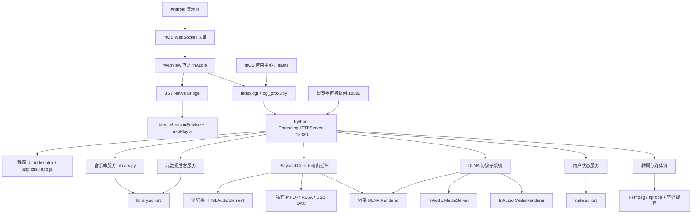

# fnAudio 项目上下文

## 0.2.11 Playback Health Severity Boundary (2026-08-14)

- `/api/health` and the support snapshot now expose only severe MPD playback errors. Recoverable warnings such as `queue_stale` remain available in the detailed MPD diagnostic payload but no longer make the service health category look failed.
- `0.2.11` was built with fnpack and deployed to the authorized external host: `artifacts/0.2.11/fnaudio-0.2.11-fnpack.fpk`, SHA-256 `EC2C3CA4C21AEBB7EA4E6A5A7035A869D552DC9326C3293F742B36269B3930CD`.
- Live post-upgrade proof: `/vol1/1000/fnaudio/external-health-0.2.11.json` and `external-core-0.2.11.json` show MPD running, empty health error category, the selected TEAC DAC, the preserved 536-item queue and `STOPPED` transport.
- Real TEAC repeat-one acceptance used a 2-second PCM WAV fixture and waited beyond two track boundaries. MPD reported `repeat=1`, queue position `0`, and `PLAYING`; PlaybackCore still named the same track. Evidence: `/vol1/1000/fnaudio/external-repeat-one-0.2.11-pAsWFF/report.json` (`repeat_one_verified=true`). The test trap restored the prior DAC target, queue and library roots.
- Real TEAC repeat-all acceptance used both 2-second PCM fixtures. Its sampled native MPD positions were `0,1,1,0,1,1,0,1,1`, proving the complete `0 -> 1 -> 0` wrap-around while playback remained active. Evidence: `/vol1/1000/fnaudio/external-repeat-all-0.2.11-QFp9py/report.json` (`repeat_all_verified=true`); prior DAC and library configuration were restored.

## 0.2.10 Real-device Automation Authentication Repair (2026-08-14)

- The DAC queue traversal, controlled MPD restart, and physical USB hot-plug capture scripts now use `X-Fnaudio-Internal: 1` exclusively for their NAS-loopback API calls. The application correctly protects these APIs even from plain loopback requests; without this header, the old scripts received HTTP 401 and could not be used as acceptance evidence. This does not change external API authorization.
- `0.2.10` was built with fnpack and deployed to the authorized external host: `artifacts/0.2.10/fnaudio-0.2.10-fnpack.fpk`, SHA-256 `B317A18AC7C61ADE4CC75FC1B1BE638E25611A1456338891460A2301E08D82FA`.
- The repaired DAC runner was copied to `/vol1/1000/fnaudio/real_device_dac_queue_run-0.2.10.sh` and executed against the real TEAC UD-301. It reached PCM `PLAYING`, observed its one-item queue position, completed queue traversal and restored the prior 536-item stopped session (`restore_verified=1`). Evidence: `/vol1/1000/fnaudio/external-dac-runner-0.2.10-20260814-193651.log` and companion `*.before.json` / `*.after.json` files.
- A two-track automatic-advance run used two 2-second PCM WAV fixtures kept under `/vol1/1000/fnaudio/real-queue-fixtures/`. The test directory was temporarily added to the library roots and the original root configuration was restored in an exit trap. The real TEAC observed both queue positions in three samples with two song changes; `queue_traversal_verified=true` and `restore_verified=true`. Evidence: `/vol1/1000/fnaudio/external-auto-next-0.2.10-h2GVO3/report.json` and `dac-auto-next.log`.
- A controlled real MPD process restart used `/vol1/1000/fnaudio/real_device_mpd_restart_run-0.2.10.sh`. It loaded a real DAC track, terminated the live MPD PID, observed supervisor recovery back to `PLAYING`, and restored the original session. Evidence: `/vol1/1000/fnaudio/external-mpd-restart-0.2.10-n70wsc/report.json` (`mpd_killed=true`, `restart_verified=true`, `restore_verified=true`).

## 0.2.9 External Playback Health Regression (2026-08-14)

- The MPD startup notice for an unavailable WildMidi decoder is now ignored only when it explicitly reports a missing Timidity configuration file. fnAudio does not currently expose MIDI playback and the external music library contains no `.mid` or `.midi` tracks, so this optional, unused decoder must not degrade playback health. Ordinary WildMidi and all other decoder failures remain classified as decoder errors.
- `0.2.9` was built directly by `tools/fnpack.exe build` through `tools/build_release.ps1`: `artifacts/0.2.9/fnaudio-0.2.9-fnpack.fpk`, SHA-256 `8457852983C32F378E308D4D90795B34D9D1606D9B7CB870DDDB2AA98F3B2496`.
- The authorized external host was transactionally upgraded through SSH port `3100`; the service stayed on `18080`. Its original 536-item queue, selected TEAC UD-301 DAC and stopped transport persisted across the upgrade.
- Real DAC smoke evidence: `/vol1/1000/fnaudio/external-dac-smoke-0.2.9-l2pPlF/`. The TEAC DAC reached `PLAYING` and `5.988s`; after the bounded run, queue/current/repeat/shuffle/target/STOPPED all matched the pre-test snapshot (`restore_verified=true`). Health reported an empty MPD error category and no WildMidi playback error.
- Companion upgrade-health evidence: `/vol1/1000/fnaudio/external-wildmidi-0.2.9-EgmiRo/`.
- Native DSD regression evidence: `/vol1/1000/fnaudio/external-dsd-0.2.9-7Q3taM/`. The selected TEAC reached `PLAYING` with `format=dsd64:2` and `native_dsd=true`; the bounded run restored the exact prior session (`restore_verified=true`).
- A fresh target refresh found only the current browser target and the TEAC DAC; no DLNA/UPnP Renderer was online. `shairport-sync` and `nqptp` are inactive on the host, and local ADB discovery is empty, so Renderer, AirPlay and Android acceptance cannot be truthfully performed in this environment yet.
- The external `0.2.10` payload itself does not include `shairport-sync` or `nqptp`; the host has neither binary installed. AirPlay is therefore an unavailable backend dependency on this host, not a failed real playback result. Do not report AirPlay acceptance until an actual receiver backend and sender are present.
- Remaining physical-device acceptance stays open: physical DAC unplug/replug, DoP-only DAC DSD, native DSD over DLNA Renderer, AirPlay, and Android multi-device foreground/background/network-switch tests.

## Release and Documentation Baseline (2026-08-14)

- The current source version is `0.2.5`. Current-state documentation was synchronized across README, architecture, decisions, recovery, Android client README and docs index; historical documents remain read-only.
- `tools/build_android_release.ps1` is the formal APK release entry point. It requires an externally supplied keystore, runs `assembleRelease`, verifies the signed APK with `apksigner`, checks `versionName` with `aapt`, and writes SHA-256 into the version artifact directory. A disposable local key proved the chain works; a real release key and its offline backup remain owner-controlled requirements.
- A static release-script test now protects the signing, verification, version and checksum contract. `SOURCE_MANIFEST.sha256` was regenerated for the current source tree.

## UI Track Presentation Boundary (2026-08-14)

- `app/ui/track_presentation.js` now owns pure track quality, date, column-value and row-key rendering rules. `app.js` injects its existing display/escaping helpers and remains the owner of application state, DOM mutation and API calls.
- The module has a standalone Node regression test and is included in both syntax verification and the release asset hash. The compatibility fallback in `app.js` exists only for isolated legacy source-slice tests; packaged browser execution loads the dedicated module first.
- Full offline verification passed: 284 Python tests, all Node/UI regressions including the new presentation test, 3 Playwright E2E tests and native fnpack payload inspection. Current FPK: `artifacts/0.2.5/fnaudio-0.2.5-fnpack.fpk`, SHA-256 `7E7CC434F1DAB8C15B720D022B72588E9BA4FA4B282AA9961ADC9891A29B4210`.

## 0.2.5 Mobile Control Layout Cache Recovery (2026-08-14)

- Mobile controls are explicitly covered by browser E2E: top device and MP3 controls remain visible; desktop player actions are hidden; shuffle precedes previous and repeat follows next.
- Releases use a content-derived asset build marker, so a package upgrade cannot retain an older WebView CSS/JS layout from the pre-0.2.2 cache strategy.
- Verification passed: 284 Python tests, Node/UI regressions, 3 Playwright E2E tests, Android Debug build and native fnpack payload inspection. FPK: `artifacts/0.2.5/fnaudio-0.2.5-fnpack.fpk`, SHA-256 `7E7CC434F1DAB8C15B720D022B72588E9BA4FA4B282AA9961ADC9891A29B4210`. Android Debug APK: `artifacts/0.2.5/fnaudio-android-0.2.5-debug.apk`, SHA-256 `FFCC86EACBFD272A662247D96CE0F2286D02A41150F22CFA3714F1C062162162`.
- LAN deployment evidence: `tools/install_test_host_fast.ps1` deployed the FPK to `198.51.100.24`, retaining backup `/vol1/1000/fnaudio/fast-deploy-backups/20260814-172218`. The live manifest and `Server` header report `0.2.5`; direct mobile-viewport inspection loaded `app.css?v=0.2.5-a09869333741` and verified the restored control layout. Screenshot: `artifacts/0.2.5/test-host-mobile-controls.png`. The test library was empty, so this validates layout and assets only, not track playback.

## External DAC Upgrade Smoke Test (2026-08-14)

- The current `0.2.5` FPK was transactionally upgraded on the authorized external fnOS test host through SSH `3100` using the `admin` account's sudo capability. Runtime configuration was retained: backend port `18080`, the music root and the selected TEAC UD-301 USB DAC.
- The live service loaded `app.css`, `track_presentation.js` and `app.js` under `0.2.5-a09869333741`; health, MPD, metadata and DLNA services were healthy. The DAC reported native DSD capability, verified `DSD_U32_BE`, PCM through 352.8 kHz and bit-perfect fixed volume.
- A six-second server-initiated DAC smoke playback entered `PLAYING` and advanced to `7.105s / 224.809s`. The pre-test 536-item queue, current item, repeat=`all`, shuffle=true, DAC target and stopped transport were restored automatically. Evidence JSON is retained on the host under `/vol1/1000/fnaudio/external-dac-test-*` and `external-dac-restore-*`.
- `tools/install_test_host_fast.ps1` now supports non-default `SshPort`, an explicit `UseSudo` execution path and a temporary `RemotePackageDirectory`; the default root/LAN workflow is unchanged.

## External Native DSD and DAC Control Test (2026-08-14)

- The external TEAC UD-301 played both library DSD samples: DSF `Simple Man` and DFF `分手說愛你`. Each entered `PLAYING`; MPD reported `format=dsd64:2`, two channels, `dsd=true` and `bitperfect_candidate=true`, proving no PCM fallback in this output chain.
- A two-track DAC control test passed real `pause` (`PAUSED`), `play`, seek (observed `21.191s` after a 20-second request) and `next` transitions. The expected second track was playing after `next`.
- The test snapshots and restoration data are retained on the host under `/vol1/1000/fnaudio/external-dsd-*`, `external-dff-*` and `external-dac-controls-*`. A post-restore immediate and delayed check confirmed the original 536-item queue, original current id `b2feef28c42d7070`, repeat=`all`, shuffle=true, DAC target and stopped transport.

## 0.2.4 Mobile Album Detail Fix (2026-08-14)

- Mobile album detail no longer uses a nested fixed-height scroll owner. The outer library viewport owns vertical scrolling on phones, preventing the detail track list from collapsing after an album is opened.
- Browser E2E now covers mobile Albums -> album detail and asserts that the scoped paged song list is present, visible, vertically sized, and free from horizontal overflow.
- Verification passed: 282 Python tests, Node/UI regressions, 3 Playwright E2E tests, Android Debug build and native fnpack payload inspection. FPK: `artifacts/0.2.4/fnaudio-0.2.4-fnpack.fpk`, SHA-256 `A8F64357451DDD531DE63AB2EE4675645EF754C2D6E8DF612CEC5EB840BAAB5A`. Android Debug APK: `artifacts/0.2.4/fnaudio-android-0.2.4-debug.apk`, SHA-256 `E325F73154A4413C090B40A7698421A3E0C37355E7C983C3AB6C05B0C991FB33`.

## 0.2.3 Frontend Presentation Boundary (2026-08-14)

- The pure topbar title/subtitle mapping was extracted from `app.js` into `ui/view_presentation.js`. The release asset hash now covers this module alongside CSS and the main UI script.
- Verification passed: 282 Python tests, Node/UI regressions, 2 Playwright E2E tests, Android Debug build and native fnpack payload inspection. FPK: `artifacts/0.2.3/fnaudio-0.2.3-fnpack.fpk`, SHA-256 `C9D4B744ED56C8FD6CAEAF530EB6BA055C32DFCBA997DE1017C1B98FC48BBF8E`. Android Debug APK: `artifacts/0.2.3/fnaudio-android-0.2.3-debug.apk`, SHA-256 `307E4DCF5E5B6BAB67636F14F5AE6890039344A1EDFE7E240345593F9B04540E`.

## 0.2.2 Offline Delivery Hardening (2026-08-14)

- fnpack staging replaces the source UI cache marker with a version plus CSS/JS content hash. A same-version rebuild can therefore not reuse stale browser or WebView code.
- `/api/diagnostics` returns a scope-protected, redacted support snapshot. Optional Chromaprint/AcoustID matching is disabled by default and requires an executable fpcalc plus `FNAUDIO_ACOUSTID_CLIENT_KEY`; its failure is isolated from the metadata queue.
- Android Debug remains buildable without secrets. `assembleRelease` now requires all four keystore settings and fails before release preparation when any are absent. A real signed artifact still requires an owner-provided keystore.
- Offline verification passed: 282 Python tests, Node/UI regressions, 2 Playwright E2E tests, Android Debug build and native fnpack payload inspection. FPK: `artifacts/0.2.2/fnaudio-0.2.2-fnpack.fpk`, SHA-256 `8D2BFBA65DA52CC9B2AA1685D24654C8BCF486DAE2A28F2179CB0093F3ED9727`. Android Debug APK: `artifacts/0.2.2/fnaudio-android-0.2.2-debug.apk`, SHA-256 `A2F6009AEEF2EF57046BBDC9B5B278F8F4B48A99729B5B3BB22C48F82C228737`.

## Workspace Layout Cleanup (2026-08-14)

- Release artifacts remain under `artifacts/0.x.y/` for rollback. Historical package inspection, temporary staging, Trim CLI sessions and FN Connect debug outputs are archived under `artifacts/_scratch/2026-08-14/` and ignored by Git.
- `.android-avd` and `.gradle-cache` are retained as hidden, reproducible Android-test caches. They are intentionally separate from source and may be removed only when disk recovery is needed.

## 0.2.1 Topbar Subtitle Cache Fix (2026-08-14)

- `app.js` previously replaced the initial 0.2.0 topbar subtitle during its first library render. Both desktop and mobile default subtitle fallbacks now use “飞牛私人音乐库”. The Web asset query version is 0.2.1 and Android installation code is 272 to prevent stale JavaScript after overwrite upgrade.
- Verified source/release version checks, JavaScript syntax, Android Debug assembly and native fnpack payload inspection. FPK: `artifacts/0.2.1/fnaudio-0.2.1-fnpack.fpk`, SHA-256 `F59FF020D739CAD35A94F6A44EEC0B6D9B86EB77C046937C1797FE3CAF6FC755`. Android Debug APK: `artifacts/0.2.1/fnaudio-android-0.2.1-debug.apk`, SHA-256 `5042A8C62CAC832EEB55F85327B45A07515D30E73AE39F32D0D64FC17043BCDE`.

## 0.2.0 Branding and Release Version (2026-08-14)

- Desktop and mobile topbar subtitles are “飞牛私人音乐库”. The App Center manifest description is “本地音乐播放器，支持高解析音乐库、歌词封面补全、USB DAC、DLNA 推送及 Android 锁屏控制。”.
- User-facing release version is 0.2.0. Android retains an independently monotonically increasing installation code, now 271; `tools/build_release.ps1` validates a positive Gradle `versionCode` rather than deriving it from the display version.
- Release verification passed: 279 Python tests, Node/UI regressions, 2 Playwright E2E tests, Android Debug build and native fnpack payload inspection. FPK: `artifacts/0.2.0/fnaudio-0.2.0-fnpack.fpk`, SHA-256 `7441A3446CD239A3F8561894736068F904885464AD47D4799A84F4B508CDE7EE`. Android Debug APK: `artifacts/0.2.0/fnaudio-android-0.2.0-debug.apk`, SHA-256 `38E61CE3D0533EB34B00AB2DFC44DB58F169E6CAAA9808A12A41CC3C64024983`.

## 0.1.270 P1-P3 Backlog Reconciliation (2026-08-14)

- Metadata candidate review can now select any stored candidate. The UI posts only a candidate index; the service validates the index against that specific track, updates its persisted `best` candidate and keeps safe blank-field-only Tag writeback.
- Added a Windows GitHub Actions workflow using the same offline, Playwright, Android and fnpack verification path as local releases. The current repository has no Git remote, so cloud execution is correctly retained as an external TODO.
- Library root merge/apply behavior now lives in `library.py`; the settings API no longer maintains a divergent server-local implementation. `TODO.md` was rewritten to reflect current P1-P3 status and external blockers.
- Verification passed: complete offline regression suite (279 Python tests, all Node UI regressions, 2 Playwright E2E tests), Android `:app:assembleDebug`, and native fnpack inspection. The authorized LAN test host `198.51.100.24` runs `0.1.270` on port `18083`; its health endpoint reports healthy server, MPD, library and metadata services. FPK: `artifacts/0.1.270/fnaudio-0.1.270-fnpack.fpk`, SHA-256 `754F653F45A5B43A9CABC417E26A625F94A906AE89E20DE8A16C0C2A00085F10`. Android Debug APK: `artifacts/0.1.270/fnaudio-android-0.1.270-debug.apk`, SHA-256 `61679351FC93E2D9914ECD654971A7893A908FFA0A099943E830542BF4B17599`.

## P1-P3 Backlog Reconciliation (2026-08-14)

- Re-audited the historical P1/P2 review against the current source rather than treating its `0.1.172` findings as current. Resource gates, structured observability, inotify change monitoring, state conflict merging, Spotify removal, version synchronization, source hygiene, and DLNA ContentDirectory semantics now have concrete implementations and automated coverage.
- Added explicit selection for review-state metadata candidates. The client submits only an index; the server validates it against the stored track-local candidate list, promotes that candidate to `best`, and retains the existing blank-fields-only Tag writeback rule.
- Added `.github/workflows/verify.yml`, which reuses `tools/test_offline.ps1 -Browser`, Android Debug assembly, and the native fnpack release inspection. No Git remote is configured locally, so cloud execution remains an external follow-up rather than a claimed result.
- Consolidated library root merge/apply behavior in `library.py`, removing the divergent server-local copy. `TODO.md` now distinguishes completed P1-P3 engineering work from external credentials, real-device, remote-repository, signing and backup dependencies.

## 0.1.269 Cancellable Cover Prewarm (2026-08-14)

- Cover thumbnail generation shares the global FFmpeg concurrency gate with playback/transcode work. Library cache prewarming runs in 24-track pages with a 150 ms inter-page delay and uses a 50 ms acquisition timeout, therefore it yields rather than competing with interactive requests.
- The per-cache-root prewarm worker is cancellable. Re-scan requests atomically replace remaining work; application shutdown signals and joins workers. Cancellation is checked after cover extraction and before thumbnail/negative-cache writes, preventing the former temporary-directory cleanup race.
- Verification passed: complete offline regression suite (277 Python tests, all Node UI regressions, 2 Playwright E2E tests), plus Android `:app:assembleDebug`. The authorized LAN test host `198.51.100.24` was fast-deployed with rollback protection; its manifest and live process report `0.1.269` on port `18083`, and `/api/health` reports healthy server, MPD, library, metadata and zero active FFmpeg tasks. FPK artifact: `artifacts/0.1.269/fnaudio-0.1.269-fnpack.fpk`; SHA-256 `B5B8A2ABB630762B7A5A4D71D3DA8D8386C9CA76FAA0915CBC94DD276B3F14E5`. Android debug APK: `artifacts/0.1.269/fnaudio-android-0.1.269-debug.apk`; SHA-256 `E138D7C7268BC36C155B25DF4CFA771AA39587145FAF7DF0B979737A44827ECC`.

## 0.1.268 Remote Notification No-Reload Return (2026-08-14)

- Fixed the notification-return regression: the `MainActivity` single-task `onNewIntent` path now ignores the notification-only action before its profile-switch `recreate()` branch. Tapping a remote media notification resumes the existing WebView without a page reload. API 35 Android-emulator regression tests passed.
- FPK artifact: `artifacts/0.1.268/fnaudio-0.1.268-fnpack.fpk`; SHA-256 `55991775E3551F032632E1FC2752679B3D437087DF5A306AC514937848556AFE`. Android debug APK: `artifacts/0.1.268/fnaudio-android-0.1.268-debug.apk`; SHA-256 `034FDAA0F2AA59C7252D958493F583691B0D2FF569C803D8533956269D327126`.

## 0.1.267 Remote Notification App Return (2026-08-14)

- Remote media notifications carry an immutable content `PendingIntent` to the existing `MainActivity`. Tapping the notification restores the app rather than starting a new login flow. API 35 emulator notification checks passed, including the content intent.
- FPK artifact: `artifacts/0.1.267/fnaudio-0.1.267-fnpack.fpk`; SHA-256 `A4698E8615AB9DA67AB8747E287BA17FE549EA800DFE284A510A809C169E9A88`. Android debug APK: `artifacts/0.1.267/fnaudio-android-0.1.267-debug.apk`; SHA-256 `958BB2F150F3BE5CF5A29CB8393F59382CCDBC1B728F3486E91651B6015F8F09`.

## 0.1.266 Remote Playback Media Notification (2026-08-14)

- Android remote outputs (USB DAC and UPnP/DLNA) now use the same Media3-owned foreground media notification as local playback. `PlaybackService` forces a media-style notification after binding `RemotePlaybackPlayer` to its `MediaSession`, including paused/connecting states; no independent plain notification remains to lose lock-screen controls.
- Source and release surfaces are `0.1.266`. JavaScript and release-version checks pass; the API 35 Android emulator verified both `dac:*` and `upnp:*` targets publish a foreground `MediaStyle` notification with the active `MediaSession` token. The formal FPK passes fnpack validation.
- FPK artifact: `artifacts/0.1.266/fnaudio-0.1.266-fnpack.fpk`; SHA-256 `B3C85534A1C36F84FCF4D2D501300D1ED74E8EB4DA45C1E8562AA6B093388DD0`. Android debug APK: `artifacts/0.1.266/fnaudio-android-0.1.266-debug.apk`; SHA-256 `26D12A4084590E84F13F2D01C61C54F1DCE3EF80858671D789A39375478F0877`.

## 0.1.265 Mobile Track Menu (2026-08-14)

- Source and release surfaces are `0.1.265`; touch long-press menus omit file-manager navigation and external sharing while desktop context menus retain them.
- FPK artifact: `artifacts/0.1.265/fnaudio-0.1.265-fnpack.fpk`; SHA-256 `8453EA1E09CFB84E7D3732AB3A2BA2A87B1419E3FDB51A1D453E5F8F3A7BDCF6`.

## 0.1.264 Favorite State Synchronization (2026-08-14)

- Source and release surfaces are `0.1.264`; the current-track favorite controls now refresh after every server-state merge and confirmed queue/core update.
- Favorite track IDs are normalized to strings at comparison time, preventing numeric/string transport differences from producing a false inactive state.
- FPK artifact: `artifacts/0.1.264/fnaudio-0.1.264-fnpack.fpk`; SHA-256 `D9C6117D9D91030775ADA3ABA3D9E77E52A8F7D9AE18BAA1845DBEFE6B6B7602`.

## 0.1.263 UI Tool Icon Refresh (2026-08-14)

- Source and release surfaces are `0.1.263`; this patch release refreshes the player and top-bar tool iconography only.
- FPK artifact: `artifacts/0.1.263/fnaudio-0.1.263-fnpack.fpk`; SHA-256 `578B52A58AD7BF490A64111A039A16BBD27F9D4F3B5720E503EB44AFF5805023`.
- The FPK was built exclusively through `tools/build_release.ps1` and `tools/fnpack.exe`; its outer package and inner payload validation passed.

## 0.1.262 App Center Upgrade Validation (2026-08-14)

- Source and release surfaces are now `0.1.262`; the higher version is required because App Center rejected same-version `0.1.261` as already installed.
- Formal App Center overwrite-upgrade validation is in progress. The authoritative artifact will be `artifacts/0.1.262/fnaudio-0.1.262-fnpack.fpk`.
- Do not classify fast deployment as App Center upgrade evidence. Record service health, port, retained configuration, lifecycle logs, and rollback separately.

## 0.1.261 Track Metadata Enrichment (2026-08-14)

- Current implementation is no longer limited to lyrics and artwork. `metadata_track_matches` stores scored recording candidates for files with filename/unknown title, artist or album fields.
- Existing providers are reused in a bounded background queue: MusicBrainz remains available for album lookup; NetEase, QQ, Kugou, Migu, JOOX and Qianqian provide recording candidates, lyrics and/or artwork.
- Auto writeback requires confidence >= 0.90 and a 0.08 lead over the next candidate. It only fills blank or filename-derived metadata; existing embedded tags remain authoritative.
- Lower-confidence or close candidates stay in `review` and are exposed through `GET /api/metadata/track?track_id=...`; `POST /api/metadata/track/apply` confirms one candidate. The UI exposes this under song actions as `元数据补全候选`.
- Current playback prioritizes lyrics first, track matching second, album artwork next, then the serialized tag writer. All FPK release artifacts continue to be built only with fnpack.

## 2026-08-13 0.1.238 Android 退出登录预填

- 修复 `0.1.237` 主动退出返回登录页被统一清空的问题。MainActivity 现在显式传递 `prefill_active_profile`，登录页显示刚才连接的地址/FN ID、账号和已加密保存的密码，但不自动登录。
- 普通冷启动仍只自动恢复会话且不闪现 FN ID；历史记录的“新增连接”仍为空白表单，三种入口互不混用。
- Android 35 模拟器 6 项 instrumented tests 全部通过；双返回退出测试明确断言登录地址恢复为刚才使用的 `127.0.0.1:动态端口`。JVM、lint、assembleDebug 和发布校验通过。
- APK：`artifacts/0.1.238/fnaudio-android-0.1.238-debug.apk`，SHA-256 `030EAD4ED5DF356FAB159A689E4B76010EEDBA9A8509BEEEC13CF38EF37DBDE2`。
- FPK：`artifacts/0.1.238/fnaudio-0.1.238-fnpack.fpk`，SHA-256 `6AB548B0F6420A573FEDBCE2CEBF303A87EC2999DC0D8C45F07953A5BD8F24B1`。本次仅 Android 行为修复，物理手机未连接，未执行真机覆盖安装。

## 2026-08-13 0.1.237 Android 封面认证与登录历史

- Android `/cover/` 请求恢复走并发 OkHttp 资源代理，显式携带 fnOS Bearer、`X-Fnaudio-Trim-Token` 和认证 Cookie；Web session 缺少请求 Cookie 时从 CookieManager 获取。服务端 160px 持久缩略图和 immutable 缓存保持不变。
- 登录页主动返回时为空白，不再默认显示活动 FN Connect ID。手动输入与当前记录不同的地址时，清除旧 `FN Connect - ...` 名称并生成独立 profile ID，因此新地址可以作为第二条历史记录保存。
- Android 模拟器测试增加实际私有封面请求的三类认证信息断言。物理小米手机在本轮修改时未出现在 ADB 列表，真机安装验收待设备重新连接。
- Android 35 模拟器 6 项 instrumented tests 全部通过：封面 GET 确认包含 Bearer、trim token、认证 Cookie，登录空表单/多历史记录、WebView、MediaSession 等回归通过。JVM、lint、assembleDebug 同样通过。
- 内网机应用中心已安装 `0.1.237`，manifest 与 HTTP `Server` 头确认版本，后端端口仍为 `18083`，已有 228 个 160px 缩略图缓存文件保留。
- FPK：`artifacts/0.1.237/fnaudio-0.1.237-fnpack.fpk`，SHA-256 `D4A153F949266723927FD95AA44E39D88F2CF5C7D2F50A8D616DAD23239D8281`。
- APK：`artifacts/0.1.237/fnaudio-android-0.1.237-debug.apk`，SHA-256 `61FFA8ACB0D363665E25AE364D6F009C8B6927078D635718B4DD7EB30D3EB5A4`。物理手机未在线，未执行真机覆盖安装。

## 2026-08-13 0.1.236 封面缩略图缓存

- 列表封面不再传输歌曲内的原始大图：`/cover/{id}?size=160` 首次生成 JPEG 缩略图并持久保存到 `<cache_dir>/covers/thumb-160/`，播放页、歌词和 Android MediaSession 使用 `size=512`。
- 相同封面版本并发只生成一次，全局最多同时执行两个缩图 FFmpeg；HTTP 缓存为 30 天 immutable。源文件 `modified_ns` 改变会自然使用新缓存键。
- 无封面结果保存 `.none` 负缓存，后续音乐库响应不再下发无效 `cover_url`，前端直接显示统一音乐符号。
- 缩略图缓存只读歌曲文件，不修改音频 Tag。定向 Python/Node 回归通过；完整测试 252 项中 251 项通过，唯一失败为 Windows 上既有的音乐目录路径边界测试，与本改动无关。
- 真机 CGI 验证时修复无封面 `` 失败回退在删除节点后访问空父节点的问题，避免 Chromium/Android WebView 控制台错误。
- 内网机 `198.51.100.24` 已通过应用中心覆盖安装 `0.1.236`，后端继续运行于 `18083`；manifest 与 HTTP `Server` 头均确认版本正确。
- 真机冷/热探针：`1973` 原封面 3,033,166 bytes，160px 缩略图 4,795 bytes，冷生成 241.57ms、磁盘热命中 0.17ms；无封面 `abcdefu` 首次确认 1.75ms、负缓存命中 0.09ms。
- 真机 CGI 首屏确认列表图片 `naturalWidth=160`，当前播放图片 `naturalWidth=512`，浏览器控制台 error/warning 为 0。
- FPK：`artifacts/0.1.236/fnaudio-0.1.236-fnpack.fpk`，SHA-256 `1DD34389105D2FDC022DDEEEB7AECCA49F63E0203395386E1F46AEBF2670BB0B`。

## 2026-08-13 0.1.227 FN Connect Public Direct

- Product decision: Tpps relay is removed. Android no longer includes Tpps JNI, Go runtime, remote signer, `libgojni.so`, `libsskit-native.so`, or `127.0.0.1:9018` routing.
- FN ID discovery now probes public IPv6 first and public IPv4 only as fallback, then uses normal fnOS WebSocket token authentication and fnAudio WebView loading.
- Xiaomi 15 Pro verified APK installation and the IPv6-first / relay-disabled policy UI. Complete FN ID login, library loading, and playback require a real network with reachability to the NAS public IPv6 route.

## 2026-08-12 0.1.225 真机封面写回修复

- 当前发布和内网机安装版本为 `0.1.225`；App Center 状态 `running`，HTTP 版本头为 `fnAudio/0.1.225 Python/3.12.4`。
- 修复 `album_artist` 为空时缓存键与 Tag 写回键不一致，以及专辑封面批量入队遗漏歌曲的问题。
- 新增一次性 `tag_write_backfill_version=1`：对已有有效缓存封面的歌曲重新排入低速 Tag 写回，不清空缓存、不重复下载，后续启动不重复迁移。
- 真机精确探测发现 99 个有效缓存候选中有 92 个缺少内嵌封面。两个验证样本完成后降为 90；后台样本 15 秒内从 `pending` 变为 `done`。
- `Steve Lacy - Bad Habit.mp3` 写回前后完整解码通过，提取封面哈希与缓存一致，原 title/artist/album/lyrics、duration、owner/mode 均保留。
- FPK：`artifacts/0.1.225/fnaudio-0.1.225-fnpack.fpk`，SHA-256 `0E86B11F41519AD7D17FD49A815031EDDC0784EEA0BB5E58EC45D8C9A136C6AA`。
- 完整证据见 `docs/REAL_DEVICE_COVER_BACKFILL_0.1.225.md` 与 `artifacts/0.1.225/real-device/`。

## 2026-08-12 连续离线改造状态

- 1-9 连续自动目标和后续 Android 模拟器自动化已经完成；该离线阶段发布版本为 `0.1.223`，之后已由 0.1.225 真机封面写回修复取代。
- 目标 1：扫描、元数据、转码、FFmpeg、缓存和磁盘水位具有统一硬边界；当前歌曲可抢占普通待办，取消/超时不发布部分索引。
- 目标 2：MPD 错误按 media/transport/decoder/output/queue/database/backend 分类；只有真实 buffer underrun 进入旧计数，损坏媒体与缺少解码器不会触发 DAC 重启。
- 目标 3：已知源码乱码、重复作用域定义、重复字典键、不可达代码和旧 DSD->PCM 未调用路径已清理，并由源码卫生测试持续阻止回归。
- 目标 4：`playback/http_contract.py` 集中目标、队列、SSE 和旧 API 转换；五个旧写入口保留兼容但返回明确弃用头。
- 目标 5：HTTP、token/scope、Range、媒体流、FFmpeg 并发、MPD/FPK 生命周期和 Chromium E2E 已纳入统一离线入口；验包检查 9 个生命周期命令、权限/资源声明、wizard 和关键 payload。
- 目标 6：Linux 使用 inotify + generation 检测变化；仅在不可用、溢出、错误或真实 dirty 时回退完整 O(n) 签名扫描。
- 目标 7：upmpdcli 只做兼容探测，不由 fnAudio 管理或占用设备；Mixer 默认 bit-perfect `none`，hardware 仅接受真实 Playback Volume 控件，software 明确非 bit-perfect。
- 目标 8：Android 自签名 HTTPS 在首次发送凭据前固定按连接的完整 DER 证书 SHA-256；WebSocket、OkHttp、媒体、封面和 WebView 共用指纹，变化时拒绝。
- 目标 9：私有目录/文件为 `0700/0600`，公开 UI 为 `0755/0644`；配置和缓存原子写，SQLite 主/WAL/SHM 加固，Tag 替换保留属主/mode，扫描/CUE/真实路径/卸载 purge 阻止越界。
- 主服务暂不降权：fnOS 共享目录、ALSA/DAC、SSDP 与 Tag 写回仍需现有权限；降权必须等待稳定 ACL 和音频组契约并做部署迁移验证。
- `TODO.md` 已删除重复和已完成事项，只保留 fnOS/外部数据、设备/协议对端、Android 系统集成与负责人决策。
- 详细设计见 `docs/RESOURCE_LIMITS_20260811.md`、`PLAYBACK_ERROR_TAXONOMY.md`、`PLAYBACK_API_COMPATIBILITY.md`、`LIBRARY_CHANGE_DETECTION.md`、`PLAYBACK_OUTPUT_POLICY.md`、`ANDROID_HTTPS_PINNING.md` 和 `FILE_PERMISSIONS_AND_PATH_BOUNDARIES.md`。
- 最终统一离线验证通过：238 个 Python 测试、JavaScript 语法检查、5 个 Node UI 回归和 2 个 Chromium E2E；Android 另通过 2 个 JVM 单元测试、`lintDebug` 与 `assembleDebug`。
- 当前 FPK：`artifacts/0.1.223/fnaudio-0.1.223-fnpack.fpk`，SHA-256 `6CBE385C472EC53099EFDE1CAC412208EF09C47FD028A51E0F12CFCFA13E574B`。
- 当前 Debug APK：`artifacts/0.1.223/fnaudio-android-0.1.223-debug.apk`，SHA-256 `7CA0EBA584FFC937F939E195979E212F58DEE26AF0E79169C4A3333A72DDE40A`；版本身份为 `versionCode=223`、`versionName=0.1.223`、`minSdk=23`，v1/v2 Debug 签名校验通过。
- 完整复现命令、九项目标边界和验包说明见 `docs/OFFLINE_ENGINEERING_0.1.222.md` 与 `docs/ANDROID_EMULATOR_TESTING.md`；当前文件哈希以 `artifacts/0.1.223/SHA256SUMS` 为准。
- Android API 35 ATD 模拟器自动化已完成：6 项 instrumented 测试覆盖加密多连接记录、历史界面、匹配/变化的自签名 HTTPS 指纹、Mock fnOS WebSocket 认证后的 WebView 加载与双击返回登录、Media3 远程队列和控制命令，以及 Debug APK 安装后的 `versionCode`。测试中发现并修复 `RemotePlaybackPlayer` 的 `COMMAND_RELEASE` 生命周期处理与 indexed seek 命令声明；复现入口为 `tools/test_android_emulator.ps1`，边界见 `docs/ANDROID_EMULATOR_TESTING.md`。

## Earlier 0.1.222 device evidence (2026-08-11)

- Non-DLNA APIs now require a loopback CGI/native proxy request carrying both
  an fnOS token and the route's explicit scope. Direct LAN access is rejected
  even when a caller claims scopes. Library, playback, state, settings and file
  operations have separate permissions; `/api/health` and `/api/access` remain
  public. Real-path containment blocks symlink escapes and shared-folder
  deletion is limited to currently configured roots. Full verification passed
  with 162 Python tests and all Node UI regressions.
- DLNA outbound network access now passes through `dlna/network.py` for SSDP
  description locations, SOAP/SCPD requests, GENA callbacks and Renderer media
  URIs. Only credential-free HTTP(S) endpoints resolving exclusively to LAN,
  loopback or link-local addresses are accepted; redirects and oversized XML
  responses are rejected. Full offline verification passed with 157 Python
  tests and all Node UI regressions.
- `TODO.md` was consolidated into a current-action list: offline work,
  deployment dependencies, physical-device acceptance and owner decisions are
  separate sections. Historical release evidence remains in this document and
  `docs/`, rather than being duplicated as active work.
- The reproducible offline FPK release path is now `tools/build_release.ps1`.
  It stages a disposable copy of the authoritative `src/` tree, excludes
  local tests and bytecode, validates the fnOS, Web and Android version
  surfaces, then verifies the outer FPK and inner app payload before writing
  the SHA-256 beside the artifact.
- An earlier reproducible 0.1.222 rebuild produced SHA-256
  `9804F776935DA64D74FFA43C8FC31B75132C3B0D8B661A6F41D762C7DA89BE92`.
  That historical same-version package has been superseded by the final
  artifact recorded above; do not use the old hash for the current file.
- App Center successfully upgraded the real DAC NAS to `0.1.222`; both App
  Center status and the running HTTP `Server` header reported `fnAudio/0.1.222`.
- A TEAC UD-301 USB DAC acceptance run traversed 20 isolated PCM tracks at
  44.1-352.8 kHz. Every queue position was observed, maximum underrun was zero,
  and the original 19-track stopped session was restored exactly.
- The complete raw log is at
  `artifacts/0.1.222/real-device/fnaudio-dac-queue-0.1.222.log`; the recovery
  record is `docs/REAL_DEVICE_DAC_QUEUE_0.1.222.md`.
- Do not mark the overall USB DAC P0 item complete. Physical replug, background
  or screen-off playback, DoP-only hardware, Renderer, AirPlay and Android
  acceptance still require real-device evidence.
- The controlled 0.1.222 MPD restart validation passed with
  `restart_verified=1` and `restore_verified=1`; the generic runner is
  `tools/real_device_mpd_restart_run.sh`, and its raw log is
  `artifacts/0.1.222/real-device/fnaudio-mpd-restart-validated-0.1.222.log`.
- Environment discovery at the same time found no external UPnP Renderer, no
  active AirPlay receiver tooling, and no Android device attached through ADB.

## 0.1.205 当前真机状态（2026-08-10）

- 当前权威安装版本为 `0.1.205`，已通过 fnOS App Center UI 覆盖安装到 `vinson023.eu.org:5666`；服务头为 `fnAudio/0.1.205 Python/3.12.4`。
- TEAC UD-301 的 API 驱动 PCM 复验：44.1 kHz/16-bit FLAC 播放至 105.60 秒，MPD 原生队列 20 首、`fault.state=PLAYING`、`underrun.count=0`。
- 同一 DAC 完成 API 播放控制闭环：暂停/恢复状态和进度正确，seek 到 30 秒后继续推进，next/previous 均成功且队列保持 20 首。
- TEAC UD-301 的 DSF 与 DFF 再次分别实测为 `dsd64:2`；两者均为 Native DSD、无 PCM fallback、无 underrun。详见 `docs/REAL_DEVICE_DAC_RECHECK_0.1.205.md`。
- DSD 测试后已通过 fnAudio API 恢复为原 20 首队列、原当前曲和 STOP 状态；`fault.state=IDLE`，不存在残留测试播放或假阳性故障。
- 目标 1–7 仍未全部完成：物理热插拔、小时级/息屏、DoP-only DAC、外部 DLNA Renderer、Android 真机/正式签名，以及 App Center 卸载与端口生命周期仍需真实环境证据。
- 0.1.205 TEAC UD-301 90 分钟受控长测已完成：181 个有效样本、12 个 MPD songid、11 次自然自动跨曲，测试队列始终为 20、最大 underrun 为 0；结束时逻辑队列为 20 且 STOP。后续发现历史恢复清单有无效 ID，MPD 原生恢复长度尚需以修复后的脚本重新核验；详见 `docs/REAL_DEVICE_LONG_RUN_0.1.205.md`。
- 长测第 146–148 个样本出现 API timeout 对应的短暂 `fault.state=SUSPECT`，但 MPD 原始状态始终为 `play`、underrun 仍为 0，随后自行回到 `PLAYING`；不能将它掩盖为“零异常”。
- `/tmp/real_device_short_queue_after_long.sh` 已完成 20 个不同短曲的自然自动下一曲；全过程测试队列保持 20、PLAYING、underrun 0。旧脚本的恢复清单有 4 个错误 ID，导致 MPD 原生队列仅 16 首；第一次独立恢复又保留了一个历史无效 ID，原生队列为 19 首。恢复清单现已根据当前音乐库查询改为 20 个有效 ID，但最终恢复命令因 SSH 中断未提交；恢复后必须确认原生队列为 20、STOP、当前曲和 fault。日志为 `/vol1/1000/fnaudio-short-queue-0.1.205.log` 与 `/vol1/1000/fnaudio-short-queue-recovery-0.1.205.log`。
- 本轮新增恢复说明 `docs/REAL_DEVICE_AUTOMATION_0.1.205.md` 和可复用脚本 `tools/real_device_short_queue_after_long.sh`，会话删除后可凭真机持久日志继续审计。
- 目标 2 的物理验收已准备 `tools/real_device_usb_hotplug_capture.sh` 与 `docs/USB_HOTPLUG_REAL_DEVICE_PROCEDURE.md`；脚本只读采样 `/proc/asound/cards` 与 MPD 状态，严禁 sysfs 模拟，仍需实际拔出/插回 TEAC UD-301 才能完成。
- 目标 7 回调集成测试发现并修复安装回调端口保留顺序缺陷：已有 `19001` 在 `18080` 被占用时不再错误漂移为 `18081`；NAS 临时夹具已通过 install/config/upgrade/uninstall keep/purge 全流程。
- 长测约 12 分钟阶段已覆盖第 0–3 首（24 个样本），仍为 `PLAYING`、20 首队列、最大 underrun 0；runner 尚未结束。
- 长测日志已同步到真机持久路径 `/vol1/1000/fnaudio-long-play-0.1.205.log`，会话删除后可从该路径恢复证据。

## 历史：0.1.202 当前状态（2026-08-09）

- 版本基线已提升至 `0.1.202`，FPK/APK 产物位于 `artifacts/0.1.202/`。
- 通过 App Center UI 覆盖安装到 `vinson023.eu.org:5666`，应用状态 `running`，HTTP Server 头为 `fnAudio/0.1.202 Python/3.12.4`。
- 修复 ALSA 探测在 MPD 刚停止时的短暂 `EBUSY` 状态：DSD 请求强制刷新能力并最多短暂重试，仍不允许未验证 DSD 转 PCM。
- TEAC UD-301 真机 DSF 与 DFF 短测均成功，MPD 报告 `audio: dsd64:2`，`native_dsd_verified=true`，`server_transcode=false`，`underrun.count=0`。
- 真机短周期回归完成：20 首 PCM 原生队列自动推进到第 20 首，队列长度保持 20，`underrun.count=0`；App Center restart 后队列长度和当前索引恢复，初始 STOP 状态保留，显式 play 后可继续播放。完整证据见 `docs/REAL_DEVICE_REGRESSION_0.1.202.md`。
- TEAC UD-301 矩阵短测完成：44.1/48/96/176.4/192 kHz PCM 与 DSF/DFF Native DSD64 均进入预期 PLAYING，384 kHz 以 502 明确拒绝且无隐式重采样，所有步骤 `underrun.count=0`；详见 `docs/PLAYBACK_MATRIX_0.1.202.md`。
- 追加 45 秒 96 kHz FLAC 连续播放监测：9 次进度采样连续增长，MPD stream `96000:24:2`、fault state `PLAYING`、`underrun.count=0`，结束后原队列/STOP 状态恢复。
- 真机系统日志显示为 2026-08-10，而开发环境日期为 2026-08-09；后续分析日志时间必须考虑设备时钟偏移。
- 真机日志中的 GAYLE FLAC lost-sync 通过独立 ffmpeg 校验确认是源文件 `invalid sync code`/`invalid frame header`；后续错误处理应区分损坏媒体与 DAC/MPD 故障。
- 真机 DLNA 探测当前 `/api/upnp/devices` 为空，`/api/dlna/renderer/status` 仅是本地控制状态，不能作为外部 Renderer 互操作完成证据。
- Android Release 构建链路已通过，但无 keystore 时只生成 `app-release-unsigned.apk`，apksigner 验证失败；正式签名仍是目标 6 的未完成项。
- 真机 `/api/config/library` 边界回归通过：非法端口和不存在目录被拒绝，同端口保存不触发重启，最终端口仍为 18080、音乐库 536 首、20 首播放队列保持不变。
- App Center 三个生命周期脚本已兼容 `/ui` 扁平安装布局；旧日志中的 `/target/ui/service_port.json` 报错属于历史版本记录。
- 目标 1–7 尚未全部完成：长时间连续播放、热插拔、DLNA Renderer、Android 多机型后台/通知和正式签名包仍需硬件验收。

## 0.1.201 当前状态

- 修复 `src/app/ui/app.js` 的 `restorePlaybackSession()`：持久化队列按每批 100 个 ID 请求 `api/library/items`，单批 CGI/代理失败不会清空已缓存队列。
- 真机 `vinson023.eu.org:5666` 已通过 App Center UI 覆盖升级 0.1.201；App Center CLI 查询显示 `fnaudio` 版本 `0.1.201`、状态 `running`。
- 真机验证：重开 fnAudio 后当前队列显示 `536` 首，当前歌曲显示“已恢复播放设备”且进度持续变化；后端 SQLite 同时保存 536 首队列和当前歌曲 ID。
- 本地验证：Python unittest 112 项通过；Node UI 队列、移动端布局、Android bridge 回归全部通过；Android `lintDebug assembleDebug` 通过。
- 构建产物：`artifacts/0.1.201/fnaudio-0.1.201-fnpack.fpk`（SHA-256 `8C5F550FED94D62489B7FEC382BE0FDE4F8BEE13D5B045CFA69C74E67D41F7C1`）、`artifacts/0.1.201/fnaudio-android-0.1.201-debug.apk`（SHA-256 `F67955278F3774F5C7A34DBE1A9E8CA0F162129E67DD8CE8B6CFE539389052D0`）。FPK 使用 `tools/fnpack.exe 1.2.3` 构建；FPK 通过 App Center UI 安装，CLI 因自定义向导限制不能直接完成安装。

## 0.1.198 本轮进展

- Android 远程输出 MediaSession 的 repeat/shuffle 命令改为携带目标值，服务端和 `PlaybackCore` 支持显式幂等更新；无目标值时仍按旧逻辑切换。
- 新增两项回归测试；全量 Python 测试 109 项通过，Android `lintDebug` 与 `assembleDebug` 通过。
- `vinson023.eu.org` 的 App Center/SSH 仍不可达，目标 1–7 中涉及真实 DAC、Renderer、Android 多机和 App Center 生命周期的条目继续保持未完成。
- `src/cmd/install_callback` 已改为合并既有 `config.json`，覆盖安装不再清空 MPD/输出/DLNA 等设置；新增生命周期脚本测试，Python 总测试数增至 111。
- 已重建 `artifacts/0.1.198/fnaudio-0.1.198-rebuild.fpk`，包内版本、app.tgz checksum 和关键源码回读通过；备用机 CLI dry-run 明确要求 App Center UI 向导，尚未安装该重建包。
- 备用机生命周期步骤和恢复要求记录在 `docs/APPCENTER_LIFECYCLE_0.1.198.md`，后续会话可直接按该文档继续，不依赖当前对话历史。

> 历史记录：`0.1.198`（2026-08-09）。该段仅保留当时的构建与连通性上下文，不是当前权威版本。

## 0.1.175 当前状态（2026-08-07）

- 当前统一版本：`0.1.175`；正式构建产物位于 `artifacts/0.1.175/`。
- DSD DLNA 推送改为原始 DSF/DFF 直出：URL 使用源文件扩展名，MIME 使用 `audio/x-dsf` 或 `audio/x-dff`，资源大小使用源文件大小，不再生成或推送 WAV PCM。
- DLNA MediaServer 的 DSD 资源和推送 Renderer 均强制使用 `original` 媒体模式；浏览器播放仍可显式请求 `dsd_wav` 转码。
- 设备能力不再触发静默 DSD 转码；不支持原生 DSD 的 Renderer 可能拒绝播放，这是符合“源码推送”要求的预期行为。
- 本地 63 个 Python 测试和 3 个 Node 回归脚本通过；新增测试确认 DSF/DFF URL、MIME、协议与源文件大小均保持原始格式，且转码回调不会被调用。

## 0.1.174 历史状态（2026-08-07）

- 当前统一版本：`0.1.174`；源码目录：`C:\path\to\fnAudio\src`；Android 源码：`C:\path\to\fnAudio\android-client`。
- 本轮修复：fnOS 启停脚本会清理旧版本遗留的 fnAudio `server.py`，避免 18080/18081 双实例、重复 MPD 和播放状态互相覆盖；停止流程同时清理匹配 fnAudio MPD 的残留进程。
- 真机部署：已在 `198.51.100.24` 通过 SSH 可回滚部署正式 0.1.174 代码，运行时端口为 `18081`；当前仅 1 个 fnAudio server、1 个 MPD，无 zombie 进程，仅监听 18081。
- 真机验证：健康检查、音乐库（228 首，5 首 DSD）、浏览器队列/加载/暂停、服务重启后的队列与播放目标持久化、DSD WAV 媒体头均通过；DSD 输出确认 `audio/wav`、96 kHz、24 bit。
- 受限项：测试机没有可发现的 USB DAC 或 UPnP Renderer，无法完成真实 DAC/Renderer 硬件连续播放；Android APK 仍需用户在目标手机安装验证。App Center 的非交互 CLI 对第三方依赖/向导升级返回 UI-only 限制，因此本轮使用 SSH 备份后覆盖部署，并保留备份：`/vol1/1000/fnaudio-backup-0.1.172-before-0.1.174-20260807.tgz`。
- 构建产物：`artifacts/0.1.174/`；正式 FPK/APK 哈希见该目录 `SHA256SUMS`，测试专用无向导包不作为发布物。

## 测试环境注意

- 当前开发基准日期与 NAS 日志日期均为 2026-08-08；若出现会话时间、缓存过期或日志排序异常，仍应先核对 NAS 系统时钟/时区。

## 0.1.173 历史开发状态（2026-08-07）

- 当前统一版本为 `0.1.173`；fnOS 源码在 `C:\path\to\fnAudio\src`，Android 源码在 `C:\path\to\fnAudio\android-client`。
- USB DAC 的主播放链路是 fnAudio 私有 MPD -> ALSA。MPD `idle` 监听现在负责识别自然结束并在服务端推进 fnAudio 队列，网页或 WebView 进入后台后不再是 USB DAC 下一曲的必要条件。
- MPD 显式 Stop 和换曲时会抑制对应的 STOPPED 事件，避免被误判成自然结束；Playback Core 仅在输出命令成功后发布播放状态，修复按钮闪烁、进度回跳及失败后仍显示播放的问题。
- 网页对同一远程目标/歌曲的短时间重复 load 已去重；恢复 NAS 播放会话时先读取服务端远程状态，不会重新推送当前歌曲。
- DLNA DSD 推送统一转换并声明为 WAV PCM 96kHz/24bit，URL、MIME、扩展名和资源大小保持一致；支持 `SetNextAVTransportURI` 的 Renderer 会预装下一曲，不支持时自动降级。
- Android 在加载 WebView 前先验证现有 token，失败后依次尝试 longToken 和已保存密码；成功后更新加密连接资料、Cookie、请求头和播放服务运行配置。
- Android `minSdk` 从 26 调整为 23（Android 6.0），并移除 API 24 才可用的集合方法；Debug Lint 与 APK 构建通过。
- 本轮本地验证：62 个 Python 测试、3 个 Node 回归脚本、JavaScript/Python 语法检查、Android Lint 和 Debug APK 构建通过。
- 尚未真机确认：USB DAC 首帧/停止行为、DLNA 不支持 NextURI 时的后台连续播放、Android 远程输出模式的通知栏/锁屏媒体卡片、具体“解析错误”手机及 DSD 设备矩阵。不得把本地测试描述为真机通过。
- Volumio 与 moOde 参考源码缓存在 `C:\path\to\fnAudio\references\volumio3-backend`、`volumio2-ui`、`moode`；固定提交与分析见 `references/README.md` 和 `references/FNAUDIO_REFERENCE_ANALYSIS.md`，第三方仓库不进入 FPK/APK 或产品提交。

> 更新日期：2026-08-08  
> 当前项目根目录：`C:\path\to\fnAudio`  
> 源码基线来源：`E:\Codex\fnaudio-0.1.7`  
> 历史可识别发布版本：`0.1.173`  
> 文档目的：为后续开发、排障、测试和发布提供可复用上下文

## 历史状态：`0.1.172` PC 右键菜单与文件夹定位修复

- fnOS 源码位于 `C:\path\to\fnAudio\src`，Android 客户端源码位于 `C:\path\to\fnAudio\android-client`；根 `VERSION`、FPK manifest、前端缓存键和 Android `versionName` 均为 `0.1.172`。
- PC 桌面歌曲右键使用 `desktopTrackContextActionButtons()`，分组（文件夹/专辑等）右键也移除“播放”和“插播所选项目”；移动端长按继续使用 `trackContextActionButtons()` 的四项快捷菜单，歌曲操作对话框仍使用完整 `trackActionButtons()`。
- `openContainingFolder()` 只把 `api/library/location` 返回的 `folder` 父目录传给 `sdk.openFileManager()`；完整音频路径会被 fnOS 宿主解释为打开文件，因此不再传入 `path`。宿主公开接口目前没有确认的“打开目录并选中文件”参数。
- 列表封面有真实图片时隐藏 `♫` fallback；加载失败会恢复 fallback；无封面（包括 DSD）统一显示 `♫`。
- Android Media3 的 `AuthenticatedBitmapLoader` 使用 fnOS token Header/Cookie 下载同源封面并写入应用私有缓存，再交给通知栏 BitmapLoader；无封面继续使用白色本地占位图。
- `artifacts/0.1.172/fnaudio-0.1.172.fpk` 大小 `4,885,254` 字节，SHA-256 `74B10F51AEF82A6BD4B9928EB316868168E03AB6548991E4C012279FF0D1385E`。
- `artifacts/0.1.172/fnaudio-android-0.1.172-debug.apk` 大小 `10,090,184` 字节，SHA-256 `EC61FEE7926064BF69D34DF6A61EEBAAC14E7EFBE4B1BA3A9D39613BF8EE60E1`；包名 `com.fnaudio.client`，versionCode 172，min SDK 26，target SDK 36。
- Android Media3 通知改用白色描边播放圆环 `ic_notification`；无真实歌曲封面时生成透明底白色播放圆环 PNG，并以应用私有文件 URI 作为媒体封面，修复系统媒体卡片显示黑色占位图标的问题。
- 占位 PNG 只生成并保存一次，不把图片字节复制到每个队列项目，避免大队列放大 Binder 数据；存在真实封面 URL 时仍优先显示真实封面。
- 歌曲行在桌面端支持右键、移动端支持 550ms 长按，统一弹出四项菜单：从当前开始播放所有歌曲、加入当前队列、收藏歌曲、加入播放列表。移动超过 10px、取消触点或滚动列表会取消长按，成功长按后的合成点击会被拦截。
- 右键/长按菜单的“收藏歌曲”只执行添加，不会在歌曲已收藏时反向取消；“从当前开始播放所有歌曲”仍解析当前视图的完整列表上下文，不退回到只读取当前分页。
- Android 客户端通过 fnOS `/websocket?type=main` 登录，支持地址、端口、HTTPS、自签名证书兼容、账号/密码和多连接历史；地址、账号、密码、token/longToken 统一进入 Android Keystore AES-GCM 加密载荷，应用数据禁止系统备份。
- 登录页只显示一个“历史连接”按钮；选择、编辑、删除和新增在独立页面完成。连接身份由 host、端口、协议和账号组成，普通表单改变身份会新增记录，只有历史页明确“编辑”才覆盖所选记录。
- 登录后 WebView 直接加载 `/cgi/ThirdParty/fnaudio/index.cgi/`。网页存在 `FnAudioNative` 时，把完整队列和控制交给 Media3 `MediaSessionService + ExoPlayer`，不再依赖后台冻结的 HTML `<audio>` 自动切歌。
- fnAudio 页面检测到 `/index.cgi` 后会在加载 CSS/脚本前写入正确的 `<base>`；Android 同源 GET 子资源由 OkHttp 重新附加会话 Header/Cookie。非 GET fnAudio API 通过 `FnAudioNative.requestJson()` 交给原生 OkHttp，解决 WebView POST 被 fnOS nginx 以 HTTP 200 纯文本 `invalid token` 拦截的问题。
- Android 登录页、历史页和 WebView 主页面统一按系统状态栏、导航栏和 `displayCutout` Insets 增加安全内边距；登录端口输入框直接默认显示 `5666`，不再显示端口说明提示。
- 原生 HTTP 桥限制为当前 NAS 的 `/cgi/ThirdParty/fnaudio/index.cgi/api/` 与 POST/PUT/PATCH/DELETE 方法，并统一覆盖队列、用户状态、播放控制、转码预热、配置、共享目录同步和播放设备切换；token 不会发送到外部地址。
- Android 登录成功后会移除登录 Activity。系统返回键先交给 fnAudio 页面关闭对话框、菜单、歌词或嵌套分类；根页面第一次显示退出提示，2.2 秒内第二次打开登录页并禁止自动恢复上次连接。
- 本地已通过 59 个 Python 测试、3 个 Node 回归脚本、JavaScript/Python 语法检查、Android Lint 和 Debug APK 构建；FPK 外层 21 个条目、内层 `app.tgz` 110 个条目已核对。
- 当前没有连接 Android 设备；`0.1.172` 尚未安装到 fnOS/手机，PC 右键菜单和文件管理父目录跳转仍需目标 fnOS WebView 复验。APK 使用 Debug 证书，不是正式签名发布版。
- 不要将任何 FPK 解包目录当作开发源码或下一次发布起点。新功能只改 `src/`；每次测试/发布包都须单独创建、记录并验证。
- 已缓存第三方 `FNOS-API` 固定提交作为外部设备验收与运维参考，评估见 `references/FNOS_API_EVALUATION.md`。它是 `trim-cli` 的高权限 REST 包装，不是官方 SDK，也不应接入 fnAudio 运行时。

## 0. 快速恢复入口

如果原开发会话已被删除，按以下顺序恢复上下文：

1. 阅读本文件，确认当前实现、风险和验证基线。
2. 阅读 `RECOVERY.md`，核对源码身份、恢复步骤和禁止事项。
3. 阅读 `TODO.md`，只从未完成的最高优先级项目继续。
4. 涉及架构边界时阅读 `ARCHITECTURE.md` 和 `DECISIONS.md`。
5. 查看 `CHANGELOG_AI.md`，确认最近一次 AI 修改及验证结果。
6. 在项目根目录运行 `git status --short`，先确认未提交变更，再在 `C:\path\to\fnAudio\src` 运行测试；不要从 `E:\Codex\builds` 或旧版本目录恢复代码。

除非文档明确说明，本文中的源码路径均相对于 `C:\path\to\fnAudio\src`。

## 1. 分析范围与结论

- `E:\Codex` 不是 Git 仓库，工作区内没有 `.git`，无法通过提交历史判断文件来源、变更归属和发布对应关系。
- 当前 fnOS 源码是 `C:\path\to\fnAudio\src`，Android 源码是 `C:\path\to\fnAudio\android-client`。初始整理基线为 `0.1.148`，当前统一版本为 `0.1.175`。
- `fnaudio/` 是约 `0.1.2` 的旧版；`fnaudio-0.1.3/` 至 `fnaudio-0.1.6/`、根目录 `builds/` 及多个打包暂存目录均属于历史材料，不应直接作为当前源码修改。
- 本项目是面向 fnOS 的本地音乐库和多目标播放器。它不是纯前端网页，也不是单一 DLNA 控制器，而是同时承担音乐库、媒体流、转码、本机播放、DLNA Control Point、MediaServer 和 MediaRenderer 等职责。
- 当前工作目录以 `0.1.175` 为开发基线；DSD 的 DLNA 路径使用原始 DSF/DFF 直推，浏览器兼容转码保持独立。
- 当前配套产物位于 `artifacts/0.1.173/`。历史版本仅用于追溯，不能替代本轮 USB DAC、DLNA 和 Android 真机验证。
- 真实 fnOS 测试设备已确认安装 `fnaudio 0.1.166`。对实际 CGI 的诊断表明：缺少网关认可 token 时返回 HTTP 200 `invalid token`；携带原生认证 Header/Cookie 的队列 POST 返回 JSON。`0.1.172` 尚未安装到 fnOS 或 Android 真机。

## 2. 项目整体架构

### 2.1 技术栈

| 层级 | 实现 |
| --- | --- |
| fnOS 集成 | FPK `manifest`、`cmd/` 生命周期脚本、`config/` 权限与资源声明、`wizard/` 安装配置页 |
| Web 入口 | fnOS iframe + CGI，`app/ui/index.cgi` 调用 `cgi_proxy.py` 转发到本机服务 |
| 前端 | 原生 HTML、CSS、JavaScript，无 npm、打包器或前端框架 |
| Android 客户端 | Java 17、WebView、Media3 1.10.1、ExoPlayer、MediaSessionService、OkHttp HTTP/WebSocket |
| HTTP 服务 | Python 3.12 标准库 `ThreadingHTTPServer` |
| 音乐库与状态 | SQLite，WAL 模式；另有内存缓存和文件缓存 |
| 本机播放 | 内置 MPD 0.23.12、ALSA、`aplay`/`libasound`、FFmpeg |
| 网络播放 | UPnP/DLNA SSDP、SOAP、GENA 事件订阅、HTTP 媒体流 |
| 元数据 | Spotify、网易云音乐、QQ 音乐、MusicBrainz、歌词与封面后台任务 |
| 发布平台 | fnOS，`manifest` 声明 `x86`，安装依赖 `python312` |

项目运行时关系：



### 2.2 分层职责

1. fnOS 包装层
   
   `manifest`、`cmd/`、`config/` 和 `wizard/` 负责安装、升级、配置、启动、停止、卸载、端口和共享目录授权。

2. 入口与代理层
   
   fnOS 通过 `/cgi/ThirdParty/fnaudio/index.cgi/` 打开应用。CGI 代理读取服务端口，并把 fnOS token 转发给本机 Python 服务，用于调用 fnOS 共享目录 API。Python 服务本身默认监听 `0.0.0.0:18080`。

3. 前端交互层
   
   `app/ui/app.js` 维护页面状态、列表、队列、收藏、歌单、设置和歌词。普通浏览器继续使用 `<audio>` 和标准 Fetch；Android WebView 检测到 `FnAudioNative` 后把本机队列与控制交给原生服务，并通过原生认证桥发送非 GET API。

4. HTTP 编排层
   
   `app/server/server.py` 提供静态文件、JSON API、媒体流、DLNA 描述与 SOAP 路由，并初始化 MPD、元数据、播放核心、SSDP、MediaServer 和 Renderer。

5. 领域服务层
   
   `library.py`、`metadata_service.py`、`state_store.py`、`transcode.py` 分别处理音乐库、外部元数据、用户状态和媒体转码。

6. 播放与协议适配层
   
   `playback/` 用统一的 `PlaybackCore` 和输出插件隔离浏览器、MPD、ALSA、DLNA 推送；`dlna/` 单独实现发现、控制、服务端、渲染器和事件订阅。

7. Android 宿主层

   `android-client/` 负责 fnOS WebSocket 登录、加密连接历史、WebView 会话注入、受限的认证 OkHttp API、MediaController 和 MediaSessionService。原生服务持有实际播放队列；WebView 是 UI、播放意图和 API 调用来源。

### 2.3 关键数据流

音乐库扫描：

```text
配置中的一个或多个音乐目录
  -> os.walk 生成文件签名
  -> 解析音频信息、Tag、封面和 CUE
  -> library.sqlite3 中的 tracks / albums / artists / composers / genres / folders
  -> 分页查询 API
  -> 前端列表或 DLNA ContentDirectory
```

播放：

```text
前端或外部 DLNA 控制器
  -> PlaybackCore 队列和播放状态
  -> browser: 返回媒体 URL，由浏览器播放
  -> mpd/alsa: 私有 MPD 或 FFmpeg + ALSA 输出到 NAS 声卡/USB DAC
  -> dlna_push: SOAP 推送给外部 Renderer
  -> dlna_renderer: 接收外部控制器命令，并把会话同步回 PlaybackCore/UI
```

状态同步：

```text
浏览器 localStorage 兼容数据
  <-> /api/state/user + revision 冲突检测
  <-> state.sqlite3
  -> 收藏、歌单、队列、当前曲目、循环、随机、目标和表格偏好
```

## 3. 目录作用

### 3.1 `E:\Codex` 工作区顶层

| 目录 | 作用与状态 |
| --- | --- |
| `$inspect/` | 单个 FPK 或归档的检查产物。不是运行时源码。 |
| `2026-07-24/` | 历史 FPK 解包、对比和验证工作区。 |
| `2026-08-05/` | 当前为空的日期工作目录。 |
| `android-sdk/` | 本机 Android SDK，用于早期 Android 壳实验。 |
| `android-sdk-tmp/` | Android SDK 临时目录，当前为空。 |
| `builds/` | `0.1.1` 到 `0.1.148` 的大量历史快照、打包目录和检查产物；体积大，不是唯一可信源码。 |
| `fnaudio/` | 旧版约 `0.1.2` 源码。 |
| `fnaudio-0.1.3/` | 早期播放架构拆分阶段源码。 |
| `fnaudio-0.1.4/` | 历史阶段源码。 |
| `fnaudio-0.1.5/` | 历史阶段源码。 |
| `fnaudio-0.1.6/` | 历史阶段源码。 |
| `fnaudio-0.1.7/` | 历史来源目录；迁入 `src/` 时版本为 `0.1.148`，当前活跃源码版本为 `0.1.173`。 |
| `fnaudio-android-shell/` | 已被 `C:\path\to\fnAudio\android-client` 替代的 Android 试验壳，只读参考。 |
| `fnaudio-pack-stage-*/` | 旧版本 FPK 暂存结构，用于历史打包。 |
| `fnOS Skill/` | fnOS API、CLI 和开发流程参考材料，不进入产品运行时。 |
| `references/` | Volumio、moOde、MPD、upmpdcli 等第三方参考源码，只用于研究；`FNAPP/` 缓存官方飞牛媒体 APK 与解包目录，已加入 Git 忽略，不进入产品运行时。 |
| `tmp-fnaudio-fpk-*/` | FPK 解包和验证目录。 |

根目录的 `.fpk`、`fnpack.exe`、Android SDK 压缩包和预览资源均为工具或构建产物，不是当前应用源文件。

### 3.2 Android 客户端 `C:\path\to\fnAudio\android-client`

| 目录 | 作用与状态 |
| --- | --- |
| `app/src/main/java/.../data/` | 连接模型和 Android Keystore 加密历史存储。 |
| `app/src/main/java/.../network/` | fnOS WebSocket 登录与 HTTP/TLS 客户端配置。 |
| `app/src/main/java/.../ui/` | 登录页、多连接切换和 fnAudio WebView 宿主。 |
| `app/src/main/java/.../playback/` | Media3 前台播放服务和运行时连接配置。 |
| `app/src/main/java/.../web/` | JavaScript/MediaController 桥。 |
| `gradle/`、`gradlew*` | 固定 Gradle 9.6.1 的可恢复构建入口。 |

### 3.3 当前 fnOS 源码 `C:\path\to\fnAudio\src`

| 目录 | 作用与状态 |
| --- | --- |
| `app/` | FPK 安装后的主要应用负载。 |
| `app/bin/` | 预留的应用二进制目录，当前没有实质内容。 |
| `app/server/` | Python 后端源码。 |
| `app/server/playback/` | 播放状态机、数据模型、插件注册表、Browser/DLNA/ALSA/MPD 输出适配。 |
| `app/server/dlna/` | SSDP、Control Point、MediaServer、MediaRenderer、SOAP、GENA 订阅、能力 profile 和诊断。 |
| `app/server/services/` | MPD 生命周期、配置生成、进程监督和空闲事件监听。 |
| `app/server/__pycache__/` | Python 自动生成缓存，不应纳入源码或发布管理。 |
| `app/target/bin/` | 随包提供的 MPD 可执行文件。 |
| `app/target/lib/` | MPD 运行所需的动态库。 |
| `app/ui/` | `index.html`、`app.css`、`app.js`、图标、CGI 入口和代理。 |
| `app/www/` | 空的历史或兼容占位目录。 |
| `builds/` | 当前源码目录内部的少量历史 UI 构建和检查快照，也不是运行时源码。 |
| `cmd/` | fnOS 安装、升级、配置、启动、停止、状态检查和卸载脚本。 |
| `config/` | fnOS 权限和资源声明；当前声明 root 运行、两个 data-share 和 `trim.file.sharedAccess` API scope。 |
| `tests/` | Python `unittest` 后端测试，以及若干人工 UI 检查截图和 DOM 记录。截图本身不是自动化测试。 |
| `transcode/` | 遗留的本地缓存种子目录。其中 `library.json` 指向旧 `0.1.6` Windows 路径，不应视为有效运行数据。 |
| `wizard/` | fnOS 安装、配置和卸载向导定义。 |

### 3.4 后端核心文件

| 文件 | 职责 |
| --- | --- |
| `app/server/server.py` | HTTP 路由、静态资源、媒体流、服务初始化和跨模块编排。约 1660 行。 |
| `app/server/library.py` | 扫描、Tag、封面、CUE、SQLite schema、分页、分组、文件夹和增量聚合。约 2001 行。 |
| `app/server/metadata_service.py` | 元数据提供商、匹配评分、任务队列、歌词、封面下载、缓存回收。约 914 行。 |
| `app/server/state_store.py` | 收藏、歌单、播放会话、UI 偏好和 revision 并发控制。 |
| `app/server/transcode.py` | 播放策略、FFmpeg 查找、MP3/DSD/CUE 转码、缓存预热和清理。 |
| `app/server/config.py` | 配置默认值、读写、端口范围约束、代理和 manifest 端口更新。 |
| `app/server/fnos_api.py` | 通过 fnOS Unix socket 调用共享目录授权 API。 |
| `app/server/alsa_player.py` | 独立 ALSA 播放辅助入口。 |
| `app/ui/app.js` | 前端全部状态、DOM、API、播放器和设置逻辑。约 4093 行。 |
| `app/ui/app.css` | 全部桌面和移动端样式。约 1277 行。 |

## 4. 已实现功能

### 4.1 音乐库与媒体解析

- 支持一个或多个 fnOS 音乐目录，并能同步系统共享目录授权。
- 支持后台扫描、扫描进度、错误记录、SQLite 索引和定时变化检查。
- 支持 FLAC、MP3、M4A、AAC、OGG、Opus、WAV、AIFF/AIF、WMA、DSF、DFF 和 CUE；项目文档已明确放弃 APE。
- 解析 ID3、Vorbis/FLAC、MP4/M4A 等元数据，并读取内嵌或同目录封面。
- 支持 CUE 虚拟分轨、分段时长、封面和按分轨转码。
- 提供全部音乐、DSD、文件夹、专辑、歌手、作曲者、类型、最近添加、随机 100 等视图。
- 提供搜索、分页、排序、列显示和列宽偏好。
- 可查询曲目实际位置、文件详情，并调用 fnOS 能力打开所在目录或创建分享链接。

### 4.2 播放与队列

- 统一 `PlaybackCore` 管理队列、当前曲目、播放目标、进度、循环和随机。
- 从列表中任一曲目开始播放时保留完整上下文队列，并将所选曲目设为当前项；收藏和自建歌单会先补齐缺失曲目再建队列。
- 歌词页复用底部播放控制栏的队列入口，点击后会关闭歌词页并进入当前队列。
- 打开当前队列会清空列表筛选，按当前排序计算正在播放项所在页，直接滚动到该行，并仅在实际队列位置显示“正在播放”标识；重复曲目不会被错误地同时标记。
- 专辑、歌手专辑和作曲者专辑详情使用独立默认列集，第一列为“序号”；旧的原始默认列偏好会自动迁移，新建或用户自定义的列偏好仍可在列设置中调整。
- 浏览器本地播放使用 HTML audio，并接入 Web Media Session。
- 本机播放支持内置 MPD、ALSA/USB DAC 设备发现、输出能力探测和播放状态。
- 支持发现外部 DLNA Renderer，并主动推送媒体和发送 Play/Pause/Stop/Seek/Next/Previous。
- 支持播放、暂停、停止、上一首、下一首、seek、循环和随机。
- 仍保留旧 player、UPnP 和 DAC API 作为兼容入口，内部主要转发到统一播放核心。

### 4.3 DLNA

- fnAudio 可作为 DLNA Control Point 搜索和控制其他 Renderer。
- fnAudio 可作为 MediaServer，通过 ContentDirectory 暴露音乐、专辑、歌手、类型和多根目录文件夹。
- fnAudio 可作为 MediaRenderer，接受外部控制器的 AVTransport 和 RenderingControl 命令。
- 支持 SSDP alive/byebye、M-SEARCH、设备描述、SCPD、SOAP、DIDL-Lite、SUBSCRIBE/UNSUBSCRIBE 和异步事件通知。
- 支持 `SetNextAVTransportURI`、连续队列、入站元数据和封面信息，并将 Renderer 会话同步到统一播放状态。
- MediaServer 同时提供原始资源和显式 MP3 fallback 资源。

### 4.4 转码与交付

- 非 MP3 的外网或手动请求可转 MP3。
- DSF/DFF 可转 96 kHz、24 bit WAV，用于浏览器、DLNA 或 DAC 兼容播放。
- CUE 虚拟分轨可转独立 FLAC 片段。
- 支持 Range/流式媒体响应、缓存预热、状态查询和两天缓存淘汰；需要 MP3 转码的当前浏览器曲目会先进入高优先级单工作线程缓存队列。
- FFmpeg/ffprobe 优先使用 fnOS 系统路径，未随项目单独内置。

### 4.5 元数据、歌词和用户状态

- 本地歌词、网易云歌词和 QQ 音乐歌词查询。
- Spotify、网易云、QQ 音乐、MusicBrainz 的专辑/歌手元数据和封面后台任务。
- 提供正缓存、负缓存、过期重试、孤儿实体宽限期和未完成任务恢复。
- 收藏、自建歌单、当前队列、播放会话和表格偏好持久化到 NAS 端 SQLite。
- 通过 revision 检测多窗口或多端写入冲突，并保留 localStorage 首次迁移与离线兼容。

### 4.6 fnOS 生命周期

- 提供安装、升级、配置、启动、停止、状态检查和卸载逻辑。
- 安装时校验或自动选择端口，并同步 `manifest` 与 UI 代理端口。
- 支持保留数据卸载和清除应用配置/缓存两种卸载模式，不删除用户音乐文件。
- 声明 `python312` 依赖、共享目录和 fnOS 文件授权 API scope。

## 5. 未完成或尚未充分验证的功能

以下内容能从阶段文档或实现状态直接判断：

| 状态 | 项目 |
| --- | --- |
| 未完成 | 尚未根据真实互操作问题添加设备专用 MediaServer profile。当前 `profiles.py` 只有通用能力策略。 |
| 待真机验证 | 尚未在真实飞牛移动端 WebView 验证前后台切换、收藏/队列同步和恢复后的播放状态。 |
| 待 Android 真机验证 | `android-client` 已可构建；保存两个以上连接、新增/编辑/删除、原生认证队列 POST、双击返回登录页、息屏续播和自动下一首尚未在手机上执行。 |
| 待协议兼容 | 当前登录实现覆盖密码登录及无签名 token/longToken 恢复；2FA、验证码和需要 HMAC/`si` 的固件仍需补齐。 |
| 待发布工程化 | 当前 APK 使用 Debug 签名；正式 keystore、升级签名策略、密钥备份和 release 混淆/崩溃日志尚未建立。 |
| 待样本验证 | WAV、DFF 尚无对应真机音乐样本验证；DSF 已有验证记录。 |
| 当前不可用 | 硬件音量控制依赖 `amixer`，阶段记录显示真机没有安装，因此 Mixer 控制不可用，但不阻塞 MPD 播放。 |
| 部分真机已验证 | 用仅版本号不同的 `0.1.149` 包已完成覆盖升级、启动、端口保持、CGI 页面、核心 API 和 MPD 冒烟；全新安装、端口变更、停止/启动、卸载及应用中心字段仍待验收。 |
| 仅探测 | `dlna/upmpdcli_renderer.py` 只检测二进制、版本和进程状态，不是可选 upmpdcli 播放后端。 |
| 已替代的历史试验 | `E:\Codex\fnaudio-android-shell/` 仅作历史参考，已由 `C:\path\to\fnAudio\android-client` 的完整 Gradle/Media3 工程替代。 |

另外，代码“已经存在”不等于生产环境“已经验证”。本次只执行了本地单元测试和语法检查，没有重新验证真实 fnOS、USB DAC、MPD 进程、不同 DLNA 客户端、外部元数据服务和移动 WebView。

## 6. 存在的问题和技术债

### P0：先确认和收紧安全边界

1. HTTP API 缺少统一鉴权
   
   服务默认绑定 `0.0.0.0`，多数读写 API、播放控制和媒体流没有登录或权限校验。`trim_api_token()` 主要用于代调用 fnOS 授权接口，不是后端 API 的访问控制。若 fnOS 防火墙没有隔离 18080，局域网中可直连该端口的客户端可能绕过 CGI 入口。

2. 进程权限过高
   
   `config/privilege` 声明 `run-as: root`。服务同时拥有目录配置、文件位置查询、共享授权、媒体读取、进程启动和网络访问能力，任何输入校验问题都会被 root 权限放大。

3. 信息与控制面暴露
   
   `/api/library/location` 可返回真实 NAS 路径；配置写入、共享目录同步/删除、播放控制和媒体端点都在同一服务上。应先建立用户/会话身份和操作级授权，再决定哪些信息可对前端公开。

4. 服务端请求目标缺少充分限制
   
   DLNA 发现会抓取设备 `LOCATION`，事件订阅会向客户端提供的 `CALLBACK` 发起 HTTP 请求。当前只做基本 URL 形状校验，建议限制为 HTTP、局域网地址、合理端口和已发现设备，防止 SSRF 或访问本机敏感服务。

### P1：影响可靠性、可维护性和发布质量

1. 工作区和发布可追溯性仍不完整
   
    当前已有根 README、`.gitignore`、源码哈希清单、`0.1.172` FPK/APK 和校验记录，以及本地 Git 基线；但仍没有远程备份、LICENSE、CI、正式 Android 签名或统一自动化发布脚本。

2. 核心文件过大
   
   `app.js` 约 4093 行，`library.py` 约 2001 行，`server.py` 约 1660 行。前端把状态、DOM、API、播放器、设置、分享混在单文件中；后端入口仍集中承担大量路由和服务编排。

3. 自动化测试覆盖存在明显空白
   
   现有 59 个测试集中在 Python 单元层，另有 3 个无浏览器依赖的 Node 回归脚本覆盖队列/专辑列、移动端结构和 Android bridge/CGI 会话；仍没有前端 E2E、HTTP 路由集成测试、安装/升级/卸载测试，也没有真实媒体流水线、私有 MPD、USB DAC 和多厂商 DLNA 兼容回归。

4. 增量扫描仍是目录全量复杂度
   
   变化检测仍会遍历全部音乐目录并构造、排序完整签名；检测到变化后还会加载大量现有 SQLite 项目再做比对。大音乐库的刷新仍接近 O(n)，不是基于文件事件或变更目录的真正增量扫描。

5. 用户状态冲突合并语义不完整
   
   前端收到 409 后会对收藏做集合并集，并让本地同 ID 歌单覆盖远端歌单。并发删除可能被旧客户端重新加入，歌单的同时编辑也可能丢失。保存进行中发生的新修改没有明确的 dirty/retry 队列保证。

6. 可观测性不足
   
   `Handler.log_message()` 被完全关闭，大量宽泛 `except Exception` 静默降级。日志散落在 stdout、`${TRIM_PKGVAR}/info.log`、MPD 日志和 `/var/log/apps/fnaudio.log`，缺少结构化字段、请求 ID、错误分类、延迟和资源指标。

7. 并发和资源没有统一上限
   
   当前 MP3 缓存预热已改为单工作线程的高低优先级队列，但 `ThreadingHTTPServer` 仍为请求创建线程，流式转码、DSD/CUE 转码和 DLNA 事件通知也缺少全局并发限制或请求限流。并发媒体请求仍可能耗尽 CPU、内存、文件句柄或线程。

8. 凭据落盘
   
   Spotify client secret 会明文写入 `config.json`。API 状态响应已有测试确保不回传 secret，但脚本未显式设置配置文件权限，也没有凭据轮换和统一日志脱敏机制。

9. Android 会话兼容依赖真机确认

   WebSocket 登录字段、token Cookie 名称和 CGI 网关接受方式来自官方/第三方协议资料与静态分析，尚未在目标 fnOS 固件上抓包确认。失败时必须回到登录页，不能退回打开 fnOS 桌面；也不能把密码、token 或完整请求写入日志。

### P2：一致性和清理项

1. 版本漂移
   
   `manifest` 是 `0.1.153`，但 `server.py` 的 `server_version` 仍为 `fnAudio/0.1.14`，多个 User-Agent、SSDP SERVER 和 model 字段仍写 `0.1`。旧开发文档还引用过时的 Windows 路径和阶段状态。

2. 源码存在乱码提示
   
   `playback/alsa_output.py` 和 `services/mpd_service.py` 中有已写入源码的乱码中文错误消息，会直接影响故障提示和诊断质量。

3. 重复和遗留代码
   
   `library.py` 重复定义 `safe_float`；`server.py` 与 `library.py` 重复路径规范化/白名单逻辑；`trim_api_token()` 有不可达的第二个 `return None`；设备 payload 同一字典重复写入 `name`，前一个值会被覆盖。`browser_output.py` 和 `dlna_push_output.py` 只做重新导出，旧兼容 API 仍长期保留。

4. DLNA 只实现常用子集
   
   `GetSystemUpdateID` 固定返回 `1`，`BrowseFlag`、`Filter` 和 `SortCriteria` 等参数没有完整语义；互操作诊断只保留有限内存快照，重启后丢失；设备专用 profile 尚未完成。

5. 生成物污染源码目录
   
   `__pycache__/`、测试截图、内部 `builds/` 和 `transcode/library.json` 与源码并置。后者还保存旧 `0.1.6` Windows 绝对路径，容易误导后续开发或被误打包。

## 7. 测试与验证现状

本次分析期间已完成：

```powershell
python -B -m unittest discover -s tests -v
```

- 结果：59 个 Python 测试、3 个 Node 前端回归脚本、Android `lintDebug` 与 `assembleDebug` 全部通过。
- 覆盖：ALSA 能力、配置、DLNA 诊断与协议、音乐库缓存和 SQLite、元数据服务、状态存储、转码缓存及当前曲目缓存优先级。
- `node --check app/ui/app.js` 通过。
- Android Debug APK 通过 v2 签名验证，manifest 为 `com.fnaudio.client / 0.1.172 / versionCode 172 / minSdk 26 / targetSdk 36`，并包含 `drawable/ic_notification`。
- `0.1.172` FPK 外层和内层可读取，外层 21 个条目、运行时 `app.tgz` 110 个条目且无 Python 字节码；manifest 为 `fnaudio / 0.1.172 / x86`。
- 使用 Python AST 解析当前 `src/` 中 39 个 Python 文件，全部通过。
- 初始整理时，`src/` 的 136 个文件与原 `0.1.148` 来源逐一比对，缺失 0、哈希差异 0；当前工作状态的完整哈希以 `SOURCE_MANIFEST.sha256` 为准。
- `SOURCE_MANIFEST.sha256` 含 179 条 fnOS/Android 源码与构建入口记录；排除 Gradle/build 产物、`.media3-inspect`、local.properties、FPK 和 APK。
- 使用 `fnpack 1.2.3` 从 `src/` 构建 `artifacts/0.1.148/fnaudio-0.1.148.fpk` 成功。包大小为 4,878,142 字节，SHA-256 为 `856088E19DD926F0ACE2F07C0BB0E76526BB129F6A3A807A27EB2E27686EB4E1`。
- 以 `src` 的完整副本构建仅版本号为 `0.1.149` 的测试包并升级到真实 fnOS x86 设备成功。升级后应用运行正常，服务端口仍为 `18081`，音乐库为 228 首（5 首 DSD），MPD `0.23.12` 正常；CGI 页面及健康、音乐库、播放核心、播放目标和 MPD 状态 API 均通过冒烟检查。
- 使用 `tar` 校验 FPK 外层和内层 `app.tgz` 均可读取；包内 `manifest` 为 `fnaudio / 0.1.148 / x86`，运行时负载含 server、ui、私有 MPD 和动态库，未包含 tests、历史 builds、转码缓存、Python 字节码或本地数据库。详细记录在 `artifacts/0.1.148/VALIDATION.md`。
- 在真实 fnOS x86 设备上，已完成多轮覆盖升级，最近确认安装版本为 `0.1.166`。此前用实际 CGI 验证了无有效 token 时的 HTTP 200 `invalid token`，以及原生认证 Header/Cookie 下队列 POST 成功返回 JSON；`0.1.172` FPK/APK 尚未安装，因此文件夹跳转和手机端完整闭环仍待验收。

未覆盖：

- 浏览器 UI 单元测试和 E2E。
- 完整 HTTP 路由、权限边界、Range/媒体流集成测试。
- fnOS FPK 安装、升级、配置、停止和卸载自动化。
- 全新安装、端口变更、停止/启动、两类卸载，以及真正的 FFmpeg 流、USB DAC 端到端测试。
- 多厂商 DLNA 控制器/Renderer/MediaServer 兼容矩阵。
- Spotify、网易、QQ 和 MusicBrainz 的稳定网络集成测试。
- Android 真机安装、登录、CGI 直达、后台/息屏连续播放、锁屏通知、蓝牙媒体键、多连接切换和厂商省电策略。

## 8. 下一步开发建议

### 第一阶段：建立可信基线

1. 将本地 `main` 基线推送至受控私有远程仓库，并为 FPK 建立外部制品备份；LICENSE 与版本策略仍需确认。
2. 已明确 `0.1.172` 的 fnOS/Android 配套源码和手动可复现构建流程；下一步应固化为统一构建脚本和 CI。
3. 将历史 `builds/`、旧版本、解包目录、第三方参考和 Android SDK 移出源码仓库或转为只读归档。
4. 保留当前 59 个 Python 测试和 3 个 Node 回归脚本作为迁移基线，新增最小 HTTP smoke test 和 FPK 包结构检查。

### 第二阶段：先处理安全

1. 核实 fnOS 是否只允许通过 CGI/应用代理访问 18080；在结论明确前，把直连端口视为未授权入口。
2. 为非 DLNA API 增加统一认证和授权中间层，区分只读库访问、播放控制、设置、共享目录和文件操作。
3. 优先绑定回环地址，或配置 fnOS 防火墙；DLNA 所需的媒体 URL 和协议监听应与管理 API 分离考虑。
4. 收紧 `LOCATION`、`CALLBACK` 和外部媒体 URI：限制协议、LAN 网段、端口、重定向和响应大小。
5. 降低进程权限；若必须 root，至少拆出最小权限辅助进程，并约束配置和缓存文件权限。

### 第三阶段：提高稳定性和可观测性

1. 引入统一结构化日志，恢复访问日志但避免敏感信息，增加请求 ID、任务 ID 和明确错误码。
2. 为扫描、元数据、转码和 DLNA 通知建立有界任务队列，并设置并发、超时、取消和缓存配额。
3. 修复乱码提示、版本漂移、重复函数、重复字典键和不可达代码。
4. 改进状态保存协议，采用操作日志、实体版本或明确的三方合并，正确处理删除和同一歌单并发编辑。
5. 对超大音乐库做基准测试，再决定采用 inotify/目录级签名、变更日志或分片扫描。

### 第四阶段：拆分模块并补齐测试

1. 将 `server.py` 拆为路由、应用服务和启动装配；保持现有 API 契约不变。
2. 将 `library.py` 拆为扫描器、元数据解析、仓储、查询和文件夹索引。
3. 将 `app.js` 拆为 API client、store、library views、player、state sync、settings 和 dialogs；引入轻量模块化即可，不必立即更换框架。
4. 增加前端 E2E、HTTP 集成、媒体 Range、转码并发、状态冲突、安装升级和 DLNA 协议回归。

### 第五阶段：完成真机验收

1. 在 fnOS 安装 `0.1.173` FPK，并在 Android 安装配套 Debug APK；重点复验 USB DAC 首帧、停止、自动下一曲、跨端恢复、DSD 推送、token 恢复和旧手机安装。
2. 用至少两首歌曲验证前台、后台、息屏、自动下一首、暂停恢复、锁屏通知、耳机拔出和蓝牙媒体键；至少等待跨曲一次。
3. 验证历史连接独立页面、密码加密保存、过期 token 自动密码登录、自签名 HTTPS 和错误地址提示；全程确认日志不含密码/token。
4. 补充 WAV、DFF 和高规格 PCM 样本，验证解码、seek、时长、封面和输出格式。
5. 建立常见 DLNA 客户端/Renderer 互操作矩阵，并完成 fnOS 应用中心生命周期验收。

## 9. 后续接手约定

- 项目根目录：`C:\path\to\fnAudio`；fnOS 工作目录为 `C:\path\to\fnAudio\src`，Android 工作目录为 `C:\path\to\fnAudio\android-client`。
- 当前配套版本以根 `VERSION`、`src/manifest` 和 Android `versionName` 的 `0.1.175` 为准。
- 根目录当前文档的优先级高于 `docs/history/` 中的阶段记录；历史文档只用于追溯。
- 不要直接从根 `builds/`、旧版本目录或 FPK 解包目录复制文件到当前源码；先确认来源、差异和目标版本。
- 修改播放逻辑时，保持 `PlaybackCore -> output plugin` 边界，不要把 SOAP、ALSA 或 FFmpeg 细节重新放回前端。
- 修改音乐库 schema、Tag、封面或 CUE 解析时，同步评估 `METADATA_VERSION`、迁移、索引重建和大库性能。
- 修改用户状态时，必须覆盖多窗口 revision 冲突、删除语义、保存进行中再次修改和应用重启恢复。
- 修改 DLNA 时，先保留互操作 trace，再基于真实客户端行为添加兼容分支。
- 不应提交或打包 `__pycache__`、测试截图、旧 FPK、历史 builds、本地 SDK、凭据或带绝对路径的缓存文件。

常用只读或验证命令：

```powershell
# 后端单元测试
python -B -m unittest discover -s tests -v

# 前端语法
node --check app/ui/app.js
node tests/test_ui_queue_columns.js

# 查找阶段文档中的未完成项
rg -n '\[ \]|TODO|待验证|未完成' *.md app tests

# 确认发布版本和端口
Get-Content manifest -Encoding UTF8
```

涉及 MPD、FFmpeg、ALSA、fnOS API、真实目录权限、SSDP 或 DLNA 的结果，必须在 fnOS 真机环境再次验证，不能只依据 Windows 本地测试判定完成。
# 0.1.177 播放栈改造增量（2026-08-08）

本轮在不引入 Volumio/moOde 运行时代码的前提下，完成了播放后端的第一批结构化改造。详细对比见 `docs/PLAYBACK_STACK_COMPARISON.md`。

已完成：

- `PlaybackState` 新增 `transport`、`state_version`；`PlaybackCore.sync_output_status()` 只接受当前选中输出的异步状态，避免旧输出晚到事件覆盖当前目标。
- `OutputPlugin` 增加默认 `status()`、`supports_action()`、`owns_audio_device()`、`preload_next()`、`recover()` 契约，旧 callback 插件仍兼容。
- MPD idle listener 现在对每次 idle 事件回调，服务端将播放、暂停、停止、输出变化合并到 PlaybackCore；不再只有 transport 切换才同步。
- MPD status 增加 `stream` 字段，报告 `format/sample_rate/bit_depth/channels/dsd/bitperfect_candidate`；能力字段增加 `dsd_mode/native_dsd_verified/bitperfect`。
- MPD 生成配置默认 `mixer_type none`、`dop no`，即优先 bit-perfect/native DSD；native DSD 尚未声称验证通过。
- DLNA Control Point 解析并缓存 `GetProtocolInfo`、AVTransport SCPD actions；`SetNextAVTransportURI` 只在设备声明支持时使用，能力暴露给 UI。
- 新增服务端 `start_remote_output_monitor()`：外部 DLNA Renderer 在后台自动续播；支持 NextURI 的设备通过当前 URI 回写队列，不支持的设备由服务端推进下一首。
- 新增 `/api/airplay/status`，真实探测 `shairport-sync` 和 `nqptp`，缺依赖时明确不可用。
- 前端不再和服务端竞争远端自动下一首，避免重复推进/跳歌。

未完成/需真机验证：

- MPD decoder underrun watchdog、有限重启和队列恢复尚未实现。
- native DSD/DoP、USB DAC 热插拔、开头卡顿和停止残音需真实 USB DAC 验证。
- AirPlay 目前只有依赖探测，还没有 Receiver supervisor、metadata 和 ALSA ownership。
- DLNA 设备的 SOAP 超时、重试、Previous quirks 和 GENA eventing 仍需兼容矩阵验证。
- 0.1.176 Android 远程播放通知/锁屏和服务重启恢复仍需真机验证。

0.1.177 NAS 验证结果：

- 已部署到 `198.51.100.24`，运行 manifest `0.1.177`，实际端口 `18081`；228 首歌曲和 5 首 DSD 保留。
- MPD 0.23.12 单实例运行，配置确认 `mixer_type "none"`、`dop "no"`；测试机没有 USB ALSA 播放设备，因此 USB DAC/native DSD 仍不能宣称硬件验收完成。
- 真实 Renderer `DESKTOP-EEIDGH9` 的 FLAC 推送、暂停、恢复、设备侧 NextURI 切换和队列回写通过。
- DSF 源码推送最终进入 PLAYING；资源响应为 `audio/x-dsf`、长度 `145081232`、支持 Range，文件头为 `DSD `。首次尝试曾出现 SOAP 接受后 STOPPED，最终代码已加入 4 秒启动宽限与明确拒播错误。
- NAS 未安装 `shairport-sync`/`nqptp`，`/api/airplay/status` 正确返回 unavailable；这不等于 AirPlay Receiver 已实现。
- 升级前备份位于 `/vol1/1000/fnaudio-backup-0.1.175-before-0.1.177-20260808.tgz`。
# 0.1.178 播放与 USB DAC 自动目标进展（2026-08-08）

本轮自动目标已完成代码层改造并进入发布验证。当前重点文件：

- `src/app/server/playback/mpd_client.py`、`mpd_output.py`、`services/mpd_service.py`：MPD 原生队列镜像、自然切歌、状态回写、恢复和 DSD 协商。
- `src/app/server/playback/alsa_output.py`：稳定 DAC 身份、USB sysfs 识别、真实 ALSA `hw_params` 探测；直接 ALSA DSD 不再 PCM 兜底。
- `src/app/server/services/process_supervisor.py`：有限重启、指数退避和重启回调。
- `src/app/server/services/audio_output_lease.py`、`dac_profiles.py`：物理音频设备租约和 DAC quirk profile。

验证结果：Python 82 项测试、Node 前端回归、Android `lintDebug`/`assembleDebug` 全部通过；产物见 `artifacts/0.1.178/`。测试 NAS 当前没有 USB DAC，且应用中心 CLI 因依赖应用状态变化要求 App Center UI；内置浏览器当前不可用，所以尚未宣称 0.1.178 已安装到 NAS。

# 0.1.179 TEAC UD-301 真机验证（2026-08-08）

- 真机 `vinson023.eu.org:3100` 已运行 0.1.178，USB DAC 为 TEAC UD-301，稳定身份为 `usb:0644:804a:00160000386ca1d14e45282720120016:dev0`，稳定 ALSA 地址为 `hw:CARD=UD301,DEV=0`。
- 44.1 kHz WAV 实时 ALSA 参数为 `S16_LE / 44100 Hz / 2ch`；DFF 实时参数为 `DSD_U32_BE / 88200 Hz / 2ch`，MPD stream 为 `dsd64:2`，证明 Native DSD 源码输出未转 PCM。
- MPD 原生队列从 WAV 自然推进到 AIF 后，PlaybackCore 当前 ID 同步更新；验证期间不需要重新清空和重建队列。
- 真机暴露出稳定设备只驻留内存的持久化缺口，0.1.179 已修复：自动选择、旧编号迁移和事务切换成功后会写回应用 `config.json`。
- Volumio 4 Bookworm 插件源码的主要帮助是再次确认 `libasound hw_params`、有限进程重启和配置变更后集中重启的方向；其 `mpdoutput` 主要面向 HTTP/Icecast，不适合作为 USB DAC 核心替代。
- 尚未完成：USB 物理/驱动解绑热插拔、MPD 强制异常后的队列与进度恢复、DoP-only DAC、Android 后台/锁屏跨曲。

# 0.1.180 播放队列一致性修复（2026-08-08）

- 真机测试发现：直接加载不在当前前端队列中的 384 kHz FLAC 时，旧逻辑会返回“正在播放新曲”但 MPD 仍播放队列旧曲。
- 已修复 `PlaybackCore.load`：缺失曲目先加入权威队列，再镜像到 MPD；后续格式/采样率失败会真实暴露。
- 0.1.180 需要重新构建并安装后再验证 384 kHz 超出 DAC 能力时的错误行为。

# 0.1.181 MPD 崩溃恢复防误进下一曲（2026-08-08）

- 真机受控终止 MPD 后确认旧逻辑会在恢复窗口误推进到下一曲。
- 已在 watchdog 恢复回调中设置 15 秒 STOPPED 抑制窗口，等待 MPD 恢复队列、当前歌曲和位置后再接受自然结束事件。
## 0.1.181 真机最新状态（2026-08-08）

- 已通过 fnOS App Center UI 完成 0.1.181 覆盖安装，应用中心可打开 fnAudio。
- 真机 TEAC UD-301 已稳定识别：`usb:0644:804a:00160000386ca1d14e45282720120016:dev0`，稳定 ALSA 名称 `hw:CARD=UD301,DEV=0`。
- 已验证 384 kHz FLAC 装载、DFF Native DSD 输出（MPD `audio=dsd64:2`）以及队列外歌曲加入权威队列后播放。
- SSH `admin` 无法终止 root 所属 MPD，因此 root 级崩溃恢复和热插拔仍是待安排的硬件验收，不宣称已完成。
## 0.1.183 真机最新状态（2026-08-08）

- 已通过 App Center UI 完成 0.1.183 覆盖升级，服务端和 MPD 均正常启动。
- TEAC UD-301 的 384 kHz FLAC 现在会明确返回“DAC 不支持源采样率 384000 Hz，已阻止隐式重采样”，不会再让 MPD/ALSA 静默降到 352.8 kHz。
- 44.1 kHz PCM 和 DFF Native DSD 仍可正常播放；DFF 状态为 `dsd64:2`。
- 尚未完成 root 级 MPD 崩溃和物理 USB 热插拔验收。

# 0.1.184 播放边界与可观测性（2026-08-08）

- DLNA 推送对已探测且明确不支持 DSD 的 Renderer 立即返回“设备不支持源码 DSD，已阻止 PCM 转码”，不会静默改变源码格式；未知能力仍允许兼容尝试。
- MPD underrun、broken pipe、ALSA error 和 audio output error 会记录计数、最近错误、自动重启时间及限流抑制次数，并通过 `status().idle.underrun` 暴露给诊断界面。
- 参考 `references/volumio-plugins-sources-bookworm (volumio 4.xxx)` 的能力协商、输出配置和有限守护思路；未直接复用其与 fnOS/MPD 不匹配的插件代码。
- 本地验证：Python 89 项、Node bridge 回归、Android `lintDebug`/`assembleDebug` 通过。产物见 `artifacts/0.1.184/`。
- 真机只读探测（2026-08-08）确认设备仍安装 0.1.183，TEAC UD-301 出现在 ALSA card 0；0.1.184 FPK 因 App Center CLI 要求自定义安装向导，未通过 CLI 宣称已安装，需用 App Center UI 覆盖升级后再做硬件回归。
# 0.1.185 播放失败事务修复（2026-08-08）

- PCM 采样率检查优先使用 USB DAC 稳定描述；播放中的 ALSA busy 不再触发 MPD stop/force probe。
- 不支持的 384 kHz 等 PCM 歌曲会被拒绝，但当前歌曲、队列和 MPD 保持播放。
- DSD 无法验证 Native DSD/DoP 时返回明确错误，不执行 PCM fallback。
- `PlaybackCore.dispatch()` 在输出打开失败时恢复旧 current/index/position/duration/queue/transport。
- 自动化验证：Python 91 项通过；真机需重新安装 0.1.185 后复测 384 kHz 拒绝、44.1/192 kHz、DFF Native DSD、stop/play/next 和 underrun。
# 0.1.186 MPD 队列恢复闭环（2026-08-08）

- 真机证据显示应用状态有 7 首队列，但 MPD 重启后 `playlistlength=0`；根因是启动恢复只恢复 `PlaybackCore`，未恢复 MPD 原生队列。
- `restore_playback_session()` 现在在 MPD 目标下重新调用 `MpdService.sync_playback_queue()`，恢复队列、current、repeat、shuffle 和 position。
- 历史停止会话恢复队列后继续保持 STOPPED；历史播放会话恢复为 PLAYING。
- 新增 `src/tests/test_playback_restore.py`，覆盖播放中和停止会话两种恢复路径。

# 0.1.186 收尾验证与发布基线（2026-08-08）

- 修正 FPK 内实际提供的 UI 缓存版本和 `Server`/SSDP 版本仍停留在 `0.1.181` 的问题，统一为 `0.1.186`。
- 本地自动化：Python 93 项、Node UI 3 项、Android `lintDebug` 与 `assembleDebug` 全部通过。
- 重新构建并检查 FPK 内层 `app.tgz`，确认 `ui/index.html` 与 `server/server.py` 均包含 `0.1.186`。
- 最新产物：`artifacts/0.1.186/fnaudio-0.1.186.fpk`、`artifacts/0.1.186/fnaudio-android-0.1.186-debug.apk`。
- FPK 已上传真机并通过 App Center 重启服务；真机仍需 App Center UI 完成覆盖安装后，才能把 0.1.186 的全部硬件验收标为通过。
- 之后通过 App Center UI 选择并确认了 0.1.186，App Center 列表显示 0.1.186；但运行中的 `server.py` 仍报告 `fnAudio/0.1.181`，说明该次升级任务未替换运行时 payload。已将此列为发布阻塞项，不能宣称真机运行 0.1.186。

# 0.1.189 真机播放与恢复闭环（2026-08-08）

- 通过新版本号强制 fnOS 完整替换 payload；真机运行中的服务报告 `fnAudio/0.1.189`。
- 启动恢复实测：逻辑队列 7 首、MPD `playlistlength=7`、当前播放状态恢复成功；MPD 启动竞态由 2/5/12 秒有界重试覆盖。
- TEAC UD-301 实测能力：稳定 ALSA `hw:CARD=UD301,DEV=0`，PCM 44.1/192 kHz 播放成功，Native DSD 输出为 `dsd64:2`，未转 PCM。
- 384 kHz FLAC 实测被拒绝，提示“DAC 不支持源采样率 384000 Hz，已阻止隐式重采样”，旧 DSD 曲目继续播放；恢复阶段若 MPD 实际 STOP，也不再发布假 PLAYING 状态。
- 真机 stop/play/next 控制通过，underrun 计数保持 0。
- 最新产物：`artifacts/0.1.189/fnaudio-0.1.189.fpk`、`artifacts/0.1.189/fnaudio-android-0.1.189-debug.apk`。
- 0.1.190：新增 AirPlayService supervisor、音频输出租约互斥和 `/api/airplay/control`；本地 97 项 Python 测试、Android assemble/lint 通过。FPK/APK 位于 `artifacts/0.1.190/`。真机只读检查确认 TEAC UD-301、MPD 0.23.12、Native DSD 和 0 underrun；App Center 非交互 FPK 安装仍受 custom wizard 限制，未宣称已覆盖安装。
- 0.1.191：重新生成并校验 FPK，内部 manifest 为 0.1.191；使用全新文件名规避 App Center 旧包缓存。APK 同步升级到 0.1.191。
## 0.1.194 本轮进展

- MPD 队列镜像增加 `play` 参数；停止状态下同步逻辑队列会替换 MPD 原生队列但不会启动音频。
- 真机 `vinson023.eu.org:3100` 上的 TEAC UD-301 已实测 DFF Native DSD 播放：`audio=dsd64:2`、`native_dsd_verified=true`、`underrun.count=0`。
- 真机 384 kHz/24-bit PCM 样本被明确拒绝（DAC 最高已探测到 352.8 kHz），未发生隐式重采样。
- 0.1.194 已通过 fnOS App Center 覆盖安装到 `vinson023.eu.org:3100`；HTTP `Server` 头为 `fnAudio/0.1.194`。停止状态队列同步实测 MPD `playlistlength=2`、`state=STOP`，没有意外启动播放。
- 0.1.194 真机补测 DSF 与 DFF Native DSD 均报告 `audio=dsd64:2`，播放结束后已恢复原队列并保持 STOP。
- 本地 Python 测试 100 项通过，UI/Android bridge 回归检查通过。
- 真机 PCM 矩阵补测 44.1/48/96/176.4/192 kHz 均成功进入 `PLAYING` 并报告对应格式。
- 真机 USB 热插拔模拟已完成：TEAC sysfs 节点 `1-4` unbind 后 MPD 自动停止，重新 bind 后约 2 秒恢复当前歌曲/队列，Native DSD 能力重新验证成功。
- 真机 MPD gapless/自然切歌已验证：10.8 秒测试曲结束后自动进入第二首，原生队列长度保持 2，未由前端重建队列。
- 尚未完成的硬件证据仍包括物理热插拔、DoP-only DAC、真实 DLNA Renderer、AirPlay Receiver、Android 多机型后台/锁屏与正式签名包。

# 0.1.197 真机安装与播放冒烟（2026-08-09）

- 使用 `artifacts/0.1.197/fnaudio-0.1.197.fpk`，通过 fnOS App Center UI 完成覆盖升级；应用中心显示版本 `0.1.197`、状态 `running`，未卸载应用或清除配置。
- SSH 只读检查确认 `server.py` 与 MPD 进程均来自 `/vol1/@appcenter/fnaudio` 新 payload；健康接口返回 `ok=true`。
- 真机目标探测确认 TEAC UD-301 稳定 ID 为 `usb:0644:804a:00160000386ca1d14e45282720120016:dev0`，稳定 ALSA 为 `hw:CARD=UD301,DEV=0`，Native DSD 能力已验证，`keepalive_mode=off`，MPD/FFmpeg `nice=0`。
- PCM 冒烟：通过 MPD 原生队列执行一次真实播放/停止控制，MPD 状态机可从 `STOP` 进入 `PLAY` 再回到 `STOP`。
- Native DSD 冒烟：播放队列中的 `NEW/Lynyrd Skynyrd - Simple Man.dsf`，MPD 报告 `audio: dsd64:2`，未发生 PCM fallback；随后已停止播放。
- 当前仍不能据此宣称长时间播放、物理拔插、息屏后台、Android 多机型、真实 DLNA Renderer 或正式签名 APK 已验收；详见 `TODO.md` 的“真机优先目标（0.1.197，P0）”。

# 0.1.198 播放状态持久化修复（2026-08-09）

- 修复 `/api/playback/control` 在 stop、pause、next、previous、repeat、shuffle、seek、play 等控制后未调用 `save_current_playback_session()` 的问题。
- 控制接口现在返回持久化 `revision`，应用重启时可读取最新 `playing`、当前歌曲、位置和队列状态，避免停止后重启又自动播放旧会话。
- 修正 `server.py` 与 `index.html` 中残留的 `0.1.197` 硬编码，避免 App Center 版本与运行时 `Server` 头/静态缓存版本不一致。
- Android 已加入参数化 release signing 配置；未提供 keystore 时只能构建 Debug/未签名 release，不能宣称正式发布包可用。
- 本地验证了无密钥 `assembleRelease` 的边界：产出 `app-release-unsigned.apk`，`apksigner verify` 明确失败；正式签名仍需用户提供并保管 keystore。
- 本地 Python unittest：107 项通过；Android Debug APK 构建通过；FPK 内 manifest 版本为 `0.1.198`。
- 已重新生成 `SOURCE_MANIFEST.sha256`，当前包含 255 个 fnOS/Android 源码与构建入口文件。
- 真机状态：`0.1.198` FPK 已上传并通过 App Center UI 启动覆盖升级；随后 SSH 3100 与 WebSocket 5666 同时暂时不可达，需设备恢复后确认实际运行版本和停止状态恢复。
- 后续复测顺序已固定：App Center 版本 → `Server` 头 → MPD 队列 → 显式 STOP → App Center 重启 → STOP 保持 → PCM/DSD 冒烟；在设备恢复前不再重复重启。
# 0.1.203 当前上下文补充（2026-08-10）

0.1.203 已通过 fnOS App Center 的手动安装流程完成一次真实覆盖升级。设备为 `vinson023.eu.org`，服务端端口 18080，MPD 端口 56660；升级未清除现有配置、音乐库、队列或 DAC 选择。

验证结果：HTTP `Server` 为 `fnAudio/0.1.203 Python/3.12.4`；健康检查通过；音乐库 536 首（DSD 2 首）；逻辑队列与 MPD 队列均为 20 首；TEAC UD-301 通过稳定 USB ID 和 `hw:CARD=UD301,DEV=0` 识别；`native_dsd_verified=true`、`dsd_mode=native`、`dop=false`、`underrun.count=0`；新增 `decoder_errors` 字段正常返回且当前为空。

这次证据只覆盖“0.1.203 覆盖安装 + 状态保留 + 短状态回归”，不能把小时级播放、息屏自动下一曲、物理 USB 热插拔、DoP-only DAC、真实外部 DLNA Renderer、Android 多机型和正式签名包标记为完成。继续开发时应优先从 `TODO.md` 的 P0 目标 1–7 逐项补齐硬件或设备证据。

## 0.1.203 长时/跨曲测试补充

在同一台 TEAC UD-301 上保留原有 20 首队列，完成约 5 分 30 秒真实播放监测。第 1 首连续播放约 204 秒后自然切换到第 2 首，切换后继续增长到约 130 秒；12 个采样点全部保持 MPD `PLAY`、`fault=PLAYING`、`underrun=0`、`decoder_errors=0`。测试结束后恢复原来的第 20 首并 STOP，队列和 DAC 选择不变。停止后出现的短暂 ALSA busy 在后续状态采样中恢复为 `busy=false`。

这提升了目标 1 的跨曲证据，但距离小时级、息屏和热插拔仍有明显差距，不能据此勾选完成。

## 0.1.204 MPD 重启恢复修复

在 0.1.203 真机播放中只终止 root MPD 进程，supervisor 自动拉起了新 PID，20 首队列、当前第 20 首和进度恢复并继续播放；同时暴露出 idle 状态仍保留旧 STOPPED 的状态同步缺口。0.1.204 新增 `normalized_transport()`，idle listener 和恢复路径都从规范化 transport/MPD 原始 state 推导状态；恢复完成后主动写入 idle/fault 状态并调用状态监听器，避免 WebView、PlaybackCore 或 Android MediaSession 误报停止。

本轮本地 Python 测试为 117 项全部通过，FPK SHA-256 为 `89F2F27701A5699180A80D9DD4C01586061004D7CC8099CA1A6BFE44E637BEFC`。0.1.204 尚未完成 App Center UI 覆盖安装，因此不能把修复后的真机回归标为完成。

## 当前自动目标 1–7（2026-08-10）

目标 1–7 已重新设为当前 P0 顺序：USB DAC 长时播放、USB 热插拔/MPD 恢复、DSD/PCM/Native DSD/DoP 矩阵、外部 DLNA Renderer、Android 后台/通知/锁屏/USB DAC、多机型与正式发布兼容性、fnOS App Center 生命周期。

本轮已完成的准备工作：

- 0.1.204 FPK 已构建并复制到真机 `/vol1/1000/fnaudio-0.1.204.fpk`，下一步必须通过 App Center UI 的“从 NAS 添加”完成安装。
- 真机当前仍报告 `fnAudio/0.1.203`；在 0.1.204 UI 安装前，不能把 MPD 重启修复视为真机已验证。
- 本地 `PYTHONPATH=src/app/server python -m unittest discover -s src/tests -p 'test_*.py'` 共 117 项全部通过。
- 目标 1–7 仍按“没有对应真实硬件/设备证据就不勾选完成”执行；小时级播放、息屏、物理热插拔、外部 Renderer、Android 多机和正式签名均保持未完成。

## 0.1.205 USB DAC 热插拔监控改进

本轮将 USB DAC 监控从“单次缺失立即停止/单次出现立即恢复”改为连续样本确认状态机。默认连续 2 次缺失才标记断开并停止 MPD，连续 2 次重新出现才触发恢复；计数器会在反向样本出现时清零。新增配置 `mpd_device_presence_samples`，有效范围 1–5，默认 2。

本地 Python unittest 已增至 123 项并全部通过；新增真机自动化恢复队列一致性回归。0.1.205 FPK 已构建，SHA-256 为 `994712233E0707B85BE9759211EE71C80BA31A4BEDED9D3C41913768375FB1DE`。Android Debug APK 已按 `versionCode=205/versionName=0.1.205` 重新构建，SHA-256 为 `2B3F24FDF8488698F8679A4E6DFDD55D371C56313860AB29F7D71D5628CE2089`；Release 仍为 unsigned。FPK 已通过 App Center UI 安装到真机；物理拔插、重枚举后的队列恢复以及息屏长时播放仍需真实设备证据。

随后已通过 App Center UI 完成 0.1.205 覆盖安装，并在真实 TEAC UD-301 播放中终止 root MPD。supervisor 从 PID `105795` 恢复到 PID `106803`，20 首队列、当前曲目、约 63 秒进度、`idle.transport=PLAYING`、`fault.state=PLAYING` 和 `underrun=0` 均得到确认。该证据只完成 MPD 异常恢复部分；物理 USB 拔插、小时级/息屏播放仍未完成。
## 0.1.213 development update (2026-08-11)

- Metadata service promotes the currently playing track's lyric lookup to priority 1.
- Cached lyrics and album artwork are written back in a serialized, rate-limited background queue. Writes support MP3/FLAC/M4A/MP4 and atomically replace only successful temporary output. DSD and CUE tracks are excluded to preserve source playback behavior.
- External metadata download remains independent from playback. Embedded lyrics are reused before an external lookup.
- Local verification: 138 Python tests, `node --check app/ui/app.js`, and `node tests/test_ui_android_bridge.js` passed. Packaged version: `0.1.213`.
## Metadata provider evidence (2026-08-11)

The cached `references/go-music-dl` project exposes 12 online metadata sources and one local source. Its real provider registries have been exercised live with search -> returned ID -> lyrics and album search -> returned ID -> album detail chains. Evidence: `artifacts/go-music-dl-provider-smoke-20260811.jsonl`; source matrix and rerun command: `docs/GO_MUSIC_DL_PROVIDER_VALIDATION.md`.

For future implementation work, treat NetEase, QQ, Kugou, Migu, JOOX and Qianqian as live-verified lyric-capable candidates. Treat NetEase, QQ, Kuwo, Jamendo, JOOX, Qianqian and Soda as live-verified album-capable candidates. Apple is currently unusable because upstream dynamic token extraction fails, and Soda song search is currently parser-incompatible. These are probe-time results, not a permanent availability guarantee. The test did not change the packaged fnAudio runtime.

## Active metadata sources (2026-08-11)

The fnAudio runtime source list is now intentionally limited to MusicBrainz,
NetEase, QQ, Kugou, Migu, JOOX, and Qianqian. Spotify and Kuwo are not runtime
providers and Spotify has no API configuration or settings UI. Legacy Spotify
credential keys are removed as configuration is loaded and must not be restored.

The reference validation matrix includes additional `go-music-dl` providers for
comparison only; it does not expand the packaged source list. For the latest
live smoke sample, NetEase, QQ, Migu, and JOOX yielded both cover and lyrics;
Kugou yielded cover but no lyric; Qianqian's signed search worked but had no
scored match for that English sample.

## Current-track metadata priority (2026-08-11)

The playing track is not treated as a normal library scan item. Its lyric lookup,
album information/artwork lookup, and tag write have priorities `0`, `1`, and
`2` respectively. Ordinary library lyrics and tag writes remain at `100` and
`200`. The metadata reconcile loop preserves an active promotion; changing the
playing track demotes unfinished work for the former track to avoid queue
starvation.

## Playback Startup Contract (2026-08-11)

Opening or restarting fnAudio restores the logical queue, selected track,
position, repeat/shuffle state, and selected output target, but it must not
start audio. The persisted playback state is normalized to `STOPPED` during
restore. A local stop always clears the browser/native media and sends the same
authoritative `stop` command to the backend before its state is persisted.

## 0.2.5 外网真实 DAC 回归（2026-08-14）

- 外网测试机 `vinson023.eu.org:3100` 正在运行 `fnAudio 0.2.5`（服务端口 `18080`）。真实输出设备为 `TEAC UD-301`，稳定设备 ID 为 `usb:0644:804a:00160000386ca1d14e45282720120016:dev0`。
- 在该设备上使用隔离的短时队列实际验证了 DSF（`Simple Man`）与 DFF（`分手說愛你`）：两次 MPD 状态均为 `PLAY`、`format=dsd64:2`、`dsd=true`、`bitperfect_candidate=true`，没有 PCM 回退。
- 同一轮已实际执行暂停、恢复、seek 和下一首；暂停状态为 `PAUSE`，恢复与 seek 后均回到 `PLAY`。证据目录：`/vol1/1000/fnaudio/external-dsd-smoke-20260814-185513/`，其中 `report.json` 为汇总。
- 测试退出时通过 API 恢复原 536 首播放队列、当前曲目、循环、随机、DAC 目标与 `STOPPED` 传输状态；`restore-verification.json` 记录 `restore_verified=true`。仍未替代物理热插拔、DoP-only DAC、DLNA Renderer、AirPlay 和 Android 多设备验收。

## 0.2.5 外网 PCM 与 DLNA 回归（2026-08-14）

- TEAC UD-301 实测从 44.1 kHz/16-bit FLAC（`Intro`）切换到 96 kHz/24-bit FLAC（`水手公园`）均为 `PLAY`，MPD 分别上报 `44100:16:2` 与 `96000:24:2`；两次均为 `bitperfect_candidate=true`，未转码。证据：`/vol1/1000/fnaudio/external-pcm-rate-20260814-185853/report.json`，会话恢复校验通过。
- 已发现真实电视端 Renderer，并对 `奇异果TV官方投屏(51)` 做了实际 FLAC 推送。设备接收的 URI 为 `http://198.51.100.68:18080/upnp/media/...`；加载、暂停、恢复和 seek 的控制请求均成功，seek 后设备与核心状态均为 `PLAYING`。证据：`/vol1/1000/fnaudio/external-dlna-pcm-20260814-190010/report.json`，恢复校验通过。
- 该 Renderer 的 `ConnectionManager` 协议信息明确 `supports_dsd=false`，故不能作为原生 DSD 推送、采样率保持或自动下一首的验收设备。继续等待兼容 Renderer；不能以电视端 PCM 结果代替该项。

## 0.2.7 外网 DLNA 自动下一首修复（2026-08-14）

- 真机复现：`奇异果TV官方投屏(51)` 在短 FLAC 结束后仍持续上报 `PLAYING`，且位置/时长永久为 `00:00:00`。旧监控器仅依赖 `PLAYING -> STOPPED`，所以队列停在第一首。
- 修复：远程输出监控器在曲目开始时保留库中的真实时长；只有当前 URI 匹配、Renderer 持续 `PLAYING`/`TRANSITIONING`、位置与时长均为零、并超过该时长 2 秒后，才执行一次队列推进。正常上报进度、暂停或 URI 不匹配的 Renderer 不会触发该兜底。
- 外网机已部署 `0.2.7`。使用 10.826 秒 `Airport Take Off` 接 76.12 秒 `Intro` 的真实电视端队列，第一首自然结束后设备 URI、fnAudio 当前曲目和传输状态均切换至第二首 `PLAYING`。证据：`/vol1/1000/fnaudio/external-dlna-autonext-0.2.7-20260814-190912/report.json`；恢复校验通过。

## 0.2.7 外网服务重启恢复验收（2026-08-14）

- 外网机通过正常生命周期脚本停止并启动 fnAudio 后，播放核心的 536 首队列、当前曲目、循环、随机和 TEAC UD-301 DAC 目标均与重启前一致。
- 重启前后传输状态均为 `STOPPED`、`playing=false`，验证启动仅恢复会话而不自动播放；`/api/health` 同时确认 MPD、媒体库、元数据、转码和 DLNA 服务健康。证据：`/vol1/1000/fnaudio/external-restart-20260814-191146/report.json`。

## 0.2.7 外网 DAC 自动下一首与跨采样率回归（2026-08-14）

- 真实 TEAC UD-301 以隔离双曲队列播放：10.826 秒、192 kHz/24-bit FLAC `Airport Take Off` 自然结束后，fnAudio 自动推进到 76.12 秒、44.1 kHz/16-bit FLAC `Intro`。
- 最终核心状态为第二首 `PLAYING`，MPD 实际输出为 `44100:16:2`、`bitperfect_candidate=true`，确认自动推进同时正确完成跨采样率设备重新配置。原 536 首会话恢复校验通过。证据：`/vol1/1000/fnaudio/external-dac-autonext-20260814-191331/report.json`。

## 0.2.7 外网原生 DSD 自动下一首回归（2026-08-14）

- 真实 TEAC UD-301 的 DSF `Simple Man`（359.648 秒）seek 至曲尾后，fnAudio 自动推进到 DFF `分手說愛你`（256.141 秒）。
- 前后 MPD 均实际上报 `dsd64:2`、`dsd=true`、`bitperfect_candidate=true`；最终核心为第二首 `PLAYING`，未出现 PCM 回退。原 536 首会话恢复校验通过。证据：`/vol1/1000/fnaudio/external-dsd-autonext-20260814-191520/report.json`。

## 0.2.7 外网 SSE 权威状态回归（2026-08-14）

- 在真实 TEAC UD-301 输出上订阅 `/api/playback/events`，并实际执行加载、暂停、恢复与停止。共收到 8 个播放事件，状态版本严格递增（`21,22,23,24,25,26,28,29`），覆盖 `PLAYING`、`PAUSED`、恢复 `PLAYING` 与 `STOPPED`。
- 事件流未报错，确认输出控制由服务端状态核心合并并广播，而非客户端自行推断。原 536 首会话恢复校验通过。证据：`/vol1/1000/fnaudio/external-sse-dac-20260814-191714/report.json`。

## 0.2.7 外网 MPD 外部控制收敛回归（2026-08-14）

- 在真实 TEAC UD-301 上直接通过 MPD 协议发送 `play 0`、`pause 1`、`pause 0`、`stop`，不经 fnAudio 播放控制 API。
- fnAudio 的 MPD 状态监听依次将权威播放核心收敛至 `PLAYING`、`PAUSED`、`PLAYING`、`STOPPED`，当前曲目保持一致。原 536 首会话恢复校验通过。证据：`/vol1/1000/fnaudio/external-mpd-outofband-20260814-191837/report.json`。

## 0.2.8 外网 DAC 逻辑重枚举与目标刷新回归（2026-08-14）

- 真机复现并修复：TEAC UD-301 从 USB 总线逻辑解绑后，旧版本的 `/api/playback/targets?refresh=1` 仍从 MPD/ALSA 能力缓存显示该 DAC 在线。`0.2.8` 将强制目标刷新连接至同步 ALSA 能力重建，且不再被正在进行的后台刷新返回旧缓存。
- 在精确 USB 节点 `1-4`（VID/PID `0644:804a`、序列号匹配）上验证：解绑时 ALSA 卡消失且 API 不再返回 MPD DAC；重新绑定后同一稳定 ID 恢复、仍被选中，播放核心保持 `STOPPED`，服务健康。该逻辑重枚举不替代后续物理热插拔验收。证据：`/vol1/1000/fnaudio/external-dac-reenumerate-0.2.8-20260814-192342/report.json`。

## 0.1.214 development update (2026-08-11)

- Extended metadata retrieval with source-level provider flows from `go-music-dl` / `music-lib`: Kuwo and Kugou now supply fallback lyrics and album artwork metadata after scored local title/artist matching.
- `references/music-lib` is cached at `3c4c32fd2aff2ffb9737856e52a45fd46b7ca12d`. It is reference source only and is excluded from FPK/APK runtime artifacts.
- Local validation: 141 Python tests, UI syntax and Android bridge checks passed. Live read-only Kugou search returned a candidate; Kuwo returned no candidates from the current network and falls through without a failure.

## 0.1.215 package update (2026-08-11)

- The stop action now also sends the authoritative backend stop command after local browser or native playback is cleared.
- Playback-session restore restores queue and settings only, then normalizes transport to `STOPPED`; launching fnAudio does not automatically start audio.
- Runtime metadata providers are MusicBrainz, NetEase, QQ, Kugou, Migu, JOOX, and Qianqian. Current playback metadata work is prioritized as lyrics, artwork, then tag write.
- FPK-only release. Android source version is kept at `0.1.215` to satisfy the repository-wide release-version contract; no APK was built in this release.
- Artifact: `artifacts/0.1.215/fnaudio-0.1.215-fnpack.fpk`, SHA-256 `204C5C78702CD21B3B192BA819428F2391D3502B118E194BBCCCAC1989DA7C79`. Package validation is recorded beside the artifact.

## 0.1.216 metadata safety fix (2026-08-11)

- Fixed background tag writing that mapped only the audio stream during a lyrics-only update. Existing embedded artwork and other non-audio streams are now preserved.
- A new downloaded cover replaces only image streams; all other original streams and container metadata remain mapped. This prevents tag writes from blanking a song that already has artwork.
- Artifact: `artifacts/0.1.216/fnaudio-0.1.216-fnpack.fpk`, SHA-256 `AA54BE69AB6CF6B96D0E354961A1909AB447E6861971F296846555A7185A07BC`.
- Real fnOS FFmpeg verification used an isolated generated MP3 with embedded artwork. After the exact lyrics-only remux mapping, `attached_pic=1` remained present and extracted cover SHA-256 was identical before and after; original title and new lyrics were also verified. No library files were read or modified.

## TODO consolidation (2026-08-11)

- `TODO.md` is now a current-only work list. Historical 0.1.202-0.1.205 execution records, duplicate hardware statements, obsolete version-specific acceptance tasks, and Spotify validation were removed from the active backlog.
- The new highest priority is auditing and recovering media tags that may have been affected before the 0.1.216 preservation fix, followed by App Center installation validation and the remaining DAC, Renderer, Android, security, and release automation work.

## Tag integrity audit tool (2026-08-11)

- Added `tools/audit_tag_integrity.py` and `docs/TAG_INTEGRITY_AUDIT.md`. The tool opens `library.sqlite3` in SQLite read-only mode and reports only evidence-backed findings: fields previously scanned from Tag but now absent, or a missing local cover with a completed `tag_write` record.
- It produces JSON and optional CSV reports with snapshot/backup restoration as the high-confidence recommendation. It does not write media, SQLite, metadata jobs, or cached assets. Local execution remains pending against a non-production music-library copy or read-only NAS snapshot.
- A read-only baseline audit was run on the current NAS database and its 227-track library: 200 files have no local embedded/sidecar cover, but zero tracks had a Tag field regression and there were no persisted completed tag-write records. No evidence-backed loss was found and no media was changed. Reports are in `artifacts/tag-audit-0.1.216/`; a pre-0.1.213 snapshot or backup is required for attribution or recovery.
- A follow-up read-only storage search found one ext4 data volume only (`/vol1`), with no mounted backup disk, snapshot/recycle directory, or older library database. The only old fnAudio directory is application source backup `fnaudio.backup-codex-20260731-121550`; it cannot restore media. Recovery remains blocked until a pre-0.1.213 library copy is supplied.

## Tag write transparency (2026-08-11)

- The Metadata settings page now shows the six most recent tag-write jobs, including a human-readable song label, current state, and any retained failure reason. Absolute media paths are deliberately not returned to the browser.
- A `Retry failed tag writes` action resets only terminal `tag_write` failures; it does not re-run lyrics, artwork, scan, or currently pending jobs. It remains an explicit user action, so the background service cannot silently retry a completed failure indefinitely.
- Verification: 26 focused metadata-service tests passed, along with `node --check src/app/ui/app.js`.

## 0.1.217 package update (2026-08-11)

- Added tag-write visibility and controlled retry to the packaged source. FPK artifact: `artifacts/0.1.217/fnaudio-0.1.217-fnpack.fpk`.
- SHA-256: `467ECC0D647854973E7E5F4B88A220210BBC4C515B2AEAD19FA3F48055631528`. Package manifest was inspected and reports version `0.1.217`.
- Full verification before packaging: 146 Python tests, `node --check src/app/ui/app.js`, and the Android bridge regression check passed. The NAS remains on `0.1.216`; installation is deliberately pending the P0 real-library verification.

## 0.1.219 current-track lyric priority (2026-08-11)

- Starting or switching to a track now requests its lyrics even while the lyrics page is closed. The request is inserted at priority `0`, ahead of ordinary metadata work and handled by a dedicated priority-lyrics worker.
- While matching is pending, the lyrics page shows an active retrieval state and re-requests the same track every 900 ms for up to 15 attempts. A completed result renders in an already-open lyrics view without reopening it.
- Local verification: 147 Python tests, JavaScript syntax validation, Android bridge regression, and the lyrics-priority UI regression test passed. App Center installed the final `0.1.219` package on `198.51.100.24`; `/api/health` reported `fnAudio/0.1.219` and the test-library request for `1973` returned complete lyrics while an ordinary album job was still active.

## 0.1.220 repeat control clarity (2026-08-11)

- Reworked the repeat control after comparing the local Volumio app's state-first icon convention. One click still cycles `off -> list -> one -> off`, but the button now redraws a distinct icon for each state: slashed repeat (off), repeat arrows (list), and repeat arrows with an integrated `1` (one).
- The old corner text badge is removed. Tooltip and accessibility labels retain the exact state and next action.
- App Center installed `0.1.220` on `198.51.100.24`. Browser validation clicked through `all`, `one`, and `off`; the deployed SVG changed respectively to plain loop arrows, loop arrows with an integrated `1`, and loop arrows with a slash before ending back at `off`.

## P0 DAC acceptance recovery (2026-08-11)

- Existing `0.1.205` logs prove a TEAC UD-301 short run, DSD DSF/DFF native output, and a 90-minute controlled playback run, but do not satisfy the remaining physical hot-plug, DoP-only, external Renderer, AirPlay, or Android device requirements.
- Historical queue recovery used hard-coded track IDs; the long-run record explicitly notes that those IDs became invalid. Added `tools/real_device_dac_queue_run.sh` and `docs/REAL_DEVICE_DAC_QUEUE_RUN.md`. The new runner snapshots live PlaybackCore state, restores through fnAudio APIs in an exit trap, and records `restore_verified=1` only after queue/current/repeat/shuffle/transport match the original state.
- Automated coverage verifies that the new runner has no baked-in original queue and requires a caller-provided valid queue. Git Bash `bash -n` validates its POSIX shell syntax. A new real-DAC run is still required before marking the USB DAC P0 items complete.
- The current in-LAN test host (`198.51.100.24`) was opened through fnOS and device discovery was allowed to complete. It exposes only `当前设备 / 浏览器播放`; no USB DAC or DLNA/UPnP Renderer was found. This host is valid for Web UI/state checks only, not DAC, native DSD, Renderer, AirPlay, or physical hot-plug acceptance.

## 0.1.254 CUE 封面写回与配置迁移修复（2026-08-14）

- 修复 CUE 分轨的错误“已写入”状态：虚拟曲目此前跳过共享音频文件写回却仍被标记成功。现在只允许 CUE 分轨写共享专辑封面，绝不把虚拟曲目标题或歌词写入共同源文件；无须写入时状态显示为“无需写入”。
- APE/DSF 写回改为仅替换本次提供的字段，避免仅更新封面时清除已有文字标签。
- 修复 App Center 新配置路径未迁移旧音乐库的问题。安装/升级时会从同卷旧 `@appconf/fnaudio/config.json` 恢复音乐库与播放设置，并保留新实例选择的端口。
- 内网真实验证：CUE APE 增加 `Cover Art (Front)` 后，其 `/cover/` 160px 端点返回 HTTP 200、`image/jpeg`、7237 字节；服务扫描根为 `/vol1/1000/test`、曲目数为 16。证据：`artifacts/0.1.254/real-device-cue-cover.json`。
- FPK：`artifacts/0.1.254/fnaudio-0.1.254-fnpack.fpk`，SHA-256 `A71E8F246A53FFDCCB97307F1DE4AE2F19E4DDFB2B91F3DD3F0BB36C9EC18E1B`。

## 0.1.255 real-device cover fallback (2026-08-14)

- Added per-track artwork fallback for tracks whose album is unclassified or has no album artwork. Metadata backfill now queries NetEase and QQ with the exact title/artist before reporting completion.
- Stored per-track artwork in `metadata_tracks.artwork_id`; cover resolution uses it when album artwork is absent. A cover-only update preserves existing lyrics.
- Installed through fnOS App Center on `198.51.100.24` at 10:15 CST. Both reported source files now contain JPEG artwork and both production `cover/<id>?size=160` endpoints returned HTTP 200 JPEG thumbnails.
- Evidence: `artifacts/0.1.255/real-device-track-artwork.json`. FPK SHA-256: `11F1376BB37A8EE8CB1B0EE789CC1109B1C1C0EE9E5D47E30BF18A5B76BA2B1C`.

## 0.1.260 Packaging policy: fnpack only (2026-08-14)

- All future FPK files must be generated directly by `tools/fnpack.exe build`. Do not alter or rearchive an FPK after fnpack produces it, because fnOS validates details of the package container.
- The LAN fast-deploy tool may repair copied control-file permissions on the NAS, but it must never change a release FPK.
- `artifacts/0.1.260/fnaudio-0.1.260-fnpack.fpk` is the first pure-fnpack release after this policy change; SHA-256 `2303A1490452D0D05F9DBD60FEBF579F7A6BF84BA45E25E39D29BD670155DF69`. It was fast-deployed successfully to the authorized LAN host; backup `/vol1/1000/fnaudio/fast-deploy-backups/20260814-113328`.

## 0.1.259 Valid gzip FPK with executable lifecycle commands (2026-08-14)

- Do not use the initial `0.1.258` package: its outer archive was accidentally emitted as an uncompressed POSIX tar, which fnOS correctly rejected as an invalid FPK.
- The corrected release flow produces a gzip-compressed FPK and uses GNU tar only for its inner POSIX permission metadata. `cmd/main` is validated as `0755` before release output is accepted.
- Current valid delivery: `artifacts/0.1.259/fnaudio-0.1.259-fnpack.fpk`, SHA-256 `7C4C1A7AAEC9065E73F0FF4D96889890EDEEB526602671CAF3DB1065EE081453`. It is gzip-compressed and contains executable `cmd/main`, `install_callback`, and `upgrade_callback`. The authorized LAN host was fast-deployed to `0.1.259` successfully; backup `/vol1/1000/fnaudio/fast-deploy-backups/20260814-113108`.

## 0.1.258 fnOS lifecycle command permissions (2026-08-14)

- Root cause of the App Center "service abnormal" state: Windows-generated FPK files marked `cmd/main`, `install_callback`, and `upgrade_callback` as `0666`; fnOS invokes `cmd/main` directly and failed with `fork/exec /var/apps/fnaudio/cmd/main: permission denied`.
- `tools/build_release.ps1` now repacks the outer FPK with GNU tar and explicitly writes lifecycle commands as `0755`. It additionally inspects the completed FPK and fails the release if `cmd/main` is not executable. `tools/install_test_host_fast.ps1` repairs the same permissions before its control-directory swap.
- The test host was repaired in place with `chmod 755 /var/apps/fnaudio/cmd/*`; fnAudio `main status` and the running server were confirmed healthy. Use `0.1.258` for the App Center upgrade so its versioned service state is refreshed.
- `0.1.258` FPK: `artifacts/0.1.258/fnaudio-0.1.258-fnpack.fpk`, SHA-256 `989AF478E9AC0EF563E665E94CDB9E7130FF390A578C49BC7C32D396E196B8FE`. Android Debug APK: `artifacts/0.1.258/fnaudio-android-0.1.258-debug.apk`, SHA-256 `70D8BB66ACA90AD09F4C2F51D21798CDD84474FE522FC3B303FD0DCCFFC13FD3`. The LAN fast-deploy backup is `/vol1/1000/fnaudio/fast-deploy-backups/20260814-112505`.

## 0.1.257 Mobile MP3 control and cover startup stability (2026-08-14)

- Mobile/Android WebView: the MP3 transcoding mode is available in the bottom playback `More` menu as `开启 MP3 转码` or `关闭 MP3 转码`; it retains the shared `fnaudio.mp3Transcode` setting and reloads only the current local target as needed.
- Startup cover stability: `loadPagedLibrary()` waits for the non-critical library status response before its initial list render, eliminating the follow-up full DOM replacement that restarted visible thumbnail loads. List artwork now preserves the music-symbol fallback until the image has actually loaded.
- Version identity is `0.1.257` across FPK manifest, UI cache keys and Android `versionCode`/`versionName`.
- Verification: `test_ui_queue_columns.js`, `test_ui_android_bridge.js`, and 15 focused Python server tests pass; the FPK package validation and Android `assembleDebug` pass. The authorized LAN test host runs `0.1.257` on port `18083`, deployed with `tools/install_test_host_fast.ps1`; rollback source is `/vol1/1000/fnaudio/fast-deploy-backups/20260814-111420`.
- Deliverables: `artifacts/0.1.257/fnaudio-0.1.257-fnpack.fpk` (SHA-256 `9CCAB111846542EAA8D02CDC3A921502D5923603D45FF5C8E790F1950E6A4749`) and `artifacts/0.1.257/fnaudio-android-0.1.257-debug.apk` (SHA-256 `54D7C6CBD1880DCFCD7716286B9347B95F8746540C7DE0750FA5A1E2DD740693`). No ADB device/emulator was attached while this build was produced, so Android installation remains pending.

## 0.1.256 WAV RIFF ID3 artwork writeback (2026-08-14)

- WAV containers cannot store artwork as an FFmpeg attached-picture video stream: the target FFmpeg's WAV muxer rejects video streams. fnAudio now writes an `ID3 ` RIFF chunk containing ID3v2.3/APIC artwork and managed textual frames, without decoding or remuxing PCM audio.
- `library.id3_tag()` scans the WAV RIFF chunks for `ID3 `, and WAV cover loading reads APIC natively before its FFmpeg compatibility fallback. This makes embedded WAV artwork available both to library metadata and to the thumbnail endpoint.
- Installed through fnOS App Center on `198.51.100.24`; `/var/apps/fnaudio/manifest` and the running service report `0.1.256`.
- Real-device verification: isolated WAV copy retained its two-channel 44.1 kHz / 9,930,732-frame PCM payload after write; readback returned the original 61,000-byte JPEG. The production sample `/vol1/1000/test/伍佰 - 泪桥.wav` was backed up under `/vol1/1000/fnaudio/wav-cover-0.1.256/`, written with its matching 102,031-byte cached album artwork, and visibly rendered a cover in fnAudio after service restart.
- FPK: `artifacts/0.1.256/fnaudio-0.1.256-fnpack.fpk`; SHA-256 `1FB5DA03223BF334B3DAC2F785C602B47B6BEBF1D0EEB9D4B3C5C595805637B1`.

## LAN fast deployment (2026-08-14)

- `tools/install_test_host_fast.ps1` is the standard root-based iteration path for the authorized LAN test host. It uploads an already-built FPK to `/vol1/1000/fnaudio/`, validates its fnAudio manifest, stops the existing service, atomically swaps the application/control directories, runs the normal upgrade callback, starts the service, and verifies the configured listener.
- It preserves `@appconf` and `@appdata`; each replaced application is retained under `/vol1/1000/fnaudio/fast-deploy-backups/<timestamp>/`. On any post-swap failure, its remote transaction restores both prior directories and restarts the former service.
- App Center installation remains the release-path acceptance check, not the default loop for normal internal testing.

## 0.1.252 封面读取与缓存失效修复（2026-08-14）

- 修复 APE 写入 `Cover Art (Front)` 后 UI 无法读取的问题：封面读取器现在原生解析 APEv2 封面项目。
- 修复 CUE 音频写入封面后仍显示音乐符号的问题：缩略图缓存与 `cover_url` 版本改用实际音频文件 mtime，不再错误依赖 `.cue` 文件时间或旧的无封面负缓存。
- WAV 使用 FFmpeg 兼容回退提取嵌入封面；无法由容器存储图片时仍会显示统一音乐符号，不把“标签写入成功”误称为“封面已写入”。
- 内网机隔离 APE 样本验证：旧负缓存失效、读取到 102031 字节 JPEG、成功生成 6242 字节 160px 缩略图。证据：`artifacts/0.1.252/real-device-cover-cache.json`。
- FPK：`artifacts/0.1.252/fnaudio-0.1.252-fnpack.fpk`，SHA-256 `75E783BEA8BAD9478F0371D0AA75EE4FF6503A1BE0EA7A64CF31CD78603AF531`。

## 0.1.250 APE/WAV/DSF Tag 真实设备验收（2026-08-14）

- 已在内网 fnOS `198.51.100.24` 的 `/vol1/@apptemp/fnaudio/tag-write-0.1.250/` 使用 APE、WAV、DSF 隔离副本，通过已安装服务实际写回。
- 三种格式的标题、艺术家、专辑、歌词均可由 fnAudio 与 ffprobe 读回，且均可解码；DSF 原封面 SHA-256 保持一致，APE 未管理 Tag 保持存在。
- 原始音乐库样本哈希全部未变化。完整结果归档于 `artifacts/0.1.250/real-device-format-tags.json`。

## Android upgrade-version correction (2026-08-11)

- Android Gradle metadata exposed a release-blocking mismatch: `versionName` was `0.1.220` while integer `versionCode` remained `216`. Android package managers compare only `versionCode`, so an installed build above 216 could reject the apparent newer package.
- Updated `android-client/app/build.gradle` to `versionCode 220`; `lintDebug` and `assembleDebug` passed. The produced debug APK reports `com.fnaudio.client`, `versionCode=220`, `versionName=0.1.220`, `minSdk=23`.
- Artifact: `artifacts/0.1.220/fnaudio-android-0.1.220-debug.apk`, SHA-256 `B25A39297A67F3B78098D800B0FF62038284E5ED43543052893CB7DF8F288A8B`. No Android device/ADB transport is currently available, so installation evidence remains pending.

## 0.1.217 NAS installation and verification (2026-08-11)

- Installed `0.1.217` on `198.51.100.24` through the fnOS App Center manual-install overlay flow. The CLI correctly required the App Center UI for the dependency-change confirmation; the update preserved `/vol1/1000/test`, port `18080`, and metadata enablement.
- `GET /api/health` returned HTTP 200 with `Server: fnAudio/0.1.217 Python/3.12.4`. `/api/metadata/status` returned the new `tag_jobs` contract, and `POST /api/metadata/retry-tag-writes` returned `{ok: true, retried: 0}` when no failed write existed.
- The metadata settings UI rendered the completed job `痴心无名氏 - 艾薇`. Read-only `ffprobe` verification of the already-written FLAC found the audio stream plus an image stream with `attached_pic=1`; title, artist, and complete lyrics remained present. No additional tag write was triggered during this acceptance test.
## 0.1.226 FN Connect 中继进展

- Android 工程已纳入官方 `libgojni.so`（arm64-v8a）及 `go.Seq`/`tpps.Tpps` JNI 绑定。
- 新增 `TppsTunnel`，负责应用上下文、动态 JSON 配置、9018 本地端口、状态轮询和停止。
- `FnConnectResolver` 保留公网地址直连；删除 `fnid.fnos.net:443` 伪中继回退，仅接受动态 Tpps 配置。
- 设备回归：小米 15 Pro 安装/启动正常；日志确认 `applyConfigJSON ok=true`、`startWithPort result=1`，无 native 崩溃。
- 完整中继登录仍待接入官方动态 P2P 配置签发接口（`api/v1/fn/con` 只返回地址发现信息）。
# 0.1.233 端口配置恢复（2026-08-13）

- 默认后端端口为 `53199`；旧安装如果 `config.json` 仍保存 `18080/18083`，升级不会擅自覆盖，需在应用中心 fnAudio 设置中改为 `53199` 后停止并重新启动。
- 安装向导和应用设置都提供 `wizard_server_port`。应用设置由 `cmd/config_init` 动态读取当前配置，保存由 `cmd/config_callback` 完成。
- 不再自动扫描并切换到相邻空闲端口。配置端口被占用时保存或启动失败，以保证界面显示、配置文件、CGI 代理和实际监听端口一致。
- 版本产物：`artifacts/0.1.233/fnaudio-0.1.233-fnpack.fpk`。
# 0.1.234 M4A 标签写回修复（2026-08-13）

- 修复 `metadata_service.py` 使用 `-map 0` 将 M4A 的 `bin_data/text` 辅助流原样复制回 `ipod` 容器而导致的写回失败。现在只映射音频与有效封面流，文件级元数据仍通过 `-map_metadata 0` 保留。
- 失败时仍只删除临时文件，原歌曲不会被替换；新增 M4A 流映射回归测试。元数据服务及发布相关测试 39 项通过。
- 真机 `198.51.100.24` 上的 `/vol1/1000/music/01 分手說愛你.m4a` 已复现旧错误并验证新命令；安装 `0.1.234` 后重试成功，界面显示“已写入”，文件通过 FFmpeg 三秒解码检查。
- 设置页端口标签由“播放”改为“运行”，端口说明与当前严格占用检查保持一致。
- FPK：`artifacts/0.1.234/fnaudio-0.1.234-fnpack.fpk`，SHA-256 `D1010658FCA0F05FA9BB4483C47E2FE84EA12147356B518C7E153D14363BA0AF`。已通过 fnOS 应用中心覆盖安装；应用中心及磁盘 manifest 均为 `0.1.234`，服务保留原端口 `18083` 和三条音乐库目录。
# 0.1.262 App Center 覆盖升级已验收（2026-08-14）

- 原生 `fnpack` FPK 已通过预检，SHA-256 为 `E210FDA0607C2D5590B87FAA45FC27A44161419F482E6DA689013C51DA1D2BF1`。
- 内网测试机通过 fnOS 应用中心手动安装完成覆盖升级，应用中心、manifest 和 HTTP `Server` 头均确认 `0.1.262`。
- 服务实际监听 `18083`，`/api/health` 返回 200；MPD、元数据服务和 DLNA 服务正常。
- 原有四条音乐库路径、端口配置、SQLite 和封面缓存均保留；生命周期命令权限为 `0755`，配置权限为 `0600`。
- 完整证据、诊断和恢复步骤见 `docs/APPCENTER_LIFECYCLE_0.1.262.md` 与 `artifacts/0.1.262/verification.json`。
