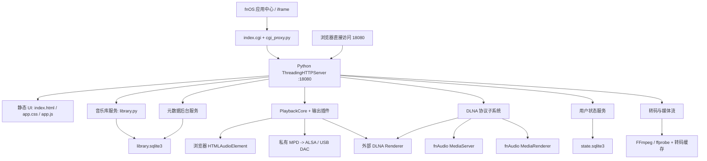

# fnAudio 项目上下文

> 生成日期：2026-08-06  
> 分析范围：`E:\Codex` 工作区，重点为 `E:\Codex\fnaudio-0.1.7`  
> 当前可识别发布版本：`0.1.148`  
> 文档目的：为后续开发、排障、测试和发布提供可复用上下文

## 1. 分析范围与结论

- `E:\Codex` 不是 Git 仓库，工作区内没有 `.git`，无法通过提交历史判断文件来源、变更归属和发布对应关系。
- 当前应继续开发的源码是 `fnaudio-0.1.7/`。目录名仍为 `0.1.7`，但 `manifest`、更新文档和前端资源所反映的当前版本是 `0.1.148`。
- `fnaudio/` 是约 `0.1.2` 的旧版；`fnaudio-0.1.3/` 至 `fnaudio-0.1.6/`、根目录 `builds/` 及多个打包暂存目录均属于历史材料，不应直接作为当前源码修改。
- 本项目是面向 fnOS 的本地音乐库和多目标播放器。它不是纯前端网页，也不是单一 DLNA 控制器，而是同时承担音乐库、媒体流、转码、本机播放、DLNA Control Point、MediaServer 和 MediaRenderer 等职责。
- 本次分析没有修改任何现有代码或配置；仅新增本文档。

## 2. 项目整体架构

### 2.1 技术栈

| 层级 | 实现 |
| --- | --- |
| fnOS 集成 | FPK `manifest`、`cmd/` 生命周期脚本、`config/` 权限与资源声明、`wizard/` 安装配置页 |
| Web 入口 | fnOS iframe + CGI，`app/ui/index.cgi` 调用 `cgi_proxy.py` 转发到本机服务 |
| 前端 | 原生 HTML、CSS、JavaScript，无 npm、打包器或前端框架 |
| HTTP 服务 | Python 3.12 标准库 `ThreadingHTTPServer` |
| 音乐库与状态 | SQLite，WAL 模式；另有内存缓存和文件缓存 |
| 本机播放 | 内置 MPD 0.23.12、ALSA、`aplay`/`libasound`、FFmpeg |
| 网络播放 | UPnP/DLNA SSDP、SOAP、GENA 事件订阅、HTTP 媒体流 |
| 元数据 | Spotify、网易云音乐、QQ 音乐、MusicBrainz、歌词与封面后台任务 |
| 发布平台 | fnOS，`manifest` 声明 `x86`，安装依赖 `python312` |

项目运行时关系：



### 2.2 分层职责

1. fnOS 包装层
   
   `manifest`、`cmd/`、`config/` 和 `wizard/` 负责安装、升级、配置、启动、停止、卸载、端口和共享目录授权。

2. 入口与代理层
   
   fnOS 通过 `/cgi/ThirdParty/fnaudio/index.cgi/` 打开应用。CGI 代理读取服务端口，并把 fnOS token 转发给本机 Python 服务，用于调用 fnOS 共享目录 API。Python 服务本身默认监听 `0.0.0.0:18080`。

3. 前端交互层
   
   `app/ui/app.js` 维护页面状态、列表浏览、播放队列、播放目标、收藏、歌单、设置、歌词、分享和文件操作。浏览器播放由 `<audio>`/Media Session 完成，远端或本机设备通过统一播放 API 控制。

4. HTTP 编排层
   
   `app/server/server.py` 提供静态文件、JSON API、媒体流、DLNA 描述与 SOAP 路由，并初始化 MPD、元数据、播放核心、SSDP、MediaServer 和 Renderer。

5. 领域服务层
   
   `library.py`、`metadata_service.py`、`state_store.py`、`transcode.py` 分别处理音乐库、外部元数据、用户状态和媒体转码。

6. 播放与协议适配层
   
   `playback/` 用统一的 `PlaybackCore` 和输出插件隔离浏览器、MPD、ALSA、DLNA 推送；`dlna/` 单独实现发现、控制、服务端、渲染器和事件订阅。

### 2.3 关键数据流

音乐库扫描：

```text
配置中的一个或多个音乐目录
  -> os.walk 生成文件签名
  -> 解析音频信息、Tag、封面和 CUE
  -> library.sqlite3 中的 tracks / albums / artists / composers / genres / folders
  -> 分页查询 API
  -> 前端列表或 DLNA ContentDirectory
```

播放：

```text
前端或外部 DLNA 控制器
  -> PlaybackCore 队列和播放状态
  -> browser: 返回媒体 URL，由浏览器播放
  -> mpd/alsa: 私有 MPD 或 FFmpeg + ALSA 输出到 NAS 声卡/USB DAC
  -> dlna_push: SOAP 推送给外部 Renderer
  -> dlna_renderer: 接收外部控制器命令，并把会话同步回 PlaybackCore/UI
```

状态同步：

```text
浏览器 localStorage 兼容数据
  <-> /api/state/user + revision 冲突检测
  <-> state.sqlite3
  -> 收藏、歌单、队列、当前曲目、循环、随机、目标和表格偏好
```

## 3. 目录作用

### 3.1 `E:\Codex` 工作区顶层

| 目录 | 作用与状态 |
| --- | --- |
| `$inspect/` | 单个 FPK 或归档的检查产物。不是运行时源码。 |
| `2026-07-24/` | 历史 FPK 解包、对比和验证工作区。 |
| `2026-08-05/` | 当前为空的日期工作目录。 |
| `android-sdk/` | 本机 Android SDK，用于早期 Android 壳实验。 |
| `android-sdk-tmp/` | Android SDK 临时目录，当前为空。 |
| `builds/` | `0.1.1` 到 `0.1.148` 的大量历史快照、打包目录和检查产物；体积大，不是唯一可信源码。 |
| `fnaudio/` | 旧版约 `0.1.2` 源码。 |
| `fnaudio-0.1.3/` | 早期播放架构拆分阶段源码。 |
| `fnaudio-0.1.4/` | 历史阶段源码。 |
| `fnaudio-0.1.5/` | 历史阶段源码。 |
| `fnaudio-0.1.6/` | 历史阶段源码。 |
| `fnaudio-0.1.7/` | 当前活跃源码，实际版本 `0.1.148`。 |
| `fnaudio-android-shell/` | Android WebView/MediaSession 试验壳，不属于当前 fnOS 主应用。 |
| `fnaudio-pack-stage-*/` | 旧版本 FPK 暂存结构，用于历史打包。 |
| `fnOS Skill/` | fnOS API、CLI 和开发流程参考材料，不进入产品运行时。 |
| `references/` | Volumio、moOde、MPD、upmpdcli 等第三方参考源码，只用于研究。 |
| `tmp-fnaudio-fpk-*/` | FPK 解包和验证目录。 |

根目录的 `.fpk`、`fnpack.exe`、Android SDK 压缩包和预览资源均为工具或构建产物，不是当前应用源文件。

### 3.2 当前源码 `fnaudio-0.1.7/`

| 目录 | 作用与状态 |
| --- | --- |
| `app/` | FPK 安装后的主要应用负载。 |
| `app/bin/` | 预留的应用二进制目录，当前没有实质内容。 |
| `app/server/` | Python 后端源码。 |
| `app/server/playback/` | 播放状态机、数据模型、插件注册表、Browser/DLNA/ALSA/MPD 输出适配。 |
| `app/server/dlna/` | SSDP、Control Point、MediaServer、MediaRenderer、SOAP、GENA 订阅、能力 profile 和诊断。 |
| `app/server/services/` | MPD 生命周期、配置生成、进程监督和空闲事件监听。 |
| `app/server/__pycache__/` | Python 自动生成缓存，不应纳入源码或发布管理。 |
| `app/target/bin/` | 随包提供的 MPD 可执行文件。 |
| `app/target/lib/` | MPD 运行所需的动态库。 |
| `app/ui/` | `index.html`、`app.css`、`app.js`、图标、CGI 入口和代理。 |
| `app/www/` | 空的历史或兼容占位目录。 |
| `builds/` | 当前源码目录内部的少量历史 UI 构建和检查快照，也不是运行时源码。 |
| `cmd/` | fnOS 安装、升级、配置、启动、停止、状态检查和卸载脚本。 |
| `config/` | fnOS 权限和资源声明；当前声明 root 运行、两个 data-share 和 `trim.file.sharedAccess` API scope。 |
| `tests/` | Python `unittest` 后端测试，以及若干人工 UI 检查截图和 DOM 记录。截图本身不是自动化测试。 |
| `transcode/` | 遗留的本地缓存种子目录。其中 `library.json` 指向旧 `0.1.6` Windows 路径，不应视为有效运行数据。 |
| `wizard/` | fnOS 安装、配置和卸载向导定义。 |

### 3.3 后端核心文件

| 文件 | 职责 |
| --- | --- |
| `app/server/server.py` | HTTP 路由、静态资源、媒体流、服务初始化和跨模块编排。约 1660 行。 |
| `app/server/library.py` | 扫描、Tag、封面、CUE、SQLite schema、分页、分组、文件夹和增量聚合。约 2001 行。 |
| `app/server/metadata_service.py` | 元数据提供商、匹配评分、任务队列、歌词、封面下载、缓存回收。约 914 行。 |
| `app/server/state_store.py` | 收藏、歌单、播放会话、UI 偏好和 revision 并发控制。 |
| `app/server/transcode.py` | 播放策略、FFmpeg 查找、MP3/DSD/CUE 转码、缓存预热和清理。 |
| `app/server/config.py` | 配置默认值、读写、端口范围约束、代理和 manifest 端口更新。 |
| `app/server/fnos_api.py` | 通过 fnOS Unix socket 调用共享目录授权 API。 |
| `app/server/alsa_player.py` | 独立 ALSA 播放辅助入口。 |
| `app/ui/app.js` | 前端全部状态、DOM、API、播放器和设置逻辑。约 4093 行。 |
| `app/ui/app.css` | 全部桌面和移动端样式。约 1277 行。 |

## 4. 已实现功能

### 4.1 音乐库与媒体解析

- 支持一个或多个 fnOS 音乐目录，并能同步系统共享目录授权。
- 支持后台扫描、扫描进度、错误记录、SQLite 索引和定时变化检查。
- 支持 FLAC、MP3、M4A、AAC、OGG、Opus、WAV、AIFF/AIF、WMA、DSF、DFF 和 CUE；项目文档已明确放弃 APE。
- 解析 ID3、Vorbis/FLAC、MP4/M4A 等元数据，并读取内嵌或同目录封面。
- 支持 CUE 虚拟分轨、分段时长、封面和按分轨转码。
- 提供全部音乐、DSD、文件夹、专辑、歌手、作曲者、类型、最近添加、随机 100 等视图。
- 提供搜索、分页、排序、列显示和列宽偏好。
- 可查询曲目实际位置、文件详情，并调用 fnOS 能力打开所在目录或创建分享链接。

### 4.2 播放与队列

- 统一 `PlaybackCore` 管理队列、当前曲目、播放目标、进度、循环和随机。
- 浏览器本地播放使用 HTML audio，并接入 Web Media Session。
- 本机播放支持内置 MPD、ALSA/USB DAC 设备发现、输出能力探测和播放状态。
- 支持发现外部 DLNA Renderer，并主动推送媒体和发送 Play/Pause/Stop/Seek/Next/Previous。
- 支持播放、暂停、停止、上一首、下一首、seek、循环和随机。
- 仍保留旧 player、UPnP 和 DAC API 作为兼容入口，内部主要转发到统一播放核心。

### 4.3 DLNA

- fnAudio 可作为 DLNA Control Point 搜索和控制其他 Renderer。
- fnAudio 可作为 MediaServer，通过 ContentDirectory 暴露音乐、专辑、歌手、类型和多根目录文件夹。
- fnAudio 可作为 MediaRenderer，接受外部控制器的 AVTransport 和 RenderingControl 命令。
- 支持 SSDP alive/byebye、M-SEARCH、设备描述、SCPD、SOAP、DIDL-Lite、SUBSCRIBE/UNSUBSCRIBE 和异步事件通知。
- 支持 `SetNextAVTransportURI`、连续队列、入站元数据和封面信息，并将 Renderer 会话同步到统一播放状态。
- MediaServer 同时提供原始资源和显式 MP3 fallback 资源。

### 4.4 转码与交付

- 非 MP3 的外网或手动请求可转 MP3。
- DSF/DFF 可转 96 kHz、24 bit WAV，用于浏览器、DLNA 或 DAC 兼容播放。
- CUE 虚拟分轨可转独立 FLAC 片段。
- 支持 Range/流式媒体响应、缓存预热、状态查询和两天缓存淘汰。
- FFmpeg/ffprobe 优先使用 fnOS 系统路径，未随项目单独内置。

### 4.5 元数据、歌词和用户状态

- 本地歌词、网易云歌词和 QQ 音乐歌词查询。
- Spotify、网易云、QQ 音乐、MusicBrainz 的专辑/歌手元数据和封面后台任务。
- 提供正缓存、负缓存、过期重试、孤儿实体宽限期和未完成任务恢复。
- 收藏、自建歌单、当前队列、播放会话和表格偏好持久化到 NAS 端 SQLite。
- 通过 revision 检测多窗口或多端写入冲突，并保留 localStorage 首次迁移与离线兼容。

### 4.6 fnOS 生命周期

- 提供安装、升级、配置、启动、停止、状态检查和卸载逻辑。
- 安装时校验或自动选择端口，并同步 `manifest` 与 UI 代理端口。
- 支持保留数据卸载和清除应用配置/缓存两种卸载模式，不删除用户音乐文件。
- 声明 `python312` 依赖、共享目录和 fnOS 文件授权 API scope。

## 5. 未完成或尚未充分验证的功能

以下内容能从阶段文档或实现状态直接判断：

| 状态 | 项目 |
| --- | --- |
| 未完成 | 尚未根据真实互操作问题添加设备专用 MediaServer profile。当前 `profiles.py` 只有通用能力策略。 |
| 待真机验证 | 尚未在真实飞牛移动端 WebView 验证前后台切换、收藏/队列同步和恢复后的播放状态。 |
| 待样本验证 | WAV、DFF 尚无对应真机音乐样本验证；DSF 已有验证记录。 |
| 当前不可用 | 硬件音量控制依赖 `amixer`，阶段记录显示真机没有安装，因此 Mixer 控制不可用，但不阻塞 MPD 播放。 |
| 待发布验证 | `python312` 依赖、发布者字段以及完整应用中心安装/升级/卸载效果仍有“待打包安装确认”记录。 |
| 仅探测 | `dlna/upmpdcli_renderer.py` 只检测二进制、版本和进程状态，不是可选 upmpdcli 播放后端。 |
| 试验项目 | `fnaudio-android-shell/` 仍为早期壳：默认地址硬编码为 `198.51.100.62:5666`，版本为 `0.1-test`，缺少 Gradle 工程文件；当前 `build/unsigned-with-dex.apk` 只有 22 字节，不能视为有效成品。 |

另外，代码“已经存在”不等于生产环境“已经验证”。本次只执行了本地单元测试和语法检查，没有重新验证真实 fnOS、USB DAC、MPD 进程、不同 DLNA 客户端、外部元数据服务和移动 WebView。

## 6. 存在的问题和技术债

### P0：先确认和收紧安全边界

1. HTTP API 缺少统一鉴权
   
   服务默认绑定 `0.0.0.0`，多数读写 API、播放控制和媒体流没有登录或权限校验。`trim_api_token()` 主要用于代调用 fnOS 授权接口，不是后端 API 的访问控制。若 fnOS 防火墙没有隔离 18080，局域网中可直连该端口的客户端可能绕过 CGI 入口。

2. 进程权限过高
   
   `config/privilege` 声明 `run-as: root`。服务同时拥有目录配置、文件位置查询、共享授权、媒体读取、进程启动和网络访问能力，任何输入校验问题都会被 root 权限放大。

3. 信息与控制面暴露
   
   `/api/library/location` 可返回真实 NAS 路径；配置写入、共享目录同步/删除、播放控制和媒体端点都在同一服务上。应先建立用户/会话身份和操作级授权，再决定哪些信息可对前端公开。

4. 服务端请求目标缺少充分限制
   
   DLNA 发现会抓取设备 `LOCATION`，事件订阅会向客户端提供的 `CALLBACK` 发起 HTTP 请求。当前只做基本 URL 形状校验，建议限制为 HTTP、局域网地址、合理端口和已发现设备，防止 SSRF 或访问本机敏感服务。

### P1：影响可靠性、可维护性和发布质量

1. 工作区和发布不可追溯
   
   没有 Git、根 README、LICENSE、`.gitignore`、CI、依赖声明或统一构建脚本。历史源码、FPK、解包目录和参考仓库混在同一工作区；`fnaudio-0.1.7/` 内也包含构建快照。无法可靠证明某个 FPK 对应哪份源码。

2. 核心文件过大
   
   `app.js` 约 4093 行，`library.py` 约 2001 行，`server.py` 约 1660 行。前端把状态、DOM、API、播放器、设置、分享混在单文件中；后端入口仍集中承担大量路由和服务编排。

3. 自动化测试覆盖存在明显空白
   
   现有 49 个测试集中在 Python 单元层，没有前端单元测试/E2E、HTTP 路由集成测试、安装/升级/卸载测试，也没有真实媒体流水线、私有 MPD、USB DAC 和多厂商 DLNA 兼容回归。

4. 增量扫描仍是目录全量复杂度
   
   变化检测仍会遍历全部音乐目录并构造、排序完整签名；检测到变化后还会加载大量现有 SQLite 项目再做比对。大音乐库的刷新仍接近 O(n)，不是基于文件事件或变更目录的真正增量扫描。

5. 用户状态冲突合并语义不完整
   
   前端收到 409 后会对收藏做集合并集，并让本地同 ID 歌单覆盖远端歌单。并发删除可能被旧客户端重新加入，歌单的同时编辑也可能丢失。保存进行中发生的新修改没有明确的 dirty/retry 队列保证。

6. 可观测性不足
   
   `Handler.log_message()` 被完全关闭，大量宽泛 `except Exception` 静默降级。日志散落在 stdout、`${TRIM_PKGVAR}/info.log`、MPD 日志和 `/var/log/apps/fnaudio.log`，缺少结构化字段、请求 ID、错误分类、延迟和资源指标。

7. 并发和资源没有统一上限
   
   `ThreadingHTTPServer` 为请求创建线程，FFmpeg 预热/流式转码和 DLNA 事件通知也会创建后台线程；没有全局任务队列、转码并发限制或请求限流。并发媒体请求可能耗尽 CPU、内存、文件句柄或线程。

8. 凭据落盘
   
   Spotify client secret 会明文写入 `config.json`。API 状态响应已有测试确保不回传 secret，但脚本未显式设置配置文件权限，也没有凭据轮换和统一日志脱敏机制。

### P2：一致性和清理项

1. 版本漂移
   
   `manifest` 是 `0.1.148`，但 `server.py` 的 `server_version` 仍为 `fnAudio/0.1.14`，多个 User-Agent、SSDP SERVER 和 model 字段仍写 `0.1`。旧开发文档还引用过时的 Windows 路径和阶段状态。

2. 源码存在乱码提示
   
   `playback/alsa_output.py` 和 `services/mpd_service.py` 中有已写入源码的乱码中文错误消息，会直接影响故障提示和诊断质量。

3. 重复和遗留代码
   
   `library.py` 重复定义 `safe_float`；`server.py` 与 `library.py` 重复路径规范化/白名单逻辑；`trim_api_token()` 有不可达的第二个 `return None`；设备 payload 同一字典重复写入 `name`，前一个值会被覆盖。`browser_output.py` 和 `dlna_push_output.py` 只做重新导出，旧兼容 API 仍长期保留。

4. DLNA 只实现常用子集
   
   `GetSystemUpdateID` 固定返回 `1`，`BrowseFlag`、`Filter` 和 `SortCriteria` 等参数没有完整语义；互操作诊断只保留有限内存快照，重启后丢失；设备专用 profile 尚未完成。

5. 生成物污染源码目录
   
   `__pycache__/`、测试截图、内部 `builds/` 和 `transcode/library.json` 与源码并置。后者还保存旧 `0.1.6` Windows 绝对路径，容易误导后续开发或被误打包。

## 7. 测试与验证现状

本次分析期间已完成：

```powershell
python -B -m unittest discover -s tests -v
```

- 结果：49 个测试全部通过，约 0.9 秒。
- 覆盖：ALSA 能力、配置、DLNA 诊断与协议、音乐库缓存和 SQLite、元数据服务、状态存储、转码缓存。
- `node --check app/ui/app.js` 通过。
- 使用 Python AST 解析 38 个 Python 文件，全部通过。

未覆盖：

- 浏览器 UI 单元测试和 E2E。
- 完整 HTTP 路由、权限边界、Range/媒体流集成测试。
- fnOS FPK 安装、升级、配置、停止和卸载自动化。
- 真正启动内置 MPD、FFmpeg 流、USB DAC 的端到端测试。
- 多厂商 DLNA 控制器/Renderer/MediaServer 兼容矩阵。
- Spotify、网易、QQ 和 MusicBrainz 的稳定网络集成测试。

## 8. 下一步开发建议

### 第一阶段：建立可信基线

1. 把 `fnaudio-0.1.7/` 提取为独立 Git 仓库，补充 `.gitignore`、根 README、LICENSE 和明确版本策略。
2. 明确 `0.1.148` 的唯一源码和可复现 FPK 构建流程，校验包内文件清单、版本和哈希。
3. 将历史 `builds/`、旧版本、解包目录、第三方参考和 Android SDK 移出源码仓库或转为只读归档。
4. 保留当前 49 个测试作为迁移基线，新增最小 HTTP smoke test 和 FPK 包结构检查。

### 第二阶段：先处理安全

1. 核实 fnOS 是否只允许通过 CGI/应用代理访问 18080；在结论明确前，把直连端口视为未授权入口。
2. 为非 DLNA API 增加统一认证和授权中间层，区分只读库访问、播放控制、设置、共享目录和文件操作。
3. 优先绑定回环地址，或配置 fnOS 防火墙；DLNA 所需的媒体 URL 和协议监听应与管理 API 分离考虑。
4. 收紧 `LOCATION`、`CALLBACK` 和外部媒体 URI：限制协议、LAN 网段、端口、重定向和响应大小。
5. 降低进程权限；若必须 root，至少拆出最小权限辅助进程，并约束配置和缓存文件权限。

### 第三阶段：提高稳定性和可观测性

1. 引入统一结构化日志，恢复访问日志但避免敏感信息，增加请求 ID、任务 ID 和明确错误码。
2. 为扫描、元数据、转码和 DLNA 通知建立有界任务队列，并设置并发、超时、取消和缓存配额。
3. 修复乱码提示、版本漂移、重复函数、重复字典键和不可达代码。
4. 改进状态保存协议，采用操作日志、实体版本或明确的三方合并，正确处理删除和同一歌单并发编辑。
5. 对超大音乐库做基准测试，再决定采用 inotify/目录级签名、变更日志或分片扫描。

### 第四阶段：拆分模块并补齐测试

1. 将 `server.py` 拆为路由、应用服务和启动装配；保持现有 API 契约不变。
2. 将 `library.py` 拆为扫描器、元数据解析、仓储、查询和文件夹索引。
3. 将 `app.js` 拆为 API client、store、library views、player、state sync、settings 和 dialogs；引入轻量模块化即可，不必立即更换框架。
4. 增加前端 E2E、HTTP 集成、媒体 Range、转码并发、状态冲突、安装升级和 DLNA 协议回归。

### 第五阶段：完成真机验收

1. 补充 WAV、DFF 和高规格 PCM 样本，验证解码、seek、时长、封面和输出格式。
2. 在真实飞牛移动 WebView 验证前后台、Media Session、收藏/队列同步和恢复。
3. 建立常见 DLNA 客户端/Renderer 互操作矩阵，只有捕获到真实差异后再添加设备 profile。
4. 完成应用中心全新安装、覆盖升级、改端口、停止残留进程、保留数据卸载和清除数据卸载验收。

## 9. 后续接手约定

- 默认工作目录：`E:\Codex\fnaudio-0.1.7`。
- 当前发布版本以 `manifest` 的 `0.1.148` 为准，不以目录名 `0.1.7` 为准。
- 不要直接从根 `builds/`、旧版本目录或 FPK 解包目录复制文件到当前源码；先确认来源、差异和目标版本。
- 修改播放逻辑时，保持 `PlaybackCore -> output plugin` 边界，不要把 SOAP、ALSA 或 FFmpeg 细节重新放回前端。
- 修改音乐库 schema、Tag、封面或 CUE 解析时，同步评估 `METADATA_VERSION`、迁移、索引重建和大库性能。
- 修改用户状态时，必须覆盖多窗口 revision 冲突、删除语义、保存进行中再次修改和应用重启恢复。
- 修改 DLNA 时，先保留互操作 trace，再基于真实客户端行为添加兼容分支。
- 不应提交或打包 `__pycache__`、测试截图、旧 FPK、历史 builds、本地 SDK、凭据或带绝对路径的缓存文件。

常用只读或验证命令：

```powershell
# 后端单元测试
python -B -m unittest discover -s tests -v

# 前端语法
node --check app/ui/app.js

# 查找阶段文档中的未完成项
rg -n '\[ \]|TODO|待验证|未完成' *.md app tests

# 确认发布版本和端口
Get-Content manifest -Encoding UTF8
```

涉及 MPD、FFmpeg、ALSA、fnOS API、真实目录权限、SSDP 或 DLNA 的结果，必须在 fnOS 真机环境再次验证，不能只依据 Windows 本地测试判定完成。
